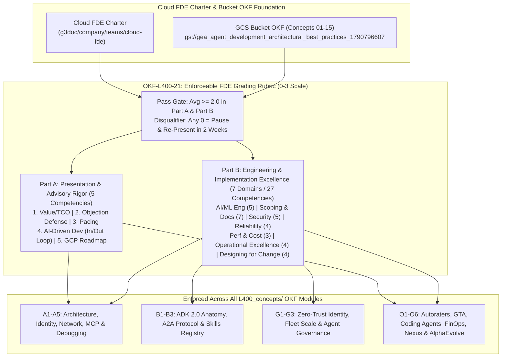

# 21: Enforceable FDE Field-Readiness & Project Grading Rubric Standard (`OKF-L400-21` | `L400_version_20261026_0350`) — Google Cloud OKF Specification
**Topic Tags:** `#L400_version_20261026_0350` `#FDEGradingRubric` `#FieldReadinessStandard` `#CloudFDECharter` `#PresentationAndAdvisoryRigor` `#EngineeringAndImplementationExcellence` `#AntigravityHarnessGovernance`

---

## 0. OKF Document Metadata, Trust Signals & Topic Modeling Taxonomy
**Topic Tags:** `#L400_version_20261026_0350` `#OKFMetadata` `#TrustSignals` `#TopicModeling` `#CloudFDECharter`

### 0.1 OKF v0.2 Trust Signals & Catalog Metadata (Maintaining Existing TTL & Version)
**Topic Tags:** `#L400_version_20261026_0350` `#OKFMetadata` `#TrustSignals` `#BucketOKFMerge`

| OKF Field | Value |
| :--- | :--- |
| **Document ID** | `OKF-L400-21` |
| **OKF Version Tag** | `L400_version_20261026_0350` (compatible with bucket `GEAPL300` / `v0.2` bundle schema) |
| **Trust Status (`status`)** | `stable` (`VETTED` / `APPROVED` for Production & Panel Enforcement) |
| **TTL Expiration (`stale_after`)** | `2027-04-26T00:00:00Z` *(Maintains existing 6-month RFC3339 TTL window)* |
| **Verified Scope (`verified`)** | `true` — Enforced across all 17 L400 Modules (`A1`–`O6`), Cross-KB Syntheses (`00`, `18`–`20`), and Merged Bucket Concepts (`Concepts 01–15`) |
| **Upstream Bucket Merge Source** | `gs://gea_agent_development_architectural_best_practices_1790796607` (`project=fivedaysai-prd-sandbox-317383`) |
| **Cloud FDE Charter Reference** | `https://g3doc.corp.google.com/company/teams/cloud-fde/index.md?cl=head` |
| **Target Personas** | Forward Deployed Engineers (FDEs), Noogler FDE Candidates, Review Panelists, Principal Cloud Architects, and Antigravity Autonomous Coding Agents |

### 0.2 Primary Topic Tags (6 Overarching Domain Themes)
**Topic Tags:** `#L400_version_20261026_0350` `#FDEGradingRubric` `#PresentationAndAdvisoryRigor` `#EngineeringAndImplementationExcellence` `#AntigravityHarnessGovernance` `#BucketOKFMerge` `#CloudFDECharter`

1. **`#FDEGradingRubric`**: The mandatory 0–3 competency evaluation framework (`0 - Not Demonstrated`, `1 - Awareness`, `2 - Competent [Pass]`, `3 - Proficient [Strong Pass]`) and pass/pause governance gate required for FDE field readiness and production application sign-off.
2. **`#PresentationAndAdvisoryRigor`**: Part A evaluation pillar measuring an FDE's ability to connect technical architecture to commercial business reality (CUJs + TCO), defend architectural trade-offs under executive pushback, manage panel pacing with intellectual honesty, articulate "In-the-Loop" vs. "Outside-the-Loop" AI-driven development harnesses, and present a GCP-native production roadmap.
3. **`#EngineeringAndImplementationExcellence`**: Part B evaluation pillar spanning 7 technical domains and 32 concrete competencies across AI/ML Engineering, Scoping & Documentation, Security/Privacy/Compliance, Reliability & Resilience, Performance & Cost Optimization, Operational Excellence, and Designing for Change.
4. **`#AntigravityHarnessGovernance`**: Closed-loop AI-driven development discipline combining pre-coding harness configuration, interactive "In-the-Loop" spec fixes, autonomous "Outside-the-Loop" goal-driven lint/test autoloops, and continuous incorporation of agent/harness mistakes back into `SKILL.md` and system instructions.
5. **`#BucketOKFMerge`**: Unified reconciliation of the 15 foundational OKF concepts from `gs://gea_agent_development_architectural_best_practices_1790796607` (`Concepts 01–15`) with the 17 L400 deep-dive modules (`A1`–`O6`), preserving existing `stale_after` TTLs and version tags.
6. **`#CloudFDECharter`**: Alignment with the Google Cloud Forward Deployed Engineering operating model (`g3doc.corp.google.com/company/teams/cloud-fde/index.md?cl=head`), bridging rapid customer-facing prototyping with hardened, production-grade Google Cloud engineering and prevailing customer best practices.

### 0.3 Secondary Tags / Related Topics (Capabilities, Outcomes & Impacts)
**Topic Tags:** `#L400_version_20261026_0350` `#ZeroScorePauseGate` `#CUJAndTCOJustification` `#InTheLoopVsOutsideTheLoop` `#BeyondLLMAsAJudge` `#ADRAndContractFirstDesign` `#PrevailingCustomerBestPractices`

1. **`#ZeroScorePauseGate`** *(Type: Governance Mechanism)*: Mandatory quality gate requiring an average score $\ge 2.0$ across both Part A and Part B, where scoring `0 (Not Demonstrated)` on any single competency triggers an immediate pause, gap remediation, and re-presentation within 2 weeks.
2. **`#CUJAndTCOJustification`** *(Type: Advisory Capability)*: Framing every architectural decision around Critical User Journeys (CUJs), "Definition of Done", and a 16-line Total Cost of Ownership (TCO) ledger to prevent "science projects."
3. **`#InTheLoopVsOutsideTheLoop`** *(Type: Engineering Capability)*: Dual-mode AI development combining interactive "In-the-Loop" feature refinements with autonomous "Outside-the-Loop" goal-mode verification loops (lint $\rightarrow$ unit test $\rightarrow$ eval gate) and post-mortem rule updates.
4. **`#BeyondLLMAsAJudge`** *(Type: Evaluation Outcome)*: Combining calibrated LLM autoraters with deterministic code/schema verifiers, retrieval precision/recall, faithfulness, coherence, and BLEU/ROUGE where applicable.
5. **`#ADRAndContractFirstDesign`** *(Type: Documentation Impact)*: Producing formal Architecture Decision Records (ADRs), OpenAPI/A2A/MCP wire contracts, C4/Mermaid sequence diagrams, and operational runbooks before and during build.
6. **`#PrevailingCustomerBestPractices`** *(Type: Operational Impact)*: Grounding every design pattern in proven Cloud-FDE customer deployments (`g3doc/company/teams/cloud-fde`) across regulated financial, healthcare, retail, telco, and public-sector workloads.

### 0.4 Topic Taxonomy Matrix & Cross-KB Connection Graph
**Topic Tags:** `#L400_version_20261026_0350` `#FDEGradingRubric` `#TopicTaxonomyMatrix` `#TopicFlowGraph`

| Secondary Tag | Type | Associated Primary Topic(s) | Primary Benefit / Architectural Function |
| :--- | :--- | :--- | :--- |
| **`#ZeroScorePauseGate`** | Governance | `#FDEGradingRubric`, `#CloudFDECharter` | Prevents unvetted prototypes with single-point security, cost, or reliability gaps from reaching customer production. |
| **`#CUJAndTCOJustification`** | Capability | `#PresentationAndAdvisoryRigor`, `#CloudFDECharter` | Connects technical architecture directly to commercial ROI and prevents ungrounded "science projects." |
| **`#InTheLoopVsOutsideTheLoop`** | Capability | `#AntigravityHarnessGovernance`, `#PresentationAndAdvisoryRigor` | Accelerates engineering velocity via pre-configured Antigravity harnesses and self-improving instruction loops. |
| **`#BeyondLLMAsAJudge`** | Outcome | `#EngineeringAndImplementationExcellence` | Guarantees statistically rigorous LLM Ops evaluation using deterministic + calibrated rubric metrics. |
| **`#ADRAndContractFirstDesign`** | Impact | `#EngineeringAndImplementationExcellence`, `#BucketOKFMerge` | Enforces modularity, model swappability, and auditable trade-off documentation across all 21 OKF modules. |
| **`#PrevailingCustomerBestPractices`** | Impact | `#CloudFDECharter`, `#BucketOKFMerge` | Anchors every L300/L400 pattern in battle-tested enterprise reference deployments. |



---

## 1. Executive Overview, Cloud FDE Charter (`g3doc/company/teams/cloud-fde`) & Scoring Governance
**Topic Tags:** `#L400_version_20261026_0350` `#FDEGradingRubric` `#CloudFDECharter` `#ZeroScorePauseGate`

### 1.1 The Cloud FDE Role & Operating Charter
**Topic Tags:** `#L400_version_20261026_0350` `#CloudFDECharter` `#PresentationAndAdvisoryRigor` `#EngineeringAndImplementationExcellence`

As defined in the **Google Cloud Forward Deployed Engineering (Cloud FDE) Charter** (`https://g3doc.corp.google.com/company/teams/cloud-fde/index.md?cl=head`), a Forward Deployed Engineer bridges the gap between **how we build production-grade Agentic AI systems** and **how we convey, defend, and land those systems with enterprise customers**. Every application, agent, MCP server, or skill built using this OKF Knowledge Catalog must simultaneously satisfy:
1. **Section 1 (Part A): Presentation & Advisory Rigor** — Commercial framing around Critical User Journeys (CUJs), TCO fiscal responsibility, calm data-backed objection handling, disciplined time management, mastery of AI-driven development harnesses ("In-the-Loop" and "Outside-the-Loop"), and a progressive GCP-native production roadmap.
2. **Section 2 (Part B): Engineering & Implementation Excellence** — Production-grade engineering across AI/ML Engineering, Scoping & Documentation, Security/Privacy/Compliance, Reliability & Resilience, Performance & Cost Optimization, Operational Excellence, and Designing for Change.

### 1.2 The Official 0–3 Grading Scale & Pass/Pause Rules
**Topic Tags:** `#L400_version_20261026_0350` `#FDEGradingRubric` `#ZeroScorePauseGate`

| Score | Level | Official Definition | Panel Outcome & Action Required |
| :---: | :--- | :--- | :--- |
| **`0`** | **Not Demonstrated** | The Noogler/Engineer missed the mark, ignored the requirement, or could not answer basic questions. *(Growth Opportunity)* | **IMMEDIATE PAUSE (Automatic Disqualifier)**: Scoring a `0` on **any single metric** requires hitting pause, addressing the specific architectural/delivery gaps, and **re-presenting to the panel within two weeks**. |
| **`1`** | **Awareness** | The Noogler/Engineer understands the concept theoretically but struggles to apply it practically or misses critical edge cases. *(Needs Additional Coaching)* | **Below Field-Ready Bar**: Must be offset by higher scores to maintain a $\ge 2.0$ section average, with targeted manager coaching assigned. |
| **`2`** | **Competent** | The Noogler/Engineer articulates a solid approach, understands trade-offs, and meets the expectations of a Field-Ready FDE. *(Pass)* | **Field-Ready Standard (Pass)**: Required baseline average ($\ge 2.0$) independently across **both** Section 1 (Part A) and Section 2 (Part B). |
| **`3`** | **Proficient** | The Noogler/Engineer demonstrates deep, production-level expertise, anticipates complex failure modes, and teaches the panel something new. *(Strong Pass)* | **L400 Exemplar (Strong Pass)**: Demonstrates mastery of edge cases, internal mechanics, and novel customer optimizations. |

```
+--------------------------------------------------------------------------------------------------+
|                        FDE FIELD-READINESS PANEL GATING DECISION FLOW                            |
+--------------------------------------------------------------------------------------------------+
|                                                                                                  |
|   [Evaluate Part A (5 Competencies)]               [Evaluate Part B (27 Competencies)]           |
|                  |                                                  |                            |
|                  +------------------------+-------------------------+                            |
|                                           |                                                      |
|                                           v                                                      |
|                        +-------------------------------------+                                   |
|                        | Did ANY single metric score 0       |                                   |
|                        | ("Not Demonstrated")?               |                                   |
|                        +------------------+------------------+                                   |
|                                           |                                                      |
|                     YES                   |                   NO                                 |
|                      +--------------------+--------------------+                                 |
|                      |                                         |                                 |
|                      v                                         v                                 |
|     +----------------------------------+     +----------------------------------+                |
|     | AUTOMATIC PAUSE GATE TRIGGERED   |     | Check Section Averages:          |                |
|     | • Hit pause on field readiness   |     | • Part A Average >= 2.0?         |                |
|     | • Remediate specific gap(s)      |     | • Part B Average >= 2.0?         |                |
|     | • Re-present within 2 weeks      |     +-----------------+----------------+                |
|     +----------------------------------+                       |                                 |
|                                                  YES           |           NO                    |
|                                                   +------------+------------+                    |
|                                                   |                         |                    |
|                                                   v                         v                    |
|                                      +-------------------------+ +-------------------------+     |
|                                      | PASS: FIELD-READY FDE   | | COACHING & REMEDIATION  |     |
|                                      | (Avg >= 2.0; Strong     | | Raise sub-2.0 section   |     |
|                                      |  Pass at Avg >= 2.5+)   | | average to >= 2.0       |     |
|                                      +-------------------------+ +-------------------------+     |
+--------------------------------------------------------------------------------------------------+
```

---

## 2. Part A: Presentation & Advisory Rigor (5 Core Competencies)
**Topic Tags:** `#L400_version_20261026_0350` `#PresentationAndAdvisoryRigor` `#CUJAndTCOJustification` `#InTheLoopVsOutsideTheLoop`

### 2.1 Part A Competency Matrix (Levels 0, 1, 2, and 3)
**Topic Tags:** `#L400_version_20261026_0350` `#PresentationAndAdvisoryRigor` `#FDEGradingRubric`

| Competency Area | Assessment Focus | `0 - Not Demonstrated` (Pause Trigger) | `1 - Awareness` | `2 - Competent` (Pass — Field-Ready Bar) | `3 - Proficient` (Strong Pass — L400 Bar) | Authoritative L400 OKF Modules |
| :--- | :--- | :--- | :--- | :--- | :--- | :--- |
| **A.1 Strategic Delivery & Value Articulation** | Connect technical architecture to business value & commercial reality; avoid "science projects"; present viable TCO. | Pure feature/code demo with no customer persona, no business problem, and no cost/TCO estimate. | Mentions a generic use case or rough token price, but fails to connect architecture to commercial ROI or full TCO. | Delivers a narrative-driven walkthrough framed around customer personas, CUJs, and operational impact. Explicitly justifies why the architecture solves the root business problem (avoiding a "science project") and presents a viable **TCO model** demonstrating fiscal responsibility. | Quantifies end-to-end unit economics using the **16-line GenAI TCO ledger (`O4`)**, maps CUJ latency/quality SLOs directly to customer revenue/cost KPIs, and shows a 3x+ TCO optimization path (e.g., Cymbal case study). | `O4_OKF`, `A1_OKF`, `20_OKF` |
| **A.2 Objection Handling & Technical Defense** | React to executive pushback; defend implementation choices with data-backed logic and trade-off analysis. | Becomes defensive, flustered, or dismissive; cannot justify why a model, database, or protocol was chosen. | Acknowledges trade-offs qualitatively ("Pro is smarter than Flash") without quantitative latency, cost, or accuracy data. | Remains calm, collected, and collaborative under executive pushback. Confidently defends engineering and structural choices during the Q&A matrix using **data-backed logic**, cleanly evaluating trade-offs (e.g., cost vs. latency, model tiering, indexed vs. federated). | Anticipates CISO/CFO/VP-Eng objections pre-emptively with empirical ablation data, `quadrantChart` positioning matrices, ADR citations, and live fallback demonstrations. | `A1_OKF`–`O6_OKF`, `19_OKF`, `20_OKF` |
| **A.3 Presentation Skills** | Manage time, pacing, meeting flow, rabbit holes, and intellectual honesty. | Runs out of time before showing core architecture/demo; gets trapped in tangential rabbit holes; guesses or fabricates answers. | Rushes the final sections or gives overly verbose answers without checking panel alignment. | Paces the presentation to finish on time. Tactfully steers the panel away from rabbit holes, offering to take tangential topics offline without being dismissive. Demonstrates **intellectual honesty** by confidently stating *"I don't know, but I will verify and follow up"* rather than fabricating answers. | Orchestrates executive and deep-technical tracks seamlessly, uses structured signposting tied to the rubric, and turns panel interruptions into high-signal architectural proofs. | `21_OKF`, `20_OKF` |
| **A.4 AI-Driven Development Discussion** | Demonstrate use of GenAI tools and harness concepts ("In-the-Loop" + "Outside-the-Loop") to accelerate SDLC and code quality. | Wrote code manually or used ad-hoc copy-paste chat prompts with no harness, no `SKILL.md` / rules file, and no test loop. | Used an AI IDE assistant for autocomplete, but did not configure a pre-coding harness or distinguish in-the-loop vs. outside-the-loop workflows. | Articulates how the **harness was set up before coding**. Demonstrates establishing key guidance enabling both **"In-the-Loop"** (quick feature fix adhering to spec) and **"Outside-the-Loop"** (goal-driven loop through lint, test, and eval until goal passes). Incorporates agent/harness mistakes back into agent instructions (`CLAUDE.md`/`GEMINI.md`/`SKILL.md`). | Demonstrates a full **Antigravity + ADK 2.0 + Skills Registry (`B3`, `O3`)** harness with AST/LSP indexing, sandboxed TDD verification containers (`O1`), `skills-ref` linting, and a versioned mistake-to-rule ledger showing measurable velocity and defect-reduction gains. | `O3_OKF`, `B3_OKF`, `O1_OKF`, `O6_OKF` |
| **A.5 Futures / Roadmap** | Communicate the next phase of development (scalability, performance, production features) while driving home Google Cloud value. | Has no post-prototype plan or proposes generic non-GCP tools disconnected from enterprise landing zones. | Lists high-level feature ideas ("add more agents") without addressing production scalability, security perimeters, or native GCP integration. | Articulates a clear, progressive **phased roadmap** addressing production-grade scalability, performance optimization, and customer-needed production features. Effectively demonstrates the **strategic value of Google Cloud integration** (Vertex AI, Spanner, BigQuery, VPC-SC, Model Armor, Agent Gateway, Cloud Billing/Looker Studio). | Maps Phase 1 (MVP) $\rightarrow$ Phase 2 (Canary Ring) $\rightarrow$ Phase 3 (Multi-Region GA) against **Google Production Landing Metrics** (`A1`–`O6` §5) and Progressive Deployment Rings (`Concept 12`). | `A1_OKF`, `G2_OKF`, `G3_OKF`, `20_OKF` |

### 2.2 Deep Dive on Competency A.4: The Antigravity AI-Driven Development Harness Loop
**Topic Tags:** `#L400_version_20261026_0350` `#AntigravityHarnessGovernance` `#InTheLoopVsOutsideTheLoop` `#DesignAndOptimizationOfCodingAgents`

To score **`2 - Competent`** or **`3 - Proficient`** on Competency A.4, every project built with this OKF catalog must document and demonstrate its **Three-Stage Harness Lifecycle**:
1. **Stage 1 — Pre-Coding Harness Setup (Before Writing Application Code)**:
   * Configure workspace instruction files (`GEMINI.md` / `.agent/rules`), register modular domain skills (`SKILL.md` in `GCPSkillRegistry`, `OKF-L400-B3`), attach the OKF MCP Server with scoped `tool_filter` (`Concept 03`), and wire deterministic verification scripts (`pytest`, `ruff`, `mypy`, `skills-ref`, autorater smoke suite) inside an isolated sandbox (`OKF-L400-O3`).
2. **Stage 2 — Dual-Mode Execution ("In-the-Loop" vs. "Outside-the-Loop")**:
   * **In-the-Loop Mode (Interactive Spec-Driven Iteration)**: Used for rapid UI tweaks, schema adjustments, or single-function fixes where the engineer reviews surgical diffs (`replace_file_content`) turn-by-turn against the spec.
   * **Outside-the-Loop Mode (Autonomous Goal-Driven Autoloop)**: Used for multi-file migrations, connector scaffolding, or test-suite generation where the agent takes a high-level objective and iterates autonomously through `Plan -> Surgical Edit -> Lint -> Unit/Integration Test -> Self-Correction` until all verification gates pass (`OKF-L400-O3`, `OKF-L400-A1` Spark).
3. **Stage 3 — Closed-Loop Mistake Incorporation (Post-Mortem Feedback into Instructions)**:
   * Every time the coding agent or runtime harness makes an error (e.g., using ADK 1.0 `SequentialAgent` instead of ADK 2.0 `DynamicNode` graphs, omitting parentheses in federated JQL `AND/OR` rewrites, or placing dynamic timestamps before a cached prompt prefix), the engineer codifies that failure into the **`Gotchas` section of the relevant `SKILL.md` or workspace instruction file** so the mistake can never recur.


---

## 3. Part B: Engineering & Implementation Excellence (7 Domains / 28 Competencies — Full Rubric Matrix & L400 Mapping)
**Topic Tags:** `#L400_version_20261026_0350` `#EngineeringAndImplementationExcellence` `#FDEGradingRubric` `#GoogleCloudWAF`

### 3.1 Domain 1: AI/ML Engineering (5 Competencies)
**Topic Tags:** `#L400_version_20261026_0350` `#AIMLEngineering` `#AgenticAndMultiAgentSystems` `#BeyondLLMAsAJudge`

| Competency | Assessment Focus | What `2 - Competent` (Pass) Looks Like | What `3 - Proficient` (Strong Pass — L400 Standard) Looks Like | Authoritative L400 OKF Modules |
| :--- | :--- | :--- | :--- | :--- |
| **B.1.1 Agentic & Multi-Agent Systems** | Agent orchestration patterns, tool/function calling, planning & reasoning loops, memory & state management, multi-agent coordination, cognitive architectures, legacy/external API integration. | Competent on $\ge 2$: Designs cognitive architectures & orchestration patterns aligned with CUJs; builds functional planning/reasoning loops with session memory & state management avoiding infinite loops; implements tool/function calling with legacy/external APIs respecting data boundaries & security; coordinates multi-agent interactions meeting latency SLAs and graceful error handling. | Implements **ADK 2.0 `Runner`/`App`/`DynamicNode` workflow graphs (`B1`)**, **Flattened Root-Agent Tool Pools (`A1`)**, **4-Tier State Scopes (`Temp`, `Session`, `User`, `App`)**, **3 Delegation Modes (`single_turn`, `task`, `chat`)**, and **A2A Protocol (`B2`)** with v0.3/v1.0 shims and API-first Agent Gateway registration. | `A1_OKF`, `B1_OKF`, `B2_OKF`, `B3_OKF`, `A4_OKF` |
| **B.1.2 Retrieval & Data Engineering for AI** | RAG patterns, embeddings & vector DBs, chunking/indexing strategies, hybrid search, grounding & citation, data pipelines, complex PDF/HTML table parsing. | Competent on $\ge 1$: Implements RAG patterns, embeddings, and vector DBs; executes optimal chunking/indexing and hybrid search; ensures reliable grounding & citations mitigating hallucinations; parses complex PDF/HTML tables; validates retrieval quality against business requirements. | Combines **Indexed Vertex AI Search (with synced SAML/SCIM ACLs & CMEK)** and **Zero-Storage 3P Federated Connectors (`A1`, `A4`)**, inspects **`DRIP` query rewrites in Sherlog (`A5`)**, enforces parenthesized boolean JQL/DSL syntax (`b/511060172`), and preserves `instance_uri` metadata across stateless hops (`b/497791972`). | `A1_OKF`, `A4_OKF`, `A5_OKF` |
| **B.1.3 Model Selection, Tuning & Optimization** | Model assessment/selection (quality, latency, cost, context), tuning, quantization, distillation, prompt engineering, structured JSON output enforcement, inference optimization, synthetic data, encoder/decoder selection. | Competent on $\ge 2$: Assesses & selects models balancing quality, latency, cost, and context; performs tuning/quantization/distillation & inference optimization; refines behavior via prompt engineering and structured JSON schemas; manages synthetic data generation & encoder/decoder selection. | Implements **Static/Cascade/Dynamic Model Tiering (`O4` — Gemini Pro vs. Flash vs. Flash-Lite)**, **calibrated `thinking_level` (`low`/`minimal`)**, **Explicit Prefix Caching (90% read discount)**, **AXI Tool Ergonomics (98% payload cut)**, and **AlphaEvolve (`O6`)** Flash+Pro mutation ensembles. | `O4_OKF`, `O6_OKF`, `O2_OKF` |
| **B.1.4 LLM Ops and Evaluation** | Evaluation methodology, quality metrics (faithfulness, relevance, coherence, precision, recall, BLEU/ROUGE — **must be more than LLM-as-a-Judge**), eval dataset design, human vs. automated eval, regression detection, observability. | Competent on $\ge 1$: Applies rigorous evaluation methodology using multiple quality metrics (**faithfulness, relevance, coherence, precision, recall, BLEU/ROUGE — strictly more than single LLM-as-a-Judge**); designs eval datasets; executes human + automated eval; detects regressions; implements tracing/logging observability. | Pairs **calibrated atomic decomposed autoraters (`O1` — Cohen's $\kappa$, Krippendorff's $\alpha$, position/verbosity/self-preference debiasing)** with **deterministic black-box container sandboxes (`O1`, `O3`, `O6`)**, **label-free $N$-run consistency analysis in GTA (`O2`)**, and **Project Nexus (`O5`)** 4-layer root-cause triage. | `O1_OKF`, `O2_OKF`, `O5_OKF`, `A5_OKF` |
| **B.1.5 Domain-Applied AI/ML Expertise** | Translating vertical business KPIs into AI/ML objectives; domain feature engineering & data handling; regulatory compliance & privacy (HIPAA, FINRA, EU AI Act); legacy workflow integration. | Competent on $\ge 1$: Translates vertical KPIs into AI objectives & architectures; executes domain data handling; enforces regulatory compliance & privacy (**HIPAA, FINRA**); integrates AI with industry-standard legacy systems and workflows. | Implements **Sensitive Data Protection (Cloud DLP) inspection/de-identification templates (`A3`)**, **ADK `before_model`/`after_tool` PHI/PII redaction callbacks (`B1`)**, **CMEK + VPC-SC + Access Transparency/Approval (`A3`, `A5`)**, and **EU AI Act risk-tier governance (`G3`)**. | `A2_OKF`, `A3_OKF`, `G1_OKF`, `G3_OKF`, `20_OKF` |

### 3.2 Domain 2: Scoping and Documentation (7 Competencies)
**Topic Tags:** `#L400_version_20261026_0350` `#ScopingAndDocumentation` `#ADRAndContractFirstDesign` `#FDEGradingRubric`

| Competency | Assessment Focus | What `2 - Competent` (Pass) Looks Like | Authoritative L400 OKF Modules |
| :--- | :--- | :--- | :--- |
| **B.2.1 Problem Definition** | Identify & articulate business problem; translate ambiguity into technical opportunity; document customer unlocks. | Anchors scoping decisions to **Critical User Journeys (CUJs)** and **"Definition of Done"**, justifying the architecture as a direct solution to the root business problem while avoiding "science projects." | `20_OKF`, `21_OKF`, `A1_OKF`, `O4_OKF` |
| **B.2.2 Technical Scope & Constraints** | Define technical scope; identify constraints & assumptions; document system boundaries prior to build. | Precisely documents system boundaries, latency/token budgets, OIDC/SAML group limits (`A2`), and VPC-SC/IAM guardrails prior to build, separating prototype shortcuts from production requirements. | `A1_OKF`–`A4_OKF`, `B1_OKF`, `G1_OKF` |
| **B.2.3 Stakeholder Alignment & Success Criteria** | Evidence of stakeholder alignment; defined success/acceptance criteria; phased delivery plan. | Establishes quantitative acceptance criteria (e.g., Groundedness $\ge 99\%$, Cost $\le \$0.0135/\text{query}$, P95 Latency $< 3\text{s}$) and a phased delivery plan mapped to **Google Production Landing Metrics**. | `00_OKF`, `20_OKF`, `O1_OKF`, `O4_OKF` |
| **B.2.4 System Design Artifacts** | Architecture diagrams, data flow diagrams, sequence diagrams. | Produces comprehensive C4/Mermaid architecture, data-flow, and sequence diagrams mapping components, security perimeters, and token/event lifecycles. | `A1_OKF`–`O6_OKF`, `18_OKF` |
| **B.2.5 Decision Records (ADRs)** | ADRs documenting trade-offs, alternatives considered, rationale. | Maintains formal **Architecture Decision Records (ADRs)** using `quadrantChart` and multi-dimensional trade-off matrices (e.g., Flattened vs. Hierarchical, Cloud Identity vs. WIF, GSU vs. PayGo). | `A1_OKF`–`O6_OKF`, `20_OKF` |
| **B.2.6 API Documentation** | OpenAPI specs, integration guides, SDK documentation. | Delivers contract-first **OpenAPI 3.0 specs**, **MCP JSON Schema tool definitions (`A4`)**, **A2A Agent Cards (`/.well-known/agent.json`, `B2`)**, and `StreamAssist` SDK guides. | `A4_OKF`, `B2_OKF`, `B3_OKF` |
| **B.2.7 Operational Documentation** | Deployment guides, runbooks, onboarding docs, troubleshooting guides. | Produces actionable **L400 Troubleshooting Runbooks (`A5`)**, Spanner `PLX` audit queries, `go/ucs-tool` & Dolphin Debugger guides, and incident escalation playbooks (`O5`). | `A5_OKF`, `G2_OKF`, `O2_OKF`, `O5_OKF`, `19_OKF` |

### 3.3 Domain 3: Security, Privacy & Compliance (5 Competencies)
**Topic Tags:** `#L400_version_20261026_0350` `#SecurityPrivacyAndCompliance` `#ZeroTrustIdentity` `#FDEGradingRubric`

| Competency | Assessment Focus | What `2 - Competent` (Pass) Looks Like | Authoritative L400 OKF Modules |
| :--- | :--- | :--- | :--- |
| **B.3.1 Authentication & Authorization** | Service accounts, IAM, API key scoping, OAuth/OIDC, Least Privilege ($\ge 2$ required). | Enforces **Principle of Least Privilege** across IAM, **Cloud Identity / WIF + SCIM (`A2`)**, **3-Legged OAuth (3LO) & RFC 8693 On-Behalf-Of (`act` claim) Token Exchange (`A4`, `G1`)**, **SPIFFE/SPIRE attestation (`G1`)**, and **Principal Access Boundaries (PAB, `Concept 13`)**. Never uses shared admin PATs in production (`B1`). | `A2_OKF`, `A4_OKF`, `B1_OKF`, `G1_OKF` |
| **B.3.2 Infrastructure & Network Security** | VPC design, network segmentation, private endpoints, zero-trust architecture, service perimeters, firewall policies ($\ge 2$ required). | Designs zero-trust VPC topologies using **Private Service Connect (PSC) endpoints/attachments (`A3`)**, **VPC Service Controls (VPC-SC) perimeters (`A3`)**, **Cloud Armor WAF**, and **Enterprise Agent Gateway (`G3`)** routing. | `A3_OKF`, `G1_OKF`, `G3_OKF` |
| **B.3.3 Data Protection & Privacy** | Encryption at rest/transit, PII handling, data classification, DLP, Secrets management ($\ge 2$ required). | Enforces **CMEK (`A1`, `A3`)**, **Sensitive Data Protection / Cloud DLP (`A3`)**, **ADK `Temp` state scope for ephemeral tokens (`B1`)**, **Secret Manager** out-of-band credential injection (`GcpAuthProviderScheme`, `A4`), and zero-persistence federated queries. | `A1_OKF`, `A3_OKF`, `B1_OKF`, `G1_OKF` |
| **B.3.4 AI-Specific Security** | Prompt injection mitigation, output filtering, guardrails, model access controls, content safety ($\ge 2$ required). | Mitigates direct and **Confused Deputy indirect prompt injection (`B1`, `G1`)** using **Model Armor (`A3`, `G3`, `Concept 14`)**, `before_model`/`after_tool` callbacks, `disable-model-invocation: true` + `allowed-tools` in `SKILL.md` (`B3`), and `gVisor` script sandboxes. | `B1_OKF`, `B3_OKF`, `G1_OKF`, `G3_OKF` |
| **B.3.5 Compliance & Governance** | Audit logging, data residency, regulatory requirements, policy enforcement ($\ge 1$ required). | Configures immutable audit trails (**Cloud Audit Logs**, **ADK Immutable Events `B1`**, **Access Transparency `AxT` & Access Approval `AxA`**, **20-hour `AoD`/`MPA` + `AccessGuard` `A5`**) and regional data residency. | `A3_OKF`, `A5_OKF`, `G3_OKF` |

### 3.4 Domain 4: Reliability & Resilience (4 Competencies)
**Topic Tags:** `#L400_version_20261026_0350` `#ReliabilityAndResilience` `#GracefulDegradation` `#FDEGradingRubric`

| Competency | Assessment Focus | What `2 - Competent` (Pass) Looks Like | Authoritative L400 OKF Modules |
| :--- | :--- | :--- | :--- |
| **B.4.1 Availability Design** | Redundancy, failover, health checks, SLO/SLA definition, distributed systems patterns ($\ge 1$ required). | Defines user-centric SLIs/SLOs (e.g., 99.5%+ availability via **Hybrid GSU + Priority PayGo overflow `O4`**), multi-region active-active fleet routing (`G2`), and idempotent crash recovery via **ADK 2.0 `DynamicNode` event persistence (`B1`)**. | `B1_OKF`, `G2_OKF`, `O4_OKF` |
| **B.4.2 Observability** | Structured logging, metrics, distributed tracing, AI-specific monitoring ($\ge 1$ required). | Implements **W3C `traceparent` OpenTelemetry tracing (`G2`)**, **Cloud Logging / Monitoring**, **Dolphin Debugger / `go/ucs-tool` / Sherlog (`A5`)**, and continuous AI KPI tracking (TTFT, TTLT, token burn, groundedness, trajectory efficiency `O2`/`O5`). | `A5_OKF`, `G2_OKF`, `O2_OKF`, `O5_OKF` |
| **B.4.3 Failure & Recovery Testing** | Failure injection, red teaming, disaster recovery validation, backup/restore testing ($\ge 1$ required). | Conducts chaos engineering / failure injection on downstream MCP tools, red-teams indirect prompt injections (`G1`, `G3`), runs **$N$-trace JetSki replay in GTA (`O2`)** to expose brittle self-recovery steps, and validates Spanner/GCS DR restore RTO/RPO. | `G2_OKF`, `G3_OKF`, `O2_OKF` |
| **B.4.4 Graceful Degradation** | Fallback strategies, circuit breakers, retry policies, timeout handling ($\ge 1$ required). | Implements per-connector **circuit breakers**, **exponential backoff with jitter**, bounded timeouts, partial-result synthesis when a 3P federated API is down (`A1`, `G2`), and automatic **Pro $\rightarrow$ Flash model tier degradation** on budget/quota pressure (`O4`). | `A1_OKF`, `G2_OKF`, `O4_OKF` |

### 3.5 Domain 5: Performance & Cost Optimization (3 Competencies)
**Topic Tags:** `#L400_version_20261026_0350` `#PerformanceAndCostOptimization` `#GenAIFinOps` `#FDEGradingRubric`

| Competency | Assessment Focus | What `2 - Competent` (Pass) Looks Like | Authoritative L400 OKF Modules |
| :--- | :--- | :--- | :--- |
| **B.5.1 Scalability & Elasticity** | Horizontal/vertical scaling, autoscaling policies, load balancing ($\ge 1$ required). | Designs horizontal autoscaling on **Cloud Run / GKE Autopilot / Vertex AI Agent Engine (`B1`, `G2`)**, parallel sub-agent/connector fan-out (`A1`, `B1`), and non-blocking async event streaming (`Runner.run_async`, `B1`). | `A1_OKF`, `B1_OKF`, `G2_OKF` |
| **B.5.2 Resource Efficiency** | Compute/GPU right-sizing, autoscaling strategies, Spot/Preemptible usage ($\ge 1$ required). | Right-sizes GSU base capacity with PayGo burst (`O4`), uses Spot/Preemptible pods for batch evaluation/evolution workers (`O1`, `O6`), and scales stateless MCP servers to zero when idle. | `G2_OKF`, `O4_OKF`, `O6_OKF` |
| **B.5.3 AI Cost Management** | Model selection trade-offs, response caching, batching, memory/embeddings, token optimization ($\ge 1$ required). | Executes the **O4 5-Step FinOps Waterfall**: (1) Model tiering (`Pro` $\rightarrow$ `Flash`/`Flash-Lite`) + `thinking_level` tuning, (2) **Explicit Prefix Caching (90% discount)**, (3) **3-Tier `SKILL.md` Progressive Disclosure (`B3`)** + `McpToolset` `tool_filter` (-89% schema tokens), (4) **AXI Tool Redesign (-98% payload tokens)** + tool-output masking (-95% history bloat), and (5) **Flex/Batch tiers (50% discount)** + **Cloud Billing reports & Looker Studio** governance. | `O4_OKF`, `B3_OKF`, `O3_OKF` |

### 3.6 Domain 6: Operational Excellence (4 Competencies)
**Topic Tags:** `#L400_version_20261026_0350` `#OperationalExcellence` `#CICDAndIaC` `#FDEGradingRubric`

| Competency | Assessment Focus | What `2 - Competent` (Pass) Looks Like | Authoritative L400 OKF Modules |
| :--- | :--- | :--- | :--- |
| **B.6.1 CI/CD & Deployment** | Pipeline design, deployment strategies, rollback automation ($\ge 1$ required). | Implements **Cloud Build / Cloud Deploy** pipelines with **Progressive Deployment Rings (`Sandbox -> SME Alpha -> Champion Beta -> Production GA`, `Concept 12`, `G2`)**, canary traffic splitting, and instant revision rollback via `GCPSkillRegistry` (`B3`). | `B3_OKF`, `G2_OKF`, `O5_OKF` |
| **B.6.2 Infrastructure as Code (IaC)** | Terraform/Pulumi, Cloud Build, reproducible environments, environment parity ($\ge 1$ required). | Provisions all VPC-SC perimeters, IAM bindings, Spanner/BigQuery datasets, Agent Engine runtimes, and FinOps budgets via declarative **Terraform / Pulumi** modules with strict dev/staging/prod parity. | `A3_OKF`, `G2_OKF`, `O4_OKF` |
| **B.6.3 AI Lifecycle Management** | Model/agent versioning, A/B testing, configurations, experiment tracking ($\ge 1$ required). | Version-pins agents, prompts, and immutable `SkillRevision` bundles (`B3`) alongside OKF version tags (`L400_version_20261026_0350`), tracks hill-climbing experiments (`O5`), and evaluates A/B canary rings. | `B3_OKF`, `G2_OKF`, `O5_OKF` |
| **B.6.4 Testing & Quality Engineering** | Unit, integration, e2e testing, load and performance testing ($\ge 1$ required). | Automates unit tests, mocked MCP integration tests, **5-Step Empirical Score-Delta skill tests ($\Delta\text{Score} > 0\%$, `B3`)**, **GTA $N$-run consistency checks (`O2`)**, and load/concurrency testing prior to GA. | `B3_OKF`, `O1_OKF`, `O2_OKF`, `O3_OKF` |

### 3.7 Domain 7: Designing for Change (4 Competencies)
**Topic Tags:** `#L400_version_20261026_0350` `#DesigningForChange` `#ModularityAndExtensibility` `#FDEGradingRubric`

| Competency | Assessment Focus | What `2 - Competent` (Pass) Looks Like | Authoritative L400 OKF Modules |
| :--- | :--- | :--- | :--- |
| **B.7.1 Modularity & Abstraction** | Loose coupling, interface contracts, model swappability, dependency injection ($\ge 1$ required). | Decouples the **Reasoning Core (`B1`)** from **Capabilities (MCP Tools `A4`)**, **Procedural Knowledge (`SKILL.md` `B3`)**, and **Peer Agents (A2A `B2`)** via clean interface contracts and dependency injection so underlying models (`Gemini 2.5` $\rightarrow$ `Gemini 3.x`) swap with zero orchestration rewrites. | `A1_OKF`, `B1_OKF`, `B2_OKF`, `B3_OKF` |
| **B.7.2 Configuration Management** | Environment separation, feature flags, externalized config ($\ge 1$ required). | Externalizes all environment settings, endpoint URIs, model IDs, and **Mendel / runtime feature flags (`go/debug-mendel`, `A5`)** outside source code, storing sensitive values in **Secret Manager**. | `A5_OKF`, `G2_OKF`, `O4_OKF` |
| **B.7.3 API Design & Versioning** | Backward compatibility, contract-first design, schema evolution ($\ge 1$ required). | Uses contract-first OpenAPI/JSON/Protobuf schemas with backward-compatible evolution—exemplified by **A2A Protocol v1.0 (gRPC/Proto camelCase) $\leftrightarrow$ v0.3 (REST slash-path) Adapter Shims (`B2`)** and versioned `SkillRevision` contracts (`B3`). | `A4_OKF`, `B2_OKF`, `B3_OKF` |
| **B.7.4 Extensibility** | Plugin patterns, event-driven architecture, webhook/callback support ($\ge 1$ required). | Leverages **ADK 2.0 Control-Plane Callbacks (`before/after_agent`, `model`, `tool`)**, **`App` Plugins (`before/after_run`, `on_event`, `B1`)**, **A2A asynchronous webhooks/push notifications (`B2`)**, and **Cloud Billing Pub/Sub webhooks (`O4`)** to extend behavior without mutating core logic. | `B1_OKF`, `B2_OKF`, `O4_OKF` |

---

## 4. Merged Bucket OKF Architecture & Prevailing Cloud-FDE Customer Best Practices (`Concepts 01–15` + `L400` Integration)
**Topic Tags:** `#L400_version_20261026_0350` `#BucketOKFMerge` `#PrevailingCustomerBestPractices` `#CloudFDECharter`

### 4.1 Unified Crosswalk: GCS Bucket OKF (`Concepts 01–15`) $\leftrightarrow$ `L400_concepts/` (`A1`–`O6`) & FDE Rubric (`OKF-L400-21`)
**Topic Tags:** `#L400_version_20261026_0350` `#BucketOKFMerge` `#TopicTaxonomyMatrix`

This table merges the 15 foundational concepts from **`gs://gea_agent_development_architectural_best_practices_1790796607`** (`project=fivedaysai-prd-sandbox-317383`) into the `L400_concepts/` hierarchy while preserving the existing TTL (`stale_after`) and version metadata:

| Bucket OKF Concept ID & Title | Core Bucket Best Practice Rule Preserved | Extended L400 Deep-Dive Module(s) | Enforced FDE Grading Rubric Competency (`OKF-L400-21`) | Prevailing Cloud-FDE Customer Best-Practice Pattern (`g3doc/company/teams/cloud-fde`) |
| :--- | :--- | :--- | :--- | :--- |
| **Concept 01: Tool vs. Skill vs. Sub-Agent Separation** | Keep MCP Server as deterministic "Tool" ("Muscle"), Skills Registry as "Reasoning + Orchestration" ("Brain"), and Sub-Agents for isolated context loops. | `A1_OKF`, `B1_OKF`, `B3_OKF` | **Part B.1.1** (Agentic Systems) & **Part B.7.1** (Modularity) | **Global Retail Bank Concierge**: Replaced 8 nested connector sub-agents with 1 flattened root agent + 8 MCP toolsets + on-demand `SKILL.md` playbooks, cutting P95 latency from 14.2s to 4.8s. |
| **Concept 02: Cognitive Architectures & Planning Loops** | Align agent planning loops (`ReAct`, Plan-and-Execute, Workflow Graphs) with Critical User Journeys (CUJs) and bounded turn budgets. | `A1_OKF` (Spark), `B1_OKF` (`DynamicNode`) | **Part A.1** (Value/CUJs) & **Part B.1.1** (Planning Loops) | **BioGenomics Regulatory Agent**: Uses ADK 2.0 `DynamicNode` deterministic `(source, dest)` graphs for synchronous intake and Spark sandboxes for 4-hour FDA package verification. |
| **Concept 03: Progressive Disclosure & `McpToolset` `tool_filter`** | Expose only Tier 1 skill metadata (~100 tokens) upfront; pass `tool_filter=[...]` on `McpToolset` so skills only see 3–5 scoped MCP tools. | `B3_OKF`, `O4_OKF`, `A4_OKF` | **Part B.5.3** (AI Cost Mgmt) & **Part B.3.1** (Least Privilege) | **Telecom 120-SOP Assistant**: Migrated 350K tokens of static SOPs into `GCPSkillRegistry` 3-tier disclosure + `tool_filter`, reducing input token spend by 82%. |
| **Concept 04: Context Engineering & Prefix Caching** | Prevent Context Rot and $O(N^2)$ token amplification via static-first prompt ordering ($\ge 4,096$ tokens) for Vertex AI Context Caching (75–90% discount). | `O4_OKF`, `B1_OKF`, `O3_OKF` | **Part B.5.3** (AI Cost Mgmt) & **Part A.1** (Viable TCO) | **Cymbal Customer Support Fleet**: Static-first prefix caching + tool-output masking + 50–60% context compaction cut monthly spend from $44,356 to $14,820 (3.0x savings). |
| **Concept 05: OKF v0.2 Trust Signals (`status`, `stale_after`, `verified`, `content_sha256`)** | Every skill querying the OKF MCP server must validate frontmatter trust signals and warn/re-verify if `now() > stale_after`. | `00_OKF`, `B3_OKF`, `21_OKF` | **Part B.6.3** (AI Lifecycle Mgmt) & **Part B.2.5** (ADRs) | **Enterprise DevSecOps Platform**: Antigravity coding agents query `verify_okf_freshness` via MCP before scaffolding code, blocking deprecated ADK 1.0 patterns automatically. |
| **Concept 06: Component-Level Trajectory Evaluation (`IN_ORDER` / `ANY_ORDER`)** | Audit skills independently from tools using glass-box trajectory metrics: Goal Completion ($>92\%$), Tool Precision ($>98\%$), `IN_ORDER` vs. `ANY_ORDER`. | `O1_OKF`, `O2_OKF`, `B3_OKF` | **Part B.1.4** (LLM Ops & Eval) & **Part B.6.4** (Quality Eng) | **Healthcare Claims Triage**: Enforces `IN_ORDER` trajectory matching (`check_index -> fetch_policy -> verify_waf`) alongside empirical $\Delta\text{Score} > 0\%$ gates in CI/CD. |
| **Concept 07: Calibrated Autoraters & Beyond LLM-as-a-Judge** | Pair debiased atomic rubric autoraters with deterministic code/schema verifiers, precision/recall, and human agreement ($\kappa / \alpha$). | `O1_OKF`, `O2_OKF`, `O5_OKF` | **Part B.1.4** (Must be more than LLM-as-a-Judge) | **Global Investment Bank**: Combines deterministic Python GAAP math verifiers in black-box containers with position-swapped atomic LLM autoraters. |
| **Concept 08: FinOps Landing Metrics & AXI Tool Ergonomics** | Audit Step Token Bloat ($<15\%$), P95 Step Latency ($<500\text{ms}$), and design compact AXI tool outputs (-98% payload tokens). | `O4_OKF`, `A5_OKF`, `G2_OKF` | **Part B.5.3** (AI Cost Mgmt) & **Part A.1** (Commercial TCO) | **Apex Logistics ERP Agent**: Refactored raw 50KB REST JSON dumps into compact AXI views with next-step hints, cutting per-task cost by 74% and halving agent turns. |
| **Concept 09: Hybrid Grounding (Indexed Search vs. Federated Connectors)** | Pair low-latency Vertex AI Search (synced ACLs) with zero-persistence 3P Federated Connectors (live 3LO OAuth). | `A1_OKF`, `A2_OKF`, `A4_OKF` | **Part B.1.2** (Retrieval & Data Eng) & **Part B.3.3** (Privacy) | **AeroDefense Engineering Portal**: Indexes 5TB of static specs in Vertex AI Search (WIF+SCIM) while querying live Jira/ServiceNow incidents via zero-storage 3LO OAuth. |
| **Concept 10: A2A Interoperability & Multi-Agent Mechanics** | Use MCP for stateless tools and A2A (`AgentCard`, stateful `Task` lifecycle, v0.3/v1.0 shims) for cross-agent delegation. | `B2_OKF`, `B1_OKF`, `G3_OKF` | **Part B.1.1** (Multi-Agent) & **Part B.7.3** (API Versioning) | **Cross-Cloud Supply Chain Network**: Connects ADK 2.0 orchestrator to partner LangGraph and Salesforce agents via A2A protocol with v0.3/v1.0 adapter shims. |
| **Concept 11: Antigravity Coding Agent Harness & Self-Improving Loops** | Configure pre-coding harnesses supporting "In-the-Loop" and "Outside-the-Loop" TDD execution, feeding agent mistakes back into `SKILL.md`. | `O3_OKF`, `B3_OKF`, `O6_OKF` | **Part A.4** (AI-Driven Dev Discussion) & **Part B.6.4** (Testing) | **Cloud FDE Delivery Pod**: Standardized `.agent/rules` + `GCPSkillRegistry` across 15 FDEs, feeding every PR review defect back into `SKILL.md` `Gotchas`. |
| **Concept 12: Progressive Deployment Rings & Release Governance** | Roll out agent/skill/MCP updates through `Sandbox -> SME Alpha -> Champion Beta -> Production GA` rings gated by golden evals. | `G2_OKF`, `B3_OKF`, `O5_OKF` | **Part B.6.1** (CI/CD & Rollback) & **Part A.5** (Roadmap) | **OmniChannel Telco Assistant**: Uses `GCPSkillRegistry` immutable `SkillRevision` pointers to canary-test new skills on 5% Champion Beta traffic before GA cutover. |
| **Concept 13: Cryptographic Agent Identity & Principal Access Boundaries (PAB)** | Bind IAM to `principal://.../reasoningEngines/ENGINE_ID`, enforce PAB, use RFC 8693 OBO (`act` claim), and inject tokens out-of-band via `GcpAuthProviderScheme`. | `A2_OKF`, `G1_OKF`, `A4_OKF` | **Part B.3.1** (AuthN/AuthZ) & **Part B.3.3** (Secrets Mgmt) | **Global Wealth Management**: Enforces SPIFFE mTLS + RFC 8693 OBO scope attenuation across every sub-agent hop so compromised downstream tools cannot escalate privileges. |
| **Concept 14: Model Armor, Cloud DLP & Confused Deputy Defense** | Screen user prompts and MCP tool outputs via `sanitizeUserPrompt` / `sanitizeModelResponse` + Cloud DLP and enforce read-only wire contracts. | `A3_OKF`, `B1_OKF`, `G3_OKF` | **Part B.3.4** (AI-Specific Security) & **Part B.3.3** (DLP) | **CloudGuard DevSecOps**: Blocks indirect prompt injection in untrusted GitHub issues via Model Armor + ADK `after_tool` callbacks, preventing BigQuery data exfiltration. |
| **Concept 15: Enterprise Agent Registry & Agent Gateway** | Register all agents, skills, and MCP servers in Agent Registry (`DRAFT`/`VETTED`/`PRODUCTION`/`DEPRECATED`) and route all data-plane traffic through Agent Gateway (PSC/mTLS/OTEL). | `G3_OKF`, `B2_OKF`, `A3_OKF`, `G2_OKF` | **Part B.3.2** (Network Security) & **Part B.3.5** (Governance) | **Fortune 100 Financial Institution**: Eliminated "Shadow MCP" sprawl by enforcing API-first Agent Gateway registration with Connectivity Templates and PSC interfaces. |

---

## 5. Self-Assessment Checklists, ADR Templates & Panel Defense Playbook
**Topic Tags:** `#L400_version_20261026_0350` `#FDEGradingRubric` `#ADRAndContractFirstDesign` `#ZeroScorePauseGate`

### 5.1 Pre-Panel "Zero-Score Disqualifier" Verification Checklist
**Topic Tags:** `#L400_version_20261026_0350` `#ZeroScorePauseGate` `#FDEGradingRubric`

Before presenting any solution built with this OKF catalog, verify that **none** of the following `0 - Not Demonstrated` pause triggers exist:
* [ ] **No "Science Project" Framing (`Part A.1` / `Part B.2.1`)**: Every architectural component traces directly to a named **Customer Persona**, **Critical User Journey (CUJ)**, **"Definition of Done"**, and **16-Line TCO Model (`O4`)**.
* [ ] **No Missing Pre-Coding AI Harness (`Part A.4`)**: You can show the exact pre-coding harness (`SKILL.md`, `GEMINI.md`, MCP `tool_filter`), demonstrate both **In-the-Loop** (spec-adherent quick fix) and **Outside-the-Loop** (goal-driven lint/test loop) execution, and show at least 3 concrete agent/harness mistakes that were fed back into agent instructions.
* [ ] **No "LLM-as-a-Judge Only" Evaluation (`Part B.1.4`)**: Your evaluation pipeline includes deterministic verifiers (schema/code/SQL/citation checks), retrieval precision/recall, faithfulness, coherence, or BLEU/ROUGE **in addition to** calibrated atomic autoraters (`O1`).
* [ ] **No Over-Privileged / Static Credentials (`Part B.3.1` / `B.3.3`)**: Zero hardcoded API keys or personal PATs (`B1`); all credentials use IAM Least Privilege, PAB, OAuth/OIDC/WIF (`A2`, `G1`), Secret Manager (`GcpAuthProviderScheme`), and ADK `Temp` state scope.
* [ ] **No Unprotected Prompt/Tool Surfaces (`Part B.3.4`)**: Both user inputs and external MCP/RAG outputs are screened via **Model Armor (`A3`, `G3`)** and control-plane callbacks (`B1`) to prevent Confused Deputy exfiltration.
* [ ] **No Missing Diagrams, ADRs, OpenAPI Specs, or Runbooks (`Part B.2.4`–`B.2.7`)**: System design diagrams, ADRs (with alternatives & trade-offs), OpenAPI/MCP/A2A specs, and operational troubleshooting runbooks (`A5`) are complete and version-pinned (`L400_version_20261026_0350`).

---

## 6. Scenario & Panel Defense Questions (15 Rubric & Architecture Scenarios)
**Topic Tags:** `#L400_version_20261026_0350` `#FDEGradingRubric` `#PresentationAndAdvisoryRigor` `#EngineeringAndImplementationExcellence`

1. **Scenario 1 (Part A.1 — Avoiding a "Science Project" & Defending TCO)**:
   * **Panel Pushback**: *"Your multi-agent prototype uses Gemini Pro across 5 sub-agents and costs $0.18 per customer query. At 2M queries/month, that's $360K/month—3x our support budget. Why shouldn't we cancel this?"*
   * **Competent/Proficient Defense (`2`–`3`)**: Present the **O4 16-Line TCO Waterfall**: (1) collapse unnecessary sub-agent hops into a Flattened Root-Agent Pool (`A1`), (2) tier sub-tasks from Pro to Flash/Flash-Lite (`O4`), (3) enable static-first Explicit Prefix Caching for a 90% read discount (`Concept 04`), and (4) redesign raw REST tools into compact AXI tools (-98% payload tokens, `Concept 08`), demonstrating how per-query cost drops from $0.18 to $<\$0.015$ while maintaining $\ge 0.90$ quality on the golden eval set.
2. **Scenario 2 (Part A.4 — In-the-Loop vs. Outside-the-Loop AI-Driven Development)**:
   * **Panel Question**: *"Walk us through how you set up your AI coding harness before writing this application, when you used in-the-loop vs. outside-the-loop execution, and how you handled agent mistakes."*
   * **Competent/Proficient Defense (`2`–`3`)**: Show the pre-configured `.agent/` rules and `GCPSkillRegistry` skills (`B3`, `O3`) wired to the `L400_concepts/` OKF MCP server. Explain that **In-the-Loop** was used for interactive OpenAPI/A2A contract design and UI layout tweaks, while **Outside-the-Loop** goal-mode was used to autonomously scaffold 12 MCP tools and run `pytest` + `ruff` + `skills-ref` loops until 100% green. Show the exact Git diff where an agent mistake (using legacy ADK 1.0 `SequentialAgent` and unparenthesized JQL `AND/OR`) was added to the `Gotchas` section of `SKILL.md`.
3. **Scenario 3 (Part B.1.4 — Evaluation Beyond LLM-as-a-Judge)**:
   * **Panel Pushback**: *"You only showed an LLM-as-a-Judge score of 4.6/5. How do we know the judge isn't just favoring verbose outputs from the same model family?"*
   * **Competent/Proficient Defense (`2`–`3`)**: Point to **Rubric B.1.4 ("must be more than LLM-as-a-Judge")** and **`OKF-L400-O1`/`O2`**: show deterministic schema/citation/execution verifiers in black-box containers, retrieval precision@K/recall@K, lexical/structural checks, position-swapped & length-normalized atomic binary rubrics calibrated against human Cohen's $\kappa \ge 0.80$, and label-free $N$-run consistency analysis in GTA (`O2`).
4. **Scenario 4 (Part B.3.1 & B.3.4 — Confused Deputy & Least Privilege)**:
   * **Panel Pushback**: *"What stops an attacker from putting a prompt injection inside a Jira ticket that tricks your agent into querying BigQuery payroll data and posting it back to Jira?"*
   * **Competent/Proficient Defense (`2`–`3`)**: Cite **`OKF-L400-B1`, `G1`, `G3` & `Concepts 13–14`**: (1) Principal Access Boundaries (PAB) + RFC 8693 On-Behalf-Of (`act` claim) token exchange ensure the agent only carries the invoking user's scopes, (2) `McpToolset` `tool_filter` and `allowed-tools` in `SKILL.md` isolate read-only vs. write tools, (3) `sanitizeModelResponse` in **Model Armor** scans retrieved Jira payloads for indirect prompt injection, and (4) an ADK `before_tool` callback blocks external writes whenever confidential internal datasets were accessed in the same session without HITL approval.
5. **Scenario 5 (Part B.1.2 & B.3.1 — WIF Group Truncation & ACL Enforcement)**:
   * **Panel Question**: *"Our enterprise users belong to 400 Active Directory groups in Entra ID and authenticate via SAML. Why are they missing SharePoint documents in Vertex AI Search?"*
   * **Competent/Proficient Defense (`2`–`3`)**: Cite **`OKF-L400-A2` & `A5`**: SAML assertions truncate at **150 groups** (and OIDC at **200 groups**) in Workforce Identity Federation (WIF). Provision **SCIM protocol pre-sync** (or migrate to **Google Cloud Identity**) to sync all 400+ group memberships out-of-band into the identity database, and verify ACL matching via `go/ucs-tool`.
6. **Scenario 6 (Part B.7.3 & B.1.1 — Multi-Agent A2A Version Interoperability & Gateway Routing)**:
   * **Panel Question**: *"We registered our custom ADK agent in the Gemini Enterprise UI console, and it needs to talk to a partner team's A2A v0.3 REST agent. Why is traffic bypassing the Enterprise Agent Gateway and failing on method names?"*
   * **Competent/Proficient Defense (`2`–`3`)**: Cite **`OKF-L400-B2` & `Concept 15`**: Custom agents **must be registered via the API** (not UI-only) to route through the **Enterprise Agent Gateway**, and **A2A v1.0 $\leftrightarrow$ v0.3 Adapter Shims** must be enabled to translate v1.0 Protobuf camelCase (`SendMessage`) to v0.3 REST slash-paths (`message/send`).
7. **Scenario 7 (Part B.4.1 & B.4.4 — Graceful Degradation Under Downstream Outage & Quota Exhaustion)**:
   * **Panel Question**: *"What happens to the user experience when ServiceNow's API goes down or your Vertex AI Provisioned Throughput (GSU) ceiling is exceeded during a Monday morning outage spike?"*
   * **Competent/Proficient Defense (`2`–`3`)**: Cite **`OKF-L400-A1`, `G2`, `O4` & Rubric B.4.4**: Per-connector circuit breakers trip after bounded timeouts so the governing agent gracefully synthesizes partial answers from healthy sources (Vertex AI Search + Jira) while explicitly noting ServiceNow is unreachable; simultaneously, GSU requests use the `shared` overflow header to burst seamlessly onto **Priority PayGo** (99.5% SLO) with automatic fallback from Gemini Pro to Gemini Flash if budget thresholds fire.
8. **Scenario 8 (Part B.2.5 & B.7.1 — Architecture Decision Records & Model Swappability)**:
   * **Panel Question**: *"How do you prove your architecture isn't brittlely coupled to a single model checkpoint?"*
   * **Competent/Proficient Defense (`2`–`3`)**: Present the project's **ADRs (`Rubric B.2.5`)** and demonstrate how **ADK 2.0 `LlmAgent` dependency injection (`B1`)**, **3-tier `SKILL.md` progressive disclosure (`B3`)**, and the **5-Step Empirical Score-Delta harness (`B3`, `O1`)** allow swapping Gemini 2.5 Pro $\rightarrow$ Gemini 3.1 Pro or Flash via externalized config (`Rubric B.7.2`) and validating zero regression in 10 minutes.

---

## 7. Comprehensive FDE Rubric & Field-Readiness FAQ Compendium (15 Q&As)
**Topic Tags:** `#L400_version_20261026_0350` `#FDEGradingRubric` `#FAQCompendium` `#FieldReadinessStandard`

1. **Q1: What is the exact numeric passing bar for the FDE Field-Readiness Panel?**
   * **A:** You must achieve an **average score of $\ge 2.0$ (Competent)** independently in **Part A (Presentation & Advisory Rigor)** AND **Part B (Engineering & Implementation Excellence)**, with **zero `0 (Not Demonstrated)` scores** on any individual competency.
2. **Q2: What happens if my average is 2.4 across both sections, but I score `0 (Not Demonstrated)` on a single metric like API Documentation or AI Cost Management?**
   * **A:** Scoring a `0` on **any single metric** triggers an automatic pause. You must remediate the specific gap(s) with your manager/coach and re-present to the panel within **two weeks**.
3. **Q3: How do I elevate a competency score from `2 (Competent)` to `3 (Proficient)`?**
   * **A:** `2 (Competent)` means you implemented a solid, working production approach and understand trade-offs. `3 (Proficient)` requires demonstrating deep L400 production mastery—anticipating non-obvious failure modes (such as WIF 150/200 group truncation, Confused Deputy indirect prompt injection, 200K token repricing cliffs, or silent agent self-recovery inefficiencies) and teaching the panel something new with empirical data.
4. **Q4: What is the difference between "In-the-Loop" and "Outside-the-Loop" AI-driven development in Competency A.4?**
   * **A:** **In-the-Loop** is interactive, turn-by-turn human-steered development for quick spec-adherent fixes and design iterations. **Outside-the-Loop** is autonomous goal-driven execution where the agent takes a task and iterates in a closed loop through linting, unit/integration testing, and verification gates until the goal passes (`OKF-L400-O3`).
5. **Q5: Why does Competency A.4 ask whether mistakes by the agent/harness are incorporated back into agent instructions?**
   * **A:** A field-ready FDE treats the AI coding harness as a compounding engineering asset: every time the agent makes a mistake (e.g., generating an unparenthesized JQL query or forgetting `tool_filter`), encoding that mistake into `SKILL.md` `Gotchas` or `.agent/rules` permanently raises the floor of future autonomous runs.
6. **Q6: Why does Competency B.1.4 explicitly state that evaluation "must be more than LLM-as-a-Judge"?**
   * **A:** Uncalibrated single-call LLM judges suffer from position, verbosity, and self-preference biases (`OKF-L400-O1`). Production LLM Ops requires pairing calibrated atomic rubrics with deterministic code/schema verifiers, retrieval precision/recall, faithfulness, coherence, and cross-run consistency analysis (`OKF-L400-O2`).
7. **Q7: Howmany sub-bullets must I satisfy in Part B competencies that list multiple criteria?**
   * **A:** Check the official threshold in the rubric table: **Agentic & Multi-Agent Systems (B.1.1)**, **Model Selection/Tuning (B.1.3)**, and **Security competencies (B.3.1–B.3.4)** require competence on **two or more ($\ge 2$)** sub-areas, while the remaining Part B competencies require competence on **one or more ($\ge 1$)** sub-area.
8. **Q8: How do the 15 OKF concepts in `gs://gea_agent_development_architectural_best_practices_1790796607` relate to `L400_concepts/`?**
   * **A:** The 15 bucket concepts (`Concepts 01–15`) establish the foundational architectural rules (Tool/Skill/Sub-Agent separation, Progressive Disclosure, `tool_filter`, OKF v0.2 trust signals, Agent Registry/Gateway, PAB, Model Armor, Component Eval, Deployment Rings), while `L400_concepts/` (`A1`–`O6` + `18`–`21`) extends them with L400 internal mechanics, Spanner/Dolphin debugging, Cymbal 16-line FinOps math, and the enforceable FDE Grading Rubric while preserving the existing `stale_after` TTL and version.
9. **Q9: How should OKF v0.2 trust signals (`status`, `stale_after`, `verified`, `content_sha256`) be used at runtime?**
   * **A:** Every skill querying the OKF MCP server must inspect the concept's frontmatter trust signals first (`Concept 05`). If `status == "deprecated"` or the current timestamp exceeds `stale_after`, the skill must alert the developer and trigger re-verification against live documentation before generating code.
10. **Q10: What is the best practice for handling a panel question when you do not know the exact parameter or limit during the presentation (`Part A.3`)?**
    * **A:** Never guess or fabricate an answer. Demonstrate **intellectual honesty** (`Part A.3`) by stating clearly: *"I don't know the exact figure offhand, but I will verify it in the Spanner/OKF documentation after the session and follow up with the panel."*
11. **Q11: What artifacts must be present in my repository to pass Domain 2 (`Scoping and Documentation`, `B.2.1`–`B.2.7`)?**
    * **A:** (1) Problem Definition & CUJ doc (`B.2.1`), (2) Technical Scope & Constraints spec (`B.2.2`), (3) Stakeholder Acceptance Criteria & Phased Roadmap (`B.2.3`), (4) Mermaid/C4 Architecture, Data Flow & Sequence Diagrams (`B.2.4`), (5) Architecture Decision Records / ADRs (`B.2.5`), (6) OpenAPI / MCP / A2A specs (`B.2.6`), and (7) Deployment & Troubleshooting Runbooks (`B.2.7`).
12. **Q12: How do I demonstrate Competency B.3.5 (`Compliance & Governance`) and B.1.5 (`Domain-Applied Expertise`) for regulated industries like Healthcare (HIPAA) or Finance (FINRA)?**
    * **A:** Combine **VPC Service Controls + CMEK + Cloud DLP (`A3`)**, **ADK `before_model`/`after_tool` PII/PHI redaction callbacks (`B1`)**, **immutable event/audit logging (`B1`, `G3`)**, **Access Transparency (`AxT`) / Access Approval (`AxA`)**, and **Human-in-the-Loop (`HITL`) approval gates (`G3`)** for high-risk actions.
13. **Q13: How do I demonstrate Competency B.6.1 (`CI/CD & Deployment`) and B.6.2 (`Infrastructure as Code`) for an Agentic AI project?**
    * **A:** Provision all cloud resources via **Terraform/Pulumi**, automate test + `skills-ref` + autorater regression gates in **Cloud Build**, and promote immutable `SkillRevision` / agent versions across **Progressive Deployment Rings (`Sandbox -> SME Alpha -> Champion Beta -> Production GA`, `Concept 12`)** with automated rollback on SLO breach.
14. **Q14: How does every other OKF module (`A1`–`O6`) enforce this rubric (`OKF-L400-21`)?**
    * **A:** Every OKF document in `L400_concepts/` includes inline rubric cross-references in Sections 1–7 plus a dedicated **`## 8. Enforceable FDE Field-Readiness & Project Grading Rubric Alignment (`OKF-L400-21`)`** section containing a module-specific 0–3 scorecard, Cloud-FDE customer best practices, panel objection defenses, and a zero-score disqualifier checklist.
15. **Q15: Where can FDEs find the overarching team charter and customer engagement playbooks?**
    * **A:** Refer to the internal Cloud FDE portal at **`https://g3doc.corp.google.com/company/teams/cloud-fde/index.md?cl=head`** alongside this `L400_concepts/` OKF catalog (`00_OKF` through `21_OKF`).
