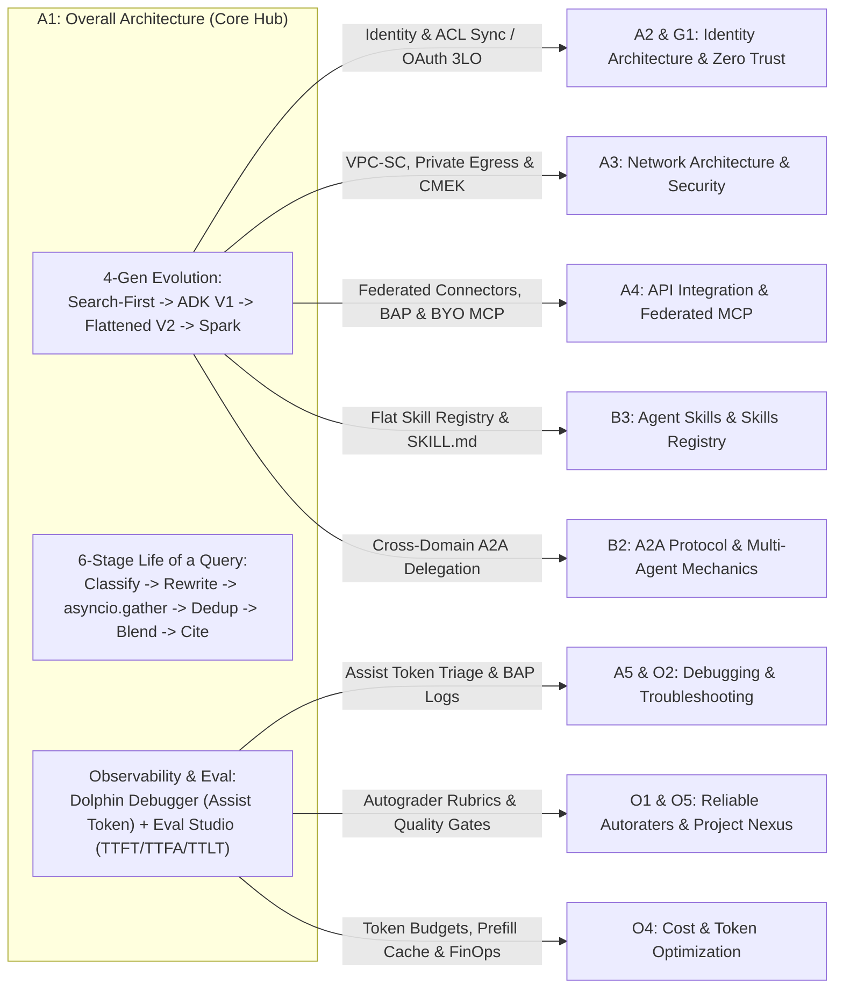
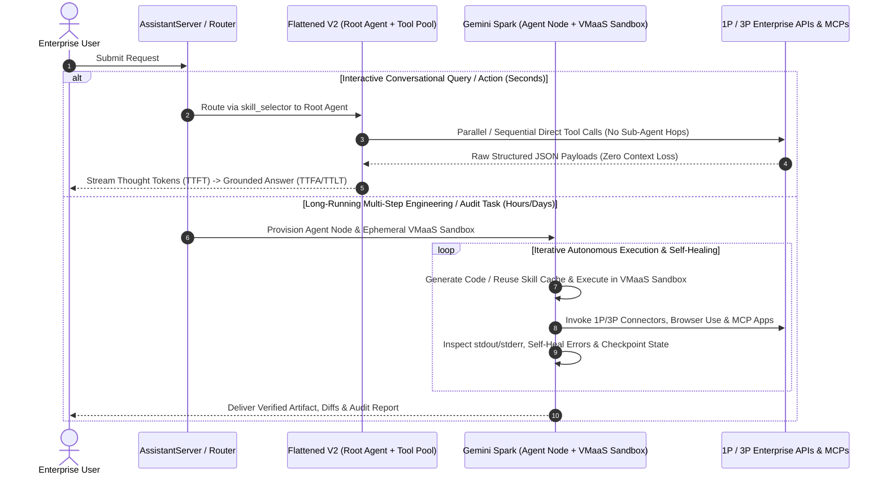
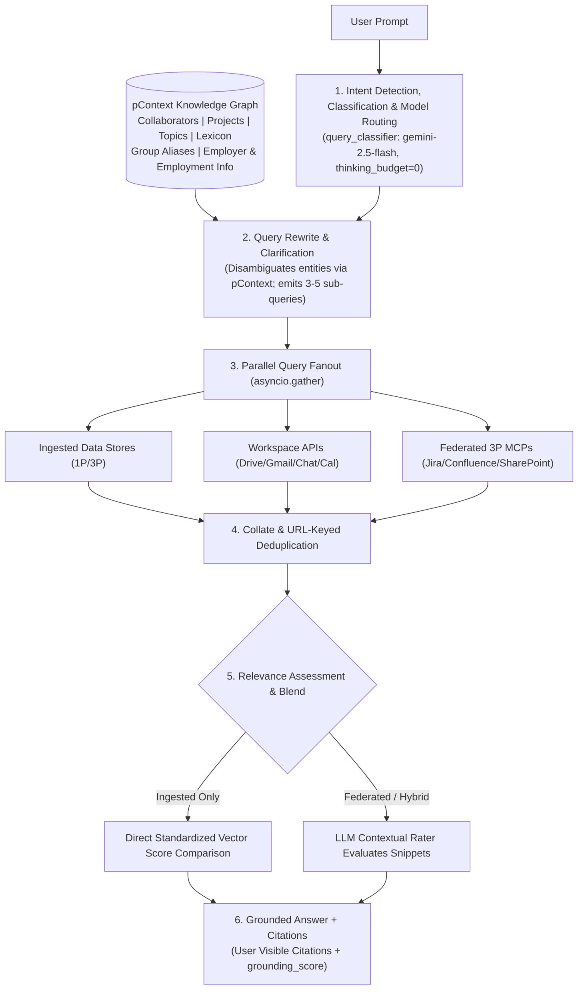
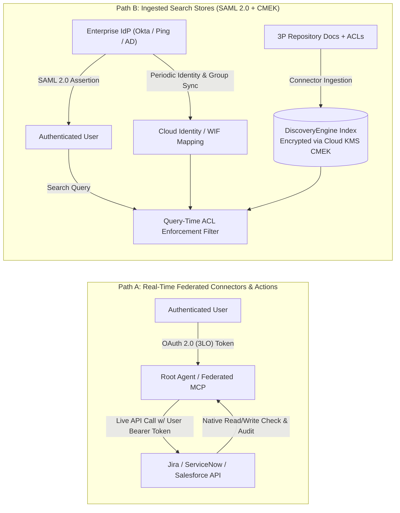
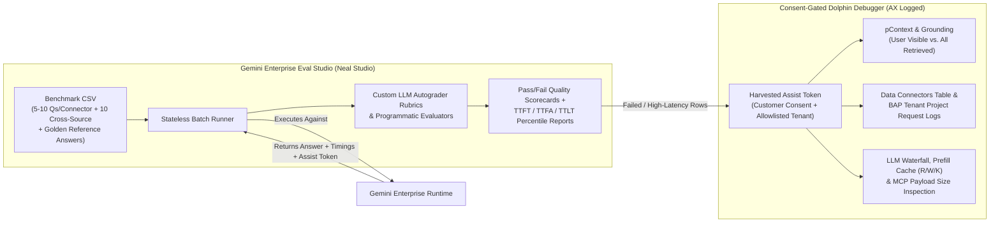
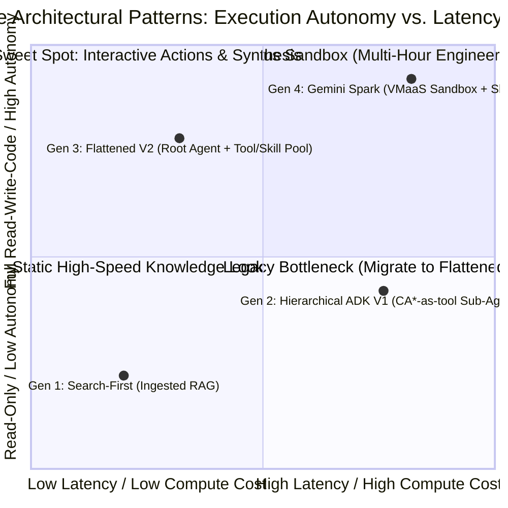

# OKF-L400-A1: Gemini Enterprise Overall Architecture — Flattened Orchestration, Autonomous Spark Sandboxes, 6-Stage Query Lifecycle, Dolphin Observability & Automated Batch Evaluation (`L400_version_20261026_0350`)
**Topic Tags:** `#L400_version_20261026_0350` `#GeminiEnterpriseArchitecture` `#FlattenedAgentOrchestration` `#AutonomousSparkSandboxes` `#ConversationalQueryLifecycle` `#DolphinObservabilityAndLatency` `#AutomatedBatchEvaluation`

---

## 0. OKF Document Metadata & Topic Modeling Taxonomy
**Topic Tags:** `#L400_version_20261026_0350` `#OKFMetadata` `#TopicModeling` `#KnowledgeCatalogSchema` `#AntigravityAgenticAI`

> **OKF v0.2 Trust Signals, Bucket Merge & Enforced FDE Grading Rubric (`OKF-L400-21`):**
> - **Version Tag:** `L400_version_20261026_0350` | **Status (`status`):** `stable` (`VETTED` / `APPROVED`) | **TTL (`stale_after`):** `2027-04-26T00:00:00Z` *(Maintains existing TTL & version)* | **Verified (`verified`):** `true`
> - **Merged Bucket OKF Lineage:** Reconciled with `Concepts 01, 02, 09, 15` in `gs://gea_agent_development_architectural_best_practices_1790796607` (`project=fivedaysai-prd-sandbox-317383`)
> - **Cloud FDE Prevailing Standard:** `https://g3doc.corp.google.com/company/teams/cloud-fde/index.md?cl=head`
> - **Enforced Project Grading Rubric (`OKF-L400-21`):** Adheres to the 0–3 FDE Field-Readiness Rubric (Pass Gate: Average >= 2.0 across Part A & Part B; Zero-Score Pause Rule: any `0 - Not Demonstrated` triggers an immediate pause and 2-week re-presentation). Primary mapped competencies for `OKF-L400-A1`: **Part A.1 (Strategic Value & TCO), Part A.5 (GCP Roadmap), Part B.1.1 (Agentic & Multi-Agent Systems), Part B.2.4 (System Design Artifacts), Part B.4.4 (Graceful Degradation), Part B.7.1 (Modularity & Abstraction)**.

### 0.1 Document Control & Source Provenance Metadata
**Topic Tags:** `#L400_version_20261026_0350` `#DocumentControl` `#SourceProvenance` `#L400TechnicalReference`

| Metadata Field | Value / Specification |
| :--- | :--- |
| **OKF Document ID** | `OKF-L400-A1-OVERALL-ARCHITECTURE` |
| **Version Tag** | `L400_version_20261026_0350` |
| **Target Ingestion Systems** | GCP Knowledge Catalog, Vertex AI RAG Engine, Antigravity Agentic AI Development Platform |
| **Primary Source Artifacts** | 1. `A1_overall_architecture.md` (Core learning points, 8 architectural questions, 7 quiz assessments)<br/>2. `sme-recording-a1-overall-architecture.md` (SME technical tutorial, 4-Layer Stack, OAuth vs. SAML, CMEK, Neal Studio, PCA scenarios)<br/>3. `slides-a1-overall-architecture.md` (A1 v1.1.0 Deck: `AssistantServer`, `DolphinServer`, `Planner + Skills V2`, `Gemini Spark` VMaaS Sandbox, 6-Stage Life of a Query, `Dolphin Debugger`, `pContext`, `TTFT`/`TTFA`/`TTLT`, `Eval Studio`) |
| **Technical Depth Level** | L400 (Principal Architect / Fellow / Staff Forward Deployed Engineer) |

---

### 0.2 Primary Topic Tags
**Topic Tags:** `#L400_version_20261026_0350` `#PrimaryTopics` `#DomainTaxonomy` `#EnterpriseAgentArchitecture`

1. **`#GeminiEnterpriseArchitecture`**: End-to-end architectural evolution across four generations—from 2024 **Search-First (Agentspace)** and **Agent-First V1 (Hierarchical ADK on `DolphinServer`)** to **Planner + Skills V2 (Flattened Conversational Architecture)** and **Gemini Spark (Long-Running Autonomous Agents)**—integrated across a 4-layer enterprise stack (UI & Access, Orchestration & Runtime, Connector & Tooling, Security/Observability/Eval).
2. **`#FlattenedAgentOrchestration`**: Elimination of hierarchical sub-agent LLM round trips (`CA*-as-tool`) by consolidating capabilities into a unified, flat pool of **Model Context Protocol (MCP)** tools, OpenAPI adapters, and procedural **Skills** directly orchestrated by the **Root Agent** after upfront **Skill & Model Selection**.
3. **`#AutonomousSparkSandboxes`**: Asynchronous, multi-hour/multi-day execution runtime (**Gemini Spark**) pairing an **Agent Node / Root Agent** and **Planner + Code Gen for Skills + Tools** with an isolated **VMaaS Sandbox with Skill Cache**, **Browser Use**, and **MCP Apps**.
4. **`#ConversationalQueryLifecycle`**: The deterministic 6-stage **Life of a Query** pipeline inside the Core Assistant: (1) Intent Detection, Classification & Model Routing (`query_classifier`), (2) Query Rewrite & Clarification + `pContext`, (3) Parallel Query Fanout via `asyncio.gather`, (4) Collate & URL-Keyed Deduplication, (5) Hybrid Relevance Assessment & Blend (standardized vector comparison vs. LLM contextual evaluation), and (6) Grounded Answer + Citations (`grounding_score`).
5. **`#HybridIdentityAndDataGovernance`**: Dual-path enterprise identity and security enforcement—combining live **OAuth 2.0 (3LO / token exchange)** for real-time federated APIs and transactional actions with periodic **SAML 2.0 + Identity/ACL Mapping Syncs** for ingested data stores, backed by **Customer-Managed Encryption Keys (CMEK)** via Cloud KMS and **VPC Service Controls**.
6. **`#DolphinObservabilityAndLatency`**: Privacy-governed production troubleshooting via **Dolphin Debugger** using customer-consented, allowlisted **Assist Tokens** under **Access Transparency (AX)**, exposing **Personal Context (`pContext`)** from the People Knowledge Graph, active **Data Connectors** & **BAP Tenant Project Request Logs**, **LLM Execution Metrics & Prefill Cache (`R/W/K`)**, and streaming latency engineering (**TTFT**, **TTFA**, **TTLT**).
7. **`#AutomatedBatchEvaluation`**: Systematic quality and latency benchmarking via open-source **Gemini Enterprise Eval Studio** (also referenced in SME recordings as **Neal Studio**), running stateless batch CSV test suites (5–10 queries per connector + 10 cross-source synthesis queries) with custom LLM autograder rubrics and automated **Assist Token** harvesting.

---

### 0.3 Secondary Sub-Topic Tags
**Topic Tags:** `#L400_version_20261026_0350` `#SecondaryTopics` `#CapabilitiesOutcomesImpacts` `#GranularTaxonomy`

1. **`#DirectToolAndSkillPool`** *(Capability)*: Converts standalone ADK connector agents into atomic tools and procedural skills directly callable by the Root Agent, eliminating inter-agent context loss and multi-hop latency.
2. **`#SparkVMaaSSandboxRuntime`** *(Capability)*: Provides an ephemeral, gVisor/VMaaS-isolated sandbox with a **Skill Cache** where long-running agents write code, run tests, inspect `stdout`/`stderr`, checkpoint progress, and self-heal.
3. **`#ParallelQueryFanoutAndHybridReranking`** *(Capability)*: Dispatches 3–5 rewritten semantic sub-queries concurrently via `asyncio.gather` and reconciles incompatible federated relevance scores using an LLM contextual rater.
4. **`#KnowledgeGraphPersonalContext`** *(Capability)*: Synthesizes user-specific organizational intelligence (`pContext`) from the People connector Knowledge Graph (collaborators, projects, internal lexicon, group aliases, employment info) to disambiguate entities before tool invocation.
5. **`#OAuthVsSAMLIdentityEnforcement`** *(Capability)*: Enforces per-user least privilege across federated connectors via OAuth 2.0 3LO tokens and across SAML-backed indexed stores via Cloud Identity / Workforce Identity Federation ACL syncs.
6. **`#AssistTokenExecutionReplay`** *(Capability)*: Reconstructs exact query execution traces in **Dolphin Debugger** under Access Transparency (AX) and explicit customer allowlisting consent.
7. **`#PerceivedAndEndToEndLatencyOptimization`** *(Outcome)*: Compresses total response time (**TTLT**) via flattened orchestration and lowers perceived wait time (**TTFT**) by streaming intermediate thought tokens to the UI while monitoring **TTFA** and **Prefill Cache (`R/W/K`)** hits.
8. **`#StatelessBatchRubricEvaluation`** *(Impact)*: Industrializes pre-production sign-off and regression testing via **Gemini Enterprise Eval Studio (`Neal Studio`)**, grading batch CSV runs against golden reference answers and custom rubrics.

---

### 0.4 Topic Taxonomy Matrix
**Topic Tags:** `#L400_version_20261026_0350` `#TopicTaxonomyMatrix` `#CapabilityMapping` `#KnowledgeCatalogIndex`

| Secondary Sub-Topic Tag | Classification | Parent Primary Topic Tag(s) | Core Architectural Mechanism | Primary Enterprise Outcome |
| :--- | :--- | :--- | :--- | :--- |
| **`#DirectToolAndSkillPool`** | **Capability** | `#GeminiEnterpriseArchitecture`, `#FlattenedAgentOrchestration` | `Planner + Skills V2` binds atomic tools & procedural skills directly to the Root Agent after `skill_selector`. | Cuts cross-system LLM hops by 40–60% and preserves exact entity IDs across tools. |
| **`#SparkVMaaSSandboxRuntime`** | **Capability** | `#AutonomousSparkSandboxes`, `#GeminiEnterpriseArchitecture` | Stateful `Agent Node` + `Planner + Code Gen` + `VMaaS Sandbox w/ Skill Cache` + `Browser Use` + `MCP Apps`. | Enables multi-hour autonomous code migration, compliance audits, and iterative self-healing. |
| **`#ParallelQueryFanoutAndHybridReranking`** | **Capability** | `#ConversationalQueryLifecycle`, `#FlattenedAgentOrchestration` | Stage 2 Query Rewrite -> Stage 3 `asyncio.gather` fanout -> Stage 4 URL dedup -> Stage 5 LLM contextual re-rank. | Maximizes multi-source recall without serial latency; normalizes heterogeneous 3P search scores. |
| **`#KnowledgeGraphPersonalContext`** | **Capability** | `#ConversationalQueryLifecycle`, `#DolphinObservabilityAndLatency` | People connector Knowledge Graph populates 8 organizational dimensions in `pContext`. | Resolves ambiguous first names (`"Alex"`) and internal project codenames (`"Nexus"`) automatically. |
| **`#OAuthVsSAMLIdentityEnforcement`** | **Capability** | `#HybridIdentityAndDataGovernance` | OAuth 2.0 (3LO) token pass-through for federated APIs; SAML 2.0 + Identity/ACL sync for indexed stores + CMEK. | Guarantees zero privilege escalation and strict compliance across both search and write actions. |
| **`#AssistTokenExecutionReplay`** | **Capability** | `#DolphinObservabilityAndLatency` | Customer-consented allowlisting + AX-audited `Assist Token` replay across 6 diagnostic views in Dolphin Debugger. | Isolates missing citations, inactive connectors, or slow MCP tools in under 60 seconds. |
| **`#PerceivedAndEndToEndLatencyOptimization`** | **Outcome** | `#DolphinObservabilityAndLatency`, `#FlattenedAgentOrchestration` | Transparent UI thought streaming (`TTFT`), answer token tracking (`TTFA`), completion (`TTLT`), Prefill Cache (`R/W/K`). | Sub-1.5s perceived responsiveness (`TTFT`) even when complex tool synthesis takes 10–30s (`TTLT`). |
| **`#StatelessBatchRubricEvaluation`** | **Impact** | `#AutomatedBatchEvaluation`, `#DolphinObservabilityAndLatency` | `Gemini Enterprise Eval Studio` (`Neal Studio`) runs stateless CSV batches + LLM autograder rubrics. | Replaces ad-hoc single-query spot checks with reproducible CI/CD quality and latency gates. |

---

### 0.5 Cross-Module Topic Connection & Flow Graph (Mermaid & ASCII)
**Topic Tags:** `#L400_version_20261026_0350` `#TopicConnectionGraph` `#CrossModuleArchitecture` `#AntigravityTopology`



```text
+---------------------------------------------------------------------------------------------------+
|                     A1: GEMINI ENTERPRISE OVERALL ARCHITECTURE (CORE HUB)                         |
|                                                                                                   |
|  [Gen 1: Search-First] -> [Gen 2: ADK V1] -> [Gen 3: Flattened V2 Pool] & [Gen 4: Spark Sandbox]  |
|                                       |                                                           |
|                                       v                                                           |
|  [6-Stage Query Lifecycle: Intent -> Rewrite/pContext -> Fanout -> URL Dedup -> Blend -> Cite]    |
|                                       |                                                           |
|                                       v                                                           |
|  [Diagnostics & Eval: Consent-Gated Assist Token -> Dolphin Debugger <-> Eval Studio (Neal)]      |
+---------------------------------------------------------------------------------------------------+
        |                        |                        |                        |
        v                        v                        v                        v
+---------------+        +---------------+        +---------------+        +------------------------+
| A2/G1: OAuth  |        | A3: VPC-SC,   |        | A4/B3: BAP,   |        | A5/O1/O4: Dolphin      |
| 3LO vs. SAML  |        | Cloud KMS     |        | Federated API |        | Triage, Autoraters,    |
| + ACL Mapping |        | CMEK & Egress |        | & Skill Pool  |        | Prefill Cache & FinOps |
+---------------+        +---------------+        +---------------+        +------------------------+
```

---

## 1. Executive Overview, Problem Statement & Antigravity Agentic AI Development Context
**Topic Tags:** `#L400_version_20261026_0350` `#ExecutiveOverview` `#ProblemStatement` `#AntigravityAgenticAI` `#EnterpriseTransformation`

> **Enforced FDE Project Grading Rubric Reference (`OKF-L400-21` & `g3doc/company/teams/cloud-fde`):** Every project applying Section 1 of `OKF-L400-A1` is graded against **Part A.1 (Strategic Value & TCO), Part A.5 (GCP Roadmap), Part B.1.1 (Agentic & Multi-Agent Systems), Part B.2.4 (System Design Artifacts), Part B.4.4 (Graceful Degradation), Part B.7.1 (Modularity & Abstraction)** and merged bucket **Concepts 01, 02, 09, 15** (`stale_after: 2027-04-26T00:00:00Z`, version `L400_version_20261026_0350`). Builders must achieve >= 2 (**Competent**) across Part A & Part B and avoid any 0 (**Not Demonstrated**) pause triggers.

### 1.1 The Enterprise Problem Statement: Why Legacy Search and Hierarchical Agents Fail at Scale
**Topic Tags:** `#L400_version_20261026_0350` `#ProblemStatement` `#MultiHopLatency` `#ContextLoss` `#ScoringHeterogeneity`

Enterprise organizations deploying generative AI assistants across fragmented SaaS ecosystems (Google Workspace, Microsoft SharePoint, Atlassian Jira/Confluence, ServiceNow, Salesforce) confront five structural engineering bottlenecks:

1. **Read-Only Ingested Search Limitations (2024 Search-First Era)**: Pre-ingesting documents, vector embeddings, and ACLs into centralized Google indexes works well for static policy lookup, but introduces ingestion sync lag, storage duplication, and zero ability to execute live transactional mutations (e.g., filing a Jira bug, updating a Salesforce opportunity, or scheduling a Calendar bridge).
2. **Compounding Multi-Hop Latency & Context Isolation in Hierarchical Multi-Agent Systems (Agent-First V1 Era)**: When each connector is wrapped as an isolated **ADK Sub-Agent (`CA*-as-tool`)** hosted on `DolphinServer`, a cross-system prompt (e.g., *"Find the root cause in the Confluence postmortem for Outage INC-9042, verify if the Jira fix was deployed, and draft a customer update in Salesforce"*) forces serial LLM round trips (Root -> ServiceNow Agent -> Root -> Confluence Agent -> Root -> Jira Agent -> Root -> Salesforce Agent). End-to-end latency (`TTLT`) exceeds 22–30 seconds, prompt tokens multiply across repeated system instructions, and **intermediate sub-agent summarization drops critical entity keys** (such as exact Jira IDs or commit SHAs) because sub-agents cannot communicate peer-to-peer.
3. **Synchronous Timeout Ceilings on Complex Engineering & Audit Workflows**: Conversational HTTP request-response loops (typically bounded to 15–60 seconds) cannot sustain iterative, multi-hour tasks such as migrating 80 microservice repositories, running unit test suites, inspecting compiler errors, and self-healing code.
4. **Heterogeneous Relevance Scoring Across Ingested and Federated Sources**: Blending search hits from Google-indexed stores with live federated APIs (SharePoint, Confluence, Jira) fails under naive numeric sorting because each third-party search engine uses proprietary, uncalibrated scoring algorithms.
5. **Opaque Production Failures & Manual Single-Query Testing**: Without privacy-governed execution trace replay (`Assist Tokens` in **Dolphin Debugger**) and automated batch evaluation (**Gemini Enterprise Eval Studio / Neal Studio**), engineering teams cannot distinguish whether a bad answer stemmed from an inactive connector, failed `pContext` entity disambiguation, MCP payload bloat, or Stage 5 relevance filtering.

---

### 1.2 Architectural Solution Summary & Core Pillars
**Topic Tags:** `#L400_version_20261026_0350` `#SolutionArchitecture` `#PlannerPlusSkillsV2` `#GeminiSpark` `#DolphinDebugger`

**Gemini Enterprise** solves these challenges through four tightly integrated architectural pillars:
- **Pillar 1 — Flattened Conversational Orchestration (`Planner + Skills V2`) & Autonomous Sandboxes (`Gemini Spark`)**: Replaces hierarchical sub-agent wrappers with an upfront **Skill & Model Selection** layer (`skill_selector`) and a **Root Agent** that directly invokes a flat pool of atomic tools and procedural skills for low-latency chat, while routing multi-hour iterative workloads to **Gemini Spark** (`Agent Node` + `Planner + Code Gen` + **VMaaS Sandbox with Skill Cache**).
- **Pillar 2 — 6-Stage Conversational Query Lifecycle**: Standardizes every informational query through (1) `query_classifier` intent/model/thinking routing, (2) Query Rewrite + **Personal Context (`pContext`)** injection, (3) `asyncio.gather` parallel fanout, (4) URL-keyed deduplication, (5) adaptive relevance blending (direct score comparison for homogeneous ingested stores vs. LLM contextual evaluation for heterogeneous federated sources), and (6) citation-grounded synthesis (`grounding_score`).
- **Pillar 3 — Hybrid Identity (`OAuth 2.0 3LO` vs. `SAML 2.0 + ACL Sync`) & `CMEK` Governance**: Enforces per-user authorization in real time via OAuth 2.0 tokens for federated APIs and write actions, while governing SAML-authenticated ingested stores via periodic Cloud Identity / Workforce Identity Federation ACL syncs and **Cloud KMS Customer-Managed Encryption Keys (CMEK)**.
- **Pillar 4 — Dolphin Debugger (`Assist Token`) & Eval Studio (`Neal Studio`) Quality Loop**: Combines customer-consented, Access Transparency-audited **Assist Token** trace replay and `TTFT`/`TTFA`/`TTLT` waterfall profiling in **Dolphin Debugger** with stateless CSV batch benchmarking and LLM autograder rubrics in **Gemini Enterprise Eval Studio**.

---

### 1.3 Antigravity Agentic AI Development Context
**Topic Tags:** `#L400_version_20261026_0350` `#AntigravityDevelopment` `#AgenticDesignPatterns` `#MCPAndSkills` `#SandboxEngineering`

For **Antigravity Agentic AI** platform engineers and Forward Deployed Engineers (FDEs), Module A1 establishes the canonical runtime blueprint:
1. **Default to Flattened Tool/Skill Pools over Sub-Agent Wrappers**: Package domain capabilities as declarative **Skills** (procedural markdown instructions + few-shot trajectories) paired with stateless **MCP / OpenAPI tools** rather than wrapping every API in its own LLM sub-agent.
2. **Exploit `Prefill Cache (R/W/K)` & Dynamic Thinking Budgets**: Keep `query_classifier` and `skill_selector` at `thinking_budget: 0` on `gemini-2.5-flash` (`PROVISIONED` throughput), and cap MCP tool response payloads (e.g., `<= 15–25 KB`) so `root_agent` prompt tokens stay well below the `2,400,000` character ceiling.
3. **Stream Thought Tokens to Optimize Perceived Latency (`TTFT`)**: Always stream intermediate reasoning milestones to the UI so users experience a sub-1.5s–3.2s **TTFT** while external tools execute in the background prior to **TTFA** and **TTLT**.
4. **Shift Multi-Step Code/Browser Loops to VMaaS Sandboxes**: Any workflow requiring `>5` sequential tool calls, filesystem writes, test execution, or self-healing loops must run asynchronously inside a **Spark VMaaS Sandbox with Skill Cache** rather than blocking the conversational thread.

---

## 2. Deep Technical Architecture, Matrices, Visual Pictures & Flow Diagrams
**Topic Tags:** `#L400_version_20261026_0350` `#DeepTechnicalArchitecture` `#VisualArchitectureDiagrams` `#MermaidAndASCIIDiagrams`

> **Enforced FDE Project Grading Rubric Reference (`OKF-L400-21` & `g3doc/company/teams/cloud-fde`):** Every project applying Section 2 of `OKF-L400-A1` is graded against **Part A.1 (Strategic Value & TCO), Part A.5 (GCP Roadmap), Part B.1.1 (Agentic & Multi-Agent Systems), Part B.2.4 (System Design Artifacts), Part B.4.4 (Graceful Degradation), Part B.7.1 (Modularity & Abstraction)** and merged bucket **Concepts 01, 02, 09, 15** (`stale_after: 2027-04-26T00:00:00Z`, version `L400_version_20261026_0350`). Builders must achieve >= 2 (**Competent**) across Part A & Part B and avoid any 0 (**Not Demonstrated**) pause triggers.

### 2.1 Four-Generation Architectural Evolution & 4-Layer Enterprise Stack
**Topic Tags:** `#L400_version_20261026_0350` `#FourGenerationEvolution` `#FourLayerEnterpriseStack` `#AssistantServer` `#DolphinServer`

Gemini Enterprise evolved through four distinct architectural generations integrated across a 4-Layer Enterprise Stack:
1. **Generation 1 — Search-First Architecture (`Agentspace`, 2024 Launch)**: `UI -> AssistantServer -> Search API (DiscoveryEngine) -> Ingested Data Stores (1P/3P)`. Built for read-only RAG over pre-indexed documents, embeddings, and synced ACLs; no transactional write actions.
2. **Generation 2 — Agent-First V1 (`Hierarchical ADK Sub-Agents`)**: `UI -> AssistantServer -> DolphinServer (Root Agent) -> CA*-as-tool (ADK Sub-Agents) + Search API / Workspace API / Connector Platform -> 1P & 3P Systems`. Unlocked read/write actions (`create_issue`, `send_email`) and federated real-time queries, but suffered from **compounding multi-hop LLM latency** and **inter-agent context isolation/loss**.
3. **Generation 3 — Planner + Skills V2 (`Flattened Conversational Architecture`)**: `UI -> AssistantServer -> Skill & Model Selection (skill_selector) -> Root Agent -> Flat Pool of Atomic Tools (Search API, Workspace API, Connector Platform, Federated Search) & Procedural Skills`. Eliminates sub-agent LLM wrappers, retaining a single unified context window and cutting cross-system latency by 40–60%.
4. **Generation 4 — Gemini Spark (`Long-Running Autonomous Agents`)**: `UI -> AssistantServer -> Agent Node / Root Agent -> Planner + Code Gen for Skills + Tools + VMaaS Sandbox with Skill Cache + Browser Use + MCP Apps`. Engineered for asynchronous, multi-hour/multi-day iterative execution.

#### 2.1.1 Visual ASCII & Mermaid Diagrams: 4-Generation Evolution & 4-Layer Stack
**Topic Tags:** `#L400_version_20261026_0350` `#ASCIIDiagram` `#MermaidDiagram` `#ArchitectureEvolution` `#FourLayerStack`

```text
+===================================================================================================+
|                  GEMINI ENTERPRISE: 4-LAYER STACK & 4-GENERATION EVOLUTION                        |
+===================================================================================================+
| LAYER 1: UI & ACCESS     | Web / Mobile Chat UI | Workspace Sidekick | Transparent Thought Stream |
+--------------------------+------------------------------------------------------------------------+
| LAYER 2: ORCHESTRATION   | AssistantServer -> query_classifier & skill_selector                   |
| & AGENT RUNTIME          |   +-- Gen 1 (Search-First): DiscoveryEngine Search API Only            |
|                          |   +-- Gen 2 (ADK V1): DolphinServer Root -> CA*-as-tool Sub-Agents     |
|                          |   +-- Gen 3 (Flattened V2): Root Agent -> Flat Pool of Tools & Skills  |
|                          |   +-- Gen 4 (Gemini Spark): Agent Node -> VMaaS Sandbox + Skill Cache  |
+--------------------------+------------------------------------------------------------------------+
| LAYER 3: CONNECTOR, DATA | Ingested Stores (Vector/ACL Index) | Federated APIs (BAP / Custom MCP) |
| & TOOLING                | Workspace APIs (Drive/Gmail/Cal)   | People Connector (pContext Graph) |
+--------------------------+------------------------------------------------------------------------+
| LAYER 4: SECURITY,       | OAuth 2.0 (3LO) vs. SAML 2.0 + ACL Sync | Cloud KMS CMEK | VPC-SC     |
| OBSERVABILITY & EVAL     | Dolphin Debugger (Assist Token + AX)    | Eval Studio (Neal Studio)    |
+===================================================================================================+
```



```mermaid
graph TB
    subgraph Gen1["Gen 1: Search-First (2024 Agentspace)"]
        U1["UI"] --> AS1["AssistantServer"] --> DE1["Search API (DiscoveryEngine)"] --> DS1["Ingested Data Stores (1P/3P)"]
    end
    subgraph Gen2["Gen 2: Agent-First V1 (Hierarchical ADK)"]
        U2["UI"] --> AS2["AssistantServer"] --> DS_R["DolphinServer: Root Agent"]
        DS_R --> CA["CA*-as-tool (Jira/Confluence Sub-Agents)"] --> SYS2["1P & 3P Systems"]
    end
    subgraph Gen3["Gen 3: Planner + Skills V2 (Flattened Pool)"]
        U3["UI"] --> AS3["AssistantServer"] --> SMS["Skill & Model Selection"] --> RA3["Root Agent"]
        RA3 --> POOL["Flat Tool & Skill Pool:<br/>Search API | Workspace API | Connector Platform | Federated MCP"] --> SYS3["1P & 3P Systems"]
    end
    subgraph Gen4["Gen 4: Gemini Spark (Long-Running Autonomous)"]
        U4["UI"] --> AS4["AssistantServer"] --> AN["Agent Node / Root Agent"]
        AN --> SBX["Planner + Code Gen | VMaaS Sandbox w/ Skill Cache | Browser Use | MCP Apps"] --> SYS4["1P & 3P Systems"]
    end
```

#### 2.1.2 Architectural Generation Comparison Matrix
**Topic Tags:** `#L400_version_20261026_0350` `#ComparisonMatrix` `#GenerationTradeOffs` `#RuntimeCharacteristics`

| Architectural Generation | Primary Execution Path | Read vs. Write Capability | Latency Profile (`TTLT`) | Primary Limitation Solved by Next Gen |
| :--- | :--- | :--- | :--- | :--- |
| **1. Search-First (2024)** | `AssistantServer` -> `DiscoveryEngine` | Read-only (pre-indexed docs) | 1.5s – 4.0s | Could not take transactional actions or query unindexed real-time SaaS APIs. |
| **2. Agent-First V1 (Hierarchical ADK)** | `DolphinServer` Root -> `CA*-as-tool` Sub-Agents | Read + Write via connector sub-agents | 15.0s – 30.0s+ (multi-hop) | Compounding LLM round trips and context loss across isolated sub-agents. |
| **3. Planner + Skills V2 (Flattened)** | `skill_selector` -> `Root Agent` -> Flat Tool/Skill Pool | Read + Write via direct MCP/OpenAPI tools | 3.0s – 10.0s (single planner loop) | Synchronous HTTP timeouts prevent multi-hour autonomous code/test execution. |
| **4. Gemini Spark (Autonomous)** | `Agent Node` -> `VMaaS Sandbox + Skill Cache` | Full Read + Write + Code/Shell + Browser | Minutes to Hours / Multi-Day | Purpose-built for asynchronous, self-healing workflows; overkill for simple Q&A. |

#### 2.1.3 Inline Section Best Practices & FAQs (4-Generation Evolution & 4-Layer Stack)
**Topic Tags:** `#L400_version_20261026_0350` `#SectionBestPractices` `#SectionFAQs` `#ArchitectureGovernance`

- **Best Practices**:
  1. **Use Flattened V2 as the Default Conversational Runtime**: Route all interactive enterprise Q&A and single-turn transactional actions through `Planner + Skills V2` to minimize `TTLT` and preserve cross-connector entity context.
  2. **Reserve ADK Sub-Agent Delegation (A2A) for Strict Domain Boundaries**: Only invoke separate sub-agents when crossing organizational security boundaries or third-party vendor runtimes.
- **Inline Section FAQs**:
  - **Q1: Why did Gemini Enterprise move away from wrapping every SaaS connector as its own ADK sub-agent (`CA*-as-tool`)?**
    * **A:** In `Agent-First V1`, chaining 3–4 connectors required 3–4 separate sub-agent LLM reasoning and summarization hops, inflating p95 latency beyond 20 seconds and causing intermediate summarization to strip critical entity identifiers (like exact Jira keys or URLs) needed by downstream tools.
  - **Q2: Does `Planner + Skills V2` sacrifice the modularity of `Agent-First V1`?**
    * **A:** No. Modularity is preserved by packaging domain logic as declarative **Skills** (`SKILL.md` procedural workflows) and atomic **MCP/OpenAPI tools** selected dynamically by `skill_selector` before `root_agent` execution.

---

### 2.2 Flattened Pool (`Planner + Skills V2`) vs. Autonomous Sandbox (`Gemini Spark`)
**Topic Tags:** `#L400_version_20261026_0350` `#FlattenedToolSkillPool` `#GeminiSparkSandbox` `#VMaaSSandbox` `#SkillCache`

In **Planner + Skills V2**, when a query arrives at `AssistantServer`, the **Skill & Model Selection** tier (`skill_selector`, running `gemini-2.5-flash` with `thinking_budget: 0`) dynamically binds only the relevant procedural skills and tool schemas into the **Root Agent** context window. The Root Agent directly orchestrates calls across `Search API`, `Workspace API`, `Connector Platform (BAP)`, and `Federated Search` without intermediate sub-agent LLM hops.

For complex workloads that exceed conversational request-response limits, **Gemini Spark** provisions an **Agent Node / Root Agent** backed by:
- **Planner + Code Gen for Skills + Tools**: Synthesizes multi-step plans and writes custom Python/shell scripts or dynamic tool adapters on the fly.
- **VMaaS Sandbox with Skill Cache**: An isolated virtualized container/VM execution environment where the agent clones repositories, executes code, inspects `stdout`/`stderr`, checkpoints progress, and reuses validated scripts from the **Skill Cache**.
- **Browser Use & MCP Apps**: Drives headless browser automation and rich interactive **MCP Apps** alongside 1P/3P enterprise connectors.

#### 2.2.1 Visual ASCII & Mermaid Diagrams: Flattened V2 Pool vs. Spark VMaaS Sandbox
**Topic Tags:** `#L400_version_20261026_0350` `#ASCIIDiagram` `#MermaidDiagram` `#FlattenedVsSpark`

```text
[HIERARCHICAL ADK V1 (LEGACY)]                  [FLATTENED V2 POOL (CONVERSATIONAL)]
Root Agent -> (LLM Hop 1) -> Jira Sub-Agent     Skill & Model Selector -> Root Agent (Unified Context)
           <- (Summary drops Commit SHA)             |-- Direct Tool Call 1: Jira MCP (Full JSON kept)
           -> (LLM Hop 2) -> GitHub Sub-Agent        |-- Direct Tool Call 2: GitHub MCP (Uses exact SHA)
           <- (Fails: missing Commit SHA!)           +-- Direct Tool Call 3: Slack MCP (Posts update)

[GEMINI SPARK (LONG-RUNNING AUTONOMOUS SANDBOX)]
UI -> AssistantServer -> Agent Node / Root Agent
                           |-- Planner + Code Gen for Skills & Tools
                           |-- VMaaS Sandbox + Skill Cache (Write Code -> Run Tests -> Parse stderr -> Self-Heal)
                           +-- Browser Use + MCP Apps + 1P/3P Connectors (Checkpoints state across hours/days)
```



#### 2.2.2 Flattened V2 vs. Gemini Spark Architectural Matrix
**Topic Tags:** `#L400_version_20261026_0350` `#FlattenedVsSparkMatrix` `#ExecutionComparison`

| Architectural Dimension | Flattened Architecture (`Planner + Skills V2`) | Long-Running Autonomous Agents (`Gemini Spark`) |
| :--- | :--- | :--- |
| **Execution Horizon** | Synchronous conversational turn (`2s – 30s`). | Asynchronous multi-hour or multi-day job (`minutes – days`). |
| **Compute Runtime** | Stateless `AssistantServer` + `DolphinServer` Root Agent. | Stateful `Agent Node` + isolated **VMaaS Sandbox with Skill Cache**. |
| **Tool & Skill Invocation** | Pre-registered MCP tools, OpenAPI adapters, and declarative skills. | Dynamic **Code Gen for Skills + Tools**, shell execution, **Browser Use**, and **MCP Apps**. |
| **Error Recovery Model** | Fast connector retry with backoff within the single HTTP turn budget. | Iterative self-healing: reads compiler/test `stderr`, patches code, and checkpoints state. |
| **Canonical Use Case** | Cross-system Q&A, summarizing incidents, creating a Jira ticket or email draft. | Migrating 80 Java repos, running Maven test suites overnight, auditing 500 vendor PDFs. |

#### 2.2.3 Inline Section Best Practices & FAQs (Flattened Pool & Spark Sandbox)
**Topic Tags:** `#L400_version_20261026_0350` `#SectionBestPractices` `#SectionFAQs` `#SandboxSecurity`

- **Best Practices**:
  1. **Enforce Ephemeral VPC-SC Sandboxes & Checkpointing for Spark**: Run every Spark VMaaS Sandbox inside a **VPC Service Controls** perimeter with read-only host mounts, no unauthorized internet egress, step-level state checkpointing, and mandatory Human-in-the-Loop (HITL) approval before production mutations.
  2. **Leverage the Spark Skill Cache**: Persist verified helper scripts in the **Skill Cache** so subsequent iterations bypass redundant LLM code generation.
- **Inline Section FAQs**:
  - **Q1: Why can't a standard conversational agent execute a 4-hour microservice migration if we simply raise the HTTP timeout?**
    * **A:** Conversational agents lack a stateful **VMaaS Sandbox** filesystem to clone repos, run compilers/test runners, inspect `stderr`, checkpoint intermediate progress, and self-heal across ratusan iterations without overflowing the conversational context window.
  - **Q2: How does the **Skill Cache** in Gemini Spark improve cost and reliability?**
    * **A:** Once the Spark Planner synthesizes and validates a tool script or workflow skill inside the VMaaS Sandbox, caching it in the **Skill Cache** allows repeatable execution across hundreds of target repos without burning LLM tokens to regenerate code.

---

### 2.3 The 6-Stage "Life of a Query" Pipeline & Personal Context (`pContext`) Knowledge Graph
**Topic Tags:** `#L400_version_20261026_0350` `#LifeOfAQuery` `#SixStagePipeline` `#PersonalContext` `#HybridRelevanceBlending`

Every conversational query entering the Core Assistant executes a deterministic **6-stage pipeline**:
1. **Stage 1 — Intent Detection, Classification & Model Routing (`query_classifier`)**: Inspects the prompt and conversation history to classify intent (informational retrieval vs. transactional tool action vs. multi-step reasoning) and routes to the optimal model tier (e.g., `gemini-2.5-flash` with `thinking_budget: 0` for fast routing/classification vs. `gemini-2.5-pro` with dynamic `thinking_budget: -1` for complex synthesis).
2. **Stage 2 — Query Rewrite & Clarification + Personal Context (`pContext`)**: Injects **Personal Context (`pContext`)** derived from the **People Connector Knowledge Graph** (populated across 8 organizational dimensions: **Collaborators**, **Projects**, **Topics**, **Employer Info**, **Knowledge Cards**, **Internal Lexicon**, **Group Aliases**, and **Employment Info**) to resolve ambiguous pronouns, first names (`"Alex"`), or internal acronyms (`"Project Titan"`). Generates **3–5 semantically varied sub-queries** optimized for target search backends, or emits a clarification prompt if ambiguity remains unresolvable.
3. **Stage 3 — Parallel Query Fanout (`asyncio.gather`)**: Dispatches all rewritten sub-queries concurrently across enabled **Ingested Data Stores** and **Federated Connectors** (`GOOGLE_DRIVE`, `GOOGLE_MAIL`, `GOOGLE_CHAT`, `GOOGLE_CALENDAR`, `GCS`, `NATIVE_CLOUD_IDENTITY`, and `THIRD_PARTY_FEDERATED` MCPs like Jira/Confluence/SharePoint) using asynchronous non-blocking I/O (`asyncio.gather`).
4. **Stage 4 — Collate & URL-Keyed Deduplication**: Aggregates raw document chunks and API records returned by parallel sub-queries and deduplicates identical documents using canonical **Document URLs** as primary keys.
5. **Stage 5 — Hybrid Relevance Assessment & Blend**: Reconciles retrieval scores across sources using a dual-mode strategy:
   - **Homogeneous Google-Ingested Stores**: Performs fast, direct numeric comparison of standardized vector/hybrid similarity scores.
   - **Heterogeneous Federated 3P Sources**: Because external SaaS APIs (SharePoint, Jira, Confluence) return incompatible native relevance scores (or unranked chronological lists), an **LLM Contextual Rater** evaluates actual snippet content against the user's intent to produce a unified ranking.
6. **Stage 6 — Grounded Answer + Citations (`grounding_score`)**: Synthesizes the final response strictly from top-ranked snippets, attaches inline **User Visible Citations** mapped to source URLs, and computes a post-generation **`grounding_score`**.

#### 2.3.1 Visual ASCII & Mermaid Diagrams: 6-Stage Life of a Query & `pContext` Graph
**Topic Tags:** `#L400_version_20261026_0350` `#ASCIIDiagram` `#MermaidDiagram` `#QueryLifecycleFlow`

```text
+---------------------------------------------------------------------------------------------------+
|                        6-STAGE "LIFE OF A QUERY" CONVERSATIONAL PIPELINE                          |
+---------------------------------------------------------------------------------------------------+
  [User Query]
       |
       v
  STAGE 1: Intent Detection, Classification & Model Routing (query_classifier: Flash, thinking=0)
       |
       v
  STAGE 2: Query Rewrite & Clarification <-- [pContext Knowledge Graph: Collaborators, Projects,
       |   (Generates 3-5 varied sub-queries)  Topics, Employer Info, Lexicon, Group Aliases]
       v
  STAGE 3: Parallel Query Fanout via `asyncio.gather`
       +-------------------+-------------------+-------------------+-------------------+
       |                   |                   |                   |                   |
       v                   v                   v                   v                   v
  [Google Drive]     [Gmail / Chat]     [Ingested Stores]   [Jira Federated]   [Confluence MCP]
       |                   |                   |                   |                   |
       +-------------------+-------------------+-------------------+-------------------+
       |
       v
  STAGE 4: Collate & URL-Keyed Deduplication (Merges duplicate hits across rewritten sub-queries)
       |
       v
  STAGE 5: Hybrid Relevance Assessment & Blend
       |-- Homogeneous Ingested Stores -----> Direct Standardized Vector Score Comparison
       +-- Heterogeneous Federated Sources -> LLM Contextual Content Evaluation & Re-Ranking
       |
       v
  STAGE 6: Grounded Answer + Citations (Synthesizes response + inline citations + grounding_score)
+---------------------------------------------------------------------------------------------------+
```



#### 2.3.2 6-Stage Query Lifecycle & `pContext` Reference Table
**Topic Tags:** `#L400_version_20261026_0350` `#QueryStageMatrix` `#PContextAttributes` `#GroundingScore`

| Pipeline Stage | Internal Component / Model | Key Input -> Output Transformation | Latency & Quality Optimization Mechanism |
| :--- | :--- | :--- | :--- |
| **1. Intent & Routing** | `query_classifier` (`gemini-2.5-flash`, `thinking_budget: 0`) | Raw prompt -> Intent class + Model tier selection | Zero thinking budget keeps classification under `~150–300ms` on `PROVISIONED` throughput. |
| **2. Rewrite & `pContext`** | Query Rewriter + People Connector Knowledge Graph | Ambiguous query + 8 `pContext` dimensions -> 3–5 explicit sub-queries | Resolves `"Alex"` or internal codenames upfront; requests clarification only when necessary. |
| **3. Parallel Fanout** | `asyncio.gather` Dispatcher | 3–5 sub-queries -> Concurrent requests to all `ACTIVE` connectors | Prevents additive serial network latency; bounded by the slowest single connector plus timeout. |
| **4. Collate & Dedup** | URL Deduplicator | Overlapping multi-query hits -> Unique candidate set (`All Retrieved Sources`) | Canonical URL primary-key matching strips duplicate documents before token-heavy re-ranking. |
| **5. Relevance Blend** | Hybrid Reranker (Vector Comparator + LLM Rater) | Candidate snippets -> Calibrated top-K context window | Solves score incompatibility across federated APIs via semantic LLM snippet evaluation. |
| **6. Grounded Synthesis** | `root_agent` (`gemini-2.5-pro`) + `grounding_score` | Top-K snippets -> Streamed answer + `User Visible Citations` | Enforces citation attribution and verifies factual support via `grounding_score` (`0.0–1.0`). |

#### 2.3.3 Inline Section Best Practices & FAQs (6-Stage Query Lifecycle & `pContext`)
**Topic Tags:** `#L400_version_20261026_0350` `#SectionBestPractices` `#SectionFAQs` `#QueryPipelineOptimization`

- **Best Practices**:
  1. **Always Enable the `NATIVE_CLOUD_IDENTITY` (People) Connector**: Without an active People connector, the `pContext` Knowledge Graph remains empty, degrading Stage 2 entity disambiguation for collaborator names and project acronyms.
  2. **Enforce Strict Per-Connector Timeouts inside `asyncio.gather`**: Configure circuit breakers and timeout budgets (e.g., `2.5s–4.0s`) on federated 3P MCP connectors so a degraded external API never stalls Stage 3 fanout.
- **Inline Section FAQs**:
  - **Q1: Why does Stage 4 deduplicate by URL, and why are multiple overlapping documents retrieved in the first place?**
    * **A:** Stage 2 rewrites a single user prompt into 3–5 semantically diverse sub-queries executed in parallel during Stage 3 to maximize recall; highly relevant documents naturally match multiple sub-queries and are deduplicated by canonical URL in Stage 4.
  - **Q2: Why can't Stage 5 simply sort federated SharePoint and Jira results by their raw API relevance scores?**
    * **A:** Every federated SaaS API uses its own uncalibrated scoring scale (or returns unranked records). An LLM contextual rater must inspect the retrieved text snippets directly to rank heterogeneous federated results accurately alongside Google-indexed content.

---

### 2.4 Hybrid Identity Architecture (`OAuth 2.0 3LO` vs. `SAML 2.0 + ACL Sync`) & `CMEK` Data Governance
**Topic Tags:** `#L400_version_20261026_0350` `#OAuthVsSAML` `#IdentityAndACLSync` `#CMEK` `#ZeroTrustSecurity`

Gemini Enterprise enforces strict Zero-Trust, per-user data access across two fundamentally different authentication and authorization planes, reinforced by **Customer-Managed Encryption Keys (CMEK)**:
1. **Real-Time Federated Connectors & Transactional Actions (`OAuth 2.0 / 3LO Token Exchange`)**: When querying live federated APIs or executing write mutations (e.g., creating a Jira ticket, updating ServiceNow, sending Gmail), Gemini Enterprise uses **3-Legged OAuth 2.0 (3LO)** or OAuth token exchange (`Per-User Auth` / `End-User Credentials`). The user's scoped bearer token is passed directly to the target SaaS API at execution time, ensuring the external system natively enforces the user's live read/write permissions and attributes audit logs to that individual.
2. **Ingested Data Stores (`SAML 2.0 + Periodic Identity & ACL Mapping Sync`)**: **SAML 2.0** is a browser-based SSO authentication assertion protocol, **not** an API delegation token that can be forwarded to backend REST/MCP APIs for real-time mutations. When enterprises use SAML 2.0 with ingested data stores, Gemini Enterprise runs an asynchronous **Identity & ACL Mapping Sync** (via Cloud Identity / Workforce Identity Federation and connector ACL pipelines) that indexes document-level Access Control Lists alongside vector embeddings. At Stage 3 query time, the search engine filters retrieved chunks against the authenticated user's synced group memberships.
3. **Customer-Managed Encryption Keys (`CMEK` via Cloud KMS)**: Enterprises with strict data sovereignty mandates configure **Cloud KMS CMEK** (including Cloud EKM / HSM) so all ingested document chunks, vector indexes, cached `pContext` graphs, and conversation history logs at rest are encrypted with keys controlled and revocable exclusively by the customer.

#### 2.4.1 Visual ASCII & Mermaid Diagrams: OAuth 2.0 (3LO) vs. SAML 2.0 + ACL Sync & CMEK
**Topic Tags:** `#L400_version_20261026_0350` `#ASCIIDiagram` `#MermaidDiagram` `#IdentityAndCMEKFlow`

```text
+---------------------------------------------------------------------------------------------------+
|               PATH A: FEDERATED REAL-TIME API & WRITE ACTIONS (OAUTH 2.0 3LO)                     |
|  [User] --(1. OAuth 3LO Consent)--> [Token Vault] --(2. Scoped Bearer Token)--> [Live SaaS API]   |
|  * Real-time read/write enforcement by target SaaS API; zero data ingestion required.             |
+---------------------------------------------------------------------------------------------------+
|               PATH B: INGESTED DATA STORES (SAML 2.0 SSO + IDENTITY/ACL SYNC + CMEK)              |
|  [SaaS Docs + ACLs] --(Async Ingestion)--> [CMEK-Encrypted Vector/ACL Index (Cloud KMS)]          |
|  [Enterprise IdP]   --(Group/ACL Sync)---> [Cloud Identity / WIF Principal Mapping Store]         |
|  [User] --(SAML 2.0 SSO Login)--> [Query Time ACL Filter Intersects User Groups vs. Doc ACLs]     |
+---------------------------------------------------------------------------------------------------+
```



#### 2.4.2 OAuth 2.0 vs. SAML 2.0 + ACL Sync & CMEK Security Matrix
**Topic Tags:** `#L400_version_20261026_0350` `#IdentityComparisonMatrix` `#OAuth2` `#SAML2` `#CMEK`

| Security / Identity Mechanism | Protocol Role | Data Access Pattern | Write / Action Support | Permission Freshness | At-Rest Encryption Boundary |
| :--- | :--- | :--- | :--- | :--- | :--- |
| **OAuth 2.0 (3LO / Token Exchange)** | Delegated API authorization token | Real-time Federated Connectors & BAP/MCP tools | **Yes** (Full read/write scoped to user token) | Instantaneous (evaluated live by target SaaS API) | Ephemeral transit payload; session logs encrypted with CMEK. |
| **SAML 2.0 + Identity/ACL Sync** | Browser SSO authentication assertion + Group sync | Ingested Data Stores (`DiscoveryEngine` index) | **No** (Read-only indexed search; SAML cannot authorize API writes) | Near-real-time to periodic (governed by ACL sync interval) | Full vector index, chunks & ACL metadata encrypted via **Cloud KMS CMEK**. |

#### 2.4.3 Inline Section Best Practices & FAQs (OAuth vs. SAML & CMEK)
**Topic Tags:** `#L400_version_20261026_0350` `#SectionBestPractices` `#SectionFAQs` `#SecurityCompliance`

- **Best Practices**:
  1. **Never Use Shared Super-Admin Service Accounts for User Actions**: Always configure per-user **OAuth 2.0 (3LO)** for transactional connectors so write actions respect least privilege and preserve individual user audit trails.
  2. **Bind CMEK Keys at Data Store Creation Time**: Configure regional/multi-regional **Cloud KMS CMEK** keys before ingesting enterprise data stores so all vector shards and conversational states inherit customer-controlled encryption from day one.
- **Inline Section FAQs**:
  - **Q1: Why can't Gemini Enterprise use a user's SAML 2.0 login assertion to create a Jira ticket on their behalf?**
    * **A:** SAML 2.0 is a browser authentication assertion consumed during initial sign-in, not a delegatable API bearer token. Executing live REST/MCP mutations against Jira requires an **OAuth 2.0 (3LO)** access token issued for the target API scope.
  - **Q2: What happens if a customer revokes their Cloud KMS CMEK key protecting a Gemini Enterprise data store?**
    * **A:** Decryption of the underlying ingested vector index, cached `pContext` store, and conversation logs is immediately blocked, rendering the data cryptographically inaccessible until the key version is re-enabled.

---

### 2.5 Dolphin Debugger (`Assist Token`), Latency Engineering (`TTFT`/`TTFA`/`TTLT`) & Eval Studio (`Neal Studio`)
**Topic Tags:** `#L400_version_20261026_0350` `#DolphinDebugger` `#AssistToken` `#LatencyEngineering` `#EvalStudio` `#NealStudio`

Gemini Enterprise pairs privacy-governed trace observability with automated batch benchmarking:
1. **Dolphin Debugger & Customer-Consented `Assist Tokens`**: To protect enterprise privacy, Google engineers cannot arbitrarily inspect user prompts or responses. Troubleshooting follows a strict **5-step compliance workflow**:
   - **(1) Customer Consent**: The enterprise customer explicitly consents to diagnostic debugging.
   - **(2) Tenant Allowlisting**: The customer/admin enables debug mode (`allowlists` the tenant environment).
   - **(3) Query Reproduction & Token Capture**: The user reproduces the issue and copies the unique **`Assist Token`** generated in the UI (or harvested automatically by Eval Studio).
   - **(4) Access Transparency (AX) Replay**: Support/FDEs load the `Assist Token` into **Dolphin Debugger**, which logs an immutable **Access Transparency (AX)** audit record.
   - **(5) 6-Plane Trace Inspection**: Engineers inspect:
     - **Plane A — Personal Context (`pContext`)**: Verifies all 8 Knowledge Graph categories populated from the People connector.
     - **Plane B — Grounding & Citations**: Compares **`User Visible Citations`** (rendered in UI) against **`All Retrieved Sources`** (e.g., all 7 retrieved snippets + URLs) to isolate retrieval failure vs. synthesis filtering.
     - **Plane C — Data Connectors & BAP Logs**: Audits every connector's `DATA SOURCE`, `TYPE`, `STATE` (`ACTIVE`), `COLLECTION ID`, `DEBUG CONSOLE` link, and **`BAP TENANT PROJECT LOGS (Request Logs)`**.
     - **Plane D — LLM Execution Metrics & Prefill Cache (`R/W/K`)**: Inspects per-call Model ID (`gemini-2.5-flash` vs. `gemini-2.5-pro`), Traffic Type (`PROVISIONED`), Latency (`297ms` vs. `23.79s`), Tokens (`Prompt + Candidates + Thoughts = Total`), **`Prefill Cache (R/W/K)`** (`Read / Write / Key`), `thinking_budget` (`0` vs. `-1`), and `Max Prompt Chars` (`2,400,000`).
     - **Plane E — Step-by-Step Execution Sequence & Waterfall**: Profiles every stage (`query_classifier` -> `skill_selector` -> `root_agent` -> MCP tool calls -> `grounding_score`).
2. **Three Core Streaming Latency Metrics (`TTFT`, `TTFA`, `TTLT`)**:
   - **Time to First Token (`TTFT`, e.g., `3.2s`)**: Elapsed time from query submission until the **first streaming thought token** renders in the transparent UI. Governs **perceived latency**.
   - **Time to First Answer Token (`TTFA`, e.g., `8.5s`)**: Elapsed time until the **first actual synthesized answer token** renders after tool calls and reasoning complete.
   - **Time to Last Token (`TTLT`, e.g., `9.8s`–`31.2s`)**: Total end-to-end completion time until the final token and citations render.
3. **Gemini Enterprise Eval Studio (`Neal Studio`)**: An open-source, cloud-deployable batch evaluation application that ingests a **CSV dataset** (recommended: **5–10 queries per target connector + 10 cross-source synthesis queries** with golden reference answers), executes **stateless end-to-end queries** against Gemini Enterprise, grades responses using **custom LLM autograder rubrics** or programmatic evaluators, tracks `TTFT`/`TTFA`/`TTLT` distributions, and automatically captures **`Assist Tokens`** for failed rows.

#### 2.5.1 Visual ASCII & Mermaid Diagrams: Dolphin Debugger Waterfall & Eval Studio Loop
**Topic Tags:** `#L400_version_20261026_0350` `#ASCIIDiagram` `#MermaidDiagram` `#LatencyWaterfall` `#EvalStudioPipeline`

```text
+---------------------------------------------------------------------------------------------------+
|                   STREAMING LATENCY TIMELINE & DOLPHIN DEBUGGER TRACE WATERFALL                   |
+---------------------------------------------------------------------------------------------------+
Query Submitted (t = 0.0s)
  |-- [0.0s - 0.3s] query_classifier (gemini-2.5-flash, PROVISIONED, thinking=0, 297ms)
  |-- [0.3s - 0.9s] skill_selector   (gemini-2.5-flash, PROVISIONED, thinking=0, 626ms)
  |-- [0.9s - 3.2s] root_agent Call 1 starts streaming UI Thought Tokens
  |===> t = 3.2s : TTFT (Time to First Token) -> Immediate UI Feedback (Lowers Perceived Latency!)
  |-- [3.2s - 7.8s] Parallel Fanout / MCP Tool Execution (e.g., Confluence/Jira/Drive APIs)
  |-- [7.8s - 8.5s] root_agent Call 2 evaluates tool payloads (Prefill Cache R/W/K hit)
  |===> t = 8.5s : TTFA (Time to First Answer Token) -> Final Answer Begins Streaming
  |-- [8.5s - 9.8s] Answer Tokens + User Visible Citations + grounding_score (1,622ms)
  |===> t = 9.8s : TTLT (Time to Last Token) -> End-to-End Turn Complete + Assist Token Emitted
+---------------------------------------------------------------------------------------------------+
```



#### 2.5.2 Dolphin Debugger Diagnostic Planes & Latency Metrics Matrix
**Topic Tags:** `#L400_version_20261026_0350` `#DiagnosticPlanesMatrix` `#TTFT` `#TTFA` `#TTLT` `#PrefillCache`

| Diagnostic Plane / Metric | Telemetry Exposed in Dolphin Debugger / Eval Studio | Root-Cause Triage Action |
| :--- | :--- | :--- |
| **`TTFT` (Time to First Token)** | Time to first streamed UI thought token (e.g., `3.2s`). | If high, check `query_classifier` / `skill_selector` latency or initial `root_agent` prompt size. |
| **`TTFA` (Time to First Answer)** | Time to first synthesized answer token (e.g., `8.5s`). | Gap `TTFA - TTFT` measures tool execution + multi-step reasoning duration. |
| **`TTLT` (Time to Last Token)** | Total end-to-end completion time (e.g., `9.8s` or `31.21s`). | If `TTLT` spikes, inspect waterfall for slow 3P MCP calls or oversized tool JSON payloads (`>25 KB`). |
| **`User Visible Citations` vs. `All Retrieved Sources`** | Rendered UI citations vs. all retrieved candidate snippets (e.g., `0` visible vs. `7` retrieved). | `0 retrieved` = connector/ACL/query-rewrite issue; `7 retrieved, 0 visible` = Stage 5/6 synthesis filtering. |
| **`Data Connectors` & `BAP Logs`** | `DATA SOURCE`, `TYPE`, `STATE` (`ACTIVE`), `COLLECTION ID`, `BAP TENANT PROJECT LOGS`. | Confirms if a missing source (e.g., Confluence) was even enabled for the query or failed with 4xx/5xx in BAP. |
| **`Prefill Cache (R/W/K)` & `Traffic Type`** | Prefix cache Read/Write/Key hits, `PROVISIONED` vs. PayGo, `thinking_budget` (`0` vs. `-1`). | Validates system prompt caching across multi-turn `root_agent` loops and confirms Provisioned Throughput routing. |

#### 2.5.3 Inline Section Best Practices & FAQs (Dolphin Debugger, Latency & Eval Studio)
**Topic Tags:** `#L400_version_20261026_0350` `#SectionBestPractices` `#SectionFAQs` `#ObservabilityAndEval`

- **Best Practices**:
  1. **Always Triage Missing Citations by Comparing `All Retrieved Sources` vs. `Data Connectors`**: Before tuning prompts, check Dolphin Debugger's `Data Connectors` table to verify the connector is `ACTIVE`, then check `All Retrieved Sources` to see if the document was retrieved.
  2. **Gate Every Production Release with Eval Studio (`Neal Studio`) CSV Benchmarks**: Run a 40–60 query CSV suite (5–10 queries per connector + 10 cross-source synthesis queries) before any prompt, skill, or connector change.
- **Inline Section FAQs**:
  - **Q1: How does streaming thought tokens improve user experience without reducing `TTLT`?**
    * **A:** Streaming intermediate planner thoughts directly to the UI immediately after `root_agent` initialization lowers **Time to First Token (`TTFT`)** to ~1–3 seconds, providing transparent visual feedback that eliminates perceived "dead air" while tools execute prior to **TTFA** and **TTLT**.
  - **Q2: Why did `root_agent` Call 2 take `23.79s` in the Dolphin Debugger trace when Call 1 took only `1.44s`?**
    * **A:** In Call 1, `root_agent` processed a compact `3,551`-token prompt to select and invoke an MCP tool (`5.49s` tool call). The MCP tool returned a massive unpaginated payload that inflated Call 2's prompt to **`24,625` tokens**, causing prefill and synthesis latency to spike to `23.79s`.

---

## 3. Architectural Best Practices, Guardrails, Trade-Offs & Anti-Patterns
**Topic Tags:** `#L400_version_20261026_0350` `#ArchitecturalBestPractices` `#TradeOffMatrix` `#Guardrails` `#AntiPatterns`

> **Enforced FDE Project Grading Rubric Reference (`OKF-L400-21` & `g3doc/company/teams/cloud-fde`):** Every project applying Section 3 of `OKF-L400-A1` is graded against **Part A.1 (Strategic Value & TCO), Part A.5 (GCP Roadmap), Part B.1.1 (Agentic & Multi-Agent Systems), Part B.2.4 (System Design Artifacts), Part B.4.4 (Graceful Degradation), Part B.7.1 (Modularity & Abstraction)** and merged bucket **Concepts 01, 02, 09, 15** (`stale_after: 2027-04-26T00:00:00Z`, version `L400_version_20261026_0350`). Builders must achieve >= 2 (**Competent**) across Part A & Part B and avoid any 0 (**Not Demonstrated**) pause triggers.

### 3.1 Architectural Quadrant Chart & Comprehensive Trade-Off Matrix
**Topic Tags:** `#L400_version_20261026_0350` `#QuadrantChart` `#TradeOffMatrix` `#ArchitectureDecisionFramework`



| Architectural Pattern / Decision | Key Advantages (Pros) | Key Limitations (Cons) | Operational Complexity | Cost & Token Footprint | Optimal Enterprise Fit |
| :--- | :--- | :--- | :--- | :--- | :--- |
| **Flattened V2 (`Planner + Skills V2`)** | Single planner context; zero inter-agent context loss; 40–60% lower `TTLT` than ADK V1. | Requires curated `skill_selector` metadata so tool schemas don't bloat the prompt. | **Low–Medium** | **Low–Medium** (1–2 LLM calls + high `Prefill Cache R/W/K` reuse) | Default runtime for 90%+ of enterprise Q&A, cross-SaaS synthesis, and transactional tool actions. |
| **Gemini Spark (`VMaaS Sandbox + Skill Cache`)** | Runs unattended for hours/days; dynamic code gen, test execution, Browser Use, self-healing. | Asynchronous turnaround; higher compute/token cost per task. | **Medium–High** (Sandbox & HITL governance) | **High per job** (amortized via **Skill Cache** reuse) | Multi-repo code migrations, automated unit test generation, deep compliance & financial audits. |
| **Ingested Data Stores (`SAML 2.0 + ACL Sync`)** | Fast vector retrieval (`<1.5s`); standardized relevance scores; full **Cloud KMS CMEK** control. | Indexing & ACL sync lag; storage duplication; read-only (no write actions). | **Medium** (Connector sync & ACL pipeline) | **Medium** (Indexing + vector storage + query cost) | Large corpora of static/semi-static docs (HR policies, SOPs, PDFs, Google Drive, SharePoint archives). |
| **Federated Real-Time Connectors (`OAuth 2.0 3LO`)** | Zero data duplication; instantaneous data & permission freshness; supports transactional writes. | Bounded by external SaaS API latency/rate limits; requires Stage 5 LLM contextual re-ranking. | **Low–Medium** (OAuth 3LO app registration & BAP logs) | **Low storage / Medium compute** (Stage 5 LLM reranking tokens) | Live operational systems (Jira tickets, ServiceNow incidents, Salesforce pipeline, real-time Slack/Chat). |

---

### 3.2 Production Guardrails & Architectural Anti-Patterns
**Topic Tags:** `#L400_version_20261026_0350` `#ProductionGuardrails` `#AntiPatterns` `#ReliabilityEngineering`

| Guardrail / Anti-Pattern Domain | Mandatory Production Guardrail (Do This) | Critical Anti-Pattern to Avoid (Never Do This) | Failure Symptom in Dolphin Debugger / Eval Studio |
| :--- | :--- | :--- | :--- |
| **1. Orchestration Topology** | Register SaaS capabilities as atomic MCP/OpenAPI tools and procedural skills inside the **Flattened V2 Pool**. | Wrapping every SaaS connector in its own LLM sub-agent (`CA*-as-tool`) for routine cross-app queries. | `TTLT > 22s`, 4+ serial LLM hops in waterfall, and missing entity IDs in downstream tool arguments. |
| **2. MCP Tool Payload Sizing** | Filter, paginate, and project MCP tool responses to `<= 15–25 KB` (`<= 3,000–5,000 tokens`) before returning to `root_agent`. | Returning unpaginated raw JSON blobs (`20,000+` tokens) from custom MCP servers into `root_agent`. | `root_agent` Call 2 prompt tokens jump from `3.5k` to `24.6k+`; `TTLT` spikes past `30s`. |
| **3. Model & Thinking Routing** | Pin `query_classifier` and `skill_selector` to `gemini-2.5-flash` with `thinking_budget: 0` on `PROVISIONED` throughput. | Enabling unconstrained `thinking_budget: -1` on `gemini-2.5-pro` for upfront routing/classification steps. | `TTFT` degrades from `~1.5s` to `>8s` before the Root Agent even begins tool selection. |
| **4. Identity & Write Actions** | Enforce per-user **OAuth 2.0 (3LO)** token pass-through for all federated queries and write mutations. | Using SAML assertions for API writes or binding a shared Super-Admin API key to transactional tools. | Either 401/403 API failures or catastrophic privilege escalation & loss of per-user audit attribution. |
| **5. Quality & Pre-Launch Sign-Off** | Run **Eval Studio (`Neal Studio`)** with 5–10 queries/connector + 10 cross-source queries and LLM autograder rubrics. | Approving production rollouts based on 3–5 manual ad-hoc chat prompts in the UI. | Undetected connector regressions, silent citation drops, and p95 latency SLA breaches in production. |

---

## 4. Enterprise Customer Use Cases & Google Cloud Well-Architected Framework (WAF) Alignment
**Topic Tags:** `#L400_version_20261026_0350` `#EnterpriseUseCases` `#WellArchitectedFramework` `#CloudBillingReports` `#LookerStudio`

> **Enforced FDE Project Grading Rubric Reference (`OKF-L400-21` & `g3doc/company/teams/cloud-fde`):** Every project applying Section 4 of `OKF-L400-A1` is graded against **Part A.1 (Strategic Value & TCO), Part A.5 (GCP Roadmap), Part B.1.1 (Agentic & Multi-Agent Systems), Part B.2.4 (System Design Artifacts), Part B.4.4 (Graceful Degradation), Part B.7.1 (Modularity & Abstraction)** and merged bucket **Concepts 01, 02, 09, 15** (`stale_after: 2027-04-26T00:00:00Z`, version `L400_version_20261026_0350`). Builders must achieve >= 2 (**Competent**) across Part A & Part B and avoid any 0 (**Not Demonstrated**) pause triggers.

### 4.1 Four Production Enterprise Customer Use Cases
**Topic Tags:** `#L400_version_20261026_0350` `#CustomerUseCases` `#FlattenedV2` `#GeminiSpark` `#DolphinTriage` `#EvalStudio`

1. **Use Case 1 — Global Financial Services SRE Incident Triage (`Flattened V2 Pool + OAuth 3LO + SAML/CMEK`)**:
   - **Scenario**: A Tier-1 bank replaced a 5-sub-agent `Agent-First V1` setup (`TTLT = 26.4s`, frequent loss of Jira keys during intermediate summarization) with **Planner + Skills V2**. When an SRE asks *"Summarize the root cause in the Confluence postmortem for Outage INC-9042, check if the linked Jira fix deployed, and post an update to the ServiceNow ticket,"* `skill_selector` binds the Confluence, Jira, and ServiceNow MCP tools directly to `root_agent`.
   - **Outcome**: Ingested postmortems are searched via SAML 2.0 + synced ACLs encrypted with **Cloud KMS CMEK**, while live Jira/ServiceNow checks and updates execute via **OAuth 2.0 (3LO)**. `TTLT` dropped from `26.4s` to `7.8s` with zero entity key loss.
2. **Use Case 2 — Enterprise Software Engineering 80-Repo Migration (`Gemini Spark VMaaS Sandbox + Skill Cache`)**:
   - **Scenario**: A cloud software enterprise needed to migrate 80 legacy Java microservices to a standardized structured-logging framework and remediate IAM helper unit tests.
   - **Outcome**: Using **Gemini Spark**, the **Agent Node** and **Planner + Code Gen** cloned each repo into an isolated **VMaaS Sandbox** inside a **VPC-SC** perimeter, reused migration scripts from the **Skill Cache**, ran Maven test suites, parsed `stderr` to self-heal compilation failures, checkpointed progress after each repo, and delivered verified pull-request diffs in 3.5 hours unattended.
3. **Use Case 3 — Healthcare Clinical Platform Citation & Latency Forensics (`Dolphin Debugger + Assist Token + AX`)**:
   - **Scenario**: A healthcare provider reported missing Confluence citations and `31.21s` latency spikes on Q3 clinical roadmap queries. After the customer granted written consent and **allowlisted** the tenant for debug mode, the user reproduced the query and shared the **`Assist Token`**.
   - **Outcome**: Replaying the `Assist Token` in **Dolphin Debugger** under **Access Transparency (AX)** revealed two root causes: (a) the Confluence connector was absent from the `Data Connectors` table for that collection, and (b) a custom `THIRD_PARTY_FEDERATED` MCP tool returned a `21,000`-token unpaginated payload, inflating `root_agent` Call 2 to `24,625` tokens (`23.79s`). Enabling the Confluence connector and paginating the MCP payload reduced `TTLT` to `6.9s`.
4. **Use Case 4 — Pharmaceutical 25,000-Seat Pre-Launch Quality Gate (`Eval Studio / Neal Studio + FinOps`)**:
   - **Scenario**: Before launching Gemini Enterprise across 25,000 employees, a pharmaceutical enterprise deployed **Gemini Enterprise Eval Studio (`Neal Studio`)** and uploaded a 50-query CSV benchmark (10 Google Drive, 10 SharePoint, 10 Jira, 10 People/`pContext`, and 10 cross-source synthesis queries with golden reference answers).
   - **Outcome**: Eval Studio ran stateless batch evaluations overnight, graded outputs with custom LLM autograder rubrics (achieving a 94% pass rate), flagged 3 high-latency SharePoint queries via their captured **`Assist Tokens`**, and exported token/cost telemetry into **Cloud Billing reports** and **Looker Studio** executive dashboards.

---

### 4.2 Google Cloud Well-Architected Framework (WAF) 5-Pillar Alignment Matrix
**Topic Tags:** `#L400_version_20261026_0350` `#WAFAlignment` `#OperationalExcellence` `#SecurityCompliance` `#Reliability` `#PerformanceOptimization` `#CostOptimization`

| WAF Pillar | Gemini Enterprise A1 Architectural Controls & Implementation | Telemetry, Tooling & Governance Verification |
| :--- | :--- | :--- |
| **1. Operational Excellence** | Standardize L1–L3 triage around customer-consented **`Assist Tokens`** in **Dolphin Debugger**; automate CI/CD regression gates using **Gemini Enterprise Eval Studio (`Neal Studio`)** with 5–10 queries/connector + 10 cross-source queries. | **Dolphin Debugger** (`pContext`, `Data Connectors`, `BAP Request Logs`), **Cloud Logging**, **Cloud Monitoring**, **Cloud Trace**. |
| **2. Security, Privacy & Compliance** | Enforce per-user **OAuth 2.0 (3LO)** for live federated APIs/writes and **SAML 2.0 + Identity/ACL Mapping Sync** for ingested stores; encrypt indexes/logs with **Cloud KMS CMEK**; isolate Spark **VMaaS Sandboxes** inside **VPC Service Controls**; gate debugging via tenant allowlisting and **Access Transparency (AX)**. | **Cloud KMS CMEK**, **VPC Service Controls**, **Access Transparency (AX)** logs, **Cloud Audit Logs**, **IAM / WIF**. |
| **3. Reliability** | Use `asyncio.gather` parallel fanout with per-connector circuit breakers, strict timeout budgets (`2.5s–4.0s`), and exponential backoff with jitter; checkpoint **Gemini Spark** VMaaS Sandbox state after every step so transient tool failures resume cleanly. | **Provisioned Throughput** (`Traffic Type: PROVISIONED`), **Service Monitoring** SLOs & Error Budgets across connector tiers. |
| **4. Performance Optimization** | Flatten orchestration (`Planner + Skills V2`) to eliminate sub-agent LLM hops; pin `query_classifier` and `skill_selector` to `gemini-2.5-flash` (`thinking_budget: 0`); stream UI thought tokens to minimize **TTFT**; cap MCP tool payloads (`<= 25 KB`); leverage **`Prefill Cache (R/W/K)`** and **Skill Cache**. | **Dolphin Debugger** LLM Waterfall (`TTFT`, `TTFA`, `TTLT`, `Prefill Cache R/W/K`), **Memorystore** for `pContext` caching. |
| **5. Cost Optimization (FinOps)** | Prevent token multiplication by replacing multi-agent `CA*-as-tool` chains with the flat tool pool; reuse cached system prefixes via **`Prefill Cache (R/W/K)`** and validated scripts via Spark's **Skill Cache**; right-size **Provisioned Throughput** commitments; track token consumption, connector API costs, and departmental chargebacks using **Cloud Billing reports** export to BigQuery visualized in **Looker Studio** FinOps dashboards. | **Cloud Billing reports**, **BigQuery Billing Export**, **Looker Studio** FinOps & Token Efficiency Dashboards, **Eval Studio** token telemetry. |

---

## 5. Google Production Landing Metrics Evaluation Matrix
**Topic Tags:** `#L400_version_20261026_0350` `#ProductionLandingMetrics` `#SLIsAndSLOs` `#LatencyAndQualityBenchmarks`

> **Enforced FDE Project Grading Rubric Reference (`OKF-L400-21` & `g3doc/company/teams/cloud-fde`):** Every project applying Section 5 of `OKF-L400-A1` is graded against **Part A.1 (Strategic Value & TCO), Part A.5 (GCP Roadmap), Part B.1.1 (Agentic & Multi-Agent Systems), Part B.2.4 (System Design Artifacts), Part B.4.4 (Graceful Degradation), Part B.7.1 (Modularity & Abstraction)** and merged bucket **Concepts 01, 02, 09, 15** (`stale_after: 2027-04-26T00:00:00Z`, version `L400_version_20261026_0350`). Builders must achieve >= 2 (**Competent**) across Part A & Part B and avoid any 0 (**Not Demonstrated**) pause triggers.

| Metric Category | Specific SLI / Production Metric | Target Production SLO / Threshold | Measurement Source & Instrumentation Plane | Architectural Remediation if Breached |
| :--- | :--- | :--- | :--- | :--- |
| **Perceived Latency** | **Time to First Token (`TTFT`)** | **p50 <= 1.5s \| p95 <= 3.2s** | Eval Studio (`Neal Studio`) & UI Streaming Telemetry | Ensure `query_classifier` & `skill_selector` use `gemini-2.5-flash` (`thinking_budget: 0`) on `PROVISIONED` throughput; verify UI thought streaming is enabled. |
| **Synthesis Start Latency** | **Time to First Answer Token (`TTFA`)** | **p50 <= 5.0s \| p95 <= 8.5s** | Eval Studio & Dolphin Debugger Step Waterfall | Optimize `asyncio.gather` connector timeouts (`<= 3.5s`); reduce sequential MCP tool round trips. |
| **End-to-End Turn Latency** | **Time to Last Token (`TTLT`)** | **p50 <= 7.5s \| p95 <= 12.0s** (Conversational) | Eval Studio & Dolphin Debugger Summary Banner | Truncate/paginate MCP tool payloads (`<= 25 KB`) so `root_agent` prompt tokens stay `< 8,000`; verify `Prefill Cache (R/W/K)` hit rates. |
| **Routing & Classification** | `query_classifier` + `skill_selector` Latency | **<= 400ms (`classifier`) \| <= 750ms (`selector`)** | Dolphin Debugger LLM Execution Metrics Table | Confirm `thinking_budget: 0` and compact skill metadata descriptions in the Skills Registry. |
| **Grounding & Factual Quality** | Post-Generation **`grounding_score`** & Eval Rubric Pass Rate | **`grounding_score >= 0.85` \| Eval Pass Rate `>= 90%`** | Dolphin Debugger (`grounding_score`) & Eval Studio Autograder | Inspect `All Retrieved Sources` vs. `User Visible Citations`; verify `pContext` People connector is `ACTIVE`; refine Stage 5 hybrid re-ranking. |
| **Prompt & Cache Efficiency** | **`Prefill Cache (R/W/K)` Hit Ratio** & Max Prompt Safety | **Cache Hit Rate `>= 75%` \| Prompt `< 100k` chars** (Hard cap: `2,400,000` chars) | Dolphin Debugger LLM Table & **Looker Studio** / **Cloud Billing reports** | Keep static system instructions and tool declarations prefix-aligned; strip verbose raw HTML/JSON from MCP responses. |

---

## 6. Complete Bank of Scenario & PCA Certification Questions
**Topic Tags:** `#L400_version_20261026_0350` `#PCACertificationQuestions` `#ScenarioAssessments` `#L400ExamBank`

> **Enforced FDE Project Grading Rubric Reference (`OKF-L400-21` & `g3doc/company/teams/cloud-fde`):** Every project applying Section 6 of `OKF-L400-A1` is graded against **Part A.1 (Strategic Value & TCO), Part A.5 (GCP Roadmap), Part B.1.1 (Agentic & Multi-Agent Systems), Part B.2.4 (System Design Artifacts), Part B.4.4 (Graceful Degradation), Part B.7.1 (Modularity & Abstraction)** and merged bucket **Concepts 01, 02, 09, 15** (`stale_after: 2027-04-26T00:00:00Z`, version `L400_version_20261026_0350`). Builders must achieve >= 2 (**Competent**) across Part A & Part B and avoid any 0 (**Not Demonstrated**) pause triggers.

### 6.1 Architectural Evolution, Orchestration & Runtime Questions (Questions 1–5)
**Topic Tags:** `#L400_version_20261026_0350` `#OrchestrationQuestions` `#FlattenedV2` `#GeminiSpark`

#### Question 1: Hierarchical Multi-Agent Bottlenecks vs. Flattened Architecture
**Topic Tags:** `#L400_version_20261026_0350` `#Question1` `#FlattenedOrchestration` `#ContextLoss`
- **Scenario**: Your enterprise operates a multi-agent assistant (`Agent-First V1`) where a root orchestrator delegates across five SaaS connectors (Jira, Confluence, ServiceNow, Salesforce, Drive) by invoking five distinct LLM-backed sub-agents (`CA*-as-tool`). Production telemetry shows p95 latency exceeding 24 seconds, high token usage, and frequent "context loss" where exact Jira issue keys retrieved from Confluence are omitted when delegating to the Jira agent. What is the primary architectural solution in Gemini Enterprise (`Planner + Skills V2`)?
  - **A.** Increase the sampling temperature of all five sub-agents to `1.0` and double the root agent's retry count.
  - **B.** Transition to the **Flattened Architecture (`Planner + Skills V2`)** where the Root Agent directly accesses a unified, flat pool of atomic MCP/OpenAPI tools and procedural skills after `skill_selector` routing, eliminating hierarchical sub-agent LLM round trips.
  - **C.** Replace all real-time API connectors with nightly CSV batch exports into Cloud Storage.
  - **D.** Force the user to submit five separate chat prompts, one for each SaaS application.
- **Correct Answer**: **B**
- **Architectural Rationale**: Flattening the architecture removes intermediate sub-agent LLM hops (`CA*-as-tool`), allowing the Root Agent to hold the complete structured output of each tool in a single context window and cutting latency by 40–60%. Options A, C, and D either worsen hallucinations, break real-time actions, or destroy user experience.

#### Question 2: Preserving Modularity in the Flattened Tool & Skill Pool
**Topic Tags:** `#L400_version_20261026_0350` `#Question2` `#SkillSelector` `#ModularExtensibility`
- **Scenario**: When migrating from standalone connector sub-agents to a flattened pool of tools and skills, how does Gemini Enterprise prevent the Root Agent's context window from being overwhelmed by hundreds of enterprise tool definitions?
  - **A.** It hardcodes a maximum limit of 2 tools per enterprise tenant.
  - **B.** It introduces an upfront **Skill & Model Selection (`skill_selector`)** step (`gemini-2.5-flash`, `thinking_budget: 0`) that dynamically selects and binds only the relevant procedural skills and tool schemas to the Root Agent for that turn.
  - **C.** It disables all third-party connectors whenever Google Workspace tools are enabled.
  - **D.** It truncates all tool JSON schemas to their first 50 characters.
- **Correct Answer**: **B**
- **Architectural Rationale**: `skill_selector` acts as a sub-second (`~626ms`) semantic filter that loads only the required skills and MCP tool definitions into `root_agent`, preserving modularity and keeping prompt tokens compact.

#### Question 3: Long-Running Autonomous Execution (`Gemini Spark`)
**Topic Tags:** `#L400_version_20261026_0350` `#Question3` `#GeminiSpark` `#VMaaSSandbox`
- **Scenario**: An enterprise security engineering team wants Gemini Enterprise to audit 80 legacy Java repositories, generate unit tests for uncovered IAM helper functions, run Maven test suites, inspect compiler errors, and iteratively fix broken tests over a 4-hour window. Why is the **Gemini Spark** architectural pattern required instead of the conversational Flattened V2 runtime?
  - **A.** Conversational agents cannot generate Java code under any circumstances.
  - **B.** Spark provides an asynchronous **Agent Node** paired with **Planner + Code Gen**, an isolated **VMaaS Sandbox with Skill Cache**, and **Browser Use / MCP Apps** to execute code, inspect `stdout`/`stderr`, self-heal across iterations, and checkpoint state without conversational HTTP timeouts.
  - **C.** Spark bypasses all Cloud IAM and VPC Service Controls restrictions.
  - **D.** Spark replaces LLM reasoning with static regex scripts.
- **Correct Answer**: **B**
- **Architectural Rationale**: Multi-hour iterative code/test/fix loops require a stateful **VMaaS Sandbox** with filesystem isolation, test execution, error recovery, and **Skill Cache** reuse rather than a synchronous request-response loop.

#### Question 4: Role of the `Skill Cache` in Gemini Spark
**Topic Tags:** `#L400_version_20261026_0350` `#Question4` `#SkillCache` `#SparkEfficiency`
- **Scenario**: During a multi-day autonomous data hygiene workflow in **Gemini Spark**, the Planner dynamically generates a Python validation tool to normalize schema fields across 500 vendor repositories. How does the **VMaaS Sandbox with Skill Cache** optimize subsequent iterations?
  - **A.** It caches the validated dynamic skill/tool script in the **Skill Cache** so subsequent iterations invoke the compiled tool directly without regenerating code via the LLM.
  - **B.** It deletes the sandbox after every single file to force cold-start code generation.
  - **C.** It stores unencrypted user passwords in browser cookies.
  - **D.** It disables `grounding_score` evaluation for all conversational users.
- **Correct Answer**: **A**
- **Architectural Rationale**: The **Skill Cache** inside the Spark runtime stores dynamically generated and verified skills/tools, eliminating repetitive LLM code-generation calls and ensuring deterministic execution across repetitive tasks.

#### Question 5: Dynamic Model Routing & Thinking Budget Governance
**Topic Tags:** `#L400_version_20261026_0350` `#Question5` `#ModelRouting` `#ThinkingBudget`
- **Scenario**: Inspecting a production trace in Dolphin Debugger, you observe `query_classifier` (`297ms`) and `skill_selector` (`626ms`) running on `gemini-2.5-flash` with `thinking_budget: 0`, whereas `root_agent` runs on `gemini-2.5-pro` with `thinking_budget: -1`. Why is the architecture designed with this split?
  - **A.** `gemini-2.5-pro` does not support JSON output schemas.
  - **B.** Upfront classification and skill selection are deterministic routing tasks that require sub-second latency (`thinking_budget: 0` on Flash), while multi-source synthesis and complex tool orchestration benefit from dynamic deep reasoning (`thinking_budget: -1` on Pro).
  - **C.** `thinking_budget: 0` forces the model to skip reading the user's prompt.
  - **D.** `gemini-2.5-flash` can only be invoked once per 24 hours.
- **Correct Answer**: **B**
- **Architectural Rationale**: Matching model tier and thinking budget to cognitive complexity keeps upfront routing under 1 second (minimizing `TTFT`) while reserving Pro reasoning capacity for `root_agent` tool synthesis.

---

### 6.2 Query Lifecycle, `pContext`, Identity (`OAuth` vs. `SAML`) & `CMEK` Questions (Questions 6–10)
**Topic Tags:** `#L400_version_20261026_0350` `#QueryLifecycleQuestions` `#PContext` `#OAuthVsSAML` `#CMEK`

#### Question 6: Stage 2 Query Rewrite & Stage 4 URL Deduplication
**Topic Tags:** `#L400_version_20261026_0350` `#Question6` `#QueryRewrite` `#URLDeduplication`
- **Scenario**: In the 6-Stage "Life of a Query" pipeline, why is **Stage 4 (Collate & Deduplicate by URL)** architecturally mandatory immediately after **Stage 3 (Parallel Query Fanout via `asyncio.gather`)**?
  - **A.** Because `asyncio.gather` randomly corrupts document URLs during network transit.
  - **B.** Because Stage 2 rewrites the user's prompt into 3–5 semantically varied sub-queries executed in parallel across connectors, frequently retrieving the same high-value document multiple times across different sub-queries.
  - **C.** Because SAML 2.0 assertions duplicate every user's identity five times.
  - **D.** Because Dolphin Debugger requires at least 50 duplicate URLs to generate an Assist Token.
- **Correct Answer**: **B**
- **Architectural Rationale**: Parallel fanout of multiple rewritten sub-queries maximizes semantic recall but inevitably produces overlapping hits for top documents. URL-keyed deduplication in Stage 4 prevents redundant chunks from consuming Stage 5 reranking tokens and skewing Stage 6 citations.

#### Question 7: Stage 5 Hybrid Relevance Assessment & Blending
**Topic Tags:** `#L400_version_20261026_0350` `#Question7` `#HybridRelevanceBlending` `#FederatedSearch`
- **Scenario**: When a user query fans out across both Google-ingested data stores and real-time federated third-party connectors (such as Jira, Confluence, and SharePoint), how does **Stage 5 (Relevance Assessment & Blend)** reconcile and rank the combined results?
  - **A.** It sorts all results strictly by raw numeric score returned by each API from highest to lowest.
  - **B.** It discards all federated results whenever at least one Google Drive document is found.
  - **C.** It uses direct standardized score comparison for homogeneous Google-ingested data stores, and invokes an **LLM Contextual Rater** to evaluate actual snippet content when blending heterogeneous federated sources whose native relevance scores are incompatible.
  - **D.** It orders results alphabetically by connector collection ID.
- **Correct Answer**: **C**
- **Architectural Rationale**: Federated 3P APIs return uncalibrated, proprietary scores (or unranked lists) that cannot be numerically compared against Google's vector similarity metrics; LLM contextual evaluation of snippet content establishes a unified semantic ranking.

#### Question 8: Personal Context (`pContext`) Knowledge Graph Disambiguation
**Topic Tags:** `#L400_version_20261026_0350` `#Question8` `#PersonalContext` `#PeopleConnector`
- **Scenario**: An employee asks Gemini Enterprise: *"What is the status of the launch doc Alex shared with me for Project Nova?"* Which architectural component enables Stage 2 to resolve `"Alex"` to the user's frequent collaborator (`Alex Rivera`) and expand `"Project Nova"` before dispatching search queries?
  - **A.** The `BAP Tenant Project Request Logs`.
  - **B.** The **Personal Context (`pContext`)** synthesized from the **People Connector Knowledge Graph** (covering Collaborators, Projects, Topics, Internal Lexicon, Group Aliases, Employer & Employment Info).
  - **C.** The Cloud KMS CMEK key rotation scheduler.
  - **D.** The `grounding_score` post-processor in Stage 6.
- **Correct Answer**: **B**
- **Architectural Rationale**: The People connector populates the user's `pContext` Knowledge Graph across 8 organizational dimensions, enabling accurate entity disambiguation and acronym expansion during Stage 2 Query Rewrite.

#### Question 9: OAuth 2.0 (3LO) vs. SAML 2.0 Identity & ACL Enforcement
**Topic Tags:** `#L400_version_20261026_0350` `#Question9` `#OAuthVsSAML` `#IdentityArchitecture`
- **Scenario**: A security architect asks why Gemini Enterprise requires **OAuth 2.0 (3LO)** for real-time federated Jira/ServiceNow connectors that create and update tickets, whereas their ingested SharePoint document store uses **SAML 2.0** SSO with periodic ACL syncs. Which explanation is architecturally accurate?
  - **A.** SAML 2.0 only works on mobile devices, while OAuth 2.0 only works on desktop browsers.
  - **B.** **OAuth 2.0 (3LO)** provides a delegatable, scoped bearer token passed directly to external SaaS APIs at runtime to authorize real-time read/write actions as the user; **SAML 2.0** is an authentication assertion protocol that cannot be forwarded as an API mutation token, so SAML-backed ingested stores rely on periodic **Identity & ACL Mapping Syncs** filtered at query time.
  - **C.** OAuth 2.0 encrypts vector indexes at rest in Cloud KMS, whereas SAML 2.0 disables encryption.
  - **D.** SAML 2.0 automatically grants Super-Admin write access to all third-party REST APIs.
- **Correct Answer**: **B**
- **Architectural Rationale**: Real-time federated queries and write mutations require live API authorization delegation via OAuth 2.0 tokens, whereas ingested search stores enforce permissions by intersecting the SAML-authenticated user's synced Cloud Identity/WIF groups against indexed document ACLs.

#### Question 10: Customer-Managed Encryption Keys (`CMEK`) Boundary
**Topic Tags:** `#L400_version_20261026_0350` `#Question10` `#CMEK` `#DataGovernance`
- **Scenario**: A regulated European bank mandates complete cryptographic control over all indexed knowledge chunks, vector embeddings, cached `pContext` profiles, and conversation history logs stored in Gemini Enterprise, including the ability to cryptographically revoke access immediately during a compliance incident. What should you configure?
  - **A.** Enable **Customer-Managed Encryption Keys (`CMEK`)** via **Cloud KMS** (or Cloud EKM) on the Gemini Enterprise data stores and tenant storage resources.
  - **B.** Set `thinking_budget: 0` on `query_classifier`.
  - **C.** Export all documents to public GitHub repositories.
  - **D.** Disable HTTPS TLS 1.3 on the load balancer.
- **Correct Answer**: **A**
- **Architectural Rationale**: Cloud KMS CMEK encrypts ingested indexes, embeddings, and conversation state at rest using keys controlled by the customer, allowing instant cryptographic revocation if required.

---

### 6.3 Dolphin Debugger, Latency (`TTFT`/`TTFA`/`TTLT`) & Eval Studio Questions (Questions 11–16)
**Topic Tags:** `#L400_version_20261026_0350` `#ObservabilityQuestions` `#DolphinDebugger` `#LatencyMetrics` `#EvalStudio`

#### Question 11: Privacy-Governed Troubleshooting via `Assist Tokens` & Access Transparency
**Topic Tags:** `#L400_version_20261026_0350` `#Question11` `#AssistToken` `#AccessTransparency`
- **Scenario**: A healthcare enterprise reports that a specific prompt returns an incomplete table. To comply with strict HIPAA and enterprise privacy guardrails, what is the mandatory sequence required before Google engineers can inspect the execution trace in **Dolphin Debugger**?
  - **A.** Google engineers can browse any customer's live chat history at any time without permission.
  - **B.** The customer must email their SAML private signing key to Google Support.
  - **C.** (1) Obtain explicit customer consent, (2) have the customer/admin allowlist the tenant environment for debug mode, (3) reproduce the query to generate an **`Assist Token`**, and (4) replay the `Assist Token` in **Dolphin Debugger** under **Access Transparency (AX)** audit logging.
  - **D.** Disable all IAM roles on the GCP Organization root node.
- **Correct Answer**: **C**
- **Architectural Rationale**: Dolphin Debugger enforces zero unauthorized prompt inspection: trace replay is strictly gated by customer consent, tenant debug allowlisting, a query-specific `Assist Token`, and immutable Access Transparency logging.

#### Question 12: Streaming Thought Tokens & Perceived Latency (`TTFT` vs. `TTFA` vs. `TTLT`)
**Topic Tags:** `#L400_version_20261026_0350` `#Question12` `#TTFT` `#PerceivedLatency`
- **Scenario**: In Gemini Enterprise, how does streaming intermediate reasoning ("thought tokens") directly to the user interface impact latency metrics during a complex multi-tool query?
  - **A.** It reduces the total end-to-end processing time (`TTLT`) by skipping tool execution.
  - **B.** It lowers **perceived user latency** by significantly improving **Time to First Token (`TTFT`)**, giving immediate transparent visual feedback while tools and synthesis run prior to `TTFA` and `TTLT`.
  - **C.** It increases the Time to First Answer Token (`TTFA`) by 60 seconds.
  - **D.** It disables citation verification in Stage 6.
- **Correct Answer**: **B**
- **Architectural Rationale**: Rendering streaming thought tokens on the UI immediately upon `root_agent` startup lowers `TTFT` (e.g., to `1.5s–3.2s`), reassuring the user that their request is actively progressing even when downstream MCP calls take several seconds before `TTFA` and `TTLT`.

#### Question 13: Isolating Missing Citations (`User Visible Citations` vs. `All Retrieved Sources`)
**Topic Tags:** `#L400_version_20261026_0350` `#Question13` `#GroundingAndCitations` `#DataConnectorsTable`
- **Scenario**: A user complains that Gemini Enterprise answered a policy question using Google Drive docs but failed to cite an authoritative Confluence page. When you load the `Assist Token` in **Dolphin Debugger**, which two diagnostic sections immediately tell you whether the Confluence page was never fetched or fetched but dropped during synthesis?
  - **A.** `Grounding & Citations` (comparing **`User Visible Citations`** against **`All Retrieved Sources`**) and the **`Data Connectors`** table (verifying whether the Confluence connector was enabled and `ACTIVE` for the query).
  - **B.** Cloud DNS zone files and VPC firewall rules.
  - **C.** The `Prefill Cache (R/W/K)` column and `Max Prompt Chars`.
  - **D.** Cloud Billing reports in Looker Studio.
- **Correct Answer**: **A**
- **Architectural Rationale**: If Confluence is missing from the `Data Connectors` table, it was never queried; if it is `ACTIVE` and the page appears in `All Retrieved Sources` (`7` sources) but not `User Visible Citations`, it was retrieved in Stage 3/4 but filtered out during Stage 5/6 synthesis.

#### Question 14: Diagnosing MCP Payload Bloat in Dolphin Debugger's LLM Waterfall
**Topic Tags:** `#L400_version_20261026_0350` `#Question14` `#MCPPayloadBloat` `#LLMWaterfall`
- **Scenario**: While inspecting a `31.21s` query trace in Dolphin Debugger, you see `root_agent` Call 1 completed in `1.44s` (`3,551` prompt tokens), followed by a `5.49s` custom MCP tool call, and then `root_agent` Call 2 took `23.79s` with **`24,625` prompt tokens**. What is the root cause and fix?
  - **A.** `query_classifier` failed to run; delete the People connector.
  - **B.** The custom MCP tool returned an unpaginated, overly verbose JSON payload (`~21,000` tokens) into the `root_agent` context window; implement server-side field projection, pagination, and payload truncation (`<= 15–25 KB`) in the MCP server.
  - **C.** The `Max Prompt Chars` limit (`2,400,000`) was set too high; lower it to `500` chars.
  - **D.** Switch `root_agent` from `PROVISIONED` throughput to free-tier quota.
- **Correct Answer**: **B**
- **Architectural Rationale**: Jumping from `3,551` to `24,625` prompt tokens immediately after an MCP tool call proves the tool dumped a massive raw payload into the planner context, inflating prefill and synthesis latency to `23.79s`.

#### Question 15: Batch Quality & Latency Benchmarking with Eval Studio (`Neal Studio`)
**Topic Tags:** `#L400_version_20261026_0350` `#Question15` `#EvalStudio` `#NealStudio` `#AutograderRubrics`
- **Scenario**: An enterprise AI CoE wants an automated, repeatable pre-production gate to test answer accuracy, citation groundedness, and latency (`TTFT`, `TTFA`, `TTLT`) across Google Drive, SharePoint, and Jira before rolling out updates. What is the recommended Google methodology?
  - **A.** Have three engineers manually type five random questions into the chat UI each Friday.
  - **B.** Deploy **Gemini Enterprise Eval Studio (`Neal Studio`)**, upload a structured CSV benchmark containing **5–10 representative queries per target connector plus 10 cross-source synthesis queries** with golden reference answers, score stateless batch runs with custom **LLM autograder rubrics**, and harvest **`Assist Tokens`** for failed rows.
  - **C.** Rely exclusively on HTTP 200 status codes from the load balancer.
  - **D.** Run unit tests only on CSS stylesheets.
- **Correct Answer**: **B**
- **Architectural Rationale**: Eval Studio (`Neal Studio`) automates stateless batch CSV execution, computes `TTFT`/`TTFA`/`TTLT` distributions, grades answers against golden references using custom rubrics, and exports `Assist Tokens` for deep Dolphin Debugger triage.

#### Question 16: Understanding `Prefill Cache (R/W/K)` in Multi-Turn Agent Loops
**Topic Tags:** `#L400_version_20261026_0350` `#Question16` `#PrefillCache` `#TokenOptimization`
- **Scenario**: In Dolphin Debugger's LLM Execution Metrics table, what does the **`Prefill Cache (R/W/K)`** telemetry column indicate, and how should architects design prompts to maximize its benefit?
  - **A.** It tracks Read, Write, and Key operations against the LLM prefix cache; architects should keep system instructions and tool declarations static and prefix-aligned so multi-step `root_agent` calls reuse cached prompt prefixes instead of recomputing prefill tokens.
  - **B.** It measures disk I/O inside the user's laptop browser.
  - **C.** It counts how many times a SAML assertion was rejected by Active Directory.
  - **D.** It indicates the number of unencrypted CMEK keys in Cloud Storage.
- **Correct Answer**: **A**
- **Architectural Rationale**: Prefix caching (`Prefill Cache R/W/K`) avoids redundant prefill computation across iterative `root_agent` tool-calling turns when static system prompts and skill/tool schemas remain at the start of the prompt prefix.

---

## 7. Comprehensive Module FAQ Compendium
**Topic Tags:** `#L400_version_20261026_0350` `#ModuleFAQCompendium` `#ArchitecturalQAndA` `#EnterpriseReference`

> **Enforced FDE Project Grading Rubric Reference (`OKF-L400-21` & `g3doc/company/teams/cloud-fde`):** Every project applying Section 7 of `OKF-L400-A1` is graded against **Part A.1 (Strategic Value & TCO), Part A.5 (GCP Roadmap), Part B.1.1 (Agentic & Multi-Agent Systems), Part B.2.4 (System Design Artifacts), Part B.4.4 (Graceful Degradation), Part B.7.1 (Modularity & Abstraction)** and merged bucket **Concepts 01, 02, 09, 15** (`stale_after: 2027-04-26T00:00:00Z`, version `L400_version_20261026_0350`). Builders must achieve >= 2 (**Competent**) across Part A & Part B and avoid any 0 (**Not Demonstrated**) pause triggers.

### 7.1 Architecture, Orchestration & Runtime FAQs (FAQs 1–8)
**Topic Tags:** `#L400_version_20261026_0350` `#ArchitectureFAQs` `#FlattenedV2` `#GeminiSpark` `#LifeOfAQuery`

1. **Q: What are the four evolutionary generations of Gemini Enterprise architecture?**
   - **A:** (1) **Search-First (`Agentspace`, 2024)** for read-only RAG over ingested stores; (2) **Agent-First V1 (`Hierarchical ADK Sub-Agents` on `DolphinServer`)** where connectors ran as isolated sub-agents (`CA*-as-tool`); (3) **Planner + Skills V2 (`Flattened Architecture`)** where `skill_selector` binds a flat pool of atomic tools and skills directly to the **Root Agent**; and (4) **Gemini Spark (`Long-Running Autonomous Agents`)** using an **Agent Node**, **Planner + Code Gen**, and a **VMaaS Sandbox with Skill Cache**.
2. **Q: What were the two primary failure modes of the Hierarchical ADK V1 (`CA*-as-tool`) design?**
   - **A:** **Compounding multi-hop latency** (every delegated sub-agent executed its own LLM reasoning/summarization pass, pushing `TTLT` past 20–30s) and **context isolation/loss** (sub-agents could not communicate peer-to-peer, and their summarized responses back to the Root Agent frequently dropped exact entity IDs needed by subsequent tools).
3. **Q: How does the Flattened Architecture (`Planner + Skills V2`) execute both read retrieval and write actions without sub-agents?**
   - **A:** `AssistantServer` invokes `skill_selector` (`gemini-2.5-flash`, `thinking_budget: 0`), which selects the relevant procedural skills and binds atomic tools from the unified pool (`Search API`, `Workspace API`, `Connector Platform / BAP`, `Federated MCPs`) directly into the `root_agent` context window.
4. **Q: When should an architect choose `Gemini Spark` over `Planner + Skills V2`?**
   - **A:** Choose `Planner + Skills V2` for synchronous conversational Q&A, cross-system synthesis, and immediate transactional tool actions (`2s–30s`). Choose `Gemini Spark` when a task requires multi-hour/multi-day autonomous execution, dynamic code generation, shell/test execution inside an isolated **VMaaS Sandbox**, **Skill Cache** reuse, or **Browser Use** with iterative self-healing.
5. **Q: What happens in each of the 6 stages of the "Life of a Query" pipeline?**
   - **A:** **Stage 1**: Intent Detection, Classification & Model Routing (`query_classifier`); **Stage 2**: Query Rewrite & Clarification enriched by **`pContext`** (generating 3–5 sub-queries); **Stage 3**: Parallel Query Fanout via `asyncio.gather`; **Stage 4**: Collate & URL-Keyed Deduplication; **Stage 5**: Hybrid Relevance Assessment & Blend (vector score comparison for ingested stores vs. LLM contextual evaluation for federated sources); **Stage 6**: Grounded Answer + Citations (`grounding_score`).
6. **Q: What are the 8 organizational dimensions inside the Personal Context (`pContext`) Knowledge Graph?**
   - **A:** Populated via the **People Connector (`NATIVE_CLOUD_IDENTITY`)**, `pContext` tracks: (1) **Collaborators**, (2) **Projects**, (3) **Topics**, (4) **Employer Info**, (5) **Knowledge Cards**, (6) **Internal Lexicon**, (7) **Group Aliases**, and (8) **Employment Info**.
7. **Q: Why does Stage 5 use two different relevance ranking strategies for ingested vs. federated sources?**
   - **A:** Google-ingested data stores share a standardized embedding and hybrid scoring scale, allowing fast numeric score comparison. External federated APIs (SharePoint, Jira, Confluence) return incompatible proprietary scores or unranked results, requiring an **LLM Contextual Rater** to read and rank the actual text snippets.
8. **Q: How does Gemini Enterprise prevent a single slow third-party federated API from stalling Stage 3 (`asyncio.gather`) fanout?**
   - **A:** Stage 3 enforces strict per-connector timeout budgets (e.g., `2.5s–4.0s`), circuit breakers, and retries with exponential backoff and jitter so degraded external endpoints degrade gracefully without blocking healthy sources.

---

### 7.2 Security, Identity, Observability, Latency & Evaluation FAQs (FAQs 9–16)
**Topic Tags:** `#L400_version_20261026_0350` `#SecurityAndObservabilityFAQs` `#OAuthVsSAML` `#DolphinDebugger` `#EvalStudio`

9. **Q: Why does Gemini Enterprise use OAuth 2.0 (3LO) for federated connectors/actions and SAML 2.0 + ACL Sync for ingested stores?**
   - **A:** **OAuth 2.0 (3LO)** issues a delegatable access token that Gemini Enterprise passes to external SaaS APIs at runtime to execute live queries and write actions under the user's exact identity. **SAML 2.0** is a browser SSO authentication assertion that cannot authorize backend REST/MCP writes; therefore, SAML-authenticated ingested stores rely on periodic **Identity & ACL Mapping Syncs** enforced via query-time ACL filtering.
10. **Q: How do Customer-Managed Encryption Keys (`CMEK`) protect Gemini Enterprise data stores?**
    - **A:** Configured via **Cloud KMS** (including Cloud EKM/HSM), **CMEK** encrypts all ingested document chunks, vector indexes, cached `pContext` graphs, and conversation logs at rest under customer-controlled keys that can be rotated or revoked at any time.
11. **Q: What is an `Assist Token`, and what compliance controls govern its use in `Dolphin Debugger`?**
    - **A:** An **`Assist Token`** is an opaque execution identifier generated for a specific query turn. To replay it in **Dolphin Debugger**, the customer must explicitly consent and **allowlist** their tenant for debug mode, and every trace inspection is recorded in **Access Transparency (AX)** audit logs.
12. **Q: How do you distinguish between `TTFT`, `TTFA`, and `TTLT`, and which metric governs perceived responsiveness?**
    - **A:** **`TTFT` (Time to First Token, e.g., `3.2s`)** measures time until the first streaming thought token appears on screen and directly governs **perceived latency**; **`TTFA` (Time to First Answer Token, e.g., `8.5s`)** measures when the synthesized final answer begins rendering after tool execution; **`TTLT` (Time to Last Token, e.g., `9.8s`)** measures total end-to-end turn completion.
13. **Q: If a user reports a missing citation from a custom MCP connector, how do you isolate whether it failed at the connector layer or synthesis layer?**
    - **A:** In **Dolphin Debugger**, first check the **`Data Connectors`** table to verify the connector is present and `ACTIVE` (and check its **`BAP Tenant Project Request Logs`** link for HTTP errors). Next, inspect **`Grounding & Citations`**: if the source is absent from **`All Retrieved Sources`**, retrieval failed; if it appears in `All Retrieved Sources` but not **`User Visible Citations`**, Stage 5/6 synthesis filtered it out.
14. **Q: What do `thinking_budget: 0`, `thinking_budget: -1`, and `Max Prompt Chars: 2,400,000` represent in Dolphin Debugger?**
    - **A:** `thinking_budget: 0` disables extended reasoning tokens on `gemini-2.5-flash` (`query_classifier`, `skill_selector`) for sub-second routing; `thinking_budget: -1` enables dynamic reasoning depth on `gemini-2.5-pro` (`root_agent`, `grounding_score`); `Max Prompt Chars: 2,400,000` (~600k tokens) defines the hard prompt character envelope.
15. **Q: How should enterprises construct a benchmark CSV for `Gemini Enterprise Eval Studio` (`Neal Studio`)?**
    - **A:** Include **5–10 representative queries per target connector** (e.g., Drive, SharePoint, Jira, Confluence, People/`pContext`) plus **10 cross-source synthesis queries**, paired with golden reference answers and custom **LLM autograder rubrics**.
16. **Q: How do enterprises govern FinOps and token economics across Flattened V2 and Gemini Spark workloads?**
    - **A:** By monitoring `Prompt / Candidates / Thoughts` token breakdowns and **`Prefill Cache (R/W/K)`** hit rates in Dolphin Debugger, right-sizing **Provisioned Throughput** (`PROVISIONED`), capping MCP tool payloads (`<= 25 KB`), and exporting GCP project billing telemetry via **Cloud Billing reports** into BigQuery to power **Looker Studio** FinOps dashboards.


---

## 8. Enforceable FDE Field-Readiness & Project Grading Rubric Alignment (`OKF-L400-21` & `g3doc/company/teams/cloud-fde`)
**Topic Tags:** `#L400_version_20261026_0350` `#FDEGradingRubric` `#FieldReadinessStandard` `#CloudFDECharter` `#BucketOKFMerge`

### 8.1 Module-Specific FDE Grading Rubric Scorecard (0–3 Scale: Part A & Part B)
**Topic Tags:** `#L400_version_20261026_0350` `#FDEGradingRubric` `#PresentationAndAdvisoryRigor` `#EngineeringAndImplementationExcellence`

Every application or architecture built using **`OKF-L400-A1` (Overall Architecture (4-Layer Stack, Flattened Pool & Spark Sandbox))** is evaluated against the standalone **FDE Grading Rubric (`OKF-L400-21`)**. To pass field readiness, the solution must achieve an average score of **>= 2.0 (Competent)** in both **Part A (Presentation & Advisory Rigor)** and **Part B (Engineering & Implementation Excellence)** with **zero `0 (Not Demonstrated)` scores**:

| Rubric Competency (`OKF-L400-21`) | `0 - Not Demonstrated` (Automatic Pause & 2-Week Re-Present) | `1 - Awareness` (Needs Coaching) | `2 - Competent` (Field-Ready Pass) | `3 - Proficient` (L400 Strong Pass) |
| :--- | :--- | :--- | :--- | :--- |
| **Part A.1 & A.2: Strategic Value, TCO & Technical Defense** | Presents `OKF-L400-A1` as an ungrounded "science project" with no CUJ, no TCO estimate, and inability to defend trade-offs under pushback. | Names high-level benefits of `Overall Architecture (4-Layer Stack, Flattened Pool & Spark Sandbox)` but lacks quantitative TCO math or data-backed trade-off defense. | Frames `Overall Architecture (4-Layer Stack, Flattened Pool & Spark Sandbox)` around customer personas & Critical User Journeys (CUJs), presents a viable TCO model (`O4`), and calmly defends design choices using data-backed matrices. | Quantifies unit economics across the 16-line TCO ledger, pre-empts CISO/CFO objections with empirical ablation stats, and links ADRs directly to commercial KPIs. |
| **Part A.4: AI-Driven Development Harness (In-Loop & Out-Loop)** | Built without a pre-configured AI harness, `SKILL.md`, or automated verification loop; agent mistakes are repeated manually. | Used basic IDE autocomplete without distinguishing In-the-Loop vs. Outside-the-Loop workflows or updating instructions. | Demonstrates pre-coding harness setup (`SKILL.md` + OKF MCP `tool_filter`), executes both **In-the-Loop** (spec fixes) and **Outside-the-Loop** (goal-driven lint/test loops), and feeds agent mistakes back into instructions. | Operates a self-improving Antigravity + `GCPSkillRegistry` (`B3`, `O3`) harness with containerized TDD verifiers (`O1`) and a versioned mistake-to-`Gotchas` ledger. |
| **Part B: Core Engineering Competencies (`Part A.1 (Strategic Value & TCO), Part A.5 (GCP Roadmap), Part B.1.1 (Agentic & Multi-Agent Systems), Part B.2.4 (System Design Artifacts), Part B.4.4 (Graceful Degradation), Part B.7.1 (Modularity & Abstraction)`)** | Ignores the production guardrails of `OKF-L400-A1`, leaving single points of failure, unscoped credentials, or unverified LLM outputs. | Understands `Overall Architecture (4-Layer Stack, Flattened Pool & Spark Sandbox)` conceptually but misses critical production edge cases (e.g., group truncation, Confused Deputy, or context bloat). | Implements the production patterns of `OKF-L400-A1` and merged bucket `Concepts 01, 02, 09, 15` meeting latency SLAs, least-privilege security, deterministic + autorater evaluation, and graceful degradation. | Masters all L400 edge cases in `OKF-L400-A1`, automates shift-left policy/security gates in CI/CD across Progressive Deployment Rings, and teaches the panel novel optimization insights. |
| **Part B.2: Scoping, ADRs, API Specs & Operational Runbooks** | Missing architecture/sequence diagrams, ADRs, OpenAPI/MCP/A2A contracts, or troubleshooting runbooks. | Provides high-level box diagrams without sequence flows, formal ADRs, or actionable operational runbooks. | Delivers complete Mermaid/ASCII architecture & sequence diagrams, ADRs with trade-off rationale, contract-first API/MCP schemas, and day-2 troubleshooting runbooks. | Publishes version-pinned OKF v0.2 documentation bundles (`L400_version_20261026_0350`, `stale_after: 2027-04-26T00:00:00Z`) verified by automated `skills-ref` and schema linters. |

### 8.2 Cloud-FDE Prevailing Customer Best Practices & Bucket OKF Integration (`g3doc/company/teams/cloud-fde` & `Concepts 01, 02, 09, 15`)
**Topic Tags:** `#L400_version_20261026_0350` `#CloudFDECharter` `#BucketOKFMerge` `#PrevailingCustomerBestPractices`

In accordance with **`https://g3doc.corp.google.com/company/teams/cloud-fde/index.md?cl=head`** and the merged Cloud Storage bucket **`gs://gea_agent_development_architectural_best_practices_1790796607`** (`Concepts 01, 02, 09, 15`), engineers implementing `OKF-L400-A1` must follow these prevailing customer best practices while maintaining the existing TTL (`stale_after: 2027-04-26T00:00:00Z`) and version (`L400_version_20261026_0350`):
* **Enforce Architectural Separation & Progressive Disclosure (`Concepts 01, 03, 04, 05`)**: Keep MCP tools atomic and stateless (scoped via `McpToolset` `tool_filter`), package procedural reasoning in `GCPSkillRegistry` `SKILL.md` bundles (`< 5,000 tokens` Tier 2), validate OKF v0.2 frontmatter trust signals (`status`, `stale_after`, `verified`, `content_sha256`) before execution, and place static prefixes first for 75–90% Context Caching discounts.
* **Enforce Zero-Trust Gateway, PAB & Model Armor (`Concepts 13, 14, 15`)**: Register all agents, skills, and MCP servers in **Agent Registry** (`VETTED`/`PRODUCTION`), route all data-plane calls through **Enterprise Agent Gateway** over **Private Service Connect (PSC)**, bind least-privilege IAM with **Principal Access Boundaries (PAB)** and out-of-band `GcpAuthProviderScheme` token injection, and screen all inputs/outputs through **Model Armor** + **Cloud DLP**.
* **Enforce Component-Level Trajectory Eval & Progressive Rings (`Concepts 06, 07, 12`)**: Validate every skill and agent trajectory in Vertex AI Evaluation Service (`IN_ORDER` / `ANY_ORDER`, Goal Completion >92%, Tool Precision >98%, Step Token Bloat <15%, P95 Step Latency <500ms) using deterministic verifiers **beyond LLM-as-a-Judge** before promoting across `Sandbox -> SME Alpha -> Champion Beta -> Production GA` rings.

### 8.3 Zero-Score ("Pause & Re-Present") Disqualifier Checklist for `OKF-L400-A1`
**Topic Tags:** `#L400_version_20261026_0350` `#ZeroScorePauseGate` `#FDEGradingRubric`

* [ ] **Commercial & CUJ Anchoring Verified (`Part A.1` / `Part B.2.1`)**: No ungrounded "science project" elements; `OKF-L400-A1` is tied to a specific customer persona, CUJ, Definition of Done, and TCO model.
* [ ] **Pre-Coding Harness & Mistake Feedback Verified (`Part A.4`)**: Both In-the-Loop and Outside-the-Loop Antigravity harness workflows are documented, and mistakes discovered during `OKF-L400-A1` implementation were fed back into `SKILL.md` `Gotchas`.
* [ ] **Evaluation Beyond LLM-as-a-Judge Verified (`Part B.1.4`)**: Deterministic schema/code/citation verifiers and retrieval/trajectory metrics are active alongside calibrated autoraters.
* [ ] **Zero-Trust & Least Privilege Verified (`Part B.3.1`–`B.3.5`)**: No static keys/PATs; PAB, OAuth/WIF, CMEK, VPC-SC, and Model Armor guardrails are enforced.
* [ ] **ADRs, Diagrams, API Contracts & Runbooks Complete (`Part B.2.4`–`B.2.7`)**: All required design and operational artifacts for `OKF-L400-A1` are complete and pinned to `L400_version_20261026_0350`.

