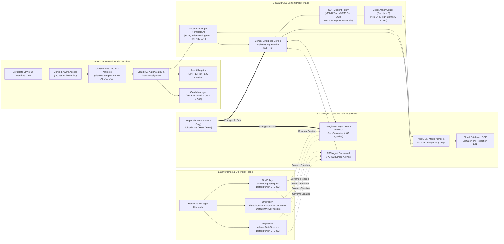
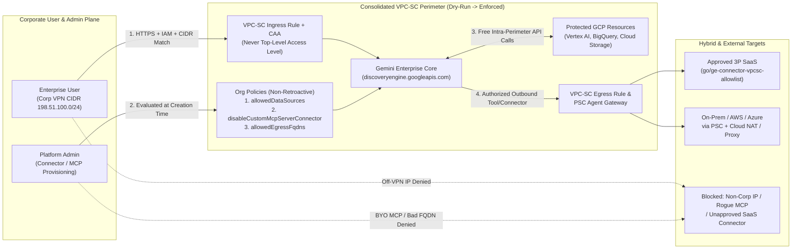
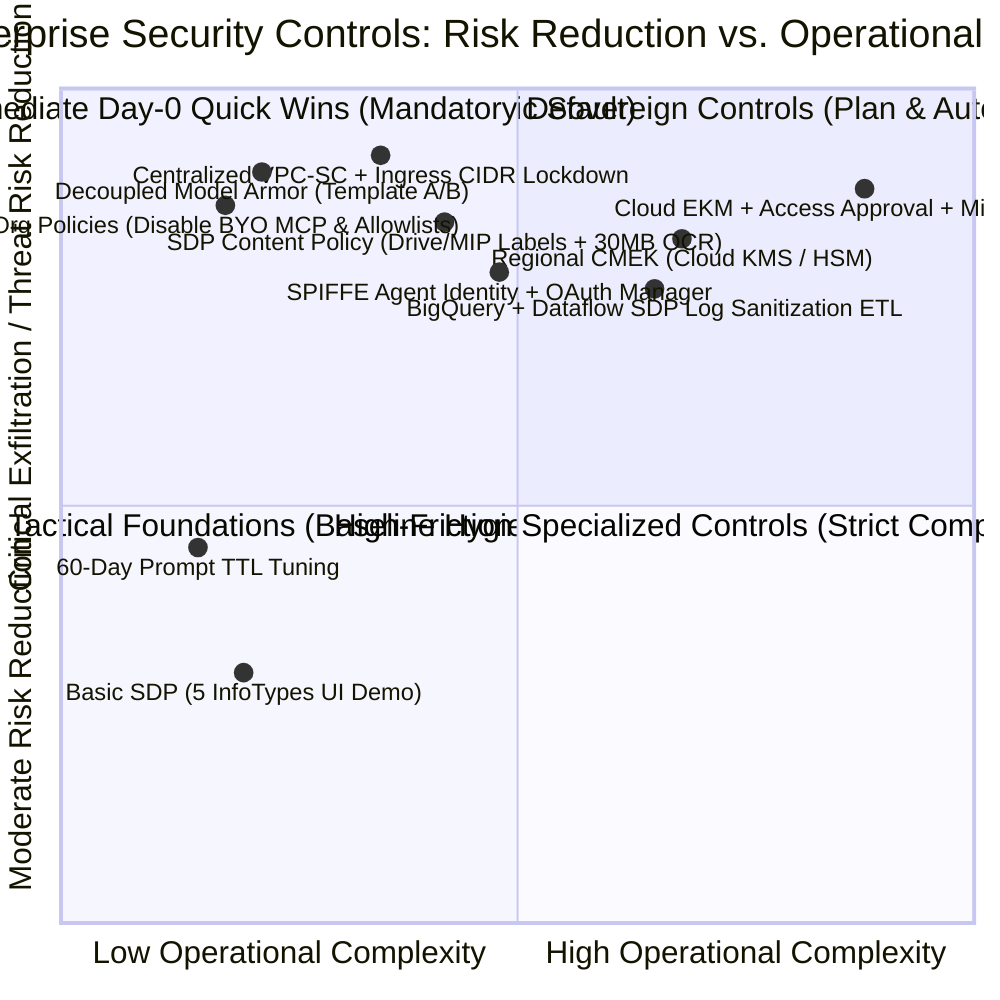

# Google Open Knowledge Framework (OKF): Gemini Enterprise Network Architecture & Security (Module A3) — `L400_version_20261026_0350`
**Topic Tags:** `#L400_version_20261026_0350` `#OKF_L400_A3` `#GeminiEnterprise` `#NetworkArchitectureAndSecurity` `#AntigravityAgenticAI` `#GCPKnowledgeCatalog`

---

## 0. OKF Document Metadata & Topic Modeling Taxonomy
**Topic Tags:** `#OKFMetadata` `#TopicModeling` `#TaxonomyHierarchy` `#KnowledgeGraphSchema` `#L400_version_20261026_0350`

> **OKF v0.2 Trust Signals, Bucket Merge & Enforced FDE Grading Rubric (`OKF-L400-21`):**
> - **Version Tag:** `L400_version_20261026_0350` | **Status (`status`):** `stable` (`VETTED` / `APPROVED`) | **TTL (`stale_after`):** `2027-04-26T00:00:00Z` *(Maintains existing TTL & version)* | **Verified (`verified`):** `true`
> - **Merged Bucket OKF Lineage:** Reconciled with `Concepts 13, 14, 15` in `gs://gea_agent_development_architectural_best_practices_1790796607` (`project=fivedaysai-prd-sandbox-317383`)
> - **Cloud FDE Prevailing Standard:** `https://g3doc.corp.google.com/company/teams/cloud-fde/index.md?cl=head`
> - **Enforced Project Grading Rubric (`OKF-L400-21`):** Adheres to the 0–3 FDE Field-Readiness Rubric (Pass Gate: Average >= 2.0 across Part A & Part B; Zero-Score Pause Rule: any `0 - Not Demonstrated` triggers an immediate pause and 2-week re-presentation). Primary mapped competencies for `OKF-L400-A3`: **Part A.2 (Objection Handling), Part B.1.5 (HIPAA/FINRA Privacy), Part B.3.2 (Infrastructure & Network Security), Part B.3.3 (Data Protection & Privacy), Part B.3.4 (AI-Specific Security), Part B.6.2 (Infrastructure as Code)**.

### 0.1 OKF Document Metadata Table
**Topic Tags:** `#DocumentMetadata` `#IngestionSchema` `#AntigravityContext` `#SourceLineage`

| Metadata Attribute | Specification / Value |
| :--- | :--- |
| **Document ID** | `OKF-L400-A3` |
| **Document Title** | Google Open Knowledge Framework (OKF): Gemini Enterprise Network Architecture & Security (Module A3) |
| **Version Identifier** | `L400_version_20261026_0350` |
| **Curriculum Level** | L400 (Principal / Fellow / Forward Deployed Engineer / Enterprise Security Architect) |
| **Target Capabilities** | Six-Layer Defense-in-Depth Security Architecture; Shared Responsibility & End-to-End Query Lifecycle (`Dolphin` query rewriter, per-project per-connector tenant projects, 60-day conversation TTL); VPC Service Controls (`VPC-SC`) API-Layer Zero-Trust Perimeters, Context-Aware Access CIDR/UI Lockdown, Ingress/Egress Rules, Private Service Connect (`PSC`) & Agent Gateway; Organization Policy Exfiltration Guardrails (`allowedDataSources`, `disableCustomMcpServerConnector`, `allowedEgressFqdns`); Cryptographic Sovereignty (`Cloud KMS`, `Cloud HSM`, `Cloud EKM`, 3-Step CMEK Onboarding, Immutability & Rotation Constraints), Access Transparency & Access Approval; Cloud Sensitive Data Protection (`SDP` / `DLP`) Content Policies, Microsoft MIP & Google Workspace / Drive Labels Lab, Multimodal OCR & Capacity Thresholds (`10 MB` Text / `30 MB` Rich Docs); Bidirectional LLM Guardrails (`Model Armor` Asymmetric `Template:A` & `Template:B` Decoupling, `PIJB`, `CSAM`, Safe Browsing URL Scanning, API `Inspect-Only` Mode); SPIFFE First-Party Agent Identity, `Agent Registry`, `OAuth Manager` (API Keys, OAuth 2.0, JWT, X.509/GCP Tokens), and Sanitized BigQuery ETL Audit Log Correlation. |
| **Source Artifacts** | 1. `a3_network_architecture_and_security.md` (Module A3 Video Transcript, Learning Points, WAF Question Bank & 45 Scenario/Certification Questions)<br>2. `slides-a3-network-architecture-and-security.md` (Module A3 L400 Architectural Slide Deck Synthesis, Process Flows & Customer Case Studies) |
| **GCP Knowledge Catalog Ingestion Schema** | `gcp-knowledge-catalog://okf/v2026.10/l400/a3-network-architecture-and-security` (Chunking Strategy: Heading-Scoped Semantic Blocks with Universal `#Tag` Inheritance; Vector Embedding Model: `text-embedding-005` / `gemini-embedding-exp`; Graph Ontology: `Capability -> Sub-Topic -> Architectural Control -> WAF Pillar`) |
| **Antigravity Agentic AI Role** | Authoritative L400 Security & Network Reference Architecture for **Antigravity-driven Agentic AI development**. Enables autonomous coding, architecture-generation, and security-verification agents in Antigravity workspaces to synthesize compliant Terraform/gcloud IaC, enforce non-retroactive CMEK and Organization Policy sequencing, design consolidated VPC-SC perimeters with PSC Agent Gateways, decouple Model Armor input/output templates, attach SDP Content Policies across connectors and Google Drive/Workspace repositories, and validate zero-trust SPIFFE agent identities prior to production deployment. |

---

### 0.2 Primary Topic Tags, Secondary Sub-Topic Tags & Three-Tier Taxonomy
**Topic Tags:** `#PrimaryTopicTags` `#SecondarySubTopicTags` `#ThreeTierTaxonomy` `#OntologyMapping`

#### 0.2.1 Primary Topic Tags (6 Core Pillars)
**Topic Tags:** `#CorePillars` `#PrimaryTags` `#SecurityDomains`

1. **`#DefenseInDepthSecurityArchitecture`** *(Type: Architectural)*: Encompasses the six-layer security model (Google Cloud Resource Manager, Cloud Logging/Monitoring & Security Command Center, Cloud IAM Hierarchy, Model Armor LLM Guardrails, Logical Segmentation via VPC-SC & Context-Aware Access, and CMEK/SDP Data Protection), the Google-managed vs. Customer-managed shared responsibility boundary, and the 60-day default stateful query lifecycle.
2. **`#ZeroTrustNetworkPerimetersAndConnectorGovernance`** *(Type: Architectural)*: Covers API-layer zero-trust perimeters (`VPC Service Controls`), Context-Aware Access CIDR/VPN ingress rules locking down the public Gemini Enterprise FQDN/UI, outbound connector egress allowlisting (`go/ge-connector-vpcsc-allowlist`), Private Service Connect (`PSC`), Cloud NAT / Proxy egress patterns, and the three non-retroactive Organization Policy constraints (`discoveryengine.managed.allowedDataSources`, `disableCustomMcpServerConnector`, `allowedEgressFqdns`).
3. **`#CryptographicSovereigntyAndAccessGovernance`** *(Type: Capability)*: Governs data-at-rest and in-transit encryption via regional (`US`/`EU` only) Customer-Managed Encryption Keys across **Cloud KMS** (Software), **Cloud HSM** (FIPS 140-2/3 Hardware), and **Cloud EKM** (External Key Manager), the mandatory three-step CMEK onboarding sequence, datastore key immutability, third-party connector and analytics key-rotation incompatibilities, **Access Transparency** logs, and **Access Approval** controls.
4. **`#SensitiveDataProtectionAndDriveLabelGovernance`** *(Type: Capability)*: Details Cloud Sensitive Data Protection (`SDP` / `DLP`) discovery, classification (`200+ infoTypes`), de-identification (redaction, masking, cryptographic tokenization, FPE), Advanced vs. Basic SDP tiers, per-connector and per-app/NotebookLM **SDP Content Policies**, native enforcement of **Microsoft Purview Information Protection (MIP/AIP)** and **Google Workspace / Google Drive Sensitivity Labels**, and high-capacity multimodal OCR document screening (`10 MB` text / `30 MB` rich documents).
5. **`#LLMGuardrailsAndModelArmor`** *(Type: Capability)*: Captures bidirectional runtime LLM inspection via **Model Armor** across Google Gemini, Anthropic Claude, Meta Llama, and OpenAI models, mitigating direct/indirect Prompt Injection and Jailbreak (`PIJB`) attacks, role-playing exploits, off-prompt URL threats (`Google Safe Browsing`), `CSAM`, and RAI violations through **Asymmetric Prompt/Response Template Decoupling** (`Template:A` vs. `Template:B`) and API-exclusive `Inspect-Only` dry-run mode.
6. **`#SPIFFEAgentIdentityAndSanitizedObservability`** *(Type: Operational)*: Defines first-party **SPIFFE** agent identities (`spiffe://<trust-domain>/<resource-path>/<agent-name>`) managed in the project-level **Agent Registry**, **OAuth Manager** automated secret and token lifecycle management (`API Keys`, `OAuth 2.0`, `JWT`, `X.509/GCP Tokens`), perimeter-isolated **Agent Gateways**, low-code agent action allowlisting, and correlated **Gemini Enterprise + Model Armor + Data Access Audit Logs** sanitized via **BigQuery ETL** pipelines.

#### 0.2.2 Secondary Sub-Topic Tags (6 High-Precision Capabilities & Impacts)
**Topic Tags:** `#SecondaryTags` `#CapabilityTags` `#ImpactTags`

1. **`#AsymmetricPromptResponseTemplateDecoupling`** *(Type: Capability)*: Attaches distinct Model Armor templates to untrusted user prompts (`Template:A` with PIJB, Safe Browsing URL scanning, RAI, and SDP enabled) versus trusted LLM responses (`Template:B` with PIJB disabled and High-Confidence RAI + SDP de-identification enabled), eliminating false positives on technical/code outputs and isolating policy block root causes.
2. **`#FederatedConnectorAndUploadSDPContentPolicy`** *(Type: Capability)*: Bridges Model Armor's inbound connector blind spot and `4 MB` file size cap by inspecting federated retrieval payloads (`Jira`, `SharePoint`, `Google Drive`), enforcing external MIP/Workspace labels, and scanning user uploads up to `10 MB` (text) and `30 MB` (PDF/Word/PPT/Excel) with embedded image OCR.
3. **`#RegionalCMEKThreeStepLifecycleAndImmutability`** *(Type: Operational)*: Enforces the strict provisioning order (`Step 01: Register Key in Project Settings` -> `Step 02: Select Key at Connector Creation` -> `Step 03: Bind Datastore to App`) within `US`/`EU` regional deployments while preventing production outages caused by non-retroactive key attachment, 3P connector rotation incompatibility, and analytics rotation failures.
4. **`#APILayerExfiltrationPreventionAndUILockdown`** *(Type: Impact)*: Eliminates credential-stuffing and cross-project data exfiltration at zero licensing cost by encapsulating `discoveryengine.googleapis.com`, `aiplatform.googleapis.com`, `bigquery.googleapis.com`, and `storage.googleapis.com` inside consolidated environment-level VPC-SC perimeters with ingress-bound Context-Aware Access CIDR rules.
5. **`#MaliciousAdminExfiltrationMitigationViaOrgPolicies`** *(Type: Impact)*: Prevents rogue or compromised project administrators from provisioning unauthorized SaaS data stores or exfiltrating enterprise context to external Bring-Your-Own (`BYO`) Model Context Protocol (`MCP`) servers via creation-time Resource Manager Organization Policies.
6. **`#CorrelatedAuditLoggingWithBigQueryPIIRedaction`** *(Type: Operational)*: Joins `Gemini Enterprise Logs` (`userIamPrincipal`, `gen_ai.user.message`, `email_agent` actions) with `Model Armor Verdict Logs` (`operationType`, `confidenceLevel`) and `Data Access Audit Logs` through a Cloud Dataflow + SDP BigQuery ETL pipeline so SOC analysts gain full forensic attribution without exposure to raw employee PII.

#### 0.2.3 Three-Tier Taxonomy Hierarchy
**Topic Tags:** `#ThreeTierTaxonomy` `#TaxonomyTree` `#DomainClassification`

* **Tier 1: Enterprise AI Network & Security Foundation (Domain Root)**
  * **Tier 2: Plane 1 — Multi-Layer Defense & Shared Responsibility**
    * Tier 3: Six-Layer Security Stack (`Resource Manager`, `SCC/Logging`, `IAM`, `Model Armor`, `VPC-SC/CAA`, `CMEK/SDP`)
    * Tier 3: Google-Managed Tenant Projects (`Data Injectors`, `Pre-Written Knowledge Graph Queries`, `Dolphin Rewriter`) vs. Customer-Managed Plane (`Identities`, `VPC-SC`, `CMEK`, `Access Transparency`)
    * Tier 3: End-to-End Query Lifecycle & Configurable 60-Day Conversation History TTL
  * **Tier 2: Plane 2 — Zero-Trust Network Perimeters, Ingress/Egress & Org Policy Governance**
    * Tier 3: Consolidated vs. Compliance Micro-Perimeter VPC-SC Design (`Dry-Run` to `Enforced`)
    * Tier 3: Public FQDN/UI Lockdown via Context-Aware Access IP/CIDR Ingress Rules (Avoiding Top-Level Access Levels)
    * Tier 3: Egress Topologies (`PSC`, `Agent Gateway`, `Cloud NAT`, `Explicit Connector Egress Allowlists`)
    * Tier 3: Non-Retroactive Organization Policies (`allowedDataSources`, `disableCustomMcpServerConnector`, `allowedEgressFqdns`)
  * **Tier 2: Plane 3 — Cryptographic Sovereignty (CMEK) & Administrative Access Controls**
    * Tier 3: Custody Tiers (`Cloud KMS Software`, `Cloud HSM Hardware`, `Cloud EKM Third-Party`)
    * Tier 3: Three-Step CMEK Onboarding, `US`/`EU` Regional Exclusivity, Support Tickets & Quota Increases
    * Tier 3: Non-Retroactive Datastore Immutability, 3P Connector & Analytics Rotation Restrictions
    * Tier 3: Administrative Sovereignty (`Access Transparency` Audit Logs & `Access Approval` Cryptographic Consent)
  * **Tier 2: Plane 4 — Sensitive Data Protection (SDP / DLP) & Bidirectional LLM Guardrails (Model Armor)**
    * Tier 3: Cloud SDP (`200+ InfoTypes`, `Basic` 5-InfoType Demo Tier vs. `Advanced` No-Training/Terraform Tier)
    * Tier 3: SDP Content Policies (Per-Connector, Per-App `Assistant setting`, Per-Project `NotebookLM setting`, `10 MB`/`30 MB` Limits, Image OCR)
    * Tier 3: Google Drive Lab & External Sensitivity Label Enforcement (`Google Workspace Labels`, `Microsoft MIP/AIP`)
    * Tier 3: Model Armor Asymmetric Decoupling (`Template:A` Input vs. `Template:B` Output, `PIJB`, `Safe Browsing`, `10k`/`130k` Token Limits, `4 MB` Cap, API `Inspect-Only`)
  * **Tier 2: Plane 5 — SPIFFE Agent Identity, OAuth Manager & Sanitized Security Telemetry**
    * Tier 3: First-Party `SPIFFE` Agent Identities (`spiffe://`) & Project-Scoped `Agent Registry`
    * Tier 3: `OAuth Manager` Credential Store & Token Automation (`API Keys`, `OAuth 2.0`, `JWT`, `X.509/GCP Tokens`)
    * Tier 3: Low-Code Agent Action Allowlisting & Multi-Stream Log Correlation via BigQuery PII Redaction ETL

#### 0.2.4 Topic Taxonomy Matrix Table
**Topic Tags:** `#TaxonomyMatrix` `#CatalogMapping` `#SecurityControlsMatrix`

| Topic Tag | Taxonomy Tier & Type | Parent / Related Tags | Architectural Scope & Governance Function |
| :--- | :--- | :--- | :--- |
| **`#DefenseInDepthSecurityArchitecture`** | Tier 1 — Architectural | `#LayeredSecurity`, `#SharedResponsibility` | Orchestrates 6 concentric security layers across Google-managed tenant projects and customer-managed GCP environments. |
| **`#ZeroTrustNetworkPerimetersAndConnectorGovernance`** | Tier 1 — Architectural | `#VPCServiceControls`, `#OrgPolicies` | Enforces API-layer zero-trust perimeters (`discoveryengine.googleapis.com`), CIDR UI lockdown, PSC routing, and Org Policy admin guardrails. |
| **`#CryptographicSovereigntyAndAccessGovernance`** | Tier 1 — Capability | `#CMEK`, `#CloudKMS`, `#AccessTransparency` | Governs `US`/`EU` regional key custody (`KMS`/`HSM`/`EKM`), 3-step onboarding, rotation constraints, and Access Transparency visibility. |
| **`#SensitiveDataProtectionAndDriveLabelGovernance`** | Tier 1 — Capability | `#CloudSDP`, `#SDPContentPolicy`, `#DriveLabels` | Classifies and de-identifies `200+ infoTypes`, enforces Workspace/MIP sensitivity labels, and inspects uploads up to `30 MB` with OCR. |
| **`#LLMGuardrailsAndModelArmor`** | Tier 1 — Capability | `#ModelArmor`, `#PromptInjection`, `#SafeBrowsing` | Screens prompts and responses for `PIJB`, `CSAM`, RAI, SDP, and malicious URLs at zero additional SKU cost in `US`/`EU` regions. |
| **`#SPIFFEAgentIdentityAndSanitizedObservability`** | Tier 1 — Operational | `#SPIFFE`, `#OAuthManager`, `#AgentGateway` | Assigns first-party IAM identities to agents, automates 4 credential types in OAuth Manager, and correlates sanitized audit logs in BigQuery. |
| **`#AsymmetricPromptResponseTemplateDecoupling`** | Tier 2 — Capability | `#LLMGuardrailsAndModelArmor` | Separates `Template:A` (Input: PIJB + URL on) from `Template:B` (Output: PIJB off, SDP/RAI on) to eliminate false positives and isolate errors. |
| **`#FederatedConnectorAndUploadSDPContentPolicy`** | Tier 2 — Capability | `#SensitiveDataProtectionAndDriveLabelGovernance` | Inspects inbound federated connector snippets and `10 MB`/`30 MB` file uploads that bypass Model Armor's connector blind spot and `4 MB` limit. |
| **`#RegionalCMEKThreeStepLifecycleAndImmutability`** | Tier 2 — Operational | `#CryptographicSovereigntyAndAccessGovernance` | Mandates key registration prior to connector creation and prevents breaking 3P connectors or Analytics via automated KMS key rotation. |
| **`#APILayerExfiltrationPreventionAndUILockdown`** | Tier 2 — Impact | `#ZeroTrustNetworkPerimetersAndConnectorGovernance` | Blocks unauthorized cross-perimeter API calls and restricts public web UI access to corporate VPN/on-prem CIDRs via ingress rules. |
| **`#MaliciousAdminExfiltrationMitigationViaOrgPolicies`** | Tier 2 — Impact | `#ZeroTrustNetworkPerimetersAndConnectorGovernance` | Blocks privileged insiders from creating unapproved SaaS connectors or connecting rogue BYO MCP servers at resource creation time. |
| **`#CorrelatedAuditLoggingWithBigQueryPIIRedaction`** | Tier 2 — Operational | `#SPIFFEAgentIdentityAndSanitizedObservability` | Joins `GE Log` (`userIamPrincipal`) and `Model Armor Log` (`operationType`, `confidenceLevel`) through a PII-redacting BigQuery ETL pipeline. |

---

### 0.3 Module Topic Connection & Flow Graph
**Topic Tags:** `#TopicConnectionGraph` `#MermaidGraphLR` `#ASCIITopology` `#EndToEndSecurityFlow`

#### 0.3.1 Mermaid.js `graph LR` Topic Connection & Security Plane Flow Graph
**Topic Tags:** `#MermaidGraph` `#SecurityPlaneFlow` `#DefenseInDepthGraph`



#### 0.3.2 ASCII Architectural Picture: Concentric Six-Layer Security & Shared Responsibility Topology
**Topic Tags:** `#ASCIIArchitecture` `#SharedResponsibilityModel` `#SixLayerTopology`

```text
+======================================================================================================+
| LAYER 1: GOOGLE CLOUD RESOURCE MANAGER & ORGANIZATION POLICIES (Creation-Time Admin Guardrails)      |
|   * discoveryengine.managed.allowedDataSources          (Default: Enabled for VPC-SC Projects)       |
|   * discoveryengine.managed.disableCustomMcpServerConnector (Default: Enabled for ALL Projects)      |
|   * discoveryengine.managed.allowedEgressFqdns          (Default: Enabled for VPC-SC Projects)       |
|                                                                                                      |
|  +================================================================================================+  |
|  | LAYER 2: DETECTION, VISIBILITY & SOVEREIGNTY (Cloud Logging, Monitoring, SCC, Access Transp.) |  |
|  |   * Admin Activity (On) | Data Access (Enable*) | GE Prompt/Agent Log (Enable*) | MA Log (On*) |  |
|  |   * Cloud Dataflow + SDP ETL -> BigQuery (Redacts Unfiltered PII/Salary Queries from Raw Logs) |  |
|  |                                                                                                |  |
|  |  +==========================================================================================+  |  |
|  |  | LAYER 3: SEGMENTATION & API PERIMETER (Consolidated VPC-SC + Context-Aware Access CIDR)  |  |  |
|  |  |   * Restricted APIs: discoveryengine.googleapis.com, Vertex AI, BigQuery, Cloud Storage  |  |  |
|  |  |   * Ingress Rules (NOT Top-Level Access Levels): Lock Public Web UI to Corporate VPN IPs |  |  |
|  |  |   * Egress Rules: PSC Agent Gateway + go/ge-connector-vpcsc-allowlist for Outbound Tools |  |  |
|  |  |                                                                                          |  |  |
|  |  |  +====================================================================================+  |  |  |
|  |  |  | LAYER 4: IDENTITY, REGISTRY & CREDENTIALS (Cloud IAM + SPIFFE + OAuth Manager)     |  |  |  |
|  |  |  |   * User AuthN/AuthZ + Seat License | First-Party SPIFFE IDs in Agent Registry     |  |  |  |
|  |  |  |   * OAuth Manager: API Keys (3P) | OAuth 2.0 (2L/3L) | JWT (Hybrid) | X.509 (A2A)  |  |  |  |
|  |  |  |                                                                                    |  |  |  |
|  |  |  |  +==============================================================================+  |  |  |  |
|  |  |  |  | LAYER 5: BIDIRECTIONAL GUARDRAILS (Model Armor + SDP Content Policies)       |  |  |  |  |
|  |  |  |  |   * Model Armor Template:A (Input)  -> PIJB ON, SafeBrowsing URL, RAI, SDP   |  |  |  |  |
|  |  |  |  |   * SDP Content Policy (Connectors/Uploads) -> 10MB/30MB, OCR, MIP/Drive Lbl |  |  |  |  |
|  |  |  |  |   * Model Armor Template:B (Output) -> PIJB OFF, High-Conf RAI + SDP Redact  |  |  |  |  |
|  |  |  |  |                                                                              |  |  |  |  |
|  |  |  |  |  +========================================================================+  |  |  |  |  |
|  |  |  |  |  | LAYER 6: CRYPTOGRAPHIC DATA PROTECTION & SHARED RESPONSIBILITY CORE    |  |  |  |  |  |
|  |  |  |  |  |  [CUSTOMER-MANAGED PLANE]              [GOOGLE-MANAGED TENANT PLANE]   |  |  |  |  |  |
|  |  |  |  |  |  * Regional CMEK (US/EU Only):         * Per-Project Per-Connector     |  |  |  |  |  |
|  |  |  |  |  |    Cloud KMS / Cloud HSM / Cloud EKM     Tenant Isolation              |  |  |  |  |  |
|  |  |  |  |  |  * 60-Day Default Prompt/Response TTL  * Data Injectors & Dolphin      |  |  |  |  |  |
|  |  |  |  |  |  * Underlying Compute: Shielded VMs    * Pre-Written KG Queries        |  |  |  |  |  |
|  |  |  |  |  +========================================================================+  |  |  |  |  |
|  |  |  |  +==============================================================================+  |  |  |  |
|  |  |  +====================================================================================+  |  |  |
|  |  +==========================================================================================+  |  |
|  +================================================================================================+  |
+======================================================================================================+
```

---

## 1. Executive Overview, Problem Statement & Antigravity Agentic AI Development Context
**Topic Tags:** `#ExecutiveOverview` `#ProblemStatement` `#AntigravityDevelopment` `#EnterpriseSecurityPosture` `#L400_version_20261026_0350`

> **Enforced FDE Project Grading Rubric Reference (`OKF-L400-21` & `g3doc/company/teams/cloud-fde`):** Every project applying Section 1 of `OKF-L400-A3` is graded against **Part A.2 (Objection Handling), Part B.1.5 (HIPAA/FINRA Privacy), Part B.3.2 (Infrastructure & Network Security), Part B.3.3 (Data Protection & Privacy), Part B.3.4 (AI-Specific Security), Part B.6.2 (Infrastructure as Code)** and merged bucket **Concepts 13, 14, 15** (`stale_after: 2027-04-26T00:00:00Z`, version `L400_version_20261026_0350`). Builders must achieve >= 2 (**Competent**) across Part A & Part B and avoid any 0 (**Not Demonstrated**) pause triggers.

### 1.1 Executive Summary & The Enterprise Agentic AI Security Challenge
**Topic Tags:** `#ExecutiveSummary` `#AgenticThreatLandscape` `#ZeroTrustArchitecture` `#EnterpriseGovernance`

Modern enterprise deployments of **Gemini Enterprise (Agentspace)** transition organizations from isolated, stateless chat interfaces to stateful, multi-model, multi-agent ecosystems capable of querying federated corporate repositories (`Google Drive`, `Microsoft SharePoint`, `OneDrive`, `Jira`, `ServiceNow`, `BigQuery`) and executing autonomous outbound actions (`sending emails`, `creating tickets`, `invoking external Model Context Protocol [MCP] servers`, and orchestrating `Agent-to-Agent [A2A]` workflows). This architectural leap introduces six critical enterprise security challenges that traditional network firewalls and standard IAM bindings cannot resolve in isolation:

1. **Asymmetric Prompt & Off-Prompt Threat Vectors**: Adversaries exploit direct prompt injections, role-playing operational pretexts (e.g., disguising malicious shutdown/startup command requests as Windows Subsystem for Linux [WSL] troubleshooting), and indirect off-prompt URL payloads to hijack LLM instructions or extract secrets. Conversely, applying aggressive Prompt Injection and Jailbreak (`PIJB`) detectors symmetrically to LLM outputs generates severe false-positive blocks on benign developer code and technical documentation.
2. **Inbound Federated Connector Blind Spots & Over-Permissive Source ACLs**: Legacy enterprise file shares (`OneDrive`, `SharePoint`, `Google Drive`) frequently suffer from "messy" or overly permissive Access Control Lists (`ACLs`), allowing employees to prompt *"What are the secrets in OneDrive?"* or query escalation tickets containing raw payment card numbers (`KAN10`). Furthermore, **Model Armor** inspects user prompts, model responses, and small direct attachments (`<= 4 MB`), but does **not** scan inbound data retrieved via federated or ingested connectors, nor does it scan embedded PDF images or files exceeding `4 MB`.
3. **Cryptographic Sovereignty & Non-Retroactive Lifecycle Traps**: Regulated enterprises in financial services, healthcare, and defense require **Customer-Managed Encryption Keys (`CMEK`)** across software (`Cloud KMS`), hardware (`Cloud HSM`), or external (`Cloud EKM`) boundaries alongside **Access Transparency** and **Access Approval**. However, architects frequently encounter destructive production pitfalls: CMEK is restricted exclusively to `US` and `EU` regional deployments (unsupported in `global`), cannot be attached retroactively to existing data stores, breaks **Analytics** when keys rotate, and is incompatible with key rotation on **third-party connectors**.
4. **Public UI Credential Abuse & Cross-Perimeter API Exfiltration**: Because Gemini Enterprise exposes a public Fully Qualified Domain Name (`FQDN`) web UI and relies on managed Google APIs (`discoveryengine.googleapis.com`), stolen employee credentials or compromised service accounts could be used from personal devices or external GCP projects to exfiltrate indexed enterprise knowledge unless an API-layer zero-trust perimeter (**VPC Service Controls**) and **Context-Aware Access** IP/CIDR ingress rules are properly enforced.
5. **Privileged Insider / Malicious Admin Exfiltration Risks**: A rogue or compromised Gemini Enterprise project administrator with permissions to create connectors could connect an unauthorized personal SaaS repository (e.g., personal Box/OneDrive) or point a custom Bring-Your-Own (`BYO`) **MCP server** at an attacker-controlled external domain unless creation-time **Organization Policies** restrict allowed data sources and egress FQDNs.
6. **Agent Identity Sprawl, Hardcoded Secrets & Unsanitized Audit Telemetry**: Multi-agent (`A2A`) and multi-cloud tool executions risk proliferating static service account keys and hardcoded API secrets. Simultaneously, while security operations centers (`SOCs`) require correlated **Gemini Enterprise** and **Model Armor** logs to attribute blocked attacks and audit low-code agent actions (`email_agent`), raw usage logs retain unfiltered user prompts containing PII or salary queries by default.

---

### 1.2 How Antigravity Agentic AI Development Consumes This OKF Artifact
**Topic Tags:** `#AntigravityAgenticAI` `#AutonomousEngineering` `#IaCGeneration` `#GuardrailVerification`

Within the **Antigravity Agentic AI Development** lifecycle, autonomous architecture, coding, and verification agents query the **GCP Knowledge Catalog** using this OKF specification (`OKF-L400-A3`, `L400_version_20261026_0350`) to enforce deterministic architectural guardrails before generating infrastructure-as-code (`Terraform` / `gcloud` / `REST API` payloads) or deploying agentic runtimes:

* **Automated Pre-Flight Regional & CMEK Sequencing Validation**: When an Antigravity agent is tasked with provisioning a CMEK-protected Gemini Enterprise environment, it validates that the target location is `us` or `eu` (never `global`), enforces the mandatory three-step sequence (`1. Register KMS Key in Project Settings` -> `2. Provision Connector with CMEK` -> `3. Bind Datastore to App`), disables automated key rotation on keys bound to third-party connectors or analytics-enabled workspaces, and flags quota/support-ticket prerequisites (`>1 CMEK key per project` quota request; `Cloud HSM`/`Cloud EKM` support ticket).
* **Zero-Trust Perimeter & Organization Policy Synthesis**: Antigravity agents automatically generate consolidated environment-scale **VPC Service Controls** perimeters encapsulating `discoveryengine.googleapis.com`, `aiplatform.googleapis.com`, `bigquery.googleapis.com`, and `storage.googleapis.com` in **Dry-Run mode** first, bind corporate VPN CIDR access levels strictly inside **Ingress Rules** (never at the perimeter's *Top-level access levels* field), and assert the three managed Organization Policies (`discoveryengine.managed.allowedDataSources`, `discoveryengine.managed.disableCustomMcpServerConnector`, and `discoveryengine.managed.allowedEgressFqdns`) **prior** to creating any connectors.
* **Complementary Dual-Guardrail Wiring (Model Armor + SDP Content Policy)**: Antigravity agents wire decoupled **Model Armor** templates (`Template:A` on input with `PIJB=ENABLED`, `SafeBrowsing=ENABLED`, `Confidence=HIGH`, `Model=latest`, `MultiLanguage=ENABLED`; `Template:B` on output with `PIJB=DISABLED`, `RAI/SDP=ENABLED`) alongside **Advanced SDP** (`Inspect` + `De-identify` templates) and **SDP Content Policies** at all three attachment points (`Per-Connector`, `Per-App Assistant setting`, and `Per-Project NotebookLM setting`) to close the `>4 MB` upload (`up to 30 MB`) and federated retrieval inspection gaps.
* **SPIFFE First-Party Identity & Sanitized Observability Scaffolding**: Antigravity agents register custom agents in the project-level **Agent Registry** using **SPIFFE** IDs (`spiffe://<trust-domain>/<resource-path>/<agent-name>`), store third-party credentials in **OAuth Manager** (`API Keys`, `OAuth 2.0`, `JWT`, `X.509/GCP Tokens`), route external A2A/MCP calls through **Private Service Connect (`PSC`) Agent Gateways**, and deploy a **Cloud Dataflow + SDP BigQuery ETL pipeline** to redact PII before joining `Gemini Enterprise Logs` with `Model Armor Verdict Logs`.

---

## 2. Deep Technical Architecture, Matrices, Visual Pictures & Flow Diagrams
**Topic Tags:** `#DeepTechnicalArchitecture` `#NetworkSecurityTopology` `#ZeroTrustControls` `#L400_version_20261026_0350`

> **Enforced FDE Project Grading Rubric Reference (`OKF-L400-21` & `g3doc/company/teams/cloud-fde`):** Every project applying Section 2 of `OKF-L400-A3` is graded against **Part A.2 (Objection Handling), Part B.1.5 (HIPAA/FINRA Privacy), Part B.3.2 (Infrastructure & Network Security), Part B.3.3 (Data Protection & Privacy), Part B.3.4 (AI-Specific Security), Part B.6.2 (Infrastructure as Code)** and merged bucket **Concepts 13, 14, 15** (`stale_after: 2027-04-26T00:00:00Z`, version `L400_version_20261026_0350`). Builders must achieve >= 2 (**Competent**) across Part A & Part B and avoid any 0 (**Not Demonstrated**) pause triggers.

### 2.1 Six-Layer Defense-in-Depth, Shared Responsibility & Stateful Query Lifecycle
**Topic Tags:** `#DefenseInDepthSecurityArchitecture` `#SharedResponsibilityModel` `#DolphinQueryRewriter` `#QueryLifecycle`

#### 2.1.1 Architectural Deep Dive: Shared Responsibility & Query Execution Pipeline
**Topic Tags:** `#GoogleManagedTenant` `#CustomerManagedPlane` `#60DayRetentionTTL`

Gemini Enterprise enforces a **six-layer defense-in-depth architecture** across two distinct operational planes:
* **Customer-Managed Environment**: Encompasses corporate identities (`Cloud Identity` / `Workforce Identity Federation`), `Cloud IAM` role bindings and user seat licensing, `Resource Manager` Organization Policies, `VPC Service Controls` (`VPC-SC`) and `Context-Aware Access` (`CAA`) perimeters, `Customer-Managed Encryption Keys` (`CMEK`), `Cloud Sensitive Data Protection` (`SDP`), `Model Armor` templates, `Agent Registry` (`SPIFFE` IDs), `OAuth Manager`, and `Cloud Logging` / `Monitoring` / `Security Command Center` (`SCC`).
* **Google-Managed Environment**: Encompasses dedicated **per-project, per-connector tenant projects** (eliminating cross-customer noisy-neighbor and data commingling risks), managed data injectors, pre-written Knowledge Graph (`KG`) queries, the internal **Dolphin** query-rewriting microservice, and underlying **Shielded VMs** with secure boot and virtual trusted platform modules (`vTPM`).
* **End-to-End Stateful Query Lifecycle**:
  1. **Identity & License Verification**: User request enters via the public FQDN or private endpoint; Cloud IAM authenticates the principal and verifies an active Gemini Enterprise seat license.
  2. **Input Guardrail Inspection (`Template:A`)**: The prompt and any direct file attachment (`<= 4 MB`) are evaluated synchronously by **Model Armor** (`PIJB`, `Safe Browsing URL`, `CSAM`, `RAI`, and `SDP`) and **SDP Content Policy** (`up to 10 MB text / 30 MB rich docs`).
  3. **Dolphin Query Rewriting & Context Retrieval**: The internal **Dolphin** service rewrites the user query using conversation history (retained for **60 days by default**, configurable by admins) and dispatches federated or indexed searches across authorized connectors (`Google Drive`, `SharePoint`, `Jira`, `BigQuery`).
  4. **Inbound Connector SDP Content Policy Inspection**: Retrieved snippets and external sensitivity labels (`Google Workspace Labels`, `Microsoft MIP/AIP`) are evaluated by the connector's **SDP Content Policy** before reaching the foundation model.
  5. **Foundation Model Synthesis & Output Guardrail (`Template:B`)**: The foundation model generates the grounded response, which passes through **Model Armor Output `Template:B`** (`PIJB` disabled; `RAI` and `SDP` de-identification enabled) before returning to the user.

| Security Layer | Primary GCP Services & Mechanisms | Threat Vector Mitigated | Plane Ownership |
| :--- | :--- | :--- | :--- |
| **Layer 1: Resource Governance** | Resource Manager, Managed Org Policies (`allowedDataSources`, `disableCustomMcpServerConnector`, `allowedEgressFqdns`) | Malicious/compromised admin creating rogue SaaS connectors or BYO MCP exfiltration endpoints | Customer-Managed |
| **Layer 2: Detection & Sovereignty** | Cloud Logging, Cloud Monitoring, Security Command Center (`SCC`), Access Transparency (`AxT`), Access Approval (`AxA`) | Unmonitored API abuse, unauthorized provider access, and blind spots in agent execution | Shared (Telemetry by Google; SIEM/ETL by Customer) |
| **Layer 3: API & Network Segmentation** | VPC Service Controls (`VPC-SC`), Context-Aware Access (`CAA` CIDR rules), Private Service Connect (`PSC`), Agent Gateway | Stolen credentials used outside corporate VPN, cross-project API data exfiltration | Customer-Managed |
| **Layer 4: Identity & Credentials** | Cloud IAM, SPIFFE First-Party Agent Identity (`spiffe://`), Project-Level Agent Registry, OAuth Manager | Agent identity spoofing, static service account key leaks, hardcoded 3P API tokens | Customer-Managed |
| **Layer 5: Content & LLM Guardrails** | Model Armor (`Template:A` & `Template:B`), Cloud SDP (`Inspect`/`De-identify`), SDP Content Policies (`OCR`, `MIP/Drive Labels`) | Prompt injection/jailbreaks (`PIJB`), malicious URLs, oversized/scanned PDF PII leaks, messy ACLs | Customer-Managed Policy / Google Runtime |
| **Layer 6: Cryptographic & Compute Core** | Regional CMEK (`Cloud KMS`, `Cloud HSM`, `Cloud EKM`), Per-Connector Tenant Projects, Shielded VMs, 60-Day History TTL | Physical/logical compromise of storage media, cross-tenant leakage, indefinite prompt retention | Shared (Customer Keys; Google Tenant Isolation) |

#### 2.1.2 Inline Section Best Practices & FAQs (Defense-in-Depth & Lifecycle)
**Topic Tags:** `#InlineBestPractices` `#InlineFAQs` `#LifecycleGovernance`

* **Inline Best Practices**:
  * **Reduce Default 60-Day Prompt Retention for High-Sensitivity Apps**: Tune the default **60-day** prompt/response storage window downward in application settings for regulated financial or clinical workflows to minimize data-at-rest exposure.
  * **Audit Both Planes Continuously**: Enable `Data Access` audit logs alongside `Security Command Center` (`SCC`) and `Cloud Monitoring` to correlate user-plane queries with Google-managed tenant connector executions.
* **Inline FAQs**:
  * **Q: How does Gemini Enterprise isolate connector pipelines across different enterprise customers?**
    **A:** Google provisions a dedicated **per-project, per-connector Google-managed tenant project** containing isolated data injectors and pre-written Knowledge Graph queries for each customer connector.
  * **Q: What internal component rewrites user prompts before querying enterprise data stores?**
    **A:** The internal **Dolphin** query-rewriting service reformulates user queries using conversation context prior to executing federated or indexed retrieval.

---

### 2.2 Ingress/Egress Network Topologies, VPC Service Controls (VPC-SC), PSC & Org Policy Guardrails
**Topic Tags:** `#ZeroTrustNetworkPerimetersAndConnectorGovernance` `#VPCServiceControls` `#PrivateServiceConnect` `#OrgPolicies`

#### 2.2.1 Ingress Lockdown, Egress PSC/NAT/Proxy & VPC-SC Perimeter Design
**Topic Tags:** `#APILayerExfiltrationPreventionAndUILockdown` `#PSCAgentGateway` `#CloudNATEgress` `#ContextAwareAccess`

* **API-Layer Zero-Trust via VPC Service Controls (`VPC-SC`)**: Offered at **no additional licensing cost**, VPC-SC wraps `discoveryengine.googleapis.com`, `aiplatform.googleapis.com`, `bigquery.googleapis.com`, and `storage.googleapis.com` inside an API-layer zero-trust boundary. Resources inside the perimeter communicate freely; all cross-perimeter API calls default to deny.
* **Centralized vs. Isolated Perimeter Topologies**:
  * **Centralized Environment Perimeter (Recommended Standard)**: Encapsulate all production Gemini Enterprise apps, Vertex AI models, BigQuery datasets, and GCS buckets into **one consolidated regional/environment perimeter** to eliminate complex internal ingress/egress rules.
  * **Isolated Compliance Micro-Perimeters**: Reserve dedicated perimeters strictly for isolated regulatory workloads (`PCI-DSS`, `HIPAA`, high-sensitivity `PII`).
* **Public UI/FQDN Ingress Lockdown via Context-Aware Access (`CAA`)**:
  * Because the Gemini Enterprise web UI uses a public FQDN, pair VPC-SC with **Access Context Manager (`ACM`) / Context-Aware Access** rules restricting access to corporate VPN or on-premises IP/CIDR blocks and device posture policies.
  * **CRITICAL ANTI-PATTERN WARNING**: Never attach access levels at the **"Top-level access levels"** setting of a VPC-SC perimeter, as top-level access levels override granular ingress rules. Always bind CIDR/device access levels inside **VPC-SC Ingress Rules**.
* **Egress Topologies (PSC, Agent Gateway, Cloud NAT & Proxy)**:
  * **Private Service Connect (`PSC`) & Agent Gateway**: Route hybrid on-premises, cross-VPC, and multi-cloud (`AWS`/`Azure`) connector and `Agent-to-Agent (A2A)` traffic privately through **PSC endpoints** and the **Agent Gateway**, enforcing Principal Access Boundary (`PAB`) and VPC-SC egress policies without traversing the public internet.
  * **Cloud NAT / Secure Web Proxy & Connector Egress Allowlists**: When Google-managed tenant projects or agents invoke external SaaS APIs (`Jira`, `ServiceNow`, `SharePoint`), configure explicit VPC-SC egress rules referencing Google's published connector allowlist (`go/ge-connector-vpcsc-allowlist`) or route outbound VPC traffic through **Cloud NAT / Secure Web Proxy** with deterministic IP/FQDN filtering.

#### 2.2.2 Non-Retroactive Organization Policy Exfiltration Guardrails
**Topic Tags:** `#MaliciousAdminExfiltrationMitigationViaOrgPolicies` `#AllowedDataSources` `#DisableCustomMcp` `#AllowedEgressFqdns`

To prevent a rogue or compromised project administrator from exfiltrating enterprise data through unauthorized connectors or custom MCP servers, enforce three Resource Manager Organization Policies **before** provisioning connectors (Organization Policies are **non-retroactive** and only evaluate at resource creation/update time):

| Organization Policy Constraint | Default State | Security Enforcement Mechanism |
| :--- | :--- | :--- |
| **`constraints/discoveryengine.managed.allowedDataSources`** | **Enabled by default** for VPC-SC projects | Restricts which connector types (`Google Drive`, `BigQuery`, `Jira`, etc.) administrators can create, blocking unapproved consumer/external SaaS repositories. |
| **`constraints/discoveryengine.managed.disableCustomMcpServerConnector`** | **Enabled by default** for **ALL** projects | Blocks creation of custom Bring-Your-Own (`BYO`) Model Context Protocol (`MCP`) server connectors so admins cannot stream prompts/context to rogue external MCP endpoints. |
| **`constraints/discoveryengine.managed.allowedEgressFqdns`** | **Enabled by default** for VPC-SC projects | Restricts outbound connector and agent network calls strictly to an explicit allowlist of approved corporate/SaaS FQDNs. |



#### 2.2.3 Inline Section Best Practices & FAQs (Network & VPC-SC)
**Topic Tags:** `#InlineBestPractices` `#InlineFAQs` `#VPCSCGovernance`

* **Inline Best Practices**:
  * **Always Deploy VPC-SC in Dry-Run Mode First**: Validate all connector (`go/ge-connector-vpcsc-allowlist`) and user ingress traffic in **Dry-Run mode** via Cloud Logging before switching to **Enforced mode** to prevent production outages.
  * **Enforce Org Policies at Folder/Org Root Before Project Onboarding**: Because Organization Policies do not retroactively delete existing connectors, apply `allowedDataSources`, `disableCustomMcpServerConnector`, and `allowedEgressFqdns` during landing-zone bootstrap.
* **Inline FAQs**:
  * **Q: Why shouldn't administrators attach Context-Aware Access levels to the "Top-level access levels" field of a VPC-SC perimeter?**
    **A:** Top-level access levels take precedence over granular VPC-SC ingress rules and over-broaden perimeter access; always attach access levels inside **Ingress Rules** instead.
  * **Q: If `discoveryengine.managed.allowedDataSources` is updated today, what happens to an unapproved connector created last week?**
    **A:** Nothing happens automatically—Organization Policies are **non-retroactive**. Existing non-compliant connectors continue operating until manually audited and deleted.

---

### 2.3 Cryptographic Sovereignty (CMEK), Access Transparency (AxT) & Access Approval (AxA)
**Topic Tags:** `#CryptographicSovereigntyAndAccessGovernance` `#RegionalCMEKThreeStepLifecycleAndImmutability` `#AccessTransparency` `#AccessApproval`

#### 2.3.1 Regional CMEK Custody Tiers, 3-Step Onboarding & Operational Constraints
**Topic Tags:** `#CloudKMS` `#CloudHSM` `#CloudEKM` `#CMEKConstraints`

Gemini Enterprise encrypts all data at rest and in transit by default (`Google-owned and Google-managed keys`), and supports **Customer-Managed Encryption Keys (`CMEK`)** across three custody tiers:
1. **Cloud KMS (Software Keys)**: Google-hosted multi-tenant software cryptographic keys.
2. **Cloud HSM (Hardware Security Module)**: FIPS 140-2/3 validated hardware keys (requires opening a **Google Cloud Support ticket** to enable for Gemini Enterprise).
3. **Cloud EKM (External Key Manager)**: Keys held outside Google Cloud in a third-party external KMS (requires opening a **Google Cloud Support ticket** to enable).

```text
+---------------------------------------------------------------------------------------------------+
|                     MANDATORY 3-STEP REGIONAL CMEK ONBOARDING & IMMUTABILITY                      |
+---------------------------------------------------------------------------------------------------+
|  PREREQUISITES:                                                                                   |
|   * Location MUST be Regional (`US` or `EU` multi-regions ONLY — `global` is NOT supported!)      |
|   * >1 CMEK Key per Project -> Submit Quota Increase Request                                      |
|   * Cloud HSM or Cloud EKM  -> Open Google Cloud Support Ticket                                   |
|                                                                                                   |
|  [STEP 01: Register CMEK Key] ---> [STEP 02: Create Connector] ---> [STEP 03: Create App]         |
|   Register KMS/HSM/EKM key in       Select registered CMEK key       Attach CMEK-encrypted        |
|   Gemini Enterprise Project         DURING initial datastore /       datastore to regional        |
|   Settings BEFORE datastores.       connector creation.              Gemini Enterprise App.       |
|                                                                                                   |
|  CRITICAL IMMUTABILITY & ROTATION CONSTRAINTS (NO RETROACTIVE ATTACHMENT!):                       |
|   [!] Pre-existing datastores CANNOT be retroactively encrypted -> Must DELETE & RECREATE.        |
|   [!] Third-Party (3P) Connectors DO NOT support KMS key rotation -> Must DELETE & RECREATE.      |
|   [!] Gemini Enterprise Analytics is INCOMPATIBLE with CMEK key rotation.                         |
+---------------------------------------------------------------------------------------------------+
```

#### 2.3.2 Access Transparency (`AxT`) & Access Approval (`AxA`)
**Topic Tags:** `#AccessTransparency` `#AccessApproval` `#ProviderSovereignty`

* **Access Transparency (`AxT`)**: Generates near-real-time, immutable audit logs whenever Google support or engineering personnel touch customer content, recording the justification (e.g., customer-initiated support case ID), actor location, and targeted resource.
* **Access Approval (`AxA`)**: Requires explicit cryptographic customer approval before Google personnel can access customer data or configurations during support workflows. Pair `AxA` with `Cloud EKM` or `Cloud HSM` for complete cryptographic and administrative sovereignty.

#### 2.3.3 Inline Section Best Practices & FAQs (CMEK, AxT & AxA)
**Topic Tags:** `#InlineBestPractices` `#InlineFAQs` `#CMEKOperations`

* **Inline Best Practices**:
  * **Disable Automatic KMS Key Rotation on 3P Connector Keys**: When provisioning Cloud KMS keys for third-party connectors (`Jira`, `ServiceNow`, `SharePoint`) or analytics-enabled workspaces, disable automated KMS rotation schedules so scheduled rotations do not break ingestion or analytics pipelines.
* **Inline FAQs**:
  * **Q: Can an architect enable CMEK on a Gemini Enterprise application deployed in the `global` location?**
    **A:** No. CMEK is strictly limited to regional locations (`US` and `EU` multi-regions) and cannot be used in `global`.
  * **Q: How can a customer apply CMEK to a data store that was created before registering the CMEK key in project settings?**
    **A:** You cannot retroactively attach CMEK to an existing data store; the data store must be **deleted and recreated** after registering the CMEK key in project settings.

---

### 2.4 Cloud Sensitive Data Protection (SDP / DLP), SDP Content Policies & Google Drive Sensitivity Label Lab
**Topic Tags:** `#SensitiveDataProtectionAndDriveLabelGovernance` `#FederatedConnectorAndUploadSDPContentPolicy` `#GoogleDriveLab` `#MIPAndWorkspaceLabels`

#### 2.4.1 Basic vs. Advanced SDP, SDP Content Policies & Multimodal File Limits
**Topic Tags:** `#BasicVsAdvancedSDP` `#SDPContentPolicy` `#MultimodalOCR`

Cloud Sensitive Data Protection (`SDP`, formerly `Cloud DLP`) inspects, classifies (`200+ built-in infoTypes` plus custom regex/dictionary detectors), and de-identifies (`Redaction`, `Character Masking`, `Cryptographic Hashing`, `Format-Preserving Encryption [FPE]`) sensitive data across Gemini Enterprise:
* **Basic SDP vs. Advanced SDP**:
  * **Basic SDP (UI Quick-Start / Demos Only)**: Configured inline in the Gemini Enterprise UI; capped at **5 infoTypes**, **redaction only**, **no reusable templates**, and **does not enforce no-training guarantees**.
  * **Advanced SDP (Mandatory Production Standard)**: Uses full reusable Cloud SDP **Inspect** and **De-identify Templates**, supports **200+ infoTypes**, custom transformations (`FPE`, cryptographic tokenization), full **Terraform/API automation**, and **guarantees customer data is never used to train Google models**.
* **SDP Content Policy Attachment Scopes & High-Capacity Multimodal Scanning**:
  * **Three Attachment Scopes**: (1) **Per-Connector** (inspects federated/ingested records from `Google Drive`, `SharePoint`, `OneDrive`, `Jira`), (2) **Per-App (`Assistant setting`)**, and (3) **Per-Project (`NotebookLM setting`)**.
  * **Overcoming Model Armor's Size & Modality Caps**: While Model Armor caps file scanning at `4 MB` and skips embedded PDF images, **SDP Content Policy** inspects **text files up to `10 MB`**, **rich documents (`PDF`, `Word`, `PPT`, `Excel`) up to `30 MB`**, and performs **Optical Character Recognition (`OCR`) on standalone images and images embedded inside PDFs**. Administrators can configure top-level actions (`Input too large`, `Unsupported file types`, `Scanning failures`) to `BLOCK` (fail-closed) or allow (fail-open).

#### 2.4.2 Google Drive / Workspace & Microsoft Purview (MIP) Sensitivity Label Lab Architecture
**Topic Tags:** `#GoogleDriveLab` `#GoogleWorkspaceLabels` `#MicrosoftPurviewMIP` `#SensitivityLabelEnforcement`

Enterprises frequently struggle with overly permissive file ACLs in **Google Drive** and **Microsoft SharePoint/OneDrive** (e.g., an internal document shared domain-wide or a Jira ticket `KAN10` containing a Visa card number). **SDP Content Policy** natively ingests external sensitivity taxonomies:
* **Google Drive / Workspace Sensitivity Labels Lab Flow**:
  1. In **Google Workspace Admin Console**, define a Drive sensitivity label taxonomy (e.g., `Classification = Public | Internal | Confidential | Restricted / Highly Sensitive`).
  2. In **Gemini Enterprise**, create an **SDP Content Policy** attached to the **Google Drive Connector** (and/or Microsoft SharePoint connector via **Microsoft Purview Information Protection [MIP / AIP]** labels).
  3. Configure the policy rule: if a Drive file carries label `Restricted` or `Highly Sensitive`, **BLOCK** the document from being indexed or returned in RAG synthesis; if it carries `Confidential`, invoke the **Advanced SDP De-identify Template** to mask `US_SOCIAL_SECURITY_NUMBER`, `CREDIT_CARD_NUMBER`, and `PERSON_NAME` before passing context to the LLM; stream findings to BigQuery (`ge1_dlp_findings`).

#### 2.4.3 Inline Section Best Practices & FAQs (SDP & Drive Labels)
**Topic Tags:** `#InlineBestPractices` `#InlineFAQs` `#SDPGovernance`

* **Inline Best Practices**:
  * **Pair SDP Content Policies with Model Armor**: Never rely on Model Armor alone for connector governance—Model Armor does **not** inspect inbound federated connector payloads or files `>4 MB`. Always attach **SDP Content Policies** to connectors (`Drive`, `SharePoint`, `Jira`) and app upload settings (`Assistant` and `NotebookLM`).
* **Inline FAQs**:
  * **Q: What are the file size limits for SDP Content Policy compared to Model Armor?**
    **A:** SDP Content Policy inspects **text files up to 10 MB** and **rich documents (PDF, Word, PPT, Excel) up to 30 MB** (plus OCR on embedded PDF images), whereas Model Armor is limited to **4 MB** (`500 KB` for raw text) and skips embedded PDF images.

---

### 2.5 Bidirectional LLM Guardrails: Model Armor & Asymmetric Template Decoupling
**Topic Tags:** `#LLMGuardrailsAndModelArmor` `#AsymmetricPromptResponseTemplateDecoupling` `#PIJB` `#SafeBrowsing`

#### 2.5.1 Model Armor Architecture, Token/Size Limits & Asymmetric Decoupling (`Template:A` vs. `Template:B`)
**Topic Tags:** `#TemplateADecoupling` `#TemplateBDecoupling` `#InspectOnlyMode` `#TokenThresholds`

**Model Armor** is a model-agnostic runtime security guardrail (`Google Gemini`, `Anthropic Claude`, `Meta Llama`, `OpenAI`) included at **no additional SKU cost** for Gemini Enterprise customers in `US` and `EU` regions:
* **Five Core Detection Engines**: (1) **Prompt Injection & Jailbreak (`PIJB`)** (blocks direct overrides, WSL operational pretexts, and role-playing exploits), (2) **Malicious URL Detection** (powered by **Google Safe Browsing** to block off-prompt phishing/malware links), (3) **CSAM** (mandatory automatic block), (4) **Responsible AI (`RAI`)** (`Hate Speech`, `Harassment`, `Dangerous Content`, `Sexually Explicit`), and (5) **Sensitive Data Protection (`SDP`)** integration.
* **Operational Limits & Modality Boundaries**:
  * **Token Limits**: Inspects up to **10,000 tokens** per standard prompt/response (`~32 pages`), expandable up to **130,000 tokens** upon support/quota approval.
  * **File Size & Modality Caps**: Inspects direct uploads up to **4 MB** (or `<50 bytes` RTF floor); **does NOT scan inbound connector data**, standalone images, or images embedded inside PDFs.
  * **SLA & Compliance**: Queries blocked by Model Armor **do not count as Gemini Enterprise SLA violations**; Model Armor holds **HIPAA** certification.
* **Mandatory Production Pattern — Asymmetric Template Decoupling (`Template:A` vs. `Template:B`)**:
  * **Input `Template:A` (User Prompt)**: Enable **PIJB = ON**, **Malicious URL (`Safe Browsing`) = ON**, **RAI = HIGH confidence**, **Advanced SDP = ON**, **Detection Model = `latest`**, and **Multi-Language Detection = ON**.
  * **Output `Template:B` (LLM Response)**: Set **PIJB = OFF** (disabling PIJB on trusted LLM outputs eliminates false positives on generated code, shell scripts, and technical answers while isolating whether a block occurred on input vs. output) and keep **RAI = HIGH confidence** + **Advanced SDP De-identification = ON**.
  * **API-Exclusive `Inspect-Only` Mode**: Before enforcing blocking in production, enable **Inspect-Only mode via the REST API** (not exposed in the Cloud Console UI) to baseline live traffic without disrupting users.

| Feature / Dimension | Model Armor (`Template:A` & `Template:B`) | SDP Content Policy (`Connector` & `App/NotebookLM`) | Architectural Synergy |
| :--- | :--- | :--- | :--- |
| **Primary Inspection Surface** | Direct user prompts, LLM responses, small chat attachments | Inbound federated/ingested connectors (`Drive`, `SharePoint`, `Jira`) & large uploads | Eliminates both prompt-layer and retrieval-layer blind spots |
| **Max File Size Inspected** | **4 MB** (`500 KB` raw text; skips `>4 MB`) | **10 MB** (Text) / **30 MB** (Rich Docs: PDF, Word, PPT, Excel) | SDP Content Policy covers oversized enterprise documents (`4–30 MB`) |
| **Image & Embedded PDF OCR** | Not supported (text-only extraction on PDFs) | **Full OCR** on standalone images & images embedded in PDFs | Prevents visual PII leaks in scanned contracts and screenshots |
| **External Sensitivity Labels** | Not supported | Enforces **Google Workspace / Drive Labels** & **Microsoft MIP/AIP Labels** | Blocks `Highly Sensitive` Drive/SharePoint docs before RAG synthesis |
| **Adversarial AI Defenses** | **PIJB** (Prompt Injection/Jailbreak) & **Safe Browsing URL** scanning | Not applicable (focuses on data classification & label governance) | Model Armor stops adversarial instruction hijacking and phishing URLs |

#### 2.5.2 Inline Section Best Practices & FAQs (Model Armor)
**Topic Tags:** `#InlineBestPractices` `#InlineFAQs` `#ModelArmorOperations`

* **Inline Best Practices**:
  * **Always Decouple `Template:A` (Input) and `Template:B` (Output) with `HIGH` Confidence**: Never share a single Model Armor template across prompts and responses; disable `PIJB` on `Template:B` and set confidence thresholds to `HIGH` to prevent false positives.
* **Inline FAQs**:
  * **Q: How can an administrator enable Model Armor `Inspect-Only` (dry-run) mode?**
    **A:** `Inspect-Only` mode can **only be enabled via the API** (it cannot be toggled in the Cloud Console UI) and logs filter verdicts without blocking user traffic.

---

### 2.6 SPIFFE First-Party Agent Identity, OAuth Manager, Agent Gateway & Sanitized Audit Telemetry
**Topic Tags:** `#SPIFFEAgentIdentityAndSanitizedObservability` `#CorrelatedAuditLoggingWithBigQueryPIIRedaction` `#OAuthManager` `#AgentRegistry`

#### 2.6.1 SPIFFE Agent Identities, Project-Level Agent Registry & OAuth Manager Credentials
**Topic Tags:** `#SPIFFEStandard` `#AgentCredentials` `#AgentGateway`

* **SPIFFE-Based First-Party Agent Identity**: Custom and managed agents receive cryptographic identities built on the open **SPIFFE** standard (`spiffe://<trust-domain>/<resource-path>/<agent-name>`) managed within the **project-level Agent Registry**. Because Agent Identity is a **first-party principal in Cloud IAM**, administrators assign least-privilege IAM roles (e.g., `roles/bigquery.dataViewer`) directly to individual agents rather than sharing over-privileged service accounts.
* **OAuth Manager & Four Agent Credential Modalities**: **OAuth Manager** serves as the centralized vault that stores client IDs, client secrets, access/refresh tokens, and API keys while automating token acquisition and rotation across four communication patterns:
  1. **API Keys**: Agent-to-third-party external API communications.
  2. **OAuth 2.0 Tokens**: Two-legged (`client_credentials`) and three-legged (user-delegated consent) authentication between agents and enterprise tools.
  3. **JWT Tokens**: Cross-cloud and hybrid communications (`GCP` to `AWS`, `Azure`, or on-premises services).
  4. **X.509 Certificates & GCP Tokens**: Mutual TLS (`mTLS`) **Agent-to-Agent (`A2A`)** communications and native GCP API invocations routed through **Agent Gateways** enforcing VPC-SC and **Principal Access Boundary (`PAB`)** rules.
* **Dual-Gate Outbound Agent Action Governance**: Before a low-code or custom agent executes a state-changing external action (e.g., `email_agent` invoking `DataConnectorService.ExecuteAction`), the call must pass (1) **Application Admin Action Allowlisting** and (2) **VPC-SC Egress / FQDN Allowlisting**.

#### 2.6.2 Four Audit Log Streams & Sanitized BigQuery ETL Correlation Pipeline
**Topic Tags:** `#AuditLogCorrelation` `#BigQueryETLPipeline` `#PIIRedaction`

| Log Stream | Default Status | Key Forensic Fields Captured | Known Limitation / Required Action |
| :--- | :--- | :--- | :--- |
| **1. Admin Activity Audit Logs** | **Always On** (Free) | Connector/datastore creation, IAM & Org Policy mutations | Does not capture user query text or runtime filter verdicts |
| **2. Data Access Audit Logs** | **Off by default** (Must Enable) | `DataConnectorService.ExecuteAction`, data store reads | Must be explicitly enabled in Cloud IAM Audit Logs |
| **3. Gemini Enterprise Usage Logs** | **Off by default** (Must Enable) | `userIamPrincipal`, `gen_ai.user.message`, `email_agent` tool arguments | **Lacks `operationType` (Prompt vs. Response) and `confidenceLevel`**; **retains raw PII / salary queries by default!** |
| **4. Model Armor & SDP Logs** | **On when template attached** | `operationType` (`Prompt`/`Response`), `confidenceLevel` (`HIGH`), `filterResults` | **Lacks end-user `userIamPrincipal`**; must be joined with Gemini Enterprise Logs in BigQuery |

* **Mandatory BigQuery ETL Sanitization Pattern**: Because raw **Gemini Enterprise Usage Logs** capture unfiltered user prompts (including accidental PII, passwords, or sensitive HR/salary queries), stream `Gemini Enterprise Logs`, `Model Armor Verdict Logs`, and `Data Access Logs` through a **Cloud Logging Sink -> Cloud Dataflow + SDP De-identification ETL Pipeline -> BigQuery Compliance Lake** so SOC analysts can join `userIamPrincipal` with `operationType`/`confidenceLevel` without viewing raw employee PII.

#### 2.6.3 Inline Section Best Practices & FAQs (SPIFFE, OAuth Manager & Logging)
**Topic Tags:** `#InlineBestPractices` `#InlineFAQs` `#AgentIdentityGovernance`

* **Inline Best Practices**:
  * **Join Gemini Enterprise and Model Armor Logs via Sanitized BigQuery Views**: Correlate `Gemini Enterprise Logs` (which contain `userIamPrincipal` and agent tool arguments) with `Model Armor Logs` (which contain `operationType` and `confidenceLevel`) only after redacting raw prompt PII via a Dataflow/SDP pipeline.
* **Inline FAQs**:
  * **Q: Which credential type in OAuth Manager is designed for cross-cloud calls from GCP to AWS, Azure, or on-premises systems?**
    **A:** **JWT Tokens** are used for cross-cloud and hybrid communications (`GCP` to `AWS`, `Azure`, or on-premises), while **X.509 certificates / GCP tokens** secure `A2A` and native GCP API calls.

---

## 3. Architectural Best Practices, Guardrails, Trade-Offs & Anti-Patterns
**Topic Tags:** `#ArchitecturalBestPractices` `#TradeOffMatrix` `#AntiPatterns` `#L400_version_20261026_0350`

> **Enforced FDE Project Grading Rubric Reference (`OKF-L400-21` & `g3doc/company/teams/cloud-fde`):** Every project applying Section 3 of `OKF-L400-A3` is graded against **Part A.2 (Objection Handling), Part B.1.5 (HIPAA/FINRA Privacy), Part B.3.2 (Infrastructure & Network Security), Part B.3.3 (Data Protection & Privacy), Part B.3.4 (AI-Specific Security), Part B.6.2 (Infrastructure as Code)** and merged bucket **Concepts 13, 14, 15** (`stale_after: 2027-04-26T00:00:00Z`, version `L400_version_20261026_0350`). Builders must achieve >= 2 (**Competent**) across Part A & Part B and avoid any 0 (**Not Demonstrated**) pause triggers.

### 3.1 Mermaid `quadrantChart`: Security Controls Impact vs. Operational Complexity
**Topic Tags:** `#MermaidQuadrantChart` `#PrioritizationMatrix` `#SecurityROI`



---

### 3.2 Multi-Dimensional Architectural Trade-Off Matrix
**Topic Tags:** `#TradeOffMatrix` `#ArchitecturalDecisions` `#DesignPatterns`

| Architectural Decision | Competing Options | Pros / Advantages | Cons / Operational Risks | Prescriptive L400 Recommendation |
| :--- | :--- | :--- | :--- | :--- |
| **1. VPC-SC Perimeter Topology** | **Centralized Environment Perimeter** vs. **Isolated Micro-Perimeters** | **Centralized**: Free intra-perimeter API calls across GE, Vertex AI, BQ, and GCS; minimal ingress/egress maintenance.<br>**Micro-Perimeters**: Strict blast-radius isolation per regulated workload. | **Centralized**: Coarse boundary if mixing regulated and non-regulated apps.<br>**Micro-Perimeters**: Severe egress/ingress rule sprawl and brittle connector breakage. | Use **one centralized container perimeter per environment** (`Prod`, `Non-Prod`), carving out isolated perimeters strictly for `PCI-DSS` or `HIPAA` enclaves. |
| **2. Model Armor Template Design** | **Asymmetric Decoupled (`Template:A` + `Template:B`)** vs. **Single Shared Template** | **Decoupled**: Eliminates false-positive PIJB blocks on trusted model code/technical outputs; pinpoints input vs. output block root cause. | **Decoupled**: Two Terraform resources to manage.<br>**Single Shared**: High false-positive rate on LLM responses. | **Always decouple**: `Template:A` (Input: `PIJB=ON`, `URL=ON`) and `Template:B` (Output: `PIJB=OFF`, `RAI/SDP=HIGH`). |
| **3. Sensitive Data Inspection Tier** | **Advanced SDP + SDP Content Policy** vs. **Basic SDP + Model Armor Alone** | **Advanced SDP + Content Policy**: `200+ infoTypes`, `FPE`/tokenization, no-training guarantee, inspects connectors & `10 MB`/`30 MB` files + OCR + Drive/MIP labels. | **Basic SDP**: Capped at 5 infoTypes, redaction only, no Terraform.<br>**Model Armor Alone**: Skips connectors, `>4 MB` files, and PDF images. | Deploy **Advanced SDP** paired with **SDP Content Policies** across all connectors and upload endpoints alongside Model Armor. |
| **4. Cryptographic Key Custody** | **Cloud KMS (Software)** vs. **Cloud HSM / Cloud EKM** | **Cloud KMS**: Fast setup, low latency, native HA.<br>**HSM / EKM**: FIPS 140-2/3 hardware or external key sovereignty with physical revocation. | **HSM / EKM**: Requires Google Support ticket; EKM adds network latency and external outage blast radius; 3P connectors & Analytics break on rotation. | Use **regional (`US`/`EU`) Cloud KMS or Cloud HSM** for standard regulated workloads; reserve **Cloud EKM** for strict sovereign mandates with **auto-rotation disabled** on 3P connectors. |
| **5. Policy Rollout & Failure Mode** | **API Inspect-Only / Dry-Run** vs. **Immediate Enforced Fail-Closed** | **Inspect-Only / Dry-Run**: Zero disruption while validating false positives.<br>**Fail-Closed (`BLOCK`)**: Guarantees zero uninspected data leakage during outages/oversized uploads. | **Immediate Enforced**: Risks blocking legitimate workflows if confidence is `LOW`/`MEDIUM`.<br>**Fail-Open**: Allows uninspected data through during service degradation. | Roll out VPC-SC (`Dry-Run`) and Model Armor (`API Inspect-Only` at `HIGH` confidence) first; promote to **Enforced Fail-Closed** for regulated workloads. |

---

### 3.3 Ten Prescriptive Guardrails & Ten Production Anti-Patterns to Avoid
**Topic Tags:** `#SecurityGuardrails` `#AntiPatterns` `#ProductionChecklist`

| # | Prescriptive Architectural Guardrail (DO THIS) | Corresponding Anti-Pattern (NEVER DO THIS) | Failure Impact & Remediation |
| :--- | :--- | :--- | :--- |
| **1** | Bind Context-Aware Access CIDR/device rules strictly inside **VPC-SC Ingress Rules**. | Attaching Access Context Manager levels to the VPC-SC **"Top-level access levels"** field. | Top-level access levels override granular ingress rules and expose protected APIs broadly. Move bindings to Ingress Rules. |
| **2** | Enforce `allowedDataSources`, `disableCustomMcpServerConnector`, and `allowedEgressFqdns` **before** project use. | Applying Organization Policies after administrators have already provisioned connectors. | Org Policies are **non-retroactive**; existing rogue SaaS or BYO MCP connectors remain active until manually deleted. |
| **3** | Provision regional (`US`/`EU`) CMEK in exact sequence: `1. Register Key -> 2. Create Connector -> 3. Create App`. | Attempting to enable CMEK in `global` or retroactively attaching CMEK to an existing datastore. | Fails validation or leaves existing datastores unencrypted; requires full **datastore deletion and recreation**. |
| **4** | Disable automatic KMS key rotation on keys bound to **3P connectors** or **Analytics-enabled** apps. | Leaving 90-day automated KMS key rotation enabled on Jira/SharePoint connectors or Analytics apps. | Breaks 3P connector ingestion and Gemini Enterprise Analytics; requires recreating 3P connectors. |
| **5** | Decouple Model Armor into `Template:A` (`PIJB=ON` for Input) and `Template:B` (`PIJB=OFF` for Output). | Attaching a single Model Armor template with `PIJB=ON` to both prompts and responses at `LOW` confidence. | Triggers severe false-positive blocks on benign LLM code/troubleshooting outputs and obscures error attribution. |
| **6** | Attach **SDP Content Policies** to connectors and App/NotebookLM uploads (`10 MB` text / `30 MB` docs + OCR). | Assuming Model Armor scans federated connector data (`Drive`, `Jira`) or PDF uploads `>4 MB`. | Leaves `4–30 MB` PDFs, scanned images, and messy-ACL connector records completely uninspected. |
| **7** | Map **Google Drive Sensitivity Labels** and **Microsoft MIP/AIP Labels** into SDP Content Policies. | Ingesting enterprise Google Drive or SharePoint repositories with default/over-permissive ACLs and no label rules. | Exposes `Highly Sensitive` documents or embedded credit card numbers (`KAN10`) to unauthorized employee prompts. |
| **8** | Assign first-party **SPIFFE Agent Identities** in the project-level **Agent Registry** and store secrets in **OAuth Manager**. | Hardcoding static API keys or sharing broad user/service-account credentials across multi-agent (`A2A`) workflows. | Creates lateral movement paths and credential leaks; migrate to SPIFFE IAM bindings and OAuth Manager rotation. |
| **9** | Route raw `Gemini Enterprise Logs` and `Model Armor Logs` through a **Dataflow + SDP BigQuery ETL pipeline**. | Granting analysts direct read access to raw Gemini Enterprise usage logs in Cloud Logging. | Exposes unfiltered employee PII, passwords, and salary queries stored in raw usage audit logs. |
| **10** | Validate VPC-SC perimeters in **Dry-Run mode** and Model Armor in **API Inspect-Only mode** before enforcement. | Flipping VPC-SC or Model Armor directly to Enforced mode in production without baselining connector allowlists. | Drops legitimate federated connector calls (`go/ge-connector-vpcsc-allowlist`) and halts business workflows. |

---

## 4. Enterprise Customer Use Cases & Google Cloud Well-Architected Framework (WAF) Alignment
**Topic Tags:** `#EnterpriseCustomerUseCases` `#WellArchitectedFramework` `#WAFAlignment` `#CloudBillingReports` `#LookerStudio`

> **Enforced FDE Project Grading Rubric Reference (`OKF-L400-21` & `g3doc/company/teams/cloud-fde`):** Every project applying Section 4 of `OKF-L400-A3` is graded against **Part A.2 (Objection Handling), Part B.1.5 (HIPAA/FINRA Privacy), Part B.3.2 (Infrastructure & Network Security), Part B.3.3 (Data Protection & Privacy), Part B.3.4 (AI-Specific Security), Part B.6.2 (Infrastructure as Code)** and merged bucket **Concepts 13, 14, 15** (`stale_after: 2027-04-26T00:00:00Z`, version `L400_version_20261026_0350`). Builders must achieve >= 2 (**Competent**) across Part A & Part B and avoid any 0 (**Not Demonstrated**) pause triggers.

### 4.1 Four Production Enterprise Customer Use Cases
**Topic Tags:** `#CustomerCaseStudies` `#FinancialServices` `#HealthcareHIPAA` `#PublicSectorSovereignty` `#RetailMultiCloud`

#### 4.1.1 Use Case 1: Global Investment Bank — FINRA/SEC Cross-Division Barrier & Zero-Exfiltration Perimeter
**Topic Tags:** `#UseCaseFinancialServices` `#VPCServiceControls` `#AsymmetricModelArmor` `#OrgPolicyGovernance`

* **Customer Scenario & Challenge**: A global investment bank deploying Gemini Enterprise across M&A Advisory and Equity Research must enforce strict information barriers, block off-VPN access from stolen credentials, prevent rogue admins from attaching personal SaaS repositories or BYO MCP servers, and eliminate false-positive prompt-injection blocks on quantitative Python snippets.
* **Target Security Architecture**:
  * Wraps `discoveryengine.googleapis.com`, `aiplatform.googleapis.com`, `bigquery.googleapis.com`, and `storage.googleapis.com` inside a consolidated `US` regional **VPC-SC perimeter** with **Ingress Rules** bound to corporate VPN CIDRs (`Context-Aware Access`) and **Org Policies** (`allowedDataSources`, `disableCustomMcpServerConnector`, `allowedEgressFqdns`) enabled prior to project onboarding.
  * Attaches decoupled **Model Armor** templates (`Template:A` with `PIJB=ON`, `Safe Browsing URL=ON`, `SDP=ON` for inputs; `Template:B` with `PIJB=OFF`, `HIGH` confidence RAI/SDP for outputs) and streams logs through a **Dataflow + SDP BigQuery ETL** pipeline.
* **Quantified Business Outcome**: **100% prevention** of off-VPN credential abuse and unauthorized MCP egress, **88% reduction** in false-positive blocks on technical code outputs, and full **FINRA/SEC** audit compliance.

#### 4.1.2 Use Case 2: National Healthcare Integrated Delivery Network — HIPAA PHI Redaction, 30 MB Clinical PDF OCR & Drive/MIP Labels
**Topic Tags:** `#UseCaseHealthcareHIPAA` `#SDPContentPolicy` `#MultimodalOCR` `#GoogleDriveLab`

* **Customer Scenario & Challenge**: A healthcare system connects `Google Drive`, `Microsoft SharePoint`, and `Jira` (`KAN10`) to Gemini Enterprise and NotebookLM. Clinicians upload `25 MB` scanned PDF medical records containing embedded diagnostic images, while legacy Drive folders have overly permissive sharing ACLs.
* **Target Security Architecture**:
  * Deploys **Advanced SDP** (`no-training` guarantee, HIPAA-aligned) and attaches **SDP Content Policies** at the **Connector level** (`Google Drive`, `SharePoint`, `Jira`), **App level (`Assistant setting`)**, and **Project level (`NotebookLM setting`)** with top-level failure actions (`Input too large`, `Unsupported file types`, `Scanning failures`) set to `BLOCK` (fail-closed).
  * Enforces **Google Workspace / Drive Sensitivity Labels** and **Microsoft Purview (MIP)** labels (`Highly Sensitive` -> `BLOCK`; `Confidential` -> cryptographic `FPE` / masking of `US_HEALTHCARE_NPI`, `MEDICAL_RECORD_NUMBER`, and `CREDIT_CARD_NUMBER`) with **OCR** enabled on embedded PDF images up to **30 MB**.
* **Quantified Business Outcome**: Zero unredacted PHI/PCI exposure across `30 MB` multimodal clinical documents and legacy Drive/Jira repositories while maintaining full **HIPAA** compliance across Gemini Enterprise and Model Armor.

#### 4.1.3 Use Case 3: European Defense & Public Sector Agency — Cryptographic Sovereignty (`Cloud EKM` + `HSM`) & Administrative Consent (`AxT` + `AxA`)
**Topic Tags:** `#UseCasePublicSector` `#CloudEKM` `#CloudHSM` `#AccessTransparency` `#AccessApproval`

* **Customer Scenario & Challenge**: A European defense agency requires that all Gemini Enterprise indices, connector tenant caches, and conversation histories reside strictly in the `EU` multi-region under customer-controlled hardware/external keys with zero unapproved Google support access.
* **Target Security Architecture**:
  * Opens a **Google Cloud Support ticket** to enable **Cloud HSM / Cloud EKM** and submits a **quota increase request** for multiple regional keys in `EU`.
  * Executes the strict **3-step CMEK lifecycle** (`1. Register Key in Project Settings -> 2. Select Key at Connector Creation -> 3. Create App`), disables automated KMS rotation on third-party connectors and analytics stores, and enables **Access Transparency (`AxT`)** alongside **Access Approval (`AxA`)**.
* **Quantified Business Outcome**: Complete `EU` cryptographic and administrative sovereignty with zero unplanned connector downtime from incompatible key rotations.

#### 4.1.4 Use Case 4: Multi-Cloud Retail Enterprise — SPIFFE Multi-Agent (`A2A`) Supply Chain Automation via PSC Agent Gateway & OAuth Manager
**Topic Tags:** `#UseCaseMultiCloudRetail` `#SPIFFEAgentIdentity` `#OAuthManager` `#PSCAgentGateway`

* **Customer Scenario & Challenge**: A global retailer orchestrates low-code and custom `A2A` supply-chain agents in Gemini Enterprise that invoke internal inventory APIs on `AWS`/`Azure`, send vendor notifications via `email_agent`, and query `BigQuery` demand forecasts without exposing static service-account keys.
* **Target Security Architecture**:
  * Registers every agent in the project-level **Agent Registry** with a unique first-party **SPIFFE ID** (`spiffe://...`), routes cross-cloud and `A2A` calls through a **Private Service Connect (`PSC`) Agent Gateway**, and delegates credential lifecycle management to **OAuth Manager** (`JWT` for AWS/Azure, `X.509/GCP tokens` for A2A/GCP, `OAuth 2.0` for 3P SaaS, `API Keys` for external APIs).
  * Requires dual outbound approval (**Admin Action Allowlist** + **VPC-SC Egress Allowlist**) before `email_agent` executes `DataConnectorService.ExecuteAction`.
* **Quantified Business Outcome**: Eliminates 100% of static long-lived agent credentials and prevents unauthorized autonomous outbound emails or cross-cloud data exfiltration.

---

### 4.2 Google Cloud Well-Architected Framework (WAF) Five-Pillar Mapping Matrix
**Topic Tags:** `#WAFMatrix` `#SecurityPillar` `#OperationalExcellence` `#ReliabilityPillar` `#CostOptimization` `#PerformanceOptimization`

| WAF Pillar | Gemini Enterprise Module A3 Architectural Controls | FinOps, Observability & Governance Instrumentation | Target Enterprise Outcome |
| :--- | :--- | :--- | :--- |
| **1. Security, Privacy & Compliance** | Six-layer defense-in-depth; consolidated `VPC-SC` + `CAA` ingress CIDR rules; `Org Policies` (`allowedDataSources`, `disableCustomMcpServerConnector`, `allowedEgressFqdns`); `US`/`EU` `CMEK` (`KMS`/`HSM`/`EKM`) + `AxT`/`AxA`; `Advanced SDP` + `SDP Content Policy` (`Drive`/`MIP` labels, `30 MB` OCR); decoupled `Model Armor` (`Template:A`/`Template:B`); `SPIFFE` + `OAuth Manager`. | `Security Command Center (SCC)`, `Data Access Audit Logs`, `Access Transparency Logs`, and `Dataflow + SDP BigQuery ETL` compliance lake (`ge1_dlp_findings`). | Zero-trust API isolation, cryptographic sovereignty, zero PHI/PII training leakage, and full HIPAA/FINRA compliance. |
| **2. Operational Excellence** | Phased `Dry-Run` (`VPC-SC`) and API `Inspect-Only` (`Model Armor`) validation; Terraform-managed `Advanced SDP` templates; correlated dual-stream logging (`GE Log` + `Model Armor Log`); strict 3-step CMEK runbooks. | Unified `Cloud Monitoring` alerting on VPC-SC ingress/egress blocks and `BigQuery` SQL joins matching `userIamPrincipal` with `operationType` and `confidenceLevel`. | Rapid root-cause isolation (input vs. output blocks) without exposing SOC analysts to raw user PII. |
| **3. Reliability & Resiliency** | Configurable fail-open (*"Allow user interactions during Model Armor processing failures"*) vs. fail-closed (`SDP Content Policy` `BLOCK` on `Input too large` / `Scanning failures`); disabling KMS auto-rotation on 3P connectors & Analytics; Model Armor blocks excluded from GE SLA penalties. | Synthetic health probes across `PSC Agent Gateways` and automated pre-flight checks preventing retroactive CMEK or top-level access-level misconfigurations. | High availability during guardrail spikes and zero connector/analytics outages from incompatible key rotations. |
| **4. Cost Optimization (FinOps)** | Zero-additional-cost `VPC-SC` perimeters and `Model Armor` (`US`/`EU` included in GE license); early blocking of malicious/off-topic prompts before expensive foundation model inference or `3P` connector calls; tuning `60-day` retention TTL and scoping `SDP` inspection to active `infoTypes`. | Track Cloud SDP (`Inspect`/`De-identify`), BigQuery ETL, and KMS/EKM cryptographic operations via **Cloud Billing reports** and custom FinOps dashboards in **Looker Studio** (correlating `ge1_dlp_findings` scan bytes and blocked prompt token savings per department). | Maximizes GenAI ROI by leveraging bundled security SKUs (`VPC-SC`, `Model Armor`) while governing variable SDP/BQ scan costs via **Cloud Billing reports** and **Looker Studio**. |
| **5. Performance & Latency Optimization** | Centralized environment-level `VPC-SC` perimeter (zero intra-perimeter proxy hops); disabling `PIJB` on `Template:B` output; private low-latency `PSC` endpoints and `Agent Gateways`; right-sizing `Model Armor` (`<= 4 MB`, `10k` tokens) vs. `SDP Content Policy` (`10 MB`/`30 MB`). | Latency percentiles (`p50`/`p95`/`p99`) tracked in `Cloud Monitoring` across `Dolphin` query rewriting, `Model Armor` evaluation, and `Cloud EKM` round-trips. | Sub-second guardrail inspection overhead and optimal retrieval throughput across hybrid/multi-cloud data stores. |

---

## 5. Google Production Landing Metrics Evaluation Matrix
**Topic Tags:** `#ProductionLandingMetrics` `#SLIsAndSLOs` `#ObservabilityTelemetry` `#LookerStudioDashboards`

> **Enforced FDE Project Grading Rubric Reference (`OKF-L400-21` & `g3doc/company/teams/cloud-fde`):** Every project applying Section 5 of `OKF-L400-A3` is graded against **Part A.2 (Objection Handling), Part B.1.5 (HIPAA/FINRA Privacy), Part B.3.2 (Infrastructure & Network Security), Part B.3.3 (Data Protection & Privacy), Part B.3.4 (AI-Specific Security), Part B.6.2 (Infrastructure as Code)** and merged bucket **Concepts 13, 14, 15** (`stale_after: 2027-04-26T00:00:00Z`, version `L400_version_20261026_0350`). Builders must achieve >= 2 (**Competent**) across Part A & Part B and avoid any 0 (**Not Demonstrated**) pause triggers.

### 5.1 Production Security, Governance & FinOps Evaluation Matrix
**Topic Tags:** `#MetricsMatrix` `#SecuritySLOs` `#FinOpsTelemetry` `#ComplianceKPIs`

| Metric ID & Name | Domain / WAF Pillar | Exact Telemetry Source & Log Filter / Query | Target Production SLO / Threshold | Automated Remediation / Runbook Action |
| :--- | :--- | :--- | :--- | :--- |
| **`SEC-A3-01`: Unauthorized VPC-SC Ingress/Egress Block Rate** | Network Zero-Trust (`VPC-SC` & `CAA`) | `Cloud Audit Logs`: `protoPayload.metadata."@type"="type.googleapis.com/google.cloud.audit.VpcServiceControlAuditMetadata"` | **100%** of off-CIDR / unapproved FQDN calls blocked; **0** false-positive blocks on `go/ge-connector-vpcsc-allowlist` | Alert SOC via `Cloud Monitoring` if external IP violations spike; update Dry-Run ingress/egress rules for legitimate connectors. |
| **`SEC-A3-02`: Org Policy Exfiltration Guardrail Coverage** | Resource Governance (`Resource Manager`) | `Org Policy API`: Verify active enforcement of `allowedDataSources`, `disableCustomMcpServerConnector`, `allowedEgressFqdns` | **100%** of Gemini Enterprise projects governed **prior** to datastore/connector creation | Block project promotion in CI/CD if any of the 3 constraints are unenforced; audit & delete pre-existing unapproved connectors. |
| **`SEC-A3-03`: Model Armor Asymmetric Template False-Positive Rate** | LLM Guardrails (`Model Armor`) | `Model Armor Verdict Logs` joined with `GE Logs` in `BigQuery` (`operationType="RESPONSE"` AND `pijbFilterResult="MATCH"`) | **0%** `PIJB` blocks on `Template:B` (Output); **< 0.5%** false-positive rate on `Template:A` (Input) at `HIGH` confidence | Verify `PIJB` is disabled on `Template:B` and confidence thresholds are set to `HIGH` using the `latest` detection model. |
| **`SEC-A3-04`: Multimodal & Connector SDP Coverage Rate** | Data Protection (`Cloud SDP` & `Drive/MIP Labels`) | `BigQuery` table `ge1_dlp_findings` + Connector/App `SDP Content Policy` configuration audit | **100%** of connectors (`Drive`, `SharePoint`, `Jira`) & upload paths (`10 MB` text / `30 MB` docs) bound to `Advanced SDP` | Enforce fail-closed (`BLOCK`) on `Input too large`, `Unsupported file types`, and `Scanning failures` for regulated apps. |
| **`SEC-A3-05`: CMEK Compliance & Rotation Health** | Cryptographic Sovereignty (`CMEK`) | `Cloud KMS Inventory` & `Discovery Engine DataStore` metadata in `US`/`EU` regional projects | **100%** regional (`US`/`EU`) datastores encrypted via 3-step sequence; **0** auto-rotation schedules on 3P connectors/Analytics | Reject `global` locations for CMEK workloads; disable automatic KMS rotation schedules on 3P connectors and Analytics keys. |
| **`SEC-A3-06`: SPIFFE Agent Identity & OAuth Manager Adoption** | Agent Identity (`SPIFFE` & `OAuth Manager`) | `Agent Registry` inventory & `Cloud IAM` policy analyzer across `spiffe://` principals | **100%** of production agents assigned unique `SPIFFE` IDs and **0** hardcoded static service-account keys or API tokens | Migrate static credentials into `OAuth Manager` (`API Key`, `OAuth 2.0`, `JWT`, `X.509`) and enforce `PAB` at the `Agent Gateway`. |
| **`SEC-A3-07`: Audit Log Sanitization & FinOps Cost Efficiency** | Observability & FinOps (`BigQuery` / `Looker Studio`) | `Cloud Dataflow` SDP redaction job metrics + **Cloud Billing reports** & **Looker Studio** FinOps dashboards | **100%** of raw `GE Usage Logs` redacted of PII before analyst query access; **<= 12%** security overhead vs. inference spend | Quarantine unsanitized log sinks immediately; tune SDP `infoTypes` and prompt retention (`<60 days`) via **Looker Studio** insights. |

---

## 6. Complete Bank of Scenario & PCA Certification Questions
**Topic Tags:** `#PCACertificationQuestions` `#ScenarioQuestions` `#ExamPreparation` `#L400Assessment`

> **Enforced FDE Project Grading Rubric Reference (`OKF-L400-21` & `g3doc/company/teams/cloud-fde`):** Every project applying Section 6 of `OKF-L400-A3` is graded against **Part A.2 (Objection Handling), Part B.1.5 (HIPAA/FINRA Privacy), Part B.3.2 (Infrastructure & Network Security), Part B.3.3 (Data Protection & Privacy), Part B.3.4 (AI-Specific Security), Part B.6.2 (Infrastructure as Code)** and merged bucket **Concepts 13, 14, 15** (`stale_after: 2027-04-26T00:00:00Z`, version `L400_version_20261026_0350`). Builders must achieve >= 2 (**Competent**) across Part A & Part B and avoid any 0 (**Not Demonstrated**) pause triggers.

### 6.1 L400 Scenario & Certification Question Bank (18 Complete Questions)
**Topic Tags:** `#QuestionBank` `#MultipleChoiceQuestions` `#ArchitecturalRationales`

#### Question 1: CMEK Key Rotation on Third-Party Connectors
**Topic Tags:** `#CMEK` `#ThirdPartyConnectors` `#KeyRotation`
An enterprise security architect configures a regional (`US`) Gemini Enterprise application with a Jira and Microsoft SharePoint third-party connector encrypted using Cloud KMS Customer-Managed Encryption Keys (`CMEK`). Security policy mandates rotating cryptographic keys every 90 days. What happens when the Cloud KMS key rotates, and what is the required remediation?
* **A)** Gemini Enterprise automatically re-encrypts the third-party connector tenant project in the background with zero downtime.
* **B)** Key rotation is not supported for third-party connectors or Gemini Enterprise Analytics; rotating the key breaks the connector, requiring the administrator to delete and recreate the third-party connector.
* **C)** The administrator must switch the connector location from `US` to `global` before rotating the key.
* **D)** The administrator must enable Model Armor `Inspect-Only` mode during the key rotation window.
* **Correct Answer:** **B**
* **Architectural Rationale:** Third-party (`3P`) connectors and Gemini Enterprise Analytics do **not** support CMEK key rotation. If a key change is required, the 3P connector must be **deleted and recreated**.

#### Question 2: Multi-Key CMEK & Hardware/External Key Prerequisites
**Topic Tags:** `#CMEKQuota` `#CloudHSM` `#CloudEKM`
A financial institution deploying Gemini Enterprise in the `EU` multi-region requires four separate CMEK keys within a single GCP project and mandates that keys reside in **Cloud HSM** and **Cloud EKM**. Which administrative actions must be completed before provisioning the data stores?
* **A)** Enable Basic SDP in the UI and set the project location to `global`.
* **B)** Submit an internal quota increase request to use more than one CMEK key per project, and open a Google Cloud Support ticket to enable Cloud HSM and Cloud EKM.
* **C)** Attach the CMEK keys retroactively to existing data stores via `gcloud discovery-engine patch`.
* **D)** Bind the CMEK keys to the VPC-SC "Top-level access levels" setting.
* **Correct Answer:** **B**
* **Architectural Rationale:** By default, Gemini Enterprise allows one CMEK key per project (requiring a **quota increase request** for multiple keys) and requires opening a **Google Cloud Support ticket** to enable **Cloud HSM** or **Cloud EKM** in `US` or `EU` regions.

#### Question 3: Retroactive CMEK Application on Existing Data Stores
**Topic Tags:** `#CMEKImmutability` `#ThreeStepOnboarding`
A platform engineer creates a BigQuery and Google Drive data store in Gemini Enterprise (`US` region) on Monday. On Wednesday, the CISO mandates that all Gemini Enterprise data stores use CMEK. How must the engineer apply CMEK to the Monday data stores?
* **A)** Select the existing data stores in the Cloud Console and click "Enable CMEK Re-encryption."
* **B)** Register the CMEK key in Gemini Enterprise Project Settings (`Step 01`), delete the existing unencrypted data stores, recreate the connectors/data stores while selecting the registered CMEK key (`Step 02`), and bind them to the app (`Step 03`).
* **C)** Apply the `constraints/discoveryengine.managed.allowedDataSources` Organization Policy to automatically encrypt existing stores.
* **D)** Enable Access Transparency and Access Approval, which automatically wraps existing data stores in CMEK.
* **Correct Answer:** **B**
* **Architectural Rationale:** CMEK cannot be applied retroactively to existing data stores. Keys must first be registered in project settings, and pre-existing data stores must be **deleted and recreated**.

#### Question 4: Eliminating Model Armor False Positives via Template Decoupling
**Topic Tags:** `#ModelArmor` `#AsymmetricPromptResponseTemplateDecoupling` `#PIJB`
Software engineers using a Gemini Enterprise coding assistant report that legitimate LLM responses containing Linux troubleshooting commands and Python scripts are frequently blocked by Model Armor, and admins cannot tell whether blocks were triggered by the user prompt or the model response. What is the recommended L400 remediation?
* **A)** Disable Model Armor entirely and rely only on Basic SDP.
* **B)** Lower the Model Armor confidence threshold to `LOW` on a single shared template.
* **C)** Decouple Model Armor into two templates: attach `Template:A` (with `PIJB` and `Safe Browsing URL` enabled at `HIGH` confidence) to user prompts, and attach `Template:B` (with `PIJB` disabled and `HIGH` confidence RAI/SDP enabled) to LLM responses.
* **D)** Move the Gemini Enterprise application outside the VPC Service Controls perimeter.
* **Correct Answer:** **C**
* **Architectural Rationale:** Assigning separate templates to user prompts (`Template:A` with `PIJB=ON`) and LLM responses (`Template:B` with `PIJB=OFF`, `HIGH` confidence) eliminates false-positive jailbreak triggers on trusted model outputs and isolates whether a block occurred on input or output.

#### Question 5: Inspecting 25 MB Scanned PDFs & Federated Connector Records
**Topic Tags:** `#SDPContentPolicy` `#MultimodalOCR` `#FileSizeLimits`
A healthcare organization notices that a `25 MB` PDF containing scanned images of patient driver's licenses and a federated Jira ticket (`KAN10`) containing a credit card number bypassed Model Armor inspection. Why did this occur, and how should the architect remediate it?
* **A)** Model Armor only scans direct uploads up to `4 MB`, does not OCR images embedded in PDFs, and does not inspect inbound federated connector payloads; the architect must configure an **SDP Content Policy** (which supports rich documents up to `30 MB`, text up to `10 MB`, embedded image OCR, and connector inspection).
* **B)** Model Armor was not set to `LOW` confidence; lowering the threshold enables `50 MB` file scanning.
* **C)** VPC Service Controls blocked Model Armor from reading the Jira ticket.
* **D)** Basic SDP must be enabled on the VPC network firewall.
* **Correct Answer:** **A**
* **Architectural Rationale:** Model Armor caps file inspection at **4 MB**, skips embedded PDF images, and only inspects prompt/response flows—not federated connector data. **SDP Content Policy** inspects text files up to **10 MB**, rich documents (`PDF`, `Word`, `PPT`, `Excel`) up to **30 MB**, performs **OCR on embedded images**, and scans connector records.

#### Question 6: Enforcing Google Drive & Microsoft Purview Sensitivity Labels
**Topic Tags:** `#GoogleDriveLab` `#MicrosoftPurviewMIP` `#SensitivityLabels`
An enterprise has tagged thousands of files in Google Drive with Google Workspace Sensitivity Labels (`Highly Sensitive`, `Confidential`) and SharePoint files with Microsoft Purview (`MIP`) labels, but folder ACLs remain overly permissive (`domain-wide read`). How can the architect prevent Gemini Enterprise and NotebookLM from surfacing `Highly Sensitive` files?
* **A)** Configure an **SDP Content Policy** at the connector, app (`Assistant setting`), and project (`NotebookLM setting`) levels that maps external MIP and Google Workspace sensitivity labels to `BLOCK` or `De-identify` actions.
* **B)** Enable the `constraints/discoveryengine.managed.allowedEgressFqdns` Organization Policy.
* **C)** Rotate the Cloud KMS CMEK key every 24 hours.
* **D)** Enable Google Safe Browsing URL filtering in Model Armor `Template:B`.
* **Correct Answer:** **A**
* **Architectural Rationale:** **SDP Content Policy** natively reads **Google Workspace / Drive sensitivity labels** and **Microsoft Purview (`MIP`/`AIP`) labels**, blocking or de-identifying labeled files before RAG synthesis even when underlying repository ACLs are overly broad.

#### Question 7: Mitigating Malicious Admin Exfiltration via BYO MCP & Unauthorized SaaS
**Topic Tags:** `#OrgPolicies` `#DisableCustomMcp` `#NonRetroactiveGuardrails`
A CISO is concerned that a compromised project administrator could connect an unauthorized personal SaaS repository or register an external custom Model Context Protocol (`MCP`) server to exfiltrate enterprise prompts. Which controls mitigate this, and what operational caveat applies?
* **A)** Enable `discoveryengine.managed.allowedDataSources`, `discoveryengine.managed.disableCustomMcpServerConnector`, and `discoveryengine.managed.allowedEgressFqdns` **before** project use; these Organization Policies are **non-retroactive** and will not delete connectors created before policy enforcement.
* **B)** Enable Basic SDP, which retroactively deletes unauthorized MCP servers every hour.
* **C)** Attach an Access Context Manager rule to the VPC-SC "Top-level access levels" setting.
* **D)** Enable Access Transparency, which automatically blocks administrator API calls.
* **Correct Answer:** **A**
* **Architectural Rationale:** Those three managed Organization Policies restrict allowed connector types, disable custom BYO MCP servers (enabled by default for all projects), and restrict egress FQDNs—but because Org Policies are **non-retroactive**, pre-existing connectors must be manually audited and removed.

#### Question 8: Locking Down the Public Gemini Enterprise Web UI FQDN
**Topic Tags:** `#VPCServiceControls` `#ContextAwareAccess` `#IngressRules`
Because the Gemini Enterprise web application uses a public FQDN, a security architect wants to ensure that even if an attacker steals an employee's corporate credentials and OAuth session token, the attacker cannot access the UI or API from outside the corporate VPN CIDR block (`198.51.100.0/24`). What is the correct configuration?
* **A)** Place `discoveryengine.googleapis.com` inside a VPC-SC perimeter and bind a Context-Aware Access IP/CIDR access level inside a **VPC-SC Ingress Rule** (avoiding "Top-level access levels").
* **B)** Attach the corporate CIDR access level to the VPC-SC **"Top-level access levels"** field so it overrides all ingress rules.
* **C)** Enable Model Armor `PIJB` filtering on `Template:B`.
* **D)** Configure `OAuth Manager` to issue public API keys to end users.
* **Correct Answer:** **A**
* **Architectural Rationale:** VPC-SC paired with Context-Aware Access CIDR rules restricts the public FQDN/API to authorized corporate networks. Access levels must be bound inside **Ingress Rules**, never at **"Top-level access levels"** (which take precedence over and bypass granular ingress rules).

#### Question 9: VPC Service Controls Perimeter Topology Strategy
**Topic Tags:** `#VPCSCTopology` `#ConsolidatedPerimeter` `#MicroPerimeters`
An organization runs four Gemini Enterprise applications that all query shared Vertex AI models, BigQuery enterprise data warehouses, and Cloud Storage buckets. Only one small application processes `PCI-DSS` cardholder data. How should the architect structure the VPC Service Controls perimeters?
* **A)** Create four separate micro-perimeters—one for each application—and build full-mesh ingress/egress rules between all of them.
* **B)** Group the general Gemini Enterprise apps, Vertex AI, BigQuery, and Cloud Storage into a **single centralized environment perimeter** (allowing free intra-perimeter communication), and create an **isolated compliance perimeter** strictly for the `PCI-DSS` workload.
* **C)** Place only `discoveryengine.googleapis.com` in the perimeter and leave BigQuery and Cloud Storage outside.
* **D)** Keep all VPC-SC perimeters permanently in Dry-Run mode.
* **Correct Answer:** **B**
* **Architectural Rationale:** Google's recommended best practice is a **centralized environment perimeter** encompassing Gemini Enterprise, Vertex AI, BigQuery, and GCS so internal services communicate freely without egress rule sprawl, reserving isolated micro-perimeters strictly for regulated (`PCI`/`HIPAA`) workloads.

#### Question 10: Correlating User Identity with Model Armor Verdicts & Protecting Log Privacy
**Topic Tags:** `#AuditLogCorrelation` `#BigQueryETLPipeline` `#LogPrivacy`
During an incident investigation, a SOC analyst notices that **Model Armor Verdict Logs** show a `HIGH` confidence prompt-injection match (`operationType="PROMPT"`), while **Gemini Enterprise Usage Logs** show `userIamPrincipal` and raw employee salary queries. How should the architect design the logging pipeline?
* **A)** Grant all analysts `roles/logging.privateLogViewer` directly on raw Gemini Enterprise logs in Cloud Logging.
* **B)** Route both log streams through a **Cloud Logging Sink + Cloud Dataflow/SDP ETL pipeline into BigQuery** that redacts unfiltered PII/salary text from raw usage logs and correlates `userIamPrincipal` (from GE logs) with `operationType` and `confidenceLevel` (from Model Armor logs).
* **C)** Disable Gemini Enterprise Usage Logs because Model Armor Logs already contain `userIamPrincipal`.
* **D)** Enable Admin Activity Audit Logs, which automatically redact PII from user prompts.
* **Correct Answer:** **B**
* **Architectural Rationale:** Raw Gemini Enterprise usage logs do **not** filter out sensitive PII/salary queries by default and lack `operationType`/`confidenceLevel`, whereas Model Armor logs lack `userIamPrincipal`. Streaming both through a **PII-redacting ETL pipeline into BigQuery** enables secure forensic correlation.

#### Question 11: SPIFFE Agent Identity & OAuth Manager Credential Selection
**Topic Tags:** `#SPIFFEAgentIdentity` `#OAuthManager` `#AgentGateway`
An architect is configuring a multi-agent workflow in Gemini Enterprise where Agent A communicates with Agent B (`A2A`) inside GCP, invokes an inventory service hosted in `AWS`, and calls a third-party SaaS REST API via two-legged OAuth. How are agent identities and credentials managed?
* **A)** Each agent receives a first-party **SPIFFE ID** (`spiffe://...`) in the project-level **Agent Registry**, while **OAuth Manager** manages **X.509 certificates/GCP tokens** for `A2A`/GCP calls, **JWT tokens** for cross-cloud `AWS` calls, and **OAuth 2.0 tokens** for the SaaS API.
* **B)** All agents share the default Compute Engine service account key JSON stored in a Cloud Storage bucket.
* **C)** Agents authenticate using Model Armor `Template:A` tokens.
* **D)** OAuth Manager only supports static API keys and cannot manage OAuth 2.0, JWT, or X.509 credentials.
* **Correct Answer:** **A**
* **Architectural Rationale:** Gemini Enterprise assigns first-party **SPIFFE** identities (`spiffe://<trust-domain>/<resource-path>/<agent-name>`) in the **Agent Registry** and uses **OAuth Manager** to automate **API Keys** (3P APIs), **OAuth 2.0** (2/3-legged tool auth), **JWT** (cross-cloud AWS/Azure/on-prem), and **X.509/GCP tokens** (`A2A` & GCP services).

#### Question 12: Enabling Model Armor Inspect-Only (Dry-Run) Mode
**Topic Tags:** `#ModelArmor` `#InspectOnlyMode` `#APIConfiguration`
A platform security team wants to evaluate a new Model Armor template against live production Gemini Enterprise prompts for two weeks without blocking any user queries. When they open the Google Cloud Console UI, they cannot find an "Inspect-Only" toggle. Why, and how do they enable it?
* **A)** Model Armor does not support non-blocking inspection; they must use Basic SDP instead.
* **B)** Model Armor **Inspect-Only mode can only be enabled via the API** (it is not exposed in the Cloud Console UI); once enabled via API, it logs filter verdicts (`filterResults`, `confidenceLevel`) without blocking user prompts.
* **C)** They must open a Google Cloud Support ticket to enable Cloud EKM first.
* **D)** They must set the application location to `global`.
* **Correct Answer:** **B**
* **Architectural Rationale:** Model Armor's **Inspect-Only** mode is an **API-exclusive** setting that evaluates production prompts and writes detailed Cloud Logging verdicts without interrupting user workflows.

#### Question 13: Basic SDP vs. Advanced SDP Production Guarantees
**Topic Tags:** `#BasicVsAdvancedSDP` `#NoTrainingGuarantee` `#TerraformAutomation`
A cloud architect is comparing **Basic SDP** and **Advanced SDP** for a production Gemini Enterprise rollout that requires Terraform IaC automation, Format-Preserving Encryption (`FPE`), 45 financial/healthcare `infoTypes`, and a strict contractual guarantee that inspected data is never used to train Google models. Which option meets these requirements?
* **A)** Basic SDP, because it supports 200+ infoTypes and Terraform out of the box.
* **B)** **Advanced SDP**, because Basic SDP is limited to 5 infoTypes, supports redaction only, lacks reusable templates/Terraform support, and does not provide the no-training guarantee.
* **C)** Neither; Cloud SDP cannot be used with Gemini Enterprise.
* **D)** Model Armor alone without any SDP templates.
* **Correct Answer:** **B**
* **Architectural Rationale:** **Basic SDP** is strictly for quick UI demos (`<= 5 infoTypes`, redaction only, no reusable templates, no no-training guarantee). **Advanced SDP** is mandatory for production (`200+ infoTypes`, custom transformations like `FPE`, Terraform/API support, and a strict **no-training guarantee**).

#### Question 14: Handling Model Armor Processing Failures & SLA Impact
**Topic Tags:** `#ModelArmorResiliency` `#FailOpenVsFailClosed` `#SLAGovernance`
An enterprise runs two Gemini Enterprise assistants: an internal IT helpdesk bot where high availability is prioritized over strict blocking during transient guardrail outages, and a regulated M&A assistant that must never process uninspected files. How should failure modes be configured, and how do Model Armor blocks affect the Gemini Enterprise SLA?
* **A)** Enable the *"Allow user interactions during Model Armor processing failures"* (fail-open) toggle on the IT helpdesk bot, set SDP Content Policy top-level failure actions (`Scanning failures`, `Input too large`, `Unsupported file types`) to `BLOCK` (fail-closed) on the M&A assistant, and note that queries blocked by Model Armor **do not count as Gemini Enterprise SLA violations**.
* **B)** Every query blocked by Model Armor counts as a 500 Internal Server Error against the Gemini Enterprise uptime SLA.
* **C)** Fail-open and fail-closed modes cannot be configured per application.
* **D)** Model Armor automatically deletes the application if a scanning failure occurs.
* **Correct Answer:** **A**
* **Architectural Rationale:** Administrators can configure fail-open behavior via the *"Allow user interactions during Model Armor processing failures"* toggle for availability-critical apps or fail-closed (`BLOCK`) in SDP Content Policies for regulated apps; in all cases, policy blocks by Model Armor **do not count as Gemini Enterprise SLA violations**.

#### Question 15: Controlling Autonomous Outbound Agent Actions (`email_agent`)
**Topic Tags:** `#LowCodeAgents` `#OutboundActionGovernance` `#VPCSCEgress`
A business analyst builds a low-code agent in Gemini Enterprise equipped with an `email_agent` tool (`DataConnectorService.ExecuteAction`) to send automated summary emails. Which two governance gates must authorize the outbound action before an email can leave the environment?
* **A)** Only the end user's browser cookie.
* **B)** Both the **Gemini Enterprise Administrator Action Allowlist** (approving the outbound tool/action) and the **VPC-SC Egress / Organization Policy FQDN Allowlist** (`allowedEgressFqdns`).
* **C)** Only Basic SDP redaction.
* **D)** Only Cloud KMS key rotation.
* **Correct Answer:** **B**
* **Architectural Rationale:** Outbound agent actions (`DataConnectorService.ExecuteAction`) require dual authorization: administrative allowlisting of the agent's action in Gemini Enterprise and network-layer egress permission via **VPC-SC Egress Rules / `allowedEgressFqdns`**.

#### Question 16: Access Transparency (`AxT`) vs. Access Approval (`AxA`)
**Topic Tags:** `#AccessTransparency` `#AccessApproval` `#AdministrativeSovereignty`
During a P1 support case, a regulated bank wants near-real-time audit logs showing the exact business justification and resource touched by Google support engineers, AND requires that Google engineers obtain explicit cryptographic approval from the bank before accessing customer data. Which combination of services satisfies both requirements?
* **A)** Cloud Trace and Error Reporting.
* **B)** **Access Transparency (`AxT`)** for near-real-time provider access audit logs with support-case justifications, paired with **Access Approval (`AxA`)** for explicit pre-access customer consent.
* **C)** Basic SDP and Model Armor `Template:B`.
* **D)** Cloud NAT and Private Service Connect.
* **Correct Answer:** **B**
* **Architectural Rationale:** **Access Transparency (`AxT`)** records near-real-time logs of Google personnel actions and justifications, while **Access Approval (`AxA`)** enforces explicit cryptographic customer approval before support access can occur.

#### Question 17: Internal Query Rewriting & Tenant Isolation Architecture
**Topic Tags:** `#DolphinQueryRewriter` `#TenantIsolation` `#60DayRetention`
Which internal component rewrites a user's conversational prompt before querying connected enterprise data stores, how long are prompts and responses retained by default, and how are connector pipelines isolated across customers?
* **A)** The **Dolphin** service rewrites queries; prompts/responses are stored for **60 days by default** (configurable); and Google creates a dedicated **per-project, per-connector Google-managed tenant project** for each connector.
* **B)** Cloud NAT rewrites queries; prompts are stored forever and cannot be changed; all customers share a single global connector tenant project.
* **C)** OAuth Manager rewrites queries and deletes conversation history after 5 minutes.
* **D)** Security Command Center rewrites queries using Basic SDP.
* **Correct Answer:** **A**
* **Architectural Rationale:** Gemini Enterprise uses the internal **Dolphin** microservice to rewrite conversational queries, retains prompt/response history for **60 days by default** (adjustable by admins), and isolates each customer connector inside its own **per-project, per-connector Google-managed tenant project**.

#### Question 18: Detecting Operational & Role-Playing Jailbreaks + Off-Prompt URL Threats
**Topic Tags:** `#PIJB` `#SafeBrowsing` `#RolePlayingJailbreak`
An attacker crafts a prompt asking Gemini Enterprise to "role-play as a senior Linux administrator debugging a Windows Subsystem for Linux (`WSL`) startup script" to trick the LLM into outputting privileged shutdown/credential-dumping commands, and embeds a shortened phishing link in the prompt. Which Model Armor capabilities in `Template:A` block both threats?
* **A)** **Prompt Injection and Jailbreak (`PIJB`) detection** (which identifies indirect/operational pretexts like WSL debugging and role-playing exploits) and **Malicious URL Detection** powered by **Google Safe Browsing**.
* **B)** Basic SDP 5-infoType redaction.
* **C)** Cloud KMS software key rotation.
* **D)** VPC Flow Logs.
* **Correct Answer:** **A**
* **Architectural Rationale:** Model Armor's **PIJB** filter detects both direct instruction overrides and operational/role-playing jailbreaks (such as the WSL troubleshooting pretext), while its **Google Safe Browsing** integration inspects and blocks malicious off-prompt URLs.

---

## 7. Comprehensive Module FAQ Compendium
**Topic Tags:** `#ModuleFAQCompendium` `#ArchitecturalFAQs` `#OperationalFAQs` `#L400_version_20261026_0350`

> **Enforced FDE Project Grading Rubric Reference (`OKF-L400-21` & `g3doc/company/teams/cloud-fde`):** Every project applying Section 7 of `OKF-L400-A3` is graded against **Part A.2 (Objection Handling), Part B.1.5 (HIPAA/FINRA Privacy), Part B.3.2 (Infrastructure & Network Security), Part B.3.3 (Data Protection & Privacy), Part B.3.4 (AI-Specific Security), Part B.6.2 (Infrastructure as Code)** and merged bucket **Concepts 13, 14, 15** (`stale_after: 2027-04-26T00:00:00Z`, version `L400_version_20261026_0350`). Builders must achieve >= 2 (**Competent**) across Part A & Part B and avoid any 0 (**Not Demonstrated**) pause triggers.

### 7.1 Complete Module A3 Architectural & Operational FAQs (18 Q&As)
**Topic Tags:** `#EnterpriseFAQs` `#SecurityQAndA` `#KnowledgeCatalogFAQs`

1. **Q: What are the six layers of the Gemini Enterprise defense-in-depth security model?**
   **A:** (1) **Resource Governance** (`Resource Manager` & `Org Policies`), (2) **Detection & Visibility** (`Cloud Logging`, `Cloud Monitoring`, `Security Command Center`, `Access Transparency`), (3) **Logical Network Segmentation** (`VPC Service Controls` & `Context-Aware Access`), (4) **Identity & Access Management** (`Cloud IAM`, `SPIFFE Agent Registry`, `OAuth Manager`), (5) **LLM & Content Guardrails** (`Model Armor` & `SDP Content Policies`), and (6) **Cryptographic & Compute Protection** (`CMEK` via `KMS`/`HSM`/`EKM`, per-connector tenant projects, and `Shielded VMs`).
2. **Q: How is the shared responsibility boundary divided between Google Cloud and the enterprise customer in Gemini Enterprise?**
   **A:** Google manages the underlying `Shielded VMs`, the `Dolphin` query-rewriting service, and dedicated **per-project, per-connector tenant projects** (hosting data injectors and pre-written Knowledge Graph queries). The customer manages `Cloud IAM` identities/licensing, `VPC-SC` perimeters, `Context-Aware Access` rules, `Organization Policies`, `CMEK` keys, `Model Armor` & `SDP` templates, `SPIFFE` agent permissions, and `Cloud Logging`/`BigQuery` SIEM pipelines.
3. **Q: How long are user prompts and model responses stored in Gemini Enterprise by default, and is this adjustable?**
   **A:** User prompts and generated responses are stored for **60 days by default** to support stateful multi-turn conversations and `Dolphin` query rewriting; administrators can adjust or shorten this retention window in application settings.
4. **Q: Does enabling VPC Service Controls (`VPC-SC`) or Model Armor incur additional licensing SKU charges for Gemini Enterprise customers?**
   **A:** **VPC Service Controls** is provided at **no additional cost** on Google Cloud, and **Model Armor** is included at **no additional cost** for Gemini Enterprise customers in the `US` and `EU` multi-regions (note: underlying **Cloud SDP** inspection/de-identification bytes and **BigQuery** storage/analysis incur standard consumption billing, which should be tracked via **Cloud Billing reports** and **Looker Studio**).
5. **Q: Why must Context-Aware Access (`CAA`) CIDR and device rules be bound inside VPC-SC Ingress Rules rather than "Top-level access levels"?**
   **A:** In VPC Service Controls, **"Top-level access levels"** take precedence over granular ingress rules and grant broad perimeter-wide access whenever matched. Binding Context-Aware Access levels inside **VPC-SC Ingress Rules** enforces fine-grained, principal- and service-specific zero-trust access.
6. **Q: Which core Google Cloud APIs must be added to a consolidated VPC-SC perimeter to protect Gemini Enterprise end-to-end?**
   **A:** At minimum, include `discoveryengine.googleapis.com` (Gemini Enterprise / Agentspace), `aiplatform.googleapis.com` (Vertex AI), `bigquery.googleapis.com` (BigQuery), and `storage.googleapis.com` (Cloud Storage), alongside explicit egress allowlists (`go/ge-connector-vpcsc-allowlist`) for external SaaS connectors.
7. **Q: How do the three Discovery Engine Organization Policies protect against malicious or compromised project administrators?**
   **A:** `constraints/discoveryengine.managed.allowedDataSources` (default ON in VPC-SC projects) restricts which connector types can be created; `constraints/discoveryengine.managed.disableCustomMcpServerConnector` (default ON for all projects) blocks custom BYO MCP servers; and `constraints/discoveryengine.managed.allowedEgressFqdns` (default ON in VPC-SC projects) restricts outbound calls to approved FQDNs. Because all three are **non-retroactive**, they must be enabled **before** administrators create connectors.
8. **Q: What is the mandatory 3-step sequence for onboarding Customer-Managed Encryption Keys (`CMEK`), and which regions are supported?**
   **A:** CMEK is supported **only in `US` and `EU` regional locations** (`global` is unsupported). Administrators must follow: **Step 01**: Register the Cloud KMS/HSM/EKM key in Gemini Enterprise Project Settings -> **Step 02**: Select the registered CMEK key **during initial connector/data store creation** -> **Step 03**: Attach the CMEK-encrypted data store to the regional Gemini Enterprise application.
9. **Q: What are the three critical operational limitations regarding CMEK retroactivity and key rotation in Gemini Enterprise?**
   **A:** (1) CMEK **cannot be applied retroactively** to existing data stores (they must be deleted and recreated), (2) **Third-party (`3P`) connectors do not support key rotation** (rotating a key requires deleting and recreating the connector), and (3) **Gemini Enterprise Analytics is incompatible with CMEK key rotation**.
10. **Q: What administrative prerequisites are required to use multiple CMEK keys per project or to enable Cloud HSM / Cloud EKM?**
    **A:** Using more than one CMEK key in a single project requires submitting an **internal quota increase request**, and enabling **Cloud HSM** or **Cloud EKM** requires opening a **Google Cloud Support ticket**.
11. **Q: Why should architects always decouple Model Armor into `Template:A` (Input) and `Template:B` (Output)?**
    **A:** Attaching `Template:A` (`PIJB=ON`, `Safe Browsing URL=ON`, `RAI/SDP=HIGH`) to untrusted user inputs and `Template:B` (`PIJB=OFF`, `RAI/SDP=HIGH`) to trusted LLM responses eliminates false-positive jailbreak blocks on generated code/technical explanations and lets admins immediately identify whether a policy block occurred on the user prompt or the model response.
12. **Q: What are Model Armor's token, file-size, and modality limits, and how does SDP Content Policy complement them?**
    **A:** Model Armor inspects up to **10,000 tokens** (expandable to **130,000 tokens**), caps file uploads at **4 MB** (`500 KB` raw text; `<50B` RTF floor), skips embedded PDF images, and **does not scan inbound federated connector data**. **SDP Content Policy** complements Model Armor by inspecting federated connectors (`Drive`, `SharePoint`, `Jira`), scanning text files up to **10 MB** and rich documents (`PDF`, `Word`, `PPT`, `Excel`) up to **30 MB**, and performing **OCR on standalone and PDF-embedded images**.
13. **Q: How does Gemini Enterprise enforce Google Drive / Workspace Sensitivity Labels and Microsoft Purview (`MIP`) labels?**
    **A:** By attaching an **SDP Content Policy** at the connector (`Google Drive`, `SharePoint`, `OneDrive`), app (`Assistant setting`), and project (`NotebookLM setting`) levels, Gemini Enterprise reads external **Google Workspace Drive Labels** and **Microsoft MIP/AIP Labels** and automatically blocks (`Restricted` / `Highly Sensitive`) or de-identifies (`Confidential`) matching files before RAG indexing or synthesis.
14. **Q: What are the four differences between Basic SDP and Advanced SDP in Gemini Enterprise?**
    **A:** **Basic SDP** is a UI-only demo feature capped at **5 infoTypes**, **redaction only**, **no reusable templates/Terraform**, and **no no-training guarantee**. **Advanced SDP** supports **200+ infoTypes**, advanced transformations (`FPE`, cryptographic masking/tokenization), full **Inspect/De-identify Templates with Terraform automation**, and a strict **no-training guarantee**.
15. **Q: How can administrators test Model Armor templates in production without blocking users, and do Model Armor blocks impact the Gemini Enterprise SLA?**
    **A:** Administrators can enable Model Armor **Inspect-Only mode via the REST API** (not available in the UI) to log filter verdicts without blocking traffic. Furthermore, once enforced, queries blocked by Model Armor **do not count as Gemini Enterprise SLA violations** (and Model Armor is **HIPAA** certified).
16. **Q: How does Gemini Enterprise manage first-party agent identities and multi-environment credentials?**
    **A:** Every agent is registered in the project-level **Agent Registry** with a cryptographic **SPIFFE ID** (`spiffe://<trust-domain>/<resource-path>/<agent-name>`) that acts as a first-party Cloud IAM principal. **OAuth Manager** securely vaults and rotates four credential types: **API Keys** (external APIs), **OAuth 2.0 tokens** (2/3-legged tool auth), **JWT tokens** (cross-cloud `AWS`/`Azure`/on-prem), and **X.509 certificates / GCP tokens** (`A2A` & native GCP services via **Agent Gateways**).
17. **Q: Why must organizations route Gemini Enterprise Usage Logs and Model Armor Logs through a BigQuery ETL pipeline?**
    **A:** Because **Gemini Enterprise Usage Logs** contain `userIamPrincipal` and agent tool arguments (`email_agent`)—plus **unfiltered raw user PII and salary queries by default**—while **Model Armor Logs** contain `operationType` (`Prompt`/`Response`) and `confidenceLevel` (`HIGH`) without `userIamPrincipal`. Routing both streams through a **Cloud Dataflow + SDP de-identification ETL pipeline into BigQuery** redacts raw PII while enabling SQL correlation across user identity and guardrail verdicts.
18. **Q: How should FinOps and security teams monitor and optimize the cost of Gemini Enterprise security controls?**
    **A:** Leverage zero-extra-cost bundled controls (`VPC-SC` and `Model Armor` in `US`/`EU`) to reject malicious/off-topic prompts early, tune prompt retention (`<60 days`), scope `Advanced SDP` templates to active `infoTypes`, and visualize `Cloud SDP` scan bytes, `BigQuery` compliance lake storage, and `Cloud KMS`/`EKM` key operations using **Cloud Billing reports** and **Looker Studio** dashboards.


---

## 8. Enforceable FDE Field-Readiness & Project Grading Rubric Alignment (`OKF-L400-21` & `g3doc/company/teams/cloud-fde`)
**Topic Tags:** `#L400_version_20261026_0350` `#FDEGradingRubric` `#FieldReadinessStandard` `#CloudFDECharter` `#BucketOKFMerge`

### 8.1 Module-Specific FDE Grading Rubric Scorecard (0–3 Scale: Part A & Part B)
**Topic Tags:** `#L400_version_20261026_0350` `#FDEGradingRubric` `#PresentationAndAdvisoryRigor` `#EngineeringAndImplementationExcellence`

Every application or architecture built using **`OKF-L400-A3` (Network Architecture & Security (PSC, VPC-SC, CMEK & Cloud DLP))** is evaluated against the standalone **FDE Grading Rubric (`OKF-L400-21`)**. To pass field readiness, the solution must achieve an average score of **>= 2.0 (Competent)** in both **Part A (Presentation & Advisory Rigor)** and **Part B (Engineering & Implementation Excellence)** with **zero `0 (Not Demonstrated)` scores**:

| Rubric Competency (`OKF-L400-21`) | `0 - Not Demonstrated` (Automatic Pause & 2-Week Re-Present) | `1 - Awareness` (Needs Coaching) | `2 - Competent` (Field-Ready Pass) | `3 - Proficient` (L400 Strong Pass) |
| :--- | :--- | :--- | :--- | :--- |
| **Part A.1 & A.2: Strategic Value, TCO & Technical Defense** | Presents `OKF-L400-A3` as an ungrounded "science project" with no CUJ, no TCO estimate, and inability to defend trade-offs under pushback. | Names high-level benefits of `Network Architecture & Security (PSC, VPC-SC, CMEK & Cloud DLP)` but lacks quantitative TCO math or data-backed trade-off defense. | Frames `Network Architecture & Security (PSC, VPC-SC, CMEK & Cloud DLP)` around customer personas & Critical User Journeys (CUJs), presents a viable TCO model (`O4`), and calmly defends design choices using data-backed matrices. | Quantifies unit economics across the 16-line TCO ledger, pre-empts CISO/CFO objections with empirical ablation stats, and links ADRs directly to commercial KPIs. |
| **Part A.4: AI-Driven Development Harness (In-Loop & Out-Loop)** | Built without a pre-configured AI harness, `SKILL.md`, or automated verification loop; agent mistakes are repeated manually. | Used basic IDE autocomplete without distinguishing In-the-Loop vs. Outside-the-Loop workflows or updating instructions. | Demonstrates pre-coding harness setup (`SKILL.md` + OKF MCP `tool_filter`), executes both **In-the-Loop** (spec fixes) and **Outside-the-Loop** (goal-driven lint/test loops), and feeds agent mistakes back into instructions. | Operates a self-improving Antigravity + `GCPSkillRegistry` (`B3`, `O3`) harness with containerized TDD verifiers (`O1`) and a versioned mistake-to-`Gotchas` ledger. |
| **Part B: Core Engineering Competencies (`Part A.2 (Objection Handling), Part B.1.5 (HIPAA/FINRA Privacy), Part B.3.2 (Infrastructure & Network Security), Part B.3.3 (Data Protection & Privacy), Part B.3.4 (AI-Specific Security), Part B.6.2 (Infrastructure as Code)`)** | Ignores the production guardrails of `OKF-L400-A3`, leaving single points of failure, unscoped credentials, or unverified LLM outputs. | Understands `Network Architecture & Security (PSC, VPC-SC, CMEK & Cloud DLP)` conceptually but misses critical production edge cases (e.g., group truncation, Confused Deputy, or context bloat). | Implements the production patterns of `OKF-L400-A3` and merged bucket `Concepts 13, 14, 15` meeting latency SLAs, least-privilege security, deterministic + autorater evaluation, and graceful degradation. | Masters all L400 edge cases in `OKF-L400-A3`, automates shift-left policy/security gates in CI/CD across Progressive Deployment Rings, and teaches the panel novel optimization insights. |
| **Part B.2: Scoping, ADRs, API Specs & Operational Runbooks** | Missing architecture/sequence diagrams, ADRs, OpenAPI/MCP/A2A contracts, or troubleshooting runbooks. | Provides high-level box diagrams without sequence flows, formal ADRs, or actionable operational runbooks. | Delivers complete Mermaid/ASCII architecture & sequence diagrams, ADRs with trade-off rationale, contract-first API/MCP schemas, and day-2 troubleshooting runbooks. | Publishes version-pinned OKF v0.2 documentation bundles (`L400_version_20261026_0350`, `stale_after: 2027-04-26T00:00:00Z`) verified by automated `skills-ref` and schema linters. |

### 8.2 Cloud-FDE Prevailing Customer Best Practices & Bucket OKF Integration (`g3doc/company/teams/cloud-fde` & `Concepts 13, 14, 15`)
**Topic Tags:** `#L400_version_20261026_0350` `#CloudFDECharter` `#BucketOKFMerge` `#PrevailingCustomerBestPractices`

In accordance with **`https://g3doc.corp.google.com/company/teams/cloud-fde/index.md?cl=head`** and the merged Cloud Storage bucket **`gs://gea_agent_development_architectural_best_practices_1790796607`** (`Concepts 13, 14, 15`), engineers implementing `OKF-L400-A3` must follow these prevailing customer best practices while maintaining the existing TTL (`stale_after: 2027-04-26T00:00:00Z`) and version (`L400_version_20261026_0350`):
* **Enforce Architectural Separation & Progressive Disclosure (`Concepts 01, 03, 04, 05`)**: Keep MCP tools atomic and stateless (scoped via `McpToolset` `tool_filter`), package procedural reasoning in `GCPSkillRegistry` `SKILL.md` bundles (`< 5,000 tokens` Tier 2), validate OKF v0.2 frontmatter trust signals (`status`, `stale_after`, `verified`, `content_sha256`) before execution, and place static prefixes first for 75–90% Context Caching discounts.
* **Enforce Zero-Trust Gateway, PAB & Model Armor (`Concepts 13, 14, 15`)**: Register all agents, skills, and MCP servers in **Agent Registry** (`VETTED`/`PRODUCTION`), route all data-plane calls through **Enterprise Agent Gateway** over **Private Service Connect (PSC)**, bind least-privilege IAM with **Principal Access Boundaries (PAB)** and out-of-band `GcpAuthProviderScheme` token injection, and screen all inputs/outputs through **Model Armor** + **Cloud DLP**.
* **Enforce Component-Level Trajectory Eval & Progressive Rings (`Concepts 06, 07, 12`)**: Validate every skill and agent trajectory in Vertex AI Evaluation Service (`IN_ORDER` / `ANY_ORDER`, Goal Completion >92%, Tool Precision >98%, Step Token Bloat <15%, P95 Step Latency <500ms) using deterministic verifiers **beyond LLM-as-a-Judge** before promoting across `Sandbox -> SME Alpha -> Champion Beta -> Production GA` rings.

### 8.3 Zero-Score ("Pause & Re-Present") Disqualifier Checklist for `OKF-L400-A3`
**Topic Tags:** `#L400_version_20261026_0350` `#ZeroScorePauseGate` `#FDEGradingRubric`

* [ ] **Commercial & CUJ Anchoring Verified (`Part A.1` / `Part B.2.1`)**: No ungrounded "science project" elements; `OKF-L400-A3` is tied to a specific customer persona, CUJ, Definition of Done, and TCO model.
* [ ] **Pre-Coding Harness & Mistake Feedback Verified (`Part A.4`)**: Both In-the-Loop and Outside-the-Loop Antigravity harness workflows are documented, and mistakes discovered during `OKF-L400-A3` implementation were fed back into `SKILL.md` `Gotchas`.
* [ ] **Evaluation Beyond LLM-as-a-Judge Verified (`Part B.1.4`)**: Deterministic schema/code/citation verifiers and retrieval/trajectory metrics are active alongside calibrated autoraters.
* [ ] **Zero-Trust & Least Privilege Verified (`Part B.3.1`–`B.3.5`)**: No static keys/PATs; PAB, OAuth/WIF, CMEK, VPC-SC, and Model Armor guardrails are enforced.
* [ ] **ADRs, Diagrams, API Contracts & Runbooks Complete (`Part B.2.4`–`B.2.7`)**: All required design and operational artifacts for `OKF-L400-A3` are complete and pinned to `L400_version_20261026_0350`.

