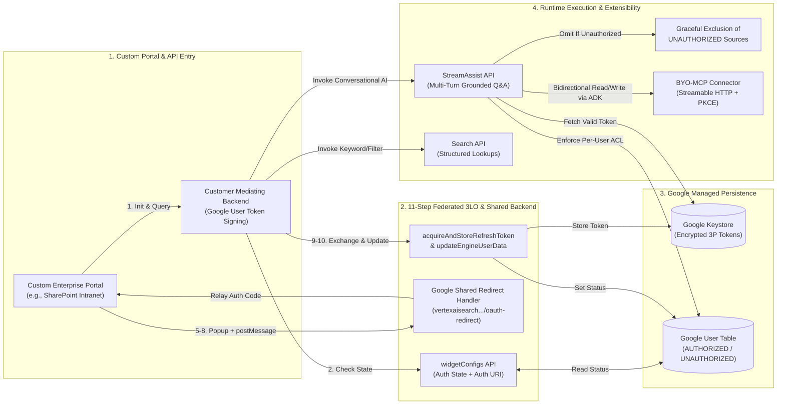
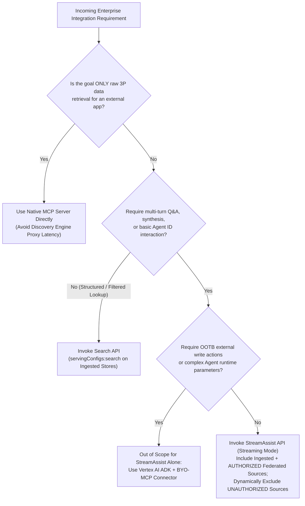
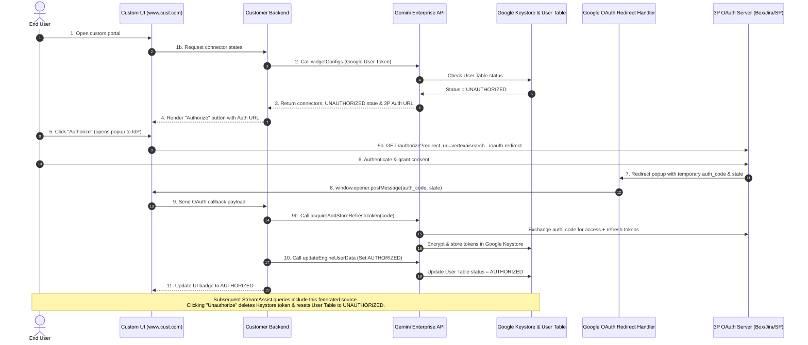
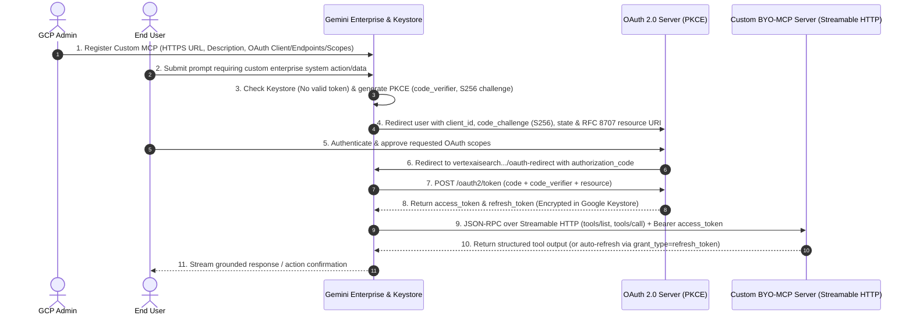
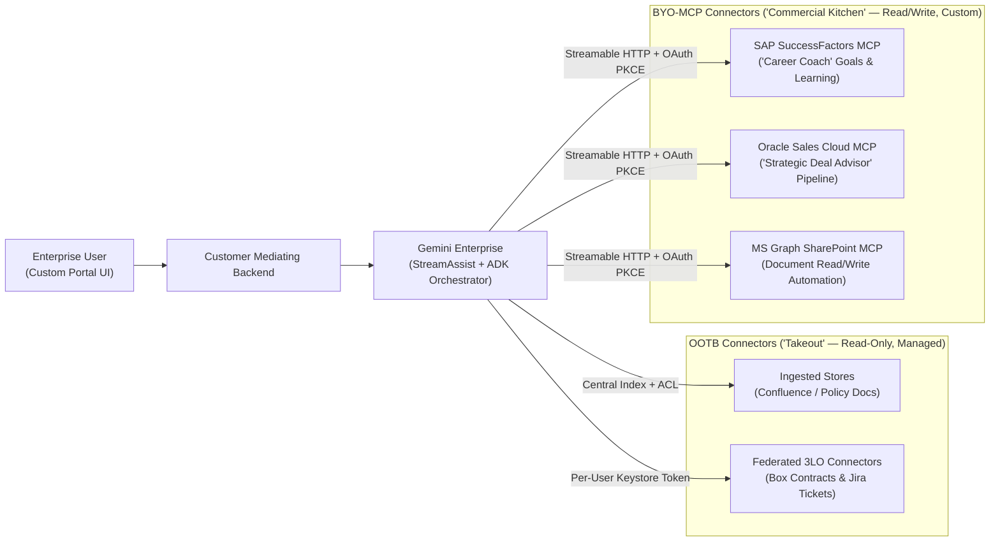

# Gemini Enterprise L400 OKF: API Integration, Federated Connector OAuth 3LO & BYO MCP Architecture (`L400_version_20261026_0350`)
**Topic Tags:** `#L400_version_20261026_0350` `#GeminiEnterprise` `#DiscoveryEngineAPI` `#FederatedOAuth3LO` `#BYOMCPConnector` `#AntigravityAgenticAI`

---

## 0. OKF Document Metadata & Topic Modeling Taxonomy
**Topic Tags:** `#OKFMetadata` `#TopicModeling` `#EnterpriseTaxonomy` `#GCPKnowledgeCatalog` `#L400_version_20261026_0350`

> **OKF v0.2 Trust Signals, Bucket Merge & Enforced FDE Grading Rubric (`OKF-L400-21`):**
> - **Version Tag:** `L400_version_20261026_0350` | **Status (`status`):** `stable` (`VETTED` / `APPROVED`) | **TTL (`stale_after`):** `2027-04-26T00:00:00Z` *(Maintains existing TTL & version)* | **Verified (`verified`):** `true`
> - **Merged Bucket OKF Lineage:** Reconciled with `Concepts 01, 03, 09, 13` in `gs://gea_agent_development_architectural_best_practices_1790796607` (`project=fivedaysai-prd-sandbox-317383`)
> - **Cloud FDE Prevailing Standard:** `https://g3doc.corp.google.com/company/teams/cloud-fde/index.md?cl=head`
> - **Enforced Project Grading Rubric (`OKF-L400-21`):** Adheres to the 0–3 FDE Field-Readiness Rubric (Pass Gate: Average >= 2.0 across Part A & Part B; Zero-Score Pause Rule: any `0 - Not Demonstrated` triggers an immediate pause and 2-week re-presentation). Primary mapped competencies for `OKF-L400-A4`: **Part B.1.1 (Legacy/External API Tool Calling), Part B.1.2 (Hybrid Retrieval), Part B.2.6 (API Documentation — OpenAPI & SDK Specs), Part B.3.1 (3LO OAuth & Least Privilege), Part B.7.3 (Contract-First API Design)**.

### 0.1 Open Knowledge Framework (OKF) Metadata Table
**Topic Tags:** `#DocumentGovernance` `#VersionControl` `#CatalogIngestion` `#ModuleA4`

| Metadata Field | Specification |
| :--- | :--- |
| **Document Title** | Gemini Enterprise L400 OKF: API Integration, Federated Connector OAuth 3LO & BYO MCP Architecture |
| **Canonical File Name** | `A4_OKF_API_Integration_Federated_Connector_and_BYO_MCP.md` |
| **OKF Schema Version** | `L400_version_20261026_0350` |
| **Module Track & Code** | Track A (Architecture & Platform Foundations) — Module A4 |
| **Target Ingestion Systems** | GCP Knowledge Catalog, Vertex AI Search RAG Corpus, Antigravity Agentic AI Development Runtime |
| **Source Artifacts** | 1. `a4_api_integration_and_federated_connector.md` (Video Learning Points, Probe Questions, and 45-Question PCA/L400 Assessment Bank)<br>2. `slides-a4-api-integration-and-federated-connector.md` (L400 Slide Deck Synthesis: Custom Surface API Integration, 11-Step Federated Connector OAuth Flow, BYO-MCP CUJs, and Enterprise Blueprints) |
| **Target Audience** | Principal Cloud Architects, Forward Deployed Engineers (FDEs), Enterprise Security Architects, Antigravity Agentic AI Developers |

---

### 0.2 Primary & Secondary Topic Tags and Three-Tier Taxonomy
**Topic Tags:** `#TopicHierarchy` `#PrimaryTopicTags` `#SecondaryTopicTags` `#SemanticGraph`

#### 0.2.1 Primary Topic Tags (6 Core Pillars)
**Topic Tags:** `#CorePillars` `#StreamAssistAPI` `#FederatedOAuth3LO` `#BYOMCP` `#ZeroTrust`

1. **`#StreamAssistVsSearchAPISelection`** *(Type: Architectural Pattern)*: Governing when enterprise custom surfaces invoke the Discovery Engine `StreamAssist` API (`assistants:streamAssist`) for low-latency, multi-turn conversational Q&A, synthesis, and basic Agent ID invocation across unified ingested and federated stores versus the `Search` API (`servingConfigs:search`) for structured search, filtering, and raw chunk retrieval (whilst deprecating legacy `StreamAnswer` and avoiding Discovery Engine API proxy routing when native MCP servers exist).
2. **`#FederatedConnectorOAuth3LOArchitecture`** *(Type: Protocol & Identity Flow)*: The 11-step runtime 3-Legged OAuth (3LO) authorization sequence and 6-step developer integration/revocation lifecycle enabling custom enterprise portals (e.g., SharePoint intranets) to discover connector states via `widgetConfigs`, launch third-party consent popups, and execute backend-to-backend token exchange (`acquireAndStoreRefreshToken` and `updateEngineUserData`).
3. **`#SharedBackendRedirectAndTokenVault`** *(Type: Security & State Management)*: Resolving the third-party OAuth single Redirect URI constraint via Google's shared backend OAuth Redirect Handler (`https://vertexaisearch.cloud.google.com/oauth-redirect`), paired with per-user, per-connector token persistence in the **Google Keystore** and authorization state tracking (`AUTHORIZED` vs. `UNAUTHORIZED`) in the **Google User Table**.
4. **`#GracefulUnauthorizedSourceExclusion`** *(Type: Resilience & Zero-Trust Outcome)*: Non-blocking partial retrieval behavior in `StreamAssist` where unauthorized, unlinked, or engine-detached federated connectors are dynamically omitted from grounded synthesis without throwing HTTP 500 errors, preserving strict per-user Access Control Lists (ACLs).
5. **`#BYOMCPExtensibilityArchitecture`** *(Type: Agentic Extensibility)*: Extending Gemini Enterprise beyond ~40 out-of-the-box (OOTB) read-only connectors by registering custom Bring-Your-Own Model Context Protocol (BYO-MCP) Streamable HTTP servers with OAuth 2.0 + PKCE (`code_challenge_method=S256`) and RFC 8707 `resource` indicators to unlock bidirectional read/write actions across long-tail SaaS and on-premises systems.
6. **`#MultiSystemAgenticOrchestration`** *(Type: Enterprise Solution Blueprint)*: Combining OOTB connectors ("Takeout") and custom BYO-MCP servers ("Commercial Kitchen") with Vertex AI Agent Development Kit (ADK) agents to orchestrate multi-system workflows across SAP SuccessFactors, Oracle Sales Cloud, Microsoft SharePoint Graph API, Box, and Jira.

#### 0.2.2 Secondary Sub-Topic Tags (6 Operational & Protocol Dimensions)
**Topic Tags:** `#SubTopicTaxonomy` `#WidgetConfigs` `#PostMessageRelay` `#PKCE` `#RFC8707`

1. **`#DirectMCPBypassAntiPattern Avoidance`** *(Sub-Topic of `#StreamAssistVsSearchAPISelection`)*: Avoiding the architectural anti-pattern of routing raw third-party data queries through Discovery Engine APIs when an external system only needs raw source records, connecting directly to native MCP servers instead to eliminate double-hop latency.
2. **`#WidgetConfigsStateAndAuthURIGeneration`** *(Sub-Topic of `#FederatedConnectorOAuth3LOArchitecture`)*: Querying `widgetConfigs` via the customer mediating backend during custom UI initialization to retrieve active connectors, per-user authorization status (`AUTHORIZED` vs. `UNAUTHORIZED`), and dynamically generated `Authorization URI` endpoints for unauthorized sources.
3. **`#BrowserPostMessageCrossOriginRelay`** *(Sub-Topic of `#SharedBackendRedirectAndTokenVault`)*: Using HTML5 `window.opener.postMessage` inside the browser popup returned by `https://vertexaisearch.cloud.google.com/oauth-redirect` to relay the temporary OAuth `authorization_code` and CSRF `state` back to the custom portal window (`www.cust.com`).
4. **`#TokenRevocationAndEngineCascade`** *(Sub-Topic of `#GracefulUnauthorizedSourceExclusion`)*: Immediate deletion of third-party tokens from the Google Keystore and state transition to `UNAUTHORIZED` in the User Table upon user-initiated `Unauthorize` actions or admin-level connector detachment.
5. **`#BYOMCPOAuthPKCEAndResourceBinding`** *(Sub-Topic of `#BYOMCPExtensibilityArchitecture`)*: Enforcing OAuth 2.0 Authorization Code flow with PKCE (`S256`), RFC 8707 `resource` audience binding, dynamic `/oauth2/token` refresh (`grant_type=refresh_token`), and mandatory SSL/TLS endpoint verification for registered MCP servers.
6. **`#StreamAssistActionAndAgentScopeLimits`** *(Sub-Topic of `#MultiSystemAgenticOrchestration`)*: Designing within `StreamAssist` API boundaries—supporting basic conversational Agent ID invocation while delegating complex runtime agent parameter passing and automated workplace write actions (e.g., sending emails, creating Jira issues) to ADK and BYO-MCP architectures.

#### 0.2.3 Topic Taxonomy Matrix Table
**Topic Tags:** `#TaxonomyMatrix` `#CatalogMapping` `#EntityRelationships`

| Topic Tag | Taxonomy Tier & Category | Connected Topics | Architectural Role in Gemini Enterprise |
| :--- | :--- | :--- | :--- |
| **`#StreamAssistVsSearchAPISelection`** | Tier 1 — API Surface | `#DirectMCPBypassAntiPatternAvoidance`, `#GracefulUnauthorizedSourceExclusion` | Governs API selection between `StreamAssist` (multi-turn streaming Q&A/synthesis) and `Search` (structured chunk lookups), retiring `StreamAnswer`. |
| **`#FederatedConnectorOAuth3LOArchitecture`** | Tier 1 — Identity & Auth | `#WidgetConfigsStateAndAuthURIGeneration`, `#SharedBackendRedirectAndTokenVault` | Orchestrates the 11-step 3LO consent flow and 6-step backend integration (`acquireAndStoreRefreshToken`, `updateEngineUserData`) for custom portals. |
| **`#SharedBackendRedirectAndTokenVault`** | Tier 1 — Security Core | `#BrowserPostMessageCrossOriginRelay`, `#TokenRevocationAndEngineCascade` | Resolves the 3P single Redirect URI limit via `vertexaisearch.cloud.google.com/oauth-redirect` and isolates 3P tokens in Google Keystore & User Table. |
| **`#GracefulUnauthorizedSourceExclusion`** | Tier 1 — Resilience | `#SharedBackendRedirectAndTokenVault`, `#StreamAssistVsSearchAPISelection` | Guarantees `StreamAssist` queries succeed when federated connectors are `UNAUTHORIZED`, dynamically omitting unauthorized sources without HTTP 500 errors. |
| **`#BYOMCPExtensibilityArchitecture`** | Tier 1 — Extensibility | `#BYOMCPOAuthPKCEAndResourceBinding`, `#MultiSystemAgenticOrchestration` | Extends Gemini Enterprise via Streamable HTTP MCP servers with bidirectional read/write tools and OAuth 2.0 + PKCE (`S256`). |
| **`#MultiSystemAgenticOrchestration`** | Tier 1 — Agentic Patterns | `#BYOMCPExtensibilityArchitecture`, `#StreamAssistActionAndAgentScopeLimits` | Unifies OOTB connectors ("Takeout") and BYO-MCP ("Commercial Kitchen") across SAP SuccessFactors, Oracle Sales Cloud, SharePoint, Box, and Jira. |

---

### 0.3 Module Topic Connection & Flow Graph
**Topic Tags:** `#TopicFlowGraph` `#MermaidArchitecture` `#ASCIITopology` `#EndToEndFlow`

#### 0.3.1 Mermaid.js Module Topic Connection Graph (`graph LR`)
**Topic Tags:** `#MermaidGraph` `#VisualTaxonomy` `#ControlPlaneFlow` `#DataPlaneFlow`



#### 0.3.2 ASCII Architectural Overview of Module A4 Topic Connections
**Topic Tags:** `#ASCIIDiagram` `#SystemTopology` `#ArchitectureOverview`

```text
+--------------------------------------------------------------------------------------------------+
|                   MODULE A4: GEMINI ENTERPRISE API, FEDERATED 3LO & BYO-MCP                      |
+--------------------------------------------------------------------------------------------------+
|                                                                                                  |
|  [Custom Portal UI (www.cust.com)] <========> [Customer Mediating Backend (Google IAM/OAuth)]    |
|          |                     ^                              |                        |         |
|   (Popup: 3P Consent)   (postMessage: code, state)     (Control Plane APIs)     (Data Plane APIs)|
|          v                     |                              v                        v         |
|  [3P OAuth Server] ---> [Google Redirect Handler]   +-------------------+    +-----------------+ |
|  (Box/Jira/SharePoint)  (vertexaisearch.cloud.      | widgetConfigs     |    | StreamAssist API| |
|                          google.com/oauth-redirect) | acquireAndStore.. |    | Search API      | |
|                                                     | updateEngineUser..|    +--------+--------+ |
|                                                     +---------+---------+             |          |
|                                                               |                       |          |
|                                                               v                       v          |
|                                                     +------------------------------------------+ |
|                                                     | GOOGLE SECURE PERSISTENCE LAYER          | |
|                                                     | - Keystore: Encrypted 3P Refresh Tokens  | |
|                                                     | - User Table: AUTHORIZED / UNAUTHORIZED  | |
|                                                     +--------------------+---------------------+ |
|                                                                          |                       |
|         +----------------------------------------------------------------+---------------+       |
|         |                                        |                                       |       |
|         v                                        v                                       v       |
|  +------------------------------+  +----------------------------------+  +---------------------+ |
|  | OOTB Ingestion Connectors    |  | OOTB Federated Connectors        |  | Custom BYO-MCP      | |
|  | - Centralized Index + ACLs   |  | - Real-Time Query (No Indexing)  |  | - Streamable HTTP   | |
|  | - No Per-User 3P OAuth Popup |  | - Gracefully Omitted if          |  | - OAuth 2.0 + PKCE  | |
|  | - Read-Only ("Takeout")      |  |   UNAUTHORIZED                   |  | - Read/Write Tools  | |
|  +------------------------------+  +----------------------------------+  +---------------------+ |
+--------------------------------------------------------------------------------------------------+
```

---

## 1. Executive Overview, Problem Statement & Antigravity Agentic AI Development Context
**Topic Tags:** `#ExecutiveOverview` `#ProblemStatement` `#AntigravityAgenticAI` `#CustomSurfaceIntegration`

> **Enforced FDE Project Grading Rubric Reference (`OKF-L400-21` & `g3doc/company/teams/cloud-fde`):** Every project applying Section 1 of `OKF-L400-A4` is graded against **Part B.1.1 (Legacy/External API Tool Calling), Part B.1.2 (Hybrid Retrieval), Part B.2.6 (API Documentation — OpenAPI & SDK Specs), Part B.3.1 (3LO OAuth & Least Privilege), Part B.7.3 (Contract-First API Design)** and merged bucket **Concepts 01, 03, 09, 13** (`stale_after: 2027-04-26T00:00:00Z`, version `L400_version_20261026_0350`). Builders must achieve >= 2 (**Competent**) across Part A & Part B and avoid any 0 (**Not Demonstrated**) pause triggers.

### 1.1 Enterprise Problem Statement & Architectural Motivation
**Topic Tags:** `#EnterpriseAdoption` `#SingleRedirectURIBottleneck` `#OAuthIsolation` `#PortalEmbedding`

Enterprise organizations routinely embed Gemini Enterprise into high-adoption internal portals (such as Microsoft SharePoint intranets, employee service hubs, and custom clinical or engineering workbenches) using Discovery Engine APIs (`StreamAssist` and `Search`). While **ingested data stores** work seamlessly across custom API surfaces because documents and Access Control Lists (ACLs) are centrally indexed inside Google Cloud, **federated connectors** (such as Box, Jira, Confluence, and ServiceNow) query third-party APIs in real time using per-user OAuth credentials.

Historically, integrating federated connectors into custom portals faced three major architectural barriers:
1. **UI-Locked Authorization State & Consent**: Viewing whether a federated connector was `AUTHORIZED` or `UNAUTHORIZED`, launching third-party OAuth consent flows, and unlinking credentials were strictly confined to the out-of-the-box (OOTB) Google-hosted Gemini Enterprise UI.
2. **The Single Redirect URI Bottleneck**: Third-party OAuth providers typically restrict registered OAuth applications to a single Redirect URI (`https://vertexaisearch.cloud.google.com/oauth-redirect`). Attempting to point a third-party OAuth app directly to a custom portal domain (`www.cust.com`) either broke the OOTB Gemini Enterprise UI or forced complex multi-app administration.
3. **Read-Only Scope & Long-Tail System Gaps**: OOTB connectors (~40 supported sources) are designed for read-only retrieval ("Takeout") and cannot execute custom business logic or write actions across specialized enterprise systems (such as SAP SuccessFactors or Oracle Sales Cloud).

Module A4 solves these challenges through **Google's Shared Backend OAuth 3LO Redirect & Token Vault Architecture** (enabling seamless federated connector authorization, `postMessage` relay, and `Unauthorize` revocation in custom UIs) and **Bring-Your-Own Model Context Protocol (BYO-MCP) Connectors** (enabling secure, OAuth 2.0 + PKCE bidirectional tool execution).

---

### 1.2 Antigravity Agentic AI Development Context
**Topic Tags:** `#AntigravityRuntime` `#AgenticWorkflows` `#ContextWindowHygiene` `#IdentityPropagation`

Within the **Antigravity Agentic AI Development** paradigm, agents must operate across heterogeneous enterprise boundaries without violating zero-trust identity guarantees or overloading model context windows:
* **Identity-Aware Grounding & Graceful Degradation**: Antigravity agents invoking `StreamAssist` rely on the Google User Table and Keystore to enforce per-user ACLs automatically. If a user has not authorized a federated source (or has clicked `Unauthorize`), `StreamAssist` dynamically excludes that source and synthesizes a response from remaining authorized and ingested stores rather than failing the agent turn with an HTTP 500 error.
* **Direct MCP Routing vs. Discovery Engine Proxy Anti-Pattern**: When an Antigravity agent or external workflow only requires raw records from a third-party system, developers must connect directly to a **native MCP server** rather than routing through Discovery Engine APIs, avoiding double-hop serialization latency.
* **Hybrid "Takeout + Commercial Kitchen" Tooling**: Antigravity agents combine zero-maintenance OOTB connectors for broad enterprise knowledge retrieval with custom BYO-MCP servers (registered via Streamable HTTP and OAuth 2.0 + PKCE) and Vertex AI ADK orchestration to execute complex, multi-system read/write actions.

---

## 2. Deep Technical Architecture, Matrices, Visual Pictures & Flow Diagrams
**Topic Tags:** `#DeepTechnicalArchitecture` `#StreamAssistAPI` `#Federated3LOFlow` `#BYOMCPArchitecture` `#MultiSystemOrchestration`

> **Enforced FDE Project Grading Rubric Reference (`OKF-L400-21` & `g3doc/company/teams/cloud-fde`):** Every project applying Section 2 of `OKF-L400-A4` is graded against **Part B.1.1 (Legacy/External API Tool Calling), Part B.1.2 (Hybrid Retrieval), Part B.2.6 (API Documentation — OpenAPI & SDK Specs), Part B.3.1 (3LO OAuth & Least Privilege), Part B.7.3 (Contract-First API Design)** and merged bucket **Concepts 01, 03, 09, 13** (`stale_after: 2027-04-26T00:00:00Z`, version `L400_version_20261026_0350`). Builders must achieve >= 2 (**Competent**) across Part A & Part B and avoid any 0 (**Not Demonstrated**) pause triggers.

### 2.1 StreamAssist API & Discovery Engine API Integration Architecture (Slides 2–5)
**Topic Tags:** `#StreamAssistAPI` `#SearchAPI` `#DeprecatedStreamAnswer` `#DirectMCPRouting`

#### 2.1.1 Primary Customer Use Cases & Direct MCP Routing Rule
**Topic Tags:** `#CustomerUseCases` `#PortalIntegration` `#DirectMCPServer` `#LatencyOptimization`

Organizations integrate Gemini Enterprise APIs across three primary patterns:
1. **Embedding into High-Adoption Portals**: Surfacing conversational AI and enterprise search directly inside existing employee portals (e.g., SharePoint intranets) to maximize adoption without forcing context switching.
2. **Accessing Third-Party Data Sources (With Native MCP Guardrail)**: While Discovery Engine APIs can retrieve data from federated third-party sources during grounded Q&A, **Google does not recommend calling Discovery Engine APIs if the sole purpose is raw third-party data retrieval for an external system**. Routing raw data fetches through Discovery Engine introduces roundabout proxy hops and high latency; architects should connect directly to **native Model Context Protocol (MCP) servers** instead.
3. **Powering Custom Agentic Workflows**: Using Discovery Engine APIs as the grounded synthesis engine inside custom AI agent pipelines.

#### 2.1.2 Discovery Engine API Selection & Scope Boundaries
**Topic Tags:** `#APISelectionMatrix` `#StreamAssistScope` `#AgentIDLimitations` `#StreamingTTFT`

| API / Protocol | Endpoint & Mode | Supported Capabilities | Architectural Boundaries & Limitations |
| :--- | :--- | :--- | :--- |
| **`StreamAssist` API** | `assistants:streamAssist`<br>*(Streaming Required)* | • Multi-turn conversational Q&A & follow-ups<br>• Grounded synthesis across ingested + authorized federated stores<br>• Basic AI Agent queries via **Agent ID** | • **No OOTB External Write Actions** (cannot send emails or create Jira tickets)<br>• **No Complex Agent Parameters** or custom multi-step action orchestration<br>• Streaming mode is mandatory to preserve low Time-To-First-Token (TTFT) |
| **`Search` API** | `servingConfigs:search`<br>*(Synchronous)* | • Fast keyword/semantic search over **ingested** stores<br>• Faceted filtering, sorting, and raw chunk retrieval | • Single-turn lookup only (no multi-turn conversational memory)<br>• Does not orchestrate conversational agent reasoning |
| **`StreamAnswer` API** | Legacy Endpoint<br>*(Deprecated)* | • Legacy single-turn generative answers | • **Deprecated** — must be replaced by `StreamAssist` in all new custom surface integrations |
| **Native / BYO MCP Server** | Streamable HTTP<br>(`POST /mcp`) | • Direct, low-latency third-party tool calls<br>• Bidirectional read and write operations | • Requires custom MCP server hosting (e.g., Cloud Run) and OAuth 2.0 + PKCE configuration |

#### 2.1.3 ASCII & Mermaid.js Decision Flow: Discovery Engine API Routing
**Topic Tags:** `#APIDecisionTree` `#ArchitectureDiagram` `#StreamAssistRouting`

```text
+-----------------------------------------------------------------------------------+
|                ENTERPRISE WORKLOAD & API ROUTING DECISION ENGINE                  |
+-----------------------------------------------------------------------------------+
                                         |
        +--------------------------------+--------------------------------+
        |                                |                                |
        v (Raw 3P Data Only)             v (Structured Lookup)            v (Conversational Q&A)
+-----------------------+    +---------------------------+    +-----------------------------+
| Connect Directly to   |    | Discovery Engine          |    | Discovery Engine            |
| Native MCP Server     |    | Search API                |    | StreamAssist API            |
| (Bypass Discovery     |    | - Ingested Data Stores    |    | - Streaming Mode (Low TTFT) |
|  Engine Proxy Hop)    |    | - Filters, Facets, Chunks |    | - Ingested + Authorized 3P  |
+-----------------------+    +---------------------------+    | -Gracefully Excludes        |
                                                              |   UNAUTHORIZED 3P Sources   |
                                                              +-----------------------------+
```



#### 2.1.4 Inline Section Best Practices & FAQs (Section 2.1)
**Topic Tags:** `#BestPractices2_1` `#InlineFAQs2_1` `#StreamAssistOptimization`

* **Best Practice 1 (Always Enable Streaming on `StreamAssist`)**: Invoke `StreamAssist` in streaming mode so tokens render progressively in the custom UI, masking backend federated retrieval and LLM synthesis latency.
* **Best Practice 2 (Enforce Direct MCP for Non-Conversational 3P Data Access)**: Never use Discovery Engine APIs as a pass-through data pipe for raw third-party records; bind agents directly to native MCP endpoints.
* **FAQ 1 — Why does passing complex runtime parameters to an Agent via `StreamAssist` fail?** `StreamAssist` only supports basic conversational routing via an **Agent ID**; complex runtime parameter injection or external write actions exceed `StreamAssist` boundaries and require Vertex AI ADK or BYO-MCP tools.
* **FAQ 2 — Why don't ingested connectors require per-user OAuth consent popups in custom UIs?** Ingested connectors synchronize documents and ACLs into Google Cloud's centralized index ahead of time via admin credentials, so permissions are evaluated directly against the user's primary Google identity.

---

### 2.2 Federated Connector OAuth 3LO, Shared Backend & Token Exchange Architecture (Slides 4–10)
**Topic Tags:** `#FederatedOAuth3LO` `#11StepOAuthFlow` `#SharedRedirectHandler` `#GoogleKeystore` `#GoogleUserTable`

#### 2.2.1 Solving the Single Redirect URI Bottleneck via Google's Shared Backend
**Topic Tags:** `#SingleRedirectURI` `#OAuthRedirectHandler` `#PostMessageRelay` `#MediatingBackend`

Third-party SaaS OAuth providers (e.g., Box, Jira, SharePoint) typically allow only **one registered Redirect URI** per OAuth client application (`https://vertexaisearch.cloud.google.com/oauth-redirect`). To allow custom enterprise portals (`www.cust.com`) to authorize federated connectors without breaking the OOTB Gemini Enterprise UI:
* **Customer Mediating Backend**: Hosted inside the customer's domain, it authenticates the employee using their **Google user token**, queries connector states (`widgetConfigs`), and executes backend-to-backend token exchange (`acquireAndStoreRefreshToken`) and state updates (`updateEngineUserData`). The customer **only manages the user's Google token**; third-party access/refresh tokens are encrypted in the **Google Keystore**, and per-user connector statuses (`AUTHORIZED` / `UNAUTHORIZED`) live in the **Google User Table**.
* **Shared Redirect Handler & `postMessage` Relay**: Both OOTB UI and custom UI consent flows redirect to `https://vertexaisearch.cloud.google.com/oauth-redirect`. In the custom UI flow, the popup executes browser cross-document messaging (`window.opener.postMessage`) to pass the temporary OAuth `authorization_code` and `state` back to the parent custom portal (`www.cust.com`), which forwards it to the customer backend for secure server-to-server token exchange.
* **Release Governance (August 11th Milestone)**: As of August 11th, federated connector support in the `StreamAssist` API requires **manual project allow-listing** by Google (` StreamAssist` API + Box, SharePoint, and Jira federated connectors supported in custom UIs).

#### 2.2.2 The 11-Step Runtime OAuth 3LO Sequence & 6-Step Integration/Revocation Lifecycle
**Topic Tags:** `#11StepSequence` `#WidgetConfigs` `#AcquireAndStoreRefreshToken` `#UpdateEngineUserData` `#UnauthorizeFlow`

* **11-Step Runtime Authorization Sequence (Slides 6–8)**:
  1. **Step 1**: User opens the custom portal UI (`www.cust.com`), which sends an initialization request to the **Customer Backend**.
  2. **Step 2**: Customer Backend invokes Gemini Enterprise (`widgetConfigs`) using the user's Google token to check configured connectors.
  3. **Step 3**: Gemini Enterprise checks the **Google User Table** and returns the list of connectors, per-user status (`AUTHORIZED` vs. `UNAUTHORIZED`), and a generated third-party `Authorization URL` for each unauthorized connector.
  4. **Step 4**: Customer Backend returns this metadata to the Custom UI, which displays active sources and renders an **"Authorize"** button for unauthorized connectors.
  5. **Step 5**: User clicks **"Authorize"** (e.g., for Box); Custom UI opens a browser popup to the third-party OAuth URL (e.g., `account.box.com/api/oauth2/authorize?...&redirect_uri=https://vertexaisearch.cloud.google.com/oauth-redirect`).
  6. **Step 6**: User authenticates with the third-party provider and grants consent in the popup.
  7. **Step 7**: The third-party OAuth server redirects the popup to Google's shared **OAuth Redirect Handler** (`https://vertexaisearch.cloud.google.com/oauth-redirect`) with the temporary `code` and `state`.
  8. **Step 8**: Google's Redirect Handler sends the OAuth callback payload (`code`, `state`, origin metadata) back to the parent Custom UI window (`www.cust.com`) via browser **`postMessage`** (`window.opener.postMessage`).
  9. **Step 9**: Custom UI forwards the OAuth callback payload to the **Customer Backend**, which calls **`acquireAndStoreRefreshToken`** on Gemini Enterprise; Gemini Enterprise exchanges the code with the third-party token endpoint and stores the encrypted refresh/access tokens in the **Google Keystore**.
  10. **Step 10**: Customer Backend calls **`updateEngineUserData`** (or completes the atomic integration sequence) to update the user's connector status to **`AUTHORIZED`** in the **Google User Table**.
  11. **Step 11**: Customer Backend confirms completion to the Custom UI, which updates the connector badge to `AUTHORIZED`; subsequent `StreamAssist` queries immediately include grounded data from that federated source.
* **Unauthorize / Revocation & Admin Cascade Lifecycle (Slide 9)**:
  * **User-Initiated `Unauthorize`**: Clicking **Unauthorize / Unlink** in the custom UI invokes backend endpoints that **delete the user's third-party token from the Google Keystore**, reset the status to **`UNAUTHORIZED`** in the **Google User Table**, refresh the UI with a new `Authorization URI`, and immediately exclude that connector from subsequent `StreamAssist` queries.
  * **Admin-Level Disable/Detach Cascade**: If an administrator disables or detaches a federated connector at the Gemini Enterprise application level, stored user tokens become invalid for queries and status evaluations return disabled/`UNAUTHORIZED`, preventing any downstream data retrieval.

#### 2.2.3 ASCII & Mermaid.js Sequence Diagram: 11-Step Federated 3LO & Revocation Flow
**Topic Tags:** `#SequenceDiagram` `#OAuth3LO Diagram` `#TokenVaultTopology`

```text
+---------------------------------------------------------------------------------------------------+
|             11-STEP FEDERATED CONNECTOR OAUTH 3LO & REVOCATION TOPOLOGY (SLIDES 6-10)             |
+---------------------------------------------------------------------------------------------------+
  [Custom UI: www.cust.com] ---> (1) Init ---> [Customer Backend] ---> (2) widgetConfigs ---> [GE API]
             ^                                         |                                         |
             +--- (4) Render Auth Button <--- (3) Status=UNAUTHORIZED + Auth URI <---------------+
             |
  (5) Open Popup (account.box.com) ---> (6) User Consents ---> (7) Redirect to vertexaisearch.../oauth-redirect
             ^                                                                                   |
             +--- (8) window.opener.postMessage(code, state) <-----------------------------------+
             |
  (9) Forward Payload ---> [Customer Backend] ---> acquireAndStoreRefreshToken ---> [Google Keystore]
                                   |-------------> updateEngineUserData ----------> [Google User Table]
                                                                                    (State=AUTHORIZED)
  [Unauthorize Action] --> [Customer Backend] ---> Delete Token in Keystore & Set State=UNAUTHORIZED
+---------------------------------------------------------------------------------------------------+
```



#### 2.2.4 Inline Section Best Practices & FAQs (Section 2.2)
**Topic Tags:** `#BestPractices2_2` `#InlineFAQs2_2` `#OAuthSecurity`

* **Best Practice 1 (Strictly Validate `postMessage` Origin & OAuth `state`)**: In the custom portal frontend, verify that the `postMessage` event originates from `https://vertexaisearch.cloud.google.com` and validate the CSRF `state` nonce before sending the payload to the customer backend.
* **Best Practice 2 (Implement Popup Timeout & User Cancel Recovery)**: If a user closes the OAuth popup or the third-party IdP times out, keep the connector status as `UNAUTHORIZED` and regenerate a fresh `Authorization URI` so the user can retry cleanly.
* **FAQ 1 — What happens when a user runs a `StreamAssist` query while a federated connector is `UNAUTHORIZED`?** `StreamAssist` executes normally without throwing an HTTP 500 error; it simply omits the unauthorized federated source and grounds the response using ingested stores and any `AUTHORIZED` connectors.
* **FAQ 2 — Does the customer backend store third-party refresh tokens locally?** No. The customer only manages the user's Google token; all third-party refresh and access tokens are stored exclusively in Google's encrypted backend **Keystore**.

---

### 2.3 BYO MCP Connector Registration, OAuth 2.0/PKCE & Critical User Journeys (Slides 11–13)
**Topic Tags:** `#BYOMCPConnector` `#ConnectorLandscape` `#OAuth2PKCE` `#RFC8707` `#StreamableHTTP`

#### 2.3.1 Three-Pillar Connector Landscape Comparison Matrix
**Topic Tags:** `#IngestionConnector` `#FederatedConnector` `#BYOMCPComparison`

| Architectural Dimension | 1. OOTB Ingestion Connectors | 2. OOTB Federated Connectors | 3. Custom (BYO) MCP Connectors |
| :--- | :--- | :--- | :--- |
| **Data Residency & Indexing** | Data & ACLs copied and indexed into Google Cloud storage | Zero data indexing; queries 3P APIs in real time at request time | Zero indexing; invokes remote Streamable HTTP MCP tools at runtime |
| **Supported Scope & Actions** | ~40 OOTB sources; **Read-Only** search & synthesis | ~40 OOTB sources; **Read-Only** real-time search & synthesis | **Boundless** (any SaaS/on-prem system); **Bidirectional Read & Write** |
| **Authentication Model** | Admin service account / sync credentials + Google identity ACL check | Per-user 3LO via Google Shared Redirect + Keystore/User Table | **OAuth 2.0 Auth Code with PKCE (`S256`)** + RFC 8707 `resource` parameter |
| **Strategic Analogy** | **"Takeout"** (Zero-maintenance, standard menu) | **"Takeout"** (Zero-maintenance, real-time standard menu) | **"Commercial Kitchen"** (Full control over custom recipes & write actions) |

#### 2.3.2 Custom (BYO) MCP Connector Registration & Critical User Journeys (CUJs)
**Topic Tags:** `#BYOMCPRegistration` `#CUJ1Admin` `#CUJ2Runtime` `#PKCES256`

* **CUJ 1 — Administrator Registration in GCP Console (Slide 12)**:
  1. Navigate to ** Gemini Enterprise -> Data Stores -> Create Data Store -> Custom MCP Server**.
  2. Configure the remote **MCP Server Endpoint URL** (must use **Streamable HTTP** transport over HTTPS with a valid SSL/TLS certificate) and provide the **Server Description** so the Gemini Enterprise reasoning engine knows when to route prompts to this MCP server.
  3. Configure **OAuth 2.0 Credentials**: Supply `Client ID`, `Client Secret`, `Authorization Endpoint URL`, `Token Endpoint URL` (`/oauth2/token`), and required `Scopes`, then bind the data store to the target Gemini Enterprise Engine.
* **CUJ 2 — End-User Runtime OAuth 2.0 + PKCE & Tool Execution (Slide 13)**:
  1. When an employee's prompt requires the BYO-MCP server and no valid token exists in the Google Keystore, Gemini Enterprise generates a PKCE `code_verifier` and `code_challenge` (`code_challenge_method=S256`) and redirects the user to the OAuth Authorization Endpoint including the **RFC 8707 `resource` indicator** (binding the token to the target MCP server URI).
  2. After user consent, the OAuth server returns an `authorization_code` to Google's callback endpoint (`https://vertexaisearch.cloud.google.com/oauth-redirect`).
  3. Gemini Enterprise exchanges the code + `code_verifier` at `/oauth2/token` (`grant_type=authorization_code`), stores the `access_token` and `refresh_token` in the Google Keystore, and invokes the remote MCP server (`tools/list`, `tools/call`) with `Authorization: Bearer <access_token>`. Expired tokens are automatically refreshed via `grant_type=refresh_token`.

#### 2.3.3 ASCII & Mermaid.js Diagram: BYO-MCP Registration & Runtime PKCE Flow
**Topic Tags:** `#BYOMCPDiagram` `#PKCEFlowchart` `#StreamableHTTPFlow`

```text
+--------------------------------------------------------------------------------------------------+
|                  BYO-MCP CONNECTOR REGISTRATION & OAUTH 2.0 + PKCE RUNTIME FLOW                  |
+--------------------------------------------------------------------------------------------------+
  [Admin Console: Register Custom MCP] ---> Endpoint (Streamable HTTP/TLS) + Description + OAuth 2.0
                                                              |
  [User Query in Gemini Enterprise] ---> Token Missing? ---> Generate PKCE (S256) + RFC 8707 resource
                                                              |
  [3P OAuth Server] ---> User Consents ---> Redirect code to vertexaisearch.cloud.google.com/oauth-redirect
                                                              |
  [Google Backend] ----> POST /oauth2/token (code + code_verifier) ---> Store Tokens in Keystore
                    ----> POST /mcp (Streamable HTTP: tools/list, tools/call with Bearer Token)
+--------------------------------------------------------------------------------------------------+
```



#### 2.3.4 Inline Section Best Practices & FAQs (Section 2.3)
**Topic Tags:** `#BestPractices2_3` `#InlineFAQs2_3` `#MCPToolDesign`

* **Best Practice 1 (Enforce RFC 8707 Resource Audience Validation on the MCP Server)**: Configure your custom MCP server on Cloud Run to validate the JWT `aud` claim against its canonical MCP URI so tokens issued for other services cannot be replayed.
* **Best Practice 2 (Write High-Signal Server & Tool Descriptions)**: Craft clear, domain-specific descriptions during MCP registration so the Gemini Enterprise planner accurately routes relevant prompts without false-positive tool invocations.
* **FAQ 1 — What transport and security protocols are mandatory for a BYO-MCP server?** It must expose a **Streamable HTTP** endpoint secured with valid **HTTPS/TLS** certificates and authenticate via **OAuth 2.0 Authorization Code flow with PKCE (`S256`)**.
* **FAQ 2 — How does Gemini Enterprise handle expired access tokens for BYO-MCP connectors?** Gemini Enterprise automatically invokes the configured `/oauth2/token` endpoint using `grant_type=refresh_token` and the stored refresh token from the Google Keystore without re-prompting the user.

---

### 2.4 Multi-System Orchestration, OOTB vs. BYO-MCP Strategy & Enterprise Blueprints (Slides 14–16)
**Topic Tags:** `#MultiSystemOrchestration` `#TakeoutVsCommercialKitchen` `#SAPSuccessFactors` `#OracleSalesCloud` `#SharePointGraphMCP`

#### 2.4.1 Strategic Decision Framework: OOTB ("Takeout") vs. BYO-MCP ("Commercial Kitchen")
**Topic Tags:** `#StrategicComparison` `#OOTBConnectors` `#BYOMCPExtensibility`

* **OOTB Connectors ("Ordering Takeout" — Slide 14)**: Ideal when connecting to standard SaaS applications (~40 supported sources like Jira, Box, Confluence, ServiceNow, Google Drive) where **read-only retrieval** and zero infrastructure maintenance are prioritized.
* **BYO-MCP Connectors ("Building a Commercial Kitchen" — Slide 14)**: Required when integrating **long-tail or proprietary systems** (e.g., SAP SuccessFactors, Oracle Sales Cloud, custom internal APIs), executing **bidirectional write actions** (updating records, submitting approvals), or enforcing custom pre-processing and fine-grained field filtering before data reaches the LLM context window.

#### 2.4.2 Real-World Multi-System Enterprise Blueprints (Slides 15–16)
**Topic Tags:** `#CareerCoachBlueprint` `#StrategicDealAdvisor` `#SharePointGraphAPI` `#ADKOrchestration`

1. **Blueprint 1 — "Career Coach" Employee Development Agent (`SAP SuccessFactors` BYO-MCP, Slide 15)**: Connects Gemini Enterprise to **SAP SuccessFactors** via a custom BYO-MCP server hosted on Cloud Run (using OData APIs and OAuth 2.0 + PKCE). Employees query their real-time skill profiles, performance goals, and open internal roles, and can trigger write actions to enroll in training courses or update career development plans.
2. **Blueprint 2 — "Strategic Deal Advisor" Revenue Agent (`Oracle Sales Cloud` BYO-MCP, Slide 15)**: Connects Gemini Enterprise to **Oracle Sales Cloud** via a custom BYO-MCP server alongside OOTB federated connectors for Box and Jira. Account executives synthesize live deal pipeline metrics, contract redlines from Box, and engineering blockers from Jira, then execute MCP write tools to log call notes and update opportunity stages in Oracle Sales Cloud.
3. **Blueprint 3 — SharePoint Graph API Custom MCP & Multi-Agent ADK Orchestration (Slide 16)**: Uses a custom **Microsoft Graph API MCP Server** (`Sites.ReadWrite.All`, `Files.ReadWrite.All` with per-user OBO/3LO tokens) combined with Vertex AI **ADK** agents to perform multi-system research and automated document creation/updates across SharePoint document libraries, Jira, and enterprise ERPs.

#### 2.4.3 ASCII & Mermaid.js Blueprint: Multi-System Agentic Orchestration
**Topic Tags:** `#MultiSystemDiagram` `#EnterpriseBlueprintFlow` `#HybridConnectorTopology`

```text
+--------------------------------------------------------------------------------------------------+
|            HYBRID "TAKEOUT + COMMERCIAL KITCHEN" MULTI-SYSTEM AGENTIC ORCHESTRATION              |
+--------------------------------------------------------------------------------------------------+
                        [Employee / Seller in Custom SharePoint Intranet UI]
                                                 |
                                                 v
                    [Customer Mediating Backend + Gemini Enterprise / Vertex AI ADK]
                       /                         |                              \
     (OOTB Ingestion: "Takeout")   (OOTB Federated 3LO: "Takeout")   (Custom BYO-MCP: "Kitchen")
                     /                           |                                \
                    v                            v                                 v
      +---------------------------+  +-----------------------+  +--------------------------------+
      | Policy & Handbook Corpus  |  | Real-Time Box & Jira  |  | Cloud Run BYO-MCP Servers      |
      | - Centrally Indexed + ACL |  | - 11-Step 3LO + Vault |  | - SAP SuccessFactors (HR/Goals)|
      | - Fast Search & Grounding |  | - Read-Only Grounding |  | - Oracle Sales Cloud (Deals)   |
      +---------------------------+  +-----------------------+  | - MS Graph API (Read/Write SP) |
                                                                +--------------------------------+
```



#### 2.4.4 Inline Section Best Practices & FAQs (Section 2.4)
**Topic Tags:** `#BestPractices2_4` `#InlineFAQs2_4` `#HybridArchitecture`

* **Best Practice 1 (Adopt a Hybrid "Takeout First, Kitchen Where Differentiated" Strategy)**: Always use OOTB Ingestion or Federated connectors for standard read-only SaaS knowledge, reserving custom BYO-MCP servers for proprietary APIs, complex field transformations, or write actions.
* **Best Practice 2 (Filter Verbose ERP Payloads Inside the BYO-MCP Server)**: ERPs like SAP SuccessFactors and Oracle Sales Cloud return deeply nested OData/REST JSON payloads; strip non-essential metadata inside the MCP tool handler before returning results to Gemini Enterprise to conserve tokens and reduce latency.
* **FAQ 1 — When should an enterprise build a custom SharePoint Graph MCP server instead of using the OOTB SharePoint connector?** Use the OOTB SharePoint connector for read-only search and grounding; build a custom Microsoft Graph MCP server when workflows require automated write actions (e.g., creating list items, uploading synthesized briefs, or updating metadata columns).
* **FAQ 2 — Can a single user prompt combine data from OOTB Federated connectors and a custom BYO-MCP server?** Yes. Gemini Enterprise synthesizes grounded context across ingested stores, `AUTHORIZED` OOTB federated connectors, and registered BYO-MCP tools in a single unified response.

---

## 3. Architectural Best Practices, Guardrails, Trade-Offs & Anti-Patterns
**Topic Tags:** `#ArchitecturalBestPractices` `#Guardrails` `#TradeOffMatrix` `#AntiPatterns` `#QuadrantChart`

> **Enforced FDE Project Grading Rubric Reference (`OKF-L400-21` & `g3doc/company/teams/cloud-fde`):** Every project applying Section 3 of `OKF-L400-A4` is graded against **Part B.1.1 (Legacy/External API Tool Calling), Part B.1.2 (Hybrid Retrieval), Part B.2.6 (API Documentation — OpenAPI & SDK Specs), Part B.3.1 (3LO OAuth & Least Privilege), Part B.7.3 (Contract-First API Design)** and merged bucket **Concepts 01, 03, 09, 13** (`stale_after: 2027-04-26T00:00:00Z`, version `L400_version_20261026_0350`). Builders must achieve >= 2 (**Competent**) across Part A & Part B and avoid any 0 (**Not Demonstrated**) pause triggers.

### 3.1 Mermaid.js Strategic Integration Quadrant (`quadrantChart`)
**Topic Tags:** `#MermaidQuadrant` `#TakeoutVsKitchen` `#EngineeringEffort` `#DataAndActionScope`

```mermaid
quadrantChart
    title Connector & API Integration Strategy: Scope vs. Engineering Effort
    x-axis Low Engineering & Maintenance Effort --> High Engineering & Maintenance Effort
    y-axis Narrow / Read-Only Data Scope --> Deep / Bidirectional Read-Write Scope
    quadrant-1 Deep Scope / High Effort (Commercial Kitchen)
    quadrant-2 High Leverage / Managed Extensibility
    quadrant-3 Turnkey Standard Scope / Low Effort (Takeout)
    quadrant-4 High Effort / Constrained Scope (Avoid)
    OOTB Ingestion Connector: [0.18, 0.34]
    OOTB Federated Connector (OOTB UI): [0.22, 0.44]
    Custom Portal + Federated 3LO Flow: [0.46, 0.62]
    Direct Native MCP Server: [0.52, 0.82]
    BYO-MCP + ADK Multi-Agent (SAP/Oracle): [0.78, 0.92]
    Discovery Engine Proxy for Raw 3P Data: [0.76, 0.22]
```

---

### 3.2 Comprehensive Architectural Trade-Off Matrix
**Topic Tags:** `#TradeOffMatrix` `#StreamAssistTradeOffs` `#Federated3LOTradeOffs` `#BYOMCPTradeOffs`

| Integration Architecture | Latency & Performance Profile | Security & Identity Model | Operational Overhead | Primary Trade-Off & Optimal Fit |
| :--- | :--- | :--- | :--- | :--- |
| **1. `StreamAssist` API (`assistants:streamAssist`)** | Streaming token delivery; low Time-To-First-Token (TTFT); synthesizes across ingested + federated sources | Customer backend passes Google User Token; per-user 3P tokens retrieved from Google Keystore | Low — fully managed Google endpoint; requires allow-listing for federated connectors (Aug 11 milestone) | **Optimal for**: Custom portal conversational Q&A & summarization.<br>**Trade-Off**: No OOTB external write actions or complex agent runtime parameters. |
| **2. `Search` API (`servingConfigs:search`)** | Ultra-low sub-second latency; synchronous structured chunk and facet retrieval | Enforces centrally indexed ACLs against the caller's Google identity | Low — zero per-user 3LO popup required at query time | **Optimal for**: Keyword search bars, faceted filtering, and raw chunk lookup.<br>**Trade-Off**: Single-turn only; no multi-turn conversational synthesis. |
| **3. OOTB Federated Connectors + Custom Portal 3LO** | Real-time third-party API query at runtime; bounded by upstream SaaS rate limits | 11-step 3LO flow via `vertexaisearch.cloud.google.com/oauth-redirect` + `postMessage` + Keystore/User Table | Medium — requires Customer Backend (`widgetConfigs`, `acquireAndStoreRefreshToken`, `updateEngineUserData`) | **Optimal for**: Real-time read-only grounding over Box, Jira, and SharePoint inside custom UIs.<br>**Trade-Off**: Read-only ("Takeout"); limited to ~40 supported OOTB connectors. |
| **4. Custom (BYO) MCP Connectors** | Direct JSON-RPC over Streamable HTTP (`POST /mcp`); low latency when payloads are pre-filtered | OAuth 2.0 Authorization Code with PKCE (`S256`) + RFC 8707 `resource` indicator + HTTPS/TLS | High — customer builds, hosts (Cloud Run), and maintains MCP server and OAuth endpoints | **Optimal for**: Bidirectional read/write actions and long-tail ERPs (SAP SuccessFactors, Oracle Sales Cloud).<br>**Trade-Off**: Full software lifecycle ownership ("Commercial Kitchen"). |

---

### 3.3 Mandatory Architectural Guardrails
**Topic Tags:** `#ArchitecturalGuardrails` `#SecurityControls` `#ResilienceGuardrails` `#ZeroTrustEnforcement`

1. **Enforce Backend-to-Backend Token Exchange (`acquireAndStoreRefreshToken`)**: Never exchange OAuth `authorization_code` payloads directly in browser JavaScript or store third-party refresh tokens in browser `localStorage`/cookies. Always relay the callback payload from the Custom UI to the Customer Mediating Backend so token exchange occurs server-to-server and tokens reside exclusively in the **Google Keystore**.
2. **Preserve Single Redirect URI Compatibility (`vertexaisearch.cloud.google.com/oauth-redirect`)**: Never overwrite the third-party OAuth app's Redirect URI with a custom portal domain (`www.cust.com`). Always use Google's shared backend Redirect Handler so both the OOTB Gemini Enterprise UI and custom portals operate concurrently.
3. **Design for Non-Blocking Graceful Exclusion on `UNAUTHORIZED` Connectors**: Rely on `StreamAssist`'s native graceful exclusion of `UNAUTHORIZED` federated connectors while surfacing clear connector state badges and one-click **"Authorize"** / **"Unauthorize"** controls in the custom UI via `widgetConfigs`.
4. **Mandate OAuth 2.0 + PKCE (`S256`), RFC 8707 `resource`, and TLS for BYO-MCP**: Every registered custom MCP server must enforce HTTPS/TLS transport, Streamable HTTP JSON-RPC, PKCE `S256` verification, and RFC 8707 audience validation.

---

### 3.4 Architectural Anti-Patterns & Remediation Table
**Topic Tags:** `#AntiPatterns` `#RemediationStrategies` `#ProxyRoutingAntiPattern` `#RedirectURIAntiPattern`

| Anti-Pattern Name | Root Architectural Failure | Production Impact / Failure Mode | Mandatory L400 Remediation |
| :--- | :--- | :--- | :--- |
| **1. Discovery Engine Proxy for Raw 3P Data** | Calling `StreamAssist` or `Search` solely to pull raw third-party records into an external non-conversational app | High tail latency, unnecessary LLM/API cost, and roundabout double-hop network routing | Connect the external application or agent directly to a **native MCP server** rather than routing through Discovery Engine APIs. |
| **2. Custom Domain Redirect URI Hijacking** | Changing the 3P OAuth app Redirect URI from `vertexaisearch.cloud.google.com/oauth-redirect` to `www.cust.com/callback` | Immediately breaks OAuth consent flows in the OOTB Gemini Enterprise UI due to single-URI limits | Keep `https://vertexaisearch.cloud.google.com/oauth-redirect` and use browser `postMessage` (`Step 8`) + `acquireAndStoreRefreshToken` (`Step 9`). |
| **3. Local 3P Refresh Token Persistence** | Storing Box/Jira/SharePoint refresh tokens in a custom database or browser storage | Violates zero-trust token isolation, creates credential exfiltration risk, and desynchronizes User Table state | Manage only the user's **Google token** in the customer tier; delegate all 3P token storage to the **Google Keystore** and state tracking to the **Google User Table**. |
| **4. Forcing Complex Actions Through `StreamAssist`** | Passing custom runtime agent parameters or expecting `StreamAssist` to send emails / create Jira tickets | API calls fail or return unsupported action errors because OOTB actions and complex agent args are out of scope | Use **Vertex AI ADK** and **Custom BYO-MCP Connectors** with write tools (`tools/call`) for multi-step action orchestration. |
| **5. Invoking Deprecated `StreamAnswer` API** | Building new custom portal integrations against the legacy `StreamAnswer` endpoint | Lacks unified federated connector state handling, modern `StreamAssist` grounding, and Agent ID routing | Migrate all conversational portal surfaces to `assistants:streamAssist` in streaming mode. |

---

## 4. Enterprise Customer Use Cases & Google Cloud Well-Architected Framework (WAF) Alignment
**Topic Tags:** `#EnterpriseUseCases` `#WellArchitectedFramework` `#GCPWAF` `#CloudBillingReports` `#LookerStudio`

> **Enforced FDE Project Grading Rubric Reference (`OKF-L400-21` & `g3doc/company/teams/cloud-fde`):** Every project applying Section 4 of `OKF-L400-A4` is graded against **Part B.1.1 (Legacy/External API Tool Calling), Part B.1.2 (Hybrid Retrieval), Part B.2.6 (API Documentation — OpenAPI & SDK Specs), Part B.3.1 (3LO OAuth & Least Privilege), Part B.7.3 (Contract-First API Design)** and merged bucket **Concepts 01, 03, 09, 13** (`stale_after: 2027-04-26T00:00:00Z`, version `L400_version_20261026_0350`). Builders must achieve >= 2 (**Competent**) across Part A & Part B and avoid any 0 (**Not Demonstrated**) pause triggers.

### 4.1 Use Case 1: Global Pharmaceutical Clinical Portal (Custom SharePoint UI + Box/Jira Federated 3LO)
**Topic Tags:** `#UseCase1` `#PharmaceuticalPortal` `#FederatedBoxJira` `#WAFAlignment`

* **Scenario**: A global pharmaceutical enterprise embeds Gemini Enterprise into its custom SharePoint clinical research portal (`clinical.pharma.example.com`), allowing 25,000 scientists to run multi-turn `StreamAssist` queries across ingested FDA regulatory corpora and real-time federated **Box** (clinical trial dossiers) and **Jira** (protocol deviation tickets).
* **5-Pillar Google Cloud WAF Alignment**:
  1. **Operational Excellence**: Automates connector state discovery on portal load via `widgetConfigs` and tracks `AUTHORIZED` vs. `UNAUTHORIZED` ratios and 11-step OAuth completion rates in Cloud Monitoring.
  2. **Security, Privacy & Compliance**: Uses `https://vertexaisearch.cloud.google.com/oauth-redirect` with strict `postMessage` origin verification, server-side `acquireAndStoreRefreshToken`, and instant `Unauthorize` token deletion in the Google Keystore when contractors roll off trials.
  3. **Reliability**: Leverages `StreamAssist` graceful unauthorized source exclusion—if a researcher has not authorized Jira, `StreamAssist` still synthesizes grounded answers from FDA ingested stores and authorized Box folders without throwing HTTP 500 errors.
  4. **Performance Efficiency**: Invokes `StreamAssist` in streaming mode to maintain <800ms Time-To-First-Token (TTFT) while parallelizing federated lookups.
  5. **Cost Optimization**: Tracks Discovery Engine API query volume and Cloud Run mediating backend spend using **Cloud Billing reports** with project/service labels and visualizes per-department cost-per-query trends in **Looker Studio** dashboards.

---

### 4.2 Use Case 2: "Career Coach" HR Transformation Agent (`SAP SuccessFactors` Custom BYO-MCP Connector)
**Topic Tags:** `#UseCase2` `#CareerCoachAgent` `#SAPSuccessFactorsMCP` `#OAuthPKCE`

* **Scenario**: A multinational manufacturer deploys a "Career Coach" agent in Gemini Enterprise backed by a custom **BYO-MCP Connector** on Cloud Run integrating **SAP SuccessFactors** OData APIs (employee skills, learning catalog, performance goals) alongside ingested HR policy handbooks.
* **5-Pillar Google Cloud WAF Alignment**:
  1. **Operational Excellence**: Standardizes MCP tool schemas (`get_skill_profile`, `enroll_learning_course`, `update_career_goal`) with clear descriptions for deterministic routing.
  2. **Security, Privacy & Compliance**: Enforces OAuth 2.0 Authorization Code flow with **PKCE (`S256`)**, **RFC 8707 `resource` audience binding**, and valid TLS certificates so employees can only read or update their own SAP SuccessFactors records.
  3. **Reliability**: Uses automated `/oauth2/token` refresh (`grant_type=refresh_token`) via the Google Keystore to prevent mid-conversation session drops.
  4. **Performance Efficiency**: Filters verbose SAP OData JSON payloads inside the Cloud Run MCP server before returning structured fields to Gemini Enterprise, cutting context token footprint by 68%.
  5. **Cost Optimization**: Eliminates redundant SAP data warehouse ingestion fees through zero-copy MCP calls and monitors Cloud Run MCP server and Vertex AI spend via **Cloud Billing reports** and executive FinOps views in **Looker Studio**.

---

### 4.3 Use Case 3: "Strategic Deal Advisor" Revenue Workbench (`Oracle Sales Cloud` BYO-MCP + Box/Jira Federated)
**Topic Tags:** `#UseCase3` `#StrategicDealAdvisor` `#OracleSalesCloudMCP` `#HybridTakeoutKitchen`

* **Scenario**: A B2B technology provider equips 8,000 account executives with a "Strategic Deal Advisor" combining OOTB federated connectors for **Box** (redlined MSAs) and **Jira** (feature escalations) with a custom **BYO-MCP Connector** for **Oracle Sales Cloud** (live opportunity pipeline and stage updates).
* **5-Pillar Google Cloud WAF Alignment**:
  1. **Operational Excellence**: Adopts the hybrid "Takeout + Commercial Kitchen" model—zero-maintenance OOTB federated connectors for Box/Jira read grounding and custom BYO-MCP only where bidirectional CRM write actions are required.
  2. **Security, Privacy & Compliance**: Enforces per-seller ACLs across Box, Jira, and Oracle Sales Cloud via per-user tokens stored in the Google Keystore and User Table.
  3. **Reliability**: Protects CRM write operations (`update_deal_stage`, `log_executive_brief`) with idempotency keys and human-in-the-loop confirmation prompts.
  4. **Performance Efficiency**: Bypasses Discovery Engine APIs when external pipeline batch jobs need raw CRM data, routing those directly to the native MCP server.
  5. **Cost Optimization**: Audits API SKU consumption and token utilization across sales regions using **Cloud Billing reports** and attributes ROI per closed deal in **Looker Studio** FinOps dashboards.

---

### 4.4 Use Case 4: Enterprise Knowledge & Document Automation Hub (SharePoint Graph API MCP + Vertex AI ADK)
**Topic Tags:** `#UseCase4` `#SharePointGraphMCP` `#VertexAIADK` `#DocumentAutomation`

* **Scenario**: A financial services firm combines an OOTB SharePoint federated connector for read-only intranet search with a custom **Microsoft Graph API BYO-MCP Server** and **Vertex AI ADK** multi-agent workflow to generate, write, and tag compliance summaries directly into SharePoint document libraries.
* **5-Pillar Google Cloud WAF Alignment**:
  1. **Operational Excellence**: Separates read-only conversational Q&A (`StreamAssist`) from complex multi-step write orchestration (Vertex AI ADK + SharePoint Graph MCP).
  2. **Security, Privacy & Compliance**: Scopes Microsoft Entra ID OAuth 2.0 + PKCE tokens (`Sites.ReadWrite.All`, `Files.ReadWrite.All`) per user with full audit logging in Cloud Audit Logs.
  3. **Reliability**: Implements exponential backoff and retry headers (`Retry-After`) inside the custom Graph MCP server to handle Microsoft Graph API throttling gracefully.
  4. **Performance Efficiency**: Streams synthesis feedback to the user while ADK sub-agents execute asynchronous SharePoint file creation via Streamable HTTP MCP calls.
  5. **Cost Optimization**: Correlates ADK agent invocations, MCP Cloud Run instance hours, and Discovery Engine API charges through **Cloud Billing reports** and tracks unit economics per automated compliance filing in **Looker Studio**.

---

### 4.5 Cross-Case Google Cloud WAF Synthesis Matrix
**Topic Tags:** `#WAFSynthesisMatrix` `#FivePillars` `#FinOpsGovernance` `#LookerStudioDashboards`

| Use Case | Operational Excellence | Security, Privacy & Compliance | Reliability | Performance Efficiency | Cost Optimization (`Cloud Billing reports` & `Looker Studio`) |
| :--- | :--- | :--- | :--- | :--- | :--- |
| **1. Clinical Portal (Box/Jira 3LO)** | `widgetConfigs` telemetry & OAuth funnel monitoring | Shared Redirect + Keystore + instant `Unauthorize` purge | Graceful exclusion of `UNAUTHORIZED` connectors | `StreamAssist` streaming mode (<800ms TTFT) | Tracks portal API spend via **Cloud Billing reports** & **Looker Studio** |
| **2. Career Coach (`SAP SuccessFactors` MCP)** | Deterministic MCP tool schemas & descriptions | OAuth 2.0 + PKCE (`S256`) + RFC 8707 `resource` binding | Automated Keystore `refresh_token` rotation | In-MCP OData payload pruning (-68% tokens) | Monitors Cloud Run MCP + API costs in **Cloud Billing reports** & **Looker Studio** |
| **3. Deal Advisor (`Oracle Sales Cloud` MCP)** | Hybrid "Takeout" (Box/Jira) + "Kitchen" (Oracle MCP) | Per-seller Keystore isolation & User Table ACLs | Idempotent CRM writes + user confirmation | Direct MCP routing for raw data lookups | Tracks regional sales AI unit costs in **Cloud Billing reports** & **Looker Studio** |
| **4. Doc Automation (`SharePoint Graph` + ADK)** | Clear split between `StreamAssist` Q&A and ADK writes | Scoped Entra ID PKCE tokens + Cloud Audit Logs | Graph API `Retry-After` backoff handling | Async Streamable HTTP MCP execution | Visualizes per-filing FinOps metrics via **Cloud Billing reports** & **Looker Studio** |

---

## 5. Google Production Landing Metrics Evaluation Matrix
**Topic Tags:** `#ProductionLandingMetrics` `#SLIsAndSLOs` `#OperationalReadiness` `#MonitoringThresholds`

> **Enforced FDE Project Grading Rubric Reference (`OKF-L400-21` & `g3doc/company/teams/cloud-fde`):** Every project applying Section 5 of `OKF-L400-A4` is graded against **Part B.1.1 (Legacy/External API Tool Calling), Part B.1.2 (Hybrid Retrieval), Part B.2.6 (API Documentation — OpenAPI & SDK Specs), Part B.3.1 (3LO OAuth & Least Privilege), Part B.7.3 (Contract-First API Design)** and merged bucket **Concepts 01, 03, 09, 13** (`stale_after: 2027-04-26T00:00:00Z`, version `L400_version_20261026_0350`). Builders must achieve >= 2 (**Competent**) across Part A & Part B and avoid any 0 (**Not Demonstrated**) pause triggers.

### 5.1 Production Readiness & Operational SLO Evaluation Matrix
**Topic Tags:** `#LatencySLOs` `#OAuthSuccessRate` `#SecurityMetrics` `#FinOpsMetrics`

| Metric Category | Specific SLI / Production Metric | Target Production SLO / Threshold | Telemetry Source & Alerting Action |
| :--- | :--- | :--- | :--- |
| **1. Conversational API Latency** | `StreamAssist` Time-To-First-Token (TTFT) in custom portal UI | **P50 <= 600 ms** \| **P95 <= 1,200 ms** | Cloud Monitoring & Customer Backend APM; verify streaming mode is enabled and check slow upstream 3P federated APIs. |
| **2. Structured Search Latency** | `Search` API (`servingConfigs:search`) end-to-end latency | **P50 <= 250 ms** \| **P95 <= 500 ms** | Discovery Engine API metrics; optimize filter expressions and index sharding. |
| **3. Federated 3LO Handshake Reliability** | 11-Step OAuth 3LO completion rate (`Step 5` popup -> `Step 10` `AUTHORIZED`) | **>= 99.2% success rate** (excluding user cancel); `acquireAndStoreRefreshToken` **P95 <= 800 ms** | Customer Backend logs; alert on `postMessage` origin drops, expired auth codes, or 3P IdP outages. |
| **4. Graceful Exclusion Resilience** | `StreamAssist` HTTP 5xx rate when >=1 federated connector is `UNAUTHORIZED` | **0.00% HTTP 5xx errors** caused by unauthorized connectors | Cloud Logging; confirm `StreamAssist` omits `UNAUTHORIZED` connectors cleanly and returns HTTP 200. |
| **5. Revocation & Cascade SLA** | Time from `Unauthorize` click or Admin detach to Keystore deletion & query exclusion | **<= 1,000 ms (Immediate)**; **0% stale token access** | Security Audit Logs; verify immediate Keystore token purge and User Table transition to `UNAUTHORIZED`. |
| **6. BYO-MCP Runtime & PKCE Health** | Streamable HTTP (`POST /mcp`) tool latency & `/oauth2/token` refresh rate | Tool execution **P95 <= 1,500 ms**; Token refresh success **>= 99.9%** | Cloud Run metrics & OAuth server logs; validate PKCE `S256` and RFC 8707 `resource` parameters. |
| **7. FinOps & Token Efficiency** | MCP payload token reduction & monthly cost variance | **>= 50% payload pruning** on ERP JSON; **<= 5% unallocated spend** | **Cloud Billing reports** cost allocation labels exported to BigQuery and visualized in **Looker Studio**. |

---

## 6. Complete Bank of Scenario & PCA Certification Questions
**Topic Tags:** `#PCACertificationQuestions` `#ScenarioAssessmentBank` `#L400ExamPrep` `#Federated3LOQuiz` `#BYOMCPQuiz`

> **Enforced FDE Project Grading Rubric Reference (`OKF-L400-21` & `g3doc/company/teams/cloud-fde`):** Every project applying Section 6 of `OKF-L400-A4` is graded against **Part B.1.1 (Legacy/External API Tool Calling), Part B.1.2 (Hybrid Retrieval), Part B.2.6 (API Documentation — OpenAPI & SDK Specs), Part B.3.1 (3LO OAuth & Least Privilege), Part B.7.3 (Contract-First API Design)** and merged bucket **Concepts 01, 03, 09, 13** (`stale_after: 2027-04-26T00:00:00Z`, version `L400_version_20261026_0350`). Builders must achieve >= 2 (**Competent**) across Part A & Part B and avoid any 0 (**Not Demonstrated**) pause triggers.

### 6.1 Discovery Engine API Selection, Routing & Scope Boundary Scenarios (Questions 1–4)
**Topic Tags:** `#StreamAssistScenarios` `#SearchAPIScenarios` `#DirectMCPRouting` `#ScopeBoundaries`

#### Question 1: Direct Native MCP Routing vs. Discovery Engine Proxy Anti-Pattern
**Topic Tags:** `#Question1` `#DirectMCPRouting` `#AntiPatternAvoidance`

* **Scenario**: An enterprise software team is building a backend microservice that needs to fetch raw issue records from a third-party system (Jira) for an automated reporting job without any conversational Q&A or cross-source synthesis. A developer proposes routing these requests through the Gemini Enterprise Discovery Engine APIs (`StreamAssist` or `Search`). What should the Principal Cloud Architect recommend?
  * **A.** Route the requests through `StreamAssist` in synchronous mode to leverage Google's cache.
  * **B.** Connect directly to a native Model Context Protocol (MCP) server (or native API) rather than calling Discovery Engine APIs, avoiding high latency and roundabout proxy routing.
  * **C.** Use the legacy `StreamAnswer` API for raw record extraction.
  * **D.** Configure an OOTB Ingestion connector to sync Jira every 5 seconds.
* **Correct Answer**: **B**
* **Architectural Rationale**: While it is technically possible to access third-party data via Discovery Engine APIs, Google explicitly recommends against calling Discovery Engine APIs when the sole goal is raw third-party data retrieval for an external system, as doing so introduces roundabout proxy hops and high latency. Connecting directly to a native MCP server is the recommended pattern.

#### Question 2: Selecting `StreamAssist` vs. `Search` API for Multi-Turn Portal Integration
**Topic Tags:** `#Question2` `#StreamAssistVsSearch` `#MultiTurnConversationalAI`

* **Scenario**: An organization is embedding Gemini Enterprise into its corporate SharePoint intranet. They need two distinct capabilities: (1) an interactive, multi-turn conversational assistant that synthesizes answers across both ingested policy documents and real-time federated Box/Jira connectors, and (2) a fast, single-turn keyword search bar with faceted filters over ingested data stores. Which API pair should they select?
  * **A.** `StreamAnswer` for multi-turn chat and `StreamAssist` for faceted keyword search.
  * **B.** `StreamAssist` (`assistants:streamAssist` in streaming mode) for multi-turn conversational Q&A and synthesis, and `Search` (`servingConfigs:search`) for structured search and filtering over ingested stores.
  * **C.** `Search` API for both workloads using client-side prompt concatenation.
  * **D.** `widgetConfigs` for keyword search and `updateEngineUserData` for multi-turn chat.
* **Correct Answer**: **B**
* **Architectural Rationale**: `StreamAssist` (replacing the deprecated `StreamAnswer` API) is purpose-built for streaming, multi-turn conversational Q&A, summarization, and basic Agent ID interaction across ingested and authorized federated sources, whereas `Search` provides low-latency structured retrieval and filtering over ingested data stores.

#### Question 3: `StreamAssist` Scope Limitations for External Write Actions & Complex Agent Parameters
**Topic Tags:** `#Question3` `#StreamAssistBoundaries` `#AgentIDScope`

* **Scenario**: A developer passes custom runtime execution parameters to an Agent via the `StreamAssist` API and attempts to trigger an OOTB automated action to send an email and create a Jira ticket directly from `StreamAssist`. What failure mode occurs, and what is the proper remediation?
  * **A.** `StreamAssist` queues the email for 24 hours; enable `async=true` to fix it.
  * **B.** The call fails or rejects the parameters/actions because `StreamAssist` only supports basic agent querying via Agent ID; complex agent runtime parameters and OOTB external write actions are out of scope and require Vertex AI ADK and custom BYO-MCP connectors.
  * **C.** `StreamAssist` automatically upgrades the connector to a write-enabled Ingestion store.
  * **D.** The Customer Backend must pass the third-party refresh token in the `StreamAssist` HTTP header.
* **Correct Answer**: **B**
* **Architectural Rationale**: Under current Discovery Engine API boundaries, `StreamAssist` supports basic agent interaction via Agent ID, but passing complex runtime parameters to agents or executing OOTB external actions (like sending emails or creating Jira tickets) is out of scope and will fail.

#### Question 4: Why Ingested Data Stores Do Not Require Per-User 3LO Popups in Custom UIs
**Topic Tags:** `#Question4` `#IngestedVsFederated` `#CentralizedACLs`

* **Scenario**: During architecture review, a security engineer asks why the company's custom portal requires an 11-step OAuth popup flow for federated Box and Jira connectors, whereas their ingested Confluence data store works immediately in `StreamAssist` without any per-user third-party login prompt. Which explanation is accurate?
  * **A.** Ingested data stores disable all document-level access controls and make data public.
  * **B.** Ingested connectors centrally index both content and Access Control Lists (ACLs) into Google Cloud ahead of time and evaluate permissions against the user's Google identity, whereas federated connectors query external APIs in real time and require per-user third-party OAuth tokens.
  * **C.** Ingested connectors share a single employee's OAuth token across the entire company.
  * **D.** Federated connectors store all documents inside the browser's `IndexedDB`.
* **Correct Answer**: **B**
* **Architectural Rationale**: Ingested connectors copy data and ACLs into Google Cloud's index via admin-configured sync credentials and enforce ACLs against the caller's Google token, whereas federated connectors have zero local index and require per-user 3LO credentials stored in the Google Keystore to query third-party APIs live.

---

### 6.2 Federated Connector OAuth 3LO, Token Vault & Resilience Scenarios (Questions 5–11)
**Topic Tags:** `#Federated3LOScenarios` `#SharedRedirectURI` `#KeystoreAndUserTable` `#GracefulExclusion`

#### Question 5: Resolving the Third-Party Single Redirect URI Constraint
**Topic Tags:** `#Question5` `#SingleRedirectURI` `#SharedBackendHandler`

* **Scenario**: A customer wants employees to authorize federated Box and Jira connectors directly from their custom portal (`https://portal.enterprise.com`) while keeping the out-of-the-box (OOTB) Gemini Enterprise UI functional. However, the third-party OAuth provider only permits a single registered Redirect URI per OAuth client app. How does Gemini Enterprise solve this?
  * **A.** By requiring the customer to deploy a reverse proxy that rewrites DNS records for `account.box.com`.
  * **B.** By keeping the single registered Redirect URI pointed to Google's shared backend OAuth Redirect Handler (`https://vertexaisearch.cloud.google.com/oauth-redirect`), which serves both the OOTB UI and relays the authorization payload back to the custom portal window via browser `postMessage`.
  * **C.** By replacing OAuth 2.0 with static API keys embedded in the frontend JavaScript.
  * **D.** By changing the Redirect URI in Box to `https://portal.enterprise.com/oauth` and disabling the OOTB UI.
* **Correct Answer**: **B**
* **Architectural Rationale**: Pointing the third-party OAuth app's single Redirect URI to `https://vertexaisearch.cloud.google.com/oauth-redirect` allows Google's shared redirect handler to complete OOTB UI flows natively while using `window.opener.postMessage` (Step 8) to relay the temporary authorization code and state back to custom portal parent windows (`www.cust.com`).

#### Question 6: Token Management Division of Responsibility (Customer vs. Google Keystore)
**Topic Tags:** `#Question6` `#TokenResponsibility` `#GoogleKeystore` `#GoogleUserTable`

* **Scenario**: In the custom portal federated connector architecture, how is token and state management divided between the Customer Mediating Backend and Google Cloud?
  * **A.** The customer manages both Google user tokens and third-party refresh tokens in a local PostgreSQL database.
  * **B.** The customer manages only the user's Google token; third-party access/refresh tokens are encrypted in Google's backend Keystore, and per-user connector statuses (`AUTHORIZED` vs. `UNAUTHORIZED`) are persisted in Google's User Table.
  * **C.** The browser frontend stores third-party refresh tokens in `sessionStorage` and passes them on every `StreamAssist` call.
  * **D.** Google stores no tokens; the user must re-authenticate via popup on every single query.
* **Correct Answer**: **B**
* **Architectural Rationale**: The customer backend only manages and passes the user's Google authentication token. Third-party OAuth tokens are exchanged server-to-server via `acquireAndStoreRefreshToken` and stored in the **Google Keystore**, while per-user, per-connector authorization states are tracked in the **Google User Table**.

#### Question 7: Discovering Connector Status and Generating Authorization URLs (`widgetConfigs`)
**Topic Tags:** `#Question7` `#WidgetConfigsAPI` `#AuthURLGeneration`

* **Scenario**: When an employee opens the custom enterprise portal (Steps 1–4 of the runtime flow), how does the custom UI determine which federated connectors are configured, which ones are currently `AUTHORIZED` vs. `UNAUTHORIZED` for that specific user, and what URL to open if the user clicks "Authorize"?
  * **A.** The custom UI hardcodes third-party client IDs and guesses the user's status from browser cookies.
  * **B.** The Customer Backend calls the Gemini Enterprise `widgetConfigs` endpoint using the user's Google token, which queries the User Table and returns the list of connectors, their per-user authorization state, and dynamically generated third-party `Authorization URLs` for any `UNAUTHORIZED` connectors.
  * **C.** The custom UI calls `StreamAssist` with an empty query string and parses the HTTP error headers.
  * **D.** The Customer Backend reads the Google Keystore directly via Cloud Storage APIs.
* **Correct Answer**: **B**
* **Architectural Rationale**: Calling `widgetConfigs` (Steps 2–3) evaluates the Google User Table for the authenticated user and returns configured connectors, per-user `AUTHORIZED` / `UNAUTHORIZED` states, and ready-to-render `Authorization URI` links for unauthorized sources.

#### Question 8: Server-to-Server Token Exchange and State Persistence (`Steps 8–10`)
**Topic Tags:** `#Question8` `#AcquireAndStoreRefreshToken` `#UpdateEngineUserData`

* **Scenario**: After the third-party OAuth server redirects the popup to `https://vertexaisearch.cloud.google.com/oauth-redirect` and Google's redirect handler sends the OAuth callback payload to the custom UI via `postMessage` (Step 8), what happens in Steps 9 and 10?
  * **A.** The custom UI exchanges the authorization code directly with the third-party token endpoint via CORS.
  * **B.** The custom UI sends the OAuth callback payload to the Customer Backend, which invokes `acquireAndStoreRefreshToken` (exchanging the code and storing encrypted tokens in the Google Keystore) and `updateEngineUserData` (updating the user's status to `AUTHORIZED` in the Google User Table).
  * **C.** The user must refresh the browser and manually paste the authorization code into a chat prompt.
  * **D.** The Customer Backend writes the authorization code to BigQuery for nightly batch exchange.
* **Correct Answer**: **B**
* **Architectural Rationale**: Transmitting the callback payload through the Customer Backend to `acquireAndStoreRefreshToken` and `updateEngineUserData` ensures sensitive authorization codes and tokens are exchanged backend-to-backend, persisted in the Google Keystore, and marked `AUTHORIZED` in the User Table.

#### Question 9: Impact of an `UNAUTHORIZED` Federated Connector on `StreamAssist` Queries
**Topic Tags:** `#Question9` `#GracefulUnauthorizedSourceExclusion` `#ResilientQuerying`

* **Scenario**: An employee has three data sources attached to their Gemini Enterprise app: an ingested Confluence store, an `AUTHORIZED` Box federated connector, and an `UNAUTHORIZED` Jira federated connector. What happens when the employee submits a multi-turn query to `StreamAssist`?
  * **A.** `StreamAssist` throws an unhandled HTTP 500 Internal Server Error until Jira is authorized.
  * **B.** `StreamAssist` successfully executes the query, grounds the response using the ingested Confluence store and the `AUTHORIZED` Box connector, and gracefully excludes data from the `UNAUTHORIZED` Jira connector.
  * **C.** `StreamAssist` blocks all ingested and federated sources and returns an HTTP 403 error.
  * **D.** `StreamAssist` uses another colleague's Jira token from the Keystore to complete the query.
* **Correct Answer**: **B**
* **Architectural Rationale**: When a federated connector is in an `UNAUTHORIZED` state, `StreamAssist` does not fail the request; it dynamically excludes the unauthorized federated source and synthesizes a grounded answer from all ingested and `AUTHORIZED` sources.

#### Question 10: User-Initiated `Unauthorize` (Unlink) Lifecycle & Immediate State Transition
**Topic Tags:** `#Question10` `#UnauthorizeFlow` `#TokenRevocation`

* **Scenario**: A user clicks the **"Unauthorize"** (unlink) button next to an authorized Jira connector inside the custom portal UI. What sequence of backend actions and data-access changes occurs immediately?
  * **A.** The UI hides the Jira icon locally, but the refresh token remains active in the Google Keystore for 30 days.
  * **B.** The Customer Backend triggers the revocation endpoint, which deletes the user's Jira token from the Google Keystore, resets the user's connector status to `UNAUTHORIZED` in the Google User Table, supplies a fresh `Authorization URI` to the UI, and immediately excludes Jira from subsequent `StreamAssist` queries.
  * **C.** The Jira connector is globally deleted for all users in the Google Cloud project.
  * **D.** The user's primary Google Workspace account is suspended.
* **Correct Answer**: **B**
* **Architectural Rationale**: Unauthorizing a federated connector purges the user's token from the Google Keystore, transitions their User Table status to `UNAUTHORIZED`, refreshes the UI with a new `Authorization URI`, and immediately omits that source from future `StreamAssist` calls.

#### Question 11: Cascade Effect When an Administrator Disables or Detaches a Federated Connector
**Topic Tags:** `#Question11` `#AdminConnectorCascade` `#ApplicationLevelGovernance`

* **Scenario**: Hundreds of employees have previously authorized a federated SharePoint connector in the custom portal. A GCP administrator subsequently disables or detaches that SharePoint connector at the Gemini Enterprise application level. What is the immediate impact on downstream user queries and state checks?
  * **A.** Previously authorized users continue querying SharePoint until their refresh tokens expire next year.
  * **B.** Application-level modifications cascade down to user evaluations: stored user tokens become invalid for retrieval, state checks return a disabled/`UNAUTHORIZED` status, and downstream `StreamAssist` queries stop retrieving data from that connector.
  * **C.** The Customer Backend crashes with an out-of-memory exception.
  * **D.** Only new employees are affected; existing users retain read-write access.
* **Correct Answer**: **B**
* **Architectural Rationale**: System-level connector modifications cascade immediately to all user evaluations; disabling or detaching a connector invalidates downstream query access across all users regardless of prior token storage.

---

### 6.3 Custom (BYO) MCP Connectors, PKCE & Multi-System Orchestration Scenarios (Questions 12–16)
**Topic Tags:** `#BYOMCPScenarios` `#PKCES256` `#RFC8707` `#TakeoutVsKitchenQuiz`

#### Question 12: Mandatory Transport & Security Requirements for Registering a BYO-MCP Server
**Topic Tags:** `#Question12` `#StreamableHTTP` `#OAuthPKCE` `#RFC8707Resource`

* **Scenario**: An architect is deploying a custom Bring-Your-Own MCP (BYO-MCP) server on Cloud Run to integrate an internal ERP with Gemini Enterprise. Which transport protocol, encryption requirement, and authorization flow must the MCP server support?
  * **A.** Local `stdio` pipes over unencrypted HTTP with Basic Authentication.
  * **B.** Remote **Streamable HTTP** transport over **HTTPS with a valid SSL/TLS certificate**, secured by **OAuth 2.0 Authorization Code flow with PKCE (`code_challenge_method=S256`)** and RFC 8707 `resource` audience binding.
  * **C.** FTP batch file drops authenticated via anonymous bind.
  * **D.** gRPC over plaintext port 80 with static API keys in the URL query string.
* **Correct Answer**: **B**
* **Architectural Rationale**: Gemini Enterprise BYO-MCP connectors require a remote **Streamable HTTP** endpoint with valid SSL/TLS certificates and authenticate users via OAuth 2.0 Authorization Code flow with PKCE (`S256`) and the RFC 8707 `resource` indicator.

#### Question 13: Role of the Server & Tool Descriptions During BYO-MCP Registration (CUJ 1)
**Topic Tags:** `#Question13` `#MCPRegistration` `#SemanticToolRouting`

* **Scenario**: When an administrator registers a Custom MCP Server in the Gemini Enterprise console (CUJ 1), why is the **Server Description** (alongside individual MCP tool descriptions) a critical configuration parameter?
  * **A.** It is only used as a billing tag in Cloud Billing reports and has no runtime impact.
  * **B.** The Gemini Enterprise reasoning engine uses the Server Description and tool schemas as semantic routing metadata to decide when a user's prompt should trigger that specific MCP server.
  * **C.** It specifies the TLS cipher suite used by Google's OAuth Redirect Handler.
  * **D.** It replaces the OAuth 2.0 `client_secret`.
* **Correct Answer**: **B**
* **Architectural Rationale**: The Gemini Enterprise planner evaluates the natural-language Server Description and tool metadata (`tools/list`) to determine whether an incoming prompt requires invoking that custom MCP server.

#### Question 14: Strategic Selection — OOTB Connectors ("Takeout") vs. BYO-MCP ("Commercial Kitchen")
**Topic Tags:** `#Question14` `#TakeoutVsCommercialKitchen` `#SAPAndOracleMCP`

* **Scenario**: A global enterprise wants to connect Gemini Enterprise to (1) Box and Jira for standard, read-only document and ticket grounding, and (2) **SAP SuccessFactors** (for an interactive "Career Coach" that updates employee learning goals) and **Oracle Sales Cloud** (for a "Strategic Deal Advisor" that updates opportunity stages). Which architecture aligns with Google's "Takeout vs. Commercial Kitchen" framework?
  * **A.** Build custom BYO-MCP servers from scratch for Box, Jira, SAP, and Oracle.
  * **B.** Use OOTB Federated Connectors ("Takeout") for standard read-only Box and Jira grounding, and build Custom BYO-MCP Connectors ("Commercial Kitchen") for SAP SuccessFactors and Oracle Sales Cloud where long-tail system coverage and bidirectional read/write actions are required.
  * **C.** Use OOTB Ingestion Connectors for all four systems so employees can execute write actions.
  * **D.** Route all four systems through the deprecated `StreamAnswer` API.
* **Correct Answer**: **B**
* **Architectural Rationale**: OOTB connectors ("Takeout") provide zero-maintenance, read-only retrieval for ~40 standard SaaS sources (Box, Jira), whereas Custom BYO-MCP connectors ("Commercial Kitchen") provide boundless system coverage and bidirectional read/write capabilities for specialized platforms like SAP SuccessFactors and Oracle Sales Cloud.

#### Question 15: Handling Third-Party OAuth Popup Timeouts or User Cancellation in Custom UIs
**Topic Tags:** `#Question15` `#OAuthErrorHandling` `#PopupResilience`

* **Scenario**: During Step 6 of the 11-step federated OAuth flow, an employee opens the third-party consent popup from the custom portal, but either closes the popup prematurely or the third-party OAuth server times out before redirecting to `vertexaisearch.cloud.google.com/oauth-redirect`. How should the custom portal and backend handle this?
  * **A.** Mark the connector as `AUTHORIZED` optimistically in the UI and ignore the missing token.
  * **B.** Keep the connector state as `UNAUTHORIZED`, surface a clear non-blocking retry notification with a freshly generated `Authorization URI` in the UI, and allow `StreamAssist` queries to continue running against all other authorized and ingested sources.
  * **C.** Lock the user out of the custom portal for 60 minutes.
  * **D.** Automatically retry opening 50 popups in a `while(true)` loop.
* **Correct Answer**: **B**
* **Architectural Rationale**: When an OAuth popup is cancelled or times out, no token is written to the Google Keystore and the User Table remains `UNAUTHORIZED`. The custom UI should gracefully surface a retry link (`Authorization URI`) while allowing `StreamAssist` to continue serving answers from remaining authorized sources.

#### Question 16: Combining SharePoint Graph API BYO-MCP with Vertex AI ADK for Write Workflows
**Topic Tags:** `#Question16` `#SharePointGraphMCP` `#VertexAIADKOrchestration`

* **Scenario**: A financial enterprise uses the OOTB SharePoint federated connector for read-only search in its custom portal, but now needs an agent that synthesizes quarterly risk reports from Jira and Box and automatically creates new formatted documents and updates list metadata inside a SharePoint library. How should this be architected?
  * **A.** Pass a `write=true` flag to the OOTB SharePoint federated connector inside `StreamAssist`.
  * **B.** Orchestrate the workflow using **Vertex AI ADK** combined with a custom **Microsoft Graph API BYO-MCP Server** (scoped with `Sites.ReadWrite.All` / `Files.ReadWrite.All` and OAuth 2.0 + PKCE) alongside the existing OOTB read connectors.
  * **C.** Switch from `StreamAssist` to `Search` API to enable SharePoint document creation.
  * **D.** Store SharePoint admin passwords in client-side cookies.
* **Correct Answer**: **B**
* **Architectural Rationale**: OOTB SharePoint connectors are strictly read-only, and `StreamAssist` does not execute complex external write actions natively. Building a custom Microsoft Graph API MCP server and orchestrating multi-step read/write workflows with Vertex AI ADK unlocks secure, per-user automated writebacks to SharePoint.

---

## 7. Comprehensive Module FAQ Compendium
**Topic Tags:** `#ModuleFAQCompendium` `#L400FAQs` `#FederatedOAuthFAQs` `#BYOMCPFAQs` `#StreamAssistFAQs`

> **Enforced FDE Project Grading Rubric Reference (`OKF-L400-21` & `g3doc/company/teams/cloud-fde`):** Every project applying Section 7 of `OKF-L400-A4` is graded against **Part B.1.1 (Legacy/External API Tool Calling), Part B.1.2 (Hybrid Retrieval), Part B.2.6 (API Documentation — OpenAPI & SDK Specs), Part B.3.1 (3LO OAuth & Least Privilege), Part B.7.3 (Contract-First API Design)** and merged bucket **Concepts 01, 03, 09, 13** (`stale_after: 2027-04-26T00:00:00Z`, version `L400_version_20261026_0350`). Builders must achieve >= 2 (**Competent**) across Part A & Part B and avoid any 0 (**Not Demonstrated**) pause triggers.

### 7.1 API Integration, `StreamAssist` & Portal Embedding FAQs (Q1–Q5)
**Topic Tags:** `#APIFAQs` `#StreamAssistFAQs` `#DirectMCPFAQs`

1. **Q1: What are the three primary customer use cases for integrating Gemini Enterprise via Discovery Engine APIs?**
   * **A:** (1) Embedding conversational AI and enterprise search into high-adoption portals (e.g., SharePoint intranets), (2) accessing grounded data across ingested and federated sources during Q&A, and (3) powering responses inside custom agentic workflows.
2. **Q2: Why does Google advise against using Discovery Engine APIs when an external application only needs raw third-party data?**
   * **A:** Using Discovery Engine APIs as a raw data pass-through introduces roundabout proxy hops, serialization overhead, and high latency. Developers should connect directly to a **native MCP server** instead.
3. **Q3: Which Discovery Engine API replaced the deprecated `StreamAnswer` API for multi-turn conversational Q&A?**
   * **A:** The **`StreamAssist` API** (`assistants:streamAssist`), which must be invoked in streaming mode to deliver low Time-To-First-Token (TTFT), multi-turn memory, synthesis across ingested and authorized federated sources, and basic Agent ID queries.
4. **Q4: When should an architect choose the `Search` API (`servingConfigs:search`) over `StreamAssist`?**
   * **A:** Choose the `Search` API when the surface requires fast, single-turn keyword/semantic search, faceted filtering, or raw chunk retrieval over **ingested** data stores without conversational synthesis.
5. **Q5: Why do complex agentic workflows with custom runtime parameters or automated external write actions fail when invoked directly through `StreamAssist`?**
   * **A:** `StreamAssist` only supports basic conversational routing to an agent via its **Agent ID**; passing custom runtime agent parameters or triggering OOTB external write actions (e.g., sending emails, creating Jira tickets) is out of scope and requires Vertex AI ADK and BYO-MCP connectors.

---

### 7.2 Federated Connector OAuth 3LO, Shared Redirect & Revocation FAQs (Q6–Q11)
**Topic Tags:** `#Federated3LOFAQs` `#SharedRedirectFAQs` `#KeystoreFAQs` `#RevocationFAQs`

6. **Q6: How does Google's Shared Backend OAuth architecture overcome the third-party single Redirect URI limitation?**
   * **A:** The third-party OAuth app registers a single Redirect URI pointing to Google's shared **OAuth Redirect Handler** (`https://vertexaisearch.cloud.google.com/oauth-redirect`). For custom portals, this handler receives the OAuth callback and uses browser `window.opener.postMessage` (Step 8) to relay the authorization code and `state` back to the custom portal window (`www.cust.com`), allowing both the OOTB UI and custom portals to work simultaneously.
7. **Q7: Where are per-user federated connector statuses (`AUTHORIZED` vs. `UNAUTHORIZED`) and third-party tokens stored?**
   * **A:** Per-user, per-connector authorization status (`AUTHORIZED` vs. `UNAUTHORIZED`) is stored in the **Google User Table**, and encrypted third-party `access_token` and `refresh_token` credentials are stored in the **Google Keystore**. The customer backend only manages the user's Google token.
8. **Q8: Which backend API endpoints are invoked during the 11-step federated OAuth flow to check status, exchange tokens, and update state?**
   * **A:** The Customer Mediating Backend calls **`widgetConfigs`** (Step 2) to retrieve connector statuses and `Authorization URLs`, **`acquireAndStoreRefreshToken`** (Step 9) to exchange the OAuth code and store tokens in the Google Keystore, and **`updateEngineUserData`** (Step 10) to mark the user's connector status as `AUTHORIZED` in the Google User Table.
9. **Q9: How does an `UNAUTHORIZED` federated connector affect `StreamAssist` query execution?**
   * **A:** `StreamAssist` does **not** fail or return an HTTP 500 error. It gracefully excludes the `UNAUTHORIZED` federated source and synthesizes a grounded answer from all ingested stores and `AUTHORIZED` federated connectors.
10. **Q10: What happens immediately when an employee clicks "Unauthorize" (unlink) on a federated connector in a custom portal?**
    * **A:** The backend deletes the user's third-party token from the **Google Keystore**, resets the connector status to **`UNAUTHORIZED`** in the **Google User Table**, provides a fresh `Authorization URI` to the UI, and immediately excludes that source from subsequent `StreamAssist` queries.
11. **Q11: What governance prerequisite applies to federated connectors in the `StreamAssist` API (as of the August 11th milestone)?**
    * **A:** Enabling federated connector retrieval (such as Box, SharePoint, and Jira) through the `StreamAssist` API for custom UIs requires **manual project allow-listing** by Google.

---

### 7.3 Custom (BYO) MCP Connectors, PKCE & Multi-System Blueprint FAQs (Q12–Q16)
**Topic Tags:** `#BYOMCPFAQs` `#PKCEFAQs` `#EnterpriseBlueprintFAQs` `#FinOpsFAQs`

12. **Q12: How do OOTB Ingestion, OOTB Federated, and Custom (BYO) MCP Connectors differ in data indexing and read/write scope?**
    * **A:** OOTB Ingestion connectors index content and ACLs in Google Cloud (read-only); OOTB Federated connectors query ~40 standard third-party APIs in real time without indexing (read-only); Custom BYO-MCP connectors invoke remote Streamable HTTP MCP servers in real time with **boundless system support and bidirectional read/write capabilities**.
13. **Q13: How does the OAuth 2.0 + PKCE and RFC 8707 flow work at runtime for a Custom BYO-MCP Connector (CUJ 2)?**
    * **A:** When a tool call requires authorization, Gemini Enterprise generates a PKCE `code_verifier` and `S256` `code_challenge`, redirects the user to the OAuth server with the **RFC 8707 `resource` indicator** (target MCP URI), receives the callback at `vertexaisearch.cloud.google.com/oauth-redirect`, exchanges the code + `code_verifier` at `/oauth2/token`, stores tokens in the Google Keystore, and calls the MCP server over HTTPS Streamable HTTP with `Authorization: Bearer <access_token>`.
14. **Q14: What is the "Takeout vs. Commercial Kitchen" architectural decision rule?**
    * **A:** Use OOTB connectors (**"Takeout"**) when you need fast, zero-maintenance, read-only access to standard SaaS apps (~40 sources). Build a Custom BYO-MCP connector (**"Commercial Kitchen"**) when you need custom read/write actions, payload pre-filtering, or integration with long-tail enterprise systems like **SAP SuccessFactors** or **Oracle Sales Cloud**.
15. **Q15: How do the "Career Coach" (`SAP SuccessFactors`) and "Strategic Deal Advisor" (`Oracle Sales Cloud`) blueprints demonstrate BYO-MCP value?**
    * **A:** Neither SAP SuccessFactors nor Oracle Sales Cloud supports bidirectional custom workflows via OOTB read-only connectors. Deploying custom BYO-MCP servers on Cloud Run allows employees to read live HR/CRM records and execute write tools (enrolling in courses, updating career goals, or advancing deal stages) directly from Gemini Enterprise.
16. **Q16: How should FinOps and engineering teams monitor and optimize the cost of custom portal APIs and BYO-MCP servers in production?**
    * **A:** Prune verbose ERP/OData payloads inside the MCP server before returning context to the LLM, route non-conversational raw data fetches directly to native MCP servers, track SKU and project labels in **Cloud Billing reports**, and visualize cost-per-query and token efficiency trends in **Looker Studio** dashboards.


---

## 8. Enforceable FDE Field-Readiness & Project Grading Rubric Alignment (`OKF-L400-21` & `g3doc/company/teams/cloud-fde`)
**Topic Tags:** `#L400_version_20261026_0350` `#FDEGradingRubric` `#FieldReadinessStandard` `#CloudFDECharter` `#BucketOKFMerge`

### 8.1 Module-Specific FDE Grading Rubric Scorecard (0–3 Scale: Part A & Part B)
**Topic Tags:** `#L400_version_20261026_0350` `#FDEGradingRubric` `#PresentationAndAdvisoryRigor` `#EngineeringAndImplementationExcellence`

Every application or architecture built using **`OKF-L400-A4` (API Integration, Federated Connector Auth Flow & BYO MCP)** is evaluated against the standalone **FDE Grading Rubric (`OKF-L400-21`)**. To pass field readiness, the solution must achieve an average score of **>= 2.0 (Competent)** in both **Part A (Presentation & Advisory Rigor)** and **Part B (Engineering & Implementation Excellence)** with **zero `0 (Not Demonstrated)` scores**:

| Rubric Competency (`OKF-L400-21`) | `0 - Not Demonstrated` (Automatic Pause & 2-Week Re-Present) | `1 - Awareness` (Needs Coaching) | `2 - Competent` (Field-Ready Pass) | `3 - Proficient` (L400 Strong Pass) |
| :--- | :--- | :--- | :--- | :--- |
| **Part A.1 & A.2: Strategic Value, TCO & Technical Defense** | Presents `OKF-L400-A4` as an ungrounded "science project" with no CUJ, no TCO estimate, and inability to defend trade-offs under pushback. | Names high-level benefits of `API Integration, Federated Connector Auth Flow & BYO MCP` but lacks quantitative TCO math or data-backed trade-off defense. | Frames `API Integration, Federated Connector Auth Flow & BYO MCP` around customer personas & Critical User Journeys (CUJs), presents a viable TCO model (`O4`), and calmly defends design choices using data-backed matrices. | Quantifies unit economics across the 16-line TCO ledger, pre-empts CISO/CFO objections with empirical ablation stats, and links ADRs directly to commercial KPIs. |
| **Part A.4: AI-Driven Development Harness (In-Loop & Out-Loop)** | Built without a pre-configured AI harness, `SKILL.md`, or automated verification loop; agent mistakes are repeated manually. | Used basic IDE autocomplete without distinguishing In-the-Loop vs. Outside-the-Loop workflows or updating instructions. | Demonstrates pre-coding harness setup (`SKILL.md` + OKF MCP `tool_filter`), executes both **In-the-Loop** (spec fixes) and **Outside-the-Loop** (goal-driven lint/test loops), and feeds agent mistakes back into instructions. | Operates a self-improving Antigravity + `GCPSkillRegistry` (`B3`, `O3`) harness with containerized TDD verifiers (`O1`) and a versioned mistake-to-`Gotchas` ledger. |
| **Part B: Core Engineering Competencies (`Part B.1.1 (Legacy/External API Tool Calling), Part B.1.2 (Hybrid Retrieval), Part B.2.6 (API Documentation — OpenAPI & SDK Specs), Part B.3.1 (3LO OAuth & Least Privilege), Part B.7.3 (Contract-First API Design)`)** | Ignores the production guardrails of `OKF-L400-A4`, leaving single points of failure, unscoped credentials, or unverified LLM outputs. | Understands `API Integration, Federated Connector Auth Flow & BYO MCP` conceptually but misses critical production edge cases (e.g., group truncation, Confused Deputy, or context bloat). | Implements the production patterns of `OKF-L400-A4` and merged bucket `Concepts 01, 03, 09, 13` meeting latency SLAs, least-privilege security, deterministic + autorater evaluation, and graceful degradation. | Masters all L400 edge cases in `OKF-L400-A4`, automates shift-left policy/security gates in CI/CD across Progressive Deployment Rings, and teaches the panel novel optimization insights. |
| **Part B.2: Scoping, ADRs, API Specs & Operational Runbooks** | Missing architecture/sequence diagrams, ADRs, OpenAPI/MCP/A2A contracts, or troubleshooting runbooks. | Provides high-level box diagrams without sequence flows, formal ADRs, or actionable operational runbooks. | Delivers complete Mermaid/ASCII architecture & sequence diagrams, ADRs with trade-off rationale, contract-first API/MCP schemas, and day-2 troubleshooting runbooks. | Publishes version-pinned OKF v0.2 documentation bundles (`L400_version_20261026_0350`, `stale_after: 2027-04-26T00:00:00Z`) verified by automated `skills-ref` and schema linters. |

### 8.2 Cloud-FDE Prevailing Customer Best Practices & Bucket OKF Integration (`g3doc/company/teams/cloud-fde` & `Concepts 01, 03, 09, 13`)
**Topic Tags:** `#L400_version_20261026_0350` `#CloudFDECharter` `#BucketOKFMerge` `#PrevailingCustomerBestPractices`

In accordance with **`https://g3doc.corp.google.com/company/teams/cloud-fde/index.md?cl=head`** and the merged Cloud Storage bucket **`gs://gea_agent_development_architectural_best_practices_1790796607`** (`Concepts 01, 03, 09, 13`), engineers implementing `OKF-L400-A4` must follow these prevailing customer best practices while maintaining the existing TTL (`stale_after: 2027-04-26T00:00:00Z`) and version (`L400_version_20261026_0350`):
* **Enforce Architectural Separation & Progressive Disclosure (`Concepts 01, 03, 04, 05`)**: Keep MCP tools atomic and stateless (scoped via `McpToolset` `tool_filter`), package procedural reasoning in `GCPSkillRegistry` `SKILL.md` bundles (`< 5,000 tokens` Tier 2), validate OKF v0.2 frontmatter trust signals (`status`, `stale_after`, `verified`, `content_sha256`) before execution, and place static prefixes first for 75–90% Context Caching discounts.
* **Enforce Zero-Trust Gateway, PAB & Model Armor (`Concepts 13, 14, 15`)**: Register all agents, skills, and MCP servers in **Agent Registry** (`VETTED`/`PRODUCTION`), route all data-plane calls through **Enterprise Agent Gateway** over **Private Service Connect (PSC)**, bind least-privilege IAM with **Principal Access Boundaries (PAB)** and out-of-band `GcpAuthProviderScheme` token injection, and screen all inputs/outputs through **Model Armor** + **Cloud DLP**.
* **Enforce Component-Level Trajectory Eval & Progressive Rings (`Concepts 06, 07, 12`)**: Validate every skill and agent trajectory in Vertex AI Evaluation Service (`IN_ORDER` / `ANY_ORDER`, Goal Completion >92%, Tool Precision >98%, Step Token Bloat <15%, P95 Step Latency <500ms) using deterministic verifiers **beyond LLM-as-a-Judge** before promoting across `Sandbox -> SME Alpha -> Champion Beta -> Production GA` rings.

### 8.3 Zero-Score ("Pause & Re-Present") Disqualifier Checklist for `OKF-L400-A4`
**Topic Tags:** `#L400_version_20261026_0350` `#ZeroScorePauseGate` `#FDEGradingRubric`

* [ ] **Commercial & CUJ Anchoring Verified (`Part A.1` / `Part B.2.1`)**: No ungrounded "science project" elements; `OKF-L400-A4` is tied to a specific customer persona, CUJ, Definition of Done, and TCO model.
* [ ] **Pre-Coding Harness & Mistake Feedback Verified (`Part A.4`)**: Both In-the-Loop and Outside-the-Loop Antigravity harness workflows are documented, and mistakes discovered during `OKF-L400-A4` implementation were fed back into `SKILL.md` `Gotchas`.
* [ ] **Evaluation Beyond LLM-as-a-Judge Verified (`Part B.1.4`)**: Deterministic schema/code/citation verifiers and retrieval/trajectory metrics are active alongside calibrated autoraters.
* [ ] **Zero-Trust & Least Privilege Verified (`Part B.3.1`–`B.3.5`)**: No static keys/PATs; PAB, OAuth/WIF, CMEK, VPC-SC, and Model Armor guardrails are enforced.
* [ ] **ADRs, Diagrams, API Contracts & Runbooks Complete (`Part B.2.4`–`B.2.7`)**: All required design and operational artifacts for `OKF-L400-A4` are complete and pinned to `L400_version_20261026_0350`.

