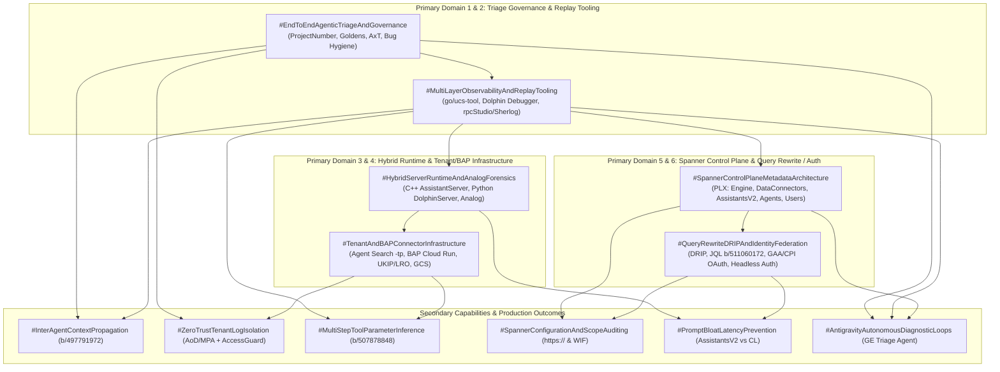
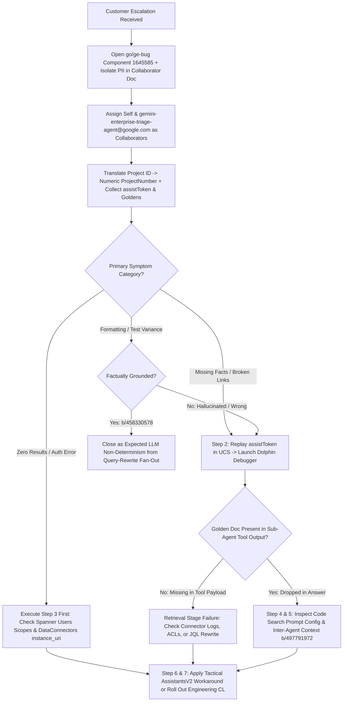
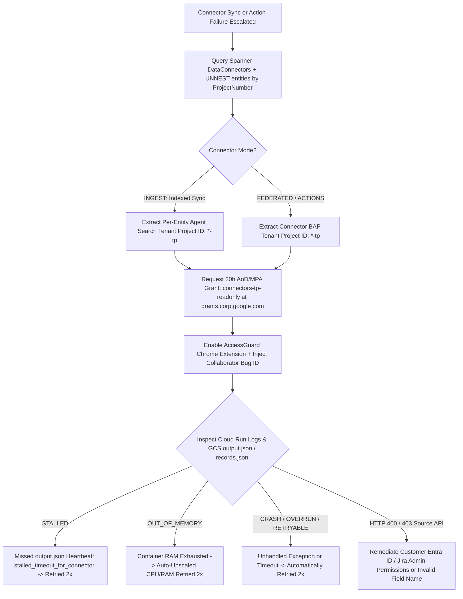
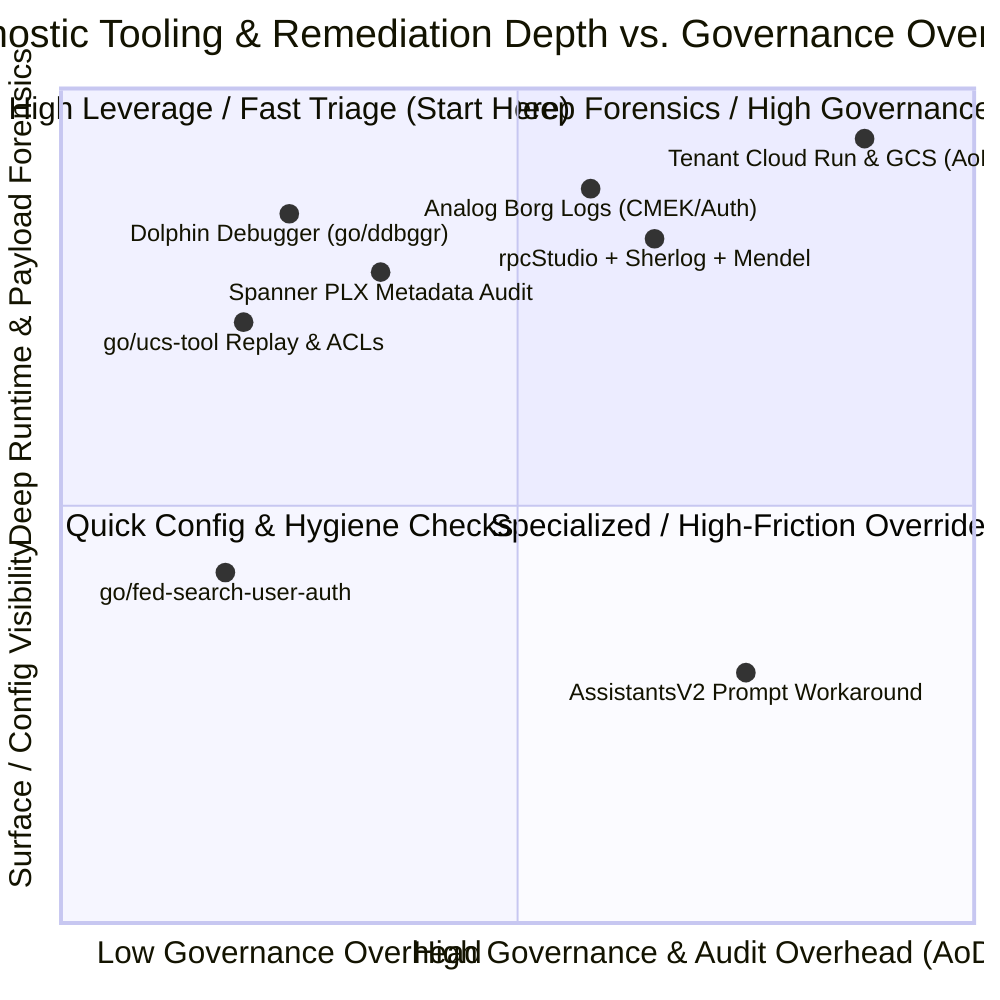

# Gemini Enterprise L400 Master Reference: End-to-End Debugging, Observability & Diagnostic Architecture (Module A5)
**Topic Tags:** `#GeminiEnterprise` `#L400Architecture` `#AgentObservability` `#DiagnosticTooling` `#MultiAgentOrchestration` `#SpannerControlPlane` `#ZeroTrustGovernance` `#AntigravityAgenticAI`

---

## 0. OKF Document Metadata & Topic Modeling Taxonomy
**Topic Tags:** `#OKFMetadata` `#TopicModeling` `#TaxonomyMatrix` `#KnowledgeCatalogIngestion` `#L400_version_20261026_0350`

> **OKF v0.2 Trust Signals, Bucket Merge & Enforced FDE Grading Rubric (`OKF-L400-21`):**
> - **Version Tag:** `L400_version_20261026_0350` | **Status (`status`):** `stable` (`VETTED` / `APPROVED`) | **TTL (`stale_after`):** `2027-04-26T00:00:00Z` *(Maintains existing TTL & version)* | **Verified (`verified`):** `true`
> - **Merged Bucket OKF Lineage:** Reconciled with `Concepts 06, 08, 15` in `gs://gea_agent_development_architectural_best_practices_1790796607` (`project=fivedaysai-prd-sandbox-317383`)
> - **Cloud FDE Prevailing Standard:** `https://g3doc.corp.google.com/company/teams/cloud-fde/index.md?cl=head`
> - **Enforced Project Grading Rubric (`OKF-L400-21`):** Adheres to the 0–3 FDE Field-Readiness Rubric (Pass Gate: Average >= 2.0 across Part A & Part B; Zero-Score Pause Rule: any `0 - Not Demonstrated` triggers an immediate pause and 2-week re-presentation). Primary mapped competencies for `OKF-L400-A5`: **Part B.1.2 (RAG & Query Rewrite Validation), Part B.2.7 (Operational Documentation & Runbooks), Part B.3.5 (Audit Logging & AoD/MPA Governance), Part B.4.2 (Observability & Tracing), Part B.7.2 (Mendel Feature Flags & Config Mgmt)**.

### 0.1 Document Identification & Ingestion Metadata
**Topic Tags:** `#DocumentIdentification` `#VersionControl` `#GCPKnowledgeCatalog` `#AntigravityIngestion`

| Metadata Field | Specification |
| :--- | :--- |
| **OKF Document Title** | Gemini Enterprise L400 Master Reference: End-to-End Debugging, Observability & Diagnostic Architecture (Module A5) |
| **Canonical Artifact Name** | `A5_OKF_Debugging_and_Troubleshooting.md` |
| **OKF Schema & Version Tag** | `L400_version_20261026_0350` |
| **Target Audience** | Principal Cloud Architects, Forward Deployed Engineers (FDEs), Technical Solutions Engineers (TSEs), PSO L400 Practitioners, Antigravity Agentic AI Autonomous Triage Pipelines |
| **Synthesized Source Artifacts** | 1. `gemini_enterprise_technical_training_debugging_and_trouble_shooting.md` (Transcript, Q&A & Quiz Bank)<br>2. `gemini-enterprise-debugging-and-troubleshooting-l400.md` (PSO L400 Architectural Synthesis)<br>3. `slides-a5-debugging.md` (129-Slide A5 Delivery Deck v1.1.0 Deep Extraction) |
| **Core Platforms & Toolchains** | `AssistantServer` (C++), `DolphinServer` (Python), `go/ucs-tool`, Dolphin Debugger (`go/ddbggr`), Analog (`go/analog`), `rpcStudio` + `Sherlog`, Mendel (`go/debug-mendel`), Cloud Spanner (`go/ge-spanner` via `PLX`), Agent Search & BAP Tenant Projects (`AoD`/`MPA` + `AccessGuard`), `DRIP` Planner |

### 0.2 Primary & Secondary Topic Tags
**Topic Tags:** `#PrimaryTopicTags` `#SecondaryTopicTags` `#SemanticIndexing` `#RAGTaxonomy`

* **Primary Topic Tags (6 Core Architectural Domains):**
  1. `#EndToEndAgenticTriageAndGovernance`: Covers the 7-step debugging framework, numeric GCP Project Number indexing, Golden Document ground-truth benchmarking, LLM non-determinism vs. defect classification, and Zero-Trust access controls (`AxT`, `AoD`/`MPA`, `AccessGuard`, Buganizer Collaborator enforcement).
  2. `#MultiLayerObservabilityAndReplayTooling`: Covers `go/ucs-tool` (`assistToken` vs. `attributionToken` replay, `DataConnector` sync runs, ACL checks), Dolphin Debugger (`assistantResponseExtension`, P50/P90 latency timeline, tool invocation history), and `rpcStudio` with `Sherlog` tracing and `Mendel` flag overrides.
  3. `#HybridServerRuntimeAndAnalogForensics`: Covers the split C++ `AssistantServer` (`StreamAssist` RPC termination, session loading) and Python `DolphinServer` (`query_classifier`, `root_agent` planning loops, sub-agent transfers) traced globally via Borg Trace IDs in `Analog` (`go/analog`) for CMEK and silent auth failures.
  4. `#TenantAndBAPConnectorInfrastructure`: Covers Google-owned Agent Search Tenant Projects (`-tp` for `INGEST` syncs, `UKIP` workers, `LRO` jobs, GCS `records.jsonl`/`output.json`) and Business Application Platform (`BAP`) Tenant Projects (Cloud Run microservices for `FEDERATED` and `ACTIONS` modes) alongside the 7 standardized sync failure states.
  5. `#SpannerControlPlaneMetadataArchitecture`: Covers multi-tenant Cloud Spanner schema (`/span/global/cloud-ml-discovery-spanner:prod-<region>`) queried via `PLX` scripts with mandatory `project_number` and `location` predicates across `Engine`, `DataConnectors`, `AssistantsV2`, `Agents`, `Users`, `Documents`, `LongRunningOperations`, and `ExternalIdentityMapping`.
  6. `#QueryRewriteDRIPAndIdentityFederation`: Covers federated query-rewrite sub-agents (`query_used_for_retrieval`, Jira JQL boolean operator precedence `b/511060172`), `DRIP` (`Differentiated Ranking Implementation Planner`), per-user OAuth 2.0 grants (`GAA` vs. `CPI` WIF identities in `go/fed-search-user-auth`), and headless API token expiration mechanics.

* **Secondary Topic Tags (6 Operational Capabilities & Outcomes):**
  1. `#InterAgentContextPropagation`: Diagnosing and remediating sub-agent-to-Root-Agent context drops such as missing `instance_uri` fields that produce broken `[your-domain]` citations (`b/497791972`, `b/503412109`, `cl/908559124`).
  2. `#ZeroTrustTenantLogIsolation`: Enforcing 20-hour `AoD`/`MPA` (`connectors-tp-readonly`) grants, `AccessGuard` Chrome headers, Cloudtop `admin_session` credentials, and Collaborator-restricted PII Google Docs.
  3. `#MultiStepToolParameterInference`: Isolating sub-agent parameter mismatches in Dolphin Debugger, such as SharePoint List `DispForm.aspx` URLs passed to file-download tools (`b/507878848`, `b/514793329`).
  4. `#SpannerConfigurationAndScopeAuditing`: Auditing missing `https://` protocol prefixes in `instance_uri`, distinguishing `low_code_agent_definition` vs. `adk_agent_definition`, and validating per-user OAuth scopes.
  5. `#PromptBloatLatencyPrevention`: Balancing tactical `AssistantsV2` system instruction workarounds against long-term engineering CLs to prevent cumulative prompt token inflation and P50/P90 latency degradation.
  6. `#AntigravityAutonomousDiagnosticLoops`: Structuring deterministic triage decision trees, machine-readable failure signatures, and automated `gemini-enterprise-triage-agent@google.com` Collaborator workflows for agentic AI debugging.

### 0.3 Topic Taxonomy & Connection Matrix
**Topic Tags:** `#TopicTaxonomyMatrix` `#ArchitecturalMapping` `#DiagnosticCapabilities` `#OperationalOutcomes`

| Topic Tag | Taxonomy Category | Connected Primary Domains | Architectural Role & Operational Outcome |
| :--- | :--- | :--- | :--- |
| **`#InterAgentContextPropagation`** | Outcome | `#EndToEndAgenticTriageAndGovernance`, `#MultiLayerObservabilityAndReplayTooling` | Eliminates broken `[your-domain]` links (`b/497791972`) by verifying sub-agent payload schemas in Dolphin Debugger and passing `instance_uri` metadata to `root_agent` via `cl/908559124`. |
| **`#ZeroTrustTenantLogIsolation`** | Governance | `#EndToEndAgenticTriageAndGovernance`, `#TenantAndBAPConnectorInfrastructure` | Protects customer PII and satisfies `AxT` compliance by gating Tenant Cloud Run and GCS `records.jsonl` access behind Buganizer Collaborator status, 20h `AoD`/`MPA` grants, and `AccessGuard`. |
| **`#MultiStepToolParameterInference`** | Capability | `#MultiLayerObservabilityAndReplayTooling`, `#TenantAndBAPConnectorInfrastructure` | Decouples connector availability from parameter schema errors (e.g., SharePoint List `DispForm.aspx` vs. file URI in `b/507878848`) by comparing sequential tool payloads in Dolphin Debugger. |
| **`#SpannerConfigurationAndScopeAuditing`** | Capability | `#SpannerControlPlaneMetadataArchitecture`, `#QueryRewriteDRIPAndIdentityFederation` | Enforces `project_number` + `location` audit predicates in `PLX` to catch malformed `instance_uri` endpoints (missing `https://`), verify ADK/no-code definitions, and inspect `GAA`/`CPI` OAuth scopes. |
| **`#PromptBloatLatencyPrevention`** | Outcome | `#QueryRewriteDRIPAndIdentityFederation`, `#HybridServerRuntimeAndAnalogForensics` | Prevents P50/P90 latency regressions caused by ad-hoc `AssistantsV2` prompt patches, routing boolean JQL fixes (`b/511060172`) and helper updates into clean engineering CLs. |
| **`#AntigravityAutonomousDiagnosticLoops`** | Capability | `#EndToEndAgenticTriageAndGovernance`, `#MultiLayerObservabilityAndReplayTooling` | Enables autonomous AI agents (like `gemini-enterprise-triage-agent@google.com`) and human architects to execute deterministic, reproducible root-cause isolation across all 7 pipeline stages. |

### 0.4 Topic Connection & End-to-End Diagnostic Flow Graphs (Mermaid & ASCII)
**Topic Tags:** `#TopicFlowGraph` `#MermaidDiagram` `#ASCIIDiagram` `#DiagnosticTopology`



```text
+---------------------------------------------------------------------------------------------------+
|                     GEMINI ENTERPRISE L400 DIAGNOSTIC & OBSERVABILITY TOPOLOGY                    |
+---------------------------------------------------------------------------------------------------+
                                                 |
       +-----------------------------------------+-----------------------------------------+
       |                                         |                                         |
       v                                         v                                         v
+------------------------------+  +------------------------------+  +------------------------------+
| 1. TRIAGE & REPLAY LAYER     |  | 2. HYBRID RUNTIME & TENANTS  |  | 3. CONTROL PLANE & REWRITE   |
| - Numeric ProjectNumber      |  | - C++ AssistantServer (RPC)  |  | - Spanner PLX (Engine,       |
| - Bug Collaborator (Not CC)  |  | - Python DolphinServer (LLM) |  |   DataConnectors, Agents,    |
| - go/ucs-tool (Assist/Search)|  | - Analog (Borg Trace IDs)    |  |   AssistantsV2, Users, LRO)  |
| - Dolphin Debugger (go/ddbggr|  | - Agent Search Tenant (-tp)  |  | - DRIP + Sherlog Tracing     |
| - rpcStudio + Mendel Flags   |  | - BAP Tenant (Cloud Run)     |  | - JQL Rewrite (b/511060172)  |
+--------------+---------------+  +--------------+---------------+  +--------------+---------------+
               |                                 |                                 |
               +-----------------+---------------+---------------+-----------------+
                                 |                               |
                                 v                               v
               +---------------------------------+-------------------------------+
               | ZERO-TRUST SECURITY GATE        | PRODUCTION RESOLUTION OUTCOMES|
               | - AxT Customer Audit Logs       | - Fix Context Drop (b/497791972|
               | - 20h AoD/MPA Grant             | - Fix URI Prefix (https://)   |
               | - AccessGuard Browser Header    | - Fix List vs File (b/507878848|
               | - Collaborator PII Google Doc   | - Prevent Prompt Bloat Latency|
               +---------------------------------+-------------------------------+
```

---

## 1. Executive Overview, Problem Statement & Antigravity Agentic AI Development Context
**Topic Tags:** `#ExecutiveOverview` `#ProblemStatement` `#AntigravityAgenticAI` `#MultiAgentObservability` `#EnterpriseTroubleshooting`

> **Enforced FDE Project Grading Rubric Reference (`OKF-L400-21` & `g3doc/company/teams/cloud-fde`):** Every project applying Section 1 of `OKF-L400-A5` is graded against **Part B.1.2 (RAG & Query Rewrite Validation), Part B.2.7 (Operational Documentation & Runbooks), Part B.3.5 (Audit Logging & AoD/MPA Governance), Part B.4.2 (Observability & Tracing), Part B.7.2 (Mendel Feature Flags & Config Mgmt)** and merged bucket **Concepts 06, 08, 15** (`stale_after: 2027-04-26T00:00:00Z`, version `L400_version_20261026_0350`). Builders must achieve >= 2 (**Competent**) across Part A & Part B and avoid any 0 (**Not Demonstrated**) pause triggers.

### 1.1 The Enterprise Multi-Agent Debugging Challenge
**Topic Tags:** `#DebuggingChallenge` `#DistributedFailureModes` `#RetrievalVsGeneration` `#SilentAuthFailures`

Gemini Enterprise (formerly Agentspace and Vertex AI Search & Conversation) orchestrates complex enterprise workflows across first-party (1P) indexed corpora, third-party (3P) federated SaaS connectors, write-back action connectors, no-code UI agents, and custom Agent Development Kit (ADK) sub-agents. Because a single conversational turn traverses seven distinct execution stages—from semantic intent classification and query planning to federated DSL query rewriting (`DRIP` / JQL), cross-project Cloud Run execution, and top-K chunk synthesis—production defects rarely manifest as simple stack traces. Instead, architects confront four pervasive operational failure patterns:
1. **Retrieval vs. Summarization Ambiguity:** When an assistant omits critical facts or returns broken links (such as `https://[your-domain]/...` in `b/497791972`), teams struggle to determine whether the third-party connector failed to fetch the record, the sub-agent stripped context during handoff, or the Root Agent hallucinated during synthesis.
2. **Silent Zero-Result & Headless Authentication Failures:** Automated API regression pipelines (`StreamAssist`) and Workforce Identity Federation (`CPI`) users frequently experience zero returned results without frontend error banners because expired OAuth tokens (`ERROR_TYPE_USER_TOKEN_EXPIRED`), missing Spanner `connector_authorizations` scopes, or CMEK restrictions suppress interactive browser re-authentication popups.
3. **LLM Non-Determinism vs. True Quality Defects:** Because query-rewrite sub-agents (`gemini-2.5-flash`) generate semantically equivalent but syntactically varied fan-out queries across identical prompts (`b/458330578`), customer QA teams using rigid string-matching assertions frequently misclassify normal generative variance as P1 production outages, while subtle boolean operator precedence bugs in generated JQL (`b/511060172`) silently pollute context windows.
4. **Multi-Tenant Security & Observability Isolation:** Connector ingestion jobs (`UKIP` workers, `LRO` operations) and live federated calls execute inside isolated Google-owned **Agent Search Tenant Projects** (`-tp`) and **Business Application Platform (BAP) Tenant Projects** (`-tp`). Without mastering Zero-Trust access workflows—numeric GCP Project Number translation, Buganizer Collaborator assignment, 20-hour Access on Demand (`AoD`) / Multi-Party Authorization (`MPA`) grants, and the `AccessGuard` Chrome extension—engineers are blocked by `Permission Denied` errors when inspecting Cloud Run or GCS logs.

### 1.2 Architectural Solution & Antigravity Agentic AI Development Context
**Topic Tags:** `#AntigravityContext` `#GETriageAgent` `#VibeDebugging` `#DeterministicTriage`

This OKF reference (`L400_version_20261026_0350`) codifies the end-to-end L400 diagnostic architecture for both human Cloud Architects and **Antigravity Agentic AI development pipelines**. Within Google's internal engineering ecosystem, autonomous diagnostic agents—exemplified by the **Gemini Enterprise Triage Agent** (`gemini-enterprise-triage-agent@google.com`), **JetSki CLI** (`Gemini CLI`), and **Ducky**—actively participate in "Vibe Debugging." When added as a **Collaborator** on a Buganizer ticket, the GE Triage Agent autonomously decodes `assistToken` payloads, inspects frontend/backend source code via Code Search (`cs/`, such as identifying missing `title` fields in `uc_citation_chips.ts`), correlates Spanner metadata, and posts Root Cause Analysis directly to the bug thread.

For Antigravity Agentic AI developers building next-generation autonomous support agents, self-healing orchestrators, and Knowledge Catalog RAG pipelines, this document provides:
* **Deterministic Triage Decision Trees:** Machine-actionable routing rules that map symptom signatures (e.g., `0 Bytes` tool payloads, `DispForm.aspx` URI mismatches, unparenthesized JQL `OR`/`AND` clauses) to exact diagnostic tools (`go/ucs-tool`, Dolphin Debugger, `Analog`, `Spanner PLX`, `rpcStudio`/`Sherlog`).
* **Inter-Agent Context Contracts:** Formal guidelines for preserving metadata (such as `instance_uri` and structured citations) across `transfer_to_agent` boundaries without inflating system prompt token counts.
* **Zero-Trust Compliance Guardrails:** Strict programmatic enforcement of `project_number` + `location` SQL predicates, Collaborator-only PII isolation, and `AoD`/`MPA` audit compliance (`AxT`).

---

## 2. Deep Technical Architecture, Matrices, Visual Pictures & Flow Diagrams
**Topic Tags:** `#DeepTechnicalArchitecture` `#ObservabilityStack` `#HybridRuntime` `#SpannerSchema` `#TenantProjects`

> **Enforced FDE Project Grading Rubric Reference (`OKF-L400-21` & `g3doc/company/teams/cloud-fde`):** Every project applying Section 2 of `OKF-L400-A5` is graded against **Part B.1.2 (RAG & Query Rewrite Validation), Part B.2.7 (Operational Documentation & Runbooks), Part B.3.5 (Audit Logging & AoD/MPA Governance), Part B.4.2 (Observability & Tracing), Part B.7.2 (Mendel Feature Flags & Config Mgmt)** and merged bucket **Concepts 06, 08, 15** (`stale_after: 2027-04-26T00:00:00Z`, version `L400_version_20261026_0350`). Builders must achieve >= 2 (**Competent**) across Part A & Part B and avoid any 0 (**Not Demonstrated**) pause triggers.

### 2.1 End-to-End 7-Step Debugging Methodology, Zero-Trust Governance & Quality Triage
**Topic Tags:** `#SevenStepWorkflow` `#ZeroTrustGovernance` `#AccessTransparency` `#LLMNonDeterminism` `#b497791972`

#### 2.1.1 The 7-Step End-to-End Debugging Framework & Inter-Agent Context Propagation (`b/497791972`)
**Topic Tags:** `#SevenStepFramework` `#InterAgentContext` `#AdyenCaseStudy` `#b497791972` `#b503412109`

Production triage in Gemini Enterprise follows a disciplined 7-step engineering sequence designed to isolate failures across orchestration, control-plane metadata, and source code:
1. **Step 1 — Gather Information:** Collect the customer's numeric **GCP Project Number** (internal tools never index by alphanumeric Project ID; translate via `project_id_number_translator` on Cloudtop if needed), **Location** (`global`, `us`, `eu`), **Engine ID**, **`assistToken`** (from `StreamAssist` network responses) or **`attributionToken`** (from search responses), Dolphin Debugger URL, and customer **"Golden" ground-truth expectations** (exact document IDs, URLs, titles, or expected record sets).
2. **Step 2 — Analyze Sub-Agent & Tooling Outcomes:** Replay the `assistToken` in `go/ucs-tool` and launch **Dolphin Debugger** (`go/ddbggr`) to inspect the Root Agent's planning loop, `transfer_to_agent` handoffs, sub-agent tool parameters, third-party API response payloads, and whether the planner terminated prematurely.
3. **Step 3 — Verify Customer Setup in Spanner:** Query Cloud Spanner (`Users`, `DataConnectors`, `Engine`, `AssistantsV2`, `Agents`) via `PLX` to validate `enable_debug_thought_messages`, user OAuth `connector_authorizations` and scopes, connector operational modes (`INGEST`, `FEDERATED`, `ACTIONS`), and `instance_uri` formatting (must include `https://`). *Operational Note:* When federated search returns zero results, execute Step 3 before Step 2.
4. **Step 4 — Examine Connector Code & Instructions:** Use internal Code Search (`cs/`) to inspect human-readable connector prompt configurations (e.g., `agent-configs/connector/agent/Salesforce/prompt_config`), few-shot examples, helper functions, and underlying API choices (e.g., Microsoft Graph API vs. SharePoint Search API).
5. **Step 5 — Identify Missing Context Between Agents:** Evaluate whether context was dropped during the handoff from a specialized sub-agent back to the orchestrator (`root_agent`).
   * **Production Bug Case Study (`b/497791972` Adyen & `b/503412109` KPMG):** Global payment processor Adyen and advisory firm KPMG escalated that their Salesforce Federated Connectors retrieved accurate Opportunity records, but every citation hyperlink rendered in the Gemini Enterprise UI was broken (`https://[your-domain]/...`). Because the `assist_token` had aged out of `go/ucs-tool`, engineers opened the Dolphin Debugger session (`http://go/ddbggr?s=_gW7nzdx2lW`) and discovered that `salesforce_agent` returned valid Opportunity IDs in its tool response but omitted the customer's Salesforce base domain (`instance_uri`). Lacking the domain in its context window, `root_agent` substituted the literal placeholder `[your-domain]`. Inspecting `agent-configs/connector/agent/Salesforce/prompt_config` confirmed the helper function omitted `instance_uri`. While a temporary system instruction in `AssistantsV2` provided partial relief, engineering deployed **`cl/908559124`** to inject the Salesforce instance domain directly into the sub-agent return payload, verified in `b/503412109#comment31`.
6. **Step 6 — Identify & Apply a Fix:** Apply a tactical system/style instruction workaround in `AssistantsV2`, identify an existing engineering CL rollout in Buganizer, or escalate to SWE to patch the sub-agent schema or code.
7. **Step 7 — Verify Resolution:** Replay the exact customer prompt and token trace to confirm end-to-end remediation.

#### 2.1.2 Zero-Trust Support Governance: `AxT`, `AoD`/`MPA`, `AccessGuard` & Bug Hygiene
**Topic Tags:** `#AccessTransparency` `#AoDMPA` `#AccessGuard` `#BugHygiene` `#PIIIsolation`

Every diagnostic action against customer metadata or logs is governed by Google's Zero-Trust support framework:
* **Tiger Team Onboarding (`go/tigerteam-debug-access`):** Engineers must join `agentspace-tiger-team@` (`pso-ge-tech-champions@`) and request Sphinx MDB group membership in `agentspace-tiger-team-tooling` to access `go/ucs-tool`, Dolphin Debugger, `rpcStudio`, and UCS Spanner.
* **Access Transparency (`AxT` — `go/ucs-axt`) & Access Approval (`AxA`):** Every internal diagnostic read triggers near real-time, customer-visible `AxT` audit logs in the consumer's GCP project (and requires explicit customer approval via `AxA` in Assured Workloads environments such as `b/49191982`).
* **Strict Bug Justification & Collaborator Enforcement:** Every query in `go/ucs-tool`, Dolphin Debugger, `Analog`, `PLX`, and `rpcStudio` requires an open Buganizer ticket filed under component `1645585` (`go/ge-bug` / `go/agentspace-bug`). The investigating engineer—and any automated bot such as `gemini-enterprise-triage-agent@google.com`—must be explicitly listed as the **Assignee** or **Collaborator** on the bug. Being listed only in the **CC** field causes tool authorization checks to fail immediately. Reusing Customer A's bug ID to query Customer B's project is a severe compliance violation.
* **Multi-Party Authorization (`MPA` / Access on Demand [`AoD`]) & `AccessGuard`:** Viewing customer connector logs in Google-owned Tenant Projects requires requesting a time-bound (up to 20 hours) `connectors-tp-readonly` grant at `grants.corp.google.com`, approved by a peer admin (`MPA`). Furthermore, the engineer must pin and activate the **`AccessGuard`** Chrome browser extension on every Pantheon tab, pasting the active Buganizer ID into the plugin fly-out so HTTP justification headers are injected into Cloud Console requests.
* **PII Isolation & The "Transparency Challenge":** Sensitive customer PII/PHI must **never** be pasted directly into Buganizer descriptions; it must be isolated inside a separate Google Doc shared strictly with verified Collaborators on the bug. Externally, engineers must never share raw log lines, Dolphin Debugger screenshots, or proprietary architecture names (such as `@s^3` `Scubed` embedding filters) with customers.

#### 2.1.3 Information-Seeking Pipeline, Golden Benchmarking & LLM Non-Determinism (`b/458330578`)
**Topic Tags:** `#InformationSeekingPipeline` `#GoldenBenchmarking` `#LLMNonDeterminism` `#b458330578`

Every information-seeking query traverses seven internal stages: (1) Semantic intent, language, spelling & safety/controversy refusal calculation; (2) Agent Plan creation; (3) User-authorized tool/connector configuration; (4) Tool & instruction execution; (5) Document chunk retrieval; (6) Top-K chunk evaluation (filtering out off-topic entities); and (7) Summarization of "sufficient" chunks.

| Diagnostic Dimension | True Retrieval / Generation Defect | Expected LLM Non-Determinism (`b/458330578`) |
| :--- | :--- | :--- |
| **Root Cause Mechanism** | Missing indexed docs, expired OAuth tokens, malformed JQL rewrites (`b/511060172`), or context drops (`b/497791972`). | Query-rewrite sub-agents (e.g., `sharepoint_federated_query_rewrite_agent` on `gemini-2.5-flash`) generate semantically equivalent but syntactically distinct fan-out queries across runs. |
| **Observed Behavior** | Factually incorrect answers, ungrounded claims, missing Golden records, or broken `[your-domain]` URLs. | Structural formatting differences (e.g., a markdown table + 4-step workflow on Run 1 vs. bulleted prose on Run 2) that remain factually accurate and grounded. |
| **Golden Benchmark Test** | Compare customer's expected **Golden Document IDs/URIs** against sub-agent tool payloads: if missing from tool output -> *Retrieval failure*; if present in tool output but absent in final answer -> *Summarization failure*. | Inspect side-by-side diffs in `Nexus` / Dolphin Debugger (`b/458330578` Home Depot Git Bash test suite) and educate the customer to replace rigid character-for-character string assertions with semantic evaluation metrics. |



#### 2.1.4 Inline Section 2.1 Best Practices & Inline FAQs
**Topic Tags:** `#Section2_1BestPractices` `#Section2_1FAQs` `#TriageBestPractices`

* **Inline Section 2.1 Best Practices:**
  * **Always Collect Numeric Project Numbers & Goldens Up Front:** Require the numeric `ProjectNumber`, `Location`, `EngineId`, `assistToken`/`attributionToken`, and Golden Document IDs at intake to eliminate multi-day back-and-forth delays.
  * **Enforce Collaborator Role & PII Doc Isolation:** Always place human investigators and `gemini-enterprise-triage-agent@google.com` in the Buganizer **Collaborator** field (never CC) and store any customer PII/PHI in a Collaborator-restricted Google Doc.
* **Inline Section 2.1 FAQs:**
  * **Q1: Why did `gemini-enterprise-triage-agent@google.com` fail with an authorization error when trying to analyze a bug I filed?**
    * **A:** Internal diagnostic tools (`go/ucs-tool`, Dolphin Debugger, Analog) verify that the caller is explicitly listed as the **Assignee** or **Collaborator** on the Buganizer ticket. If the bot or peer engineer is only in the **CC** list, access is denied.
  * **Q2: How do we determine whether a missing clause in an assistant response is a retrieval bug or a summarization bug?**
    * **A:** Obtain the customer's **Golden Document** URI/ID and inspect the sub-agent's tool response payload in Dolphin Debugger. If the Golden Document was never returned by the sub-agent tool, the defect is in **search/retrieval**; if the chunk is present in the tool payload but omitted from the final answer, the defect is in **summarization/generation**.

---

### 2.2 Baseline Token Replay, License & ACL Forensics via `go/ucs-tool`
**Topic Tags:** `#UCSTool` `#TokenReplay` `#AssistToken` `#AttributionToken` `#ACLForensics`

#### 2.2.1 `go/ucs-tool` Architecture, Assist Replay vs. Search Replay & Token Decoding
**Topic Tags:** `#InternalAdminService` `#AssistReplay` `#SearchReplay` `#TokenFetchErrors`

Powered by `InternalAdminService`, **`go/ucs-tool`** is the foundational web portal for replaying customer tokens, inspecting connector sync runs, managing licenses, and checking document ACLs.
* **Assist Replay (`assistToken`):** Replays conversational turns from `StreamAssist` calls, exposing multi-agent planning steps, grounded citations, raw `assistantResponseExtension` JSON payloads, and the direct launch hyperlink to **Dolphin Debugger**.
* **Search Replay (`attributionToken` / Search Token):** Replays standalone `SearchService.Search` calls (primarily for ingestion connectors), surfacing retrieved document segments, relevance scores, source collections, and querying user ACLs.
* **Deprecation of `encoded_reason`:** Backend replay calls in Pantheon and `go/ucs-tool` no longer require an `encoded_reason` string; engineers should ignore UI warning banners requesting it.
* **Three Standard Token Fetch Failure Signatures:**
  1. **`"Unable to decode token"`:** The customer truncated or corrupted the token string when copying/pasting from Chrome DevTools or UI feedback logs.
  2. **`"The assist log was not found"`:** Either debug logging was not enabled on the engine, or the log expired past the **30-day** retention window.
  3. **`"Unable to convert server response to JSON"`:** An internal `AdminService` serialization error or upstream protobuf schema mismatch occurred.

#### 2.2.2 `DataConnector` Sync Inspection, `LicenseConfig`, Document ACL Checks & Setup vs. Engineering Errors
**Topic Tags:** `#DataConnectorTab` `#LicenseConfig` `#DocumentACLCheck` `#SetupVsEngineeringErrors`

Beyond token replay, `go/ucs-tool` provides five specialized operational modules:
1. **`DataConnector` Module:** Queries connector state (`ACTIVE`), third-party type (`SERVICE_NOW`, `SHAREPOINT`, `JIRA`), `Entity Infos` (`knowledge` and `thirdpartyidentity` displaying both the **Agent Search Tenant Project ID** and **BAP Tenant Project ID**), and **`Entity Sync Runs`** (document crawl/fetch counts, import counts, error file counts, and direct hyperlinks to Tenant Project Cloud Logging and GCS buckets).
2. **Distinguishing Customer Setup Errors vs. Engineering Bugs in Tenant Logs:**
   * **Customer Setup Errors (`b/418844808`, `b/418714738`, `b/448416960`):** Visible in Tenant Cloud Run or GCS `output.json` logs as external HTTP 401/403 permission failures—for example, Microsoft Graph API returning `403 Forbidden - Insufficient privileges` (`Authorization_RequestDenied`) on `ProjectNumber: 608117404199` because the customer's Entra ID administrator failed to grant mail/site application permissions, or On-Premise Jira Server (`b/416062411`) logging `[403] Forbidden error. You are not authorized to perform this action. Administrator privileges are required` in `JiraEntityAdapter.initialize` under `ConnectorsPlatformLog`.
   * **Engineering / Infrastructure Bugs (`b/418276511`):** Internal runtime failures such as `DEADLINE_EXCEEDED: Deadline expired before operation could complete` inside `DiscoveryEngineConnectorService` during LRO creation, requiring SWE escalation.
3. **Document ACL Check:** Validates whether a specific user identity (`user_email` or external identity) has read permissions on an ingested document (`document_name` / URI) against synced ACL entities.
4. **`LicenseConfig` & Operations:** Audits seat allocations, subscription tiers, and active `LongRunningOperations` (`LRO`) status.

```text
+--------------------------------------------------------------------------------------------------+
|                             go/ucs-tool DIAGNOSTIC MODULE ARCHITECTURE                           |
+--------------------------------------------------------------------------------------------------+
|  INPUT CREDENTIALS: Numeric ProjectNumber + Location (global/us/eu) + Collaborator Buganizer ID  |
+-------------------+--------------------------+--------------------------+------------------------+
                    |                          |                          |
                    v                          v                          v
     +-----------------------------+ +----------------------------+ +---------------------------+
     | 1. ASSIST / SEARCH REPLAY   | | 2. DATACONNECTOR MODULE    | | 3. DOCUMENT ACL & LICENSE |
     | - assistToken -> Conversation| | - Entity Infos: knowledge  | | - Verify user_email vs    |
     |   turn + Launch Dolphin Dbg | |   & thirdpartyidentity     | |   synced Document ACLs    |
     | - attributionToken ->       | | - Exposes Agent Search -tp | | - Inspect LicenseConfig   |
     |   Standalone Search chunks  | |   & BAP Tenant Project IDs | |   seat states & LRO jobs  |
     | - 30-day log retention TTL  | | - Entity Sync Runs -> Links| | - Isolate ACL drops from  |
     | - Ignore encoded_reason warn| |   to Cloud Logging & GCS   | |   unindexed corpus gaps   |
     +-----------------------------+ +----------------------------+ +---------------------------+
```

#### 2.2.3 Inline Section 2.2 Best Practices & Inline FAQs
**Topic Tags:** `#Section2_2BestPractices` `#Section2_2FAQs` `#UCSToolBestPractices`

* **Inline Section 2.2 Best Practices:**
  * **Extract Tenant Project IDs Directly from `Entity Infos`:** Use the `DataConnector` tab in `go/ucs-tool` (or Spanner `UNNEST(entities)`) to retrieve both the Agent Search Tenant Project ID and BAP Tenant Project ID rather than asking the customer for internal Google project identifiers.
  * **Triage 403 Source API Errors Before Escalating to SWE:** Always inspect Tenant Cloud Run and GCS error logs linked from `Entity Sync Runs` to filter out customer IAM/OAuth misconfigurations (such as missing Entra ID Graph permissions or Jira Admin roles) before filing engineering defects.
* **Inline Section 2.2 FAQs:**
  * **Q1: What causes `go/ucs-tool` to return `"The assist log was not found"` when replaying a valid-looking `assistToken`?**
    * **A:** Either debug logging was not enabled for the customer's engine at the time of the query, or more than **30 days** have elapsed since the conversational turn occurred (exceeding the assist log retention TTL).
  * **Q2: Which `go/ucs-tool` module should an architect query to check document crawl counts, sync states, and error files for an ingestion connector?**
    * **A:** The **`DataConnector`** module (specifically inspecting **`Entity Sync Runs`** and **`Entity Infos`** using the customer's `ProjectNumber`, `Location`, `Collection`, and Buganizer `Justification`).

---

### 2.3 Multi-Agent Orchestration & Hybrid Server Runtime Diagnostics (`Dolphin Debugger` & `Analog`)
**Topic Tags:** `#DolphinDebugger` `#AnalogLogViewer` `#AssistantServerCpp` `#DolphinServerPython` `#b507878848`

#### 2.3.1 Dolphin Debugger (`go/ddbggr`) Architecture, Latency Timelines & Tool Error Tiers (`b/507878848`)
**Topic Tags:** `#DolphinDebuggerUI` `#LatencyTimeline` `#ToolInvocationHistory` `#SharePointListVsFile` `#b507878848`

**Dolphin Debugger** (`go/ddbggr`) parses raw `assistantResponseExtension` JSON payloads (`debug_log` / `new_debug_log`) into a visual execution workbench across five primary panels:
1. **Execution Summary & Latency Timeline (Waterfall):** Displays end-to-end turn duration and sequential vs. parallel execution bars across `query_classifier`, `root_agent`, `transfer_to_agent` calls, and specialized sub-agents (e.g., `imagen_agent`, `sharepoint_agent`, `jira_agent`).
2. **LLM Execution Metrics:** Breaks down model version (e.g., `gemini-2.5-flash` vs. `gemini-2.5-flash-image`), prompt token counts, completion token counts, and per-call LLM latency.
3. **Agent Plan & Thought Stream:** Visualizes the Root Agent's internal reasoning steps, decomposition strategy, and termination conditions.
4. **Tool Invocation History & Tool Errors:** Exposes exact request parameters, response payload byte sizes, and structured error codes for every sub-agent tool call.
5. **Deprecation of Automated "Loss Analysis" (`Gemini 3 Flash Preview`):** The experimental LLM-based "Loss Analysis" tab was removed from Dolphin Debugger because it suffered from severe confirmation bias—fabricating plausible-sounding defects (such as *"Conversational Overhang"* or *"Instruction-to-Spec Mismatch"*) even on healthy traces. Engineers must rely on deterministic payload inspection rather than LLM self-critique.

**Three-Tier Tool Execution Failure Taxonomy in Dolphin Debugger:**
* **Tier 1 — Immediate Sub-Agent Zero-Byte Failure:** In `b/498998386`, `query_classifier` (`gemini-2.5-flash`, 4,818 prompt tokens, 727ms) and `root_agent` (`gemini-2.5-flash`, 10,815 prompt tokens, 1,696ms) invoke `transfer_to_agent` to `imagen_agent` (`gemini-2.5-flash-image`, 6,835ms), where `Tool Invocation History` displays a **`0 Bytes`** response payload, immediately isolating the crash to the sub-agent tool call.
* **Tier 2 — Multi-Step Tool Parameter Inference Failure (`b/507878848` & `b/514793329`):** A customer reports that summarizing an embedded SharePoint survey PNG fails with `code: 5` (`generic::not_found: Resource "projects/.../locations/us-central1/connections/bap-.../tools/download_document" was not found [HTTP 404]`). A superficial reading suggests the BAP `download_document` tool is missing. However, inspecting `Tool Invocation History` reveals **two** calls to `sharepoint_agent_download_document` in the same turn: the first call **succeeds** (`92.97 KB` payload for a PDF), proving the BAP tool exists and works, while the second call **fails** (`380 Bytes` error for the PNG). Inspecting the upstream `sharepoint_agent_search_tool` response (`56.29 KB`) exposes the true root cause: the PDF result returned a direct Document Library file path (`.../Shared%20Documents/.../file.pdf`), whereas the PNG result returned a **SharePoint List item display URL** (`.../Lists/.../DispForm.aspx?ID=...`), which `download_document` cannot fetch (`b/514793329`).
* **Tier 3 — Silent / Unsurfaced Errors Requiring Analog (`ERROR_TYPE_USER_TOKEN_EXPIRED`):** During headless API testing against a federated Slack connector, `slack_agent` `search_chat_message_tool` returns `"no_results_before_truncation": ""` with **zero errors** shown in Dolphin Debugger. Pivoting to **Analog** reveals `UNAUTHENTICATED: External auth token has expired` (`ERROR_TYPE_USER_TOKEN_EXPIRED`).

#### 2.3.2 Hybrid C++/Python Runtime (`AssistantServer` vs. `DolphinServer`) & `Analog` (`go/analog`)
**Topic Tags:** `#HybridRuntime` `#AssistantServer` `#DolphinServer` `#AnalogForensics` `#CMEKDebugging`

Gemini Enterprise's conversational runtime is split across two Borg server fleets traced globally via **`Analog`** (`go/analog`, transitioning long-term to `Nexus Observability`):

| Runtime Server | Implementation Language & Borg Job | Core Architectural Responsibilities | Primary `Analog` Diagnostic Templates & Use Cases |
| :--- | :--- | :--- | :--- |
| **`AssistantServer`** | **C++** (`prod-global.discovery-assistant-server`) | Terminates incoming external `StreamAssist` RPCs, validates project/engine metadata, loads conversational session state, enforces CMEK & VPC-SC policies, and dispatches internal RPCs to `DolphinServer` and `FederatedSearchServer`. | Queried via **`go/fed_assist_template`** by searching `text_payload` for the customer's `assist_token`. Used to extract the underlying Borg **`traceId`** when standard token replay is blocked (e.g., **CMEK** customers `b/517490651`). |
| **`DolphinServer`** | **Python** (`cloud-ml-dolphin-server`) | Executes the multi-agent orchestration loop (`query_classifier`, `root_agent`), LLM prompt construction, `transfer_to_agent` routing, and outbound sub-agent tool invocations to BAP/Tenant projects. | Queried via **`go/fed_dolphin_template`** using the Borg **`traceId`** extracted from `AssistantServer`. Exposes uncaught Python exceptions, headless OAuth `Token Expired` errors, and third-party HTTP 401/403/500 stack traces. |

```mermaid
sequenceDiagram
    autonumber
    participant Client as Customer UI / Headless API
    participant AS as AssistantServer (C++ Borg)
    participant DS as DolphinServer (Python Borg)
    participant BAP as BAP Tenant Project (Cloud Run)
    participant SaaS as 3P SaaS API (SharePoint / Slack / Jira)

    Client->>AS: StreamAssist RPC (Query + User Identity)
    Note over AS: Generates assistToken & Borg traceId<br/>Logged in Analog (go/fed_assist_template)
    AS->>DS: Forward Orchestration Request (traceId)
    Note over DS: query_classifier -> root_agent planning<br/>Logged in Analog (go/fed_dolphin_template)
    DS->>BAP: transfer_to_agent -> Execute Connector Tool
    BAP->>SaaS: Outbound REST / OAuth 2.0 Call
    alt Healthy Direct File URI (PDF)
        SaaS-->>BAP: 200 OK (92.97 KB Payload)
        BAP-->>DS: Return Document Content
    else SharePoint List URI Mismatch (b/507878848)
        SaaS-->>BAP: 404 Not Found on DispForm.aspx
        BAP-->>DS: code: 5 generic::not_found (380B in Dolphin Dbg)
    else Headless Expired OAuth Token
        SaaS-->>BAP: 401 Unauthorized (Token Expired)
        BAP-->>DS: ERROR_TYPE_USER_TOKEN_EXPIRED (Silent in UI/Dbg; Visible in Analog)
    end
    DS-->>AS: Synthesize StreamAssist Response + assistantResponseExtension
    AS-->>Client: Return Answer + assistToken
```

#### 2.3.3 Inline Section 2.3 Best Practices & Inline FAQs
**Topic Tags:** `#Section2_3BestPractices` `#Section2_3FAQs` `#DolphinAndAnalogBestPractices`

* **Inline Section 2.3 Best Practices:**
  * **Always Compare Sibling Tool Invocations Before Declaring a Connector Down:** When Dolphin Debugger reports a `404 NOT_FOUND` on a BAP tool (`b/507878848`), check `Tool Invocation History` for other calls to the same tool in that turn and inspect the upstream search payload for malformed URIs (such as SharePoint List `DispForm.aspx` links).
  * **Pivot from `AssistantServer` to `DolphinServer` via Borg `traceId` for CMEK & Silent Failures:** When CMEK blocks `go/ucs-tool` token replay (`b/517490651`) or when federated tools return empty results without errors in Dolphin Debugger, query `go/fed_assist_template` by `assist_token`, extract the `traceId`, and inspect `go/fed_dolphin_template` in Analog.
* **Inline Section 2.3 FAQs:**
  * **Q1: Why was the LLM-based "Loss Analysis" tab (`Gemini 3 Flash Preview`) removed from Dolphin Debugger?**
    * **A:** It exhibited severe confirmation bias—hallucinating plausible root causes (like *"Conversational Overhang"*) even when no error occurred. Engineers must inspect actual tool payloads and latency timelines instead.
  * **Q2: Why does an expired third-party OAuth token fail silently with zero results during automated API regression testing instead of prompting the user to log in?**
    * **A:** Headless API scripts invoking `StreamAssist` lack an interactive browser UI layer to render OAuth 2.0 re-authentication popups, causing the sub-agent to fail with `ERROR_TYPE_USER_TOKEN_EXPIRED` in Analog logs and return empty results to the Root Agent.


---

### 2.4 Google-Owned Tenant Projects, BAP Infrastructure, `AoD`/`MPA` & 7 Connector Sync Error States
**Topic Tags:** `#TenantProjects` `#BAPInfrastructure` `#AoDMPA` `#ConnectorSyncStates` `#GCSForensics`

#### 2.4.1 Agent Search Tenant Projects vs. BAP Tenant Projects & Cloudtop GCS Forensics
**Topic Tags:** `#AgentSearchTenantProject` `#BAPTenantProject` `#UKIPWorkers` `#RecordsJsonl` `#OutputJson`

Gemini Enterprise isolates third-party data connector runtimes inside Google-owned GCP projects (suffixed with **`-tp`**) to enforce strict security boundaries between customer workloads:

| Infrastructure Dimension | Agent Search Tenant Project (`entities.tenant_project_id`) | Business Application Platform (BAP) Tenant Project (`bap_config.bap_tenant_project_id`) |
| :--- | :--- | :--- |
| **Operational Modes Supported** | **`DATA_CONNECTOR_MODE_INGEST`** (Indexed 3P Connectors: SharePoint, Confluence, ServiceNow, Jira Server). | **`DATA_CONNECTOR_MODE_FEDERATED`** (Live 3P Search) & **`DATA_CONNECTOR_MODE_ACTIONS`** (Write-Back Actions). |
| **Granularity & Mapping in Spanner** | Provisioned **per entity** within a connector (e.g., Confluence `page`, `space` -> `q3c944a8bb4b6b119-tp`, `blogpost`, `comment`, `attachment` -> `ma8ab454b964dd3aa-tp`). Extracted via `UNNEST(DataConnector.DataConnector.entities)`. | Provisioned **per connector instance** (e.g., `o953cb6968a9815ff-tp`) inside `DataConnector.bap_config.bap_tenant_project_id`. Also exposed in `go/ucs-tool` under `Entity Infos`. |
| **Runtime Compute & Storage** | **Cloud Run Jobs**, **`UKIP` Workers** (Borg), **`LRO` tables**, and intermediate **Tenant GCS Buckets** storing raw crawled payloads (`records.jsonl`, pre-imported/pre-mapped PDFs) and sync telemetry (`output.json`). | **Cloud Run Microservices** executing synchronous outbound REST/GraphQL/SOAP calls and OAuth 2.0 token exchanges against external SaaS endpoints. |
| **Forensic CLI & Log Access** | Requires 20h `AoD`/`MPA` (`connectors-tp-readonly`), active `AccessGuard` Chrome plugin for Pantheon (`ConnectorsPlatformLog`), and gLinux **Cloudtop `admin_session`** (`--reason="<BUG_ID>"`) to run `gsutil ls`/`gsutil cat` on GCS buckets. | Requires 20h `AoD`/`MPA` (`connectors-tp-readonly`) and active `AccessGuard` Chrome plugin to inspect Cloud Run microservice container logs (where HTTP 400/401/403/500 errors highlight in red). |

#### 2.4.2 The 7 Standardized Connector Execution & Sync Error States
**Topic Tags:** `#SevenSyncStates` `#StalledTimeout` `#OutOfMemoryUpscale` `#CrashAndOverrun`

When inspecting `Entity Sync Runs` in `go/ucs-tool` or Tenant Project Cloud Run logs, connector jobs emit seven standardized operational error states:
1. **`INTERNAL_ERROR`:** An exception occurred during the data fetch phase; inspect Cloud Run job logs, `output.json` in the Tenant GCS bucket, or the Spanner error column.
2. **`CRASH`:** The container terminated unexpectedly due to an unhandled runtime exception; inspect operation status and sync run debug messages (automatically retried up to **2 additional times**).
3. **`OVERRUN`:** The sync run exceeded the maximum allowed execution timeout window; inspect Cloud Run job logs (automatically retried up to **2 additional times**).
4. **`STALLED`:** The connector failed to update `output.json` within the configured heartbeat interval (`stalled_timeout_for_connector` in `CdPush`); the execution is cancelled, marked `STALLED`, and retried up to **2 additional times**.
5. **`CANCELLED`:** Triggered either because (a) the customer manually paused the connector (placing the overall Entity Sync Run in `CANCELLED` state) or (b) the pipeline aborted due to an internal error (placing the overall Entity Sync Run in `ERROR` state).
6. **`OUT_OF_MEMORY`:** The connector container exhausted its memory allocation during large payload processing; the platform automatically re-triggers the job with **auto-upscaled CPU and RAM** up to **2 additional times**.
7. **`RETRYABLE_FAILURE`:** A transient network or source-API error occurred during fetch; inspect Cloud Run logs, GCS `output.json`, or Spanner error fields (automatically retried up to **2 additional times**).



#### 2.4.3 Inline Section 2.4 Best Practices & Inline FAQs
**Topic Tags:** `#Section2_4BestPractices` `#Section2_4FAQs` `#TenantProjectBestPractices`

* **Inline Section 2.4 Best Practices:**
  * **Always Pair `AoD`/`MPA` Grants with the `AccessGuard` Extension:** Obtaining peer approval for `connectors-tp-readonly` via `grants.corp.google.com` is necessary but insufficient on its own; engineers must also enable the `AccessGuard` browser plugin on the active Pantheon tab so the Buganizer justification header is sent with every request.
  * **Use Cloudtop `admin_session` and `gsutil` for Corrupted Ingestion Payloads:** When a customer claims a specific PDF or wiki page was corrupted during ingestion, authenticate via `admin_session --reason="<BUG_ID>"` on a gLinux Cloudtop and inspect the pre-imported and pre-mapped objects in the Agent Search Tenant Project's GCS bucket (`records.jsonl` and `output.json`).
* **Inline Section 2.4 FAQs:**
  * **Q1: Why does a Confluence connector have multiple Agent Search Tenant Project IDs in Spanner alongside a separate BAP Tenant Project ID?**
    * **A:** Indexed (`INGEST`) connectors provision a distinct Agent Search Tenant Project **per entity** (`page`, `space`, `blogpost`, `comment`, `attachment`) to isolate crawl/sync workloads and GCS buckets, whereas live federated search (`FEDERATED`) and write-back actions (`ACTIONS`) execute in a single connector-level **BAP Tenant Project**.
  * **Q2: What triggers a `STALLED` connector sync state, and how does Gemini Enterprise recover?**
    * **A:** A sync job is marked `STALLED` when it fails to write a heartbeat update to `output.json` within the `stalled_timeout_for_connector` window configured in `CdPush`. The platform cancels the hung run and automatically retries it up to **2 more times**.

---

### 2.5 Spanner Control Plane Metadata (`PLX`), Federated Query Rewrite (`b/511060172`), `DRIP` & `rpcStudio` (`Sherlog` / `Mendel`)
**Topic Tags:** `#SpannerControlPlane` `#PLXQueries` `#QueryRewriteJQL` `#b511060172` `#DRIPPlanner` `#SherlogAndMendel`

#### 2.5.1 Cloud Spanner Control Plane Architecture & Core Tables (`go/ge-spanner`)
**Topic Tags:** `#SpannerTables` `#DataConnectorsTable` `#UsersTable` `#AgentsTable` `#AssistantsV2Table`

Gemini Enterprise stores all control-plane metadata in regional multi-tenant Cloud Spanner databases (`/span/global/cloud-ml-discovery-spanner:prod-<region>`, where `<region>` is `global`, `us`, or `eu`). Because Spanner is multi-tenant, internal compliance auditing mandates that **every `PLX` query explicitly filter by numeric `project_number` and `location`** (`WHERE project_number = <NUM> AND location = '<LOC>'`).

| Spanner Table Name | Primary Schema Columns & Diagnostic Fields | Critical Troubleshooting Verifications & Failure Signatures |
| :--- | :--- | :--- |
| **`Engine`** | `project_number`, `location`, `engine_id`, `collection_id`, `app_type`, `enable_debug_thought_messages` | Verify engine binding to data stores and confirm `enable_debug_thought_messages` is enabled so Dolphin Debugger thought traces are recorded. |
| **`DataConnectors`** | `connector_id`, `connector_modes` (`DATA_CONNECTOR_MODE_INGEST`, `FEDERATED`, `ACTIONS`), `params.instance_uri`, `entities` (`tenant_project_id`), `bap_config.bap_tenant_project_id`, `inclusion_filters` | Verify whether a connector is index-only (`INGEST`) vs. federated (`FEDERATED`/`ACTIONS`). Confirm `instance_uri` includes the explicit **`https://`** prefix (saving `subdomain.domain.com` without `https://` breaks OAuth redirects and REST calls). |
| **`AssistantsV2`** | `assistant_id`, `llm_system_instructions`, `style_and_formatting_instructions`, `default_web_grounding_toggle`, `vertex_agents`, `enabled_actions` | Inspect custom persona/system instructions for conflicting rules or excessive prompt bloat that degrades P50/P90 latency; apply short-term tactical workarounds here. |
| **`Agents`** | `agent_id`, `low_code_agent_definition` (UI No-Code Agent Designer), `adk_agent_definition` (Custom code-first ADK agents), `a2a_agent_definition`, `authorization_config` | Note the naming quirk: **`low_code_agent_definition`** stores UI-built **no-code** agents, whereas **`adk_agent_definition`** stores code-first **ADK** agents deployed on Vertex AI Agent Engine / Cloud Run. |
| **`Users`** | `user_id` (`GAA`-prefixed Gaia ID for Google Workspace vs. `CPI`-prefixed ID for Workforce Identity Federation), `connector_authorizations` (unnested via `Ask PLX`) | Verify whether a user has authorized the 3P connector and inspect granted OAuth 2.0 scopes (also accessible without SQL via **`go/fed-search-user-auth`**). Note: ServiceNow federated auth rows legitimately have empty scopes, whereas missing rows return zero results. |
| **`Documents` & `LRO` & `ExternalIdentityMapping`** | `Documents` (indexed metadata & ACLs), `LongRunningOperations` (`LRO` sync progress), `ExternalIdentityMapping` (`thirdpartyidentity` ACL group mappings) | Verify whether missing search results stem from unindexed documents, stalled `LRO` ingestion jobs, or unmapped external identity groups. |

#### 2.5.2 Federated Query Rewrite (`b/511060172`), `DRIP` Planner & `rpcStudio` (`Sherlog` / `Mendel`)
**Topic Tags:** `#FederatedQueryRewrite` `#JiraJQLBug` `#b511060172` `#DRIP` `#RPCStudio` `#Sherlog` `#MendelFlags`

When a user queries a federated or indexed connector, specialized query-rewrite sub-agents and internal planners transform natural language into source-specific DSL queries:
* **Federated Query Rewrite & Jira JQL Boolean Precedence Bug (`b/511060172`):** Specialized rewrite agents (`jira_federated_query_rewrite_agent`, `confluence_federated_query_rewrite_agent`, `sharepoint_federated_query_rewrite_agent`) generate structured filter strings exposed in Dolphin Debugger under **`query_used_for_retrieval`**.
  * **Production Case Study (`b/511060172`):** Users asking for Jira issues assigned to them from the past week received completely unrelated issues across the company. Inspecting `query_used_for_retrieval` in Dolphin Debugger revealed that the rewrite agent generated an unparenthesized JQL expression combining `OR` and `AND`: `summary ~ "launch" OR description ~ "launch" AND assignee = currentUser() AND updated >= -7d`. Because JQL evaluates `AND` with higher precedence than `OR`, Jira returned **every issue in the entire company matching `summary ~ "launch"`** regardless of assignee or date, plus issues matching the second branch—flooding the context window with irrelevant tickets. Rather than bloating `AssistantsV2` system instructions (which inflates token counts and latency on every turn), the proper resolution is fixing the sub-agent's query-rewrite prompt config to enforce strict parentheses around `OR` clauses: `(summary ~ "launch" OR description ~ "launch") AND assignee = currentUser()`.
* **`DRIP` (`Differentiated Ranking Implementation Planner`):** The internal search query planner that parses natural language into structured search intents, date range constraints, and ranking treatments (`intent`, `treatment`). Note on multi-region deployments (`us`, `eu`): relative date expressions (e.g., *"issues from the past 3 days"*) depend on the server timezone context passed into `DRIP` and `StreamAssist`.
* **`rpcStudio`, `Sherlog` (`go/sherlog`) & `Mendel` (`go/debug-mendel`):**
  * **`rpcStudio`:** Internal gRPC workbench used to construct and fire raw `SearchService.Search` or `AssistantService.StreamAssist` requests directly against prod backends (`cloud-discoveryengine.googleapis.com`).
  * **Bypassing User ACLs in `rpcStudio`:** By toggling **`Read Without ACLs`** (with a valid Collaborator Buganizer justification), engineers can execute a search query that ignores document ACLs—deterministically proving whether a missing document is absent from the index or merely hidden from the user due to an ACL mismatch.
  * **`Sherlog` Tracing & `Mendel` Overrides:** Setting ` debug_options { enable_tracing: true } ` in `rpcStudio` generates a **Sherlog** trace URL (`go/sherlog`) exposing internal `DRIP` query rewrite plans, `@s^3` (`Scubed`) embedding lookups, and candidate drop reasons. Engineers can also inject **Mendel flag overrides** (`go/debug-mendel`) in `rpcStudio` to test experimental ranking or query-rewrite fixes in isolation before rolling out a production CL.

```text
+---------------------------------------------------------------------------------------------------+
|               QUERY REWRITE, DRIP, SPANNER PLX & RPCSTUDIO / SHERLOG DIAGNOSTIC FLOW              |
+---------------------------------------------------------------------------------------------------+
| 1. NATURAL LANGUAGE QUERY: "Show my launch Jira tickets updated in the last 7 days"               |
+-------------------------------------------------+-------------------------------------------------+
                                                  |
                  +-------------------------------+-------------------------------+
                  |                                                               |
                  v                                                               v
+---------------------------------------------------+   +-------------------------------------------+
| FEDERATED PATH (Dolphin Debugger / Analog)        |   | INDEXED / DRIP PATH (rpcStudio / Sherlog) |
| - Inspect `query_used_for_retrieval` in Dbg       |   | - Replay SearchService.Search in rpcStudio|
| - DEFECT (b/511060172): Unparenthesized JQL OR/AND|   | - Toggle "Read Without ACLs" to isolate   |
|   `summary ~ "x" OR desc ~ "x" AND assignee = me` |   |   index absence vs. ACL permission drop   |
| - Pollutes context window with all org tickets    |   | - Enable `enable_tracing: true` -> Open   |
| - Verify User Auth in Spanner `Users` (`GAA`/`CPI`|   |   Sherlog (`go/sherlog`) to inspect DRIP  |
|   via Ask PLX or `go/fed-search-user-auth`)       |   |   intent/treatment & test Mendel flags    |
+---------------------------------------------------+   +-------------------------------------------+
```

#### 2.5.3 Inline Section 2.5 Best Practices & Inline FAQs
**Topic Tags:** `#Section2_5BestPractices` `#Section2_5FAQs` `#SpannerAndSherlogBestPractices`

* **Inline Section 2.5 Best Practices:**
  * **Always Include `project_number` and `location` in Spanner `PLX` Queries:** Never run unbounded `SELECT` queries against multi-tenant Spanner tables; always scope predicates to `WHERE project_number = <NUM> AND location = '<LOC>'` and provide a valid Collaborator Buganizer ID.
  * **Use `rpcStudio` "Read Without ACLs" to Settle Index vs. Permission Disputes:** Rather than guessing whether an ingestion connector dropped a file or an ACL group failed to sync, run the query in `rpcStudio` with `Read Without ACLs` enabled to immediately confirm index presence.
* **Inline Section 2.5 FAQs:**
  * **Q1: In the Spanner `Agents` table, which column stores custom code-first ADK agents, and which column stores UI-built Agent Designer agents?**
    * **A:** Due to a schema naming quirk, custom code-first ADK agents are stored in **`adk_agent_definition`** (or low-code ADK schemas depending on version), while UI-built no-code Agent Designer agents are stored in **`low_code_agent_definition`**. Always inspect both columns when auditing agent definitions.
  * **Q2: Why did the Jira federated connector in `b/511060172` return tickets belonging to other employees when the user explicitly asked for "my tickets"?**
    * **A:** The `jira_federated_query_rewrite_agent` generated an unparenthesized JQL query (`A OR B AND assignee = currentUser()`). Because `AND` binds tighter than `OR` in JQL, the first clause (`A`) matched tickets across the entire organization without applying the `assignee` filter.

---

### 2.6 Autonomous Agentic Triage ("Vibe Debugging") with `gemini-enterprise-triage-agent` & `JetSki CLI`
**Topic Tags:** `#VibeDebugging` `#GETriageAgent` `#JetSkiCLI` `#Ducky` `#AutonomousTriage`

#### 2.6.1 Architecture of the Gemini Enterprise Triage Agent (`gemini-enterprise-triage-agent@google.com`)
**Topic Tags:** `#GETriageAgentArchitecture` `#CodeSearchIntegration` `#uc_citation_chips` `#CollaboratorBot`

Google's internal engineering workflow accelerates L400 debugging by pairing human architects with autonomous diagnostic agents:
1. **`gemini-enterprise-triage-agent@google.com`:** When added as a **Collaborator** on a `go/ge-bug` (component `1645585`) ticket containing a numeric `ProjectNumber`, `Location`, and `assistToken`, the Triage Agent autonomously replays the token, parses the Dolphin Debugger trace, searches the internal monorepo via Code Search (`cs/`), and posts a structured root-cause comment. For example, when investigating missing citation titles in the UI, the agent traced the payload to `uc_citation_chips.ts` and identified that the frontend chip component required a populated `title` attribute that the sub-agent had omitted.
2. **JetSki CLI (`Gemini CLI`) & Ducky:** Engineers running on gLinux Cloudtops use JetSki CLI and Ducky to automate `PLX` Spanner queries, parse multi-megabyte `records.jsonl` files from Tenant GCS buckets, and cross-reference `ConnectorsPlatformLog` stack traces against known Buganizer fixes.

#### 2.6.2 Inline Section 2.6 Best Practices & Inline FAQs
**Topic Tags:** `#Section2_6BestPractices` `#Section2_6FAQs` `#AutonomousTriageBestPractices`

* **Inline Section 2.6 Best Practices:**
  * **Treat Autonomous Triage Outputs as Grounded Hypotheses, Not Infallible Truth:** Just as Dolphin Debugger's deprecated Loss Analysis tab suffered from confirmation bias, always verify `gemini-enterprise-triage-agent@google.com` code pointers against actual `Tool Invocation History` payloads and Spanner rows before pushing production fixes.
* **Inline Section 2.6 FAQs:**
  * **Q1: What minimum fields must be present in a Buganizer ticket for `gemini-enterprise-triage-agent@google.com` to execute an autonomous investigation?**
    * **A:** The bot must be added as a **Collaborator** (not CC), and the ticket must provide the numeric **GCP Project Number**, **Location**, **Engine ID**, **`assistToken`** (or Dolphin Debugger link), and a clear description of **Expected vs. Actual behavior**.

---

## 3. Architectural Best Practices, Guardrails, Trade-Offs & Anti-Patterns
**Topic Tags:** `#BestPractices` `#ArchitecturalGuardrails` `#TradeOffMatrix` `#AntiPatterns` `#QuadrantChart`

> **Enforced FDE Project Grading Rubric Reference (`OKF-L400-21` & `g3doc/company/teams/cloud-fde`):** Every project applying Section 3 of `OKF-L400-A5` is graded against **Part B.1.2 (RAG & Query Rewrite Validation), Part B.2.7 (Operational Documentation & Runbooks), Part B.3.5 (Audit Logging & AoD/MPA Governance), Part B.4.2 (Observability & Tracing), Part B.7.2 (Mendel Feature Flags & Config Mgmt)** and merged bucket **Concepts 06, 08, 15** (`stale_after: 2027-04-26T00:00:00Z`, version `L400_version_20261026_0350`). Builders must achieve >= 2 (**Competent**) across Part A & Part B and avoid any 0 (**Not Demonstrated**) pause triggers.

### 3.1 Diagnostic Tooling & Remediation Strategy Quadrant (`quadrantChart`)
**Topic Tags:** `#DiagnosticQuadrant` `#ToolSelection` `#GovernanceFriction` `#ObservabilityDepth`



### 3.2 Multi-Dimensional Architectural Trade-Off Matrix
**Topic Tags:** `#TradeOffMatrix` `#ConnectorModes` `#DiagnosticTools` `#WorkaroundVsCL`

| Architectural Decision / Tooling Layer | Access & Governance Requirements | Technical Strengths & Observability Depth | Operational Limitations & Risks | Best-Fit Enterprise Scenario |
| :--- | :--- | :--- | :--- | :--- |
| **1. `go/ucs-tool` & Dolphin Debugger (`go/ddbggr`)** | Tiger Team MDB group + Buganizer **Collaborator** status (`1645585`). Triggers customer `AxT` log. | Visualizes P50/P90 latency waterfall, LLM token counts, `transfer_to_agent` calls, `query_used_for_retrieval`, and exact sub-agent tool payloads (`b/507878848`). | 30-day log retention TTL; blocked on **CMEK** customer projects (`b/517490651`); does not surface silent headless OAuth `Token Expired` errors. | **Primary first-line triage** for 85%+ of retrieval vs. generation disputes, latency spikes, and missing inter-agent context (`b/497791972`). |
| **2. `Analog` Global Borg Log Viewer (`go/analog`)** | Buganizer **Collaborator** + Borg templates (`go/fed_assist_template`, `go/fed_dolphin_template`). | Correlates C++ `AssistantServer` and Python `DolphinServer` via Borg `traceId`; works for **CMEK** tenants; surfaces `ERROR_TYPE_USER_TOKEN_EXPIRED`. | High cognitive load parsing raw Borg text payloads; currently in maintenance mode (`KSLO`) during long-term migration to `Nexus`. | **CMEK-enabled customers**, silent zero-result federated queries, and headless API regression auth failures. |
| **3. Tenant Project & BAP Forensics (`AoD`/`MPA` + `gsutil`)** | 20h peer-approved `AoD`/`MPA` (`connectors-tp-readonly`) + `AccessGuard` plugin + Cloudtop `admin_session`. | Ground-truth visibility into 3P HTTP 400/403/500 errors, `ConnectorsPlatformLog`, 7 sync error states (`STALLED`, `OUT_OF_MEMORY`), and raw GCS `records.jsonl`. | Highest governance latency (requires peer MPA approval and per-tab `AccessGuard` header injection). | **Stalled ingestion crawls**, source API 403 permission errors (`b/448416960`), corrupted PDFs in GCS, and BAP action failures. |
| **4. `AssistantsV2` Prompt Workaround vs. Engineering CL** | Spanner `AssistantsV2` config update vs. SWE Code Search (`cs/`) CL rollout (`cl/908559124`). | **Workaround:** Unblocks customer pilots in minutes.<br>**Engineering CL:** Fixes root schema/URI parser without adding prompt tokens. | **Workaround Risk:** Accumulating instructions in `AssistantsV2` bloats prompt token counts on every turn, **degrading P50/P90 latency** and causing instruction conflicts. | Use `AssistantsV2` prompt tweaks **only as a temporary bridge**, and always track a permanent SWE CL (`cl/908559124`, `b/514793329`) to remove the prompt patch. |

### 3.3 L400 Architectural Guardrails
**Topic Tags:** `#ArchitecturalGuardrails` `#ComplianceRules` `#LatencyProtection` `#SecurityControls`

1. **Numeric Project Number & Collaborator Mandate:** Never query internal tools using an alphanumeric `project_id`, and never execute a diagnostic lookup without being listed as **Assignee** or **Collaborator** on a customer-specific Buganizer ticket.
2. **Spanner Multi-Tenant Predicate Guardrail:** Every `PLX` SQL query against `cloud-ml-discovery-spanner` must include `WHERE project_number = <NUM> AND location = '<LOC>'` to satisfy internal tenant-isolation auditing.
3. **Per-User OAuth Enforcement for Federated Connectors:** Always enforce per-user OAuth 2.0 (`GAA` for Google Workspace, `CPI` for Workforce Identity Federation) in Spanner's `Users` table (`go/fed-search-user-auth`) so third-party source ACLs are respected at query time.
4. **Prompt Token Budget Guardrail:** Cap temporary workaround instructions in `AssistantsV2` (`llm_system_instructions` / `style_and_formatting_instructions`) and schedule their removal once the underlying sub-agent CL rolls out, preserving P50/P90 latency SLAs.

### 3.4 Common Field Anti-Patterns & Failure Modes to Avoid
**Topic Tags:** `#AntiPatterns` `#SharedServiceAccountAntiPattern` `#PromptBloatAntiPattern` `#PIIExposureAntiPattern`

* **Anti-Pattern 1 — Shared Service Account for User-Facing Federated Search:** Configuring a single high-privilege Service Account instead of per-user OAuth (`GAA`/`CPI`) to bypass token expiration in federated connectors completely defeats source-system ACLs, leaking restricted executive/HR records to all users.
* **Anti-Pattern 2 — Pasting Customer PII Directly into Buganizer Descriptions:** Placing raw customer prompts containing SSNs, PHI, or confidential financial data into the Buganizer description violates privacy compliance; always isolate PII in a Collaborator-only Google Doc.
* **Anti-Pattern 3 — Omitting `https://` in Spanner `DataConnectors.params.instance_uri`:** Saving a third-party endpoint as `jira.corp.com` instead of `https://jira.corp.com` causes immediate OAuth redirect and REST client exceptions.
* **Anti-Pattern 4 — Treating LLM Formatting Variance as a Platform Bug (`b/458330578`):** Escalating P1 bugs because two runs of an identical prompt produce different markdown structures wastes engineering cycles when query-rewrite fan-out is functioning as designed.

---

## 4. Enterprise Customer Use Cases & Google Cloud Well-Architected Framework (WAF) Alignment
**Topic Tags:** `#EnterpriseUseCases` `#WellArchitectedFramework` `#GCPWAF` `#CloudBillingReports` `#LookerStudio`

> **Enforced FDE Project Grading Rubric Reference (`OKF-L400-21` & `g3doc/company/teams/cloud-fde`):** Every project applying Section 4 of `OKF-L400-A5` is graded against **Part B.1.2 (RAG & Query Rewrite Validation), Part B.2.7 (Operational Documentation & Runbooks), Part B.3.5 (Audit Logging & AoD/MPA Governance), Part B.4.2 (Observability & Tracing), Part B.7.2 (Mendel Feature Flags & Config Mgmt)** and merged bucket **Concepts 06, 08, 15** (`stale_after: 2027-04-26T00:00:00Z`, version `L400_version_20261026_0350`). Builders must achieve >= 2 (**Competent**) across Part A & Part B and avoid any 0 (**Not Demonstrated**) pause triggers.

### 4.1 Real-World Enterprise Customer Diagnostic Use Cases
**Topic Tags:** `#CustomerUseCases` `#FinancialServicesUseCase` `#HealthcareUseCase` `#RetailUseCase` `#GlobalPaymentsUseCase`

#### 4.1.1 Use Case 1: Global Payment Processor & Advisory Firm — Inter-Agent Context Drop & Broken Salesforce Citations (`b/497791972` & `b/503412109`)
**Topic Tags:** `#UseCase1` `#Adyen` `#KPMG` `#SalesforceConnector` `#b497791972` `#cl908559124`

* **Enterprise Context & Problem:** Global payment processor Adyen (`b/497791972`) and advisory firm KPMG (`b/503412109`) deployed the Salesforce Federated Connector. Sales executives reported that while Opportunity summaries were accurate, clicking any citation link routed to `https://[your-domain]/lightning/r/Opportunity/...`.
* **L400 Diagnostic Execution:** Because the original `assist_token` had aged out of `go/ucs-tool`'s 30-day window, the architect opened the saved Dolphin Debugger session (`http://go/ddbggr?s=_gW7nzdx2lW`). Inspecting `Tool Invocation History` for `salesforce_agent` confirmed that Opportunity IDs were retrieved, but the customer's `instance_uri` was omitted from the tool output schema (`agent-configs/connector/agent/Salesforce/prompt_config`).
* **Architectural Resolution:** Applied a tactical `AssistantsV2` instruction workaround while SWE merged **`cl/908559124`** to inject the Salesforce instance domain into the sub-agent return payload, permanently resolving broken `[your-domain]` links across all tenants.

#### 4.1.2 Use Case 2: Regulated Healthcare Enterprise — CMEK Federated Triage, Stalled Ingestion & BAP TLS Forensics (`b/517490651`)
**Topic Tags:** `#UseCase2` `#HealthcareCMEK` `#AnalogTraceId` `#AoDMPA` `#AccessGuard`

* **Enterprise Context & Problem:** A HIPAA-regulated healthcare payer using Customer-Managed Encryption Keys (CMEK) reported two simultaneous issues: (1) federated ServiceNow queries failed silently (`b/517490651`) while `go/ucs-tool` replay was blocked by CMEK security controls, and (2) their Confluence ingestion connector was stuck in `STALLED` state. Clicking the Tenant Project Cloud Run link in Chrome returned `Permission Denied`.
* **L400 Diagnostic Execution:** For the CMEK federated failure, the architect opened **`Analog`** (`go/fed_assist_template`), searched `prod-global.discovery-assistant-server` by `assist_token`, extracted the Borg `traceId`, and pivoted to `go/fed_dolphin_template` (`cloud-ml-dolphin-server`), exposing an expired OAuth grant. To resolve the `Permission Denied` error on the Tenant Project logs, the architect obtained a 20-hour **`AoD`/`MPA`** grant (`connectors-tp-readonly`), activated the **`AccessGuard`** Chrome extension with the Collaborator Buganizer ID, and inspected the Agent Search Tenant Project (`-tp`) GCS `output.json` heartbeat logs alongside the BAP Tenant Project Cloud Run logs.
* **Architectural Resolution:** Re-authenticated the ServiceNow OAuth token and resolved an intermediate TLS proxy timeout blocking `output.json` heartbeat updates during Confluence crawls.

#### 4.1.3 Use Case 3: Multinational Financial Institution — SharePoint List vs. File URI Mismatch & Headless Slack Auth Expiration (`b/507878848` & `b/514793329`)
**Topic Tags:** `#UseCase3` `#SharePointListVsFile` `#b507878848` `#b514793329` `#HeadlessSlackAuth`

* **Enterprise Context & Problem:** A financial institution reported that asking Gemini Enterprise to summarize embedded SharePoint survey PNGs failed with `HTTP 404 Resource download_document was not found` (`b/507878848`), while their nightly headless `StreamAssist` regression script against a federated Slack connector returned zero messages every 7 days with no errors in Dolphin Debugger.
* **L400 Diagnostic Execution:** In Dolphin Debugger, `Tool Invocation History` showed two calls to `sharepoint_agent_download_document`: the first succeeded (`92.97 KB` PDF from `.../Shared%20Documents/...`), proving the BAP download tool existed, while the second failed (`380 Bytes` on `.../Lists/.../DispForm.aspx?ID=...`), proving `sharepoint_agent_search_tool` returned a SharePoint List item URL instead of a file path (`b/514793329`). Pivoting to **Analog** for the Slack `assistToken` revealed `UNAUTHENTICATED: External auth token has expired` (`ERROR_TYPE_USER_TOKEN_EXPIRED`).
* **Architectural Resolution:** Escalated the SharePoint List URI handling defect under `b/514793329` and redesigned the customer's headless QA pipeline to refresh Workforce Identity Federation (`CPI`) OAuth tokens programmatically before executing nightly `StreamAssist` runs.

#### 4.1.4 Use Case 4: Enterprise Retail Platform — Jira JQL Boolean Precedence Fix (`b/511060172`) & Non-Deterministic Test Stabilization (`b/458330578`)
**Topic Tags:** `#UseCase4` `#HomeDepot` `#JiraJQLPrecedence` `#b511060172` `#b458330578`

* **Enterprise Context & Problem:** A Fortune 50 retail platform engineering team escalated two P1 tickets: (1) asking for *"my launch Jira tickets from the past week"* returned hundreds of unrelated tickets across the enterprise (`b/511060172`), and (2) their automated regression test for Git Bash branching examples failed intermittently (`b/458330578`) because the markdown layout varied across runs.
* **L400 Diagnostic Execution:** Inspecting `query_used_for_retrieval` in Dolphin Debugger for Ticket 1 revealed unparenthesized `OR`/`AND` JQL (`summary ~ "launch" OR description ~ "launch" AND assignee = currentUser()`), causing Jira to ignore the `assignee` filter on the first branch. For Ticket 2, side-by-side trace comparison in Dolphin Debugger / `Nexus` confirmed that both responses were 100% factually accurate, differing only in query-rewrite fan-out phrasing.
* **Architectural Resolution:** Patched the Jira query-rewrite sub-agent prompt to enforce parenthesized `(A OR B) AND C` boolean grouping without bloating `AssistantsV2` system instructions, and migrated the customer's QA assertions from brittle regex string-matching to semantic LLM-as-a-judge evaluation.

### 4.2 Google Cloud Well-Architected Framework (WAF) 5-Pillar Alignment Matrix
**Topic Tags:** `#WAFAlignmentMatrix` `#OperationalExcellence` `#SecurityPillar` `#ReliabilityPillar` `#PerformanceOptimization` `#CostOptimization` `#CloudBillingReports` `#LookerStudio`

| Google Cloud WAF Pillar | Core Gemini Enterprise L400 Architectural Controls | Concrete Implementation, FinOps & Diagnostic Mechanisms |
| :--- | :--- | :--- |
| **1. Operational Excellence** | Standardized 7-Step Triage Playbook, Golden Benchmarking & Autonomous Vibe Debugging | Standardize intake around numeric `ProjectNumber`, `assistToken`, and Golden Document IDs. Add `gemini-enterprise-triage-agent@google.com` as a Buganizer **Collaborator** (`1645585`) for automated code-search (`cs/`) and trace triage. Decouple expected LLM non-determinism (`b/458330578`) from true retrieval/generation regressions. |
| **2. Security, Privacy & Compliance** | Zero-Trust Diagnostics (`AxT`, `AoD`/`MPA`, `AccessGuard`), Per-User OAuth (`GAA`/`CPI`) & PII Isolation | Enforce 20-hour peer-approved `AoD`/`MPA` grants (`connectors-tp-readonly`) + `AccessGuard` Chrome headers for Tenant Project log access. Audit Spanner `PLX` queries with mandatory `project_number` and `location` predicates. Isolate customer PII/PHI in Collaborator-only Google Docs, and validate per-user OAuth scopes via `go/fed-search-user-auth` (never shared Service Accounts). |
| **3. Reliability & Resilience** | Self-Healing Connector Syncs (7 States), Multi-Agent Fault Isolation & `rpcStudio` ACL Verification | Rely on automated 2x retry loops for `CRASH`, `OVERRUN`, `STALLED` (`stalled_timeout_for_connector` heartbeat in `output.json`), and `RETRYABLE_FAILURE`, plus auto-upscaled CPU/RAM retries for `OUT_OF_MEMORY`. Isolate sub-agent parameter errors (`b/507878848` SharePoint List vs. File URI) so single-tool failures do not crash the `StreamAssist` stream. |
| **4. Performance Optimization** | Latency Waterfall Profiling, Prompt Token Discipline & Parenthesized DSL Query Rewrites | Profile per-stage durations in Dolphin Debugger's Latency Timeline (`query_classifier` vs. `root_agent` vs. sub-agents). Prevent P50/P90 latency inflation by replacing cumulative `AssistantsV2` system instruction workarounds with clean engineering CLs (`cl/908559124`) and parenthesized JQL rewrites (`b/511060172`). |
| **5. Cost Optimization (FinOps)** | Corpus Filtering, Right-Sized Worker Memory, **Cloud Billing Reports** & **Looker Studio** FinOps Dashboards | Configure `inclusion_filters` and `exclusion_filters` in Spanner `DataConnectors` to prevent indexing stale archive data into paid Agent Search datastores (`INGEST`), and right-size initial Cloud Run worker memory to avoid wasting 2 failed full-duration runs before `OUT_OF_MEMORY` auto-upscaling triggers. Track datastore indexing volume, query-rewrite token consumption, and Tenant/consumer project spend using **Cloud Billing reports** for granular SKU/project cost attribution and custom **Looker Studio** FinOps dashboards correlated with BigQuery billing exports and Dolphin Debugger token metrics. |


---

## 5. Google Production Landing Metrics Evaluation Matrix
**Topic Tags:** `#ProductionLandingMetrics` `#SLAsAndSLOs` `#ObservabilityKPIs` `#ReadinessChecklist`

> **Enforced FDE Project Grading Rubric Reference (`OKF-L400-21` & `g3doc/company/teams/cloud-fde`):** Every project applying Section 5 of `OKF-L400-A5` is graded against **Part B.1.2 (RAG & Query Rewrite Validation), Part B.2.7 (Operational Documentation & Runbooks), Part B.3.5 (Audit Logging & AoD/MPA Governance), Part B.4.2 (Observability & Tracing), Part B.7.2 (Mendel Feature Flags & Config Mgmt)** and merged bucket **Concepts 06, 08, 15** (`stale_after: 2027-04-26T00:00:00Z`, version `L400_version_20261026_0350`). Builders must achieve >= 2 (**Competent**) across Part A & Part B and avoid any 0 (**Not Demonstrated**) pause triggers.

### 5.1 Quantitative Production Landing & Observability Evaluation Matrix
**Topic Tags:** `#MetricsMatrix` `#LatencySLOs` `#ConnectorSyncSLOs` `#ZeroTrustCompliance`

| Metric Category & KPI Name | Target Production Threshold / SLO | Primary Telemetry Source & Verification Tool | Remediation Action if Threshold is Breached |
| :--- | :--- | :--- | :--- |
| **1. End-to-End `StreamAssist` Latency (P50 / P90)** | **P50 <= 3.0s / P90 <= 6.5s** (Indexed); **P90 <= 9.5s** (Federated Multi-Agent Fan-Out) | Dolphin Debugger (`go/ddbggr`) *Latency Timeline* & *LLM Execution Metrics* (`query_classifier` + `root_agent` + sub-agent durations). | Audit `AssistantsV2` `llm_system_instructions` for prompt bloat; replace emergency prompt workarounds with engineering CLs (`cl/908559124`); optimize federated query-rewrite fan-out. |
| **2. Sub-Agent Tool Execution Success Rate** | **>= 99.5%** non-error payload returns (`> 0 Bytes`, HTTP 200) | Dolphin Debugger *Tool Invocation History* & *Tool Errors* (`code: 5` `NOT_FOUND`, `0 Bytes` payloads) + BAP Tenant Cloud Run logs. | Inspect upstream search payloads for SharePoint List vs. File URI mismatches (`b/507878848` `DispForm.aspx`); verify `https://` prefix in `DataConnectors.params.instance_uri`. |
| **3. Federated Auth & Headless Token Health** | **< 0.1%** `ERROR_TYPE_USER_TOKEN_EXPIRED` rate in production/QA runs | `Analog` (`go/fed_assist_template` -> `go/fed_dolphin_template`) + Spanner `Users` (`go/fed-search-user-auth` for `GAA`/`CPI`). | Implement automated OAuth token refresh hooks for headless `StreamAssist` test runners; verify user OAuth scopes in `Users.connector_authorizations`. |
| **4. Ingestion Connector Sync Completion & Heartbeat** | **>= 99.0%** scheduled sync runs completing `ACTIVE` with `0` `STALLED` / `OVERRUN` exhaustion | `go/ucs-tool` *DataConnector* (`Entity Sync Runs`) + Agent Search Tenant Project (`-tp`) GCS `output.json` & Cloud Run logs. | Check `output.json` heartbeat against `stalled_timeout_for_connector`; remediate source 403 Graph/Jira Admin permissions (`b/448416960`); right-size Cloud Run RAM to avoid `OUT_OF_MEMORY` retries. |
| **5. Grounded Citation & Golden Retrieval Recall** | **100%** valid citation URIs (`0` `[your-domain]` links) & **>= 95%** Golden Doc recall | Dolphin Debugger *Tool Invocation History* vs. customer Golden Document IDs + `rpcStudio` (`Read Without ACLs`) + `Sherlog` (`DRIP`). | Verify sub-agent return schemas include `instance_uri` (`b/497791972`); parenthesize `OR` clauses in JQL rewrites (`b/511060172`); run `go/ucs-tool` Document ACL Check. |
| **6. Zero-Trust Diagnostic Governance Compliance** | **100%** queries scoped by `project_number` + `location`, valid Collaborator Bug ID, and `0` PII leaks | Internal `PLX` Spanner audit logs, `AxT` consumer logs, Buganizer (`1645585`), `grants.corp.google.com` (`AoD`/`MPA`), `AccessGuard`. | Enforce Collaborator assignment (human + `gemini-enterprise-triage-agent@google.com`), isolate PII in Collaborator Google Docs, and require 20h `AoD`/`MPA` + `AccessGuard` on Tenant logs. |

---

## 6. Complete Bank of Scenario & PCA Certification Questions
**Topic Tags:** `#PCACertificationQuestions` `#ScenarioQuizBank` `#L400Assessment` `#DistractorAnalysis`

> **Enforced FDE Project Grading Rubric Reference (`OKF-L400-21` & `g3doc/company/teams/cloud-fde`):** Every project applying Section 6 of `OKF-L400-A5` is graded against **Part B.1.2 (RAG & Query Rewrite Validation), Part B.2.7 (Operational Documentation & Runbooks), Part B.3.5 (Audit Logging & AoD/MPA Governance), Part B.4.2 (Observability & Tracing), Part B.7.2 (Mendel Feature Flags & Config Mgmt)** and merged bucket **Concepts 06, 08, 15** (`stale_after: 2027-04-26T00:00:00Z`, version `L400_version_20261026_0350`). Builders must achieve >= 2 (**Competent**) across Part A & Part B and avoid any 0 (**Not Demonstrated**) pause triggers.

### 6.1 Complex Enterprise Architecture Scenarios (Questions 1–5)
**Topic Tags:** `#ComplexScenarios` `#GoldenBenchmarkingQuiz` `#AoDMPAAccessGuardQuiz` `#SpannerPLXQuiz` `#HeadlessAuthQuiz`

#### 6.1.1 Question 1 — Multi-Agent Latency Triage & Golden Document Stage Isolation
**Topic Tags:** `#Question1` `#GoldenDocuments` `#DolphinDebugger` `#ProjectNumber`

**Scenario:** An investment bank's Cloud Architect escalates two production defects in their Gemini Enterprise assistant: (1) Queries comparing quarterly guidance take over 19 seconds (breaching their 6-second P90 SLA), and (2) synthesized answers omit covenant clauses known to exist in a specific 8-K PDF ("Golden Document"). The architect provides only their alphanumeric GCP Project ID (`apex-genai-prod-01`) and a screenshot of the chat UI. Which diagnostic sequence should you execute?
* **A.** Search `go/ucs-tool` using `apex-genai-prod-01`, open the `LRO` Spanner table to view per-agent latency, and append the 8-K PDF text into `AssistantsV2` `llm_system_instructions`.
* **B.** Translate `apex-genai-prod-01` to the numeric **GCP Project Number**, collect the **Location**, **Engine ID**, **`assistToken`**, and **Golden Document** URI, ensure you are listed as **Assignee** or **Collaborator** on the `go/ge-bug` ticket, replay the `assistToken` in `go/ucs-tool` to open **Dolphin Debugger**, inspect the *Latency Timeline*, and compare the Golden Document against the sub-agent's *Tool Invocation History* payload to isolate retrieval vs. summarization failure.
* **C.** Bypass `go/ucs-tool` and run `SELECT * FROM Engine` in Spanner without a `WHERE` clause, then instruct the customer to switch from per-user OAuth to a shared Service Account.
* **D.** Re- enable the `Gemini 3 Flash Preview` Loss Analysis tab in Dolphin Debugger to automatically refactor the Root Agent prompt.

* **Correct Answer:** **B**
* **Rationale:** Internal tools (`go/ucs-tool`, Dolphin Debugger, Analog, Spanner) index strictly by numeric **Project Number**, require **Assignee/Collaborator** status on the Buganizer ticket, and isolate retrieval vs. generation by checking whether the customer's Golden Document appears in the sub-agent's tool output payload.

#### 6.1.2 Question 2 — Tenant Project Access Denial (`AoD`/`MPA` + `AccessGuard`) & Stalled Ingestion Sync
**Topic Tags:** `#Question2` `#AoDMPA` `#AccessGuard` `#StalledSync` `#UKIPWorkers`

**Scenario:** A healthcare customer's federated ServiceNow sub-agent returns `502 Bad Gateway`, while their Confluence ingestion connector is stuck in `STALLED` state. You have already received a 20-hour `connectors-tp-readonly` Multi-Party Authorization (`MPA`) grant via Access on Demand (`AoD`) and are a Collaborator on the bug, yet clicking the Tenant Project Cloud Run log link from `go/ucs-tool` returns `Permission Denied` in Chrome. How do you resolve the browser access error and diagnose the stalled ingestion job?
* **A.** Activate the **`AccessGuard`** Chrome extension with the active `go/ge-bug` justification header to view the BAP Tenant Project Cloud Run logs, and inspect the Agent Search Tenant Project (`-tp`) GCS `output.json` heartbeat logs, `LongRunningOperations` (`LRO`), and `UKIP` worker logs for the `STALLED` ingestion sync.
* **B.** Ask the customer to grant `roles/owner` on their consumer project and restart the `DolphinServer` Borg job.
* **C.** Open Chrome in Incognito mode with all extensions disabled and query `AssistantsV2` in Spanner.
* **D.** Add your corporate email to the Buganizer **CC** list and delete the connector row from `DataConnectors`.

* **Correct Answer:** **A**
* **Rationale:** Viewing Tenant Project logs in Pantheon requires **both** a 20-hour `AoD`/`MPA` grant (`connectors-tp-readonly`) **and** the active **`AccessGuard`** Chrome extension injecting the Buganizer ID header. Stalled `INGEST` runs are diagnosed via `output.json` heartbeat timeouts (`stalled_timeout_for_connector`), `LRO`, and Agent Search Tenant Project logs.

#### 6.1.3 Question 3 — Spanner `PLX` Audit Compliance, `instance_uri` Formatting & `Agents` Schema
**Topic Tags:** `#Question3` `#SpannerPLX` `#InstanceUriHttps` `#AgentsTableSchema`

**Scenario:** After promoting a federated Jira connector and a custom code-first ADK sub-agent from staging to production, OAuth 2.0 redirects and outbound REST API calls fail immediately with malformed endpoint exceptions. Which `PLX` Spanner query requirement and schema verification will identify the root cause while complying with internal security audit rules?
* **A.** Execute a `PLX` query that explicitly filters by numeric **`project_number`** and **`location`**, verify in `DataConnectors` that `params.instance_uri` includes the explicit **`https://`** protocol prefix (e.g., `https://jira.corp.com` rather than `jira.corp.com`), and inspect the `Agents` table (`adk_agent_definition` vs. `low_code_agent_definition`) to confirm production endpoints.
* **B.** Query Spanner by alphanumeric `project_id` only, strip `https://` from `instance_uri`, and check the `Users` table for ADK code.
* **C.** Run `SELECT * FROM DataConnectors` across all tenants without a `WHERE` clause using a customer's expired bug ID.
* **D.** Check `LongRunningOperations` (`LRO`) for the `instance_uri` field and store the ADK webhook inside `AssistantsV2`.

* **Correct Answer:** **A**
* **Rationale:** Multi-tenant Spanner compliance requires `project_number` and `location` predicates on every `PLX` query. Omitting `https://` in `instance_uri` breaks OAuth redirect handshakes and HTTP clients.

#### 6.1.4 Question 4 — Headless API `Token Expired` Errors & Workforce Identity Federation (`CPI`) Scopes
**Topic Tags:** `#Question4` `#HeadlessAPITesting` `#TokenExpired` `#WIFCPI` `#FedSearchUserAuth`

**Scenario:** An enterprise authenticates via Okta Workforce Identity Federation (`CPI`) and uses a federated Confluence connector. Automated nightly headless `StreamAssist` API tests suddenly return zero Confluence results with an `ERROR_TYPE_USER_TOKEN_EXPIRED` entry in Analog logs—without ever showing a login prompt—while several interactive Okta users report the assistant says it lacks access to Confluence. How should you explain the headless failure and verify the users' OAuth scopes without writing SQL?
* **A.** Headless API scripts bypass the front-end browser UI required to render interactive OAuth 2.0 re-authentication popups; to check the Okta users' scopes without SQL, look up their **`CPI`**-prefixed identities in **`go/fed-search-user-auth`** (or unnest `connector_authorizations` in Spanner `Users`).
* **B.** Replace per-user OAuth with a single organization-wide GCP Service Account so headless scripts and Okta users share a static key.
* **C.** Headless API calls route exclusively to `LRO` tables; check `GAA` Gaia IDs in Cloud Billing reports.
* **D.** Append the users' OAuth refresh tokens directly into `AssistantsV2` `llm_system_instructions`.

* **Correct Answer:** **A**
* **Rationale:** Headless API calls cannot render browser OAuth popups when third-party tokens expire (`UNAUTHENTICATED: External auth token has expired` in Analog). Using a shared Service Account is a critical security anti-pattern that bypasses per-user source ACLs.

#### 6.1.5 Question 5 — Inter-Agent Context Drops (`b/497791972`), JQL Precedence (`b/511060172`) & Non-Determinism (`b/458330578`)
**Topic Tags:** `#Question5` `#b497791972` `#b511060172` `#b458330578`

**Scenario:** You are triaging three escalations: (1) Salesforce Federated Connector citations render as `https://[your-domain]/...` (`b/497791972`); (2) Jira Federated Connector queries for *"my launch tickets"* return other employees' tickets (`b/511060172`); and (3) a QA team's automated test fails because two runs of the same Git Bash prompt returned a markdown table on Run 1 and bullet points on Run 2, though both are factually accurate (`b/458330578`). What is the accurate root-cause classification and remediation for all three?
* **A.** All three are `DolphinServer` memory corruptions requiring a server restart.
* **B.** Ticket 1 is an **inter-agent context drop** where `salesforce_agent` omitted `instance_uri` when returning Opportunity IDs to `root_agent` (fixed via `cl/908559124` or temporary `AssistantsV2` instructions); Ticket 2 is a **JQL boolean precedence bug** in `query_used_for_retrieval` where unparenthesized `OR`/`AND` clauses bypassed `assignee = currentUser()`; and Ticket 3 is **expected LLM non-determinism** from query-rewrite fan-out (only a bug if factually incorrect or ungrounded).
* **C.** Ticket 1 and Ticket 2 are caused by missing `AoD` grants, and Ticket 3 requires disabling `query_classifier`.
* **D.** Fix Ticket 1 and Ticket 2 by pasting 50 pages of JQL documentation into `AssistantsV2`, and file a P0 bug for Ticket 3.

* **Correct Answer:** **B**
* **Rationale:** Ticket 1 (`b/497791972`) stems from missing `instance_uri` in the sub-agent payload; Ticket 2 (`b/511060172`) stems from unparenthesized `OR`/`AND` JQL in `query_used_for_retrieval`; Ticket 3 (`b/458330578`) is normal generative variance across query-rewrite fan-out.

---

### 6.2 Core L400 Diagnostic Verification Questions (Questions 6–16)
**Topic Tags:** `#CoreCertificationQuestions` `#ToolingVerification` `#SpannerAndAnalogQuiz`

#### 6.2.1 Question 6 — Bug Hygiene, PII Isolation & Autonomous Triage Agent Authorization
**Topic Tags:** `#Question6` `#PIIIsolation` `#GETriageAgent` `#CollaboratorRole`

**Question:** A customer prompt trace contains confidential taxpayer PII. You want both a senior PSO peer and the automated **Gemini Enterprise Triage Agent** (`gemini-enterprise-triage-agent@google.com`) to inspect the `assistToken` replay. Which action complies with Google security and tool authorization policies?
* **A.** Paste the taxpayer PII into the bug description and add both the peer and bot to the **CC** field.
* **B.** Isolate the PII inside a separate Google Doc restricted strictly to verified bug collaborators, link the doc in the `go/ge-bug` ticket, and add both the peer and `gemini-enterprise-triage-agent@google.com` as **Collaborator** (or **Assignee**).
* **C.** Reuse an open bug ID from another customer so no new PII ticket is created.
* **D.** Upload the raw logs to a public GCS bucket and share the URL in chat.
* **Correct Answer:** **B** — *Rationale:* PII must never be placed in bug descriptions (isolate in a Collaborator-restricted doc), and internal tools reject callers who are only on the **CC** list.

#### 6.2.2 Question 7 — SharePoint List vs. Document Library URI Failure (`b/507878848`)
**Topic Tags:** `#Question7` `#SharePointListURI` `#b507878848` `#b514793329`

**Question:** In Dolphin Debugger, `root_agent` calling `sharepoint_agent_download_document` fails with `code: 5 (HTTP 404 Resource download_document was not found)` for an embedded PNG, yet a call to `sharepoint_agent_download_document` for a PDF in the same turn succeeded with a `92.97 KB` payload. What does inspecting the upstream `sharepoint_agent_search_tool` output reveal?
* **A.** The BAP Tenant Project Cloud Run container crashed mid-turn.
* **B.** The successful PDF used a direct file URI (`.../Shared%20Documents/.../file.pdf`), whereas the failed PNG returned a SharePoint List item display URL (`.../Lists/.../DispForm.aspx?ID=...`) that `download_document` cannot download (`b/507878848` / `b/514793329`).
* **C.** The user's Gaia (`GAA`) account was deleted between the two tool calls.
* **D.** `gemini-2.5-flash` does not support PNG file extensions in tool parameters.
* **Correct Answer:** **B** — *Rationale:* Comparing sibling calls in `Tool Invocation History` proves the BAP download tool exists; the 404 occurs because a SharePoint List `DispForm.aspx` URL was passed instead of a direct file path.

#### 6.2.3 Question 8 — CMEK Federated Debugging via `Analog` Borg Trace Correlation (`b/517490651`)
**Topic Tags:** `#Question8` `#CMEKDebugging` `#AnalogTemplates` `#BorgTraceId`

**Question:** A healthcare enterprise using Customer-Managed Encryption Keys (CMEK) reports silent federated search failures (`b/517490651`), and CMEK security controls block standard token replay in `go/ucs-tool`. How do you trace the execution across the hybrid runtime?
* **A.** Ask the customer to disable CMEK in production.
* **B.** Open `go/fed_assist_template` in **Analog**, query C++ `AssistantServer` (`prod-global.discovery-assistant-server`) by `assist_token` in `text_payload`, extract the Borg **`traceId`**, and pivot into `go/fed_dolphin_template` to inspect Python `DolphinServer` (`cloud-ml-dolphin-server`) logs.
* **C.** Query `LongRunningOperations` in Spanner using `project_id`.
* **D.** Use the deprecated Loss Analysis tab in Dolphin Debugger.
* **Correct Answer:** **B** — *Rationale:* Analog queries Borg server logs directly via `go/fed_assist_template` (`AssistantServer`) and `go/fed_dolphin_template` (`DolphinServer`) correlated by `traceId`, bypassing CMEK replay restrictions.

#### 6.2.4 Question 9 — Distinguishing Agent Search Tenant Projects vs. BAP Tenant Projects
**Topic Tags:** `#Question9` `#AgentSearchTenantProject` `#BAPTenantProject` `#SpannerUnnest`

**Question:** When querying Spanner `DataConnectors` via `UNNEST(DataConnector.DataConnector.entities)` for a customer using Confluence ingestion alongside federated search and write-back actions, how are the Google-owned Tenant Projects structured?
* **A.** A single Tenant Project hosts all customer engines globally.
* **B.** Indexed (`INGEST`) entities (`page`, `space`, `attachment`) map to per-entity **Agent Search Tenant Projects** (`entities.tenant_project_id`), whereas live `FEDERATED` and `ACTIONS` calls execute in the connector's **BAP Tenant Project** (`bap_config.bap_tenant_project_id`).
* **C.** Both run inside the customer's consumer billing project.
* **D.** Only `ACTIONS` connectors use Tenant Projects; `INGEST` connectors run inside `AssistantServer`.
* **Correct Answer:** **B** — *Rationale:* Agent Search Tenant Projects isolate per-entity ingestion crawls and GCS buckets, while BAP Tenant Projects host Cloud Run microservices for federated search and actions.

#### 6.2.5 Question 10 — Diagnosing the 7 Connector Sync Error States (`STALLED` vs. `OUT_OF_MEMORY`)
**Topic Tags:** `#Question10` `#StalledVsOOM` `#OutputJsonHeartbeat` `#AutoUpscaling`

**Question:** During an ingestion crawl in an Agent Search Tenant Project, what is the operational difference between a `STALLED` state and an `OUT_OF_MEMORY` state?
* **A.** `STALLED` means the customer paused the connector; `OUT_OF_MEMORY` means the Spanner database is full.
* **B.** `STALLED` occurs when the connector fails to update `output.json` within the `stalled_timeout_for_connector` heartbeat window (cancelled and retried up to 2x); `OUT_OF_MEMORY` occurs when container RAM is exhausted, triggering an automatic retry with **auto-upscaled CPU and RAM** (up to 2x).
* **C.** Neither state is ever retried automatically.
* **D.** Both states indicate a missing `https://` prefix in `instance_uri`.
* **Correct Answer:** **B** — *Rationale:* `STALLED` tracks missed `output.json` heartbeats (`CdPush`), whereas `OUT_OF_MEMORY` automatically re-runs the job on larger CPU/RAM shapes up to 2 additional times.

#### 6.2.6 Question 11 — Isolating Index Absence vs. ACL Drops in `rpcStudio` & `Sherlog`
**Topic Tags:** `#Question11` `#RPCStudio` `#ReadWithoutACLs` `#SherlogAndMendel`

**Question:** A user cannot find a specific ingested policy document in search results. How can an engineer use **`rpcStudio`** to deterministically verify whether the document exists in the index vs. being blocked by ACLs, and also inspect internal `DRIP` query rewrites?
* **A.** Toggle **`Read Without ACLs`** in `rpcStudio` (with a valid Collaborator Bug ID) to test whether the document returns when ACLs are bypassed, and set `debug_options { enable_tracing: true }` to generate a **`Sherlog`** (`go/sherlog`) trace exposing `DRIP` plans.
* **B.** Delete the `ExternalIdentityMapping` table in Spanner.
* **C.** Add a style instruction in `AssistantsV2` forcing the assistant to guess the policy.
* **D.** Run `gsutil rm` on the Tenant Project GCS bucket.
* **Correct Answer:** **A** — *Rationale:* `rpcStudio`'s `Read Without ACLs` toggle isolates index presence from user ACL filtering, and `enable_tracing: true` produces a `Sherlog` link for `DRIP` inspection.

#### 6.2.7 Question 12 — Tactical `AssistantsV2` Prompt Workarounds vs. Long-Term Latency Degradation
**Topic Tags:** `#Question12` `#PromptBloatLatency` `#AssistantsV2` `#EngineeringCL`

**Question:** Why must architects avoid accumulating permanent workaround rules inside `AssistantsV2` (`llm_system_instructions` and `style_and_formatting_instructions`)?
* **A.** `AssistantsV2` instructions are wiped every 24 hours by `CdPush`.
* **B.** Every added instruction inflates the prompt token count sent to the LLM on every conversational turn, **directly increasing P50/P90 latency** and risking contradictory instructions across sub-agents.
* **C.** Modifying `AssistantsV2` revokes all `GAA` and `CPI` user OAuth tokens.
* **D.** `AssistantsV2` only applies to standalone `SearchService.Search` calls.
* **Correct Answer:** **B** — *Rationale:* System prompt bloat directly degrades P50/P90 latency; tactical prompt workarounds should be replaced by engineering CLs (`cl/908559124`).

#### 6.2.8 Question 13 — ServiceNow Federated vs. Indexed Verification in Spanner (`Ask PLX`)
**Topic Tags:** `#Question13` `#ServiceNowAuth` `#AskPLX` `#ConnectorModes`

**Question:** User "MJ" can query a ServiceNow connector while user "Jasmin" receives zero results, and neither user can execute write-back ticket creation. When you query Spanner `Users` (`connector_authorizations`) and `DataConnectors` via `Ask PLX`, what configuration explains both observations?
* **A.** MJ has an authorization row in `Users` (with empty scopes, which is normal for ServiceNow) while Jasmin has `0` rows; and `DataConnectors.connector_modes` contains only `DATA_CONNECTOR_MODE_INGEST` without `DATA_CONNECTOR_MODE_ACTIONS`.
* **B.** Empty scopes in `Users` mean MJ's account is corrupted.
* **C.** ServiceNow does not support `DATA_CONNECTOR_MODE_INGEST`.
* **D.** Both users need `roles/spanner.admin`.
* **Correct Answer:** **A** — *Rationale:* In Spanner `Users`, ServiceNow authorization rows legitimately have empty scopes (whereas missing rows mean the user is unauthorized), and `connector_modes` lacking `ACTIONS` proves the connector is index-only.

#### 6.2.9 Question 14 — Cloudtop GCS Forensics (`admin_session` & `gsutil`) for Corrupted PDFs
**Topic Tags:** `#Question14` `#CloudtopGsutil` `#AdminSession` `#RecordsJsonl`

**Question:** A customer claims that an ingested PDF's text was garbled during connector crawling. After obtaining a 20-hour `AoD`/`MPA` grant (`connectors-tp-readonly`), how do you inspect the raw crawled file before and after schema mapping?
* **A.** Run `admin_session --reason="<BUG_ID>"` on a gLinux **Cloudtop** (using `@google.com` credentials) and execute `gsutil ls` / `gsutil cat` against the Agent Search Tenant Project's GCS bucket to inspect the pre-imported/pre-mapped objects and `records.jsonl`.
* **B.** Query `go/fed-search-user-auth` from a mobile browser.
* **C.** Check `AssistantsV2` in Spanner.
* **D.** Run `rpcStudio` with `Mendel` overrides.
* **Correct Answer:** **A** — *Rationale:* Inspecting intermediate GCS objects (`records.jsonl`, `output.json`, pre-imported PDFs) in an Agent Search Tenant Project requires `AoD`/`MPA` plus an authenticated `admin_session` on a gLinux Cloudtop.

#### 6.2.10 Question 15 — Customer Setup Errors (`403 Forbidden`) vs. Engineering Bugs in `go/ucs-tool`
**Topic Tags:** `#Question15` `#SetupVsEngineeringBug` `#GraphAPI403` `#b448416960`

**Question:** While inspecting failed `Entity Sync Runs` in `go/ucs-tool` (`b/448416960`), you follow the Tenant Project log link and find Microsoft Graph API returning `403 Forbidden - Insufficient privileges (Authorization_RequestDenied)` for an Outlook/SharePoint connector. How should this be handled?
* **A.** File a P0 bug against the `DiscoveryEngineConnectorService` C++ team.
* **B.** Classify it as a **Customer Setup Issue** and guide the customer's Microsoft Entra ID administrator to grant the required application permissions in Azure, rather than escalating to Google SWE.
* **C.** Increase `stalled_timeout_for_connector` in `CdPush`.
* **D.** Switch the connector mode from `INGEST` to `ACTIONS`.
* **Correct Answer:** **B** — *Rationale:* Source API `403 Forbidden` responses (such as missing Entra ID Graph permissions or missing Jira Admin privileges in `JiraEntityAdapter.initialize`) are customer configuration errors, not Google engineering defects.

#### 6.2.11 Question 16 — Deprecation of Dolphin Debugger's LLM "Loss Analysis" Tab
**Topic Tags:** `#Question16` `#LossAnalysisDeprecation` `#ConfirmationBias`

**Question:** Why was the automated LLM-based "Loss Analysis" tab (`Gemini 3 Flash Preview`) removed from Dolphin Debugger?
* **A.** It required a separate `AoD`/`MPA` approval per click.
* **B.** It exhibited strong confirmation bias—fabricating plausible-sounding errors (such as *"Conversational Overhang"* or *"Instruction-to-Spec Mismatch"*) even on completely healthy traces.
* **C.** It only supported `SearchService.Search` tokens and not `assistToken`.
* **D.** It automatically mutated customer Spanner tables.
* **Correct Answer:** **B** — *Rationale:* Automated LLM loss critiques suffered from confirmation bias and invented false root causes when nothing went wrong; deterministic inspection of tool payloads and timelines is required.

---

## 7. Comprehensive Module FAQ Compendium
**Topic Tags:** `#ModuleFAQCompendium` `#L400TroubleshootingFAQs` `#OperationalReference`

> **Enforced FDE Project Grading Rubric Reference (`OKF-L400-21` & `g3doc/company/teams/cloud-fde`):** Every project applying Section 7 of `OKF-L400-A5` is graded against **Part B.1.2 (RAG & Query Rewrite Validation), Part B.2.7 (Operational Documentation & Runbooks), Part B.3.5 (Audit Logging & AoD/MPA Governance), Part B.4.2 (Observability & Tracing), Part B.7.2 (Mendel Feature Flags & Config Mgmt)** and merged bucket **Concepts 06, 08, 15** (`stale_after: 2027-04-26T00:00:00Z`, version `L400_version_20261026_0350`). Builders must achieve >= 2 (**Competent**) across Part A & Part B and avoid any 0 (**Not Demonstrated**) pause triggers.

### 7.1 Triage Governance, Token Replay & Observability Tooling FAQs (Q1–Q8)
**Topic Tags:** `#GovernanceFAQs` `#ToolingFAQs` `#TokenReplayFAQs`

1. **Q1: Why do all internal Gemini Enterprise debugging tools reject alphanumeric GCP Project IDs?**
   * **A:** Internal control-plane and observability backends (`go/ucs-tool`, Dolphin Debugger, `Analog`, `Spanner`, `rpcStudio`) partition and index customer metadata strictly by numeric **GCP Project Number**. If a customer only supplies a Project ID, translate it on Cloudtop via `project_id_number_translator <project-id>`.
2. **Q2: What is the difference between an `assistToken` and an `attributionToken` in `go/ucs-tool`?**
   * **A:** An **`assistToken`** captures a multi-agent conversational turn from `StreamAssist` (including planner steps, sub-agent tool calls, and the link to Dolphin Debugger), whereas an **`attributionToken`** (Search Token) captures a standalone `SearchService.Search` call against an indexed datastore.
3. **Q3: What do the three common token fetch error messages in `go/ucs-tool` indicate?**
   * **A:** `"Unable to decode token"` means the token string was truncated/corrupted during copy-paste; `"The assist log was not found"` means debug logging was disabled or the 30-day retention TTL expired; `"Unable to convert server response to JSON"` indicates an internal `AdminService` or protobuf schema error.
4. **Q4: Should I stop if Pantheon or `go/ucs-tool` displays a warning about a missing `encoded_reason`?**
   * **A:** No. The backend no longer requires `encoded_reason` for Assist or Search token replay; simply ignore the UI warning banner.
5. **Q5: Why am I getting `Permission Denied` in Chrome when clicking a Tenant Project Cloud Run log link even after my 20-hour `AoD`/`MPA` grant (`connectors-tp-readonly`) was approved?**
   * **A:** You must also install, pin, and activate the **`AccessGuard`** Chrome browser extension on that browser tab and enter your Collaborator Buganizer ID into the plugin fly-out so the justification header is attached to HTTP requests.
6. **Q6: What is the "Transparency Challenge" when communicating root causes to customers?**
   * **A:** Because every internal diagnostic access logs a customer-visible `AxT` entry—and because internal stack traces, Dolphin Debugger screenshots, and proprietary component names (like `@s^3` `Scubed` or `DRIP`) are Google Confidential—engineers must translate internal findings into clear, actionable customer guidance without leaking raw logs or internal tool screenshots.
7. **Q7: How does the autonomous `gemini-enterprise-triage-agent@google.com` assist during L400 escalations?**
   * **A:** When added as a **Collaborator** on a `go/ge-bug` (`1645585`) ticket containing a numeric `ProjectNumber`, `Location`, and `assistToken`, the bot replays the trace, searches the internal codebase (`cs/`, such as `uc_citation_chips.ts`), and posts an automated root-cause analysis comment.
8. **Q8: When is LLM response variation between identical prompts considered a bug vs. expected behavior (`b/458330578`)?**
   * **A:** Because query-rewrite sub-agents generate non-deterministic fan-out queries, differences in markdown structure (e.g., table vs. bullet list) or tool ordering are **expected behavior**. It is only a bug if the response is factually incorrect, ungrounded, or misses required source records.

### 7.2 Hybrid Runtime, Tenant/BAP Projects, Spanner `PLX` & Query Rewrite FAQs (Q9–Q16)
**Topic Tags:** `#RuntimeFAQs` `#SpannerFAQs` `#QueryRewriteFAQs` `#TenantBAPFAQs`

9. **Q9: How do `AssistantServer` and `DolphinServer` divide responsibilities during a `StreamAssist` call?**
   * **A:** **`AssistantServer`** (C++, `prod-global.discovery-assistant-server`) terminates the external gRPC stream, manages session state, and enforces CMEK/VPC-SC policies; **`DolphinServer`** (Python, `cloud-ml-dolphin-server`) runs the `query_classifier`, `root_agent` reasoning loop, `transfer_to_agent` handoffs, and outbound sub-agent tool executions.
10. **Q10: How do I debug a federated connector failure for a CMEK customer when `go/ucs-tool` replay is blocked (`b/517490651`)?**
    * **A:** Query `go/fed_assist_template` in **Analog** using the customer's `assist_token` in `text_payload` to find the C++ `AssistantServer` log entry, copy the internal Borg **`traceId`**, and query `go/fed_dolphin_template` by that `traceId` to inspect the Python `DolphinServer` execution trace.
11. **Q11: What caused the broken `https://[your-domain]/...` Salesforce citation links in Adyen (`b/497791972`) and KPMG (`b/503412109`)?**
    * **A:** An inter-agent context drop: `salesforce_agent` returned raw Opportunity IDs without including the customer's Salesforce base domain (`instance_uri`) in its tool output, forcing `root_agent` to emit `[your-domain]`. Engineering resolved it via **`cl/908559124`**.
12. **Q12: Why did `sharepoint_agent_download_document` throw `HTTP 404 NOT_FOUND` on a PNG file while succeeding on a PDF in the same turn (`b/507878848`)?**
    * **A:** `sharepoint_agent_search_tool` returned a direct Document Library file path for the PDF (`.../Shared%20Documents/.../file.pdf`), which `download_document` supports, but returned a SharePoint List item display URL (`.../Lists/.../DispForm.aspx?ID=...`) for the PNG (`b/514793329`).
13. **Q13: What caused the Jira Federated Connector in `b/511060172` to return tickets belonging to other users?**
    * **A:** The `jira_federated_query_rewrite_agent` emitted an unparenthesized JQL string (`summary ~ "launch" OR description ~ "launch" AND assignee = currentUser()`). Because JQL evaluates `AND` before `OR`, the first clause matched tickets across the entire company without filtering by `assignee`.
14. **Q14: How can I verify a Workforce Identity Federation (`CPI`) or Google Workspace (`GAA`) user's OAuth scopes for a federated connector without writing Spanner SQL?**
    * **A:** Use **`go/fed-search-user-auth`** (or unnest `connector_authorizations` in Spanner's `Users` table via `Ask PLX`) to inspect the user's granted OAuth 2.0 scopes and authorization timestamps.
15. **Q15: Why is using a single shared Service Account for federated search considered a severe architectural anti-pattern?**
    * **A:** Federated search enforces source-system ACLs at query time using the calling user's OAuth token (`GAA`/`CPI`). Substituting a shared Service Account grants every user the Service Account's broad permissions, exposing restricted HR, legal, or executive records.
16. **Q16: How do `rpcStudio`, `Sherlog`, and `Mendel` work together when debugging indexed search ranking or missing documents?**
    * **A:** Engineers fire `SearchService.Search` in **`rpcStudio`** with `Read Without ACLs` enabled to test index presence, set `enable_tracing: true` to inspect internal `DRIP` query rewrites and `@s^3` (`Scubed`) lookups in **`Sherlog`** (`go/sherlog`), and pass **`Mendel`** flag overrides (`go/debug-mendel`) to validate ranking/rewrite fixes before production rollout.


---

## 8. Enforceable FDE Field-Readiness & Project Grading Rubric Alignment (`OKF-L400-21` & `g3doc/company/teams/cloud-fde`)
**Topic Tags:** `#L400_version_20261026_0350` `#FDEGradingRubric` `#FieldReadinessStandard` `#CloudFDECharter` `#BucketOKFMerge`

### 8.1 Module-Specific FDE Grading Rubric Scorecard (0–3 Scale: Part A & Part B)
**Topic Tags:** `#L400_version_20261026_0350` `#FDEGradingRubric` `#PresentationAndAdvisoryRigor` `#EngineeringAndImplementationExcellence`

Every application or architecture built using **`OKF-L400-A5` (End-to-End Debugging, Observability & Troubleshooting)** is evaluated against the standalone **FDE Grading Rubric (`OKF-L400-21`)**. To pass field readiness, the solution must achieve an average score of **>= 2.0 (Competent)** in both **Part A (Presentation & Advisory Rigor)** and **Part B (Engineering & Implementation Excellence)** with **zero `0 (Not Demonstrated)` scores**:

| Rubric Competency (`OKF-L400-21`) | `0 - Not Demonstrated` (Automatic Pause & 2-Week Re-Present) | `1 - Awareness` (Needs Coaching) | `2 - Competent` (Field-Ready Pass) | `3 - Proficient` (L400 Strong Pass) |
| :--- | :--- | :--- | :--- | :--- |
| **Part A.1 & A.2: Strategic Value, TCO & Technical Defense** | Presents `OKF-L400-A5` as an ungrounded "science project" with no CUJ, no TCO estimate, and inability to defend trade-offs under pushback. | Names high-level benefits of `End-to-End Debugging, Observability & Troubleshooting` but lacks quantitative TCO math or data-backed trade-off defense. | Frames `End-to-End Debugging, Observability & Troubleshooting` around customer personas & Critical User Journeys (CUJs), presents a viable TCO model (`O4`), and calmly defends design choices using data-backed matrices. | Quantifies unit economics across the 16-line TCO ledger, pre-empts CISO/CFO objections with empirical ablation stats, and links ADRs directly to commercial KPIs. |
| **Part A.4: AI-Driven Development Harness (In-Loop & Out-Loop)** | Built without a pre-configured AI harness, `SKILL.md`, or automated verification loop; agent mistakes are repeated manually. | Used basic IDE autocomplete without distinguishing In-the-Loop vs. Outside-the-Loop workflows or updating instructions. | Demonstrates pre-coding harness setup (`SKILL.md` + OKF MCP `tool_filter`), executes both **In-the-Loop** (spec fixes) and **Outside-the-Loop** (goal-driven lint/test loops), and feeds agent mistakes back into instructions. | Operates a self-improving Antigravity + `GCPSkillRegistry` (`B3`, `O3`) harness with containerized TDD verifiers (`O1`) and a versioned mistake-to-`Gotchas` ledger. |
| **Part B: Core Engineering Competencies (`Part B.1.2 (RAG & Query Rewrite Validation), Part B.2.7 (Operational Documentation & Runbooks), Part B.3.5 (Audit Logging & AoD/MPA Governance), Part B.4.2 (Observability & Tracing), Part B.7.2 (Mendel Feature Flags & Config Mgmt)`)** | Ignores the production guardrails of `OKF-L400-A5`, leaving single points of failure, unscoped credentials, or unverified LLM outputs. | Understands `End-to-End Debugging, Observability & Troubleshooting` conceptually but misses critical production edge cases (e.g., group truncation, Confused Deputy, or context bloat). | Implements the production patterns of `OKF-L400-A5` and merged bucket `Concepts 06, 08, 15` meeting latency SLAs, least-privilege security, deterministic + autorater evaluation, and graceful degradation. | Masters all L400 edge cases in `OKF-L400-A5`, automates shift-left policy/security gates in CI/CD across Progressive Deployment Rings, and teaches the panel novel optimization insights. |
| **Part B.2: Scoping, ADRs, API Specs & Operational Runbooks** | Missing architecture/sequence diagrams, ADRs, OpenAPI/MCP/A2A contracts, or troubleshooting runbooks. | Provides high-level box diagrams without sequence flows, formal ADRs, or actionable operational runbooks. | Delivers complete Mermaid/ASCII architecture & sequence diagrams, ADRs with trade-off rationale, contract-first API/MCP schemas, and day-2 troubleshooting runbooks. | Publishes version-pinned OKF v0.2 documentation bundles (`L400_version_20261026_0350`, `stale_after: 2027-04-26T00:00:00Z`) verified by automated `skills-ref` and schema linters. |

### 8.2 Cloud-FDE Prevailing Customer Best Practices & Bucket OKF Integration (`g3doc/company/teams/cloud-fde` & `Concepts 06, 08, 15`)
**Topic Tags:** `#L400_version_20261026_0350` `#CloudFDECharter` `#BucketOKFMerge` `#PrevailingCustomerBestPractices`

In accordance with **`https://g3doc.corp.google.com/company/teams/cloud-fde/index.md?cl=head`** and the merged Cloud Storage bucket **`gs://gea_agent_development_architectural_best_practices_1790796607`** (`Concepts 06, 08, 15`), engineers implementing `OKF-L400-A5` must follow these prevailing customer best practices while maintaining the existing TTL (`stale_after: 2027-04-26T00:00:00Z`) and version (`L400_version_20261026_0350`):
* **Enforce Architectural Separation & Progressive Disclosure (`Concepts 01, 03, 04, 05`)**: Keep MCP tools atomic and stateless (scoped via `McpToolset` `tool_filter`), package procedural reasoning in `GCPSkillRegistry` `SKILL.md` bundles (`< 5,000 tokens` Tier 2), validate OKF v0.2 frontmatter trust signals (`status`, `stale_after`, `verified`, `content_sha256`) before execution, and place static prefixes first for 75–90% Context Caching discounts.
* **Enforce Zero-Trust Gateway, PAB & Model Armor (`Concepts 13, 14, 15`)**: Register all agents, skills, and MCP servers in **Agent Registry** (`VETTED`/`PRODUCTION`), route all data-plane calls through **Enterprise Agent Gateway** over **Private Service Connect (PSC)**, bind least-privilege IAM with **Principal Access Boundaries (PAB)** and out-of-band `GcpAuthProviderScheme` token injection, and screen all inputs/outputs through **Model Armor** + **Cloud DLP**.
* **Enforce Component-Level Trajectory Eval & Progressive Rings (`Concepts 06, 07, 12`)**: Validate every skill and agent trajectory in Vertex AI Evaluation Service (`IN_ORDER` / `ANY_ORDER`, Goal Completion >92%, Tool Precision >98%, Step Token Bloat <15%, P95 Step Latency <500ms) using deterministic verifiers **beyond LLM-as-a-Judge** before promoting across `Sandbox -> SME Alpha -> Champion Beta -> Production GA` rings.

### 8.3 Zero-Score ("Pause & Re-Present") Disqualifier Checklist for `OKF-L400-A5`
**Topic Tags:** `#L400_version_20261026_0350` `#ZeroScorePauseGate` `#FDEGradingRubric`

* [ ] **Commercial & CUJ Anchoring Verified (`Part A.1` / `Part B.2.1`)**: No ungrounded "science project" elements; `OKF-L400-A5` is tied to a specific customer persona, CUJ, Definition of Done, and TCO model.
* [ ] **Pre-Coding Harness & Mistake Feedback Verified (`Part A.4`)**: Both In-the-Loop and Outside-the-Loop Antigravity harness workflows are documented, and mistakes discovered during `OKF-L400-A5` implementation were fed back into `SKILL.md` `Gotchas`.
* [ ] **Evaluation Beyond LLM-as-a-Judge Verified (`Part B.1.4`)**: Deterministic schema/code/citation verifiers and retrieval/trajectory metrics are active alongside calibrated autoraters.
* [ ] **Zero-Trust & Least Privilege Verified (`Part B.3.1`–`B.3.5`)**: No static keys/PATs; PAB, OAuth/WIF, CMEK, VPC-SC, and Model Armor guardrails are enforced.
* [ ] **ADRs, Diagrams, API Contracts & Runbooks Complete (`Part B.2.4`–`B.2.7`)**: All required design and operational artifacts for `OKF-L400-A5` are complete and pinned to `L400_version_20261026_0350`.

