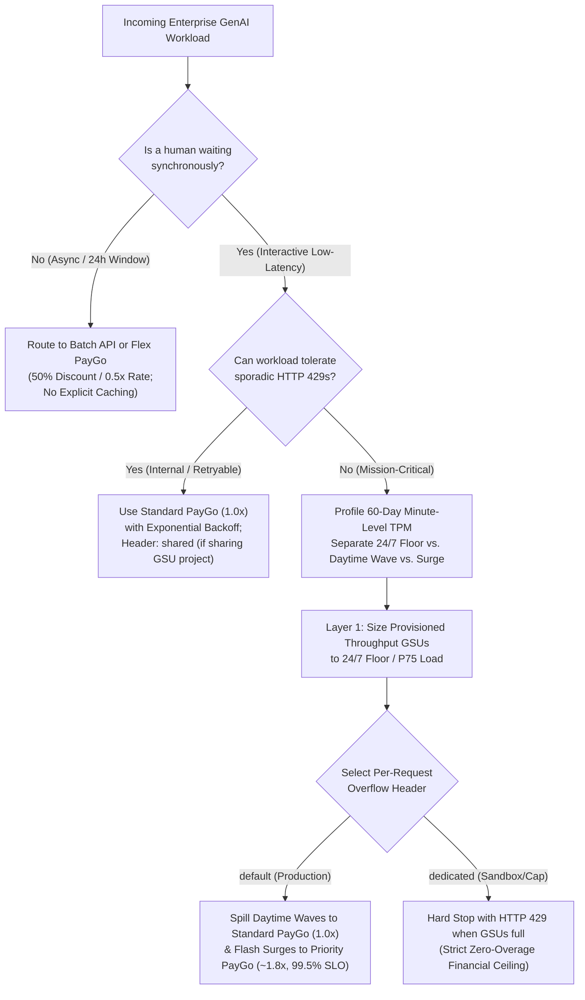
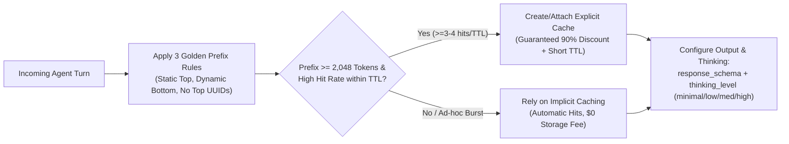
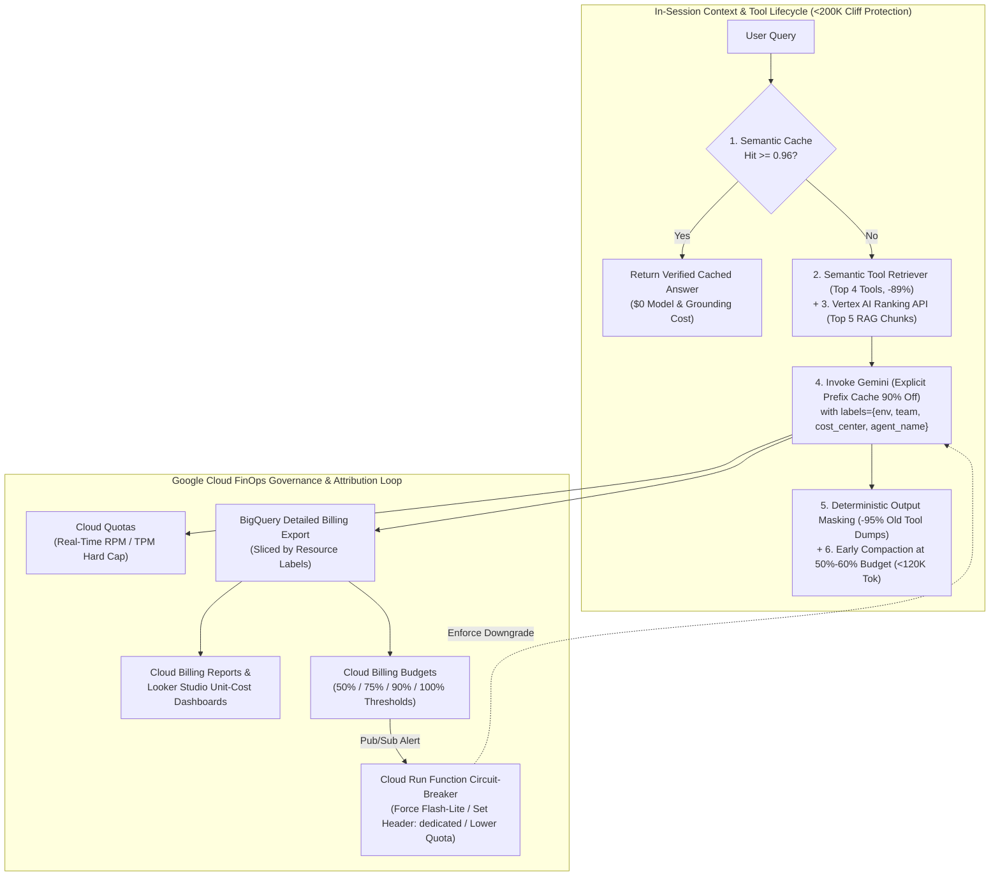
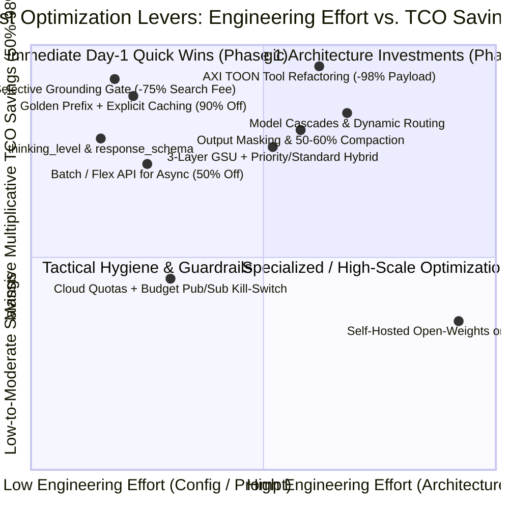

# O4 OKF: Cost & Token Estimation, Analysis, and Optimization (`L400_version_20261026_0350`)
**Topic Tags:** `#L400_version_20261026_0350` `#GenAIFinOps` `#TokenOptimization` `#ProvisionedThroughput` `#ContextCaching` `#AgentRouting` `#AXIToolDesign` `#GovernanceGuardrails`

---

## 0. OKF Document Metadata & Topic Modeling Taxonomy
**Topic Tags:** `#L400_version_20261026_0350` `#TaxonomyModeling` `#GCPKnowledgeCatalog` `#AntigravityAgenticAI`

> **OKF v0.2 Trust Signals, Bucket Merge & Enforced FDE Grading Rubric (`OKF-L400-21`):**
> - **Version Tag:** `L400_version_20261026_0350` | **Status (`status`):** `stable` (`VETTED` / `APPROVED`) | **TTL (`stale_after`):** `2027-04-26T00:00:00Z` *(Maintains existing TTL & version)* | **Verified (`verified`):** `true`
> - **Merged Bucket OKF Lineage:** Reconciled with `Concepts 03, 04, 08` in `gs://gea_agent_development_architectural_best_practices_1790796607` (`project=fivedaysai-prd-sandbox-317383`)
> - **Cloud FDE Prevailing Standard:** `https://g3doc.corp.google.com/company/teams/cloud-fde/index.md?cl=head`
> - **Enforced Project Grading Rubric (`OKF-L400-21`):** Adheres to the 0–3 FDE Field-Readiness Rubric (Pass Gate: Average >= 2.0 across Part A & Part B; Zero-Score Pause Rule: any `0 - Not Demonstrated` triggers an immediate pause and 2-week re-presentation). Primary mapped competencies for `OKF-L400-O4`: **Part A.1 (Commercial Reality & Viable 16-Line TCO Model), Part A.2 (Cost vs. Latency & Model Tiering Defense), Part B.1.3 (Model Selection & Thinking Level Optimization), Part B.4.1 (Hybrid GSU + Priority PayGo 99.5% SLO), Part B.5.2 (Resource Right-Sizing), Part B.5.3 (90% Prefix Caching & 98% AXI Payload Reduction)**.

### 0.1 OKF Document Metadata Table
**Topic Tags:** `#DocumentMetadata` `#VersionControl` `#CatalogIngestion` `#L400_version_20261026_0350`

| Metadata Field | Enterprise Value & Specification |
| :--- | :--- |
| **Document ID & Title** | `O4_OKF_Cost_Token_Estimation_Analysis_and_Optimization.md` — *Cost & Token Estimation, Analysis, and Optimization* |
| **OKF Version Tag** | `L400_version_20261026_0350` |
| **Module Track & Level** | **Track O (Optimization & Operations)** — **L400 Distinguished / Principal Cloud Architect & FinOps Engineering** |
| **Primary SME & Sources** | Anna Novakovska (Engineering Manager, Applied AI Engineering, Google Cloud); Synthesized from `cost_token_estimation_analysis_optimization.md`, `sme-recording-o4-cost-token-estimation-analysis-optimization.md`, and `slides-o4-cost-token-estimation-analysis-optimization.md` |
| **Target Consumers** | GCP Knowledge Catalog RAG Indexers, Antigravity Agentic AI Development Plane, Enterprise Cloud Architects, FinOps Engineers, PCA Certification Candidates |
| **Core Reference Benchmark** | **Cymbal Customer Support Agent Case Study**: Optimizing `100,000` conversations/month (`400,000` agent turns) from **`$44,356/mo` (`44.4¢/conv`)** down to **`$14,820/mo` (`14.8¢/conv`)** — a **3.0x (`66.6%`) TCO reduction** without sacrificing resolution quality |

### 0.2 Primary & Secondary Topic Tags
**Topic Tags:** `#PrimaryTopicTags` `#SecondaryTopicTags` `#SemanticIndexing` `#KnowledgeGraph`

#### 0.2.1 Primary Topic Tags (6 Core Domains)
**Topic Tags:** `#CoreDomains` `#CapacityPlanning` `#PrefixCaching` `#ModelRouting` `#AXITools` `#CloudFinOps`

1. **`#CapacityPlanningAndGSUs`**: Covers the four foundational GenAI billing models (per-token API, per-seat licensing, Provisioned Throughput GSUs, per-unit platform charges), the 5 Vertex AI consumption tiers (**Provisioned Throughput**, **Priority PayGo ~1.8x**, **Standard PayGo 1.0x**, **Flex PayGo 0.5x**, **Batch API 0.5x**), GSU capacity math ($\text{TPS} = (\text{Input} + \text{Output}) \times \text{QPS}$), per-request overflow headers (`default`, `dedicated`, `shared`), and the 3-layer hybrid capacity architecture.
2. **`#ContextCachingArchitecture`**: Encompasses **Implicit Caching** (automatic, zero storage fee, zero setup) vs. **Explicit Caching** (guaranteed **90% prefix discount** at `0.1x` input rate plus hourly TTL storage fee), prefix breakeven math, and the **3 Golden Rules of Prompt Prefix Ordering** (Static First, Dynamic Last, Exclude Cache-Breakers).
3. **`#ModelTieringAndRouting`**: Governs the **Cost-Quality-Latency Triangle**, per-request `thinking_level` (`minimal`, `low`, `medium`, `high`), controlled output generation (`response_schema`, `max_output_tokens`, `stop_sequences`), and 3 routing topologies (**Static Routing**, **Model Cascades**, **Dynamic Semantic Routing** via ADK/LangGraph or Apigee/LiteLLM) alongside mid-session prefix cache invalidation trade-offs.
4. **`#AXIToolErgonomics`**: Defines the 10-principle **Agent eXperience Interface (`axi.md`)** specification across **Efficiency** (`TOON` tabular format, minimal default schemas, smart truncation), **Robustness** (pre-computed aggregates, explicit empty responses, structured self-healing errors), and **Discoverability** (ambient setup skills, no-args state discovery, contextual `next:` disclosure, concise `--help`), cutting Cymbal's `list_tickets` payload by **98%** (`5,659 -> 87 tokens`).
5. **`#ContextLifecycleEngineering`**: Addresses the **`200K` token Pro long-context pricing cliff** (`2x` input / `1.5x` output), Semantic Response Caching, RAG Reranking (`50 chunks -> top 5`), Semantic Tool Retrievers (`-89%` schema tokens), Deterministic Output Masking (`-95%` history bloat), Early Context Compaction at **`50%–60%`** utilization, and Sub-Agent Fan-Out Caps (`max_parallel_subagents = 3`).
6. **`#CloudFinOpsGovernance`**: Implements defense-in-depth runtime financial controls across **Cloud Quotas** (RPM/TPM hard rate limits), **Cloud Billing Budgets + Pub/Sub + Cloud Run Functions** (automated circuit-breakers), **Vertex AI & Gemini Enterprise Spend Caps**, and **Resource Labels -> BigQuery Billing Export -> Cloud Billing reports & Looker Studio** attribution dashboards.

#### 0.2.2 Secondary Sub-Topic Tags (6 Capabilities, Outcomes & Impacts)
**Topic Tags:** `#UnitEconomics` `#MultilingualTokenization` `#ThinkingGovernance` `#RouterResilience` `#AntigravityFinOps`

1. **`#16LineEnterpriseCostLedger`**: Separates visible token spend (`38%` baseline) from hidden agentic multipliers and non-token platform charges (`62%` baseline: grounding at `$35/1K queries`, Agent Engine runtime, Model Armor, DLP, logging) across a 6-step workload estimation methodology.
2. **`#MultilingualByteTokenization`**: Models UTF-8 byte expansion across scripts (English ~`4 chars/token`, Spanish/French `1.2x–1.5x`, CJK `2.0x–3.0x`, Hindi/Devanagari `2.5x–4.0x`) and mitigates expansion via English system/tool schemas.
3. **`#HumanEscalationTCOPrevention`**: Evaluates systems on **Unit Cost per Resolved Task** rather than cost per API call, preventing naive cheap-model selection from triggering `$15–$45` human support escalations.
4. **`#GatewayTrafficFailover`**: Combines in-framework ADK/LangGraph routing with enterprise API Gateways (Apigee / LiteLLM) to enforce multi-endpoint cost routing and automatic failover on `HTTP 429`/`503` errors.
5. **`#QuadraticHistoryElimination`**: Prevents $O(N^2)$ multi-turn token compounding by replacing stale 8,000-token tool dumps with 300-token structured digests and compacting transcripts well before the `200K` pricing boundary.
6. **`#AntigravityWorkspaceGovernance`**: Embeds per-task token budgets, AXI-compliant MCP servers, semantic tool indexing, and automated `cost_center` / `agent_name` billing labels directly into Antigravity Agentic AI development workflows.

### 0.3 Topic Taxonomy Matrix
**Topic Tags:** `#TaxonomyMatrix` `#TieredClassification` `#ArchitecturalMapping` `#L400_version_20261026_0350`

| Tier 1 Domain | Tier 2 Architectural Pillar | Tier 3 Concrete Implementation Mechanism | Primary Quantitative Impact / Target Metric |
| :--- | :--- | :--- | :--- |
| **A. Capacity & Unit Economics** | **A.1 4 Billing Models & 5 Consumption Tiers** | Provisioned Throughput (GSUs), Priority PayGo (`~1.8x`, `99.5%` SLO), Standard (`1.0x`), Flex (`0.5x`), Batch (`0.5x`); `default` / `dedicated` / `shared` headers | **Zero `HTTP 429` errors** on critical paths; **50% discount** on async/batch workloads; `<10%` idle GSU waste |
| **A. Capacity & Unit Economics** | **A.2 16-Line Ledger & 6-Step Estimation** | Cymbal case study (`100K` conv/mo, `400K` turns); Grounding (`$35/1K`), Agent Engine, Model Armor, DLP, and Open-Weights GPU floor (`$2,200/mo`) | **`$44,356/mo` -> `$14,820/mo`** (**3.0x / `-66.6%` TCO reduction**; `44.4¢` -> `14.8¢/conv`) |
| **B. Model Tiering & Prefix Caching** | **B.1 Model Tiering & Thinking Governance** | `Gemini 3.1 Pro` vs. `3.5 Flash` (`~7x` cheaper) vs. `3.1 Flash-Lite` (`~20x` cheaper); `thinking_level` (`minimal` to `high`); `response_schema`, `max_output_tokens` | **60%–85% output/thinking token savings** (where output/thinking tokens bill at **3x–6x** input rates) |
| **B. Model Tiering & Prefix Caching** | **B.2 Implicit vs. Explicit Prefix Caching** | Explicit Cache (`90%` discount / `0.1x` input rate + TTL storage) vs. Implicit Cache (`0` storage fee); 3 Golden Prefix Rules (Static First, Dynamic Last, No Timestamps/UUIDs) | **>85% prefix cache hit rate**; **75%–90% static input token cost reduction** |
| **C. Routing & AXI Tool Ergonomics** | **C.1 Static, Cascade & Dynamic Routing** | Static Task Routing, Model Cascades (`Flash-Lite` -> `Flash` -> `Pro`), Dynamic Semantic Routing (ADK/LangGraph vs. Apigee/LiteLLM); Cost per Resolved Task | **50%–75% blended inference savings** while preserving resolution rate and avoiding human escalations |
| **C. Routing & AXI Tool Ergonomics** | **C.2 AXI 10 Principles (`axi.md`)** | **Efficiency** (`TOON` format, minimal schemas, truncation), **Robustness** (upfront aggregates, explicit empty `{matched: 0}`, self-healing errors), **Discoverability** | **98% tool payload reduction** (`5,659 -> 87 tokens` on `list_tickets`); **50%–75% fewer retry calls** |
| **D. Context Lifecycle & Cloud FinOps** | **D.1 Context Lifecycle & `200K` Cliff** | Semantic Caching, RAG Reranking (`50->5`), Semantic Tool Retriever (`50->3`, `-89%`), Output Masking (`-95%`), Early Compaction (`50%–60%`), Fan-Out Caps | **Zero unapproved `>200K` cliff crossings**; linear $O(N)$ vs. quadratic $O(N^2)$ session token scaling |
| **D. Context Lifecycle & Cloud FinOps** | **D.2 Cloud FinOps & Governance Loop** | Cloud Quotas (RPM/TPM), Billing Budgets + Pub/Sub + Cloud Run Functions, Spend Caps, Resource Labels (`env`, `team`, `cost_center`, `agent_name`) -> BigQuery & Looker Studio | **100% cost attribution**; `<60s` automated budget circuit-breaker; **zero runaway billing incidents** |

### 0.4 Module Topic Connection & Flow Graph
**Topic Tags:** `#TopicFlowGraph` `#MermaidArchitecture` `#ASCIIDiagram` `#EndToEndFlow`

#### 0.4.1 Mermaid.js Module Topic Connection & Flow Graph
**Topic Tags:** `#MermaidGraph` `#OptimizationPipeline` `#ArchitecturalFlow`

```mermaid
graph LR
    subgraph S1["1. Capacity & Consumption (Domain A)"]
        A1["6-Step Workload Sizing<br/>& 16-Line Cost Ledger"] --> A2["GSU Capacity Math<br/>TPS = (In + Out) x QPS"]
        A2 --> A3["3-Layer Hybrid Consumption<br/>GSUs + Standard/Priority + Flex/Batch"]
    end

    subgraph S2["2. Tiering, Prefix Caching & Output Control (Domain B)"]
        B1["Model Tiering & Routing<br/>Pro vs. Flash vs. Flash-Lite"] --> B2["3 Golden Prefix Rules<br/>Explicit (90% Off) & Implicit Cache"]
        B2 --> B3["Controlled Generation<br/>response_schema & thinking_level"]
    end

    subgraph S3["3. AXI Tool Ergonomics & Context Lifecycle (Domain C)"]
        C1["AXI Tool Design (axi.md)<br/>TOON Format (-98% Tokens)"] --> C2["Semantic Tool Retriever (-89%)<br/>& RAG Reranking (50 -> 5)"]
        C2 --> C3["Output Masking (-95%) &<br/>Early Compaction (50%-60% < 200K)"]
    end

    subgraph S4["4. FinOps Governance & Observability (Domain D)"]
        D1["Cloud Quotas (RPM/TPM)<br/>& Platform Spend Caps"] --> D2["Budgets + Pub/Sub +<br/>Cloud Run Circuit-Breaker"]
        D2 --> D3["Resource Labels -> BigQuery -> <br/>Cloud Billing Reports & Looker Studio"]
    end

    A3 --> B1
    B3 --> C1
    C3 --> D1
```



#### 0.4.2 ASCII Module Topic Connection & Architectural Dependency Map
**Topic Tags:** `#ASCIITopology` `#SystemDependency` `#DefenseInDepth`

```text
+=========================================================================================+
|          O4 ENTERPRISE GENAI COST & TOKEN OPTIMIZATION ARCHITECTURE (3.0x SAVINGS)      |
+=========================================================================================+
  [1. CAPACITY & CONSUMPTION PLANE]               [2. MODEL & PREFIX CACHE PLANE]
  +-----------------------------------+           +-----------------------------------+
  | * 16-Line Ledger (Tokens = 38%,   |           | * Cost-Quality-Latency Triangle   |
  |   Non-Token Platform = 62%)       |           | * Static / Cascade / Dynamic      |
  | * Layer 1: Provisioned GSUs       |---------->|   Routing (ADK / Apigee / LiteLLM)|
  | * Layer 2: Standard PayGo (1.0x)  |           | * Explicit Cache (90% Off Prefix) |
  | * Layer 3: Priority PayGo (~1.8x) |           | * 3 Golden Prefix Ordering Rules  |
  | * Async: Flex / Batch API (0.5x)  |           | * thinking_level & response_schema|
  +-----------------------------------+           +-----------------+-----------------+
                                                                    |
                                                                    v
  [4. CLOUD FINOPS GOVERNANCE PLANE]              [3. AXI TOOL & CONTEXT LIFECYCLE]
  +-----------------------------------+           +-----------------------------------+
  | * Cloud Quotas (Hard RPM/TPM Cap) |           | * AXI (axi.md): TOON Tabular Rows |
  | * Billing Budgets -> Pub/Sub ->   |<----------|   (5,659 -> 87 tokens, -98% cut)  |
  |   Cloud Run Kill-Switch           |           | * Semantic Tool Retriever (-89%)  |
  | * Spend Caps (Hard Dollar Ceiling)|           | * RAG Reranker (50 -> Top 5)      |
  | * Labels -> BigQuery Export ->    |           | * Output Masking (-95% History)   |
  |   Cloud Billing & Looker Studio   |           | * Compaction @ 50-60% (<200K Cliff)|
  +-----------------------------------+           +-----------------------------------+
```

---

## 1. Executive Overview, Problem Statement & Antigravity Agentic AI Development Context
**Topic Tags:** `#ExecutiveOverview` `#ProblemStatement` `#AntigravityAgenticAI` `#L400_version_20261026_0350`

> **Enforced FDE Project Grading Rubric Reference (`OKF-L400-21` & `g3doc/company/teams/cloud-fde`):** Every project applying Section 1 of `OKF-L400-O4` is graded against **Part A.1 (Commercial Reality & Viable 16-Line TCO Model), Part A.2 (Cost vs. Latency & Model Tiering Defense), Part B.1.3 (Model Selection & Thinking Level Optimization), Part B.4.1 (Hybrid GSU + Priority PayGo 99.5% SLO), Part B.5.2 (Resource Right-Sizing), Part B.5.3 (90% Prefix Caching & 98% AXI Payload Reduction)** and merged bucket **Concepts 03, 04, 08** (`stale_after: 2027-04-26T00:00:00Z`, version `L400_version_20261026_0350`). Builders must achieve >= 2 (**Competent**) across Part A & Part B and avoid any 0 (**Not Demonstrated**) pause triggers.

### 1.1 The Enterprise GenAI Financial Viability Challenge
**Topic Tags:** `#FinancialViability` `#MultiTurnCompounding` `#NonTokenCosts` `#UnitEconomics`

In enterprise production, Generative AI systems rarely fail solely due to model intelligence—they fail when **unbounded unit economics destroy business ROI at scale**. Three structural blind spots cause production GenAI budgets to spiral out of control:
1. **Quadratic Multi-Turn Context Compounding ($O(N^2)$)**: Unlike single-turn classifiers, an autonomous agent executes 4 to 10+ reasoning-and-tool loops per user conversation. Because LLMs are stateless, every turn re-sends and re-bills the entire accumulated history, system instructions, tool schemas, and verbose JSON tool payloads. Worse, crossing the **`200,000` input token threshold** on `Gemini 3.1 Pro` triggers a **2x input rate and 1.5x output rate pricing cliff** across the entire request.
2. **Output & Internal Thinking Token Asymmetry (3x–6x Multiplier)**: Output tokens and internal reasoning (`thinking`) tokens require sequential autoregressive decoding and are billed at **3x to 6x the input token rate** (e.g., `$12.00/1M` output vs. `$2.00/1M` input on `Gemini 3.1 Pro`). Unconstrained chain-of-thought reasoning on routine tasks silently multiplies inference bills.
3. **The Hidden Non-Token Platform Iceberg (62% of Baseline Spend)**: Architects who only estimate raw prompt/response tokens miss **62% of the actual monthly bill**. In the **Cymbal Customer Support Agent** baseline (`$44,356/month` for `100,000` conversations / `400,000` turns), raw model tokens account for only **`$16,800` (`38%`)**, while **Google Search Grounding (`$35/1,000 queries` = `$14,000` / `32%`)**, **Vertex AI Agent Engine runtime (`$8,600`)**, **Model Armor (`$2,400`)**, **Cloud DLP (`$1,200`)**, and **Cloud Logging (`$1,356`)** make up the remaining **`$27,556` (`62%`)**.

### 1.2 Antigravity Agentic AI Development Context & Knowledge Catalog Integration
**Topic Tags:** `#AntigravityDevelopment` `#AgenticEngineering` `#MCPToolOptimization` `#KnowledgeCatalog`

Within the **Antigravity Agentic AI Development Plane** and **GCP Knowledge Catalog**, cost and token optimization is engineered directly into the agent lifecycle rather than bolted on after launch:
- **Prompt & Context Assembly Discipline**: Antigravity agent templates enforce **Golden Prefix Ordering**—placing immutable system instructions, policies, and static MCP tool declarations at the exact top of the prompt so **Explicit (`90%` discount)** and **Implicit Context Caching** achieve `>85%` cache hit rates across turns.
- **AXI-Native MCP Server & Skill Generation**: When developers build custom tools or MCP servers in Antigravity, they apply the **Agent eXperience Interface (`axi.md`)** specification—emitting **TOON (Token-Oriented Object Notation)** tabular responses (`5,659 -> 87 tokens`, a **98% reduction**), minimal default schemas, structured self-healing errors, and explicit empty responses (`{"status": "success", "matched_records": 0}`) to eliminate hallucinated retry loops.
- **Automated FinOps Telemetry & Guardrails**: Every Antigravity sub-agent and Vertex AI invocation injects mandatory GCP resource labels (`env`, `team`, `cost_center`, `agent_name`), enforces `max_parallel_subagents`, triggers **Early Context Compaction at `50%–60%` capacity**, and streams telemetry into **BigQuery**, **Cloud Billing reports**, and **Looker Studio** unit-economics dashboards.

---

## 2. Deep Technical Architecture, Matrices, Visual Pictures & Flow Diagrams
**Topic Tags:** `#DeepTechnicalArchitecture` `#EnterpriseCostModel` `#PrefixCaching` `#AXITools` `#L400_version_20261026_0350`

> **Enforced FDE Project Grading Rubric Reference (`OKF-L400-21` & `g3doc/company/teams/cloud-fde`):** Every project applying Section 2 of `OKF-L400-O4` is graded against **Part A.1 (Commercial Reality & Viable 16-Line TCO Model), Part A.2 (Cost vs. Latency & Model Tiering Defense), Part B.1.3 (Model Selection & Thinking Level Optimization), Part B.4.1 (Hybrid GSU + Priority PayGo 99.5% SLO), Part B.5.2 (Resource Right-Sizing), Part B.5.3 (90% Prefix Caching & 98% AXI Payload Reduction)** and merged bucket **Concepts 03, 04, 08** (`stale_after: 2027-04-26T00:00:00Z`, version `L400_version_20261026_0350`). Builders must achieve >= 2 (**Competent**) across Part A & Part B and avoid any 0 (**Not Demonstrated**) pause triggers.

### 2.1 Enterprise GenAI Cost Model (16-Line Ledger), Cymbal Case Study & Consumption Tiers
**Topic Tags:** `#16LineLedger` `#CymbalCaseStudy` `#ConsumptionTiers` `#GSUSizing` `#MultilingualTokens`

#### 2.1.1 The Four Foundational Billing Models & Three Operational Evaluation Axes
**Topic Tags:** `#BillingModels` `#OperationalAxes` `#WorkloadClassification`

Enterprise GenAI workloads on Google Cloud combine four distinct billing models:
1. **Per-Token (Pay-As-You-Go / PayGo)**: Variable billing per `1M` input, cached input, and output/thinking tokens across **Priority (`~1.8x`)**, **Standard (`1.0x`)**, **Flex (`0.5x`)**, and **Batch (`0.5x`)** tiers.
2. **Per-Seat / Subscription Licensing**: Fixed monthly price per human user for **Gemini Enterprise**, Workspace AI, or SaaS copilots—cost scales with headcount rather than token volume.
3. **Provisioned Throughput (GSUs)**: Fixed subscription price per **Generative AI Scale Unit (GSU)** with monthly/annual commitment discounts, providing SLA-backed reserved token throughput (`TPM`/`TPS`).
4. **Per-Unit / Platform & Managed Infrastructure Charges**: Non-token charges billed per API request, per vCPU-hour/GiB-hour, per character inspected, or per GB ingested (e.g., **Web Search Grounding at `$35 / 1,000 queries`**, Vertex AI Agent Engine runtime, Vector Search nodes, Model Armor, Cloud DLP, Cloud Logging/Monitoring).

Before selecting a consumption tier or model, architects evaluate every workload across **three operational axes**:
- **Axis 1 — Operational Criticality**: Mission-critical, revenue-impacting customer-facing application vs. internal employee productivity tool vs. non-critical background job.
- **Axis 2 — Latency Tolerance**: Sub-second (`<800ms` TTFT) synchronous human interaction vs. asynchronous background queue (`5–15 min`) vs. overnight batch pipeline (`24h` window).
- **Axis 3 — Traffic Pattern**: Steady 24/7 global floor vs. predictable diurnal business-hour waves vs. spiky, unpredictable flash sales or market-open surges.

#### 2.1.2 The Five Consumption Options Spectrum, GSU Math & Multilingual Tokenization
**Topic Tags:** `#FiveConsumptionTiers` `#GSUMath` `#OverflowHeaders` `#MultilingualTokenization`

| Consumption Tier | Pricing Multiplier | Availability SLO / Latency Profile | Context Caching Support | Optimal Workload Fit |
| :--- | :--- | :--- | :--- | :--- |
| **1. Provisioned Throughput (GA)** | Fixed $/GSU/month (Commitment discounts) | **Strict SLA-backed guaranteed throughput** & consistent low latency | **Supported** (Explicit & Implicit) | Steady 24/7 baseline floor (sized to **50th–75th percentile** load, never 100% peak) |
| **2. Priority PayGo (GA)** | **`~1.8x` Base Rate** | **99.5% Availability SLO**; prioritized queue & lower latency during peak congestion | **Supported** (Explicit & Implicit) | Mission-critical interactive spikes/surges that **cannot tolerate `HTTP 429` errors** |
| **3. Standard PayGo (GA)** | **`1.0x` Base Rate** | Best-effort shared pool; sporadic `HTTP 429` errors possible under regional contention | **Supported** (Explicit & Implicit) | Predictable daytime waves or general workloads with exponential backoff/retry |
| **4. Flex PayGo (Preview/GA)** | **`0.5x` Base Rate (50% Off)** | Asynchronous / opportunistic capacity; variable latency (`minutes`) | **NOT Supported** (No Explicit Cache) | Latency-tolerant background jobs, queue processors, non-blocking agent tasks |
| **5. Batch API (GA)** | **`0.5x` Base Rate (50% Off)** | **Up to 24-hour completion SLO** via Cloud Storage / BigQuery batch jobs | **NOT Supported** (No Explicit Cache) | Nightly catalog enrichment, bulk document extraction, offline evals & autoraters |

- **GSU Capacity Sizing Formula**: Google Cloud normalizes multimodal throughput into **Generative AI Scale Units (GSUs)**:
  $$\text{Required TPS} = (\text{Average Input Tokens} + \text{Average Output & Thinking Tokens}) \times \text{Peak Sustained QPS}$$
  $$\text{Required GSUs} = \left\lceil \frac{\text{Required TPS} \times \text{Model Weighting Factor}}{\text{Tokens Per Second per GSU}} \right\rceil$$
  *Contract Asymmetry Rule*: You can **scale UP** GSUs mid-term as demand grows, but you **cannot scale DOWN or cancel** committed GSUs until the contract term expires. Always size GSUs to your **24/7 baseline or 75th percentile**, never your rare peak spike.
- **Per-Request Overflow Headers (`X-Vertex-AI-LLM-Request-Type`)**:
  - **`default` (Spillover)**: Consumes reserved GSUs first; once 100% utilized, excess requests **automatically spill over into Standard/Priority PayGo**, preventing `HTTP 429` errors during surges.
  - **`dedicated` (Hard Ceiling)**: Restricts traffic strictly to reserved GSUs; once exhausted, excess requests **immediately fail with `HTTP 429`**, enforcing a zero-overage budget cap.
  - **`shared` (Bypass Reservation)**: Bypasses reserved GSUs entirely and bills directly to PayGo, preventing low-priority scripts or dev/test jobs from stealing reserved GSUs from production traffic.
- **Multilingual Tokenization Multipliers**: Because subword tokenizers operate over UTF-8 byte sequences, non-Latin scripts consume significantly more tokens for the exact same semantic meaning:
  - **English / Latin Base**: `~4 characters per token` (`1.0x` baseline).
  - **Spanish / French / German / Portuguese**: `1.2x – 1.5x` token multiplier.
  - **Chinese / Japanese / Korean (CJK)**: `2.0x – 3.0x` token multiplier.
  - **Hindi / Devanagari / Arabic / Thai / Cyrillic**: `2.5x – 4.0x` token multiplier.
  - *Architectural Mitigation*: Keep internal system instructions, JSON/TOON keys, and MCP tool schemas in **English** while instructing the model to converse with the end user in their native language.

#### 2.1.3 The 6-Step Estimation Methodology & 16-Line Cymbal Customer Support Case Study (`$44,356` -> `$14,820/mo`)
**Topic Tags:** `#6StepEstimation` `#16LineCostModel` `#CymbalCaseStudy` `#OpenWeightsCrossover`

Every production GenAI estimate follows a **6-Step Methodology**: (1) **Decompose Workload & Turn Multipliers** (conversations $\times$ turns/conv), (2) **Profile Token Volumes per Turn** (system prompt, tool schemas, RAG chunks, history, user input, thinking tokens, output tokens, multilingual factor), (3) **Map Model Tiers & Caching Ratios** (Explicit/Implicit cache hit rates, routing split), (4) **Select Consumption Tiers** (GSUs vs. Priority/Standard/Flex/Batch), (5) **Quantify Non-Token Platform Services** (Grounding, Agent Engine, Model Armor, DLP, Logging), and (6) **Compute Unit Economics & Open-Weights Crossover** (`$/conversation` and `$/resolved task`).

Below is the complete **16-Line Enterprise Monthly Cost Ledger** for the **Cymbal Retail Customer Support Agent** (`100,000` conversations/month $\times$ `4` turns/conversation = **`400,000` agent turns/month**):

| Line # | Cost Category & Component | Unoptimized Baseline Architecture (`Gemini 3.1 Pro` Everywhere) |Baseline Monthly Cost | Optimized Architecture (`Flash` + Routing + Caching + Selective Grounding) | Optimized Monthly Cost | Optimization Lever Applied |
| :--- | :--- | :--- | :--- | :--- | :--- | :--- |
| **01** | **System Instructions & Policy Prefix** | `4,000` tok $\times$ `400K` turns @ `$2.00/1M` (0% cached) | `$3,200` | `85%` Explicit Cache hit (`0.1x`) on `3.5 Flash` (`80%` turns) + `3.1 Pro` (`20%` turns) | `$180` | **Explicit Prefix Caching (`90%` discount) + Model Tiering** |
| **02** | **Tool Declarations (MCP Schemas)** | `3,500` tok $\times$ `400K` turns @ `$2.00/1M` (All 35 tools) | `$2,800` | Semantic Tool Retriever (`top 4 tools` = `450` tok) + Prefix Caching | `$65` | **Semantic Tool Retriever (`-87%`) + Prefix Caching** |
| **03** | **RAG Retrieved Context Chunks** | `2,500` tok $\times$ `400K` turns @ `$2.00/1M` (25 raw chunks) | `$2,000` | Vertex AI Ranking API (`top 5 chunks` = `600` tok) on `80% Flash / 20% Pro` | `$210` | **RAG Reranker (`50->5 chunks`) + Model Routing** |
| **04** | **Multi-Turn Conversation & Tool History** | `2,000` avg tok $\times$ `400K` turns @ `$2.00/1M` (Raw JSON) | `$1,600` | AXI `TOON` format (`-98%` tool dump) + Output Masking (`-95%`) + Compaction | `$145` | **AXI `TOON` + Output Masking + Early Compaction** |
| **05** | **User Prompt Input Tokens** | `500` tok $\times$ `400K` turns @ `$2.00/1M` | `$400` | `500` tok $\times$ `400K` turns (`80% Flash @ $0.30/1M`, `20% Pro @ $2.00/1M`) | `$128` | **Model Tiering (`80% Flash` / `20% Pro` Cascade)** |
| **06** | **Internal Reasoning (`thinking`) Tokens** | `900` tok $\times$ `400K` turns @ `$12.00/1M` (`high` default) | `$4,320` | `thinking_level="low"` on `Flash` (`200` tok) + `"medium"` on `Pro` (`500` tok) | `$612` | **Per-Request `thinking_level` Governance** |
| **07** | **Final Response Output Tokens** | `500` tok $\times$ `400K` turns @ `$12.00/1M` (Verbose prose) | `$2,480` | `response_schema` + `max_output_tokens=350` (`80% Flash / 20% Pro`) | `$480` | **Controlled Generation (`response_schema`) + Tiering** |
| **08** | **Subtotal: Raw Model Inference (Lines 01–07)** | **100% `Gemini 3.1 Pro` (`38.0%` of total baseline bill)** | **`$16,800`** | **Hybrid `Flash` (80%) + `Pro` (20%) + Caching + AXI (`12.3%` of opt. bill)** | **`$1,820`** | **`-89.2%` Reduction in Model Token Spend** |
| **09** | **Google Search Grounding** | Triggered on **100% of turns** (`400K` queries @ `$35/1K`) | `$14,000` | Classifier gates Grounding to **only `25%` of turns** needing live web data (`100K` queries) | `$3,500` | **Selective Grounding Gate (`-75%` Grounding spend)** |
| **10** | **Vertex AI Agent Engine Runtime** | Over-provisioned always-on container instances | `$5,200` | Right-sized autoscaling + reduced turn latency from AXI/Flash | `$3,400` | **Runtime Right-Sizing & Faster Turn Completion** |
| **11** | **Vertex AI Vector Search & Embeddings** | Unoptimized index shards + redundant re-embedding | `$3,400` | Consolidated index + Semantic Response Cache (`20%` hit rate) | `$2,400` | **Semantic Response Cache + Index Consolidation** |
| **12** | **Model Armor (Prompt Injection / Safety)** | Inspected on all raw verbose payloads | `$2,400` | Compact AXI payloads + tiered inspection | `$1,800` | **Payload Compaction (`-25%` inspection volume)** |
| **13** | **Cloud Data Loss Prevention (Cloud DLP)** | Full-payload regex + infoType scanning on raw JSON | `$1,200` | Scoped inspection on user inputs & final egress only | `$900` | **Scoped PII Redaction Boundary** |
| **14** | **Cloud Logging, Monitoring & Trace** | Full verbose prompt/tool JSON logged at 100% | `$1,356` | Structured metadata logging + sampled payload traces | `$1,000` | **Log Volume Filtering & Sampling** |
| **15** | **Subtotal: Non-Token Platform Services (09–14)** | **`62.0%` of Total Baseline Bill** | **`$27,556`** | **`87.7%` of Optimized Bill (Right-sized platform footprint)** | **`$13,000`** | **`-52.8%` Reduction in Non-Token Spend** |
| **16** | **TOTAL MONTHLY TCO & UNIT COST** | **`$44,356 / month` (`44.4¢` per conversation)** | **`$44,356`** | **`$14,820 / month` (`14.8¢` per conversation)** | **`$14,820`** | **`3.0x` Total Savings (`-$29,536/mo` / `-66.6%`)** |

* **Open-Weights Self-Hosting Crossover Reality Check (Gemma / Llama on GKE/Vertex AI)**: Teams often propose replacing managed `Gemini 3.5 Flash` (`$1,820/mo` optimized token spend in Line 08) with self-hosted open-weights models on dedicated GPUs. However, hosting a production HA pair of `g2-standard` / `a2-highgpu` nodes across two zones for 24/7 availability establishes an **infrastructure floor of `~$2,200 to $4,500+/month`** before adding SRE maintenance. Thus, for Cymbal's optimized workload (`$1,820/mo` token spend), managed **Gemini 3.5 Flash is cheaper than the bare-metal GPU floor**, and self-hosting only crosses over into positive ROI at very high, flat 24/7 utilization where idle GPU waste approaches zero.

#### 2.1.4 Visual Architecture Diagrams: 3-Layer Hybrid Consumption & GSU Sizing Flow
**Topic Tags:** `#HybridConsumptionDiagram` `#GSUSizingFlow` `#ThreeLayerCapacity`

```text
  TPM / TPS Load
   ^
80M|                     /\        <-- LAYER 3: PRIORITY PAYGO (~1.8x Rate, 99.5% SLO)
   |                    /  \           Absorbs sudden flash spikes with ZERO HTTP 429s
50M|       .-~-.       /    \  .-~-.
   |      /     \     /      \/     \ <-- LAYER 2: STANDARD PAYGO (1.0x Base Rate)
25M|-----/-------\---/---------------\--- Absorbs predictable daytime waves via `default` spillover
   |===================================== <-- LAYER 1: PROVISIONED THROUGHPUT (Reserved GSUs)
   |     24/7 Committed Baseline Floor        Fixed $/GSU, 100% utilized, zero idle waste
 0 +-------------------------------------> Time of Day (00:00 -> 24:00)
   [Async / Overnight Jobs] ------------> OFF-PEAK LAYER: FLEX PAYGO / BATCH API (0.5x / 50% Off)
```



#### 2.1.5 Inline Section 2.1 Best Practices & FAQs
**Topic Tags:** `#Section2_1BestPractices` `#Section2_1FAQs` `#GSUGovernance`

- **Inline Best Practices (Section 2.1)**:
  1. **Never Size GSUs to Peak Spikes**: Reserve Provisioned Throughput GSUs only for your sustained baseline/P75 floor; use `X-Vertex-AI-LLM-Request-Type: default` to spill daytime waves to Standard PayGo and sudden critical surges to Priority PayGo (`~1.8x`).
  2. **Audit Non-Token Line Items First**: Gate Google Search Grounding (`$35/1,000 queries`) behind an intent classifier so routine conversational turns do not trigger a `3.5¢` search fee that dwarfs a `0.4¢` token call.
  3. **Isolate Non-Critical Workloads in Shared Projects**: Attach `X-Vertex-AI-LLM-Request-Type: shared` to internal batch/eval scripts so they never steal reserved GSUs from customer-facing traffic.
- **Inline Section 2.1 FAQs**:
  - **Q1: Why did Cymbal's baseline cost `$44,356/mo` when raw `Gemini 3.1 Pro` tokens were only `$16,800/mo`?**
    **A:** Because `62%` (`$27,556/mo`) came from non-token platform services—primarily unconditional Google Search Grounding (`$14,000/mo` for `400K` turns at `$35/1K queries`) and over-provisioned Agent Engine/Vector Search/Model Armor/DLP/Logging resources.
  - **Q2: Can we enable Explicit Context Caching (`90%` off) on a nightly Batch API (`50%` off) pipeline to stack both discounts?**
    **A:** **No.** Explicit Context Caching is supported on Provisioned Throughput, Priority PayGo, and Standard PayGo, but is **not available on Flex PayGo or the Batch API**.

---

### 2.2 Model Tiering, Prefix Context Caching & Controlled Generation / Thinking Governance
**Topic Tags:** `#ModelTiering` `#PrefixContextCaching` `#ControlledGeneration` `#ThinkingLevel`

#### 2.2.1 The Cost-Quality-Latency Triangle & Model Tier Selection (Lever 1)
**Topic Tags:** `#CostQualityLatency` `#GeminiModelTiers` `#UnitCostPerResolvedTask`

Every optimization decision balances the **Cost-Quality-Latency Triangle**, anchored by a single cardinal rule: **Measure Total Cost per Resolved Task, never Cost per API Call.** If switching from `Gemini 3.5 Flash` (`14.8¢/conv`) to `Gemini 3.1 Flash-Lite` (`4.2¢/conv`) lowers autonomous resolution by `15%` and forces those failed conversations to escalate to human contact-center agents at **`$18.00/escalation`**, your total operational TCO explodes upward despite lower token bills.

| Model Tier | Representative Relative Input / Output Pricing | Primary Architectural Role | Ideal Task Examples |
| :--- | :--- | :--- | :--- |
| **`Gemini 3.1 Pro`** | **`1.0x` Reference** (e.g., `$2.00/1M` in, `$12.00/1M` out `<=200K`; `2x` in / `1.5x` out `>200K`) | Complex multi-step reasoning, deep code synthesis, nuanced policy conflict resolution | Complex legal/financial synthesis, root-cause architecture debugging, novel edge cases |
| **`Gemini 3.5 Flash`** | **`~7x Cheaper` than Pro** (e.g., `~$0.30/1M` in, `~$2.50/1M` out) | **Primary Enterprise Agent Workhorse (`70%–85%` of production traffic)** | Customer support orchestration, tool-calling loops, RAG synthesis, SQL/code generation |
| **`Gemini 3.1 Flash-Lite`** | **`~20x Cheaper` than Pro** (e.g., `~$0.10/1M` in, `~$0.40/1M` out) | High-volume classification, routing, entity extraction, grounding gates | Intent routing, PII pre-screening, log categorization, bulk summarization |

#### 2.2.2 Explicit vs. Implicit Prefix Context Caching & Breakeven Math (Lever 2)
**Topic Tags:** `#ExplicitCaching` `#ImplicitCaching` `#PrefixOrderingRules` `#BreakevenMath`

Context caching eliminates repeated re-billing of identical prompt prefixes across requests:

| Dimension | Implicit Context Caching | Explicit Context Caching |
| :--- | :--- | :--- |
| **Activation & Setup** | **Automatic (Zero code/API changes)**; enabled by default on supported Gemini models | **Programmatic API (`cachedContents.create`)**; developer manages cache lifecycle & `ttl` |
| **Token Discount & Storage Fee** | Discount applied automatically on opportunistic cache hits; **`$0` storage fee** | **Guaranteed `90%` discount (`0.1x` input rate)** on cached prefix tokens + **Hourly TTL Storage Fee** (`$/1M tokens/hour`) |
| **Hit Guarantee & Determinism** | Best-effort (depends on routing locality & request concurrency) | **Deterministic `100%` hit guarantee** whenever `cached_content` resource ID is referenced before TTL expiry |
| **Minimum Token Threshold** | Model-dependent (`~1,024–2,048` tokens) | **`>= 2,048` to `4,096` tokens** (or model-specific minimum; must exceed breakeven volume) |

- **Explicit Cache Breakeven Formula**: Because Explicit Caching charges an hourly storage fee $C_{\text{storage}}$ per 1M tokens per hour while saving $0.90 \times C_{\text{input}}$ per cache hit, the minimum request rate $N_{\text{breakeven}}$ (requests per hour within TTL) required to break even is:
  $$N_{\text{breakeven}} = \left\lceil \frac{C_{\text{input}} (\text{Initial Creation Write}) + C_{\text{storage}} \times \text{TTL}_{\text{hours}}}{0.90 \times C_{\text{input}}} \right\rceil$$
  *Rule of Thumb*: A cached prefix needs **at least `2 to 4+` hits within its TTL window** (depending on model tier—`Flash` has a slightly higher hit count threshold than `Pro` because `Flash` input tokens are cheaper relative to storage) to turn net-positive. Never create a `24-hour` Explicit Cache TTL for a prefix queried only twice a day!
- **The 3 Golden Rules of Prompt Prefix Ordering**: Because LLM KV-cache matching operates strictly **left-to-right (token 0 forward)** and invalidates every token after the first byte mismatch:
  1. **Rule 01 — Static Content First (Top of Prompt)**: Place immutable system instructions, safety policies, few-shot examples, and static MCP tool declarations at the very beginning of the prompt (`[Tokens 0 ... K]`).
  2. **Rule 02 — Dynamic Content Strictly Last (Bottom of Prompt)**: Place tenant/user-specific RAG chunks, multi-turn conversation history, and the current user message at the end (`[Tokens K+1 ... N]`).
  3. **Rule 03 — Eliminate Top-of-Prompt Cache-Breakers**: Never inject `current_timestamp`, `request_uuid`, `session_id`, or `user_name` into line 1 of the system prompt, and always serialize tool declarations in a **deterministic sorted order** (never iterate over an unsorted Python `set` or dictionary whose key order changes across restarts).

#### 2.2.3 Controlled Output Generation & Per-Request `thinking_level` Governance (Lever 3)
**Topic Tags:** `#ControlledGeneration` `#ThinkingLevel` `#OutputOptimization`

Because **output and internal thinking tokens cost `3x to 6x` more than input tokens**, controlling generation verbosity delivers immediate multiplicative savings:
- **Enforce `response_schema` (Structured Outputs)**: Constrain intermediate agent classifications, router decisions, and extraction steps to compact JSON schemas or enum values (e.g., `{"route": "BILLING", "grounding_needed": false}` = `12 tokens`) rather than conversational paragraphs (`250 tokens`).
- **Set `max_output_tokens` & `stop_sequences`**: Enforce hard token ceilings per task type and halt generation immediately once a delimiter is emitted.
- **Per-Request `thinking_level` Tuning (`Gemini 3+`)**: In Gemini 3 models, `thinking_level` replaces raw `thinking_budget` integers with four discrete reasoning tiers:
  - **`minimal` / `low`**: Ideal for classification, routing, entity extraction, and simple FAQ lookups (`-75%` to `-90%` thinking tokens).
  - **`medium`**: Balanced reasoning for standard multi-step tool orchestration and RAG synthesis.
  - **`high`**: Reserved strictly for complex coding, math, architecture synthesis, or ambiguous policy disputes.

#### 2.2.4 Visual Architecture Diagrams: Prefix Layout & Tiering/Caching Decision Flow
**Topic Tags:** `#PrefixLayoutDiagram` `#CachingDecisionFlow` `#KVCacheReuse`

```text
 ❌ ANTI-PATTERN (0% CACHE HIT RATE)              ✅ GOLDEN PREFIX ORDERING (>85% CACHE HIT RATE)
+------------------------------------------+     +------------------------------------------+
| 1. System Time: 2026-10-26T04:57:12Z [!] |     | 1. Static System Instructions & Policies | \
| 2. User ID: usr_99281a & Session UUID[!] |     | 2. Static Few-Shot Examples              |  |-- 90% CACHED PREFIX
| 3. Unsorted Tool Schemas (Random Order)  |     | 3. Deterministically Sorted Tool Schemas | /    (0.1x Input Rate)
| 4. Static System Instructions & Policies |     +------------------------------------------+
| 5. RAG Context & Conversation History    |     | 4. Dynamic RAG Context & Session History | \__ Fresh Dynamic Tail
| 6. Current User Message + Timestamp      |     | 5. Current User Message + Timestamp      | /   (1.0x Input Rate)
+------------------------------------------+     +------------------------------------------+
  [!] Byte 1 changes every call -> 0% reuse!       Byte-identical prefix across all users/turns!
```



#### 2.2.5 Inline Section 2.2 Best Practices & FAQs
**Topic Tags:** `#Section2_2BestPractices` `#Section2_2FAQs` `#CachingBestPractices`

- **Inline Best Practices (Section 2.2)**:
  1. **Append Dynamic Context to the Tail**: Move `current_date`, `user_id`, and RAG snippets out of the system instruction header and append them to the final user turn so the static prefix remains 100% cacheable across all tenants.
  2. **Right-Size Explicit Cache TTLs**: Match Explicit Cache `ttl` (`5m` to `60m`) to actual traffic bursts rather than defaulting to `24h`, avoiding idle storage charges overnight.
  3. **Default to `thinking_level="low"` on Routine Turns**: Reserve `thinking_level="high"` for complex escalation turns, cutting expensive `3x–6x` thinking tokens by up to `80%`.
- **Inline Section 2.2 FAQs**:
  - **Q1: Why did our Explicit Context Cache hit rate drop from `92%` to `0%` after a minor Python upgrade?**
    **A:** The deployment serialized MCP tool schemas from an unsorted dictionary/set or injected a dynamic timestamp/trace ID above the tool declarations, shifting byte offsets at the top of the prompt and invalidating the prefix KV-cache (**Golden Rule 03**).
  - **Q2: When should we use Batch API (`50%` off) vs. Standard PayGo with Explicit Caching (`90%` off prefix)?**
    **A:** If a workload is asynchronous (`24h` window) and each item has a **unique prompt with little shared prefix**, **Batch API (`50%` off all input & output tokens)** wins. However, if `10,000` requests share a massive **`100,000`-token static handbook prefix** and tiny `200`-token outputs, **Standard PayGo + Explicit Caching (`90%` off the `100K` prefix = `0.1x` rate)** is cheaper than Batch (`0.5x` rate without Explicit Caching).


---

### 2.3 Model Routing Topologies & Agent eXperience Interface (AXI) Tool Ergonomics
**Topic Tags:** `#ModelRouting` `#AXIToolDesign` `#TOONFormat` `#RouterFailureModes` `#GatewayRouting`

#### 2.3.1 Three Routing Topologies, Deployment Placements & Router Failure Modes (Lever 4)
**Topic Tags:** `#StaticRouting` `#ModelCascades` `#DynamicSemanticRouting` `#CacheInvalidationTrap`

Rather than routing 100% of turns to `Gemini 3.1 Pro`, enterprise architects implement three routing patterns:

| Routing Pattern | Architectural Mechanism | Latency Impact | Prefix Cache Impact | Best Fit |
| :--- | :--- | :--- | :--- | :--- |
| **1. Static Task Routing** | Hardcodes `(model_tier, thinking_level)` per workflow node in code (e.g., Classifier = `Flash-Lite` `minimal`; Synthesizer = `Flash` `low`) | **Zero extra hop (`0ms`)** | **100% Preserved** (each node uses a fixed model) | Deterministic multi-step pipelines with well-known step complexity |
| **2. Model Cascades (Escalation)** | Attempts turn on `Flash-Lite` or `Flash` (`thinking_level="low"`), steps up `thinking_level="high"` on same model first, then escalates to `Pro` only on low confidence | **Sequential latency penalty** on escalated turns (`2x` calls) | **Preserved when stepping up `thinking_level` on same model**; invalidated on model tier jump | Asynchronous or semi-interactive workflows where `80%+` resolve on first tier |
| **3. Dynamic Semantic Routing** | Upfront lightweight classifier (`Flash-Lite` or embedding router) dispatches turn directly to optimal `(model, thinking_level)` in one hop | **Low (`~50–120ms` router hop)** | **CRITICAL CAVEAT**: Mid-session model switching **invalidates model-specific prefix KV-caches!** | Diverse, single-turn or phase-segmented multi-turn enterprise assistants |

- **Critical Dynamic Routing vs. Context Cache Trade-Off**: Context caches (both Implicit and Explicit) are **strictly bound to a specific model checkpoint** (`gemini-3.5-flash` cannot read a KV-cache created on `gemini-3.1-pro`). If a dynamic router switches a `50,000`-token multi-turn session from `Pro` to `Flash` for a single simple turn and back to `Pro` on the next turn, it forces full uncached input re-ingestion and breaks prefix cache continuity. **Golden Rule**: Step up `thinking_level` (`low` -> `high`) **within the same model tier first** before switching model checkpoints mid-session!
- **Router Deployment Placements**:
  - **In-Framework / Application Layer (Google ADK, LangGraph, Antigravity)**: Best when routing depends on deep internal agent state, tool-call retry counts, or domain-specific rubric confidence.
  - **API Gateway / Proxy Layer (Apigee, LiteLLM)**: Best for centralized platform governance across dozens of teams—enforcing cross-region/multi-endpoint cost routing, token rate limiting, unified telemetry, and **automatic failover** when a regional endpoint returns `HTTP 429` or `503`.
- **Three Router Failure Modes**:
  1. **Under-Routing (False Negative Complexity)**: Routing a hard reasoning task to `Flash-Lite`, causing tool-call hallucinations or customer frustration that triggers an **`$18–$45` human support escalation**.
  2. **Over-Routing (False Positive Complexity)**: Routing `80%+` of routine turns to `Gemini 3.1 Pro`, silently erasing all projected routing savings.
  3. **Threshold & Distribution Drift**: New product launches or seasonal query shifts cause a static router's confidence calibration to degrade over time—mitigated via **5% shadow/canary routing** to `Gemini 3.1 Pro` as an continuous autorater baseline.

#### 2.3.2 Agent eXperience Interface (AXI) 10 Principles & TOON Format (`5,659 -> 87 Tokens`, `-98%`)
**Topic Tags:** `#AXIPrinciples` `#TOONFormat` `#TokenEfficiency` `#CallReduction` `#ToolDiscoverability`

Human-oriented APIs and CLIs return verbose pretty-printed JSON with repeated field keys, deeply nested metadata, 50KB stack traces, or ambiguous blank strings `""` when zero records match—causing agents to waste tens of thousands of tokens across 4–8 retry loops. The **Agent eXperience Interface (`axi.md`)** standardizes 10 agent-first tool design principles across three buckets:

| AXI Bucket | Principle # & Name | Concrete Engineering Specification | Token & Loop Savings Impact |
| :--- | :--- | :--- | :--- |
| **Bucket 1: Efficiency (Shrink Payload Size)** | **P1. Compact Tabular Serialization (`TOON` / `TRON`)** | Replace repetitive JSON arrays of objects with **TOON (Token-Oriented Object Notation)**—declaring column headers once (`tickets[3]{id,status,prio}:`) followed by compact comma/pipe-delimited rows | **Up to `98%` token reduction** when combined with P2 & P3 (`5,659 -> 87 tokens` in Cymbal `list_tickets`) |
| **Bucket 1: Efficiency** | **P2. Minimal Default Schema Projection** | Return only the **3–5 core fields** an agent needs for decisioning (`id`, `status`, `priority`, `summary`) by default; require an explicit `--fields=all` or `get_ticket(id)` call for full descriptions/audit logs | Eliminates `70%–85%` of unused JSON metadata fields (`avatar_url`, `etag`, `css_class`, etc.) |
| **Bucket 1: Efficiency** | **P3. Smart Content Truncation with Metadata** | Cap free-text fields and log outputs (e.g., `max_chars=500` or `max_rows=10`) and append explicit pagination/size metadata (`"... [truncated 4,200 chars; call read_log(offset=500) for more]"`) | Prevents a single noisy tool call from blowing past the **`200K` long-context pricing cliff** |
| **Bucket 2: Robustness (Eliminate Retry Loops)** | **P4. Pre-Computed Upfront Aggregates** | Prepend high-level summary counts (`total_matched: 42, open_p0: 2, open_p1: 5`) at the top of list responses so the agent never has to paginate through 50 rows just to count items | Eliminates multi-page pagination loops (`3–6` extra turns saved) |
| **Bucket 2: Robustness** | **P5. Explicit Empty Responses (Never Blank `""`)** | When a query matches zero records, **never return `""` or `{}`**; return `{"status": "success", "code": 200, "matched_records": 0, "query": "order_id=991"}` | Prevents the agent from assuming the tool silently crashed and burning **3–5 retry turns** |
| **Bucket 2: Robustness** | **P6. Structured Self-Healing Errors** | Return actionable machine-readable recovery instructions on error (`{"error": "INVALID_DATE_FORMAT", "expected": "YYYY-MM-DD", "received": "10/26/26", "retry_hint": "Use --date=2026-10-26"}`) | Cuts tool error recovery from 4 trial-and-error turns down to **1 deterministic self-correction** |
| **Bucket 3: Discoverability (Progressive Disclosure)** | **P7. Ambient Context & Paired Agent Skills** | Ship lightweight `SKILL.md` instructions that load on-demand only when the domain is invoked rather than stuffing 30 tool manuals into the global system prompt | Keeps baseline system prompt lean (`-60%` static instruction bloat) |
| **Bucket 3: Discoverability** | **P8. Safe No-Args State Discovery** | Invoking a CLI/tool with zero arguments returns current environment context, active workspace state, and valid entry-point commands | Eliminates blind exploratory `ls`/`whoami`/`status` probing turns |
| **Bucket 3: Discoverability** | **P9. Contextual `next:` Action Disclosure** | Append 1–2 logical follow-up commands at the bottom of tool output (`next: get_ticket(id=1042) | refund_order(id=881)`) | Guides agent trajectory without bloating upfront tool definitions |
| **Bucket 3: Discoverability** | **P10. Concise Progressive `--help`** | Provide ultra-compact (<150 token) subcommand `--help` output optimized for LLM consumption rather than 3,000-token man pages | Prevents documentation lookups from polluting conversation history |

#### 2.3.3 Visual Comparison: Verbose JSON (`5,659 Tokens`) vs. AXI `TOON` Output (`87 Tokens`)
**Topic Tags:** `#TOONComparison` `#PayloadReduction` `#CymbalListTickets`

```text
 ❌ BEFORE: LEGACY HUMAN/REST API JSON (`list_tickets` -> 5,659 Tokens for 25 Tickets)
+---------------------------------------------------------------------------------------+
| { "api_version": "v2.4.1", "tenant_org_uuid": "org_8829104-ab91-4410-9912",           |
|   "records": [                                                                        |
|     { "ticket_identifier": "TCK-1042", "created_by_user_avatar_https_url": "https...",|
|       "ticket_status_label": "OPEN", "priority_severity_description": "P1_HIGH",      |
|       "full_html_body_untruncated": "<div><p>Customer reported...(4,000 chars)...</p>"|
|     }, ... (24 more verbose nested objects with repeated keys)                        |
|   ] }                                                                                 |
+---------------------------------------------------------------------------------------+
                                           |
                    [ Apply AXI: TOON + Minimal Schema + Truncation ]
                                           v
 ✅ AFTER: AXI-COMPLIANT `TOON` OUTPUT (`list_tickets` -> 87 Tokens | -98.5% Reduction!)
+---------------------------------------------------------------------------------------+
| summary: matched=3 open=2 closed=1 (showing 3 of 3)                                   |
| tickets[3]{id,status,prio,subject}:                                                   |
|   TCK-1042,OPEN,P1,"Card declined on checkout (#ORD-881)"                             |
|   TCK-1039,OPEN,P2,"Address change request"                                           |
|   TCK-0991,CLOSED,P3,"Refund processed"                                               |
| next: get_ticket(id="TCK-1042") | issue_refund(order_id="ORD-881")                    |
+---------------------------------------------------------------------------------------+
```

#### 2.3.4 Inline Section 2.3 Best Practices & FAQs
**Topic Tags:** `#Section2_3BestPractices` `#Section2_3FAQs` `#AXIGovernance`

- **Inline Best Practices (Section 2.3)**:
  1. **Step Up `thinking_level` Before Switching Models**: In a Model Cascade, escalate from `Flash (low)` to `Flash (high)` before jumping to `Pro` so you preserve the `Flash` prefix KV-cache across turns.
  2. **Wrap Legacy Enterprise APIs in an AXI Adapter**: Never pass raw ERP/CRM REST payloads directly into the agent context; strip HTML/boilerplate, project 3–5 core columns in `TOON` format, and append `summary:` and `next:` hints.
- **Inline Section 2.3 FAQs**:
  - **Q1: Why does AXI Principle 5 forbid returning an empty string `""` when a search finds no records?**
    **A:** LLMs interpret a blank tool return `""` as a silent network failure or malformed syntax and typically retry 3 to 5 times with broadened queries—multiplying token and tool latency costs by `4x`. Returning `status: success, matched_records: 0` halts retries immediately.
  - **Q2: How do we detect silent router degradation ("Under-Routing") in production?**
    **A:** Sample `5%` of traffic routed to `Flash-Lite`/`Flash` and replay it asynchronously against `Gemini 3.1 Pro` (via the Batch API at `50%` off) using an Autorater rubric, while tracking downstream human escalation rates per route.

---

### 2.4 Context Lifecycle Engineering (`200K` Cliff, Masking, Compaction) & Cloud FinOps Guardrails
**Topic Tags:** `#ContextLifecycle` `#200KTokenCliff` `#OutputMasking` `#ContextCompaction` `#CloudFinOps`

#### 2.4.1 Five Context & Multi-Agent Token Reduction Patterns & The `200K` Token Cliff
**Topic Tags:** `#SemanticCaching` `#RAGReranking` `#SemanticToolRetriever` `#DeterministicMasking` `#EarlyCompaction`

On `Gemini 3.1 Pro`, crossing **`200,000` input tokens** doubles the input token price (`2x` rate: e.g., `$2.00 -> $4.00/1M`) and increases the output/thinking token price by **`1.5x`** (`$12.00 -> $18.00/1M`) for the *entire* prompt. Worse, an uncompacted 20-turn debugging session grows quadratically ($O(N^2)$). Six architectural controls prevent context explosion:

| Context Control Pattern | Technical Mechanism | Quantitative Savings / Target |
| :--- | :--- | :--- |
| **1. Semantic Response Caching** | Embeds incoming user query into **Vertex AI Vector Search / Memorystore for Redis**; if cosine similarity `>= 0.96` against a verified canonical Q&A (and TTL/policy valid), returns cached response immediately | **100% LLM & Grounding savings (`$0` inference)** on `15%–30%` of repetitive FAQ/support queries |
| **2. Two-Stage RAG Reranking** | Stage 1 retrieves `top 50` candidate chunks via fast vector search; Stage 2 runs **Vertex AI Ranking API** (cross-encoder) to filter down to the **`top 5` highest-relevance chunks** before prompt injection | **`-80% to -90%` RAG context tokens** (`2,500 -> 600` tokens in Cymbal) while *improving* answer accuracy |
| **3. Semantic Tool Retriever** | Instead of injecting all `50+` enterprise MCP tool schemas (`~4,500` tokens) into every turn, indexes tool descriptions in embeddings and injects only the **`top 3–5` relevant tools** (`~500` tokens) | **`-89%` tool declaration tokens** (`4,500 -> 500` tokens) and higher tool-selection precision |
| **4. Deterministic Output Masking** | After turn $T$ completes and the agent has extracted the needed answer from an `8,000`-token tool payload, replaces the raw payload in session history `[Turn T-2]` with a **`300`-token structured placeholder/digest** + artifact URI | **`-95%` historical tool output bloat** while keeping full raw payload retrievable on demand |
| **5. Early Context Compaction (`50%–60%`)** | Triggers asynchronous sliding-window summarization when the session reaches **`50%–60%` of the effective context budget** (`~100K–120K` tokens)—never waiting until `95%` (`190K+`) | **Guarantees zero `>200K` pricing cliff crossings** and prevents "lost-in-the-middle" attention degradation |
| **6. Sub-Agent Fan-Out Guardrails** | Enforces `max_parallel_subagents = 3`, `max_turns_per_subagent = 5`, and passes **scoped state slices (`500`-token brief)** rather than cloning the parent's `80,000`-token transcript into every child agent | Prevents **$O(K \times N^2)$ multi-agent token amplification** across hierarchical swarms |

#### 2.4.2 Google Cloud FinOps Governance: Quotas, Budgets, Spend Caps & Looker Studio Attribution
**Topic Tags:** `#CloudQuotas` `#BillingBudgets` `#SpendCaps` `#ResourceLabels` `#LookerStudio` `#CloudBillingReports`

Production GenAI architectures enforce a four-layer financial defense-in-depth framework on Google Cloud:
1. **Layer 1 — Cloud Quotas (Real-Time Rate Ceilings)**: Configure per-project, per-region, and per-model **Requests Per Minute (RPM)** and **Tokens Per Minute (TPM)** quotas in **Google Cloud Quotas**. Stops runaway infinite agent retry loops within seconds before they burn thousands of dollars.
2. **Layer 2 — Cloud Billing Budgets + Pub/Sub + Cloud Run Functions (Automated Circuit-Breakers)**: Configure **Cloud Billing Budgets** with multi-threshold alerts (`50%`, `75%`, `90%`, `100%` of actual and forecasted spend) wired to a **Cloud Pub/Sub** topic. Remember: *Billing Budgets alone only send notifications—they do NOT automatically stop consumption!* Wire the Pub/Sub topic to a **Cloud Run Function** that automatically shifts traffic headers to `dedicated`, scales down non-critical quotas, disables expensive `Pro` routing in Apigee/LiteLLM, or revokes sandbox service account permissions.
3. **Layer 3 — Vertex AI & Gemini Enterprise Spend Caps**: Enforce platform-level monthly/daily spend caps on **Vertex AI Agent Engine / Gemini Enterprise** workspaces to establish hard financial boundaries per tenant or business unit.
4. **Layer 4 — Resource Labels -> BigQuery Billing Export -> Cloud Billing Reports & Looker Studio**: Attach mandatory key-value **Resource Labels** (`env: prod|staging|dev`, `team: retail-support`, `cost_center: cc-4092`, `agent_name: cymbal-support-v2`, `workflow_step: rag-synthesizer`) to every Vertex AI API request (`labels` field in `GenerateContentRequest`), cached content resource, and Agent Engine deployment. Export detailed usage to **BigQuery Standard/Detailed Billing Export**, slice real-time spend by label in **Cloud Billing reports**, and join billing rows with application resolution telemetry in **Looker Studio** to track **Cost per Resolved Task**, **Cache Hit Ratio**, and **Grounding Rate** by team.

#### 2.4.3 Visual Architecture Diagram: Context Lifecycle & Automated FinOps Circuit-Breaker
**Topic Tags:** `#ContextLifecycleDiagram` `#FinOpsCircuitBreaker` `#LookerStudioPipeline`



#### 2.4.4 Inline Section 2.4 Best Practices & FAQs
**Topic Tags:** `#Section2_4BestPractices` `#Section2_4FAQs` `#FinOpsBestPractices`

- **Inline Best Practices (Section 2.4)**:
  1. **Compact at `50%–60%`, Never `95%`**: Trigger sliding-window context compaction around `100K–120K` tokens so a single large tool response never pushes a `Gemini 3.1 Pro` request over the `200K` `2x` input / `1.5x` output pricing cliff.
  2. **Never Rely on Billing Budget Emails Alone**: Always attach a **Pub/Sub + Cloud Run Function** automated circuit-breaker to Cloud Billing Budgets so runaway loops in `dev`/`staging` are throttled programmatically within seconds.
- **Inline Section 2.4 FAQs**:
  - **Q1: Why should we mask old tool outputs deterministically in code before running LLM-based context compaction?**
    **A:** Deterministic Output Masking replaces an `8,000`-token raw log from 3 turns ago with a `300`-token digest (`-95%` tokens) at **zero LLM token cost and zero latency**, whereas LLM summarization itself consumes input and output tokens.
  - **Q2: How do we attribute shared Vertex AI endpoint spend across 12 internal product teams?**
    **A:** Pass `labels={"team": "<name>", "cost_center": "<id>", "agent_name": "<agent>"}` inside every `GenerateContent` API call and view the breakdown directly in **Cloud Billing reports** and **Looker Studio** backed by **BigQuery Billing Export**.

---

## 3. Architectural Best Practices, Guardrails, Trade-Offs & Anti-Patterns
**Topic Tags:** `#ArchitecturalBestPractices` `#TradeOffMatrix` `#Guardrails` `#AntiPatterns` `#L400_version_20261026_0350`

> **Enforced FDE Project Grading Rubric Reference (`OKF-L400-21` & `g3doc/company/teams/cloud-fde`):** Every project applying Section 3 of `OKF-L400-O4` is graded against **Part A.1 (Commercial Reality & Viable 16-Line TCO Model), Part A.2 (Cost vs. Latency & Model Tiering Defense), Part B.1.3 (Model Selection & Thinking Level Optimization), Part B.4.1 (Hybrid GSU + Priority PayGo 99.5% SLO), Part B.5.2 (Resource Right-Sizing), Part B.5.3 (90% Prefix Caching & 98% AXI Payload Reduction)** and merged bucket **Concepts 03, 04, 08** (`stale_after: 2027-04-26T00:00:00Z`, version `L400_version_20261026_0350`). Builders must achieve >= 2 (**Competent**) across Part A & Part B and avoid any 0 (**Not Demonstrated**) pause triggers.

### 3.1 Optimization Lever Prioritization Quadrant (`quadrantChart`)
**Topic Tags:** `#QuadrantChart` `#ROIvsEffort` `#PrioritizationMatrix`



### 3.2 Comprehensive Architectural Trade-Offs Matrix
**Topic Tags:** `#TradeOffMatrix` `#ArchitecturalDecisions` `#CapacityTradeOffs`

| Architectural Decision | Option A | Option B | Core Financial & Operational Trade-Off | Quantitative Crossover / Selection Rule |
| :--- | :--- | :--- | :--- | :--- |
| **1. Capacity Commitment** | **Provisioned Throughput (GSUs)** | **Priority (`~1.8x`) / Standard (`1.0x`) PayGo** | Fixed monthly commitment (risk of idle GSU waste if over-sized) vs. variable pay-per-token (higher unit cost on Priority or `429` risk on Standard) | Size **GSUs to 24/7 floor / P75 load**; spill daytime waves to **Standard** and critical surges to **Priority PayGo** |
| **2. Prefix Caching Mode** | **Explicit Context Caching (`90%` Off)** | **Implicit Context Caching (`$0` Storage)** | Guaranteed `0.1x` input rate + hourly TTL storage charge vs. best-effort opportunistic discount with zero storage fee | Use **Explicit** when a static prefix (`>=2,048` tok) receives **`>=3–4+` hits per TTL window**; use **Implicit** for unpredictable bursts |
| **3. Async Discount Strategy** | **Batch API / Flex PayGo (`0.5x` Rate)** | **Standard PayGo + Explicit Cache (`0.1x` Prefix)** | Flat `50%` discount on all tokens (no Explicit Cache allowed) vs. `90%` discount on shared prefix + `1.0x` on unique tail | Use **Batch/Flex** when prompts are mostly unique; use **Standard + Explicit Cache** when `>70%` of each prompt is a shared static prefix |
| **4. Routing Topology** | **Dynamic Semantic Router (Upfront)** | **In-Model `thinking_level` Step-Up Cascade** | Single-hop dispatch across model tiers (breaks model-specific prefix KV-cache on switch) vs. stepping up `thinking_level` on same model first | Keep multi-turn sessions on **`Gemini 3.5 Flash`** and step up `thinking_level` (`low` -> `high`) before switching to `Pro` |
| **5. Model Hosting** | **Managed Vertex AI (`Gemini 3.5 Flash`)** | **Self-Hosted Open-Weights (`Gemma`/`Llama` on GKE)** | Zero idle cost & elastic scaling vs. **`~$2,200–$4,500+/mo` 24/7 HA GPU floor** + SRE operational overhead | Stay on **Managed Gemini** unless sustained 24/7 token spend significantly exceeds the HA GPU infrastructure floor |

### 3.3 Eight Production Guardrails & Eight Fatal Anti-Patterns
**Topic Tags:** `#ProductionGuardrails` `#AntiPatterns` `#FinOpsRemediation`

| # | Mandatory Production Guardrail | Corresponding Anti-Pattern (NEVER Do This) | Concrete Failure Consequence & Remediation |
| :--- | :--- | :--- | :--- |
| **G1** | **Evaluate Routers on Unit Cost per Resolved Task** | **Naive "Cheapest-Model-First" Mandate** | Switching support agents blindly to `Flash-Lite` drops resolution by `15%`, triggering **`$18+` human escalations** that dwarf token savings |
| **G2** | **Enforce Golden Prefix Ordering (Static Top, Dynamic Bottom)** | **Top-of-Prompt Timestamp / UUID Injection** | Injecting `datetime.now()` or unsorted tool schemas at line 1 destroys prefix KV-caching (**`0%` cache hit rate**, `10x` prefix cost) |
| **G3** | **Gate Web Search Grounding Behind an Intent Classifier** | **Unconditional Grounding on Every Agent Turn** | Enabling Google Search Grounding on 100% of turns adds **`$35 / 1,000 queries`** (`$14,000/mo` in Cymbal) for turns that need zero web data |
| **G4** | **Refactor Tools to AXI (`TOON`, Minimal Schema, Explicit Empty)** | **Dumping Raw REST JSON & Blank `""` on Zero Matches** | Raw JSON burns `5,659` tokens/call (`65x` bloat) and blank `""` responses trigger **3–5 hallucinated retry turns** |
| **G5** | **Mask Stale Tool Outputs (`-95%`) & Compact at `50%–60%`** | **Waiting Until `95%` (`190K` Tokens) to Compact** | Crossing **`200,000` input tokens** on `Gemini 3.1 Pro` triggers the **`2x` input / `1.5x` output pricing cliff** across the entire request |
| **G6** | **Size GSUs to P50–P75 Floor with `default` Spillover** | **Sizing Reserved GSUs to Rare Peak Spikes (or Using `dedicated` on Critical Customer Traffic)** | Sizing GSUs to peak wastes `60%+` capacity 22 hours/day (and GSUs cannot be scaled down mid-term); `dedicated` causes hard `HTTP 429` outages during surges |
| **G7** | **Cap Sub-Agent Fan-Out (`<=3`) & Pass Scoped Briefs** | **Unbounded Sub-Agent Spawning with Full History Clones** | Cloning an `80K`-token parent transcript into 10 parallel sub-agents instantly bills **`800,000+` tokens per turn** |
| **G8** | **Wire Billing Budgets -> Pub/Sub -> Cloud Run Kill-Switch** | **Relying on Email Budget Alerts Without Quotas/Automation** | An infinite retry loop on Friday night burns **`$50,000+`** before anyone reads a Monday morning billing email |

---

## 4. Enterprise Customer Use Cases & Google Cloud Well-Architected Framework (WAF) Alignment
**Topic Tags:** `#EnterpriseUseCases` `#WellArchitectedFramework` `#CloudBillingReports` `#LookerStudio` `#L400_version_20261026_0350`

> **Enforced FDE Project Grading Rubric Reference (`OKF-L400-21` & `g3doc/company/teams/cloud-fde`):** Every project applying Section 4 of `OKF-L400-O4` is graded against **Part A.1 (Commercial Reality & Viable 16-Line TCO Model), Part A.2 (Cost vs. Latency & Model Tiering Defense), Part B.1.3 (Model Selection & Thinking Level Optimization), Part B.4.1 (Hybrid GSU + Priority PayGo 99.5% SLO), Part B.5.2 (Resource Right-Sizing), Part B.5.3 (90% Prefix Caching & 98% AXI Payload Reduction)** and merged bucket **Concepts 03, 04, 08** (`stale_after: 2027-04-26T00:00:00Z`, version `L400_version_20261026_0350`). Builders must achieve >= 2 (**Competent**) across Part A & Part B and avoid any 0 (**Not Demonstrated**) pause triggers.

### 4.1 Four Production Enterprise Customer Use Cases
**Topic Tags:** `#RetailUseCase` `#FinancialServicesUseCase` `#DevSecOpsUseCase` `#GlobalHealthcareUseCase`

| Use Case & Industry | Baseline Challenge & Failure Mode | End-to-End O4 Target Architecture Implemented | Verified Production Outcome |
| :--- | :--- | :--- | :--- |
| **1. Cymbal Omnichannel Retail Support Agent** (`100K` conv/mo, `400K` turns) | Unoptimized `Gemini 3.1 Pro` on all turns (`$16,800` tokens) + unconditional Google Search Grounding (`$14,000`) + bloated 35-tool JSON schemas (`$44,356/mo` total = `44.4¢/conv`) | **80% `Gemini 3.5 Flash` / 20% `3.1 Pro` Cascade** + **Explicit Prefix Caching (`90%` off)** + **AXI `TOON` (`5,659 -> 87` tok)** + **Semantic Tool Retriever (`35 -> 4` tools)** + **Selective Grounding Gate (`25%` turns)** | **`$44,356/mo -> $14,820/mo`** (`44.4¢ -> 14.8¢/conv`, **3.0x / `-66.6%` TCO reduction**); CSAT increased from `4.6` to `4.7` |
| **2. Global Retail Brokerage Trading & Compliance Copilot** (`80M` TPM market-open surge) | Sizing Provisioned Throughput GSUs for 9:30 AM market-open peak (`80M` TPM) caused `68%` idle GSU waste overnight, while internal compliance scripts stole GSUs during peak | **3-Layer Hybrid Capacity**: **GSUs** sized to `25M` TPM P75 floor (`default` header) + daytime spillover to **Standard PayGo** + 9:30 AM surge routed to **Priority PayGo (`~1.8x`, `99.5%` SLO)**; compliance jobs tagged `shared` and nightly audits moved to **Batch API (`0.5x`)** | **`-48%` monthly capacity spend**, **zero `HTTP 429` errors** at market open, and `100%` GSU isolation from background scripts |
| **3. Enterprise DevSecOps Kubernetes Incident Response Agent** (`25K` incidents/mo) | Custom K8s CLI returned `50KB` raw JSON pod logs and blank `""` strings on empty grep queries, pushing `Gemini 3.1 Pro` past the **`200K` token cliff** (`2x` input price) across `9.4` tool calls/incident | Refactored CLI to **AXI (`axi.md`)**: **TOON** tabular pod listings, log truncation at `1,500` tokens with top summary counts, explicit `{"matched": 0}` responses, **Deterministic Output Masking (`-95%`)**, and **Early Compaction at `55%` (`110K` tok)** | Tool calls per incident dropped from **`9.4 -> 2.1`**, zero `>200K` cliff crossings, and **`-74%` token cost per resolved incident** |
| **4. Multinational LATAM & APAC Claims Processing Platform** (Spanish, Japanese, Hindi) | Non-Latin UTF-8 tokenization (`2.0x–4.0x` token expansion in Japanese/Hindi) plus 12-department shared Vertex AI billing with zero chargeback visibility or runaway loop protection | English-only internal system instructions, MCP schemas, and `TOON` keys (translating only at ingress/egress); mandatory `labels={env, team, cost_center, agent_name}` exported to **BigQuery**, visualized in **Cloud Billing reports** and **Looker Studio**, with **Pub/Sub + Cloud Run** budget circuit-breakers | **`-54%` multilingual token overhead**, **100% department cost attribution**, and `<45s` automated throttling of runaway staging agents |

### 4.2 Google Cloud Well-Architected Framework (WAF) 5-Pillar Alignment Matrix
**Topic Tags:** `#WAFPillars` `#OperationalExcellence` `#SecurityCompliance` `#Reliability` `#Performance` `#CostOptimization`

| WAF Pillar | Core Architectural Principle in O4 | Concrete Google Cloud Implementation & Verification |
| :--- | :--- | :--- |
| **1. Cost Optimization** | Engineer unit economics per resolved task across tokens (`38%`) and non-token platform services (`62%`) | Combine **3-Layer Hybrid Capacity (GSUs + Priority/Standard + Flex/Batch)**, **Explicit Prefix Caching (`90%` off)**, **Selective Grounding (`-75%`)**, **AXI `TOON` tools (`-98%`)**, and attribute every dollar via **Resource Labels -> BigQuery Billing Export -> Cloud Billing reports AND Looker Studio** |
| **2. Operational Excellence** | Prevent silent router drift, cache invalidation regressions, and runaway agent loops via automated governance | Enforce CI/CD checks for **Golden Prefix Ordering**, run **5% shadow canary evaluations** on `Gemini 3.1 Pro`, and wire **Cloud Billing Budgets -> Pub/Sub -> Cloud Run Functions** for automated circuit-breaking |
| **3. Reliability** | Eliminate `HTTP 429` rate-limit failures on mission-critical traffic and eradicate hallucinated tool retry loops | Use `X-Vertex-AI-LLM-Request-Type: default` with **Priority PayGo (`99.5%` SLO)** for peak spillover, deploy **Apigee / LiteLLM** multi-region failover, and implement **AXI Bucket 2** (`explicit empty responses` + `structured self-healing errors`) |
| **4. Performance Efficiency** | Minimize Time-to-First-Token (TTFT), end-to-end turn latency, and attention degradation in long sessions | Leverage **Explicit Prefix Caching** (skipping prefill compute), right-size `thinking_level="low"` on `Gemini 3.5 Flash`, filter RAG context via **Vertex AI Ranking API (`50 -> 5`)**, and trigger **Early Compaction at `50%–60%`** |
| **5. Security, Privacy & Compliance** | Maintain Model Armor and Cloud DLP guardrails without paying for redundant inspection on bloated payloads | Apply **AXI payload truncation** and **Deterministic Output Masking** prior to long-term storage, scope **Cloud DLP** inspection to untrusted ingress/egress boundaries, and enforce hard **Cloud Quotas** against denial-of-wallet attacks |


---

## 5. Google Production Landing Metrics Evaluation Matrix
**Topic Tags:** `#ProductionLandingMetrics` `#SLOMatrix` `#FinOpsKPIs` `#ObservabilityTelemetry` `#L400_version_20261026_0350`

> **Enforced FDE Project Grading Rubric Reference (`OKF-L400-21` & `g3doc/company/teams/cloud-fde`):** Every project applying Section 5 of `OKF-L400-O4` is graded against **Part A.1 (Commercial Reality & Viable 16-Line TCO Model), Part A.2 (Cost vs. Latency & Model Tiering Defense), Part B.1.3 (Model Selection & Thinking Level Optimization), Part B.4.1 (Hybrid GSU + Priority PayGo 99.5% SLO), Part B.5.2 (Resource Right-Sizing), Part B.5.3 (90% Prefix Caching & 98% AXI Payload Reduction)** and merged bucket **Concepts 03, 04, 08** (`stale_after: 2027-04-26T00:00:00Z`, version `L400_version_20261026_0350`). Builders must achieve >= 2 (**Competent**) across Part A & Part B and avoid any 0 (**Not Demonstrated**) pause triggers.

### 5.1 Enterprise Production FinOps & Token Efficiency KPI Matrix
**Topic Tags:** `#KPIMatrix` `#ThresholdGovernance` `#BigQueryLookerMetrics`

| # | Metric Category | Production KPI / Telemetry Signal | Target Green SLO Zone | Warning / Yellow Zone | Critical / Red Action Trigger & Automated Remediation |
| :--- | :--- | :--- | :--- | :--- | :--- |
| **M01** | **Unit Economics** | **All-In Cost per Resolved Task (`$/Resolution`)** (Joined across **BigQuery Billing Export** & **Looker Studio**) | **`<= $0.15 / conv`** (Cymbal benchmark: `14.8¢` vs. `44.4¢` baseline) | `$0.16 – $0.28 / conv` | **`> $0.30 / conv`**: Audit **Looker Studio** label breakdown for un-gated Grounding (`$35/1K`), prefix cache miss spike, or over-routing to `Pro` |
| **M02** | **Capacity & GSUs** | **Provisioned Throughput GSU Utilization vs. Unreserved Spillover** | **`75% – 92%` avg utilization**; `<15%` spillover to PayGo | `55% – 74%` utilization or `15%–30%` spillover | **`<50%` utilization** (idle GSU waste: consolidate workloads via `default` header) or **`>35%` sustained spillover** (scale up GSUs for new baseline floor) |
| **M03** | **Prefix Caching** | **Explicit / Implicit Prefix Cache Hit Rate** (`cached_content_token_count / prompt_token_count`) | **`>= 85%`** of static prefix tokens billed at `0.1x` (`90%` off) | `65% – 84%` cache hit rate | **`< 60%` hit rate**: Inspect prompt assembly for top-of-prompt timestamps/UUIDs or unsorted MCP tool dicts (**Golden Rule 03**) |
| **M04** | **Long-Context Cliff** | **P99 Prompt Input Token Length vs. `200K` Cliff** | **P99 `<= 120,000` tokens** (Compaction triggered at `50%–60%`) | P99 `121,000 – 175,000` tokens | **Any unapproved request `> 200,000` tokens** (`2x` input / `1.5x` output cliff): Enforce immediate **Deterministic Output Masking (`-95%`)** & `50%` compaction |
| **M05** | **Output & Thinking** | **Thinking-to-Output Token Ratio** (`thoughts_token_count / candidates_token_count`) | **`<= 1.2x`** on routine `Flash` turns (`thinking_level="low"`) | `1.3x – 2.5x` ratio | **`> 3.0x` on routine turns**: Enforce per-request `thinking_level="minimal"` or `"low"` and attach `response_schema` + `max_output_tokens` |
| **M06** | **AXI Tool Ergonomics** | **Average Tool Response Payload & Calls per Task** | **`<= 250` tokens/call** (`TOON` format) & **`<= 2.5` calls/task** | `251 – 800` tokens/call or `2.6 – 4.5` calls/task | **`> 1,000` tokens/call or `> 5` calls/task**: Refactor tool to **AXI (`axi.md`)** (`TOON` rows, truncation, explicit `{matched: 0}`, self-healing errors) |
| **M07** | **Model Routing** | **Tier Distribution & Human Escalation Rate** | **`75%–85%` `Flash`/`Flash-Lite`**, `15%–25%` `Pro`; Escalation `<= baseline` | `<60%` `Flash` (Over-routing) or `+2%` escalation uptick | **Human escalation `+3%+` (Under-routing)**: Recalibrate router thresholds against **5% `Pro` shadow canary** autorater scores |
| **M08** | **Non-Token Platform** | **Web Search Grounding Invocation Rate** (`grounded_turns / total_turns`) | **`<= 25%` of turns** (Only live-fact queries @ `$35/1K`) | `26% – 45%` of turns | **`> 50%` of turns**: Deploy `Flash-Lite` intent gate before enabling Google Search Grounding tool |
| **M09** | **FinOps Governance** | **Resource Label Coverage & Budget Circuit-Breaker Latency** | **`100%` labeled** (`env`, `team`, `cost_center`, `agent_name`); `<60s` kill-switch | `95% – 99.9%` labeled | **`< 95%` labeled or un-throttled budget breach**: Block unlabeled deploys in CI/CD; verify **Billing Budget -> Pub/Sub -> Cloud Run** function |

---

## 6. Complete Bank of Scenario & PCA Certification Questions
**Topic Tags:** `#PCACertification` `#ScenarioQuestions` `#ExamPreparation` `#FinOpsArchitecture` `#L400_version_20261026_0350`

> **Enforced FDE Project Grading Rubric Reference (`OKF-L400-21` & `g3doc/company/teams/cloud-fde`):** Every project applying Section 6 of `OKF-L400-O4` is graded against **Part A.1 (Commercial Reality & Viable 16-Line TCO Model), Part A.2 (Cost vs. Latency & Model Tiering Defense), Part B.1.3 (Model Selection & Thinking Level Optimization), Part B.4.1 (Hybrid GSU + Priority PayGo 99.5% SLO), Part B.5.2 (Resource Right-Sizing), Part B.5.3 (90% Prefix Caching & 98% AXI Payload Reduction)** and merged bucket **Concepts 03, 04, 08** (`stale_after: 2027-04-26T00:00:00Z`, version `L400_version_20261026_0350`). Builders must achieve >= 2 (**Competent**) across Part A & Part B and avoid any 0 (**Not Demonstrated**) pause triggers.

### 6.1 Capacity Planning, GSUs & Hybrid Consumption Questions (Q1–Q4)
**Topic Tags:** `#PCAQuestions_1_to_4` `#GSUSizing` `#OverflowHeaders` `#ConsumptionTiers`

#### Question 01: Three-Layer Hybrid Capacity & Per-Request Overflow Headers
**Topic Tags:** `#PCAQuestion01` `#ThreeLayerCapacity` `#PriorityPayGo` `#BatchAPI`

* **Scenario**: A global e-commerce retailer runs three workloads in a single Google Cloud project: (1) a mission-critical customer shopping assistant (`20M` TPM 24/7 floor, `45M` TPM daytime wave, and `85M` TPM flash-sale surges that cannot tolerate `HTTP 429` errors), (2) an experimental data-science prompt evaluation script running ad-hoc during business hours, and (3) a nightly `18-hour` catalog enrichment job processing `2 million` unique product descriptions. How should the Principal Architect configure capacity and headers to minimize TCO while guaranteeing SLOs?
  * **A.** Reserve `85M` TPM of Provisioned Throughput GSUs with `dedicated` header for the shopping assistant; route data-science scripts to Flex PayGo; run catalog enrichment on Standard PayGo.
  * **B.** Reserve Provisioned Throughput GSUs sized to the `20M–30M` TPM baseline floor; configure the shopping assistant with `X-Vertex-AI-LLM-Request-Type: default` so daytime waves spill to **Standard PayGo (`1.0x`)** and flash-sale surges route to **Priority PayGo (`~1.8x`, `99.5%` SLO)**; set `X-Vertex-AI-LLM-Request-Type: shared` on data-science scripts to bypass GSUs; and run the nightly `18-hour` catalog job on the **Batch API (`0.5x` / `50%` discount)**.
  * **C.** Run all three workloads on Standard PayGo (`1.0x`) with Explicit Context Caching enabled on the Batch API.
  * **D.** Size GSUs to `45M` TPM with `dedicated` header on the shopping assistant so flash sales hard-stop with `HTTP 429` errors to protect the budget.
* **Correct Answer**: **B**
* **Deep Architectural Rationale**: **Option B** implements the 3-layer hybrid architecture: sizing GSUs to the baseline floor eliminates idle GSU waste (since GSUs cannot be scaled down mid-term); `default` spillover + **Priority PayGo (`99.5%` SLO)** protects flash sales without paying for `85M` TPM 24/7; `shared` prevents data-science scripts from stealing production GSUs; and **Batch API** cuts overnight async costs by `50%`. **A** wastes GSUs 22 hours/day; **C** fails because Explicit Caching is unsupported on Batch; **D** causes customer outages (`429`s) during flash sales.

#### Question 02: Enforcing Hard Financial Ceilings on Sandbox Workloads (`dedicated` Header)
**Topic Tags:** `#PCAQuestion02` `#DedicatedHeader` `#HardSpendCeiling`

* **Scenario**: A financial institution shares a provisioned `10-GSU` reservation across its internal innovation lab. The CFO mandates that sandbox agents in the lab may use idle GSUs but must **never** incur variable Pay-As-You-Go overage charges under any circumstances, even if requests fail when the reservation is full. Which configuration satisfies this requirement?
  * **A.** Set `X-Vertex-AI-LLM-Request-Type: default` on all sandbox requests.
  * **B.** Set `X-Vertex-AI-LLM-Request-Type: shared` on all sandbox requests.
  * **C.** Set `X-Vertex-AI-LLM-Request-Type: dedicated` on all sandbox requests so traffic stays strictly inside the GSU reservation and immediately returns `HTTP 429` once GSUs are 100% utilized.
  * **D.** Route sandbox requests to Priority PayGo (`~1.8x`).
* **Correct Answer**: **C**
* **Deep Architectural Rationale**: **`dedicated`** enforces a hard financial ceiling by confining traffic strictly to reserved GSUs and failing immediately with `HTTP 429` upon exhaustion. **`default` (A)** spills into billable PayGo; **`shared` (B)** bypasses GSUs and bills 100% to PayGo; **Priority PayGo (D)** bills variable tokens at `~1.8x`.

#### Question 03: Cymbal 16-Line Cost Model & Hidden Non-Token Cost Drivers
**Topic Tags:** `#PCAQuestion03` `#CymbalCaseStudy` `#WebSearchGrounding` `#16LineLedger`

* **Scenario**: In the Cymbal Retail Customer Support Agent baseline (`100,000` conversations/month, `400,000` turns, `$44,356/month` total bill), raw `Gemini 3.1 Pro` token charges accounted for `$16,800/month` (`38%`). Which single non-token platform configuration was responsible for **`$14,000/month` (`32%` of the entire bill)**, and how was it reduced by **`75%`** (`-$10,500/month`)?
  * **A.** Cloud Logging verbosity; reduced by disabling all audit logs.
  * **B.** Unconditional **Google Search Grounding** enabled on 100% of agent turns (`400,000` queries $\times$ `$35 / 1,000 queries` = `$14,000/mo`); optimized to `$3,500/mo` by placing a lightweight classifier gate so Grounding only triggers on the **`25%` of turns** (`100,000` queries) requiring live external web facts.
  * **C.** Explicit Context Caching storage fees; reduced by switching to Implicit Caching.
  * **D.** Cloud DLP character scanning; reduced by removing PII redaction.
* **Correct Answer**: **B**
* **Deep Architectural Rationale**: At **`$35 per 1,000 grounded queries`** (`3.5¢` per turn), enabling Web Search Grounding unconditionally across `400,000` turns costs **`$14,000/month`**—nearly matching the entire raw `Gemini 3.1 Pro` token bill (`$16,800`). Gating Grounding to the `25%` of turns that genuinely require live web search saves **`$10,500/month`** immediately.

#### Question 04: Managed Gemini 3.5 Flash vs. Self-Hosted Open-Weights GPU Crossover
**Topic Tags:** `#PCAQuestion04` `#OpenWeightsCrossover` `#GPUInfrastructureFloor`

* **Scenario**: After optimizing Cymbal's support agent (`400,000` turns/month), total monthly model token spend on `Gemini 3.5 Flash` (80%) and `Gemini 3.1 Pro` (20%) is **`$1,820/month`**. An engineer proposes migrating the `Flash` traffic (`~$900/month` in tokens) to a self-hosted `Gemma 3 27B` deployment on GKE using a highly available multi-zone pair of `g2-standard` GPU nodes (`~$2,200/month` committed hardware cost) to "eliminate per-token API fees." How should the Architect evaluate this proposal?
  * **A.** Approve immediately because open-weights models have `$0` licensing fees.
  * **B.** Reject the migration: a 24/7 HA production GPU cluster establishes an infrastructure floor of **`~$2,200+/month`** (plus SRE operational burden) that exceeds the **`$1,820/month`** managed Gemini token bill, because traffic drops overnight and idle GPU capacity cannot be returned by the minute.
  * **C.** Approve, provided the GKE nodes use `X-Vertex-AI-LLM-Request-Type: dedicated`.
  * **D.** Approve and enable Explicit Context Caching on the Batch API to cover peak load.
* **Correct Answer**: **B**
* **Deep Architectural Rationale**: Self-hosted GPUs bill 24/7 regardless of diurnal traffic valleys. When managed `Gemini 3.5 Flash` token spend (`$1,820/mo`) is below the **`~$2,200+/mo` HA GPU hardware floor**, self-hosting *increases* TCO while adding patching, autoscaling, and SRE overhead.

---

### 6.2 Prefix Caching, Prompt Ordering & Batch Crossover Questions (Q5–Q7)
**Topic Tags:** `#PCAQuestions_5_to_7` `#ExplicitCaching` `#GoldenPrefixRules` `#MultilingualTokens`

#### Question 05: Diagnosing a `0%` Context Cache Hit Rate (Golden Prefix Ordering)
**Topic Tags:** `#PCAQuestion05` `#GoldenPrefixRules` `#CacheInvalidation`

* **Scenario**: An enterprise legal agent preloads a `45,000`-token regulatory manual and `25` MCP tool schemas in every request. Despite enabling Context Caching, Cloud Monitoring reports a **`0%` cache hit rate**. Inspection of the prompt builder reveals:
  `Line 1: Current UTC Timestamp: 2026-10-26T12:03:01Z | Session: uuid-8841`
  `Line 2: Tool Declarations (serialized from a Python set() of tool objects)`
  `Line 3: 45,000-Token Static Regulatory Manual`
  `Line 4: User Question`
  What must the Architect change to achieve an **`>85%` prefix cache hit rate**?
  * **A.** Increase `max_output_tokens` to `8,192`.
  * **B.** Apply the **3 Golden Rules of Prompt Prefix Ordering**: move the `45,000`-token static manual and **deterministically sorted** tool schemas to the exact top of the prompt (`Lines 1–2`), and move dynamic cache-breakers (`UTC timestamp`, `session_uuid`, and `User Question`) strictly to the bottom tail (`Lines 3–4`).
  * **C.** Switch from Standard PayGo to Flex PayGo so Explicit Caching forces a match.
  * **D.** Base64-encode the timestamp at Line 1.
* **Correct Answer**: **B**
* **Deep Architectural Rationale**: Transformer KV-cache matching operates strictly left-to-right from token `0`. A changing timestamp at Line 1 or randomly ordered Python `set()` tool schemas invalidates every subsequent token. Placing static instructions/manuals and deterministically sorted tools first—and dynamic timestamps/queries last—restores `>85%` prefix cache hits.

#### Question 06: Explicit Context Caching (`90%` Off Prefix) vs. Batch API (`50%` Off) Crossover Math
**Topic Tags:** `#PCAQuestion06` `#ExplicitCacheVsBatch` `#BreakevenCalculation`

* **Scenario**: A compliance team must run `5,000` contract clauses overnight against a single shared **`100,000`-token master policy book**. Each request consists of the identical `100,000`-token policy prefix, a `200`-token clause tail, and a `100`-token structured output. Why is running this job on **Standard PayGo with Explicit Context Caching (`1-hour TTL`)** significantly cheaper than running it on the **Batch API (`50%` off)**?
  * **A.** Because Batch API charges a `3.0x` multiplier on prompts over `50,000` tokens.
  * **B.** Because **Explicit Context Caching is not supported on the Batch API**; on Batch API (`0.5x`), every request pays `50%` of the `100,000`-token prefix (`50,000` effective tokens $\times$ `5,000` = `250M` billed input tokens), whereas on **Standard PayGo + Explicit Caching (`90%` discount = `0.1x` prefix rate)**, the `100,000`-token prefix bills at `10,000` effective tokens $\times$ `5,000` = **`50M` effective tokens (`~5x` cheaper on prefix tokens)** plus negligible 1-hour storage.
  * **C.** Because Standard PayGo provides a `90%` discount on output tokens.
  * **D.** Because Batch API cannot process prompts larger than `32,000` tokens.
* **Correct Answer**: **B**
* **Deep Architectural Rationale**: Batch API (`0.5x`) and Flex PayGo (`0.5x`) do **not** support Explicit Context Caching. When a batch shares a massive static prefix (`100K` tokens) across thousands of calls with tiny unique tails (`200` tokens), Standard PayGo + Explicit Caching (`0.1x` input rate on the `100K` prefix) beats Batch API (`0.5x` input rate) by nearly **`5x`** on input token costs.

#### Question 07: Mitigating Multilingual UTF-8 Tokenization Expansion (`2.5x–4.0x`)
**Topic Tags:** `#PCAQuestion07` `#MultilingualTokenization` `#UTF8ByteExpansion`

* **Scenario**: A global insurance enterprise rolls out its US customer claims agent (`12,000` input tokens/turn in English) to India (Hindi/Devanagari) and Japan (Japanese). Without changing workflow logic, average input tokens per turn jump to **`34,000` tokens (`~2.8x` increase)** after the team translates all system prompts, 30 MCP tool schemas, and internal JSON keys into Hindi and Japanese. How should the Architect eliminate this token inflation while preserving native user conversations?
  * **A.** Disable UTF-8 encoding and use ASCII-only transliteration for customer replies.
  * **B.** Keep all internal system instructions, few-shot rubrics, MCP tool schemas, and AXI `TOON` field keys in **compact English (`~1.0x` tokenization density)** while instructing Gemini to converse with the user in Hindi or Japanese at the final output boundary.
  * **C.** Switch from `Gemini 3.5 Flash` to `Gemini 3.1 Pro` because `Pro` bills per character rather than per token.
  * **D.** Set `thinking_level="high"` to compress Devanagari tokens.
* **Correct Answer**: **B**
* **Deep Architectural Rationale**: Subword tokenizers require **`2.0x–3.0x`** more tokens for CJK and **`2.5x–4.0x`** more tokens for Hindi/Devanagari scripts than English. Keeping the `85%+` internal scaffolding (system prompt, tool schemas, `TOON` keys) in English while localizing only user-facing ingress/egress eliminates most of the multilingual token multiplier.

---

### 6.3 Thinking Governance, Model Routing & AXI Tool Ergonomics Questions (Q8–Q11)
**Topic Tags:** `#PCAQuestions_8_to_11` `#ThinkingLevel` `#ModelCascades` `#AXIToolDesign` `#HumanEscalationTCO`

#### Question 08: Controlling Output & Internal Reasoning (`thinking_level`) Multiplier (`3x–6x`)
**Topic Tags:** `#PCAQuestion08` `#ThinkingLevelGovernance` `#ControlledGeneration`

* **Scenario**: An order-routing microservice uses `Gemini 3.5 Flash` to classify incoming support emails into one of 12 department queues. Although the input email is only `300` tokens, the service bills an average of `1,400` output + thinking tokens per call because the model defaults to deep chain-of-thought reasoning and outputs a 3-paragraph explanation. Since output and thinking tokens cost **3x to 6x** more than input tokens, which configuration maximally reduces cost and latency?
  * **A.** Switch to `Gemini 3.1 Pro` with `thinking_level="high"`.
  * **B.** Configure `thinking_level="minimal"` (or `"low"`), enforce a strict **`response_schema`** returning only `{"queue_id": "ENUM_VALUE"}`, and set `max_output_tokens=32`.
  * **C.** Truncate the `300`-token input email to `50` tokens.
  * **D.** Enable Google Search Grounding on every classification call.
* **Correct Answer**: **B**
* **Deep Architectural Rationale**: Setting `thinking_level="minimal"` eliminates unnecessary internal chain-of-thought tokens on simple classification tasks, and enforcing `response_schema` + `max_output_tokens=32` shrinks output generation from `1,400` tokens down to `<15` tokens (**`>98%` reduction in expensive `3x–6x` output/thinking spend**).

#### Question 09: Dynamic Model Switching vs. Prefix KV-Cache Invalidation
**Topic Tags:** `#PCAQuestion09` `#ModelCascades` `#CacheInvalidationTrap`

* **Scenario**: A coding assistant maintains an `80,000`-token Explicit Context Cache (`90%` off) on `Gemini 3.5 Flash` (`thinking_level="low"`). On Turn 6, the user asks a moderately complex refactoring question. If an upfront Dynamic Router switches Turn 6 to `Gemini 3.1 Pro` and then switches Turn 7 back to `Gemini 3.5 Flash`, what hidden financial penalty occurs, and what is the preferred cascade step?
  * **A.** Zero penalty; Explicit Context Caches are shared universally across `Flash` and `Pro`.
  * **B.** Switching model checkpoints mid-session **invalidates/bypasses the model-specific prefix KV-cache**, forcing the entire `80,000`-token session history to re-bill at full `1.0x` uncached `Gemini 3.1 Pro` input rates; the Architect should first step up **`thinking_level="high"` on `Gemini 3.5 Flash`** (which **preserves** the `Flash` KV-cache) before escalating across model tiers to `Pro`.
  * **C.** Switching models triggers an automatic `HTTP 429` error.
  * **D.** Switching models deletes the user's BigQuery billing export.
* **Correct Answer**: **B**
* **Deep Architectural Rationale**: KV-caches are physically tied to a specific model's weights/layers. Jumping from `Flash` to `Pro` incurs a full uncached prefill of the `80,000`-token history on `Pro`. Stepping up `thinking_level` (`low` -> `high`) on `Gemini 3.5 Flash` first resolves most moderately complex turns while keeping the `90%` cached prefix intact.

#### Question 10: AXI Tool Refactoring (`TOON` Format, Explicit Empty Responses & Self-Healing Errors)
**Topic Tags:** `#PCAQuestion10` `#AXIToolDesign` `#TOONFormat` `#ExplicitEmptyResponse`

* **Scenario**: In the Cymbal case study, the legacy `list_tickets` tool returned `5,659` tokens of deeply nested REST JSON per call, and returned an empty string `""` whenever a customer had zero open tickets—causing the agent to retry `list_tickets` 4 times per session. Which combination of **Agent eXperience Interface (`axi.md`)** principles reduced `list_tickets` to **`87` tokens (`-98%`)** and eliminated the retry loops?
  * **A.** Base64 compression and silent `HTTP 500` errors.
  * **B.** **AXI Bucket 1 (Efficiency)**: formatting rows in **`TOON` (Token-Oriented Object Notation)** with a 4-column minimal default schema and content truncation; plus **AXI Bucket 2 (Robustness)**: prepending upfront aggregate counts (`summary: matched=0`), returning **explicit empty payloads** (`{"status": "success", "matched_records": 0}` instead of `""`), and returning **structured self-healing error hints**.
  * **C.** Moving all 35 tool schemas into the user prompt tail.
  * **D.** Switching the tool output to XML with full HTML body fields.
* **Correct Answer**: **B**
* **Deep Architectural Rationale**: Combining **AXI Bucket 1** (`TOON` tabular serialization + minimal schema projection + truncation) cut the `list_tickets` payload from `5,659` to **`87` tokens (`-98.5%`)**, while **AXI Bucket 2** (upfront aggregates + explicit empty responses + structured self-healing errors) eliminated the 3–5 blind retry loops triggered by ambiguous blank `""` returns.

#### Question 11: The "Under-Routing" Trap & Unit Cost per Resolved Task (`+$554,800/mo` Net Loss)
**Topic Tags:** `#PCAQuestion11` `#CostQualityLatency` `#HumanEscalationTCO` `#UnderRoutingTrap`

* **Scenario**: A telecom enterprise processes `200,000` support conversations/month. On `Gemini 3.5 Flash` (`14.8¢/conv` = `$29,600/mo`), autonomous resolution is **`88%`** (`24,000` human escalations/mo). A FinOps analyst forces all traffic onto `Gemini 3.1 Flash-Lite` (`4.2¢/conv` = `$8,400/mo`, saving `$21,200/mo` in cloud bills), which causes autonomous resolution to drop to **`72%`** (`56,000` human escalations/mo). If each human tier-2 escalation costs **`$18.00`** in contact-center labor, what is the true net monthly financial impact?
  * **A.** A net savings of `$21,200/month`.
  * **B.** A catastrophic **net TCO loss of `$554,800/month`** (`32,000` extra human escalations $\times$ `$18.00` = `+$576,000/mo` in added labor minus `$21,200/mo` in token savings), proving why architects must optimize **Unit Cost per Resolved Task** rather than raw cost per API call.
  * **C.** A net savings of `$100,000/month` due to lower latency.
  * **D.** Zero net impact.
* **Correct Answer**: **B**
* **Deep Architectural Rationale**: Saving `$21,200/mo` on tokens while causing `32,000` additional `$18.00` human escalations (`+$576,000/mo`) destroys **`$554,800/month`** in net enterprise value. Always ask: *"Does lower model quality cost more in downstream human labor than the tokens saved?"*

---

### 6.4 Context Lifecycle (`200K` Cliff, Masking, Compaction) & Cloud FinOps Questions (Q12–Q16)
**Topic Tags:** `#PCAQuestions_12_to_16` `#200KTokenCliff` `#OutputMasking` `#ContextCompaction` `#CloudFinOps`

#### Question 12: Avoiding the `200K` Long-Context Pricing Cliff via Masking & Early Compaction (`50%–60%`)
**Topic Tags:** `#PCAQuestion12` `#200KTokenCliff` `#DeterministicOutputMasking` `#EarlyCompaction`

* **Scenario**: An enterprise root-cause analysis agent running on `Gemini 3.1 Pro` executes 15 sequential tool calls per incident, each returning `15,000` tokens of diagnostic data. By Turn 13, the accumulated session history crosses **`200,000` input tokens**, causing per-turn inference costs to jump sharply while accuracy degrades on middle turns. What two architectural mechanisms prevent this cliff?
  * **A.** Wait until the context reaches `98%` of the `1M` limit (`980,000` tokens) before summarizing.
  * **B.** Implement **Deterministic Output Masking** (replacing stale `15,000`-token raw tool outputs from 2+ turns ago with `300`-token structured digests, cutting historical tool bloat by **`-95%` at zero LLM cost**) combined with **Early Context Compaction triggered at `50%–60%`** of the `200K` threshold (`~100K–120K` tokens).
  * **C.** Duplicate the full `200,000`-token history into 5 parallel sub-agents.
  * **D.** Switch the request header to `X-Vertex-AI-LLM-Request-Type: shared`.
* **Correct Answer**: **B**
* **Deep Architectural Rationale**: Crossing **`200,000` input tokens** on `Gemini 3.1 Pro` triggers a **`2x` input price and `1.5x` output price cliff** across the entire request. **Deterministic Output Masking (`-95%`)** removes stale tool dumps without spending LLM tokens, and **Early Compaction at `50%–60%`** (`100K–120K` tokens) guarantees the session never crosses the `200K` boundary.

#### Question 13: Semantic Tool Retriever (`50 Tools -> Top 3–5`, `-89%` Schema Tokens)
**Topic Tags:** `#PCAQuestion13` `#SemanticToolRetriever` `#MCPSchemaOptimization`

* **Scenario**: An enterprise workspace assistant connects to 8 MCP servers exposing `54` distinct tools (`4,800` tokens of JSON schema declarations). Even on simple "What is my next meeting?" turns, all `54` tool schemas are injected into the prompt and the model occasionally hallucinates arguments for unrelated ERP tools. How should the Architect optimize both token spend and tool selection accuracy?
  * **A.** Remove all parameter descriptions and types from the `54` tool schemas.
  * **B.** Implement a **Semantic Tool Retriever** that embeds the user's query against a vector index of tool descriptions and dynamically injects only the **`top 3–5` relevant tool schemas** (`~500` tokens, a **`-89%` token reduction**)—paired with a cached core toolset.
  * **C.** Spawn `54` separate sub-agents, one per tool, on every turn.
  * **D.** Force the user to type the exact MCP tool name in their prompt.
* **Correct Answer**: **B**
* **Deep Architectural Rationale**: A **Semantic Tool Retriever** shrinks tool schema tokens by **`~89%`** (`4,800 -> ~500` tokens) while narrowing the model's action space so tool-calling precision increases.

#### Question 14: Controlling Multi-Agent Fan-Out Amplification ($O(K \times N^2)$)
**Topic Tags:** `#PCAQuestion14` `#SubAgentFanOut` `#MultiAgentGovernance`

* **Scenario**: A hierarchical orchestrator agent accumulates a `60,000`-token session history and then spawns `8` parallel specialist sub-agents to research sub-questions, passing the entire `60,000`-token parent transcript to each sub-agent across `6` internal turns (`8 * 6 * 60,000 = 2.88M` input tokens per user query!). Which architectural guardrails stop this multi-agent cost explosion?
  * **A.** Enforce a **hard fan-out cap (`max_parallel_subagents = 3`, `max_turns_per_subagent = 5`)**, pass only a **scoped `500`-token task brief** (never the parent's full `60,000`-token transcript) to each sub-agent, and default sub-agents to **`Gemini 3.5 Flash` / `Flash-Lite`**.
  * **B.** Upgrade all `8` sub-agents to `Gemini 3.1 Pro` with `thinking_level="high"`.
  * **C.** Enable Google Search Grounding on all `8` sub-agents simultaneously.
  * **D.** Store the `60,000`-token transcript in an unsorted JSON header.
* **Correct Answer**: **A**
* **Deep Architectural Rationale**: Unbounded multi-agent fan-out with full parent transcript cloning causes $O(K \times N^2)$ token amplification. Capping parallel fan-out (`<=3`), passing scoped `500`-token context slices, and running worker sub-agents on `Flash`/`Flash-Lite` cuts swarm token consumption by **`>90%`**.

#### Question 15: Automated Cloud Billing Budget Circuit-Breakers (`Pub/Sub` + `Cloud Run Functions`)
**Topic Tags:** `#PCAQuestion15` `#CloudBillingBudgets` `#AutomatedCircuitBreaker` `#CloudQuotas`

* **Scenario**: A development team configures a `$5,000/month` **Cloud Billing Budget** with email alerts at `50%`, `90%`, and `100%`. On Saturday at 2:00 AM, a buggy integration test enters an infinite retry loop against `Gemini 3.1 Pro`, burning `$18,000` before engineers read the alert emails on Monday morning. Why did the Cloud Billing Budget fail to stop the overspend, and what is the correct Google Cloud FinOps architecture?
  * **A.** Cloud Billing Budgets only check spend once every 30 days.
  * **B.** **Cloud Billing Budgets are notification-only by default and do NOT automatically block API consumption**; the Architect must pair **Cloud Quotas** (real-time RPM/TPM hard rate limits) with a **Cloud Billing Budget -> Cloud Pub/Sub -> Cloud Run Function** circuit-breaker that programmatically throttles quotas, forces `X-Vertex-AI-LLM-Request-Type: dedicated`, or disables non-prod API keys/routing when thresholds are breached.
  * **C.** The team should have used Implicit Context Caching instead of Budgets.
  * **D.** Cloud Billing Budgets only work on self-hosted GKE clusters.
* **Correct Answer**: **B**
* **Deep Architectural Rationale**: Cloud Billing Budgets never halt workloads on their own. Real-time protection requires **Cloud Quotas (RPM/TPM)** for instant per-minute rate capping plus **Billing Budgets wired to Pub/Sub and a Cloud Run Function** for automated programmatic circuit-breaking.

#### Question 16: Multi-Tenant Chargeback Attribution via Resource Labels, Cloud Billing Reports & Looker Studio
**Topic Tags:** `#PCAQuestion16` `#ResourceLabels` `#CloudBillingReports` `#LookerStudio`

* **Scenario**: A central AI Platform team operates shared Vertex AI endpoints for 15 business units. The VP of Finance requires both out-of-the-box cloud console spend slicing by `cost_center` and `agent_name`, AND a custom executive dashboard correlating cloud dollar spend with application-level `resolved_tickets` to track **Unit Cost per Resolved Task (`$/Resolution`)**. Which architecture delivers both requirements?
  * **A.** Create 15 separate Google Cloud Organizations, one per agent.
  * **B.** Attach mandatory **Resource Labels** (`env`, `team`, `cost_center`, `agent_name`) to every Vertex AI API request and resource, export billing data via **BigQuery Detailed Billing Export**, use **Cloud Billing reports** for native console spend filtering by label, and build a **Looker Studio** dashboard joining BigQuery billing rows with application resolution logs.
  * **C.** Estimate department spend by dividing the monthly invoice equally by 15.
  * **D.** Parse unstructured text logs in Cloud Storage once a quarter.
* **Correct Answer**: **B**
* **Deep Architectural Rationale**: **Resource Labels** flow automatically into **Cloud Billing reports** (for immediate native console slicing by `cost_center`, `team`, `agent_name`, and `env`) and **BigQuery Detailed Billing Export**, where **Looker Studio** joins token/platform spend with business outcome telemetry (`resolved_tasks`) to calculate true unit economics.

---

## 7. Comprehensive Module FAQ Compendium
**Topic Tags:** `#ModuleFAQCompendium` `#EnterpriseFinOpsFAQs` `#TechnicalQAndA` `#L400_version_20261026_0350`

> **Enforced FDE Project Grading Rubric Reference (`OKF-L400-21` & `g3doc/company/teams/cloud-fde`):** Every project applying Section 7 of `OKF-L400-O4` is graded against **Part A.1 (Commercial Reality & Viable 16-Line TCO Model), Part A.2 (Cost vs. Latency & Model Tiering Defense), Part B.1.3 (Model Selection & Thinking Level Optimization), Part B.4.1 (Hybrid GSU + Priority PayGo 99.5% SLO), Part B.5.2 (Resource Right-Sizing), Part B.5.3 (90% Prefix Caching & 98% AXI Payload Reduction)** and merged bucket **Concepts 03, 04, 08** (`stale_after: 2027-04-26T00:00:00Z`, version `L400_version_20261026_0350`). Builders must achieve >= 2 (**Competent**) across Part A & Part B and avoid any 0 (**Not Demonstrated**) pause triggers.

### 7.1 Capacity, Pricing, Caching & Routing FAQs (Q1–Q8)
**Topic Tags:** `#CapacityFAQs` `#CachingFAQs` `#RoutingFAQs`

1. **Q: Why is "pick the cheapest model" an enterprise anti-pattern in GenAI FinOps?**
   **A:** Because unit economics must be measured as **Total Cost per Resolved Task**, not cost per API call. If a cheap model (`4¢/conv`) fails to resolve a customer issue and triggers a human support escalation (`$18–$45/escalation`), total TCO skyrockets.
2. **Q: How do we calculate the required number of Provisioned Throughput GSUs for a workload?**
   **A:** Compute $\text{Required TPS} = (\text{Avg Input Tokens} + \text{Avg Output/Thinking Tokens}) \times \text{Sustained QPS}$, apply the model-specific weighting factor, and divide by the per-GSU token throughput ceiling. Size GSUs to your **24/7 baseline floor or P75 load**, never your rare peak spike.
3. **Q: Can we scale down or cancel Provisioned Throughput GSUs mid-contract if our traffic drops?**
   **A:** **No.** You can scale GSUs **up** mid-term as demand grows, but committed GSUs cannot be scaled down or canceled until the commitment window expires.
4. **Q: What is the exact behavior of the three `X-Vertex-AI-LLM-Request-Type` overflow headers?**
   **A:** **`default`** consumes reserved GSUs first and spills excess traffic seamlessly into PayGo; **`dedicated`** confines traffic strictly to reserved GSUs and fails immediately with `HTTP 429` when full (hard budget cap); **`shared`** bypasses GSUs completely and bills directly to PayGo.
5. **Q: When should we use Priority PayGo (`~1.8x`) vs. Flex PayGo (`0.5x`) vs. Batch API (`0.5x`)?**
   **A:** Use **Priority PayGo (`~1.8x` rate, `99.5%` availability SLO)** for mission-critical interactive traffic surges that cannot tolerate `HTTP 429` errors; use **Flex PayGo (`50%` off)** for asynchronous/queue-backed tasks that tolerate minutes of latency; use **Batch API (`50%` off)** for bulk jobs with a `24-hour` completion window.
6. **Q: What is the difference between Implicit and Explicit Context Caching on Vertex AI?**
   **A:** **Implicit Caching** is automatic with `$0` storage cost and best-effort opportunistic hits; **Explicit Caching** guarantees a **`90%` discount (`0.1x` input rate)** on a pinned prefix resource (`cachedContents`) in exchange for an hourly TTL storage fee, requiring **`>=3–4+` hits per TTL window** to break even.
7. **Q: Why does dynamic mid-session model switching hurt Context Caching, and how do we avoid it?**
   **A:** Prefix KV-caches are bound to a single model checkpoint (`Flash` vs. `Pro`). Switching models mid-session forces full uncached re-ingestion of the conversation history. Avoid this by **stepping up `thinking_level` (`low` -> `high`) on the same model tier first** before escalating to `Pro`.
8. **Q: Should we deploy our model router inside the agent framework (ADK/LangGraph) or at the API Gateway (Apigee/LiteLLM)?**
   **A:** Use **in-framework routing (ADK/LangGraph)** when routing decisions depend on fine-grained internal agent state or rubric confidence; use **API Gateway routing (Apigee/LiteLLM)** for centralized multi-team cost governance, quota enforcement, and automatic cross-region `HTTP 429`/`503` failover.

### 7.2 AXI Tool Design, Context Lifecycle & Cloud FinOps Governance FAQs (Q9–Q16)
**Topic Tags:** `#AXIFAQs` `#ContextLifecycleFAQs` `#CloudFinOpsFAQs` `#LookerStudioFAQs`

9. **Q: How did Cymbal reduce `list_tickets` tool output from `5,659` tokens to `87` tokens (`-98%`)?**
   **A:** By applying **AXI (`axi.md`) Bucket 1 (Efficiency)**: replacing verbose nested REST JSON with **TOON (Token-Oriented Object Notation)** tabular rows (`tickets[3]{id,status,prio,subject}:`), projecting only 4 core fields by default, and truncating free-text bodies.
10. **Q: How does AXI Bucket 2 (Robustness) reduce multi-turn agent tool loops?**
    **A:** By prepending **upfront summary counts** (`summary: matched=3 open=2`), returning **explicit empty payloads** (`{"status": "success", "matched_records": 0}` instead of `""`), and returning **structured self-healing error hints** so the agent fixes malformed arguments in 1 turn instead of 5.
11. **Q: What happens at the `200,000` input token threshold on `Gemini 3.1 Pro`, and why compact at `50%–60%`?**
    **A:** Prompts exceeding `200,000` input tokens on `Gemini 3.1 Pro` trigger a **`2x` input price and `1.5x` output price cliff** across the entire request. Compacting early at **`50%–60%` (`~100K–120K` tokens)** prevents any large tool response from pushing the turn over `200K`.
12. **Q: How does Deterministic Output Masking differ from LLM Context Compaction?**
    **A:** **Deterministic Output Masking** is a zero-cost, zero-latency code rule that replaces stale raw tool outputs (from 2+ turns ago) with a compact `300`-token digest (`-95%` tokens), whereas **LLM Context Compaction** uses a lightweight model (`Flash-Lite`) to summarize older conversational turns. Use Masking on every turn and Compaction at `50%–60%` capacity.
13. **Q: How do we prevent Google Search Grounding (`$35 / 1,000 queries`) from dominating our monthly bill?**
    **A:** Place a fast intent gate (`Gemini 3.1 Flash-Lite` or classifier rule) in front of the Grounding tool so Web Search only executes on turns requiring live external facts (`25%` of turns in Cymbal, saving **`$10,500/month`**).
14. **Q: How do we stop a runaway sub-agent swarm or infinite retry loop in real time?**
    **A:** Enforce `max_parallel_subagents = 3` and `max_turns_per_subagent = 5` in the orchestrator, configure hard **Cloud Quotas (RPM/TPM)** per project/model, and wire **Cloud Billing Budgets -> Cloud Pub/Sub -> Cloud Run Functions** to automatically throttle or disable offending workloads.
15. **Q: How do Cloud Billing reports and Looker Studio work together for GenAI FinOps observability?**
    **A:** Every Vertex AI call attaches **Resource Labels** (`env`, `team`, `cost_center`, `agent_name`). **Cloud Billing reports** provide immediate out-of-the-box console slicing and anomaly detection by label, while **BigQuery Detailed Billing Export** feeds **Looker Studio** to join cloud dollar spend with application resolution logs for **Unit Cost per Resolved Task (`$/Resolution`)** tracking.
16. **Q: What is the complete sequence of levers that achieved Cymbal's `3.0x` (`$44,356 -> $14,820/mo`) TCO reduction?**
    **A:** (1) **Model Tiering & Routing** (`80% Flash / 20% Pro`), (2) **Explicit Prefix Caching (`90%` off)** via Golden Prefix Ordering, (3) **`thinking_level` & `response_schema` Output Control**, (4) **AXI `TOON` Tool Refactoring (`-98%`) + Semantic Tool Retriever (`-87%`)**, (5) **Two-Stage RAG Reranking + Output Masking + Early Compaction**, and (6) **Selective Web Search Grounding (`-75%` search spend) + Platform Right-Sizing**.


---

## 8. Enforceable FDE Field-Readiness & Project Grading Rubric Alignment (`OKF-L400-21` & `g3doc/company/teams/cloud-fde`)
**Topic Tags:** `#L400_version_20261026_0350` `#FDEGradingRubric` `#FieldReadinessStandard` `#CloudFDECharter` `#BucketOKFMerge`

### 8.1 Module-Specific FDE Grading Rubric Scorecard (0–3 Scale: Part A & Part B)
**Topic Tags:** `#L400_version_20261026_0350` `#FDEGradingRubric` `#PresentationAndAdvisoryRigor` `#EngineeringAndImplementationExcellence`

Every application or architecture built using **`OKF-L400-O4` (Cost & Token Estimation, Analysis, and Optimization (FinOps))** is evaluated against the standalone **FDE Grading Rubric (`OKF-L400-21`)**. To pass field readiness, the solution must achieve an average score of **>= 2.0 (Competent)** in both **Part A (Presentation & Advisory Rigor)** and **Part B (Engineering & Implementation Excellence)** with **zero `0 (Not Demonstrated)` scores**:

| Rubric Competency (`OKF-L400-21`) | `0 - Not Demonstrated` (Automatic Pause & 2-Week Re-Present) | `1 - Awareness` (Needs Coaching) | `2 - Competent` (Field-Ready Pass) | `3 - Proficient` (L400 Strong Pass) |
| :--- | :--- | :--- | :--- | :--- |
| **Part A.1 & A.2: Strategic Value, TCO & Technical Defense** | Presents `OKF-L400-O4` as an ungrounded "science project" with no CUJ, no TCO estimate, and inability to defend trade-offs under pushback. | Names high-level benefits of `Cost & Token Estimation, Analysis, and Optimization (FinOps)` but lacks quantitative TCO math or data-backed trade-off defense. | Frames `Cost & Token Estimation, Analysis, and Optimization (FinOps)` around customer personas & Critical User Journeys (CUJs), presents a viable TCO model (`O4`), and calmly defends design choices using data-backed matrices. | Quantifies unit economics across the 16-line TCO ledger, pre-empts CISO/CFO objections with empirical ablation stats, and links ADRs directly to commercial KPIs. |
| **Part A.4: AI-Driven Development Harness (In-Loop & Out-Loop)** | Built without a pre-configured AI harness, `SKILL.md`, or automated verification loop; agent mistakes are repeated manually. | Used basic IDE autocomplete without distinguishing In-the-Loop vs. Outside-the-Loop workflows or updating instructions. | Demonstrates pre-coding harness setup (`SKILL.md` + OKF MCP `tool_filter`), executes both **In-the-Loop** (spec fixes) and **Outside-the-Loop** (goal-driven lint/test loops), and feeds agent mistakes back into instructions. | Operates a self-improving Antigravity + `GCPSkillRegistry` (`B3`, `O3`) harness with containerized TDD verifiers (`O1`) and a versioned mistake-to-`Gotchas` ledger. |
| **Part B: Core Engineering Competencies (`Part A.1 (Commercial Reality & Viable 16-Line TCO Model), Part A.2 (Cost vs. Latency & Model Tiering Defense), Part B.1.3 (Model Selection & Thinking Level Optimization), Part B.4.1 (Hybrid GSU + Priority PayGo 99.5% SLO), Part B.5.2 (Resource Right-Sizing), Part B.5.3 (90% Prefix Caching & 98% AXI Payload Reduction)`)** | Ignores the production guardrails of `OKF-L400-O4`, leaving single points of failure, unscoped credentials, or unverified LLM outputs. | Understands `Cost & Token Estimation, Analysis, and Optimization (FinOps)` conceptually but misses critical production edge cases (e.g., group truncation, Confused Deputy, or context bloat). | Implements the production patterns of `OKF-L400-O4` and merged bucket `Concepts 03, 04, 08` meeting latency SLAs, least-privilege security, deterministic + autorater evaluation, and graceful degradation. | Masters all L400 edge cases in `OKF-L400-O4`, automates shift-left policy/security gates in CI/CD across Progressive Deployment Rings, and teaches the panel novel optimization insights. |
| **Part B.2: Scoping, ADRs, API Specs & Operational Runbooks** | Missing architecture/sequence diagrams, ADRs, OpenAPI/MCP/A2A contracts, or troubleshooting runbooks. | Provides high-level box diagrams without sequence flows, formal ADRs, or actionable operational runbooks. | Delivers complete Mermaid/ASCII architecture & sequence diagrams, ADRs with trade-off rationale, contract-first API/MCP schemas, and day-2 troubleshooting runbooks. | Publishes version-pinned OKF v0.2 documentation bundles (`L400_version_20261026_0350`, `stale_after: 2027-04-26T00:00:00Z`) verified by automated `skills-ref` and schema linters. |

### 8.2 Cloud-FDE Prevailing Customer Best Practices & Bucket OKF Integration (`g3doc/company/teams/cloud-fde` & `Concepts 03, 04, 08`)
**Topic Tags:** `#L400_version_20261026_0350` `#CloudFDECharter` `#BucketOKFMerge` `#PrevailingCustomerBestPractices`

In accordance with **`https://g3doc.corp.google.com/company/teams/cloud-fde/index.md?cl=head`** and the merged Cloud Storage bucket **`gs://gea_agent_development_architectural_best_practices_1790796607`** (`Concepts 03, 04, 08`), engineers implementing `OKF-L400-O4` must follow these prevailing customer best practices while maintaining the existing TTL (`stale_after: 2027-04-26T00:00:00Z`) and version (`L400_version_20261026_0350`):
* **Enforce Architectural Separation & Progressive Disclosure (`Concepts 01, 03, 04, 05`)**: Keep MCP tools atomic and stateless (scoped via `McpToolset` `tool_filter`), package procedural reasoning in `GCPSkillRegistry` `SKILL.md` bundles (`< 5,000 tokens` Tier 2), validate OKF v0.2 frontmatter trust signals (`status`, `stale_after`, `verified`, `content_sha256`) before execution, and place static prefixes first for 75–90% Context Caching discounts.
* **Enforce Zero-Trust Gateway, PAB & Model Armor (`Concepts 13, 14, 15`)**: Register all agents, skills, and MCP servers in **Agent Registry** (`VETTED`/`PRODUCTION`), route all data-plane calls through **Enterprise Agent Gateway** over **Private Service Connect (PSC)**, bind least-privilege IAM with **Principal Access Boundaries (PAB)** and out-of-band `GcpAuthProviderScheme` token injection, and screen all inputs/outputs through **Model Armor** + **Cloud DLP**.
* **Enforce Component-Level Trajectory Eval & Progressive Rings (`Concepts 06, 07, 12`)**: Validate every skill and agent trajectory in Vertex AI Evaluation Service (`IN_ORDER` / `ANY_ORDER`, Goal Completion >92%, Tool Precision >98%, Step Token Bloat <15%, P95 Step Latency <500ms) using deterministic verifiers **beyond LLM-as-a-Judge** before promoting across `Sandbox -> SME Alpha -> Champion Beta -> Production GA` rings.

### 8.3 Zero-Score ("Pause & Re-Present") Disqualifier Checklist for `OKF-L400-O4`
**Topic Tags:** `#L400_version_20261026_0350` `#ZeroScorePauseGate` `#FDEGradingRubric`

* [ ] **Commercial & CUJ Anchoring Verified (`Part A.1` / `Part B.2.1`)**: No ungrounded "science project" elements; `OKF-L400-O4` is tied to a specific customer persona, CUJ, Definition of Done, and TCO model.
* [ ] **Pre-Coding Harness & Mistake Feedback Verified (`Part A.4`)**: Both In-the-Loop and Outside-the-Loop Antigravity harness workflows are documented, and mistakes discovered during `OKF-L400-O4` implementation were fed back into `SKILL.md` `Gotchas`.
* [ ] **Evaluation Beyond LLM-as-a-Judge Verified (`Part B.1.4`)**: Deterministic schema/code/citation verifiers and retrieval/trajectory metrics are active alongside calibrated autoraters.
* [ ] **Zero-Trust & Least Privilege Verified (`Part B.3.1`–`B.3.5`)**: No static keys/PATs; PAB, OAuth/WIF, CMEK, VPC-SC, and Model Armor guardrails are enforced.
* [ ] **ADRs, Diagrams, API Contracts & Runbooks Complete (`Part B.2.4`–`B.2.7`)**: All required design and operational artifacts for `OKF-L400-O4` are complete and pinned to `L400_version_20261026_0350`.

