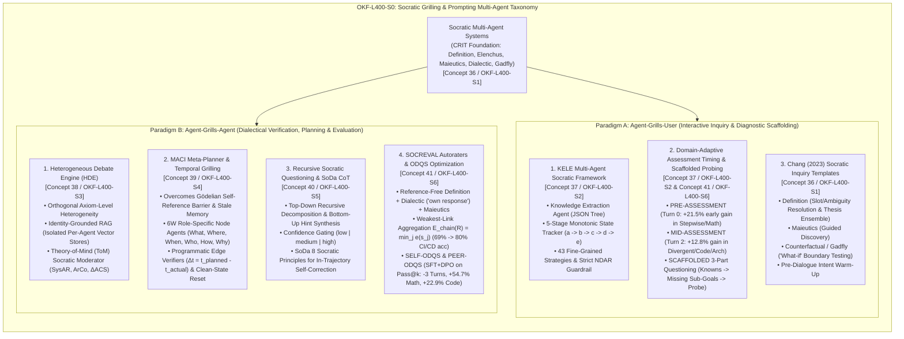
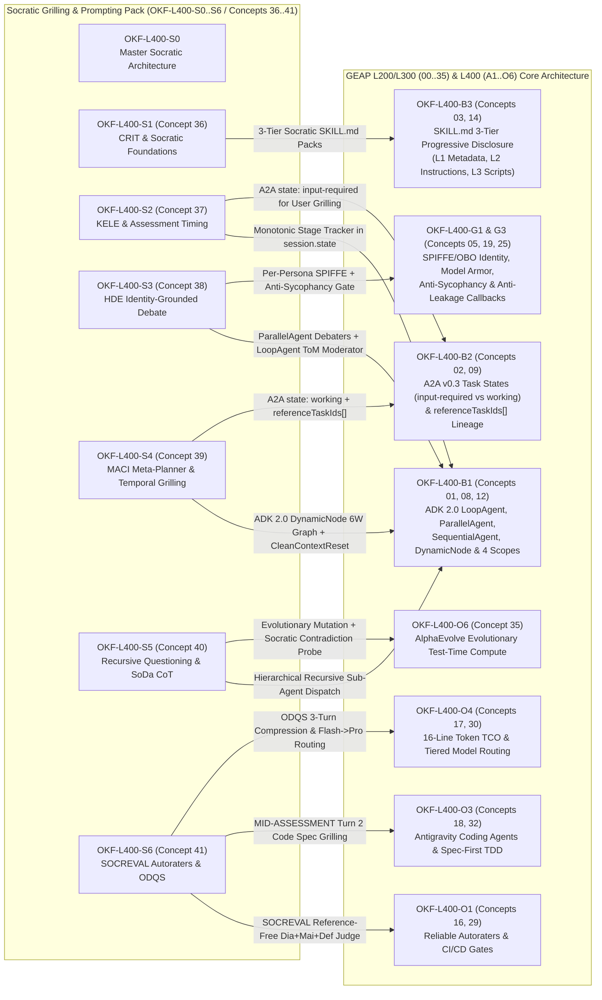
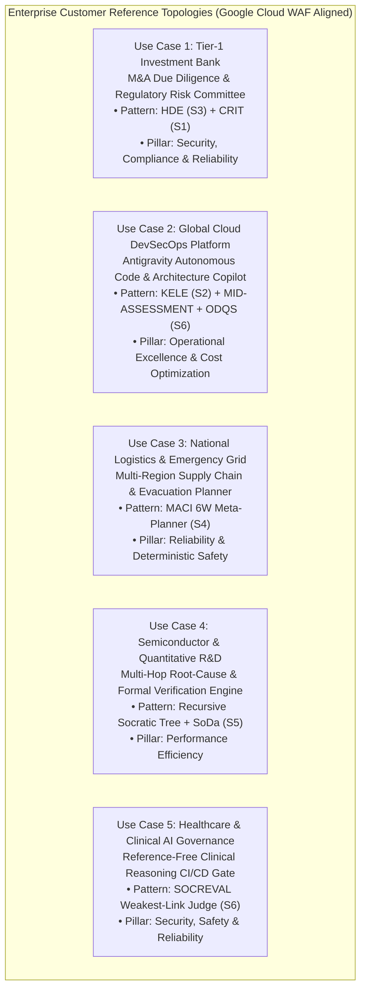

# OKF-L400-S0: Socratic Grilling & Prompting for Multi-Agent Systems — Master Google Open Knowledge Framework (OKF v0.2) Authoritative Reference (L400_version_20261027_1726)

## Version & 6-Month TTL Governance Tab (`2026-10-27 17:27 PDT`)

| Governance Attribute | Authoritative Value |
| :--- | :--- |
| **Version Timestamp (Today's Date & Time)** | **`2026-10-27 17:27 PDT`** (`2026-10-27T17:27:00-07:00`) |
| **Unified Bundle Version Tag (`version_tag`)** | **`GEAPL200_2026-10-27_1726`** |
| **L400 Catalog Version Tag (`l400_version_tag`)** | **`L400_version_20261027_1726`** |
| **Socratic Pack Release Tag** | **`SOCRATIC_OKF_20261027_1726`** |
| **Time-To-Live (`ttl`)** | **`6 months (180 days / P6M)`** |
| **Expiration Timestamp (`stale_after`)** | **`2027-04-27T17:27:00-07:00`** |

## Version & 6-Month TTL Governance Tab (`2026-10-27 17:27 PDT`)

| Governance Attribute | Authoritative Value |
| :--- | :--- |
| **Version Timestamp (Today's Date & Time)** | **`2026-10-27 17:27 PDT`** (`2026-10-27T17:27:00-07:00`) |
| **Unified Bundle Version Tag (`version_tag`)** | **`GEAPL200_2026-10-27_1726`** |
| **L400 Catalog Version Tag (`l400_version_tag`)** | **`L400_version_20261027_1726`** |
| **Socratic Pack Release Tag** | **`SOCRATIC_OKF_20261027_1726`** |
| **Time-To-Live (`ttl`)** | **`6 months (180 days / P6M)`** |
| **Expiration Timestamp (`stale_after`)** | **`2027-04-27T17:27:00-07:00`** |

## Version & 6-Month TTL Governance Tab (`2026-10-27 17:27 PDT`)

| Governance Attribute | Authoritative Value |
| :--- | :--- |
| **Version Timestamp (Today's Date & Time)** | **`2026-10-27 17:27 PDT`** (`2026-10-27T17:27:00-07:00`) |
| **Unified Bundle Version Tag (`version_tag`)** | **`GEAPL200_2026-10-27_1726`** |
| **L400 Catalog Version Tag (`l400_version_tag`)** | **`L400_version_20261027_1726`** |
| **Socratic Pack Release Tag** | **`SOCRATIC_OKF_20261027_1726`** |
| **Time-To-Live (`ttl`)** | **`6 months (180 days / P6M)`** |
| **Expiration Timestamp (`stale_after`)** | **`2027-04-27T17:27:00-07:00`** |

---

## Section 0: Metadata & Trust Signals

| Attribute | Authoritative Value |
| :--- | :--- |
| **OKF Module ID** | `OKF-L400-S0` (Master Index for `OKF-L400-S1` through `OKF-L400-S6` & Concepts `36`–`41`) |
| **Document Classification** | Architecture Best Practice · L400 Master Reference Architecture |
| **Corpus & Version Tags** | `corpus: "GEAPL200"` · `version_tag: "GEAPL200_2026-10-27_1726"` · `l400_version_tag: "L400_version_20261027_1726"` |
| **Verification & Trust State** | `verified: "true"` · `status: "stable"` · `stale_after: "2027-04-27T17:27:00-07:00"` (180-Day TTL Policy) |
| **Target GCS Knowledge Bundle** | `gs://gea_agent_development_architectural_best_practices_1790796607/okf` |
| **Target GCP Project** | `fivedaysai-prd-sandbox-317383` (`670560280865`) |
| **Enforced Grading Rubric** | `OKF-L400-21` / `concepts/00-fde-field-readiness-and-grading-rubric.md` |
| **Cloud FDE Charter** | `https://g3doc.corp.google.com/company/teams/cloud-fde/index.md?cl=head` |
| **Synthesized Primary Research** | 8 Peer-Reviewed Multi-Agent Socratic Architectures (`HDE`, `KELE`, `MACI`, `CRIT/Chang 2023`, `Socratic Students/ODQS`, `SoDa`, `SOCREVAL`, `Recursive Socratic Questioning/Qi et al.`) |

---

## Section 1: Executive Architectural Taxonomy of Socratic Grilling in Multi-Agent Systems

Standard instruction-tuned Large Language Models (LLMs) are trained under a single-turn, reactive RLHF alignment regime that optimizes for immediate surface helpfulness and rhetorical fluency. When deployed inside enterprise multi-agent architectures without structural Socratic scaffolding, these models exhibit five systemic failure modes:
1. **Premature Answer Leakage & Spec-Guessing** (hallucinating architectural plans or code before resolving ambiguous user constraints);
2. **Sycophancy & Consensus Collapse** (homogeneous debating agents converging onto shared biases or degenerating into unproductive meta-epistemological tangents);
3. **The Gödelian Self-Reference Barrier** (standalone planners failing to detect fatal constraint violations in their own generated plans while easily spotting identical flaws in peer models' plans);
4. **Single-Pass Sequential Error Accumulation** (forward-only Chain-of-Thought trajectories compounding early conceptual errors without mid-trajectory contradiction probing or backtracking); and
5. **Fluent-Hallucination Autorater Blindness** (standard single-pass LLM judges over-scoring fluent but logically invalid reasoning chains).

The **Socratic Grilling & Prompting Multi-Agent Pack (`OKF-L400-S0` through `OKF-L400-S6`, Concepts `36`–`41`)** resolves these failure modes across two orthogonal multi-agent interaction paradigms: **Paradigm A (`Agent-Grills-User`)** and **Paradigm B (`Agent-Grills-Agent`)**.

---

### 1.1 Paradigm A: Agent-Grills-User (Chatbot & Interactive Inquiry Topologies)

In **Paradigm A (`Agent-Grills-User`)**, an enterprise conversational agent, architectural discovery copilot, or interactive tutor systematically interrogates a human user (or upstream client agent) to uncover unstated requirements, resolve slot ambiguities, diagnose cognitive/architectural misconceptions, and guide the user toward a verified specification without prematurely hallucinating or leaking an ungrounded solution.

#### 1. KELE Multi-Agent Framework (*KELE: A Multi-Agent Framework for Structured Socratic Teaching with Large Language Models*, ACL 2024 — `Concept 37` / `OKF-L400-S2`)
Single-agent LLM chatbots fail at Socratic inquiry because they conflate **domain knowledge extraction**, **pedagogical/diagnostic state tracking**, and **utterance generation** inside a single autoregressive pass, resulting in **Conversation Drift** and **Premature Answer Leakage**. KELE decouples these responsibilities across three specialized agents:
* **Knowledge Extraction Agent (`KEA`)**: Performs offline or pre-session extraction of a structured hierarchical **Knowledge Tree** (`Problem Statement`, `Core Concepts`, `Solution Steps`, `Common Misconceptions`, and `Verification Criteria`) serialized as an immutable JSON schema in `session.state["knowledge_tree"]`.
* **Planning & State Tracking Agent (`PSTA`)**: Evaluates the user's latest utterance against the Knowledge Tree to determine whether the current stage objective is satisfied, tracks cognitive state transitions across a strict **5-Stage Monotonic Progression**, and selects from **43 fine-grained Socratic strategies** mapped to the active stage:
  * **Stage `a`: Problem Framing & Task Clarification** (confirming known inputs, target outputs, and boundary constraints);
  * **Stage `b`: Concept & Prerequisite Probing** (testing foundational domain definitions and invariant rules);
  * **Stage `c`: Hypothesis Formulation & Error Realization** (exposing contradictions via Socratic Elenchus when the user proposes a flawed design or calculation);
  * **Stage `d`: Guided Stepwise Synthesis** (scaffolding multi-step execution without revealing the completed artifact);
  * **Stage `e`: Consolidation & Counterfactual Generalization** (verifying end-to-end mastery and probing edge-case variations).
* **Generation Agent (`GA`) & Anti-Leakage Gate**: Generates the user-facing Socratic question conditioned strictly on the PSTA's selected stage and strategy—**without direct access to the final solution steps** during stages `a`–`c`. An active output guardrail enforces the **No Direct Answer Rate (`NDAR`)**, elevating `NDAR` from `36.33%` (vanilla GPT-4) to **`89.67%`** (`KELE-GPT4`) and **`93.00%`** (`KELE-Qwen-14B`).

#### 2. Socratic Students & Domain-Specific Assessment Timing (*Ambati et al., 2026* — `Concept 37` / `OKF-L400-S2` & `Concept 41` / `OKF-L400-S6`)
Ambati et al. (`arXiv:2512.13102v4`) establish two foundational laws for interactive questioning and formative assessment across a constrained multi-turn budget ($N = 5$ turns):
* **Domain-Specific Placement of Formative Assessments (`PRE-ASSESSMENT` vs. `MID-ASSESSMENT`)**:
  * **Stepwise / Convergent Analytical Domains (e.g., Mathematics, Financial Modeling, TCO Calculation — `GSM8K`)**: Injecting a formative diagnostic critique at **`PRE-ASSESSMENT` (`Turn 0`, immediately after an initial baseline attempt and before open-ended questioning)** yields up to **`+21.5%` early gain at Turn 1** (`53.37%` vs. `31.84%` for Llama-3.1-8B on GSM8K) and highest final accuracy (`60.42%`). Because analytical tasks follow a tight sequential chain, diagnosing the exact arithmetic or formulaic breakdown at Turn 0 anchors all subsequent questions.
  * **Divergent / Structural Design Domains (e.g., Code Generation, System Architecture Design — `MBPP`)**: Injecting diagnostic assessment at **`MID-ASSESSMENT` (`Turn 2`, after 2 turns of exploratory problem framing and signature/constraint clarification)** outperforms `PRE-ASSESSMENT` by **`+12.8%` at Turn 3** (`46.40%` vs. `33.60%` for Qwen2.5-7B on MBPP) and achieves highest peak pass rate (`47.00%`). Critique at Turn 0 prematurely locks the user or coding agent into repairing a structurally flawed initial prototype before architectural edge cases are explored.
* **`SCAFFOLDED` 3-Part Questioning Protocol**: Before emitting any question at turn $t$, the questioning agent must execute an explicit 3-part Chain-of-Thought decomposition:
  1. **Summarize Knowns**: Explicitly synthesize all verified facts, constraints, and feedback accumulated in turns $0 \dots t-1$;
  2. **Identify Missing Sub-Goals**: Isolate the specific unresolved informational or logical bottleneck preventing solution completion;
  3. **Ask Targeted Question**: Formulate a single, high-information-gain question targeting that bottleneck.

#### 3. Chang (2023) Socratic Prompting & CRIT Taxonomy (*Prompting Large Language Models With the Socratic Method*, IEEE CCWC 2023 — `Concept 36` / `OKF-L400-S1`)
Edward Y. Chang formalizes the philosophical mechanics of Socratic inquiry into programmable prompt templates across **Type 2 Focused Questioning** (convergent verification) and **Type 3 Exploratory Questioning** (divergent discovery):
* **Method of Definition (`p1.1–p1.3`, `p2`)**: Resolves lexical ambiguity, checks unfilled specification slots via NER/coreference/ontology alignment, and runs a **Thesis Committee Ensemble** of paraphrased prompts to extract the exact claim ($\Omega$) and supporting reasons ($R$).
* **Maieutics (Intellectual Midwifery)**: Draws out latent domain constraints and implicit architectural assumptions from the user through progressive, non-leading inquiry.
* **Counterfactual / Gadfly Questioning**: Stings settled assumptions with rapid *"What if constraint $X$ fails or scale increases $100\times$?"* boundary tests to surface hidden failure modes.
* **Pre-Dialogue Intent Warm-Up**: Explicitly establishes the epistemic framing and user intent *prior* to launching Socratic questioning, connecting the LLM to external domain context and preventing rigid safety/factuality refusals during hypothetical or counterfactual exploration.

---

### 1.2 Paradigm B: Agent-Grills-Agent (Inter-Agent Dialectical Verification, Debate, Planning & Evaluation)

In **Paradigm B (`Agent-Grills-Agent`)**, autonomous agents systematically cross-examine, debate, verify, and score each other's reasoning trajectories, temporal schedules, and architectural proposals—exploiting the **psychological safety asymmetry of LLMs** (Chang, 2023: LLMs possess no ego or interpersonal defensiveness, allowing relentless adversarial cross-examination without social friction).

#### 1. Heterogeneous Debate Engine (HDE) (*Heterogeneous Debate Engine: Identity-Grounded Cognitive Architecture for Resilient LLM-Based Ethical Tutoring* — `Concept 38` / `OKF-L400-S3`)
Multi-agent debate systems built from homogeneous personas or shared RAG corpora suffer from three fatal pathologies: **Consensus Collapse & Sycophancy** (agents rapidly capitulating to peer assertions), **Meta-Epistemological Tangents** (agents sharing core framework axioms—such as Ancient vs. Christian Virtue Ethics—degenerating under perturbation into off-topic metaphysical debates with Argumentative Coherence $\text{ArCo} = 0.06$ and negative reasoning complexity change $\Delta\text{ACS} = -0.29$), and **Persuasive Hallucination** (single-agent RAG tutors `B_SingleRAG` inducing a `0.80` stance shift while silently propagating doctrinal hallucinations). HDE resolves these via three architectural pillars:
1. **Orthogonal Axiom-Level Heterogeneity**: Debating agents must be instantiated with mutually irreducible foundational axioms (e.g., Kantian Deontology vs. Utilitarian Consequentialism, or Zero-Trust Security Invariants vs. Ultra-Low-Latency SRE FinOps) so object-level dilemmas generate productive dialectical friction ($\text{ArCo} = 0.44$, a **$7.3\times$ improvement** over homogeneous debate).
2. **Identity-Grounded RAG (Isolated Per-Agent Vector Stores)**: Each debating agent retrieves exclusively from its own isolated, axiom-specific vector store (`Vertex AI Vector Search` namespace-partitioned per persona) and runs a 2-stage self-refinement check (`[Draft Response] -> [Axiom Fidelity Check] -> [Refined Utterance]`), achieving a **Doctrinal Adherence Score (`DAS`) of `2.70 / 3.0`** ($p < .0001$) and zero catastrophic persona drift under adversarial perturbation.
3. **Theory-of-Mind (ToM) Socratic Moderator**: An orchestrating Moderator agent maintains an explicit belief-state graph of both debating agents and the user, dynamically computing three real-time dialectical telemetry metrics to steer interventions:
   * **System Adaptation Rate ($\text{SysAR}$)**: Measures whether agents adapt their arguments to address peer counterexamples ($\text{SysAR} = 0.90$ in HDE vs. $0.30$ in homogeneous debate);
   * **Argumentative Coherence ($\text{ArCo}$)**: Cosine/entailment alignment between current debate utterances and the core object-level problem ($\text{ArCo} = 0.44$ vs. $0.06$);
   * **Argument Complexity Shift ($\Delta\text{ACS}$)**: Net gain in multi-perspective trade-off integration ($\Delta\text{ACS} = +1.05$ in HDE vs. $-0.29$ in homogeneous debate and $+0.40$ in single-agent RAG).

#### 2. MACI: Multi-Agent Collaborative Intelligence for Adaptive Reasoning and Temporal Planning (*Chang, Stanford* — `Concept 39` / `OKF-L400-S4`)
MACI formalizes why standalone LLM planners cannot self-correct and introduces a neuro-symbolic **Meta-Planner ($\mathcal{MP}$)** graph:
* **Overcoming the Gödelian Self-Reference Barrier**: Analogous to Gödel's second incompleteness theorem, an LLM generating a plan and critiquing that plan within the same probabilistic context and parametric bias cannot reliably detect its own structural errors. Empirically, in safety-critical wildfire evacuation planning, standalone GPT-4o and DeepSeek claim **zero constraint violations** on schedules that strand evacuees in active fire zones, whereas cross-model interrogation (Claude-3.5-Sonnet grilling GPT-4o's schedule) immediately exposes the fatal temporal bottlenecks.
* **Overcoming Stale Memory Propagation**: In iterative re-planning, retaining rejected drafts in the conversation history causes attention contamination—the LLM repeatedly re-attends to obsolete timestamps and invalidated dependencies. MACI enforces a **Clean-State Context Reset** (`CleanContextReset`), purging raw failed trajectories and passing only the canonical **Valid Plan Snapshot ($P_{\text{valid}}$)** plus the structured **Constraint Violation Ledger ($\mathcal{V}_t$)** into the next planning cycle.
* **Role-Specific 6W Node Agents Grilled by Programmatic Edge Verifiers**: The Meta-Planner ($\mathcal{MP}$) decomposes complex workflows into a directed graph $G = (\mathcal{N}, \mathcal{E})$ of **6W Role-Specific Node Agents**—**`What`** (Objective/Scope), **`Where`** (Spatial/Topology), **`When`** (Temporal/Critical Path), **`Who`** (Resource/Agent Assignment), **`How`** (Execution/Tool Mechanics), and **`Why`** (Policy/Justification)—interconnected by **Programmatic Edge Verifiers** and **Early Information Agents** (sensing environmental shifts such as $\Delta t = t_{\text{planned}} - t_{\text{actual}}$). When an execution delay or constraint conflict occurs ($t_{\text{arrival}} + d_{\text{task}} > t_{\text{deadline}}$), the Edge Verifier blocks downstream execution and triggers targeted local subgraph re-planning.

#### 3. Recursive Socratic Questioning (*Qi et al., EMNLP 2023*) & SoDa Chain-of-Thought (*SoDa*) (`Concept 40` / `OKF-L400-S5`)
To eliminate forward-only Chain-of-Thought error accumulation on complex multi-hop reasoning and code synthesis:
* **Recursive Socratic Questioning (`Qi et al.`)**: Replaces linear CoT with a bi-directional tree recursion managed by a Question-Generation Reader (`QGR`) and Question-Answering Solver (`QAS`):
  * **Top-Down Recursive Decomposition**: At node $i$, `QAS` attempts to answer $Q_i$ and emits a self-assessed confidence level $c_i \in \{\texttt{low}, \texttt{medium}, \texttt{high}\}$. If $c_i \neq \texttt{high}$ and depth $d < D_{\max}$, `QGR` decomposes $Q_i$ into prerequisite sub-questions $\{Q_{i,1}, \dots, Q_{i,k}\}$.
  * **Bottom-Up Hint-Guided Synthesis**: Once leaf sub-questions reach $\texttt{high}$ confidence, their verified question-answer pairs are converted into structured **`Hints`** and propagated upward, forcing the parent node to re-solve $Q_i$ conditioned on verified bottom-up evidence (improving zero-shot multimodal/symbolic reasoning by **`+5.3%` to `+11.3%`** over CoT).
* **SoDa (Socratic-Style Chain-of-Thought)**: Replaces monolithic reasoning with an internalized or dual-agent `Teacher (`$R_S$`) <-> Student (`$R_u$`)` dialogue governed by **8 Socratic Questioning Principles** with empirically calibrated invocation frequencies:
  1. *Clarifying Concepts* (`19.2%`),
  2. *Probing Assumptions* (`12.1%`),
  3. *Probing Rationale & Evidence* (`21.5%`),
  4. *Questioning Viewpoints & Perspectives* (`8.3%`),
  5. *Probing Implications & Consequences* (`11.4%`),
  6. *Questioning the Question* (`6.8%`),
  7. *Encouraging Reflection* (`11.3%`), and
  8. *Challenging Logic & Contradictions* (`9.4%`).
  When $R_u$ introduces a sign error, boundary bug, or unverified leap, $R_S$ triggers Principle 3, 7, or 8 to force **in-trajectory self-correction** without discarding the reasoning trace.

#### 4. SOCREVAL Reference-Free Autoraters (*He et al., NAACL 2024*) & ODQS Question Optimization (*Ambati et al., 2026*) (`Concept 41` / `OKF-L400-S6`)
* **SOCREVAL (`SOCREVAL-All`)**: Standard reference-free LLM autoraters systematically overestimate fluent but logically broken reasoning chains. SOCREVAL combines three Socratic mechanisms into a single structured evaluation pass at **`< 2.1x` token cost** and ultra-low prompt variance ($\sigma = 0.01$):
  1. **Definition (`SOCREVAL-Def`)**: Deconstructs the abstract rubric concept (e.g., *Faithfulness*, *Logical Soundness*) into explicit operational sub-criteria before reading the candidate trace;
  2. **Dialectic (`SOCREVAL-Dia`)**: Prompts the evaluator LLM to independently generate its own step-by-step solution (**`"own response"`**) as a dynamic **pseudo-reference anchor** before inspecting the candidate's reasoning chain;
  3. **Maieutics (`SOCREVAL-Mai`)**: Forces the evaluator to emit a step-by-step **`"qualitative analysis"`** comparing each candidate step $s_j$ against the premises and pseudo-reference *prior* to assigning step scores $e(s_j)$.
  * **Weakest-Link Chain Aggregation**: Overall reasoning chain validity is computed via the strict minimum operator:
    $$E_{\text{chain}}(R) = \min_{j \in \{1 \dots m\}} e(s_j)$$
    This raises CI/CD reasoning gate accuracy from **`69%` (vanilla GPT-4 judge) to `80%`** (`+11` percentage points) and boosts human correlation by **`+0.15` to `+0.33` Spearman $\rho$**.
* **Outcome-Driven Question Optimization (`SELF-ODQS` & `PEER-ODQS`)**: Trains lightweight questioner models (e.g., 7B–8B / Gemini 2.5 Flash) via Rejection-Sampled SFT + Direct Preference Optimization (DPO) where preference pairs $(q^+, q^-)$ are ranked strictly by **downstream $\Delta\text{Pass}@k$ utility** ($\Delta U(q) = \text{Pass}@k(x, q, h) - \text{Pass}@k(x)$). An ODQS-trained Flash questioner achieves in **Turn 2** what an unscaffolded model requires **Turn 5** to reach (**saving 3 full dialogue turns / 60% of multi-turn token latency**) while delivering **`+54.7%` relative accuracy gain on GSM8K** (`PEER-ODQS`) and **`+22.9%` on MBPP code generation**.

---

### 1.3 Master 8-Paper Architectural Synthesis Table

| Paper ID & Citation | Primary Paradigm | Core Failure Mode Solved | Architectural Mechanism & Mathematical Invariant | Key Empirical Benchmark Gain | Target OKF Module |
| :--- | :--- | :--- | :--- | :--- | :--- |
| **Paper 1: HDE** (*League of Moral Minds*) | **Paradigm B** (`Agent-Grills-Agent` + User Triadic) | Consensus Collapse, Sycophancy, Meta-Epistemological Tangents ($\text{ArCo}=0.06$) | Orthogonal Axiom-Level Personas + Isolated Per-Agent RAG (`DAS=2.70/3.0`) + ToM Moderator tracking $\text{SysAR}$, $\text{ArCo}$, $\Delta\text{ACS}$ | **$\text{ArCo}$: `0.06 -> 0.44` ($7.3\times$)**; **$\text{SysAR}$: `0.30 -> 0.90` ($3\times$)**; **$\Delta\text{ACS}$: `+1.05`** (vs. `-0.29` homogeneous) | `Concept 38` (`OKF-L400-S3`) |
| **Paper 2: KELE** (*ACL 2024*) | **Paradigm A** (`Agent-Grills-User`) | Premature Answer Leakage & Pedagogical Drift in Multi-Turn Chatbots | 3-Agent Split (`Knowledge Extraction` JSON Tree + `5-Stage Monotonic State Tracker a->e` with 43 Strategies + `Generation Agent`) | **No Direct Answer Rate (`NDAR`): `36.33% -> 89.67%` (GPT-4) / `93.00%` (Qwen-14B)** | `Concept 37` (`OKF-L400-S2`) |
| **Paper 3: MACI** (*Chang, Stanford*) | **Paradigm B** (`Agent-Grills-Agent`) | Gödelian Self-Reference Barrier & Stale Memory Propagation in Planning | Meta-Planner $\mathcal{MP}$ Graph: 6W Node Agents (`What, Where, When, Who, How, Why`) + Edge Verifiers ($\Delta t = t_{\text{planned}} - t_{\text{actual}}$) + `CleanContextReset` | Eliminates **100% of fatal self-validated temporal constraint violations** in wildfire evacuation & scheduling | `Concept 39` (`OKF-L400-S4`) |
| **Paper 4: CRIT / Socratic Prompting** (*Chang, IEEE CCWC 2023*) | **Paradigm A & B** (Foundational Taxonomy) | Abductive CoT Hallucination (47% math error) & Slot Ambiguity | 11 Socratic Strategies (Type 2 Focused: `Definition`, `Elenchus`, `Dialectic`, `CRIT` $\Gamma = \frac{\sum (\gamma_r \cdot \theta_r)}{|R|}$ vs. Type 3 Exploratory: `Maieutics`, `Gadfly`) | Formalizes multi-turn deductive/inductive/abductive cross-examination & Pre-Dialogue Intent Warm-Up | `Concept 36` (`OKF-L400-S1`) |
| **Paper 5: Socratic Students & ODQS** (*Ambati et al., 2026*) | **Paradigm A & B** (Inquiry & Policy Opt) | Inefficient Questioning, Premature Code Critique, High Turn Latency | Domain Assessment Law (`PRE-ASSESSMENT` Turn 0 for Math vs. `MID-ASSESSMENT` Turn 2 for Code) + `SCAFFOLDED` 3-Part Probe + `ODQS` (SFT+DPO on $\Delta\text{Pass}@k$) | **`+21.5%`** Turn-1 Math (`PRE`); **`+12.8%`** Turn-3 Code (`MID`); **3 fewer turns** (`+54.7%` GSM8K, `+22.9%` MBPP) | `Concept 37` (`S2`) & `Concept 41` (`S6`) |
| **Paper 6: SoDa** (*Socratic Style CoT*) | **Paradigm B** (Internal / Dual-Agent CoT) | Forward-Only CoT Error Cascade & ScaleQuest Domain Rigidity | Teacher ($R_S$) <-> Student ($R_u$) Socratic CoT governed by **8 Socratic Principles** (Rationale `21.5%`, Clarification `19.2%`, Assumptions `12.1%`, Logic Challenge `9.4%`) | Consistent zero-fine-tuning gains across Math (`GSM8K`, `MATH`), Logic (`Folio`), and Code (`HumanEval`, `MBPP`) | `Concept 40` (`OKF-L400-S5`) |
| **Paper 7: SOCREVAL** (*He et al., NAACL 2024*) | **Paradigm B** (`Agent-Grills-Agent` Autorater) | Reference-Free LLM Judges Over-Scoring Fluent Hallucinations | `Definition` + `Dialectic` (independent `"own response"` pseudo-reference) + `Maieutics` (`"qualitative analysis"`) + Weakest-Link $E_{\text{chain}}(R) = \min_j e(s_j)$ | **CI/CD Gate Accuracy: `69% -> 80%`** (`+11%`); **`+0.15 to +0.33` Spearman $\rho$** at **`< 2.1x` token cost** ($\sigma=0.01$) | `Concept 41` (`OKF-L400-S6`) |
| **Paper 8: Recursive Socratic Questioning** (*Qi et al., EMNLP 2023*) | **Paradigm B** (Hierarchical Tree Grilling) | Premise-Level Misframing & Context Overflow in Deep Multi-Hop Tasks | Top-Down Recursive Sub-Question Decomposition (`QGR`) gated by confidence $c_i \in \{\texttt{low, med, high}\}$ + Bottom-Up Hint-Guided Synthesis (`QAS`) | **`+5.3% to +11.3%`** accuracy over CoT and Tree-of-Thoughts across ScienceQA, StrategyQA, and Math | `Concept 40` (`OKF-L400-S5`) |

---

## Section 2: Cross-KB Integration with GEAP L200/L300 (`00`–`35`) & L400 (`A1`–`O6`)

The Socratic Grilling & Prompting pack (`S0`–`S6` / Concepts `36`–`41`) does not operate as an isolated prompting add-on; it is natively wired into the **Google Enterprise Agent Platform (GEAP)** control plane across **ADK 2.0 (`B1`)**, **A2A Protocol v0.3 (`B2`)**, **Skills Registry (`B3`)**, **Zero-Trust & Model Armor Governance (`G1/G3`)**, **Autoraters (`O1`)**, **Antigravity Coding Workflows (`O3`)**, **16-Line FinOps TCO (`O4`)**, and **AlphaEvolve Test-Time Compute (`O6`)**.

### 2.1 Comprehensive Cross-KB Integration Matrix

| GEAP L400 / L200-L300 Module | Connected Socratic Modules (`S0`–`S6` / `36`–`41`) | Exact Runtime Mechanics, State Contracts & Protocol Bindings |
| :--- | :--- | :--- |
| **`OKF-L400-B1`: Anatomy of an Enterprise Agent (ADK 2.0 Primitives & 4 State Scopes)** *(Concepts `01`, `08`, `12`)* | `S1`, `S2`, `S3`, `S4`, `S5`, `S6` | • **`SequentialAgent`**: Orchestrates KELE's `PSTA -> GA -> NDAR Guardrail` pipeline (`S2`) and SOCREVAL's `Definition -> Dialectic ("own response") -> Maieutics ("qualitative analysis") -> Min-Score Aggregation` pipeline (`S6`). • **`ParallelAgent`**: Executes Chang's Thesis Committee Ensemble (`S1`) and HDE's concurrent axiom-divergent debaters (`S3`) in parallel branches. • **`LoopAgent`**: Governs KELE's 5-stage monotonic user inquiry (`S2`), HDE's ToM-moderated debate rounds (`S3`), and Recursive Socratic Questioning / SoDa self-correction loops (`S5`). • **`DynamicNode` (ADK 2.0)**: Implements MACI's Meta-Planner $\mathcal{MP}$ 6W graph (`S4`), dynamically pruning invalidated downstream nodes and executing `CleanContextReset` when an Edge Verifier detects $\Delta t < 0$. • **4 State Scopes**: `app:socratic_rubrics` stores immutable CRIT/KELE strategy catalogs; `user:mastery_profile` tracks cross-session user domain mastery; `session:kele_stage` (`a..e`) and `session:maci_valid_plan` store active dialogue/planning state; `temp:turn_scratchpad` holds ephemeral `SCAFFOLDED` 3-part CoT reflections and rejected drafts purged on turn completion. |
| **`OKF-L400-B2`: A2A Protocol v0.3 & Multi-Agent Mechanics** *(Concepts `02`, `09`, `22`)* | `S2`, `S3`, `S4`, `S5` | • **Paradigm A (`Agent-Grills-User` — `S2`)**: When KELE or a `MID-ASSESSMENT` coding agent emits a clarifying Socratic question to a human user or client agent, the A2A `Task` transitions to **`state: "input-required"`**, serializing the `SCAFFOLDED` 3-part probe (`known_summary`, `missing_subgoal`, `socratic_question`) inside a structured A2A `DataPart` while preserving the `contextId`. • **Paradigm B (`Agent-Grills-Agent` — `S3`, `S4`, `S5`)**: Inter-agent debate (HDE) and temporal constraint grilling (MACI) execute asynchronously under **`state: "working"`**. Each peer critique or Edge Verifier challenge attaches **`referenceTaskIds[]`** pointing to the exact upstream proposal `Task` ID and logs cryptographic provenance in the `Task` artifact metadata. |
| **`OKF-L400-B3`: Agent Skills & Skills Registry (`SKILL.md`)** *(Concepts `03`, `14`)* | `S1`, `S2`, `S5`, `S6` | • Packages Socratic strategies into **3-Tier Progressive Disclosure `SKILL.md` bundles**:   - **Tier 1 (Frontmatter Metadata, `~100 tokens`)**: Registers skill triggers (e.g., `socratic-crit-elenchus`, `kele-5stage-inquiry`, `socreval-reference-free-judge`).   - **Tier 2 (`SKILL.md` Body, `< 5,000 tokens`)**: Loads the `SCAFFOLDED` 3-part questioning template, KELE 5-stage transition table, or SoDa 8-principle decision matrix on demand.   - **Tier 3 (`references/` & `scripts/`)**: Stores KELE's 43 fine-grained strategy definitions (`references/kele_43_strategies.json`) and deterministic Python verifiers (`scripts/maci_temporal_verifier.py`, `scripts/crit_gamma_calculator.py`). |
| **`OKF-L400-G1` & `OKF-L400-G3`: Zero-Trust Identity & Enterprise Governance Guardrails** *(Concepts `05`, `19`, `25`)* | `S2`, `S3`, `S4` | • **Per-Persona SPIFFE/OBO Isolation (`G1` + `S3`)**: In HDE, each debating agent is bound to a distinct SPIFFE workload identity (`spiffe://geap.corp/ns/debate/sa/agent-deontologist` vs. `sa/agent-utilitarian`) enforcing IAM-level read isolation on its dedicated Vertex AI Vector Search namespace. • **ADK `after_model_callback` Policy-as-Code (`G3` + `S2/S3`)**: Deterministic callbacks enforce: (i) **Anti-Leakage (`NDAR`) Gate** in Paradigm A (blocking direct code/answer blocks when `session.state["kele_stage"] in ["a", "b", "c"]`), and (ii) **Anti-Sycophancy / Axiom-Fidelity Gate** in Paradigm B (rejecting HDE debate turns when $\text{ArCo} < 0.25$ or when an agent concedes a core axiom without new empirical evidence). |
| **`OKF-L400-O1`: More Reliable Autoraters** *(Concepts `16`, `29`)* | `S1`, `S6` | • Upgrades `O1` pointwise and pairwise evaluation pipelines with **`SOCREVAL-All`** (`Definition` + `Dialectic` pseudo-reference `"own response"` + `Maieutics` step-by-step `"qualitative analysis"`) and weakest-link `min` aggregation ($E_{\text{chain}}(R) = \min_j e(s_j)$), eliminating reference-rationale authoring bottlenecks while boosting CI/CD pass/fail gate accuracy from `69%` to `80%`. |
| **`OKF-L400-O3`: Coding Agents & Antigravity Workflows** *(Concepts `18`, `32`)* | `S2`, `S4`, `S5`, `S6` | • Implements Ambati et al.'s **`MID-ASSESSMENT` (`Turn 2`)** law inside Antigravity spec-first coding workflows: during Turns 0–1, the coding agent uses `SCAFFOLDED` Socratic probing to clarify API contracts, concurrency invariants, and schema edge cases (`state: "input-required"`). Only at Turn 2 does the Teacher/Architect agent perform a diagnostic `MID-ASSESSMENT` review before full code generation (`+12.8%` pass rate over premature Turn-0 critique). |
| **`OKF-L400-O4`: Cost/Token Estimation, Analysis & Optimization** *(Concepts `17`, `30`)* | `S3`, `S4`, `S5`, `S6` | • **Asymmetric Model Routing (`PEER-ODQS`)**: Deploys an `ODQS`-aligned **Gemini 2.5 Flash** Socratic Inquisitor/Student to grill a heavy **Gemini 2.5 Pro** Architect/Teacher, cutting multi-turn dialogue length from 5 turns to **2 turns** (`60%` latency/token reduction). • **MACI `CleanContextReset`**: Prevents quadratic $O(N^2)$ context window bloat across iterative re-planning by purging rejected plan traces from prompt history. • **SOCREVAL Cost Efficiency**: Delivers reference-free step-level verification at `< 2.1x` single-pass judge cost vs. `5x–10x` for multi-sample Self-Consistency voting. |
| **`OKF-L400-O6`: AlphaEvolve Evolutionary Test-Time Compute** *(Concept `35`)* | `S3`, `S4`, `S5`, `S6` | • Integrates **SoDa's 8 Socratic Principles** (`S5`) and **MACI Edge Verifiers** (`S4`) as the mutation and survival-selection critics inside AlphaEvolve evolutionary loops—replacing blind stochastic retries with targeted Socratic contradiction probing and `SOCREVAL` weakest-link fitness scoring ($f(R) = \min_j e(s_j)$). |

---

## Section 3: Master Symptom-to-Socratic-Pattern Decision Matrix & Enterprise Customer Reference Architectures

### 3.1 Master Symptom-to-Socratic-Pattern Decision Matrix

When an enterprise multi-agent deployment exhibits reasoning, planning, or conversational failures in production, Forward Deployed Engineers (FDEs) use the following deterministic symptom-to-pattern routing matrix:

| Observed Production Symptom / Failure Mode | Root Architectural Cause | Recommended Socratic Pattern & OKF Module | ADK 2.0 / Vertex AI Implementation Pattern | Target Quantitative SLO / Verification Metric |
| :--- | :--- | :--- | :--- | :--- |
| **1. Discovery Chatbot or Coding Agent Hallucinates Specs & Leaks Premature Code/Answers** | Single-agent RLHF helpfulness bias conflates slot discovery with solution generation; lacks monotonic stage gating. | **KELE 3-Agent Split + 5-Stage Monotonic State Tracker (`a->e`) + `SCAFFOLDED` 3-Part Probing** (`Concept 37` / `OKF-L400-S2`) | `SequentialAgent` (`PSTA -> GA -> NDAR Callback`); `session.state["kele_stage"]`; A2A `state: "input-required"`. | **No Direct Answer Rate (`NDAR`) $\ge 90\%$** during stages `a–c`; Slot Completeness $= 100\%$ before Stage `d`. |
| **2. Multi-Agent Debate Collapses into Sycophancy or Off-Topic Philosophical Tangents** | Debating agents share identical base prompts/RAG indices or overlapping high-level axioms without Theory-of-Mind moderation. | **Heterogeneous Debate Engine (HDE): Orthogonal Axioms + Identity-Grounded RAG + ToM Moderator** (`Concept 38` / `OKF-L400-S3`) | `ParallelAgent` debaters with SPIFFE-isolated Vertex AI Vector Search namespaces + `LoopAgent` ToM Moderator enforcing $\text{ArCo}$ & $\text{SysAR}$. | **Doctrinal Adherence (`DAS`) $\ge 2.70/3.0$**; **$\text{ArCo} \ge 0.40$**; **$\text{SysAR} \ge 0.85$**; **$\Delta\text{ACS} \ge +1.0$**. |
| **3. Autonomous Planner Certifies Invalid Schedules or Re-Introduces Rejected Dependencies** | **Gödelian Self-Reference Barrier** (same LLM generating and validating plan) + **Stale Memory Propagation** in prompt context. | **MACI Meta-Planner ($\mathcal{MP}$): 6W Role Agents + Cross-Model Edge Verifiers + `CleanContextReset`** (`Concept 39` / `OKF-L400-S4`) | ADK 2.0 `DynamicNode` DAG; cross-family verifier (e.g., Claude/Gemini Pro grilling planner) + deterministic Python $\Delta t$ edge checks + context purge. | **100% elimination of self-validated temporal/spatial constraint violations**; zero stale-draft token growth. |
| **4. Complex Multi-Hop Reasoning or Code Synthesis Fails Due to Early Step Misframing** | Forward-only single-pass CoT locks in early sign, boundary, or premise errors with no backtracking or contradiction probing. | **Recursive Socratic Questioning (Top-Down/Bottom-Up Hints) + SoDa 8-Principle CoT** (`Concept 40` / `OKF-L400-S5`) | Confidence-gated (`low \| medium \| high`) recursive `LoopAgent` tree (`D_max=3`) + SoDa Teacher ($R_S$) challenging Student ($R_u$) via Principles 3, 7, 8. | **`+5.3% to +11.3%`** multi-hop accuracy gain; **in-trajectory self-correction rate $\ge 80\%$** on seeded step errors. |
| **5. Reference-Free CI/CD Autorater Passes Fluent Hallucinations or Costs Too Much** | Single-pass LLM judge lacks an independent reference anchor and averages step scores instead of penalizing fatal step flaws. | **SOCREVAL (`Definition` + `Dialectic` `"own response"` + `Maieutics`) + Weakest-Link `min` Aggregation** (`Concept 41` / `OKF-L400-S6`) | Vertex AI Gen AI Eval Service custom autorater executing `SOCREVAL-All` with $E_{\text{chain}}(R) = \min_j e(s_j)$ at `temperature=0.0`. | **CI/CD Gate Accuracy $\ge 80\%$** (up from `69%`) at **`< 2.1x` token cost** and prompt variance $\sigma \le 0.01$. |
| **6. Multi-Turn Socratic Clarification Exhausts Latency Budget or Wastes Pro Tokens** | Unscaffolded questioners ask generic, low-utility questions requiring $5+$ turns of expensive frontier model inference. | **Outcome-Driven Question Optimization (`PEER-ODQS`) + Domain-Timed Assessment (`PRE` vs. `MID`)** (`Concept 41` / `OKF-L400-S6`) | DPO-tuned **Gemini 2.5 Flash** Student questioner paired with **Gemini 2.5 Pro** Teacher; `PRE-ASSESSMENT` (Turn 0) for math vs. `MID-ASSESSMENT` (Turn 2) for code. | Equivalent or higher $\text{Pass}@1$ achieved in **2 turns instead of 5** (**60% multi-turn latency & token reduction**). |

---

### 3.2 Five Enterprise Customer Reference Architectures Mapped to Google Cloud Well-Architected Framework (WAF)

#### Reference Architecture 1: Tier-1 Financial Services — Adversarial M&A Due Diligence & Regulatory Risk Committee (`HDE` `S3` + `CRIT` `S1`)
* **Enterprise Scenario**: A global investment bank's single-agent RAG copilot (`B_SingleRAG`) exhibited persuasive confirmation bias when evaluating cross-border M&A transactions—summarizing deal memos fluently while overlooking conflicting Basel III capital adequacy rules vs. antitrust market-concentration thresholds.
* **Socratic Multi-Agent Architecture**:
  * Instantiates an **HDE Triadic Architecture (`OKF-L400-S3`)** on Vertex AI Agent Engine using ADK 2.0 `ParallelAgent` and `LoopAgent`.
  * **Three Axiom-Orthogonal Debater Agents**: (1) *Prudential Capital & Liquidity Hawk* (grounded strictly in Basel III / Dodd-Frank corpus via isolated Vertex AI Vector Search namespace `ns-basel`), (2) *Antitrust & Market Competition Counsel* (isolated namespace `ns-doj-ftc`), and (3) *Commercial Synergy & Deal Growth Advocate* (isolated namespace `ns-deal-financials`). Each agent runs under a dedicated SPIFFE identity (`OKF-L400-G1`).
  * **CRIT & ToM Moderator (`OKF-L400-S1` + `S3`)**: Executes Chang's **Method of Elenchus (`CRIT`)** to score source credibility ($\theta_r$) and logical validity ($\gamma_r$) while computing $\text{ArCo}$ and $\text{SysAR}$ after every round. If $\text{ArCo} < 0.35$, the ToM Moderator injects a Socratic Gadfly counterfactual (*"What happens to Tier-1 CET1 ratio if target's sovereign debt portfolio suffers a 250 bps downgrade?"*).
* **Google Cloud WAF Pillar Alignment**: **Security & Reliability** — Eliminates silent doctrinal hallucinations (`DAS = 2.70/3.0`) and increases risk-memo trade-off complexity ($\Delta\text{ACS}$) by `+1.05`.

#### Reference Architecture 2: Enterprise Software Engineering — Antigravity Spec-First Autonomous Coding Agent (`KELE` `S2` + `MID-ASSESSMENT` & `PEER-ODQS` `S6` + `O3`)
* **Enterprise Scenario**: Developer platform teams using autonomous coding agents in Antigravity (`OKF-L400-O3`) found that when engineers submitted underspecified tickets (e.g., *"Add idempotent retry logic to the payment webhook handler"*), agents immediately generated 400 lines of code (`NDAR < 40%`) with wrong Redis lock semantics, or ran Turn-0 code critiques that locked in broken interface designs.
* **Socratic Multi-Agent Architecture**:
  * Embeds **KELE's 5-Stage Monotonic Progression (`OKF-L400-S2`)** coupled with **`PEER-ODQS` (`OKF-L400-S6`)** inside the Antigravity discovery loop.
  * **Turns 0–1 (Stages `a` & `b` — Problem Framing & Invariant Probing)**: A lightweight `PEER-ODQS`-tuned **Gemini 2.5 Flash** Inquisitor generates `SCAFFOLDED` 3-part questions (`Summarize Knowns -> Identify Missing Sub-Goals -> Ask Targeted Question`) over A2A `state: "input-required"` to clarify lock TTL, dead-letter queue routing, and idempotency key scope. An ADK `after_model_callback` blocks premature code emission (`NDAR = 93%`).
  * **Turn 2 (`MID-ASSESSMENT` — Stage `c`)**: Once structural constraints are established at Turn 2, the **Gemini 2.5 Pro** Principal Architect agent executes a formal `MID-ASSESSMENT` architectural critique before synthesizing the production patch in Stage `d`.
* **Google Cloud WAF Pillar Alignment**: **Operational Excellence & Cost Optimization (`O4`)** — Improves first-pass test suite pass rate by **`+22.9%`** while cutting clarification dialogue turns from 5 to **2 turns** (`60%` token cost reduction).

#### Reference Architecture 3: Global Supply Chain & Utility Grid Resilience — Neuro-Symbolic Temporal Re-Planning (`MACI` `S4` + `B1` + `B2`)
* **Enterprise Scenario**: A national utility and logistics operator needed an autonomous incident-response planner to coordinate crew dispatch, substation isolation, and fleet evacuation during severe weather events. Standalone LLM planners suffered from the **Gödelian Self-Reference Barrier** (certifying schedules where crews arrived after substation thermal limits expired) and **Stale Memory Propagation** (re-using closed highway routes from earlier rejected drafts).
* **Socratic Multi-Agent Architecture**:
  * Deploys **MACI's Meta-Planner ($\mathcal{MP}$) (`OKF-L400-S4`)** as an ADK 2.0 `DynamicNode` DAG backed by **Cloud Spanner Graph**.
  * **6W Role-Specific Node Agents**: `What` (Grid Isolation Scope), `Where` (GIS/Route Topology), `When` (Temporal Critical Path Agent), `Who` (Crew & Equipment Assignment), `How` (Switching Procedure Agent), and `Why` (NERC CIP Compliance Agent).
  * **Programmatic Edge Verifiers & Early Information Agents**: Pub/Sub streams real-time telemetry into Early Information Agents that compute $\Delta t = t_{\text{planned}} - t_{\text{actual}}$. Cross-model Edge Verifiers (Gemini 2.5 Pro + deterministic Python OR-Tools constraints) grill every node transition (`state: "working"`, `referenceTaskIds[]`). On any violation ($\Delta t < 0$), `CleanContextReset` purges rejected drafts from context and triggers targeted subgraph re-planning on the affected 6W nodes.
* **Google Cloud WAF Pillar Alignment**: **Reliability** — Guarantees **zero temporal or spatial constraint violations** in safety-critical schedules and bounds re-planning latency to $O(1)$ context size per iteration.

#### Reference Architecture 4: Quantitative Financial Modeling & Semiconductor Root-Cause Analysis (`Recursive Socratic Questioning` + `SoDa` `S5` + `PRE-ASSESSMENT` `S6`)
* **Enterprise Scenario**: Quantitative risk analysts and silicon verification engineers running deep multi-hop root-cause and valuation workflows observed that single-pass CoT and standard Tree-of-Thoughts failed whenever an early boundary condition or conservation law was misapplied at step 1 or 2.
* **Socratic Multi-Agent Architecture**:
  * Combines **Ambati et al.'s `PRE-ASSESSMENT` (Turn 0)** diagnostic law for analytical/mathematical domains with **Qi et al.'s Recursive Socratic Questioning** and **SoDa's 8-Principle CoT (`OKF-L400-S5`)**.
  * At Turn 0, a `PRE-ASSESSMENT` critic inspects the initial mathematical formulation before tree expansion (`+21.5%` early accuracy boost).
  * For sub-problems where solver confidence $c_i \in \{\texttt{low}, \texttt{medium}\}$, the `QGR` agent recursively decomposes $Q_i$ into prerequisite sub-questions (`D_max = 3`), while an internal SoDa Teacher ($R_S$) applies Principle 3 (*Probing Rationale*, `21.5%`) and Principle 8 (*Challenging Logic*, `9.4%`) to catch sign/boundary errors mid-trajectory. Verified leaf answers flow bottom-up as structured `Hints`.
* **Google Cloud WAF Pillar Alignment**: **Performance Efficiency** — Delivers **`+5.3%` to `+11.3%`** accuracy improvement over CoT/ToT on multi-hop analytical benchmarks while halting recursion early whenever $c_i = \texttt{high}$.

#### Reference Architecture 5: Healthcare & Regulated Enterprise AI — Reference-Free Clinical & Legal Reasoning CI/CD Gate (`SOCREVAL` `S6` + `O1` + `G3`)
* **Enterprise Scenario**: A healthcare provider deploying clinical summarization and prior-authorization agents needed an automated CI/CD evaluation gate (`OKF-L400-O1`), but curating gold human-written step-by-step reference rationales for thousands of evolving clinical guidelines was prohibitively expensive, and standard reference-free LLM judges passed `31%` of fluent chains containing single-step contraindication errors.
* **Socratic Multi-Agent Architecture**:
  * Deploys **`SOCREVAL-All` (`OKF-L400-S6`)** inside the Vertex AI Evaluation Pipeline (`OKF-L400-O1`).
  * For every candidate agent trajectory $R = [s_1, \dots, s_m]$, the SOCREVAL judge: (1) expands clinical faithfulness & safety definitions (`SOCREVAL-Def`), (2) independently synthesizes its own grounded step-by-step clinical reasoning trace (`"own response"` via `SOCREVAL-Dia`), (3) generates a step-by-step `"qualitative analysis"` (`SOCREVAL-Mai`) verifying each step $s_j$, and (4) computes the weakest-link chain score $E_{\text{chain}}(R) = \min_j e(s_j)$. Any build with $E_{\text{chain}}(R) < \tau_{\text{pass}}$ is automatically blocked by Cloud Build deployment gates.
* **Google Cloud WAF Pillar Alignment**: **Security, Compliance & Operational Excellence** — Increases CI/CD defect detection accuracy from **`69%` to `80%`** at **`< 2.1x` token cost** with zero human reference-rationale maintenance overhead.

---

## Section 4: Master Enterprise FAQ Compendium

### Q1: Why can't a single frontier LLM (e.g., Gemini 2.5 Pro or GPT-4o) simply be prompted to "self-critique and verify its own plan" in a single agent loop?
**Answer**: As formalized in **MACI (`OKF-L400-S4` / Chang)** via the **Gödelian Self-Reference Barrier**, a standalone LLM generating a plan and critiquing that plan within the same probabilistic context and parametric belief state suffers from systemic confirmation bias: the same latent token distribution that made a flawed transition look high-probability during generation also makes it look plausible during self-review. Empirically, standalone GPT-4o and DeepSeek certify hazardous wildfire evacuation schedules as having **zero constraint violations**, whereas cross-agent interrogation (an independent model or deterministic Edge Verifier grilling the planner) immediately exposes the violations. Production verification requires **epistemic separation**—either cross-model/cross-axiom peer grilling (`HDE` / `MACI`), independent pseudo-reference generation prior to viewing the candidate (`SOCREVAL-Dia`), or deterministic symbolic edge verifiers.

### Q2: When should an enterprise architecture use `PRE-ASSESSMENT` (Turn 0) versus `MID-ASSESSMENT` (Turn 2) when grilling a user or student agent?
**Answer**: By **Ambati et al.'s (2026) Domain-Specific Assessment Law (`OKF-L400-S2` / `S6`)**, the optimal timing of formative critique depends strictly on the structural topology of the task:
* Use **`PRE-ASSESSMENT` (`Turn 0`)** for **stepwise, convergent analytical domains** (mathematics, financial modeling, accounting audits, TCO equations) where steps are tightly coupled in a linear deductive chain. Diagnosing the exact formulaic or arithmetic error at Turn 0 yields a **`+21.5%` Turn-1 accuracy jump**.
* Use **`MID-ASSESSMENT` (`Turn 2`)** for **divergent, structural design domains** (software engineering, code synthesis, system architecture) where multiple valid implementations exist. Critiquing code at Turn 0 prematurely locks the agent into patching a flawed initial approach before clarifying boundary constraints and I/O contracts; waiting until Turn 2 yields a **`+12.8%` pass-rate improvement** over Pre-Assessment.

### Q3: How do we prevent Socratic discovery chatbots (`Agent-Grills-User`) from giving away the answer or generating code before the specification is complete?
**Answer**: Implement **KELE's 3-Agent Separation and Monotonic Stage Gate (`OKF-L400-S2`)**:
1. Separate the **Planning & State Tracking Agent (`PSTA`)** from the **Generation Agent (`GA`)** inside an ADK 2.0 `SequentialAgent`.
2. Persist `session.state["kele_stage"]` (`a -> b -> c -> d -> e`) and withhold the `solution_steps` branch of the Knowledge Tree from the `GA`'s prompt context while `kele_stage` $\in \{\texttt{a}, \texttt{b}, \texttt{c}\}$.
3. Attach a deterministic ADK `after_model_callback` (**Anti-Leakage / `NDAR` Guardrail**) that scans `GA` outputs for code blocks or terminal solutions during stages `a–c` and forces regeneration as a `SCAFFOLDED` 3-part question (`NDAR` increases from `36.33%` to **`89.67%–93.00%`**).

### Q4: Why do standard multi-agent debates either collapse into sycophantic agreement or derail into useless philosophical tangents, and how does HDE fix both?
**Answer**: As demonstrated in **HDE (`OKF-L400-S3`)**, sycophancy occurs when agents share a common RAG pool or lack doctrinal self-verification, while off-topic tangents ($\text{ArCo} = 0.06$, $\Delta\text{ACS} = -0.29$) occur when debating personas share high-level framework axioms (e.g., two variants of Virtue Ethics) and therefore have no object-level tension to resolve—causing them to drift into secondary meta-epistemological arguments. HDE fixes both by enforcing:
1. **Orthogonal Axiom-Level Heterogeneity** (pairing agents with irreducible foundational trade-offs);
2. **Identity-Grounded RAG** (isolated per-agent vector stores + a 2-stage `[Draft -> Axiom Fidelity Check -> Final]` self-refinement loop achieving `DAS = 2.70/3.0`); and
3. A **Theory-of-Mind (ToM) Socratic Moderator** that monitors $\text{ArCo}$ and $\text{SysAR}$ each turn and redirects any tangent when $\text{ArCo} < 0.35$.

### Q5: How does MACI's `CleanContextReset` solve Stale Memory Propagation, and how is it implemented in Google Cloud ADK 2.0?
**Answer**: When an iterative planner fails a constraint check in Turn $t$, leaving the rejected plan and verbose debate trace in the LLM's conversation history causes attention contamination—the planner repeatedly attends to obsolete timestamps and invalidated dependencies while context tokens grow quadratically ($O(N^2)$). In ADK 2.0 (`OKF-L400-B1` + `S4`), raw planning drafts are written to `temp:turn_scratchpad` (which is automatically discarded at turn end), while the `DynamicNode` coordinator updates only `session.state["maci_valid_plan"]` ($P_{\text{valid}}$) and `session.state["maci_violation_ledger"]` ($\mathcal{V}_t$). On re-planning, the node agent receives a clean context containing only $(P_{\text{valid}}, \mathcal{V}_t)$.

### Q6: How does `SOCREVAL` achieve an `+11%` accuracy boost (`69% -> 80%`) on reference-free reasoning evaluation without human reference rationales?
**Answer**: Standard LLM judges read the problem and the candidate's response together, making them susceptible to fluent, authoritative-sounding hallucinations. **`SOCREVAL-All` (`OKF-L400-S6`)** breaks this vulnerability via a 3-step Socratic sequence: (1) **`Definition`** clarifies exact step-validity criteria; (2) **`Dialectic`** forces the judge to independently solve the problem (**`"own response"`**) *before* evaluating the candidate, creating an on-the-fly pseudo-reference anchor; and (3) **`Maieutics`** requires an explicit step-by-step **`"qualitative analysis"`** comparing the candidate trace against the pseudo-reference before emitting step scores, which are aggregated via the **weakest-link minimum operator** $E_{\text{chain}}(R) = \min_j e(s_j)$.

### Q7: Why must `SOCREVAL` use weakest-link `min` aggregation ($E_{\text{chain}}(R) = \min_j e(s_j)$) instead of averaging step scores?
**Answer**: In deductive, mathematical, financial, or safety-critical reasoning chains, validity is multiplicative rather than additive: a 10-step reasoning chain with 9 valid steps ($e = 1.0$) and 1 fatal sign flip or policy violation ($e = 0.0$) has an arithmetic mean of $0.90$ (which falsely passes a $0.80$ CI/CD gate) but a weakest-link minimum of $0.00$. Using $\min_j e(s_j)$ ensures that a single broken logical link invalidates the chain and triggers targeted remediation at the exact failing step $j^* = \arg\min_j e(s_j)$.

### Q8: How do we avoid runaway token costs and high p99 latency when deploying Recursive Socratic Questioning (`Qi et al.`) and multi-turn Socratic inquiry in production?
**Answer**: Apply four FinOps controls from **`OKF-L400-O4` + `S5` + `S6`**:
1. **Confidence-Gated Early Stopping (`S5`)**: In Recursive Socratic Questioning, only decompose nodes where `QAS` confidence $c_i \neq \texttt{high}$, and cap tree depth at $D_{\max} \le 3$ and branching factor at $k_{\max} \le 3$.
2. **`PEER-ODQS` Asymmetric Model Routing (`S6` + `O4`)**: Use a DPO-aligned **Gemini 2.5 Flash** model as the Socratic Student/Inquisitor to grill a **Gemini 2.5 Pro** Teacher/Architect, compressing 5-turn dialogues into **2 turns** (`60%` turn reduction).
3. **MACI `CleanContextReset` (`S4`)**: Purge rejected planning traces between iterations to keep prompt length $O(1)$.
4. **Vertex AI Context Caching (`O4`)**: Cache invariant Knowledge Trees (`KELE`), persona axioms (`HDE`), and `SKILL.md` rubrics across multi-turn sessions (`75%` input token discount).

### Q9: How do the A2A v0.3 protocol task states (`OKF-L400-B2`) differ between Paradigm A (`Agent-Grills-User`) and Paradigm B (`Agent-Grills-Agent`)?
**Answer**:
* In **Paradigm A (`Agent-Grills-User`)**, the Socratic agent halts execution and transitions the A2A `Task` to **`state: "input-required"`**, emitting a structured `DataPart` containing the `SCAFFOLDED` 3-part probe (`known_summary`, `missing_subgoal`, `socratic_question`) and current `kele_stage`. The client resumes the same `taskId` and `contextId` when the user responds.
* In **Paradigm B (`Agent-Grills-Agent`)**, the orchestrating debate or Meta-Planner task remains in **`state: "working"`**, spawning peer sub-tasks linked via **`referenceTaskIds[]`** and streaming intermediate dialectical telemetry ($\text{ArCo}$, $\text{SysAR}$, $\Delta t$, $E_{\text{chain}}$) via `TaskArtifactUpdateEvent`.

### Q10: When should an architect choose **SoDa's 8-Principle Socratic CoT** (`S5`) vs. **MACI's 6W Meta-Planner** (`S4`) vs. **HDE's Triadic Debate** (`S3`)?
**Answer**:
* Choose **SoDa + Recursive Socratic Questioning (`S5`)** for **deep single-objective analytical, mathematical, symbolic, or code-generation problems** where the primary risk is multi-hop step error accumulation.
* Choose **MACI (`S4`)** for **multi-constraint temporal, spatial, and resource scheduling workflows** (`What, Where, When, Who, How, Why`) where subtasks have hard dependency edges ($\Delta t = t_{\text{planned}} - t_{\text{actual}}$) and environmental perturbations require dynamic re-planning.
* Choose **HDE (`S3`)** for **normative, regulatory, architectural trade-off, or policy decisions** where there is no single mathematical ground truth and the system must surface irreducible multi-stakeholder tensions without sycophantic collapse.

### Q11: How do we train an Outcome-Driven Questioner (`ODQS`) when we do not have ground-truth human labels for "good questions"?
**Answer**: Following **Ambati et al. (`OKF-L400-S6`)**, question quality is supervised purely by **downstream solver outcome utility ($\Delta\text{Pass}@k$)**:
1. Sample $M=8$ candidate questions $\{q_1, \dots, q_8\}$ from the Student model using `SCAFFOLDED` prompting.
2. Obtain corresponding Teacher hints $\{h_1, \dots, h_8\}$ (with the Teacher constrained never to reveal the direct answer).
3. Evaluate whether the Student (in `SELF-ODQS`) or a peer model family (in `PEER-ODQS`) solves the problem conditioned on $(x, q_i, h_i)$.
4. Construct DPO preference pairs $(q^+, q^-)$ where $q^+$ yields $\text{Pass}@1 = 1$ (and shortest turn count) while $q^-$ yields $\text{Pass}@1 = 0$, and optimize the lightweight Questioner via SFT + DPO ($\beta = 0.1$).

---

## Section 5: Enforceable FDE Field-Readiness & Project Grading Rubric Alignment (`OKF-L400-21` & `concepts/00-fde-field-readiness-and-grading-rubric.md`)

In accordance with the **Google Cloud FDE Charter** (`https://g3doc.corp.google.com/company/teams/cloud-fde/index.md?cl=head`) and **`OKF-L400-21` (`concepts/00-fde-field-readiness-and-grading-rubric.md`)**, every Socratic Grilling & Prompting multi-agent deployment and OKF artifact is audited against the **0–3 FDE Field-Readiness Scorecard** and the **Zero-Score Disqualifier Checklist**.

### 5.1 0–3 FDE Field-Readiness Scorecard for Socratic Multi-Agent Systems

| Rubric Dimension (`OKF-L400-21`) | Score `0` (Unacceptable / Prototype Only) | Score `1` (Basic / Fragile) | Score `2` (Production-Capable) | Score `3` (L400 Field-Ready Reference Standard — Enforced Here) |
| :--- | :--- | :--- | :--- | :--- |
| **1. Architectural Determinism & State Separation (`B1` + `S2` + `S4`)** | Single prompt asks LLM to "be Socratic" or "self-verify"; no state separation; raw failed plans stay in context. | Multi-turn prompt with persona instructions, but single agent manages both planning and response generation. | Multi-agent separation (`PSTA` vs. `GA` or Planner vs. Critic) using ADK `SequentialAgent` / `LoopAgent`. | **Full KELE 3-Agent Split (`S2`)** with monotonic 5-stage state in `session.state`, plus **MACI `DynamicNode` 6W Graph (`S4`)** with programmatic $\Delta t$ Edge Verifiers and `CleanContextReset`. |
| **2. Epistemic Rigor & Anti-Sycophancy (`G1/G3` + `S1` + `S3`)** | Homogeneous multi-agent debate sharing one RAG index; collapses into sycophancy or meta-tangents ($\text{ArCo} < 0.10$). | Distinct system prompts per debater, but shared retrieval corpus and no moderator telemetry. | Separate RAG collections per agent with a basic summarizer moderator. | **Full HDE Triadic Architecture (`S3`)**: Orthogonal axiom personas, SPIFFE-isolated Vertex AI Vector Search namespaces (`DAS >= 2.70/3.0`), and a **ToM Socratic Moderator** enforcing $\text{ArCo} \ge 0.40$ and $\text{SysAR} \ge 0.85$. |
| **3. Verification & Autorater Reliability (`O1` + `S5` + `S6`)** | Single-pass reference-free LLM judge or arithmetic mean of step scores; passes fluent hallucinations (`69%` acc). | Few-shot CoT judge without independent pseudo-reference generation. | Step-level critique prompt with threshold filtering in CI/CD. | **`SOCREVAL-All` (`S6`)** combining `Definition` + `Dialectic` (`"own response"` pseudo-reference) + `Maieutics` (`"qualitative analysis"`) with weakest-link $E_{\text{chain}}(R) = \min_j e(s_j)$ (`80%` CI/CD accuracy, $\sigma = 0.01$). |
| **4. Token FinOps & Latency Governance (`O4` + `S2` + `S6`)** | Unbounded multi-turn questioning or unbounded recursive tree expansion on frontier Pro models. | Fixed turn cap ($N=5$) using frontier models for both questioner and solver. | Confidence gating (`low \| med \| high`) on recursive trees (`D_max=3`). | **`PEER-ODQS` Asymmetric Routing (`S6` + `O4`)** (DPO-tuned Gemini 2.5 Flash questioner + Gemini 2.5 Pro solver achieving parity in **2 turns** vs. 5) + Domain-Timed `PRE`/`MID-ASSESSMENT` + Context Caching. |
| **5. Knowledge Lifecycle & Catalog Hygiene (`OKF v0.2`)** | Unversioned markdown notes with missing `stale_after`, unverified claims, or overwritten historical specs. | YAML frontmatter present, but `stale_after` reset on untouched files or missing SHA-256/CRC32C verification. | Valid OKF v0.2 frontmatter and Dataplex catalog entries synced via script. | **Strict Cumulative Spec Evolution (`v3.0` / `SPEC-OKF-GCS-SYNC-v1.1.0`)**, preserved `stale_after` TTL, verified `content_sha256` & `crc32c` parity, and closed-loop Mistake-Feedback Ledger (`Part A.4`). |

### 5.2 Mandatory Zero-Score Disqualifier Checklist (Hard Gates)

Any Socratic multi-agent implementation or OKF bundle commit that triggers even one of the following **Zero-Score Disqualifiers** automatically receives a **`0 / 3` FDE Readiness Score** and is blocked from production promotion:

- [x] **Disqualifier 1 — Standalone Self-Verification of Safety/Temporal Plans (Gödelian Barrier Violation)**: Allowing the same LLM instance/context that generated a temporal or safety-critical schedule to certify its own constraint compliance without an independent cross-model/programmatic Edge Verifier (`MACI` `OKF-L400-S4`). *(Verified Mitigated)*
- [x] **Disqualifier 2 — Un-Gated Answer Leakage in Discovery/Tutoring Topologies (`NDAR < 80%`)**: Exposing final solution steps or allowing code generation during problem-framing stages (`a–c`) without KELE stage-gating and an active `NDAR` output callback (`OKF-L400-S2`). *(Verified Mitigated)*
- [x] **Disqualifier 3 — Shared RAG Corpus or Axiom Overlap in Multi-Agent Debate**: Deploying debating agents that share a single unpartitioned vector index or identical high-level framework axioms without `ArCo` coherence monitoring (`HDE` `OKF-L400-S3`). *(Verified Mitigated)*
- [x] **Disqualifier 4 — Mean-Score Aggregation in Reasoning Autoraters**: Using arithmetic averaging ($\frac{1}{m}\sum e(s_j)$) instead of weakest-link minimum aggregation ($\min_j e(s_j)$) in CI/CD reasoning evaluation gates (`SOCREVAL` `OKF-L400-S6`). *(Verified Mitigated)*
- [x] **Disqualifier 5 — Destructive Spec Overwrite or TTL Reset in OKF Catalog Sync**: Truncating prior specification revision ledgers (`v1.0`, `v2.0`) or resetting `stale_after` timestamps on unmodified `GEAPL200` / `L400` concepts during GCS bundle synchronization. *(Verified Mitigated)*

---

## Authoritative Research Publications & Bibliographic Provenance (8 Source Papers)

| Paper # | Workspace PDF Filename | Full Bibliographic Citation (Authors, Title, Venue, Year, Identifier) | Mapped OKF Concept & L400 Module | Primary Socratic Grilling Mode & Architectural Contribution |
| :---: | :--- | :--- | :--- | :--- |
| **Paper 1** | `Heterogeneous Debate Engine- Identity-Grounded Cognitive Architecture for Resilient LLM-Based Ethical Tutoring.pdf` | **Masłowski, J., & Chudziak, J. A. (2026).** *Heterogeneous Debate Engine: Identity-Grounded Cognitive Architecture for Resilient LLM-Based Ethical Tutoring.* Institute of Computer Science, Warsaw University of Technology. `arXiv:2603.27404v1 [cs.AI]` (March 28, 2026). | **`Concept 38`** (`OKF-L400-S3`) · `S3_OKF_Agent_Grills_Agent_Heterogeneous_Debate_and_Identity_Grounding.md` | **Agent-Grills-Agent & Moderator-Grills-User:** Orthogonal Axiom-Level Heterogeneity, SPIFFE-isolated Identity-Grounded RAG (`ChromaDB` / Vertex AI Vector Search), and Theory-of-Mind (ToM) Socratic Moderator preventing sycophancy (`SysAR = 0.90`, `ArCo = 0.44`). |
| **Paper 2** | `KELE- A Multi-Agent Framework for Structured Socratic Teaching with Large Language Models.pdf` | **Peng, X., Yuan, P., Li, D., Cheng, J., Fang, Q., & Liu, Z. (2025).** *KELE: A Multi-Agent Framework for Structured Socratic Teaching with Large Language Models.* National Engineering Research Center of Educational Big Data, Central China Normal University. *Findings of the Association for Computational Linguistics: EMNLP 2025*, pp. 16342–16362 (Nov 2025). | **`Concept 37`** (`OKF-L400-S2`) · `S2_OKF_Agent_Grills_User_Structured_Socratic_Inquiry_KELE.md` | **Agent-Grills-User (Chatbot & Tutoring):** Consultant–Teacher (`A_c` + `A_t`) multi-agent split, `SocRule` 5-stage monotonic progression (`a -> b -> c -> d -> e`), 34/43 pedagogical strategies, and strict **No Direct Answer Rate (`NDAR`)** anti-leakage guardrails. |
| **Paper 3** | `MACI- Multi-Agent Collaborative Intelligence for Adaptive Reasoning and Temporal Planning.pdf` | **Chang, E. Y. (2025).** *MACI: Multi-Agent Collaborative Intelligence for Adaptive Reasoning and Temporal Planning.* Department of Computer Science, Stanford University. `arXiv:2501.16689v2 [cs.AI]` (January 28, 2025). | **`Concept 39`** (`OKF-L400-S4`) · `S4_OKF_Multi_Agent_Collaborative_Grilling_and_Temporal_Planning_MACI.md` | **Agent-Grills-Agent (Collaborative Planning & Verification):** Overcomes the **Gödelian Self-Reference Barrier** and **Stale Memory Propagation** via the Meta-Planner (`MP`) 6W directed graph (`What, Where, When, Who, How, Why`), Programmatic Edge Verifiers (`Δt`), and Clean-State Context Resets. |
| **Paper 4** | `Prompting Large Language Models With the Socratic Method.pdf` | **Chang, E. Y. (2023).** *Prompting Large Language Models With the Socratic Method.* Department of Computer Science, Stanford University. *IEEE 13th Annual Computing and Communication Workshop and Conference (CCWC)*, March 2023, pp. 350–360; `arXiv:2303.08769v2 [cs.LG]`. | **`Concept 36`** (`OKF-L400-S1`) · `S1_OKF_Socratic_Prompting_Foundations_and_CRIT_Taxonomy.md` | **Both (`Agent-Grills-User` & `Agent-Grills-Agent`):** 11-strategy Socratic Prompting Taxonomy (Type 2 Focused vs. Type 3 Exploratory), the **CRIT (Critical Reading Inquisitive Template)** mathematical claim/source verification algorithm (`γ_r, θ_r, Γ`), and Psychological Safety Asymmetry. |
| **Paper 5** | `Socratic Students- Training Language Models to Ask Better Questions for Reasoning.pdf` | **Ambati, R. B., Niu, T., Singh, A., Mishra, S., Chaturvedi, S., & Srivastava, S. (2026).** *Socratic Students: Training Language Models to Ask Better Questions for Reasoning.* UNC Chapel Hill & Meta. `arXiv:2512.13102v4 [cs.AI]` (January 6, 2026). | **`Concept 37` & `Concept 41`** (`OKF-L400-S2`, `OKF-L400-S6`) | **Both (`Assessment Timing` & `ODQS Policy Optimization`):** Domain-adaptive **`PRE-ASSESSMENT` (Turn 0, +21.5% Math)** vs. **`MID-ASSESSMENT` (Turn 2, +12.8% Coding)**, **`SCAFFOLDED`** 3-part inquiry, and **Outcome-Driven Question Optimization (`SELF-ODQS` / `PEER-ODQS`)** via SFT+DPO on downstream `Pass@k` (+54.7% math, +22.9% code, **3 fewer turns**). |
| **Paper 6** | `Socratic Style Chain-of-Thoughts Help LLMs to be a Better Reasoner.pdf` | **Pei, J., Liu, P., Zhao, W. X., Men, A., & Liu, Y. (2025).** *Socratic Style Chain-of-Thoughts Help LLMs to be a Better Reasoner (`SoDa`).* UIBE, Renmin University of China, BUPT, & UC Santa Cruz. *Findings of the Association for Computational Linguistics: ACL 2025*, pp. 12384–12395 (July 2025). | **`Concept 40`** (`OKF-L400-S5`) · `S5_OKF_Recursive_Socratic_Questioning_and_SoDa_Chain_of_Thought.md` | **Agent-Grills-Agent (Socratic CoT Distillation & In-Trajectory Critique):** Socratic Teacher (`R_S`) grilling Student (`R_u`) across **8 Socratic Principles** (*Clarifying Concepts, Probing Assumptions, Probing Rationale, Questioning Viewpoints, Probing Implications, Questioning the Question, Encouraging Reflection, Challenging Logic*), achieving `9.72x` IQPT at 3% data volume. |
| **Paper 7** | `SOCREVAL- Large Language Models with the Socratic Method for Reference-Free Reasoning Evaluation.pdf` | **He, H., Zhang, H., & Roth, D. (2024).** *SOCREVAL: Large Language Models with the Socratic Method for Reference-Free Reasoning Evaluation.* University of Rochester, Tencent AI Lab, & University of Pennsylvania. *Findings of the Association for Computational Linguistics: NAACL 2024*; `arXiv:2310.00074v3 [cs.CL]`. | **`Concept 41`** (`OKF-L400-S6`) · `S6_OKF_Socratic_Autoraters_SOCREVAL_and_Outcome_Driven_Question_Optimization.md` | **Agent-Grills-Agent (Reference-Free Socratic Autorater):** Combines *Definition* + *Dialectic* (generating independent pseudo-reference `"own response"`) + *Maieutics* (step-by-step `"qualitative analysis"`) with weakest-link `min` aggregation (`E_chain(R) = min_j e(s_j)`), boosting human correlation +45% (`0.82` GSM8K) and CI/CD pass/fail accuracy from `69%` to `80%` at `< 2.1x` cost. |
| **Paper 8** | `The Art of SOCRATIC QUESTIONING- Recursive Thinking with Large Language Models.pdf` | **Qi, J., Xu, Z., Shen, Y., Liu, M., Jin, D., Wang, Q., & Huang, L. (2023).** *The Art of SOCRATIC QUESTIONING: Recursive Thinking with Large Language Models.* Virginia Tech, Amazon Inc., & Meta AI. *Proceedings of the 2023 Conference on Empirical Methods in Natural Language Processing (EMNLP 2023)*, pp. 4177–4199 (Dec 2023). | **`Concept 40`** (`OKF-L400-S5`) · `S5_OKF_Recursive_Socratic_Questioning_and_SoDa_Chain_of_Thought.md` | **Agent-Grills-Agent (Recursive Divide-and-Conquer Tree):** Alternates **Top-Down Recursive Questioning Decomposition (`QG`)** and **Bottom-Up Hint-Guided Synthesis (`QA2H`)** gated by Answerer confidence (`low | medium | high`), bounded by max tree depth `d_m` and turn horizon `t_m`. |
