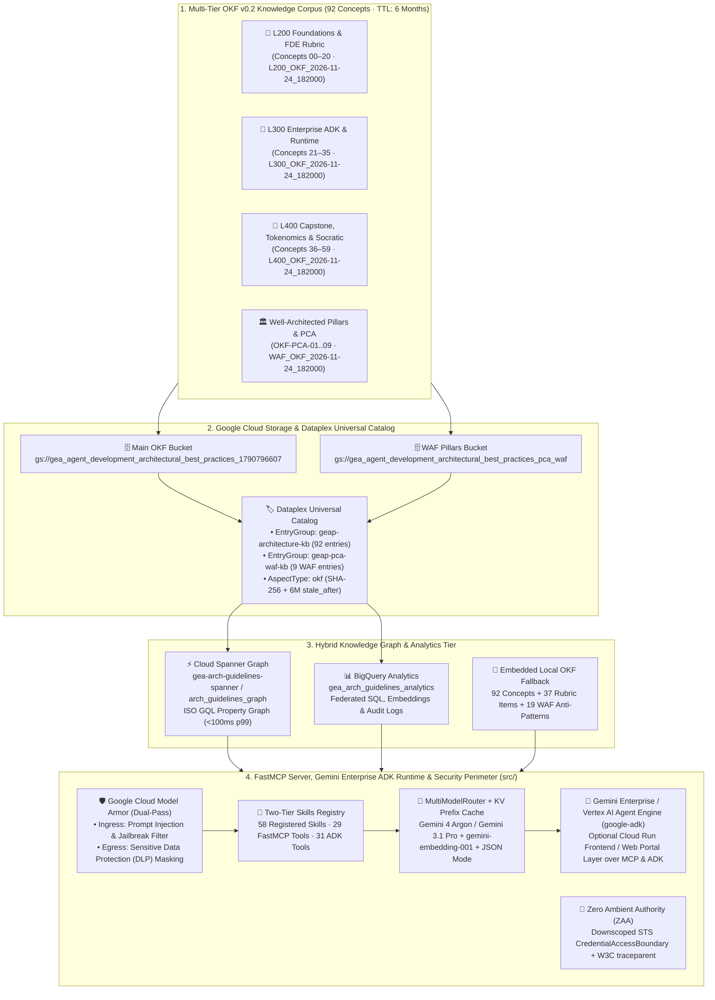

# Enterprise Agents Architectural Guidelines MCP Server — Complete Reference Documentation

* **Server Name:** `gea-arch-guidelines-mcp` (`arch-guidelines` / `gea-arch-guidelines`)
* **Version:** `0.2.0` (`GEA_UNIFIED_L200_L300_L400_WAF_2026-11-24_182000`)
* **OKF v0.2 Corpus Version Date:** `2026-11-24` (`2026-11-24T18:20:00-08:00`)
* **6-Month TTL Expiry (`stale_after`):** `2027-05-24` (`2027-05-24T18:20:00-08:00` / ISO-8601 `P6M`)
* **Total OKF Concepts Backed:** **92 Verified Concepts** (`21 L200` + `15 L300` + `47 L400` + `9 Well-Architected Pillar OKFs`)
* **Total Registered Skills:** **58 Skills** (`46 Python SkillPlugins` + `5 Canonical Core Skills` + `7 Workspace SKILL.md Skills`)
* **Total FastMCP Tools Exposed:** **29 Tools** (plus **31 First-Class ADK Agent Tools** on Gemini Enterprise / Vertex AI Agent Engine)

---

## 1. End-to-End System Architecture

The **Enterprise Agents Architectural Guidelines MCP Server** is a production-grade [FastMCP](https://github.com/jlowin/fastmcp) server that provides AI agents (Google Antigravity CLI/IDE, Gemini Enterprise, Vertex AI Reasoning Engine) and human architects with deterministic, graph-backed architectural guidance, Google Cloud FDE Rubric governance, and Well-Architected Framework (WAF) verification.

---

## 2. Backing Cloud Storage, Dataplex & Hybrid Graph Infrastructure

| Infrastructure Layer | Resource Identifier | Purpose |
| :--- | :--- | :--- |
| **GCP Project** | `fivedaysai-prd-sandbox-317383` (Project Number `301802433103`) | Sandbox hosting project (portable to Argolis via `data/`) |
| **Main OKF GCS Bucket** | `gs://gea_agent_development_architectural_best_practices_1790796607` | Stores `/okf/` unified corpus and `/tiers/{L200,L300,L400,WAF_Pillars}/` |
| **WAF Pillars GCS Bucket** | `gs://gea_agent_development_architectural_best_practices_pca_waf` | Stores `/WAF_OKF_2026-11-24_182000/okf/` and `/okf/` with Uniform Bucket-Level Access & PAP |
| **Dataplex Entry Groups** | `projects/fivedaysai-prd-sandbox-317383/locations/us/entryGroups/geap-architecture-kb` `projects/fivedaysai-prd-sandbox-317383/locations/us/entryGroups/geap-pca-waf-kb` | Houses all 101 catalog entries (`92` in unified KB + `9` in dedicated WAF KB) with `okf` aspects |
| **Cloud Spanner Graph** | Instance: `gea-arch-guidelines-spanner` Database: `arch_guidelines_graph` Graph: `ArchGuidelinesGraph` | Operational ISO GQL property graph (`Guidelines`, `Patterns`, `Antipatterns`, `FDERubricItems`, `Tradeoffs`) |
| **BigQuery Dataset** | `fivedaysai-prd-sandbox-317383.gea_arch_guidelines_analytics` | Analytical deep-dive tables (`guidelines`, `patterns`, `antipatterns`, `fde_rubric_items`, `mcp_query_audit_logs`) |
| **Local Gitignored Staging** | `/Users/prdmohan/ge_spark_workspace/projects/architecture_best_practices_mcp/data/` | Full offline/portable copy of `L200/`, `L300/`, `L400/`, `WAF_Pillars/`, `unified_okf/`, and `dataplex_catalog_entries/` for Argolis migration |

---

## 3. Complete Inventory of All 29 Exposed FastMCP Tools

### 3.1 Health & Observability (`src/tools/health.py`)
| # | Tool Name | Signature | Description |
|---:|:---|:---|:---|
| 1 | `health_check` | `health_check()` | Returns server health status, version, project ID, and Spanner/BigQuery connectivity posture. |

### 3.2 Guideline & Pattern Graph Retrieval (`src/tools/guidelines.py`, `src/tools/patterns.py`)
| # | Tool Name | Signature | Description |
|---:|:---|:---|:---|
| 2 | `get_best_practice` | `get_best_practice(topic: str)` | Operational `<100ms` ISO GQL lookup against Cloud Spanner Graph for guidelines and patterns matching `topic`. |
| 3 | `deep_dive_guideline` | `deep_dive_guideline(component: str)` | Analytical BigQuery SQL join retrieving patterns, antipattern hazards, and remedies for `component`. |
| 4 | `search_guidelines` | `search_guidelines(query: str, category: str \| None = None, limit: int = 5)` | Keyword and category search across all 92 OKF guidelines. |
| 5 | `get_guideline_details` | `get_guideline_details(guideline_id: str)` | Full executive summary and source provenance for a specific guideline ID (e.g., `DOC-01`, `OKF-PCA-01`). |
| 6 | `query_architectural_pattern` | `query_architectural_pattern(pattern_name: str)` | Retrieves a design pattern and traverses `MITIGATES` edges to list mitigated antipatterns. |
| 7 | `evaluate_design_tradeoffs` | `evaluate_design_tradeoffs(option_a: str, option_b: str)` | Compares two architectural options across latency, complexity, security posture, and SLA recommendation. |

### 3.3 FDE Field-Readiness Charter & Governance (`src/tools/fde_governance.py`)
| # | Tool Name | Signature | Description |
|---:|:---|:---|:---|
| 8 | `query_fde_charter_best_practices` | `query_fde_charter_best_practices(domain: str \| None = None, rubric_id: str \| None = None)` | Retrieves official Google Cloud FDE Field-Readiness Rubric competencies across all 34 canonical sub-competencies. |
| 9 | `audit_project_against_fde_rubric` | `audit_project_against_fde_rubric(project_manifest_or_description: str, target_domains: list[str] \| None = None)` | Grades a project against the FDE Rubric (`0.0–3.0`), enforces the `>= 2.0` production cutline, and flags `0.0` disqualifiers. |
| 10 | `search_fde_charter_best_practices` | `search_fde_charter_best_practices(keyword: str, limit: int = 10)` | Traverses `ENFORCES_RUBRIC` edges in Spanner Graph to find OKF guidelines enforcing a rubric keyword. |

### 3.4 Two-Tier Progressive Disclosure Skills Registry (`src/tools/skills.py`)
| # | Tool Name | Signature | Description |
|---:|:---|:---|:---|
| 11 | `list_registered_skills` | `list_registered_skills(category: str \| None = None)` | **Tier 1 Progressive Disclosure:** Returns lightweight (~30 tokens/skill) catalog of all 58 registered skills. |
| 12 | `get_skill_manifest` | `get_skill_manifest(skill_id: str)` | **Tier 2 Progressive Disclosure:** Hydrates full parameter schema, sandbox tier, and instructions for a specific `skill_id`. |
| 13 | `invoke_skill` | `invoke_skill(skill_id: str, parameters: dict[str, Any])` | Dynamically executes any of the 58 registered skills with Model Armor ingress sanitization and egress DLP masking. |
| 14 | `record_session_feedback` | `record_session_feedback(session_id: str, skill_id: str, rating: float, ...)` | Records online quality ratings (`0.0–5.0`) and rubric scores to OpenTelemetry and Cloud Monitoring. |

### 3.5 Autonomous OKF Knowledge Evolution (`src/tools/evolution.py`)
| # | Tool Name | Signature | Description |
|---:|:---|:---|:---|
| 15 | `check_okf_freshness` | `check_okf_freshness(threshold_days: int = 30)` | Audits all OKF concepts for `stale_after` TTL expiration and calculates the corpus freshness index percentage. |
| 16 | `search_recent_architectural_updates` | `search_recent_architectural_updates(topic: str, max_results: int = 5)` | Discovers recent Google Cloud architectural updates, API releases, and security standards. |
| 17 | `propose_concept_evolution` | `propose_concept_evolution(concept_id: str, update_summary: str, new_architectural_findings: list[str])` | Drafts an AST-preserving markdown evolution of an OKF concept, bumping `stale_after` (+180 days) and recalculating `content_sha256`. |
| 18 | `commit_and_sync_okf_bundle` | `commit_and_sync_okf_bundle(concept_id: str, evolved_markdown: str, approved_by: str)` | Writes an approved concept update after egress DLP sanitization and prepares GCS/Dataplex synchronization. |

### 3.6 Engineering Specification Generation & Modernization (`src/tools/specs.py`)
| # | Tool Name | Signature | Description |
|---:|:---|:---|:---|
| 19 | `generate_arbitrary_spec` | `generate_arbitrary_spec(domain_or_topic: str, tech_stack_or_framework: str = "cloud-native", requirements: str = "", complexity_level: str = "principal_staff_exhaustive")` | Synthesizes a production-grade engineering specification with ADRs, Mermaid diagrams, schemas, and acceptance tests. |
| 20 | `update_spec_best_practices` | `update_spec_best_practices(existing_spec_content: str, standards_to_apply: list[str] \| None = None, strictness_level: str = "production_cutline_enforced")` | Audits an existing technical spec and upgrades it with ZAA, Dual-Pass Model Armor, Spanner Graph ISO GQL, and KV Prefix Caching. |
| 21 | `generate_spec_collection` | `generate_spec_collection(project_name: str, codebase_summary_or_path: str, spec_modules: list[str] \| None = None, enforce_fde_cutline: bool = True)` | Synthesizes a 6-part modular specification collection from an existing codebase or manifest. |
| 22 | `alexandria_search` | `alexandria_search(query: str, domain: str = "all", top_k: int = 5)` | Queries verified Google Cloud Alexandria architectural blueprints grounded in the Cloud FDE Charter. |

### 3.7 Well-Architected Framework (WAF) & PCA OKF Verification (`src/tools/specs.py`)
| # | Tool Name | Signature | Description |
|---:|:---|:---|:---|
| 23 | `search_waf_okf_best_practices` | `search_waf_okf_best_practices(query: str, pillar: str = "all", service_area: str = "all", include_antipatterns: bool = True)` | Searches the Dataplex `GEAP_WAF_PILLARS` OKF Knowledge Base (`OKF-PCA-01`..`09`) for 5-second decision matrices and anti-patterns. |
| 24 | `verify_spec_waf_pillar` | `verify_spec_waf_pillar(architecture_spec: str, pillar: str, search_query: str = "")` | Verifies a project design spec against a single WAF pillar (`operational_excellence`, `security`, `reliability`, `cost_optimization`, `performance_optimization`, `sustainability`). |
| 25 | `verify_spec_all_waf_pillars` | `verify_spec_all_waf_pillars(architecture_spec: str, workload_type: str = "enterprise_cloud_system", target_pillars: list[str] \| None = None)` | Verifies a project design spec across **all 6 WAF pillars simultaneously** and scans all 18 forensic PCA/WAF anti-patterns. |
| 26 | `audit_waf_pillars` | `audit_waf_pillars(architecture_description: str, target_pillars: list[str] \| None = None)` | Executes a full 6-pillar Well-Architected critique with HRIs, MRIs, and remediation roadmaps. |
| 27 | `audit_complete_system` | `audit_complete_system(project_name: str, full_system_spec_or_code_manifest: str)` | Executes a 360-degree certification audit combining WAF, all 34 FDE Rubric competencies, and Model Armor security checks. |

### 3.8 Terraform HCL Well-Architected Drift & Version Comparison (`src/tools/specs.py`)
| # | Tool Name | Signature | Description |
|---:|:---|:---|:---|
| 28 | `verify_terraform_waf_compliance` | `verify_terraform_waf_compliance(terraform_hcl: str, workload_context: str = "production_enterprise_workload", target_pillars: list[str] \| None = None)` | Scans an existing/current Terraform `.tf` script for WAF departures across all 6 pillars and produces a critique with remediated HCL. |
| 29 | `compare_terraform_versions_waf` | `compare_terraform_versions_waf(past_terraform_hcl: str, present_terraform_hcl: str, change_context: str = "Terraform infrastructure evolution review")` | Compares a **past** Terraform version against a **present** Terraform version across all 6 WAF pillars, detecting regressions, resolved violations, persistent gaps, and resource diffs. |

---

## 4. Security, Zero Ambient Authority (`ZAA`) & Observability

1. **Dual-Pass Model Armor (`src/security/model_armor.py`):**
   * **Pass 1 (Ingress):** Every tool argument is screened against prompt injection, jailbreak patterns, SQL/GQL injection, and SSRF attempts before reaching Spanner, BigQuery, or the LLM router.
   * **Pass 2 (Egress DLP):** Every tool response is scrubbed via `sanitize_response()` and `sanitize_tool_output()` to redact any accidental GCP API keys (`AIzaSy...`), OAuth tokens, private keys, or PII; fails closed on error.
2. **Zero Ambient Authority (`src/mcp_adapter.py`):**
   * Supports caller-delegated downscoped STS `CredentialAccessBoundary` tokens (`mint_downscoped_sts_context`) and Principal Access Boundaries (`PAB`).
3. **OpenTelemetry & W3C `traceparent` (`src/otel_setup.py`):**
   * Every tool invocation emits an OpenTelemetry span (`tools/call:<tool_name>`) with latency, token metrics, and security attributes, propagating W3C `traceparent` headers end-to-end.
