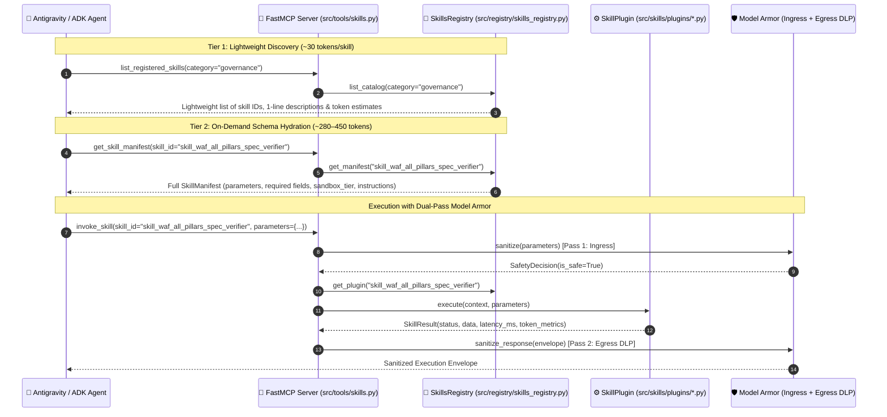

# Skills Registry & Two-Tier Progressive Disclosure Documentation

* **Registry Implementation:** [src/registry/skills_registry.py](../src/registry/skills_registry.py)
* **Dynamic Discovery Engine:** [src/skills/discovery.py](../src/skills/discovery.py)
* **Base Plugin Contract:** [src/skills/base.py](../src/skills/base.py)
* **Total Unique Skills Registered:** **58 Skills** (`46 Python SkillPlugins` + `5 Canonical Core Skills` + `7 Standalone Workspace SKILL.md Skills`)
* **Total Antigravity `.agents/skills/` Directories:** **46 Directories**

---

## 1. Two-Tier Progressive Disclosure Architecture

Stuffing dozens of full tool/skill schemas and multi-page instructions into an agent's initial system prompt causes context window bloat, high token costs, and attention dilution. To solve this, the Skills Registry implements **Two-Tier Progressive Disclosure** (enforced by `OKF Concept 07`, `OKF Concept 14`, and `OKF Concept 44`):



---

## 2. How Dynamic Skill Discovery Works

When `SkillsRegistry` initializes, `init_skills_registry()` in `src/skills/discovery.py` automatically scans two sources and normalizes hyphen/underscore aliases (`skill-foo` $\leftrightarrow$ `skill_foo`):

1. **Executable Python Plugins (`src/skills/plugins/*.py`):**
   * Dynamically imports every `.py` module in `src/skills/plugins/` and registers every subclass of `SkillPlugin`.
   * Each plugin defines a `@property def manifest(self) -> SkillManifest` and an `async def execute(self, context: SkillExecutionContext, parameters: dict[str, Any]) -> SkillResult`.
2. **Antigravity Workspace Skills (`.agents/skills/*/SKILL.md`):**
   * Parses YAML frontmatter (`name`, `description`) and markdown body from every `.agents/skills/<skill-folder>/SKILL.md` file.
   * If a Python `SkillPlugin` with the same normalized ID (`skill_<name>`) is already registered, the executable Python plugin takes precedence; otherwise, a `workspace_skill` manifest is added so all `.agents/skills/` are discoverable via `list_registered_skills`.
3. **Canonical Core Skills (`CANONICAL_SKILLS` in `src/registry/skills_registry.py`):**
   * 5 foundational skills (`skill-arch-eval`, `skill-fde-governance`, `skill-security-auditor`, `skill-okf-evolution`, `skill-nl2kg-triplification`) that dispatch directly to core Spanner Graph, BigQuery, and OKF Evolution entrypoints.

---

## 3. Complete Catalog of All 58 Registered Skills

### 3.1 Architecture & Specification Synthesis (`9 Skills`)
| # | Skill ID | Type | Sandbox Tier | Source File | Description |
|---:|:---|:---|:---|:---|:---|
| 1 | `skill-arch-eval` | Canonical Core | `read_only` | `src/registry/skills_registry.py` | Evaluates agent system designs against Google Cloud architectural best practices and Spanner Graph GQL patterns. |
| 2 | `skill_arbitrary_spec_generator` | Python Plugin | `read_only` | `src/skills/plugins/arbitrary_spec_generator.py` | Generates end-to-end production specifications for any arbitrary domain, framework, or technology stack. |
| 3 | `skill_codebase_to_spec_collection` | Python Plugin | `read_only` | `src/skills/plugins/codebase_to_spec_collection.py` | Inspects an existing codebase or manifest and synthesizes a 6-part modular specification collection. |
| 4 | `skill_google_landing_metrics_critique` | Python Plugin | `read_only` | `src/skills/plugins/google_landing_metrics.py` | Audits architectures against Google Landing Metrics, Core Web Vitals (LCP/INP/CLS), Edge CDN hit ratios, and p99 latency envelopes. |
| 5 | `skill_spec_best_practices_updater` | Python Plugin | `read_only` | `src/skills/plugins/spec_best_practices_updater.py` | Audits existing technical specifications and upgrades them with ZAA, WAF, Model Armor Dual-Pass, and KV Prefix Caching. |
| 6 | `skill_spec_generator` | Python Plugin | `read_only` | `src/skills/plugins/spec_generator.py` | Generates production-grade technical specifications (RFCs, ADRs, sequence diagrams, acceptance criteria). |
| 7 | `skill_system_design` | Python Plugin | `read_only` | `src/skills/plugins/system_design.py` | Synthesizes end-to-end enterprise architectures adhering to ZAA, tiered storage, and multi-agent topologies. |
| 8 | `skill_waf_okf_search` | Python Plugin | `read_only` | `src/skills/plugins/waf_okf_pillars.py` | Searches the Dataplex PCA & Well-Architected OKF v0.2 Knowledge Base (`OKF-PCA-01`..`09`) by pillar, service area, or keyword. |
| 9 | `skill_spec_critique` | Python Plugin | `read_only` | `src/skills/plugins/spec_critique.py` | Category: `advisory`. Rigorously critiques technical specifications using Socratic grilling, flagging SPOFs and anti-patterns. |

### 3.2 Governance, FDE Rubric & Well-Architected Framework Verification (`12 Skills`)
| # | Skill ID | Type | Sandbox Tier | Source File | Description |
|---:|:---|:---|:---|:---|:---|
| 10 | `skill-fde-governance` | Canonical Core | `read_only` | `src/registry/skills_registry.py` | Audits project architectures against the Google Cloud FDE Rubric, enforcing the `>= 2.0` production cutline. |
| 11 | `skill_rubric_level_critique` | Python Plugin | `read_only` | `src/skills/plugins/fde_rubric_critique.py` | Evaluates architectures against specific FDE Rubric sub-competencies (`RUBRIC-A-1`..`RUBRIC-B-7`) and detects `0.0` disqualifiers. |
| 12 | `skill_complete_system_audit` | Python Plugin | `read_only` | `src/skills/plugins/fde_rubric_critique.py` | Executes an exhaustive 360-degree audit across WAF, FDE sub-competencies, and Model Armor security perimeters. |
| 13 | `skill_waf_critique` | Python Plugin | `read_only` | `src/skills/plugins/waf_critique.py` | Audits workloads across all 6 GCP Well-Architected Framework pillars grounded in `OKF-PCA-01`..`09`. |
| 14 | `skill_waf_pillar_critique` | Python Plugin | `read_only` | `src/skills/plugins/waf_critique.py` | Deep-dive critique focused on a single user-specified GCP Well-Architected pillar. |
| 15 | `skill_waf_all_pillars_spec_verifier` | Python Plugin | `read_only` | `src/skills/plugins/waf_okf_pillars.py` | Verifies any project design spec across **all 6 WAF pillars simultaneously** and runs the 18-rule PCA/WAF anti-pattern scanner. |
| 16 | `skill_waf_pillar_operational_excellence` | Python Plugin | `read_only` | `src/skills/plugins/waf_okf_pillars.py` | Verifies specs against the **Operational Excellence** pillar (`OKF-PCA-06`, `OKF-PCA-07`, `OKF-PCA-09`). |
| 17 | `skill_waf_pillar_security` | Python Plugin | `read_only` | `src/skills/plugins/waf_okf_pillars.py` | Verifies specs against the **Security, Privacy & Compliance** pillar (`OKF-PCA-04`, `OKF-PCA-05`, `OKF-PCA-02`, `OKF-PCA-03`, `OKF-PCA-09`). |
| 18 | `skill_waf_pillar_reliability` | Python Plugin | `read_only` | `src/skills/plugins/waf_okf_pillars.py` | Verifies specs against the **Reliability & DR** pillar (`OKF-PCA-01`, `OKF-PCA-03`, `OKF-PCA-06`, `OKF-PCA-08`, `OKF-PCA-09`). |
| 19 | `skill_waf_pillar_cost_optimization` | Python Plugin | `read_only` | `src/skills/plugins/waf_okf_pillars.py` | Verifies specs against the **Cost Optimization (FinOps)** pillar (`OKF-PCA-01`, `OKF-PCA-02`, `OKF-PCA-04`, `OKF-PCA-06`, `OKF-PCA-07`, `OKF-PCA-09`). |
| 20 | `skill_waf_pillar_performance_optimization` | Python Plugin | `read_only` | `src/skills/plugins/waf_okf_pillars.py` | Verifies specs against the **Performance Optimization** pillar (`OKF-PCA-01`, `OKF-PCA-02`, `OKF-PCA-03`, `OKF-PCA-09`). |
| 21 | `skill_waf_pillar_sustainability` | Python Plugin | `read_only` | `src/skills/plugins/waf_okf_pillars.py` | Verifies specs against the **Sustainability & Carbon Efficiency** pillar (`OKF-PCA-01`, `OKF-PCA-02`, `OKF-PCA-04`, `OKF-PCA-09`). |

### 3.3 DevOps & Terraform Well-Architected Verification (`3 Skills`)
| # | Skill ID | Type | Sandbox Tier | Source File | Description |
|---:|:---|:---|:---|:---|:---|
| 22 | `skill_terraform_infra` | Python Plugin | `infra_deploy` | `src/skills/plugins/terraform_infra.py` | Generates, audits, and hardens Terraform HCL for Spanner, Vertex AI, BigQuery, and IAM enforcing least-privilege standards. |
| 23 | `skill_terraform_waf_verifier` | Python Plugin | `read_only` | `src/skills/plugins/terraform_infra.py` | Verifies an existing/current Terraform `.tf` script for WAF departures across all 6 pillars and produces a critique with remediated HCL. |
| 24 | `skill_terraform_version_comparator` | Python Plugin | `read_only` | `src/skills/plugins/terraform_infra.py` | Compares a **past** Terraform script against a **present** Terraform script across all 6 WAF pillars, detecting regressions, resolved violations, and resource diffs. |

### 3.4 Knowledge Management, Workflow, Graph Data & Security (`7 Skills`)
| # | Skill ID | Category | Type | Source File | Description |
|---:|:---|:---|:---|:---|:---|
| 25 | `skill-okf-evolution` | `knowledge_management` | Canonical Core | `src/registry/skills_registry.py` | Audits concept staleness, discovers recent GCP updates, and drafts backward-compatible OKF evolutions. |
| 26 | `skill_alexandria_search` | `knowledge_management` | Python Plugin | `src/skills/plugins/alexandria_search.py` | Searches Google Cloud Alexandria architectural reference blueprints grounded in the Cloud FDE Charter. |
| 27 | `skill_discovery_and_catalog` | `knowledge_management` | Python Plugin | `src/skills/plugins/discovery_and_catalog.py` | Queries the dynamic skills catalog, recommends optimal skill chains for complex workflows, and estimates token overhead. |
| 28 | `skill_okf_evolution_agent` | `knowledge_management` | Python Plugin | `src/skills/plugins/okf_evolution_agent.py` | Autonomous monthly OKF corpus freshness auditor and grounded concept evolution synthesizer. |
| 29 | `skill-nl2kg-triplification` | `graph_data` | Canonical Core | `src/registry/skills_registry.py` | Extracts semantic entities and relationships from markdown documents to populate Cloud Spanner Graph and BigQuery. |
| 30 | `skill-security-auditor` | `security` | Canonical Core | `src/registry/skills_registry.py` | Audits Zero Ambient Authority (ZAA), Model Armor dual-pass sanitization, and Principal Access Boundaries (PAB). |
| 31 | `skill_spec_creation_workflow` | `workflow` | Python Plugin | `src/skills/plugins/spec_creation_workflow.py` | Orchestrates the 5-stage specification lifecycle (`RFC -> ADR Review -> Implementation Draft -> Threat Model -> Sign-Off`). |

### 3.5 Standalone Workspace `SKILL.md` Skills (`7 Skills`)
| # | Skill ID | Category | Antigravity Skill Path | Description |
|---:|:---|:---|:---|:---|
| 32 | `skill_enterprise_system_design` | `workspace_skill` | `.agents/skills/enterprise-system-design/SKILL.md` | Synthesizes end-to-end enterprise architectures adhering to ZAA, tiered storage, and Model Armor. |
| 33 | `skill_eval_harness` | `workspace_skill` | `.agents/skills/eval-harness/SKILL.md` | Runs evaluation benchmarks and validates retrieval accuracy, latency, and reasoning quality. |
| 34 | `skill_fastmcp_tool_dev` | `workspace_skill` | `.agents/skills/fastmcp-tool-dev/SKILL.md` | Develops, tests, and validates FastMCP tools, prompts, and resources (`stdio` and `sse`). |
| 35 | `skill_fde_governance_auditor` | `workspace_skill` | `.agents/skills/fde-governance-auditor/SKILL.md` | Audits agent projects against the Google Cloud FDE 26-subcompetency rubric. |
| 36 | `skill_google_landing_metrics` | `workspace_skill` | `.agents/skills/google-landing-metrics/SKILL.md` | Audits architectures against Google Landing Metrics, Core Web Vitals, and Edge CDN SLAs. |
| 37 | `skill_nl2kg_triplification` | `workspace_skill` | `.agents/skills/nl2kg-triplification/SKILL.md` | Extracts entities and relationships from natural language docs into Spanner Graph triples. |
| 38 | `skill_okf_auto_evolution` | `workspace_skill` | `.agents/skills/okf-auto-evolution/SKILL.md` | Monitors, updates, and evolves the OKF v0.2 corpus on Vertex AI Reasoning Engine. |

### 3.6 Enterprise Engineering Rubric Suites (`20 Skills`)
| # | Skill ID | Category | Source File | Description |
|---:|:---|:---|:---|:---|
| 39 | `skill_ai_ml_rubric_assessment_feedback` | `governance` | `src/skills/plugins/ai_ml_rubric.py` | Assesses projects/specs against all 5 AI/ML Engineering Rubric domains. |
| 40 | `skill_ai_ml_rubric_assessment_feedback_resolution` | `workflow` | `src/skills/plugins/ai_ml_rubric.py` | Resolves AI/ML rubric feedback iteratively using library skills until PASS. |
| 41 | `skill_ai_ml_rubric_assessment_faq_doc_generator` | `knowledge_management` | `src/skills/plugins/ai_ml_rubric.py` | Generates AI/ML rubric FAQs and upserts them into `docs/FAQs.md`. |
| 42 | `skill_security_privacy_compliance_assessor_feedback` | `security` | `src/skills/plugins/security_privacy_compliance.py` | Assesses projects/specs against all 5 Security, Privacy & Compliance domains. |
| 43 | `skill_security_privacy_compliance_feedback_resolver` | `security` | `src/skills/plugins/security_privacy_compliance.py` | Resolves Security, Privacy & Compliance feedback iteratively until PASS. |
| 44 | `skill_security_privacy_compliance_faqs` | `security` | `src/skills/plugins/security_privacy_compliance.py` | Generates conversational Security, Privacy & Compliance FAQs in `docs/FAQs.md`. |
| 45 | `skill_reliability_resilience_assessor_feedback` | `governance` | `src/skills/plugins/reliability_resilience.py` | Assesses projects/specs/components against all 4 Reliability & Resilience domains. |
| 46 | `skill_reliability_resilience_feedback_resolver` | `workflow` | `src/skills/plugins/reliability_resilience.py` | Resolves Reliability & Resilience feedback iteratively until PASS. |
| 47 | `skill_reliability_resilience_faqs` | `knowledge_management` | `src/skills/plugins/reliability_resilience.py` | Generates Reliability & Resilience FAQs in `docs/FAQs.md`. |
| 48 | `skill_performance_cost_optimization_assessor_feedback` | `governance` | `src/skills/plugins/performance_cost_optimization.py` | Assesses projects/specs/components against all 3 Performance & Cost domains. |
| 49 | `skill_performance_cost_optimization_feedback_resolver` | `workflow` | `src/skills/plugins/performance_cost_optimization.py` | Resolves Performance & Cost feedback iteratively until PASS. |
| 50 | `skill_performance_cost_optimization_faqs` | `knowledge_management` | `src/skills/plugins/performance_cost_optimization.py` | Generates Performance & Cost Optimization FAQs in `docs/FAQs.md`. |
| 51 | `skill_operational_excellence_assessor_feedback` | `governance` | `src/skills/plugins/operational_excellence.py` | Assesses projects/specs/components against all 4 Operational Excellence domains. |
| 52 | `skill_operational_excellence_feedback_resolver` | `workflow` | `src/skills/plugins/operational_excellence.py` | Resolves Operational Excellence feedback iteratively until PASS. |
| 53 | `skill_operational_excellence_faqs` | `knowledge_management` | `src/skills/plugins/operational_excellence.py` | Generates Operational Excellence FAQs in `docs/FAQs.md`. |
| 54 | `skill_designing_for_change_assessor_feedback` | `architecture` | `src/skills/plugins/designing_for_change.py` | Assesses projects/specs/components against all 4 Designing for Change domains. |
| 55 | `skill_designing_for_change_feedback_resolver` | `workflow` | `src/skills/plugins/designing_for_change.py` | Resolves Designing for Change feedback iteratively until PASS. |
| 56 | `skill_designing_for_change_faqs` | `knowledge_management` | `src/skills/plugins/designing_for_change.py` | Generates Designing for Change FAQs in `docs/FAQs.md`. |
| 57 | `skill_scoping_documentation_assessor_feedback` | `governance` | `src/skills/plugins/scoping_and_documentation.py` | Assesses entire project documentation against all 7 Scoping & Documentation domains. |
| 58 | `skill_scoping_documentation_feedback_resolver` | `workflow` | `src/skills/plugins/scoping_and_documentation.py` | Resolves Scoping & Documentation feedback iteratively until PASS. |

---

## 4. How to Add a New Skill to the Registry

1. **Create a Python `SkillPlugin` class** in `src/skills/plugins/<your_plugin>.py` subclassing `SkillPlugin`:
   ```python
   from src.skills.base import SkillPlugin, SkillManifest, SkillParameter, SkillResult, SkillExecutionContext

   class MyCustomArchSkill(SkillPlugin):
       @property
       def manifest(self) -> SkillManifest:
           return SkillManifest(
               id="skill_my_custom_arch",
               name="My Custom Architecture Skill",
               version="1.0.0",
               category="architecture",
               description="One-line summary for Tier 1 progressive disclosure.",
               capabilities=["custom_capability"],
               entrypoint="execute",
               context_token_estimate=250,
               sandbox_tier="read_only",
               parameters=[
                   SkillParameter(name="target_spec", type="string", description="Spec to analyze"),
               ],
               instructions="Detailed instructions returned during Tier 2 hydration.",
           )

       async def execute(self, context: SkillExecutionContext, parameters: dict) -> SkillResult:
           return SkillResult(status="success", skill_id=self.manifest.id, latency_ms=1.2, data={"verified": True})
   ```
2. **Create a companion Antigravity `SKILL.md`** in `.agents/skills/my-custom-arch/SKILL.md` with YAML frontmatter (`name` and `description`).
3. `src/skills/discovery.py` will automatically discover and register both on server startup!
