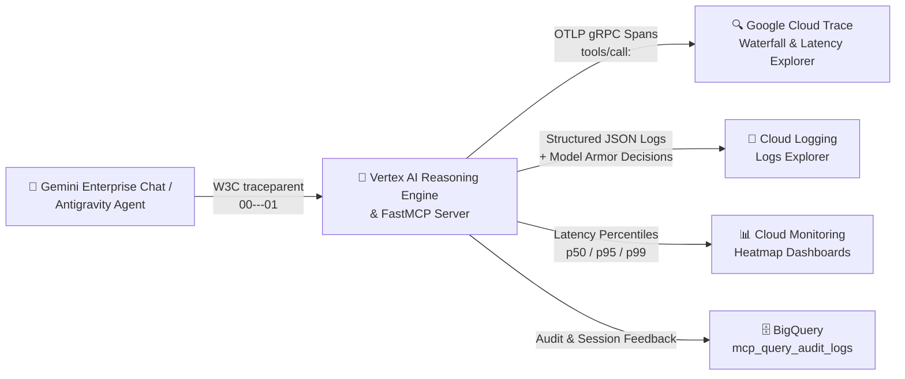

# End-to-End Testing & Verification Runbook: (1) Gemini Enterprise in Google Cloud & (2) Local Antigravity Skills

This runbook provides step-by-step instructions to:
1. **Deploy the entire stack from scratch** (`data/` $\rightarrow$ Cloud Storage $\rightarrow$ Dataplex $\rightarrow$ Spanner Graph & BigQuery $\rightarrow$ Vertex AI Reasoning Engines & MCP Server $\rightarrow$ Full Test & Evaluation Suite) when switching to a new GCP Project or Argolis Cloud Account.
2. **Test the Agent in Gemini Enterprise (Google Cloud Chatbot / Vertex AI Agent Engine)** and inspect **Experimental Traces, Trajectory Waterfalls, OpenTelemetry Spans, and BigQuery Audit Logs**.
3. **Install all Skills in Local Antigravity** and execute the **Single-Command All-38-Skills Runbook Test** as well as interactive Antigravity prompts.

---

## Part 0: From-Scratch Deployment to Any New GCP Project / Argolis Account

All **92 deduplicated OKF v0.2 concepts** (`21 L200`, `15 L300`, `47 L400`, and `9 Well-Architected Pillars`) are staged inside the local gitignored `data/` folder (`data/okf/`).

### 0.1 Prompt to Give Antigravity When Switching Project & Cloud Account
When you switch to your Argolis account or a new GCP project, paste this prompt directly into Antigravity:

> **Prompt for Antigravity:**
> *"Deploy the entire `architecture_best_practices_mcp` project from scratch into my new GCP project `<NEW_PROJECT_ID>` using cloud account `<NEW_ACCOUNT_EMAIL>` in region `us-central1`. Run `bash scripts/deploy_from_scratch.sh` to copy `data/` to Cloud Storage, propagate all 92 L200/L300/L400/WAF concepts to the Dataplex Knowledge Base, hydrate Cloud Spanner Graph and BigQuery, deploy the MCP server and Vertex AI Reasoning Engines, update my local Antigravity MCP config, and run all MCP and 38-skill runbook evaluation tests."*

### 0.2 Direct Shell Script Execution (`scripts/deploy_from_scratch.sh`)
```bash
cd /Users/prdmohan/ge_spark_workspace/projects/architecture_best_practices_mcp

# 1. Authenticate if switching to a new account (e.g. admin@prdmohan.altostrat.com)
gcloud auth login admin@prdmohan.altostrat.com
gcloud auth application-default login

# 2. Run a safe Dry-Run + Full 38-Skill Runbook Test Suite first
bash scripts/deploy_from_scratch.sh \
  --project-id <NEW_PROJECT_ID> \
  --account admin@prdmohan.altostrat.com \
  --region us-central1 \
  --dry-run

# 3. Execute Live Full-Stack Deployment from scratch
bash scripts/deploy_from_scratch.sh \
  --project-id <NEW_PROJECT_ID> \
  --account admin@prdmohan.altostrat.com \
  --region us-central1 \
  --update-env \
  --update-antigravity-config
```

---

## Part 1: Testing in Gemini Enterprise (Google Cloud Chatbot) & Viewing Experimental Traces

### Step 1.1: Verify or Publish the Agent to Gemini Enterprise & GCP Agent Registry
`scripts/deploy_from_scratch.py` automatically runs `scripts/publish_gemini_enterprise.sh`. To run or verify it standalone:

```bash
cd /Users/prdmohan/ge_spark_workspace/projects/architecture_best_practices_mcp
export GCP_PROJECT_ID="fivedaysai-prd-sandbox-317383"   # or your Argolis project ID
export GCP_REGION="us-central1"

# Publish Reasoning Engine & 29-tool / 38-skill ToolSpec to Agent Registry & Gemini Enterprise
bash scripts/publish_gemini_enterprise.sh

# List deployed Vertex AI Reasoning Engines
gcloud ai reasoning-engines list --project="${GCP_PROJECT_ID}" --region="${GCP_REGION}"
```

### Step 1.2: Test the Agent in Google Cloud Console (Gemini Enterprise / Vertex AI Agent Engine) & REST CLI

#### A. Via Google Cloud Console (Gemini Enterprise / Vertex AI Agent Builder UI)
1. Open the **Vertex AI Reasoning Engines / Agent Engine Console**:
   `https://console.cloud.google.com/vertex-ai/reasoning-engines?project=fivedaysai-prd-sandbox-317383`
   *(or open **Gemini Enterprise / Agentspace** at `https://console.cloud.google.com/gen-app-builder/engines?project=fivedaysai-prd-sandbox-317383`)*.
2. Select **`Enterprise Architecture Guidelines Agent`** (or **`Autonomous OKF Evolution Agent`**).
3. Enter the following **Test Prompts** in the Gemini Enterprise chat window:
   * **Test Prompt 1 (All-Pillars WAF Spec Verification):**
     > *"Verify our proposed payment platform specification against all 6 Google Cloud Well-Architected Framework pillars using `verify_spec_all_waf_pillars`: We use Cloud Spanner Multi-Region with Interleaved Tables, GKE Workload Identity, Secret Manager, Cloud KMS CMEK, VPC-SC with Access Context Manager Ingress, and Cloud Deploy canary rollouts."*
   * **Test Prompt 2 (Terraform WAF Drift & Past-vs-Present Comparison):**
     > *"Compare our past Terraform (`availability_type = REGIONAL`, `backend gcs`) with our present Terraform (`availability_type = ZONAL`, `backend local`, `google_service_account_key`) using `compare_terraform_versions_waf` and flag any WAF regressions."*
   * **Test Prompt 3 (FDE Charter & Rubric Audit):**
     > *"Audit our multi-agent system against the Google Cloud FDE Field-Readiness Rubric using `audit_project_against_fde_rubric`."*

#### B. Via Automated CLI Smoke Test (`scripts/test_reasoning_engine.py` & `scripts/test_gemini_enterprise_rest.sh`)
```bash
# Test both Reasoning Engines live via Python SDK
uv run python scripts/test_reasoning_engine.py

# Test live REST `:query` endpoint with Bearer token
bash scripts/test_gemini_enterprise_rest.sh
```

---

### Step 1.3: Inspect Experimental Traces, Trajectory Spans & Telemetry in Google Cloud

Every query to the MCP Server or Vertex AI Reasoning Engine emits **OpenTelemetry distributed traces** (with W3C `traceparent` propagation), **Cloud Logging structured audit events**, and **BigQuery trajectory logs**.



1. **View Distributed Experimental Traces in Google Cloud Trace Explorer:**
   * **Console URL:** `https://console.cloud.google.com/traces/list?project=fivedaysai-prd-sandbox-317383`
   * Filter by Span Name:
     * `tools/call:verify_spec_all_waf_pillars`
     * `tools/call:verify_terraform_waf_compliance`
     * `tools/call:compare_terraform_versions_waf`
     * `tools/call:search_waf_okf_best_practices`
     * `tools/call:invoke_skill`
     * `tools/call:get_best_practice`
   * Click any trace to inspect the **Latency Waterfall**, **Span Attributes** (`tool.name`, `skill_id`, `execution.latency_ms`, `security.blocked`, `caller_identity`, `traceparent`), and child Spanner Graph / BigQuery queries.
   * **CLI Trace Inspection:**
     ```bash
     gcloud logging read 'resource.type="aiplatform.googleapis.com/ReasoningEngine" OR jsonPayload.traceparent!=""' \
       --project="fivedaysai-prd-sandbox-317383" \
       --limit=10 \
       --format="table(timestamp, resource.labels.reasoning_engine_id, textPayload)"
     ```

2. **View Trajectory & Audit Logs in BigQuery (`mcp_query_audit_logs`):**
   ```bash
   bq query --project_id=fivedaysai-prd-sandbox-317383 --use_legacy_sql=false \
     'SELECT guid.guideline_id, guid.title, guid.category, guid.version_tag, guid.stale_after
      FROM `fivedaysai-prd-sandbox-317383.gea_arch_guidelines_analytics.guidelines` AS guid
      WHERE guid.category = "well_architected"
      ORDER BY guid.guideline_id
      LIMIT 10'
   ```

3. **View Spanner Graph Operational Queries & Latency:**
   ```bash
   gcloud spanner databases execute-sql arch_guidelines_graph \
     --instance=gea-arch-guidelines-spanner \
     --project=fivedaysai-prd-sandbox-317383 \
     --sql="SELECT guideline_id, category, version_tag, stale_after FROM Guidelines WHERE category IN ('well_architected', 'l200', 'l300', 'l400') ORDER BY guideline_id LIMIT 15"
   ```

---

## Part 2: Installing Skills in Local Antigravity & Invoking the All-Skills Runbook

### Step 2.1: Install the 26 `.agents/skills/` & MCP Config in Local Antigravity

1. **Install/Sync Skills Globally into Local Antigravity (`~/.gemini/skills/`):**
   ```bash
   mkdir -p ~/.gemini/skills
   cp -R /Users/prdmohan/ge_spark_workspace/projects/architecture_best_practices_mcp/.agents/skills/* ~/.gemini/skills/
   ls -la ~/.gemini/skills/
   ```
2. **Verify `~/.gemini/config/mcp_config.json` Points to Your Active Project:**
   ```bash
   cat ~/.gemini/config/mcp_config.json
   ```
   *(Or run `uv run python scripts/deploy_from_scratch.py --project-id <PROJECT_ID> --update-antigravity-config --dry-run` to update it automatically).*

---

### Step 2.2: Run the Automated Single-Command All-38-Skills Runbook Test

We have built a dedicated runbook test file ([tests/test_all_38_skills_runbook.py](../tests/test_all_38_skills_runbook.py)) that tests **Tier 1 discovery**, **Tier 2 manifest hydration**, **every single one of the 38 registered skills (`invoke_skill`)**, and **all 29 FastMCP tools** in one command:

```bash
cd /Users/prdmohan/ge_spark_workspace/projects/architecture_best_practices_mcp

# Run the single runbook test for all 38 skills + 29 MCP tools
uv run pytest tests/test_all_38_skills_runbook.py -v

# Run the entire MCP server & evaluation test suite
uv run pytest tests/test_all_38_skills_runbook.py \
              tests/test_pca_waf_okf_skills.py \
              tests/test_new_tools.py \
              tests/test_okf_fde_audit_remediations.py \
              tests/test_mcp_local.py \
              tests/test_model_armor.py \
              tests/test_model_router.py \
              tests/test_pipeline.py \
              tests/test_server.py -v
```

---

### Step 2.3: Invoke the Runbook Interactively Inside Antigravity

Once inside an Antigravity session, you can test any skill from [04_SKILLS_USAGE_RUNBOOK.md](04_SKILLS_USAGE_RUNBOOK.md) either by natural-language prompt or direct MCP tool invocation:

1. **Search the Dataplex Well-Architected OKF Knowledge Base (`skill_waf_okf_search`):**
   > *"Use `search_waf_okf_best_practices` on `arch-guidelines` to look up the 5-second decision matrix for Cloud Spanner vs Cloud SQL vs Bigtable under the `reliability` and `performance_optimization` pillars."*
2. **Verify a Design Spec Per Pillar & Across All 6 Pillars (`skill_waf_all_pillars_spec_verifier`):**
   > *"Use `verify_spec_all_waf_pillars` on `arch-guidelines` to verify our project design spec against all 6 Well-Architected pillars and check for any of the 18 PCA/WAF anti-patterns."*
3. **Verify & Critique Current Terraform HCL (`skill_terraform_waf_verifier`):**
   > *"Use `verify_terraform_waf_compliance` on `arch-guidelines` to audit `iac/main.tf` for any departures from the Google Cloud Well-Architected Framework."*
4. **Compare Past vs. Present Terraform Versions (`skill_terraform_version_comparator`):**
   > *"Use `compare_terraform_versions_waf` on `arch-guidelines` to compare our past Terraform script against our present Terraform script and report pillar score deltas and any newly introduced WAF regressions."*
