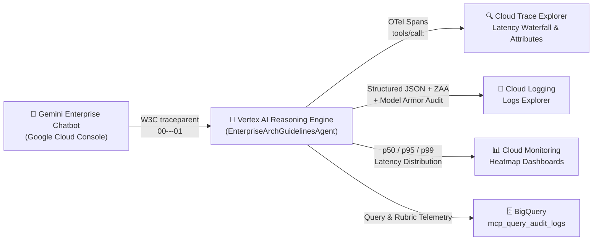

# Gemini Enterprise (Google Cloud Chatbot & Vertex AI Agent Engine) Testing & Experimental Traces Runbook

This runbook provides step-by-step instructions to publish, invoke, and test the **Enterprise Architecture Guidelines Agent** (`gea-arch-guidelines-agent`) inside **Gemini Enterprise (Google Cloud Console Chatbot / Vertex AI Agent Engine)** and inspect its **Experimental Traces, Trajectory Waterfalls, OpenTelemetry Spans, and BigQuery Audit Logs**.

---

## 1. Publish & Verify the Agent in Gemini Enterprise & GCP Agent Registry

The agent runs natively on **Vertex AI Reasoning Engine** (Zero Cloud Run) and exposes all **29 FastMCP Tools** and **38 Registered Skills** backed by the **92 OKF v0.2 concepts** (`L200`, `L300`, `L400`, and `WAF_Pillars`).

```bash
cd /Users/prdmohan/ge_spark_workspace/projects/architecture_best_practices_mcp
export GCP_PROJECT_ID="fivedaysai-prd-sandbox-317383"   # or your target Argolis project ID
export GCP_REGION="us-central1"

# 1. Verify deployed Vertex AI Reasoning Engines
gcloud ai reasoning-engines list \
  --project="${GCP_PROJECT_ID}" \
  --region="${GCP_REGION}"

# 2. Export the 29-tool / 38-skill ToolSpec and register/update in GCP Agent Registry & Gemini Enterprise
bash scripts/publish_gemini_enterprise.sh

# 3. Verify Agent Registry registration
gcloud agent-registry services describe gea-arch-guidelines-agent \
  --project="${GCP_PROJECT_ID}" \
  --location="${GCP_REGION}"
```

---

## 2. Testing the Chatbot in Google Cloud Console (Gemini Enterprise / Vertex AI UI)

### Step 2.1: Open Gemini Enterprise / Vertex AI Agent Engine in Google Cloud Console

> **Note on Google Cloud Console URLs:** While the underlying API resource is `reasoningEngines/<id>`, Google Cloud Console's web UI routes them under **Vertex AI Agent Engine** (`/vertex-ai/agents` and `/vertex-ai/agents/agent-engines`).

1. **Vertex AI Agent Engine (Reasoning Engines) Console:**
   * **Agent Overview:** `https://console.cloud.google.com/vertex-ai/agents?project=fivedaysai-prd-sandbox-317383`
   * **Agent Engines List:** `https://console.cloud.google.com/vertex-ai/agents/agent-engines?project=fivedaysai-prd-sandbox-317383`
   * **Live Deployed Reasoning Engine Resources (`us-central1`):**
     * **Enterprise Architecture Guidelines Agent:** `projects/301802433103/locations/us-central1/reasoningEngines/2766980659804110848`
     * **Autonomous OKF Evolution Agent:** `projects/301802433103/locations/us-central1/reasoningEngines/4506777490852675584`
2. **Gemini Enterprise / Agent Builder (Agentspace) Web App:**
   * `https://console.cloud.google.com/gen-app-builder/engines?project=fivedaysai-prd-sandbox-317383`
3. **Dataplex Universal Catalog (Knowledge Catalog) Search:**
   * `https://console.cloud.google.com/dataplex/search?project=fivedaysai-prd-sandbox-317383`
4. Select **`Enterprise Architecture Guidelines Agent`** (`2766980659804110848`) or **`Autonomous OKF Evolution Agent`** (`4506777490852675584`).

---

### Step 2.2: Execute End-to-End Chatbot Verification Prompts

Copy and paste the following test prompts into the Gemini Enterprise Chatbot UI to exercise each capability and generate rich experimental traces:

#### Test 1: Search the Dataplex Well-Architected & PCA OKF Knowledge Base (`OKF-PCA-01`–`09`)
> **Prompt:**
> *"Search our Dataplex Well-Architected OKF Knowledge Base (`search_waf_okf_best_practices`) for the 5-second decision matrix comparing Cloud Spanner Multi-Region, Cloud SQL High Availability, and Cloud Bigtable under the `reliability` and `performance_optimization` pillars."*
* **Expected Chatbot Behavior:**
  * Invokes `search_waf_okf_best_practices(query="Cloud Spanner Multi-Region Cloud SQL HA Bigtable", pillar="reliability")`.
  * Returns the `OKF-PCA-01` and `OKF-PCA-09` decision matrix (`99.999%` Multi-Region Spanner with Interleaved Tables & 15s Stale Reads vs. Cloud SQL Zonal HA synchronous standby + Read Replicas vs. Bigtable `HighCardID#ReverseTimestamp` composite row keys) and cites the Dataplex entry URI.

#### Test 2: Verify a Project Design Specification Across All 6 Well-Architected Pillars Simultaneously
> **Prompt:**
> *"Verify this project design specification across all 6 Google Cloud Well-Architected Framework pillars (`verify_spec_all_waf_pillars`): Our global order platform uses Terraform with GCS remote state locking, Cloud Deploy canary rollouts, Cloud Trace with W3C traceparent, GKE Workload Identity (Zero Ambient Authority), Secret Manager, Cloud KMS CMEK, Confidential GKE Nodes, VPC-SC with Access Context Manager Ingress Rules, Cloud Armor, Cloud Spanner Multi-Region (99.999% SLA, Interleaved Tables, 15s Stale Reads), Memorystore for Redis Standard Tier HA, GKE Autopilot, Spot VMs for batch workers, GCS Autoclass, BigQuery Partitioning/Clustering, Premium Network Tier + Cloud CDN, and CFE% carbon-free region constraints."*
* **Expected Chatbot Behavior:**
  * Invokes `verify_spec_all_waf_pillars` (`skill_waf_all_pillars_spec_verifier`).
  * Returns `verdict: WELL_ARCHITECTED_FOUNDATION_APPROVED`, a composite WAF score `>= 2.8 / 3.00`, per-pillar scores for all 6 pillars, and confirms `0` violations across all 18 forensic PCA/WAF anti-pattern rules.

#### Test 3: Verify & Critique an Existing Terraform Script for WAF Departures
> **Prompt:**
> *"Verify and critique this current Terraform script for departures from the Google Cloud Well-Architected Framework (`verify_terraform_waf_compliance`):*
> ```hcl
> terraform { backend "local" {} }
> resource "google_service_account_key" "app_key" { service_account_id = "app-sa" }
> resource "google_storage_bucket" "data" {
>   name = "raw-data"
>   location = "US"
>   public_access_prevention = "inherited"
>   uniform_bucket_level_access = false
>   force_destroy = true
> }
> resource "google_sql_database_instance" "db" {
>   name = "prod-db"
>   deletion_protection = false
>   settings { availability_type = "ZONAL" }
> }
> ```
> *"*
* **Expected Chatbot Behavior:**
  * Invokes `verify_terraform_waf_compliance` (`skill_terraform_waf_verifier`).
  * Flags `WAF_DEPARTURE_DETECTED` and pinpoints `TF-WAF-OPS-01` (`backend "local"`), `TF-WAF-SEC-02` (`google_service_account_key`), `TF-WAF-SEC-03` (`public_access_prevention = "inherited"`), `TF-WAF-REL-01` (`ZONAL` Cloud SQL + `deletion_protection = false`), and `TF-WAF-REL-03` (`force_destroy = true`), outputting a drop-in remediated HCL block.

#### Test 4: Compare Past vs. Present Terraform Versions (`compare_terraform_versions_waf`)
> **Prompt:**
> *"Compare our past Terraform version (`backend \"gcs\"`, `availability_type = \"REGIONAL\"`, `deletion_protection = true`) against our present Terraform version (`backend \"local\"`, `availability_type = \"ZONAL\"`, `google_service_account_key` added) using `compare_terraform_versions_waf` and report the pillar score deltas and newly introduced WAF regressions."*
* **Expected Chatbot Behavior:**
  * Invokes `compare_terraform_versions_waf` (`skill_terraform_version_comparator`).
  * Returns `evolution_verdict: WAF_REGRESSION_DETECTED`, negative score deltas on Security, Reliability, and Operational Excellence, and itemizes the newly introduced regressions and resource diffs.

#### Test 5: 360-Degree FDE Field-Readiness Rubric & Model Armor Security Audit
> **Prompt:**
> *"Run a complete 360-degree FDE Field-Readiness Rubric audit (`audit_project_against_fde_rubric` and `audit_complete_system`) on our multi-agent architecture and verify that Dual-Pass Model Armor egress DLP masks any leaked API keys."*
* **Expected Chatbot Behavior:**
  * Grades all 34 FDE Rubric sub-competencies (`Part A` + `Part B.1`–`B.7` + `Tokenomics/Socratic Addendum`), enforces the `>= 2.0` production cutline, and confirms zero `0.0` disqualifiers.

---

### Step 2.3: Automated CLI & REST Smoke Tests Against Live Vertex AI Reasoning Engines

You can also trigger live queries from your terminal to generate experimental traces in Google Cloud:

```bash
cd /Users/prdmohan/ge_spark_workspace/projects/architecture_best_practices_mcp

# 1. Query both live Reasoning Engines via Vertex AI Python SDK
uv run python scripts/test_reasoning_engine.py

# 2. Query the live Reasoning Engine REST `:query` endpoint via curl
bash scripts/test_gemini_enterprise_rest.sh
```

---

## 3. Inspecting Experimental Traces, Trajectory Spans & Audit Logs in Google Cloud

Every interaction with the Gemini Enterprise Agent or FastMCP Server emits **OpenTelemetry (`OTLP`) spans**, **W3C `traceparent` context headers**, **Model Armor safety decisions**, and **BigQuery audit records**.



### 3.1 View Experimental Traces & Waterfalls in Google Cloud Trace Explorer
1. Open **Cloud Trace Explorer** in the Google Cloud Console:
   `https://console.cloud.google.com/traces/list?project=fivedaysai-prd-sandbox-317383`
2. Filter by **Span Name** to inspect specific tool and skill executions:
   * `tools/call:verify_spec_all_waf_pillars`
   * `tools/call:verify_spec_waf_pillar`
   * `tools/call:search_waf_okf_best_practices`
   * `tools/call:verify_terraform_waf_compliance`
   * `tools/call:compare_terraform_versions_waf`
   * `tools/call:invoke_skill`
   * `tools/call:get_best_practice`
   * `tools/call:audit_project_against_fde_rubric`
3. Click any trace row to inspect its **Experimental Trace Attributes**:
   * `tool.name` / `skill_id`
   * `execution.latency_ms` (e.g., `<100ms` for Spanner Graph operational GQL queries)
   * `caller_identity` & `access_boundary_enforced` (`Zero Ambient Authority` downscoped STS token verification)
   * `traceparent` (`00-<32-hex-trace-id>-<16-hex-span-id>-01`)
   * `security.blocked` / `matched_filters` (Dual-Pass Model Armor screening status)

### 3.2 Query Reasoning Engine & Trace Logs via `gcloud logging`
```bash
# View recent Reasoning Engine execution logs and W3C traceparent IDs
gcloud logging read \
  'resource.type="aiplatform.googleapis.com/ReasoningEngine" OR jsonPayload.traceparent!=""' \
  --project="fivedaysai-prd-sandbox-317383" \
  --limit=15 \
  --format="table(timestamp, resource.labels.reasoning_engine_id, textPayload)"
```

### 3.3 Inspect Latency Distribution Heatmaps in Cloud Monitoring (`OKF-PCA-06`)
1. Open **Cloud Monitoring Metrics Explorer**:
   `https://console.cloud.google.com/monitoring/metrics-explorer?project=fivedaysai-prd-sandbox-317383`
2. Select chart type **Heatmap** (per `OKF-PCA-06` / Anti-Pattern #17) to visualize `p50`, `p95`, and `p99` tail latency distributions across Reasoning Engine and Spanner Graph requests.

### 3.4 Verify Knowledge Graph & Audit Tables in Cloud Spanner & BigQuery
```bash
# 1. Verify all 92 OKF concepts (L200, L300, L400, well_architected) in Cloud Spanner Graph
gcloud spanner databases execute-sql arch_guidelines_graph \
  --instance=gea-arch-guidelines-spanner \
  --project=fivedaysai-prd-sandbox-317383 \
  --sql="SELECT category, COUNT(*) AS concept_count, MIN(version_tag) AS version_tag, MIN(stale_after) AS expires_at FROM Guidelines GROUP BY category ORDER BY category"

# 2. Verify Well-Architected & PCA guidelines in BigQuery Analytics
bq query --project_id=fivedaysai-prd-sandbox-317383 --use_legacy_sql=false \
  'SELECT guideline_id, title, category, created_at
   FROM `fivedaysai-prd-sandbox-317383.gea_arch_guidelines_analytics.guidelines`
   WHERE category = "well_architected"
   ORDER BY guideline_id'
```
