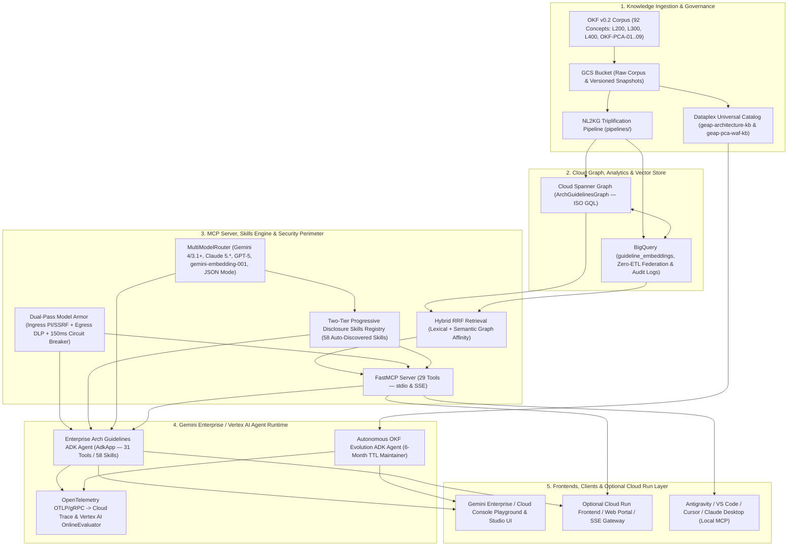

# Enterprise Agents Architectural Guidelines MCP Server — Architecture

## 1. Executive Summary

The **Enterprise Agents Architectural Guidelines MCP Server** (`gea-agents-arch-guidelines-mcp-server`) is a production-grade **Model Context Protocol (MCP)** server and **Gemini Enterprise / Vertex AI Agent Engine (`google-adk`)** platform providing AI agents and enterprise engineers with grounded, graph-backed architectural guidelines, Well-Architected Framework (WAF) verification, Terraform compliance auditing, and **7 full engineering rubric suites** (**58 dynamically discovered skills**, **29 FastMCP tools**, **31 ADK agent tools**).

The core MCP server and ADK agents are deployed natively on **Gemini Enterprise / Vertex AI Agent Engine** (`google-adk` / `AdkApp`), with an optional **Cloud Run frontend / web deployment layer** that can sit over the deployed Gemini Enterprise agent and MCP server for custom web UIs, portals, or SSE/REST gateways.

---

## 2. High-Level System Architecture

---

## 3. Deployed Runtime Topology

| Layer | Technology / Resource | Purpose |
| :--- | :--- | :--- |
| **Gemini Enterprise Main Agent & MCP Runtime** | Vertex AI Agent Engine (`google-adk` / `AdkApp`) — `reasoningEngines/1740451315344998400` | Hosts the primary Enterprise Architecture Guidelines ADK Agent and MCP surface (**31 ADK tools**, **58 skills**, `gemini-4-carbon`, full Cloud Trace telemetry). |
| **Autonomous OKF Evolution Agent** | Vertex AI Agent Engine (`google-adk` / `AdkApp`) — `reasoningEngines/4759850982706249728` | Audits 6-month TTL freshness across the 92 OKF v0.2 concepts and proposes backward-compatible revisions grounded in the Cloud FDE Charter. |
| **Optional Cloud Run Frontend / Web Layer** | Google Cloud Run (over Gemini Enterprise / MCP) | Optional stateless web UI, developer portal, or SSE/REST proxy layered on top of the deployed Gemini Enterprise Agent Engine and FastMCP server for browser-based workflows. |
| **Local IDE MCP Integration** | FastMCP (`stdio` / `SSE`) + `.agents/skills/` | Direct local integration into Antigravity, VS Code, Cursor, and Claude Desktop with all 58 skills and 29 MCP tools. |
| **Continuous Online Evaluation** | Vertex AI `OnlineEvaluator` — `onlineEvaluators/7362365043960184832` | Continuously scores `100%` of live production Cloud Trace spans using `final_response_quality_v1`. |

---

## 4. Key Components

1. **Knowledge & Retrieval Layer (`pipelines/`, `src/graph/`)**:
   - **NL2KG Triplification Pipeline (`pipelines/nl2kg_pipeline.py`)**: Extracts typed Pydantic ontology nodes (`Guideline`, `Pattern`, `Antipattern`, `Tradeoff`, `FDERubricItem`) and directed edges into **Cloud Spanner Graph** and **BigQuery**.
   - **Hybrid RRF Retrieval (`src/graph/client.py`)**: Combines ISO GQL graph traversals, BigQuery Zero-ETL federated SQL (`use_data_boost = true`), and Reciprocal Rank Fusion (`hybrid_search_guidelines`) with embedded offline fallback.
2. **FastMCP Server & Two-Tier Progressive Disclosure Skills Registry (`src/server.py`, `src/registry/`, `src/skills/`)**:
   - **29 FastMCP Tools** and **58 Auto-Discovered Skills** (`src/skills/plugins/*.py` + `.agents/skills/*/SKILL.md`) spanning Architecture, WAF 6-Pillar Verification, Terraform Compliance/Drift, FDE Governance, and **7 Complete Engineering Rubrics** (AI/ML Engineering, Security/Privacy/Compliance, Reliability & Resilience, Performance & Cost Optimization, Operational Excellence, Designing for Change, and Scoping & Documentation).
   - **Two-Tier Progressive Disclosure** saves `>80%` prompt tokens per turn (`list_registered_skills` -> `get_skill_manifest` -> `invoke_skill`).
3. **Security, Guardrails & Multi-Model Routing (`src/security/`, `src/models/`)**:
   - **Dual-Pass Model Armor (`src/security/model_armor.py`)**: Ingress prompt-injection/SSRF blocking + fail-closed egress PII/secret DLP redaction with a `150ms` timeout and rolling circuit breaker (`failure_threshold=3`, `cooldown_seconds=60.0`).
   - **MultiModelRouter (`src/models/router.py`)**: Multi-family routing across Gemini 4/3.1+, Claude 5.*, and GPT-5/o3 plus encoder-only `gemini-embedding-001`, Zero Legacy enforcement, KV prefix caching, and `generate_structured()` JSON Schema validation.
4. **Infrastructure as Code (`iac/`)**:
   - Modular Terraform (`iac/modules/spanner`, `bq`, `federation`, `gcs`, `gemini_enterprise`) with GCS remote state locking (`iac/backend.tf`).
5. **Observability & Evaluation Harness (`src/otel_setup.py`, `tests/`, `scripts/`)**:
   - OpenTelemetry OTLP/gRPC tracing to Cloud Trace, Vertex AI `OnlineEvaluator`, `95` automated local eval/trajectory/runbook tests (`tests/evals/`), deterministic IR/NLG metrics (Hit Rate@k, Precision@k, Recall@k, F1, MRR, ROUGE-L), and an independent 58-skill trajectory record (`docs/validation/all_58_skills_trajectory_record.json`).
