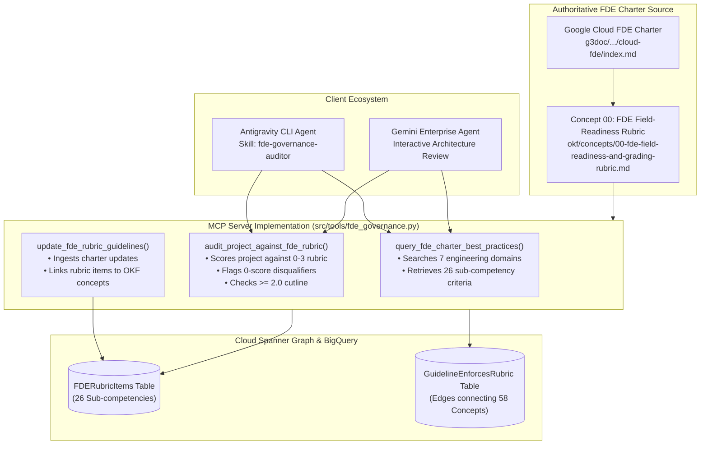

# Spec (e): FDE Charter Best Practices Search & Governance Skill (`fde-charter-governance-skill-spec.md`)

**Status:** ACTIVE (Target Specification)  
**Target Repository:** [`https://github.com/prdmohangoogley/gea-agents-arch-guidelines-mcp-server`](https://github.com/prdmohangoogley/gea-agents-arch-guidelines-mcp-server)  
**Canonical Repo Path:** `docs/specs/fde-charter-governance-skill-spec.md` (mirrored at `specs/fde-charter-governance-skill-spec.md`)  
**Target GCP Project:** `fivedaysai-prd-sandbox-317383` (`301802433103`)  
**Governing Authority:** Google Cloud FDE Charter ([`https://g3doc.corp.google.com/company/teams/cloud-fde/index.md?cl=head`](https://g3doc.corp.google.com/company/teams/cloud-fde/index.md?cl=head)) · [`concepts/00-fde-field-readiness-and-grading-rubric.md`](../../okf/concepts/00-fde-field-readiness-and-grading-rubric.md)  
**New FastMCP Tools:** `query_fde_charter_best_practices`, `audit_project_against_fde_rubric`, `update_fde_rubric_guidelines`  
**New Antigravity Skill:** `.agents/skills/fde-governance-auditor/SKILL.md`

---

## 1. Executive Summary & Objective

This specification formalizes the integration of the **Google Cloud Forward Deployed Engineering (FDE) Charter** ([`https://g3doc.corp.google.com/company/teams/cloud-fde/index.md?cl=head`](https://g3doc.corp.google.com/company/teams/cloud-fde/index.md?cl=head)) and its **Field-Readiness & Project Grading Rubric** into the MCP server as first-class, MCP-invokable tools and an accompanying Antigravity skill.

### Core Objectives:
1. **MCP-Invokable FDE Charter Tools:** Expose FastMCP tools allowing any connected AI agent (in Gemini Enterprise or Antigravity) to query FDE engineering standards, audit architectures against the 26 sub-competencies, and ingest charter updates.
2. **Automated Rubric Auditor Tool:** Implement `audit_project_against_fde_rubric` which computes a quantitative 0–3 scorecard, validates the `>= 2.0` production pass bar, detects critical `0-score` disqualifiers, and outputs remediation plans.
3. **FDE Governance Skill (`fde-governance-auditor`):** Register a reusable skill in the Skills Registry enabling agents to perform autonomous pre-flight readiness reviews of customer implementations.

---

## 2. Architectural Framework & Tool Topology



---

## 3. New FastMCP Tool Specifications (`src/tools/fde_governance.py`)

### 3.1 `query_fde_charter_best_practices`

```python
@mcp.tool()
async def query_fde_charter_best_practices(
    domain: str | None = None,
    competency: str | None = None,
) -> dict[str, Any]:
    """Retrieve official Google Cloud FDE Charter engineering standards and rubric criteria.

    Args:
        domain: FDE domain ('Part A: Advisory Rigor', 'Part B.1: Architecture', 'Part B.2: Quality', 'Part B.3: Security', 'Part B.4: Observability', 'Part B.5: Operational Readiness', 'Part B.6: Code Standards', 'Part B.7: Documentation').
        competency: Specific sub-competency keyword (e.g., 'Zero Ambient Authority', 'Model Armor', 'Progressive Disclosure').

    Returns:
        Structured envelope containing rubric criteria (Levels 0, 1, 2, 3), disqualifier rules, and customer exemplars.
    """
```

### 3.2 `audit_project_against_fde_rubric`

```python
@mcp.tool()
async def audit_project_against_fde_rubric(
    project_manifest_or_description: str,
    target_domains: list[str] | None = None,
) -> dict[str, Any]:
    """Evaluate an architecture or codebase against the Google Cloud FDE Field-Readiness Rubric.

    Args:
        project_manifest_or_description: Detailed markdown summary of architecture, components, security, and tests.
        target_domains: Optional list of domains to restrict audit to (defaults to all 7 domains).

    Returns:
        Scorecard containing per-competency ratings (0.0 - 3.0), composite score, pass/fail status (cutline >= 2.0),
        disqualifiers detected, and prioritized remediation actions.
    """
```

### 3.3 `update_fde_rubric_guidelines`

```python
@mcp.tool()
async def update_fde_rubric_guidelines(
    rubric_id: str,
    domain: str,
    sub_competency: str,
    criteria_level_2: str,
    criteria_level_3: str,
    disqualifier_condition: str,
    enforcing_concept_ids: list[str],
) -> dict[str, Any]:
    """Ingest an update to the FDE Rubric and bind it to enforcing OKF architectural concepts.

    Args:
        rubric_id: Unique rubric identifier (e.g., 'RUBRIC-B-3-4').
        domain: Engineering domain.
        sub_competency: Title of sub-competency.
        criteria_level_2: Production bar criteria.
        criteria_level_3: Exemplar bar criteria.
        disqualifier_condition: Defect that triggers immediate failure.
        enforcing_concept_ids: Concepts that fulfill this requirement (e.g. ['02', '34']).

    Returns:
        Mutation result in Cloud Spanner Graph and BigQuery.
    """
```

---

## 4. Antigravity Skill Definition (`.agents/skills/fde-governance-auditor/SKILL.md`)

```markdown
---
name: fde-governance-auditor
description: >-
  Audits agent projects, MCP servers, and multi-agent systems against the Google Cloud FDE
  Field-Readiness & Project Grading Rubric (https://g3doc.corp.google.com/company/teams/cloud-fde/index.md?cl=head).
  Evaluates architectures against the 26 sub-competencies, enforces the >= 2.0 cutline, detects 0-score
  disqualifiers, and produces prioritized remediation roadmaps.
---

# FDE Governance Auditor Skill

This skill guides Antigravity agents in evaluating and grading customer AI agent projects against the Google Cloud FDE Charter.

## Pre-Flight Evaluation Protocol

1. **Query FDE Standards**:
   Retrieve the rubric requirements for the target domain:
   ```bash
   call_mcp_tool(ServerName="arch-guidelines", ToolName="query_fde_charter_best_practices", Arguments={"domain": "Part B.3: Security & Identity"})
   ```

2. **Execute Full Project Audit**:
   Pass the project architecture summary or repository manifest to the auditor tool:
   ```bash
   call_mcp_tool(ServerName="arch-guidelines", ToolName="audit_project_against_fde_rubric", Arguments={"project_manifest_or_description": "<project summary>"})
   ```

3. **Verify Pass / Pause Cutlines**:
   - **Composite Score >= 2.0**: Ready for production deployment.
   - **Any 0-Score Sub-Competency**: **IMMEDIATE PAUSE**. Flag critical disqualifier (e.g., hardcoded API keys, unauthenticated endpoints, missing evals) and generate remediation tasks before proceeding.
```

---

## 5. Verification & Acceptance Criteria

| ID | Criteria | Validation Method | Target SLA |
|---|---|---|---|
| **AC-E.1** | Tool Self-Invocation | MCP server invokes `query_fde_charter_best_practices` locally | Returns 26 sub-competencies cleanly |
| **AC-E.2** | Disqualifier Detection | `audit_project_against_fde_rubric` flags intentional zero-score defects | 100% detection of unauthenticated endpoints & hardcoded keys |
| **AC-E.3** | Scorecard Output Rigor | Audit outputs full GFM table with 0–3 ratings and composite mean | Scorecard parses without formatting defects |
| **AC-E.4** | Dynamic Ingestion | `update_fde_rubric_guidelines` inserts node into Spanner Graph | `SELECT COUNT(*)` on `FDERubricItems` increments |
| **AC-E.5** | Antigravity Skill Registration | Skill recognized in `.agents/skills/fde-governance-auditor` | Discovered by AGY CLI and subagents |
