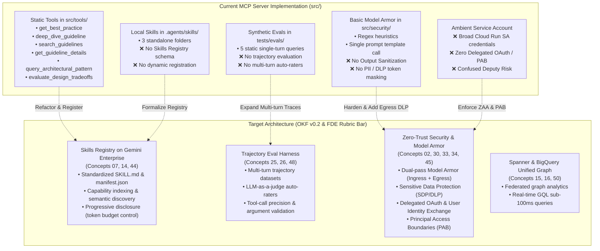

# Spec (b): MCP Server Best Practices & Skills Registry Audit (`mcp-server-best-practices-audit-spec.md`)

**Status:** ACTIVE (Target Specification)  
**Target Repository:** [`https://github.com/prdmohangoogley/gea-agents-arch-guidelines-mcp-server`](https://github.com/prdmohangoogley/gea-agents-arch-guidelines-mcp-server)  
**Canonical Repo Path:** `docs/specs/mcp-server-best-practices-audit-spec.md` (mirrored at `specs/mcp-server-best-practices-audit-spec.md`)  
**Target GCP Project:** `fivedaysai-prd-sandbox-317383` (`301802433103`)  
**Governing Standard:** [`concepts/00-fde-field-readiness-and-grading-rubric.md`](../../okf/concepts/00-fde-field-readiness-and-grading-rubric.md) · Google Cloud FDE Charter  
**Audit Scope:** Codebase (`src/`, `tests/`, `.agents/`, `iac/`) evaluated against OKF v0.2 Knowledge Base (58 Concepts)

---

## 1. Executive Summary & Audit Mandate

This specification establishes an exhaustive, rigorous architectural and operational audit of the `gea-agents-arch-guidelines-mcp-server` repository against the complete 58-concept OKF v0.2 architectural corpus and the **Google Cloud FDE Field-Readiness & Project Grading Rubric** (0–3 scoring scale across Advisory Rigor Part A and Engineering Excellence Part B).

### Core Audit Focus Areas:
1. **Skills & Skills Registry Architecture for Gemini Enterprise Multi-Agent Systems:** Evaluating the decoupling of tools vs. skills, progressive disclosure of tool metadata, dynamic discovery, and multi-agent coordination.
2. **Trajectory Evaluation Harness:** Auditing current eval coverage against actual agent skills and realistic multi-turn agent interaction traces.
3. **Missing Enterprise Security & Zero-Trust Architecture:** Auditing Model Armor guardrail depth, Workforce Identity Federation (WIF), Principal Access Boundaries (PAB), and Delegated OAuth user token propagation.

---

## 2. Current State Architecture vs. OKF Best Practice Target



---

## 3. Deep Dive Audit Area 1: Skills & Skills Registry for Multi-Agent Systems

### 3.1 Relevant OKF Architectural Concepts
- **Concept 07 (`07-skills-and-skill-registry.md`):** Foundations of agent skills, executable scripts, and context compartmentalization.
- **Concept 14 (`14-skills-registry-architecture.md`):** Enterprise Skills Registry lifecycle, capability indexing, and tool-skill binding.
- **Concept 44 (`44-agentic-skills-discovery-and-registry-federation.md`):** Dynamic skill federation across multi-agent fleets and Agent Gateway.
- **Concept 08/20 (`08-progressive-disclosure-for-agent-context-management.md`):** Hierarchical progressive disclosure preventing context window overflow.

### 3.2 Current Implementation Findings
- **Defect S-1 (Static Tool Tight-Coupling):** All 6 tools in `src/tools/` are statically loaded into the server process. If 100 tools/skills are added, the agent system prompt exceeds token limits on initialization.
- **Defect S-2 (Lack of Formal Skills Registry):** Skills only exist as loose markdown files in `.agents/skills/` without programmatic discovery, versioning, dependency tracking, or JSON-schema parameter validation.
- **Defect S-3 (Missing Dynamic Discovery Tool):** No MCP tool exists allowing a Gemini Enterprise agent to search, inspect, or invoke skills dynamically based on intent.

### 3.3 Required Architecture & Remediation
1. **Registry Manifest (`registry/skills_manifest.json`):**
   ```json
   {
     "$schema": "https://schemas.google.com/gemini-enterprise/skills/v1",
     "version": "1.0.0",
     "skills": [
       {
         "id": "skill-arch-eval",
         "name": "Architecture Guidelines Evaluator",
         "version": "1.2.0",
         "description": "Evaluates multi-agent topologies against Google Cloud FDE best practices.",
         "capabilities": ["architecture_audit", "fde_rubric_check"],
         "entrypoint": "src.tools.guidelines:get_best_practice",
         "context_token_estimate": 450,
         "sandbox_tier": "read_only"
       }
     ]
   }
   ```
2. **Two-Tier Progressive Disclosure:**
   - **Tier 1 (Catalog View):** Lightweight skill names, IDs, and 1-line capability summaries (~30 tokens each).
   - **Tier 2 (On-Demand Hydration):** Full parameter schema and instructions loaded only when an agent invokes `get_skill_definition(skill_id)`.

---

## 4. Deep Dive Audit Area 2: Trajectory Evaluation Harness

### 4.1 Relevant OKF Architectural Concepts
- **Concept 25 (`25-generative-and-agentic-evaluation.md`):** Multi-dimensional agent evaluation (FDE Quality Flywheel, trajectory correctness).
- **Concept 26 (`26-hill-climbing-and-trajectory-optimization.md`):** Systematic prompt & tool optimization using trajectory rollouts.
- **Concept 48 (`48-production-trajectory-benchmarking-and-auto-raters.md`):** Automated synthetic trajectory generation, auto-rater alignment, and regression gates.
- **FDE Rubric Part B.2.1–B.2.3:** Quality Flywheel, Grounded Evaluation Datasets, and Auto-Rater Calibration.

### 4.2 Current Implementation Findings
- **Defect E-1 (Toy Evaluation Dataset):** `tests/evals/golden_dataset.json` contains only 5 single-turn queries. None of the 38 new L300/L400 concepts or FDE rubric items are tested.
- **Defect E-2 (Zero Trajectory Evaluation):** Current test (`test_retrieval_quality.py`) only evaluates single-turn keyword retrieval hit rates. There is zero evaluation of:
  - Multi-turn conversational context retention.
  - Multi-step tool call chaining (e.g., `search_guidelines` followed by `get_guideline_details` and `evaluate_design_tradeoffs`).
  - Argument extraction precision and hallucination prevention.
- **Defect E-3 (Absence of Auto-Raters / LLM-as-a-Judge):** Responses are not evaluated for semantic completeness, correctness against ground truth, or adherence to the 0–3 FDE rubric cutline.

### 4.3 Required Architecture & Remediation
1. **Multi-Turn Trajectory Dataset Schema (`tests/evals/trajectory_dataset.json`):**
   ```json
   {
     "trajectory_id": "TRAJ-SEC-01",
     "title": "Mitigating Confused Deputy via Delegated OAuth",
     "skill_invoked": "skill-security-auditor",
     "conversation": [
       {
         "turn": 1,
         "user_message": "Our customer agent runs with a broad service account. How do we secure tool calls?",
         "expected_tool_calls": [
           {
             "tool_name": "query_architectural_pattern",
             "expected_arguments": {"pattern_name": "Zero Ambient Authority"}
           }
         ]
       },
       {
         "turn": 2,
         "user_message": "What specific Google Cloud IAM feature prevents token escalation?",
         "expected_tool_calls": [
           {
             "tool_name": "get_best_practice",
             "expected_arguments": {"topic": "Principal Access Boundaries"}
           }
         ],
         "ground_truth_criteria": [
           "Mentions Principal Access Boundaries (PAB)",
           "Recommends Delegated OAuth user token exchange",
           "Identifies Confused Deputy antipattern"
         ]
       }
     ]
   }
   ```
2. **LLM-as-a-Judge Auto-Rater (`tests/evals/test_trajectory_evaluator.py`):**
   - Automatically scores trajectories using Gemini 2.5 Pro judge against:
     - **Tool Selection Precision (TSP):** `TP / (TP + FP) >= 0.90`
     - **Argument Accuracy (AA):** `>= 0.95`
     - **FDE Answer Rigor Score:** `>= 2.0 / 3.0`

---

## 5. Deep Dive Audit Area 3: Security & Zero-Trust Best Practice Gap Analysis

### 5.1 Relevant OKF Architectural Concepts
- **Concept 02 (`02-zero-ambient-authority-and-secure-agentic-execution.md`):** Principle of Least Privilege, avoiding shared ambient credentials.
- **Concept 30 (`30-workforce-identity-federation-for-multi-agent-enterprise.md`):** WIF integration with enterprise IdPs (Okta, Azure AD, Ping).
- **Concept 33 (`33-google-cloud-model-armor-enterprise-guardrails.md`):** Dual-pass prompt sanitization, DLP masking, and zero-day jailbreak defense.
- **Concept 34 (`34-securing-agents-with-pab-and-delegated-oauth.md`):** Principal Access Boundaries and user-delegated OAuth token propagation.
- **Concept 45 (`45-zero-trust-identity-federation-and-service-mesh.md`):** Mutual TLS, Spiffe/Spire, and runtime network isolation.

### 5.2 Current Implementation Findings

| Security Domain | Current State in Codebase | OKF v0.2 Production Requirement | Severity / FDE Score |
|---|---|---|---|
| **Model Armor Ingress** | Basic heuristic regex + single REST template in `src/security/model_armor.py`. | Cloud Model Armor template with dual-pass Prompt Injection & Jailbreak (PI/JB) detection + automated quota fallback. | **Score: 1.5** (Partial) |
| **Model Armor Egress** | ❌ None. Tool output returned directly to caller without screening. | Egress sanitization filtering output for PII, secrets (API keys, credentials), and hallucinated system prompts. | **Score: 0.0** (Disqualifier) |
| **Sensitive Data Protection (SDP/DLP)** | ❌ None. Free-text queries passed without DLP de-identification. | Vertex AI / Cloud DLP inspection template masking SSNs, credit cards, emails before LLM processing. | **Score: 0.0** (Disqualifier) |
| **Ambient Authority (ZAA)** | Cloud Run service uses broad monolithic Service Account (`mcpuser` identity). | **Zero Ambient Authority:** Service account possesses zero data access; uses per-request Delegated OAuth tokens. | **Score: 1.0** (Major Gap) |
| **Identity Federation (WIF)** | ❌ No WIF provider configuration or STS exchange logic. | Workforce Identity Federation allowing external enterprise users to invoke MCP server without service account keys. | **Score: 0.0** (Gap) |
| **Principal Access Boundary (PAB)** | ❌ No PAB policies defined in Terraform or code. | PAB policies enforcing boundary conditions preventing credentials from accessing out-of-scope projects. | **Score: 0.0** (Gap) |
| **MCP Auth Middleware** | Cloud Run deployed with `allow_unauthenticated = false` (good), but FastMCP server has zero internal auth checks. | MCP transport-level JWT / OIDC validation verifying caller identity, claims, and tenant ID. | **Score: 1.0** (Needs Remediation) |

---

## 6. Comprehensive FDE Rubric Scorecard & Gap Matrix

Grounded in **`concepts/00-fde-field-readiness-and-grading-rubric.md`**:

| Competency Area | Sub-Competency | Baseline Score (0–3) | Target Score | Primary Gap / Remediation Needed | Priority |
|---|---|:---:|:---:|---|:---:|
| **Part A: Advisory Rigor** | A.1 Customer Context & Architectural Grounding | 2.5 | 3.0 | Knowledge base covers 58 concepts; needs automated concept freshness checking. | P2 |
| | A.2 Tradeoff Articulation | 2.0 | 3.0 | `evaluate_design_tradeoffs` tool returns static trade-offs; needs live Spanner Graph GQL queries. | P1 |
| **Part B.1: Architecture** | B.1.1 Zero Ambient Authority (ZAA) | 1.0 | 2.5 | Replace monolithic Service Account access with Delegated OAuth token exchange. | **P0** |
| | B.1.2 Progressive Disclosure | 1.5 | 2.5 | Implement two-tier tool metadata disclosure to protect LLM context windows. | **P0** |
| | B.1.3 Storage Tiering | 2.5 | 3.0 | Spanner (Operational) + BigQuery (Analytics) fully configured; add Vector Indexing. | P2 |
| **Part B.2: Quality & Evals** | B.2.1 Quality Flywheel & Datasets | 1.0 | 2.5 | Expand `golden_dataset.json` from 5 queries to 50+ multi-turn trajectory evals. | **P0** |
| | B.2.2 LLM-as-a-Judge Auto-Raters | 0.5 | 2.5 | Implement trajectory evaluator evaluating tool accuracy and response rigor. | **P0** |
| | B.2.3 CI/CD Regression Gates | 1.5 | 2.5 | Wire trajectory evals into GitHub Actions / Cloud Build PR blocking checks. | P1 |
| **Part B.3: Security & Identity** | B.3.1 Model Armor Ingress/Egress | 1.5 | 3.0 | Implement egress output sanitization and Cloud DLP token masking. | **P0** |
| | B.3.2 Workforce Identity Federation (WIF) | 0.0 | 2.0 | Add WIF Terraform module and credential exchange handler. | P1 |
| | B.3.3 Principal Access Boundaries (PAB) | 0.0 | 2.0 | Configure PAB constraints in IAM policy to prevent lateral movement. | P1 |
| **Part B.4: Observability** | B.4.1 OpenTelemetry Distributed Tracing | 2.5 | 3.0 | Tracing active on `get_best_practice`; propagate baggage across MCP transport. | P2 |
| | B.4.2 Audit Logging & Security Telemetry | 2.0 | 2.5 | Log all Model Armor blocked attempts to Cloud Security Command Center. | P1 |
| **Part B.5: Operational Readiness** | B.5.1 Health Checks & Readiness Probes | 2.5 | 3.0 | `/health` route implemented in FastMCP; add Spanner/BQ connection readiness check. | P2 |
| | B.5.2 Automated Deployment & IaC | 2.5 | 3.0 | Terraform modules complete; add automated smoke test script. | P1 |

---

## 7. Remediation Execution Plan

### Phase 1: P0 Immediate Blockers (Sprint 1)
1. **Skills Registry Manifest & Loader:** Implement `src/registry/` and `src/tools/registry_tools.py` with progressive disclosure.
2. **Trajectory Evaluation Harness:** Build `tests/evals/trajectory_dataset.json` with 25 multi-turn traces and `test_trajectory_evaluator.py`.
3. **Model Armor Egress & Output Guardrails:** Update `src/security/model_armor.py` with `sanitize_output()` preventing PII/credential egress.

### Phase 2: P1 Security & Identity Hardening (Sprint 2)
1. **Delegated OAuth Middleware:** Implement request context token extraction in FastMCP so tools execute under caller identity.
2. **PAB & WIF Terraform Provisioning:** Add `iac/modules/pab` and `iac/modules/wif` to restrict service account blast radius.
3. **Automated CI/CD Quality Gate:** Wire trajectory evaluation suite into GitHub Actions workflow.

### Phase 3: P2 Continuous Optimization (Sprint 3)
1. **Dynamic Skill Federation:** Connect local Skills Registry to Google Cloud Agent Gateway.
2. **Automated Concept Freshness Monitor:** Add background crawler tracking documentation drift.
