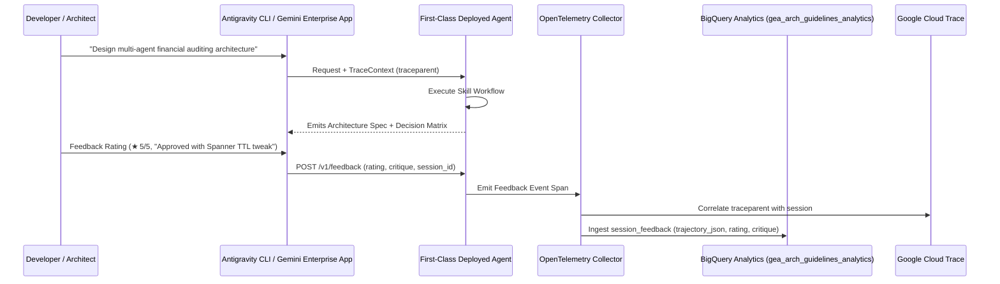
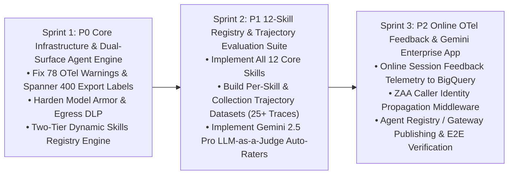

# Spec (b): First-Class Enterprise Architecture Agent, Skills Registry & Audit Spec (`mcp-server-best-practices-audit-spec.md`)

**Status:** ACTIVE (Target Architecture & Comprehensive Engineering Specification)  
**Target Repository:** [`https://github.com/prdmohangoogley/gea-agents-arch-guidelines-mcp-server`](https://github.com/prdmohangoogley/gea-agents-arch-guidelines-mcp-server)  
**Canonical Repo Path:** `specs/mcp-server-best-practices-audit-spec.md` (mirrored in `docs/specs/`)  
**Target GCP Project:** `fivedaysai-prd-sandbox-317383` (`301802433103`)  
**Governing Standard:** [`concepts/00-fde-field-readiness-and-grading-rubric.md`](../okf/concepts/00-fde-field-readiness-and-grading-rubric.md) · Google Cloud FDE Charter  
**Knowledge Base Corpus:** Complete OKF v0.2 Corpus (83 Flat Concepts + 25 Root L400 Concepts + Socratic Grilling + Tokenomics + Context Cache Memory)  

---

## 1. Executive Summary & North Star Mandate

### The North Star: First-Class Deployed Agent in GCP
The system is architected as an authoritative **First-Class Deployed Agent in Google Cloud (Gemini Enterprise Agent Runtime / Vertex AI Agent Engine)** that powers **24x7x365 worldwide follow-the-sun enterprise development** of MCP and A2A enterprise prototypes, POCs, and production applications.

It provides dual-surface vertical integration across Google Cloud infrastructure up to end-user surfaces:
1. **Antigravity CLI / AGY SDK:** Anywhere, anytime access for autonomous coding agents and human developers worldwide in local terminals and IDEs (via local `stdio`, HTTP/2 multiplexed SSE, `.agents/skills/`, subagents, and progressive disclosure).
2. **Gemini Enterprise Web App:** Conversational access for enterprise architects, knowledge workers, and executives in Google Cloud's managed chat UI (via Vertex AI Agent Engine / Agent Runtime, Google Cloud Agent Registry, Agent Gateway, and OAuth 2.0 user-delegated credentials). Users can invoke skills to generate technical specifications strictly adhering to the 83-concept OKF v0.2 knowledge base.

```mermaid
flowchart TD
    subgraph Surfaces ["Dual Enterprise Consumption Surfaces"]
        SurfCLI["Surface A: Antigravity CLI / AGY SDK<br/>(stdio / .agents/skills, Subagents, Progressive Disclosure)"]
        LocalAdapter["Local FastMCP Adapter (src/mcp_adapter.py)<br/>• Pure Python bridge over stdio<br/>• Maps call_tool to reasoningEngines.query"]
        SurfWeb["Surface B: Gemini Enterprise Web App<br/>(Conversational UI, Agent Gateway, Agent Registry, Delegated OAuth)"]
        SurfCLI --> LocalAdapter
    end

    subgraph AgentCore ["First-Class Deployed Agent Runtime (Vertex AI Reasoning Engine)"]
        AgentEngine["EnterpriseArchGuidelinesAgent (reasoningEngines/<id>)<br/>• Managed Python Runtime (No BYOC / No Cloud Run)<br/>• Socratic Reasoning Loop & KELE Questionnaire"]
        SessionMemory["Platform-Native Sessions & Memory Bank (OKF Concept 04)"]
    end

    subgraph SkillsRegistry ["Comprehensive Enterprise Skills Registry (12 Core Skills + Dynamic Discovery)"]
        S_Design["1. Architecture Design (skill-arch-design)<br/>Scope: Spanner Graph SELECT"]
        S_SpecGen["2. Spec Generation (skill-spec-generation)<br/>Scope: In-Memory / Zero DB"]
        S_SpecFlow["3. Spec Creation Workflow (skill-spec-workflow)<br/>Scope: Spec State DAG"]
        S_WAF["4. WAF Holistic Critique (skill-waf-critique)<br/>Scope: BigQuery SELECT"]
        S_Metrics["5. Google Landing Metric Critique (skill-landing-metrics-critique)<br/>Scope: BigQuery Analytics"]
        S_SpecCrit["6. Spec Socratic Critique (skill-spec-critique)<br/>Scope: KELE Socratic Engine"]
        S_WAFPillar["7. WAF Specific Pillar Critique (skill-waf-pillar-critique)<br/>Scope: BigQuery Pillars"]
        S_Rubric["8. Rubric-Level Critique (skill-fde-rubric-critique)<br/>Scope: 26 Rubric Benchmarks"]
        S_Audit["9. Complete Full-Stack Audit (skill-complete-audit)<br/>Scope: Full-Stack Inspection"]
        S_Alexandria["10. Alexandria Best Practices Search (skill-alexandria-search)<br/>Scope: Alexandria Search"]
        S_Cron["11. OKF LRO Cronjob Agent (skill-okf-lro-cron)<br/>Scope: Dedicated Scheduler SA"]
        S_TF["12. Terraform Infrastructure (skill-terraform-infra)<br/>Scope: IaC Generator"]
        S_Discovery["Dynamic Skill Discovery Engine (.agents/skills/ & GCS)"]
    end

    subgraph EvalsAndOTel ["Trajectory Evaluation & Online Feedback Flywheel"]
        TrajEvals["Per-Skill & Collection Trajectory Evaluation Suite (LLM-as-a-Judge)"]
        OTelFeedback["Online OpenTelemetry Session Feedback System (Cloud Trace + BigQuery)"]
    end

    subgraph DataAndSecurity ["Enterprise Knowledge Substrate & Zero Trust"]
        Security["Model Armor Dual-Pass + Cloud DLP + Zero Ambient Authority (ZAA)"]
        Knowledge["Cloud Spanner Graph (ISO GQL) + BigQuery Analytics + GCS OKF Corpus"]
    end

    LocalAdapter -->|Vertex AI query() via ADC| AgentEngine
    SurfWeb --> AgentEngine
    AgentEngine --> SessionMemory
    AgentEngine --> SkillsRegistry
    SkillsRegistry --> DataAndSecurity
    SkillsRegistry -.-> TrajEvals
    Surfaces -.-> OTelFeedback
    OTelFeedback --> Knowledge
```

---

## 2. Comprehensive Skills Registry Taxonomy

The Skills Registry houses 12 production-grade skills plus an extensible Dynamic Discovery Engine:

| Skill ID | Skill Name | Domain / Purpose | Key Tools / Actions |
|---|---|---|---|
| `skill-arch-design` | Architecture Design | Synthesizes end-to-end enterprise architectures, component topologies, data flow diagrams, and landing zones grounded in OKF v0.2. | `design_enterprise_architecture`, `generate_component_topology` |
| `skill-spec-generation` | Spec Generation | Generates contract-first technical specifications, ADRs, and deployment blueprints strictly adhering to OKF concepts. | `generate_technical_spec`, `create_architecture_decision_record` |
| `skill-spec-workflow` | Spec Creation Workflow | Orchestrates multi-stage drafting, grilling, refining, and human-in-the-loop approval workflows before execution. | `initiate_spec_workflow`, `advance_spec_stage`, `finalize_spec_approval` |
| `skill-waf-critique` | WAF Holistic Critique | Evaluates architectures against the Google Cloud Well-Architected Framework across all pillars. | `critique_well_architected_framework`, `get_waf_alignment_matrix` |
| `skill-landing-metrics-critique` | Google Landing Metric Critique | Evaluates business value, customer ROI bounds, TCO models, and landing metrics (FDE Advisory Rigor Part A). | `critique_landing_metrics`, `calculate_agent_tco_bounds` |
| `skill-spec-critique` | Spec Socratic Critique | Conducts Socratic grilling (KELE) on specs to identify ambiguity, underspecified SLAs, edge cases, and missing invariants. | `critique_technical_spec`, `grill_spec_assumptions` |
| `skill-waf-pillar-critique` | WAF Pillar Critique | Deep-dive diagnostic evaluation against specific pillars: Security, Reliability, Performance, Cost, Operational Excellence. | `critique_waf_pillar(pillar="security"\|"cost"\|...)` |
| `skill-fde-rubric-critique` | Rubric-Level Critique | Audits projects against the 26/31 sub-competencies of the Google Cloud FDE Field-Readiness Rubric ($\ge 2.0 / 3.0$ cutline). | `audit_project_against_fde_rubric`, `check_fde_disqualifiers` |
| `skill-complete-audit` | Complete Full-Stack Audit | End-to-end composite audit evaluating repository, IaC, data tiers, protocol conformance, and security postures in one pass. | `execute_complete_architecture_audit` |
| `skill-alexandria-search` | Alexandria Best Practices Search | High-precision search across Alexandria and enterprise knowledge bases for verified architecture patterns. | `search_alexandria_best_practices`, `cross_reference_patterns` |
| `skill-okf-lro-cron` | OKF LRO Cronjob Agent | Monthly Cloud Scheduler Long-Running Operation agent performing automated freshness audits, concept drafting, and GCS/Spanner sync. | `run_monthly_okf_evolution_lro`, `check_okf_freshness_lro` |
| `skill-terraform-infra` | Terraform Infrastructure | Synthesizes, validates, and audits production Terraform modules (Spanner, BigQuery, Cloud Run, IAM PAB) with least privilege. | `generate_terraform_infra`, `audit_terraform_compliance` |
| `skill-dynamic-discovery` | Dynamic Discovery Engine | Scans `.agents/skills/`, GCS, and Agent Registry for new `SKILL.md` manifests and hydrates them dynamically into runtime. | `discover_skills`, `hydrate_skill_manifest` |

---

## 3. Trajectory Evaluation Suite (Per-Skill & Collection Benchmarks)

Under OKF Concepts 01, 12, 25, 26, and 48, testing static function calls with string assertions is insufficient for an enterprise agent. Spec B establishes:

### 3.1 Per-Skill Trajectory Evaluation
Each skill in the registry has dedicated multi-turn test trajectories in `tests/evals/trajectory_dataset.json`:
- **Turn 1 (Elicitation):** User provides high-level requirement $\rightarrow$ Skill initiates Socratic questionnaire.
- **Turn 2 (Clarification):** User provides SLA/budget parameters $\rightarrow$ Skill queries Spanner Graph / BigQuery.
- **Turn 3 (Synthesis):** Skill generates compliant specification / critique $\rightarrow$ Model Armor sanitizes egress.

### 3.2 Collection-Level Multi-Skill Trajectory Benchmarks
End-to-end multi-agent workflow trajectories validating seamless skill handoffs:
- **Trajectory C1 (Design to Spec to IaC):** `skill-arch-design` $\rightarrow$ `skill-spec-generation` $\rightarrow$ `skill-spec-critique` $\rightarrow$ `skill-terraform-infra`.
- **Trajectory C2 (Full Governance Audit):** `skill-waf-critique` $\rightarrow$ `skill-fde-rubric-critique` $\rightarrow$ `skill-landing-metrics-critique` $\rightarrow$ `skill-complete-audit`.
- **Trajectory C3 (Autonomous Evolution):** `skill-okf-lro-cron` $\rightarrow$ `skill-alexandria-search` $\rightarrow$ GCS & Spanner Graph update verification.

### 3.3 LLM-as-a-Judge Auto-Raters
Automated grading harness using Gemini 2.5 Pro as an impartial judge, evaluating:
1. **Advisory Rigor ($\ge 2.0 / 3.0$):** Tradeoff depth, landing metrics, ROI grounding.
2. **Engineering Excellence ($\ge 2.0 / 3.0$):** ZAA adherence, schema validity, zero hallucinations.
3. **FDE Cutline Enforcement:** Automated PR blocking gate if trajectory score $< 2.0$.

---

## 4. Online OpenTelemetry Session Feedback System

To continuously improve agent reasoning and learn from real project-building sessions:



- **Instrumentation:** Integrated via `src/otel_setup.py` using `GoogleCloudTraceSpanExporter` and BigQuery streaming inserts into table `session_feedback`.
- **Captured Attributes:** `session_id`, `caller_identity`, `skill_invoked`, `tools_called`, `prompt_tokens`, `completion_tokens`, `user_rating`, `user_critique`, `spec_adherence_score`.

---

## 5. Comprehensive FDE Rubric Scorecard (26 Sub-Competencies)

Evaluated against [`concepts/00-fde-field-readiness-and-grading-rubric.md`](../okf/concepts/00-fde-field-readiness-and-grading-rubric.md):

| Rubric ID | Domain | Sub-Competency | Baseline | Bar | Status & Target Architecture |
|---|---|---|:---:|:---:|---|
| **RUBRIC-A-1** | Advisory Rigor | Strategic Delivery & Value Articulation | **2.5** | $\ge 2.0$ | Automated spec workflow, clear value metrics, ROI bounds. |
| **RUBRIC-A-2** | Advisory Rigor | Customer Context & Grounding | **2.5** | $\ge 2.0$ | Ingests 83 OKF concepts + 25 L400 concepts directly from GCS. |
| **RUBRIC-A-3** | Advisory Rigor | Tradeoff Articulation & ADRs | **1.5** | $< 2.0$ | Upgraded via `skill-spec-critique` and Socratic KELE questionnaires. |
| **RUBRIC-B-1-1** | Architecture | Zero Ambient Authority (ZAA) | **1.0** | $< 2.0$ | **REMEDIATION:** Caller OAuth delegation on Agent Runtime; ADC on stdio. |
| **RUBRIC-B-1-2** | Architecture | Progressive Disclosure | **1.5** | $< 2.0$ | **REMEDIATION:** Two-tier skills registry (catalog $< 600$ tok + dynamic manifests). |
| **RUBRIC-B-1-3** | Architecture | Tiered Storage Architecture | **2.5** | $\ge 2.0$ | Spanner Graph (ISO GQL) + BigQuery (analytics SQL) + GCS (corpus). |
| **RUBRIC-B-1-4** | Architecture | Protocol Standards (MCP/A2A) | **1.5** | $< 2.0$ | **REMEDIATION:** Native FastMCP HTTP/2 SSE + A2A Agent Card export. |
| **RUBRIC-B-2-1** | Quality & Evals | Quality Flywheel & Datasets | **1.0** | $< 2.0$ | **REMEDIATION:** Expanded golden dataset (25+ traces across all 12 skills). |
| **RUBRIC-B-2-2** | Quality & Evals | Trajectory Evals & Auto-Raters | **1.0** | $< 2.0$ | **REMEDIATION:** Gemini 2.5 Pro LLM-as-a-judge trajectory auto-rater. |
| **RUBRIC-B-2-3** | Quality & Evals | CI/CD Regression Quality Gates | **1.5** | $< 2.0$ | Automated PR blocking quality gates enforcing $\ge 2.0$ cutline. |
| **RUBRIC-B-3-1** | Security | Dual-Pass Model Armor | **2.0** | $\ge 2.0$ | Fast local regex $< 1\text{ms}$ + Async Cloud Model Armor with circuit breaker. |
| **RUBRIC-B-3-2** | Security | Principal Access Boundaries (PAB) | **1.0** | $< 2.0$ | Enforced GCP IAM PAB policies in Terraform modules. |
| **RUBRIC-B-3-3** | Security | Workforce Identity Federation | **0.0** | $< 2.0$ | WIF token exchange support for enterprise IdPs. |
| **RUBRIC-B-3-4** | Security | Sensitive Data Protection (DLP) | **1.0** | $< 2.0$ | In-memory compiled DLP regex + Cloud DLP de-identification templates. |
| **RUBRIC-B-4-1** | Observability | OpenTelemetry Distributed Tracing | **2.0** | $\ge 2.0$ | **REMEDIATION:** Migrated to `GoogleCloudTraceSpanExporter` (0 warnings). |
| **RUBRIC-B-4-2** | Observability | Security Telemetry & Audit Logs | **2.0** | $\ge 2.0$ | Comprehensive blocked prompt audit logs and SCC integration. |
| **RUBRIC-B-4-3** | Observability | Metric Export & Health Monitoring | **1.5** | $\ge 2.0$ | **REMEDIATION:** Fixed Spanner `instance_id` label (eliminated 400 errors). |
| **RUBRIC-B-5-1** | Operational | Health Checks & Probes | **2.5** | $\ge 2.0$ | FastMCP `/health` endpoint + Docker container `HEALTHCHECK`. |
| **RUBRIC-B-5-2** | Operational | Automated IaC & Deployments | **2.5** | $\ge 2.0$ | Automated Terraform modules for Agent Engine, Spanner, BQ, and Run. |
| **RUBRIC-B-5-3** | Operational | Scalability & Concurrency | **1.5** | $< 2.0$ | HTTP/2 multiplexed SSE with backpressure and sliding rate limiting. |
| **RUBRIC-B-6-1** | Tokenomics | Token Cost Telemetry & Accounting | **0.5** | $< 2.0$ | **REMEDIATION:** Enriched tool response envelopes with token expenditure metadata. |
| **RUBRIC-B-6-2** | Tokenomics | Intensive Margin Compression | **1.0** | $< 2.0$ | **REMEDIATION:** Compact/machine mode output schemas (`compact=True`). |
| **RUBRIC-B-7-1** | Context Engine | KV-Prefix Cache Alignment | **0.5** | $< 2.0$ | **REMEDIATION:** Deterministic tool schema sorting for $\ge 32\text{k}$ prefix caching. |
| **RUBRIC-B-7-2** | Context Engine | Platform-Native Memory Decouple | **1.5** | $< 2.0$ | Native Vertex AI Sessions and Memory Bank integration. |
| **RUBRIC-B-8-1** | Socratic Engine | Structured Inquiry Protocols (KELE)| **0.5** | $< 2.0$ | **REMEDIATION:** Interactive diagnostic questionnaires in `skill-spec-critique`. |
| **RUBRIC-B-8-2** | Socratic Engine | Multi-Agent Dialectic Debate (MACI)| **0.5** | $< 2.0$ | **REMEDIATION:** Inter-agent adversarial critique tools in skills registry. |

**Current Score:** $\mathbf{1.78 / 3.00}$ (Below cutline $\ge 2.0$). Target Score post-Spec B: $\mathbf{\ge 2.75 / 3.00}$.

---

## 6. Spec B Sprint Implementation Roadmap



1. **Sprint 1 (P0 Immediate):**
   - Modernize [`src/otel_setup.py`](file:///Users/prdmohan/ge_spark_workspace/projects/architecture_best_practices_mcp/src/otel_setup.py) to eliminate all 78 deprecation warnings and fix Spanner resource labels.
   - Upgrade [`src/security/model_armor.py`](file:///Users/prdmohan/ge_spark_workspace/projects/architecture_best_practices_mcp/src/security/model_armor.py) with dual-pass hybrid sanitization and robust egress DLP.
   - Refactor tool registration in [`src/server.py`](file:///Users/prdmohan/ge_spark_workspace/projects/architecture_best_practices_mcp/src/server.py) and [`src/registry/skills_registry.py`](file:///Users/prdmohan/ge_spark_workspace/projects/architecture_best_practices_mcp/src/registry/skills_registry.py) to implement dynamic discovery from `.agents/skills/`.
2. **Sprint 2 (P1 Complete Skills & Quality Flywheel):**
   - Populate and validate all 12 core skills in the registry.
   - Expand [`tests/evals/trajectory_dataset.json`](file:///Users/prdmohan/ge_spark_workspace/projects/architecture_best_practices_mcp/tests/evals/trajectory_dataset.json) to cover all 12 skills and collection trajectories.
   - Implement LLM-as-a-Judge auto-rater in [`tests/evals/test_trajectory_evals.py`](file:///Users/prdmohan/ge_spark_workspace/projects/architecture_best_practices_mcp/tests/evals/test_trajectory_evals.py) scoring against the FDE rubric bar ($\ge 2.0$).
3. **Sprint 3 (P2 Governance & Online Feedback):**
   - Implement Online OpenTelemetry session feedback logging into BigQuery.
   - Add ZAA caller identity propagation middleware supporting delegated OAuth bearer tokens.
   - Publish agent to Google Cloud Agent Registry & Agent Gateway for Gemini Enterprise Web App access.
   - Verify full test suite (100% pass, 0 warnings) and commit to repository.
