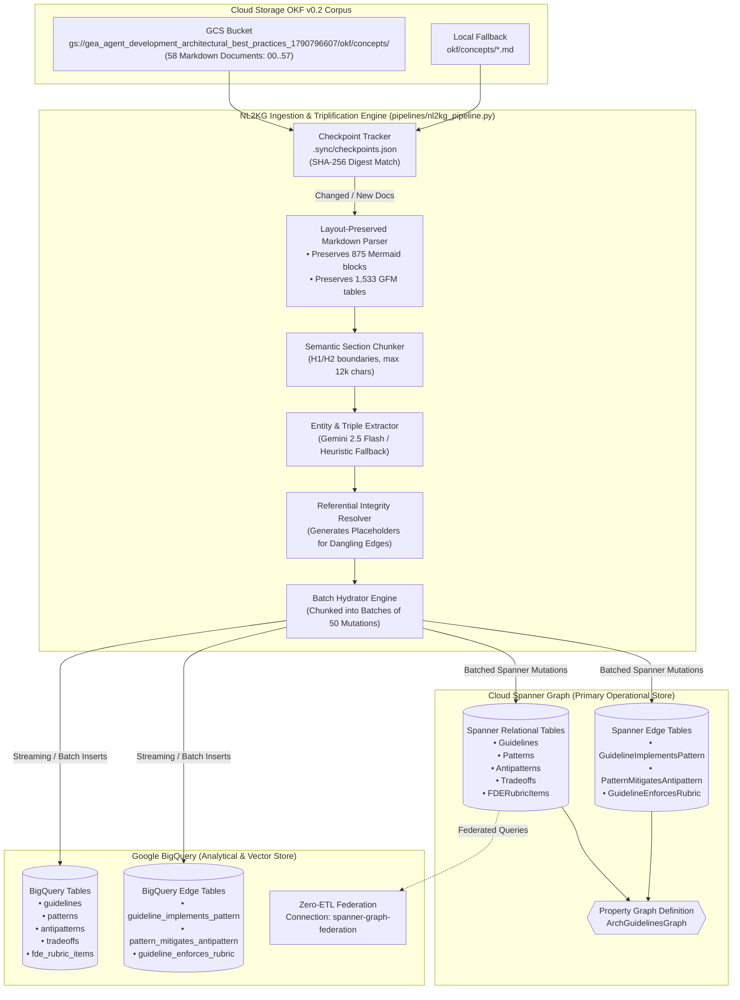

# Spec (a): OKF v0.2 Spanner Graph & BigQuery Graph Propagation (`spanner-bq-graph-sync-spec.md`)

**Status:** ACTIVE (Target Specification)  
**Target Repository:** [`https://github.com/prdmohangoogley/gea-agents-arch-guidelines-mcp-server`](https://github.com/prdmohangoogley/gea-agents-arch-guidelines-mcp-server)  
**Canonical Repo Path:** `docs/specs/spanner-bq-graph-sync-spec.md` (mirrored at `specs/spanner-bq-graph-sync-spec.md`)  
**Executable Pipeline:** `pipelines/nl2kg_pipeline.py` & `pipelines/main.py`  
**Target GCP Project:** `fivedaysai-prd-sandbox-317383` (`301802433103`)  
**Source Corpus:** `gs://gea_agent_development_architectural_best_practices_1790796607/okf/concepts/` (58 Concepts, `00`–`57`)  
**Target Cloud Spanner Graph:** Instance `gea-arch-guidelines-spanner` · Database `arch_guidelines_graph` · Graph `ArchGuidelinesGraph`  
**Target Google BigQuery:** Dataset `gea_arch_guidelines_analytics` (Federated Connection `spanner-graph-federation`)  
**Governing FDE Charter & Rubric:** [`concepts/00-fde-field-readiness-and-grading-rubric.md`](../../okf/concepts/00-fde-field-readiness-and-grading-rubric.md) · [`docs/specs/okf-gcs-update-spec.md`](okf-gcs-update-spec.md)

---

## 1. Executive Summary & Objective

Following the synchronization of the **58-concept OKF v0.2 bundle** to Google Cloud Storage (`gs://gea_agent_development_architectural_best_practices_1790796607/okf`) and Google Cloud Knowledge Catalog (Dataplex), this specification establishes the automated propagation and synchronization pipeline to project these concepts into the operational knowledge graph in **Cloud Spanner Graph** and the analytical vector store in **Google BigQuery**.

### Key Deliverables:
1. **Full Corpus Ingestion:** Ingest all 58 concepts (`00` FDE Grading Rubric, `01`–`20` L200, `21`–`35` L300, `36`–`57` L400) directly from GCS with local directory fallback.
2. **Enriched Graph Ontology:** Ingest standard entities (`Guideline`, `Pattern`, `Antipattern`, `Tradeoff`) plus first-class **`FDERubricItem`** nodes representing the 26 sub-competencies from Concept `00`.
3. **New Graph Edge Semantics:** Support edge relationships: `IMPLEMENTS`, `MITIGATES`, `RELATES_TO`, `TRADES_OFF`, `REQUIRES`, and **`ENFORCES_RUBRIC`**.
4. **Referential Integrity & Zero-Failure Guarantees:** Automatic placeholder generation to ensure zero foreign key constraint violations in Spanner and zero dangling edges.
5. **Incremental Checkpointing & Batch Hydration:** Deduplicated batch commits (50 items/batch) tracked by SHA-256 digests in `.sync/checkpoints.json`.

---

## 2. End-to-End Pipeline Architecture



---

## 3. Graph Ontology & Schema Definitions

### 3.1 Node Schema Definitions

| Node Label | Spanner / BQ Table | Primary Key | Key Attributes | Description |
|---|---|---|---|---|
| `Guideline` | `Guidelines` | `guideline_id STRING(64)` | `title`, `category`, `summary`, `source_url`, `content_sha256`, `version_tag`, `stale_after`, `created_at` | Architectural document or principle (58 concepts). |
| `Pattern` | `Patterns` | `pattern_id STRING(64)` | `name`, `category`, `description`, `created_at` | Concrete design pattern (e.g., ZAA, Memory Bank, Progressive Disclosure). |
| `Antipattern` | `Antipatterns` | `antipattern_id STRING(64)` | `name`, `hazard`, `remedy`, `created_at` | Security trap, anti-pattern, or design defect. |
| `Tradeoff` | `Tradeoffs` | `tradeoff_id STRING(64)` | `dimension`, `option_a`, `option_b`, `analysis`, `created_at` | Architectural trade-off analysis between alternatives. |
| `FDERubricItem` | `FDERubricItems` | `rubric_id STRING(64)` | `domain`, `sub_competency`, `criteria_level_2`, `criteria_level_3`, `disqualifier_condition`, `created_at` | Google Cloud FDE 0–3 grading rubric competency criteria. |

### 3.2 Edge Schema Definitions

| Edge Label | Spanner Table | Source Node | Destination Node | Attributes | Semantics |
|---|---|---|---|---|---|
| `IMPLEMENTS` | `GuidelineImplementsPattern` | `Guideline` | `Pattern` | `notes STRING(MAX)` | Guideline defines or specifies an architectural pattern. |
| `MITIGATES` | `PatternMitigatesAntipattern` | `Pattern` | `Antipattern` | `rationale STRING(MAX)` | Pattern neutralizes an antipattern or security hazard. |
| `ENFORCES_RUBRIC` | `GuidelineEnforcesRubric` | `Guideline` | `FDERubricItem` | `enforcement_level STRING(32)`, `notes STRING(MAX)` | Guideline fulfills specific FDE Rubric sub-competencies. |
| `REQUIRES` | `PatternRequiresPattern` | `Pattern` | `Pattern` | `dependency_type STRING(32)` | Structural dependency between patterns. |
| `TRADES_OFF` | `GuidelineTradesOff` | `Guideline` | `Tradeoff` | `context STRING(MAX)` | Guideline evaluates a specific architectural tradeoff. |

---

## 4. Database DDL & Property Graph Updates

### 4.1 Cloud Spanner DDL (`iac/modules/spanner/`)

```sql
-- Net-new Table: FDERubricItems (Grounded in Concept 00)
CREATE TABLE FDERubricItems (
    rubric_id STRING(64) NOT NULL,
    domain STRING(64) NOT NULL,
    sub_competency STRING(128) NOT NULL,
    criteria_level_2 STRING(MAX) NOT NULL,
    criteria_level_3 STRING(MAX),
    disqualifier_condition STRING(MAX),
    created_at TIMESTAMP NOT NULL OPTIONS (allow_commit_timestamp = true)
) PRIMARY KEY (rubric_id);

-- Net-new Edge Table: GuidelineEnforcesRubric
CREATE TABLE GuidelineEnforcesRubric (
    guideline_id STRING(64) NOT NULL,
    rubric_id STRING(64) NOT NULL,
    enforcement_level STRING(32) NOT NULL,
    notes STRING(MAX),
    CONSTRAINT FK_GuidelineEnforces_Guideline FOREIGN KEY (guideline_id) REFERENCES Guidelines (guideline_id),
    CONSTRAINT FK_GuidelineEnforces_Rubric FOREIGN KEY (rubric_id) REFERENCES FDERubricItems (rubric_id)
) PRIMARY KEY (guideline_id, rubric_id);

-- Schema Evolution for Guidelines Table: Add Metadata Columns
ALTER TABLE Guidelines ADD COLUMN IF NOT EXISTS content_sha256 STRING(64);
ALTER TABLE Guidelines ADD COLUMN IF NOT EXISTS version_tag STRING(64);
ALTER TABLE Guidelines ADD COLUMN IF NOT EXISTS stale_after TIMESTAMP;

-- Updated Property Graph Definition
CREATE OR REPLACE PROPERTY GRAPH ArchGuidelinesGraph
  NODE TABLES (
    Guidelines
      LABEL Guideline
      PROPERTIES (guideline_id, title, category, summary, source_url, content_sha256, version_tag),
    Patterns
      LABEL Pattern
      PROPERTIES (pattern_id, name, category, description),
    Tradeoffs
      LABEL Tradeoff
      PROPERTIES (tradeoff_id, dimension, option_a, option_b, analysis),
    Antipatterns
      LABEL Antipattern
      PROPERTIES (antipattern_id, name, hazard, remedy),
    FDERubricItems
      LABEL FDERubricItem
      PROPERTIES (rubric_id, domain, sub_competency, criteria_level_2, criteria_level_3)
  )
  EDGE TABLES (
    PatternMitigatesAntipattern
      SOURCE KEY (pattern_id) REFERENCES Patterns (pattern_id)
      DESTINATION KEY (antipattern_id) REFERENCES Antipatterns (antipattern_id)
      LABEL MITIGATES
      PROPERTIES (rationale),
    GuidelineImplementsPattern
      SOURCE KEY (guideline_id) REFERENCES Guidelines (guideline_id)
      DESTINATION KEY (pattern_id) REFERENCES Patterns (pattern_id)
      LABEL IMPLEMENTS
      PROPERTIES (notes),
    GuidelineEnforcesRubric
      SOURCE KEY (guideline_id) REFERENCES Guidelines (guideline_id)
      DESTINATION KEY (rubric_id) REFERENCES FDERubricItems (rubric_id)
      LABEL ENFORCES_RUBRIC
      PROPERTIES (enforcement_level, notes)
  );
```

### 4.2 BigQuery DDL (`iac/modules/bq/`)

```sql
-- Net-new BigQuery Tables for Analytics and Vector Grounding
CREATE TABLE IF NOT EXISTS `fivedaysai-prd-sandbox-317383.gea_arch_guidelines_analytics.fde_rubric_items` (
    rubric_id STRING OPTIONS(description="Rubric Item ID e.g. RUBRIC-B-2-1"),
    domain STRING OPTIONS(description="Part A or Part B Domain"),
    sub_competency STRING OPTIONS(description="Specific sub-competency title"),
    criteria_level_2 STRING OPTIONS(description="Production threshold criteria (2.0)"),
    criteria_level_3 STRING OPTIONS(description="Exemplar criteria (3.0)"),
    disqualifier_condition STRING OPTIONS(description="0-score disqualifier condition"),
    created_at TIMESTAMP
);

CREATE TABLE IF NOT EXISTS `fivedaysai-prd-sandbox-317383.gea_arch_guidelines_analytics.guideline_enforces_rubric` (
    guideline_id STRING,
    rubric_id STRING,
    enforcement_level STRING,
    notes STRING
);
```

---

## 5. Execution Protocol & Verification Plan

### 5.1 Pipeline Invocation

The pipeline supports both full batch ingestion and incremental sync:

```bash
# Full Ingestion from GCS Bucket across all 58 concepts
uv run python -m pipelines.nl2kg_pipeline \
  --gcs-bucket gea_agent_development_architectural_best_practices_1790796607 \
  --project-id fivedaysai-prd-sandbox-317383 \
  --spanner-instance gea-arch-guidelines-spanner \
  --spanner-database arch_guidelines_graph \
  --bq-dataset gea_arch_guidelines_analytics \
  --checkpoint-file .sync/checkpoints.json

# Local Directory Fallback Ingestion (for offline test / CI)
uv run python -m pipelines.nl2kg_pipeline \
  --local-dir okf/concepts \
  --project-id fivedaysai-prd-sandbox-317383 \
  --dry-run
```

### 5.2 Verification Queries

#### Spanner Graph Query (GQL via gcloud)
```bash
gcloud spanner databases execute-sql arch_guidelines_graph \
  --instance=gea-arch-guidelines-spanner \
  --project=fivedaysai-prd-sandbox-317383 \
  --sql="""
    GRAPH ArchGuidelinesGraph
    MATCH (g:Guideline)-[:IMPLEMENTS]->(p:Pattern)-[:MITIGATES]->(a:Antipattern)
    RETURN g.title, p.name, a.name
    LIMIT 10;
  """
```

#### FDE Rubric Traversal Query (GQL via gcloud)
```bash
gcloud spanner databases execute-sql arch_guidelines_graph \
  --instance=gea-arch-guidelines-spanner \
  --project=fivedaysai-prd-sandbox-317383 \
  --sql="""
    GRAPH ArchGuidelinesGraph
    MATCH (g:Guideline)-[:ENFORCES_RUBRIC]->(r:FDERubricItem)
    WHERE r.domain = 'Part B.2: Quality & Reliability'
    RETURN g.guideline_id, g.title, r.sub_competency, r.criteria_level_2;
  """
```

#### BigQuery Analytics Verification Query
```bash
bq query --use_legacy_sql=false \
  --project_id=fivedaysai-prd-sandbox-317383 \
  """
    SELECT
      g.category,
      COUNT(DISTINCT g.guideline_id) as total_guidelines,
      COUNT(DISTINCT e.pattern_id) as total_patterns_implemented,
      COUNT(DISTINCT r.rubric_id) as total_rubric_links
    FROM `fivedaysai-prd-sandbox-317383.gea_arch_guidelines_analytics.guidelines` g
    LEFT JOIN `fivedaysai-prd-sandbox-317383.gea_arch_guidelines_analytics.guideline_implements_pattern` e
      ON g.guideline_id = e.guideline_id
    LEFT JOIN `fivedaysai-prd-sandbox-317383.gea_arch_guidelines_analytics.guideline_enforces_rubric` r
      ON g.guideline_id = r.guideline_id
    GROUP BY g.category
    ORDER BY total_guidelines DESC;
  """
```

---

## 6. Acceptance Criteria

| ID | Criteria | Metric / Threshold | Verification Method |
|---|---|---|---|
| **AC-A.1** | Ingestion Completeness | 58 / 58 Concepts ingested | Spanner `SELECT COUNT(*) FROM Guidelines` == 58 |
| **AC-A.2** | FDE Rubric Population | 26 / 26 Sub-competencies present | Spanner `SELECT COUNT(*) FROM FDERubricItems` >= 26 |
| **AC-A.3** | Edge Graph Integrity | Zero foreign key constraint violations | Pipeline logs show 0 `IntegrityError` or placeholder unresolvables |
| **AC-A.4** | BigQuery Parity | 100% row match between Spanner & BQ | Comparison query between Spanner table counts and BQ row counts |
| **AC-A.5** | Execution Performance | End-to-end sync completes under 5 minutes | Pipeline execution runtime timer < 300 seconds |
| **AC-A.6** | Idempotency | Re-running pipeline performs 0 redundant writes | Checkpoint tracker confirms 58/58 skipped on rerun |
