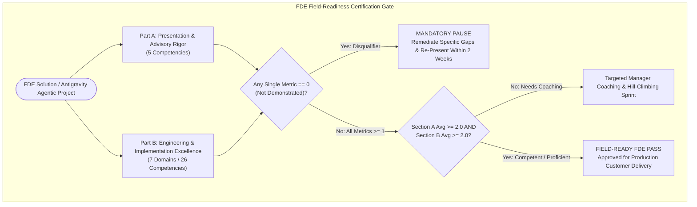

# Architecture Best Practice: Google Cloud FDE Field-Readiness & Project Grading Rubric (Mandatory Governance Standard)

**Topics:** #fde-grading-rubric #field-readiness #advisory-rigor #engineering-excellence #agentic-ai-governance #landing-metrics #well-architected-framework #google-cloud

> **Sources:** [Cloud FDE Team Handbook (`g3doc`)](https://g3doc.corp.google.com/company/teams/cloud-fde/index.md?cl=head) · [GCS OKF Bucket (`gea_agent_development_architectural_best_practices_1790796607`)](https://pantheon.corp.google.com/storage/browser/gea_agent_development_architectural_best_practices_1790796607?forceOnBucketsSortingFiltering=true&project=fivedaysai-prd-sandbox-317383) · **Corpus:** `GEAPL200` · **Version:** `GEAPL200_2026-09-30_124746` (180-Day TTL Preserved)

---

## 1. Executive Mandate & Enforcement Policy

Every architecture, concept, prototype, or production application built using this Open Knowledge Format (OKF v0.2) knowledge base — including all Antigravity-driven Agentic AI workflows — **must strictly adhere to the Google Cloud Forward Deployed Engineer (FDE) Grading Rubric** documented in this specification and anchored to the [Cloud FDE Team Charter](https://g3doc.corp.google.com/company/teams/cloud-fde/index.md?cl=head).

As a Forward Deployed Engineer (FDE), your role bridges **how you build a technical solution** and **how you convey its commercial and operational value to enterprise customers**. Every concept in this catalog (`01` through `35`) explicitly cross-references and enforces this rubric.

### Pass / Fail Cutlines & Governance Rules
1. **Two Mandatory Sections:** Every project and technical review is graded across:
   - **Part A — Section 1: Presentation & Advisory Rigor** (5 competencies)
   - **Part B — Section 2: Engineering & Implementation Excellence** (7 domains, 26 competencies)
2. **Minimum Passing Average (`>= 2.0 - Competent`):** You must achieve an average score of **`2 - Competent`** or higher across **each** of the two sections independently.
3. **Zero-Tolerance Disqualifier (`No Score of 0`):** Scoring a **`0 (Not Demonstrated)`** on **any single metric** triggers an automatic **mandatory pause**. You must remediate the specific architectural or advisory gap and re-present to the panel within **two weeks**.
4. **Coaching & Progression Loop:** Panel evaluations and per-competency scores are shared with your manager to guide targeted coaching and field-readiness certification.

---

## 2. Official 0–3 Competency Grading Scale

| Score | Level | Definition | Panel Outcome |
|---:|---|---|---|
| **0** | **Not Demonstrated** | The Noogler/FDE missed the mark, ignored the requirement, or could not answer basic questions. | **Growth Opportunity (Automatic Pause & 2-Week Re-Presentation)** |
| **1** | **Awareness** | The Noogler/FDE understands the concept but struggles to apply it practically or misses critical edge cases. | **Needs Additional Coaching** |
| **2** | **Competent** | The Noogler/FDE articulates a solid approach, understands trade-offs, and meets the expectations of a Field-Ready FDE. | **Pass (Field-Ready Baseline)** |
| **3** | **Proficient** | The Noogler/FDE demonstrates deep, production-level expertise, anticipates complex failure modes, and teaches the panel something new. | **Strong Pass (Exemplar Reference Architecture)** |

---

## 3. Part A — Section 1: Presentation & Advisory Rigor

| # | Competency Area | Assessment Focus | What "2 - Competent" Looks Like (Pass Cutline) | Prevailing Customer Best-Practice Exemplar (Corpus Grounded) |
|---|---|---|---|---|
| **A.1** | **Strategic Delivery & Value Articulation** | Can they connect technical architecture to business value? Can they clearly articulate why they built this solution and how it handles commercial reality? | Delivers a compelling, narrative-driven walkthrough of the user experience framed around customer personas and operational impact. Explicitly justifies why the architecture directly solves the root business problem (avoiding a "science project") and presents a viable **Total Cost of Ownership (TCO)** model that demonstrates fiscal responsibility. | **NorthBay Mutual ("ClaimPilot") & Cymbal Support:** Anchoring multi-agent claims triage to a measurable `$ / Resolved Claim` TCO model (stacking Gemini Flash/Pro tokens, Agent Runtime vCPU/GiB-hr, Memory Bank, and Enterprise Search queries) rather than an uncosted demo ([Concept 01](/concepts/01-ai-agent-quality-engineering.md), [Concept 28](/concepts/28-cost-estimation-and-optimization-for-agentic-solutions.md)). |
| **A.2** | **Objection Handling & Technical Defense** | How do they react to executive pushback, and can they defend their implementation choices? | Remains entirely calm, collected, and collaborative under pressure when facing stakeholder resistance. Confidently defends engineering decisions and structural design choices during the Q&A matrix using data-backed logic, while cleanly evaluating and addressing technical trade-offs (e.g., cost vs. latency, model tiering). | **SecureVault Bank ("WireGuard") & Meridian Retail ("ShopMate"):** Defending why a P99 latency of 11s with `EXACT` trajectory verification and deterministic `$200` code-level HITL escalation is mandatory when money moves, whereas P50 < 3s Flash routing handles catalog lookups ([Concept 01](/concepts/01-ai-agent-quality-engineering.md), [Concept 12](/concepts/12-agent-quality.md)). |
| **A.3** | **Presentation Skills** | How effectively do they manage time, pacing, and the overall flow of the meeting? | Paces the presentation to finish on time. Tactfully steers the panel away from rabbit holes, offering to take tangential topics offline without being dismissive. Demonstrates intellectual honesty by confidently admitting *"I don't know, but I will get back to you"* rather than fabricating answers. | **Enterprise Architecture Discovery & AI Steering Committee Briefings:** Structuring executive readouts around CUJ scorecards, WAF pillar trade-off tables, and explicit scope boundaries ([Concept 31](/concepts/31-plan-change-management-for-gemini-enterprise-deployments.md)). |
| **A.4** | **AI-Driven Development Discussion** | How effectively do they demonstrate the use of GenAI tools and harness concepts to accelerate their own development lifecycle and code quality? | Articulates how their harness was set up before coding. Demonstrates understanding of establishing key guidance that enables both **"in the loop"** (quick feature fix that adheres to spec) and **"outside the loop"** (goal-driven — task is taken and executed in an autonomous loop through lint, test, eval until goal is passed) development. Mistakes made by the agent/harness are systematically incorporated back into agent instructions (`AGENTS.md` / `SKILL.md` / specs). | **Spec-Driven Development & Vibe-Coding SecOps Harness:** Using locked specifications (`specs/`), OKF MCP knowledge bases, and post-mortem rule feedback loops so every agent mistake updates the harness instructions and golden regression suite ([Concept 02](/concepts/02-vibe-coding-agent-security-evaluation-kb.md), [Concept 13](/concepts/13-spec-driven-production-grade-development.md), [Concept 16](/concepts/16-the-new-sdlc-with-vibe-coding.md)). |
| **A.5** | **Futures / Roadmap** | Can they communicate what the next phase of development would look like while driving home the value of Google Cloud? | Articulates a clear, progressive roadmap for future development phases, addressing production-grade scalability, performance optimization, and features the customer needs in production deployment. Effectively demonstrates the strategic value of Google Cloud integration, explaining how native GCP services enhance stability, security, and long-term business value. | **Prototype-to-Production Maturity Roadmap:** Phasing from Phase 1 (Local ADK + InMemoryRunner) → Phase 2 (Vertex AI Agent Runtime + Memory Bank + Model Armor) → Phase 3 (Multi-Region Agent Gateway, Agent Registry A2A Mesh, Provisioned Throughput GSUs, and Dataplex OKF Governance) ([Concept 11](/concepts/11-prototype-to-production.md), [Concept 35](/concepts/35-govern-agents-with-agent-gateway-registry-policies.md)). |

---

## 4. Part B — Section 2: Engineering & Implementation Excellence

### Domain B.1: AI/ML Engineering

| # | Competency Area | Assessment Focus | Pass Requirement & What "2 - Competent" Looks Like | Prevailing Customer Best-Practice Exemplars & Linked Concepts |
|---|---|---|---|---|
| **B.1.1** | **Agentic & Multi-Agent Systems** | Agent orchestration patterns, tool/function calling, planning and reasoning loops, memory and state management, multi-agent coordination, cognitive architectures, and integrating agents with legacy/external APIs. | **Competent on >= 2 of the following:** • Designs cognitive architectures & orchestration patterns (`SequentialAgent`, `ParallelAgent`, `LoopAgent`, Router/Coordinator) aligned with Critical User Journeys (CUJs). • Builds functional planning/reasoning loops; utilizes session memory (`session.state`) & Memory Bank ensuring context retention and avoiding infinite execution loops (`max_iterations`). • Implements tool/function calling (`McpToolset`, OpenAPI) integrating legacy/external APIs while respecting data boundaries & security. • Coordinates multi-agent interactions (A2A, `AgentTool` isolated histories vs. shared history) meeting enterprise latency SLAs and graceful error handling. | • **Apex Financial ("LendAssist")** & **Corporate Travel Concierge:** Deterministic ADK workflow orchestration with bounded loops ([Concept 06](/concepts/06-agent-tools-mcp-multi-agent-orchestration.md), [Concept 21](/concepts/21-build-and-deploy-multi-agent-adk-systems.md)). • **International Airline Booking & Wealth Management Assistant:** Stateful Session + Vertex AI Memory Bank consolidation ([Concept 08](/concepts/08-context-engineering-stateful-agents.md), [Concept 23](/concepts/23-agent-context-persistence-and-memories.md), [Concept 24](/concepts/24-agent-with-persistent-memories-deep-dive.md)). |
| **B.1.2** | **Retrieval & Data Engineering for AI** | RAG architecture patterns, embedding models and vector databases, chunking and indexing strategies, hybrid search, grounding and citation, data pipelines for AI, parsing complex document formats (PDF/HTML tables). | **Competent on >= 1 of the following:** • Implements RAG patterns, embeddings, and vector/hybrid search maximizing retrieval precision. • Ensures reliable grounding and inline citations mitigating hallucinations. • Orchestrates data pipelines parsing complex document formats (multi-page PDFs, HTML tables, Mermaid diagrams) with ACL preservation. • Validates retrieval quality against business requirements ensuring production-grade data trust. | • **Financial Services Quarterly Revenue RAG & Enterprise SharePoint/Jira Sync:** Hybrid search with strict source-system ACL replication, Federated vs. Indexed connector selection, and OKF v0.2 Dataplex Knowledge Catalog ingestion ([Concept 29](/concepts/29-deploy-the-gemini-enterprise-app.md), [Concept 03](/concepts/03-enterprise-ai-agent-protocol-stack.md)). |
| **B.1.3** | **Model Selection, Tuning & Optimization** | Model assessment and selection (quality, latency, cost, context), tuning, quantization, distillation, prompt engineering, structured output enforcement (JSON mode), inference optimization, data engineering, encoder/decoder selection. | **Competent on >= 2 of the following:** • Assesses & selects models balancing quality, latency, cost, and context (e.g., Gemini Flash front-door routing with Gemini Pro escalation; calibrated `thinking_config` budgets). • Performs tuning, distillation, or context caching; optimizes inference. • Refines behavior via clean prompt engineering (retiring legacy prompt debt) and enforces strict structured outputs (`response_schema` / JSON mode). • Manages synthetic evaluation data generation, labeling, and preparation. | • **High-Volume Customer Support (10M queries/mo) & Gemini 3 Migration:** Tiered Flash/Pro routing, retiring prompt engineering debt, calibrating thinking budgets, and enforcing `response_schema` ([Concept 26](/concepts/26-hill-climbing-agentic-systems.md), [Concept 27](/concepts/27-upgrade-to-the-latest-models.md), [Concept 28](/concepts/28-cost-estimation-and-optimization-for-agentic-solutions.md)). |
| **B.1.4** | **LLM Ops and Evaluation** | Evaluation methodology for GenAI, quality metrics (faithfulness, relevance, coherence), eval dataset design, human vs. automated evaluation, regression detection, observability (tracing/logging). | **Competent on >= 1 of the following:** • Applies Tri-Partite evaluation methodology using deterministic metrics (schema, regex, trajectory precision/recall, BLEU/ROUGE where applicable — **must be more than LLM-as-a-Judge alone**), calibrated autoraters (Cohen's κ ≥ 0.75), and human SME ground truth. • Designs stratified Golden Datasets; executes offline CI gates and online shadow/canary evaluation. • Detects regressions; implements OpenTelemetry GenAI distributed tracing (`agent.run`, `llm.generate`, `tool.execute`, `agent.transfer`) and structured JSON logging. | • **Aurora Diagnostics & Global Logistics CI Testing:** Combining Black-Box golden dataset regression with Glass-Box trajectory assertions (`EXACT`, `IN_ORDER`, `ANY_ORDER`) and OpenTelemetry tracing in Vertex AI Evaluation Service ([Concept 01](/concepts/01-ai-agent-quality-engineering.md), [Concept 12](/concepts/12-agent-quality.md), [Concept 25](/concepts/25-evaluate-generative-agentic-systems.md)). |
| **B.1.5** | **Domain-Applied AI/ML Expertise** | Translation of vertical-specific business KPIs into AI/ML objectives and architectures. Domain-specific feature engineering, data handling, regulatory compliance (HIPAA, FINRA, EU AI Act), and legacy workflow integration. | **Competent on >= 1 of the following:** • Translates vertical-specific business KPIs into quantifiable AI/ML objectives and CUJ scorecards. • Executes domain-specific data handling; enforces regulatory compliance and privacy (HIPAA PHI redaction, FINRA immutable audit trails, EU AI Act Algorithmic Impact Assessments). • Integrates AI solutions cleanly with industry-standard legacy ERP/CRM/EHR systems. | • **Global HealthTech (HIPAA PHI Protection), Tier-1 Bank SAR Investigation (FINRA), & National Home Improvement Retailer:** Encoding vertical domain expertise as governed ADK Skills and enforcing regulatory guardrails in code ([Concept 02](/concepts/02-vibe-coding-agent-security-evaluation-kb.md), [Concept 07](/concepts/07-enterprise-agent-skills.md), [Concept 14](/concepts/14-agent-skills.md)). |

---

### Domain B.2: Scoping and Documentation

| # | Competency Area | Assessment Focus | What "2 - Competent" Looks Like (Pass Cutline) | Prevailing Customer Best-Practice Exemplars & Linked Concepts |
|---|---|---|---|---|
| **B.2.1** | **Problem Definition** | Identifying and articulating the business problem, translating ambiguity into a technical opportunity, documenting what success unlocks for the customer. | Identifies and articulates business problems clearly; translates ambiguity into actionable technical opportunity. Documents customer success unlocks, justifying the architecture as a direct solution to the root business problem while avoiding "science projects". Anchors scoping decisions to **Critical User Journeys (CUJs)** and **"Definition of Done."** | **Meridian Retail & Omnichannel Returns:** Translating vague "improve support with AI" requests into concrete CUJs with explicit resolution rate, hop count (`1.5–3.0 hops`), and cost-per-ticket targets ([Concept 01](/concepts/01-ai-agent-quality-engineering.md), [Concept 13](/concepts/13-spec-driven-production-grade-development.md)). |
| **B.2.2** | **Technical Scope & Constraints** | Defining technical scope, identifying constraints and assumptions, documenting system boundaries and the architectural approach prior to build. | Defines technical scope precisely; identifies critical constraints (latency SLAs, regionality, quota ceilings, legacy API timeouts). Documents system boundaries and architectural approach prior to build phase, maintaining clear separation between prototype features and production-grade requirements. | **Spec-Driven Production-Grade Development:** Authoring formal `specs/` defining non-goals, latency/token budgets, and sandbox boundaries before generating agent code ([Concept 11](/concepts/11-prototype-to-production.md), [Concept 13](/concepts/13-spec-driven-production-grade-development.md), [Concept 16](/concepts/16-the-new-sdlc-with-vibe-coding.md)). |
| **B.2.3** | **Stakeholder Alignment & Success Criteria** | Evidence of stakeholder alignment, defined success criteria and acceptance criteria, phased delivery plan or architectural roadmap. | Demonstrates robust stakeholder alignment across IT, SecOps, Legal, and Business Units; defines clear acceptance criteria and Develops a phased delivery plan (Pilot → Cohort Waves → GA) synchronizing technical milestones with business expectations. | **Enterprise AI Center of Excellence (CoE) & Agent Release Rings:** RACI matrices, Champion network onboarding, and ring-based acceptance gates ([Concept 31](/concepts/31-plan-change-management-for-gemini-enterprise-deployments.md), [Concept 32](/concepts/32-plan-change-management-for-gemini-enterprise-agents.md)). |
| **B.2.4** | **System Design Artifacts** | Architecture diagrams, data flow diagrams, sequence diagrams. | Produces comprehensive architecture, data flow, and sequence diagrams (e.g., validated Mermaid.js C4/sequence/state topologies) clearly mapping system components, trust boundaries, interaction patterns, and data lifecycles. | **Visual Agent Architecture & Protocol Topologies:** Full sequence diagrams for 3-legged OAuth, WIF token exchange, Model Armor inline inspection, and multi-agent state flow ([Concept 17](/concepts/17-agents-concepts-visually-explained.md), [Concept 30](/concepts/30-third-party-idp-with-workforce-identity-federation.md), [Concept 34](/concepts/34-secure-your-agents-with-gemini-enterprise-agent-platform.md)). |
| **B.2.5** | **Decision Records (ADRs)** | ADRs, documenting trade-offs, alternatives considered, rationale. | Maintains comprehensive **Architecture Decision Records (ADRs)** and Trade-Off Matrices documenting alternatives considered (e.g., Shared vs. Separate Session History, PAYG vs. Provisioned Throughput, Federated vs. Indexed Search, MCP vs. A2A) and the data-backed rationale. | **Trade-Off Analysis Matrices in Every OKF Concept:** Explicit comparison of pros, cons, failure modes, and mitigations across architectural options ([Concept 03](/concepts/03-enterprise-ai-agent-protocol-stack.md), [Concept 24](/concepts/24-agent-with-persistent-memories-deep-dive.md), [Concept 28](/concepts/28-cost-estimation-and-optimization-for-agentic-solutions.md)). |
| **B.2.6** | **API Documentation** | OpenAPI specs, integration guides, SDK documentation. | Delivers precise OpenAPI 3.0 specifications, strongly typed MCP tool schemas (`inputSchema`), A2A `AgentCard` manifests, and clear SDK integration guides with actionable error recovery hints. | **Contract-First Tool & MCP Design:** Treating tool docstrings, parameter `enum` constraints, and structured error hints as machine-consumable API contracts ([Concept 18](/concepts/18-agent-tools-interoperability-with-mcp.md), [Concept 19](/concepts/19-agent-tools-interoperability-2.md), [Concept 35](/concepts/35-govern-agents-with-agent-gateway-registry-policies.md)). |
| **B.2.7** | **Operational Documentation** | Deployment guides, runbooks, onboarding docs, troubleshooting guides. | Produces actionable deployment guides, Day-2 runbooks, pre-flight checklists, and troubleshooting guides (covering 403 IAM/WIF context mismatches, proxy SSE timeout drops, SCIM hard-deletes, and rollback procedures). | **Agent Runtime & Gemini Enterprise Deployment Runbooks:** Step-by-step Cloud Shell, Terraform, and Dataplex registration runbooks ([Concept 04](/concepts/04-deploying-gemini-enterprise-agent-runtime.md), [Concept 29](/concepts/29-deploy-the-gemini-enterprise-app.md), [Concept 30](/concepts/30-third-party-idp-with-workforce-identity-federation.md)). |

---

### Domain B.3: Security, Privacy & Compliance

| # | Competency Area | Assessment Focus | Pass Requirement & What "2 - Competent" Looks Like | Prevailing Customer Best-Practice Exemplars & Linked Concepts |
|---|---|---|---|---|
| **B.3.1** | **Authentication & Authorization** | Service accounts, IAM, API key scoping, OAuth/OIDC, Least Privilege. | **Competent on >= 2:** Implements robust authN/authZ via per-agent cryptographic identities (`principal://.../reasoningEngines/...`), Workforce Identity Federation (SAML/OIDC + CEL conditions), 3-legged OAuth delegated user authority via Auth Manager, and **Principal Access Boundaries (PAB)** enforcing strict Least Privilege and zero ambient authority. | **Tier-1 Retail Banking & DevOps Assistant Narrow Connector Binding:** Eliminating Confused Deputy risks via 3-legged OAuth and PAB policies ([Concept 02](/concepts/02-vibe-coding-agent-security-evaluation-kb.md), [Concept 30](/concepts/30-third-party-idp-with-workforce-identity-federation.md), [Concept 34](/concepts/34-secure-your-agents-with-gemini-enterprise-agent-platform.md)). |
| **B.3.2** | **Infrastructure & Network Security** | VPC design, network segmentation, private endpoints, zero-trust architecture, service perimeters, firewall policies. | **Competent on >= 2:** Designs Zero-Trust network architectures using **VPC Service Controls (VPC-SC)** perimeters, Context-Aware Access (CAA), Private Service Connect Interfaces (PSC-I), Split-Horizon DNS, isolated **Agent Sandboxes** (zero internet egress), and centralized **Agent Gateway** ingress/egress enforcement. | **Financial Institution BigQuery Revenue Protection & Hub-VPC Egress Gateway:** Preventing token and data exfiltration with VPC-SC, PSC-I, and Agent Gateway ([Concept 22](/concepts/22-build-enterprise-agents-with-code-execution.md), [Concept 29](/concepts/29-deploy-the-gemini-enterprise-app.md), [Concept 35](/concepts/35-govern-agents-with-agent-gateway-registry-policies.md)). |
| **B.3.3** | **Data Protection & Privacy** | Encryption at rest/transit, PII handling, data classification, DLP, Secrets management. | **Competent on >= 2:** Enforces CMEK encryption at rest and mTLS in transit (`Certificate Manager TrustConfig`); integrates **Sensitive Data Protection (Cloud DLP)** for automatic PII/PHI redaction across prompts, logs, and Memory Bank; isolates OAuth secrets in Secret Manager / Managed Auth Vaults so tokens never enter LLM context. | **Global HealthTech PHI Redaction & Multi-Tenant Vector Isolation:** Blocking Cross-Tenant Vector Poisoning and redacting SSNs/PHI before LLM inference or memory persistence ([Concept 10](/concepts/10-vibe-coding-agent-security-and-evaluation.md), [Concept 33](/concepts/33-model-armor-securing-ai-deployments.md), [Concept 34](/concepts/34-secure-your-agents-with-gemini-enterprise-agent-platform.md)). |
| **B.3.4** | **AI-Specific Security** | Prompt injection mitigation, output filtering, guardrails, model access controls, content safety. | **Competent on >= 2:** Deploys **Google Cloud Model Armor** templates inline across user inputs, RAG/MCP tool outputs (Indirect Prompt Injection defense), A2A messages, and model responses; enforces deterministic code validation hooks (`before_tool_callback`) and Risk-Stratified HITL Logic Reviews before destructive actions. | **Enterprise Media (Jira Indirect Injection Defense) & Prescription Refill Agent:** Halting poisoned tool outputs and malicious URIs via Model Armor fail-closed callbacks ([Concept 02](/concepts/02-vibe-coding-agent-security-evaluation-kb.md), [Concept 33](/concepts/33-model-armor-securing-ai-deployments.md), [Concept 34](/concepts/34-secure-your-agents-with-gemini-enterprise-agent-platform.md)). |
| **B.3.5** | **Compliance & Governance** | Audit logging, data residency, regulatory requirements, policy enforcement. | **Competent on >= 1:** Configures immutable Cloud Audit Logs attributing actions to both the specific agent principal and the delegating human user; locks multi-region data residency (`us`, `eu`) at provisioning; enforces Custom Org Policy constraints (`allowlistedEgressAgentGatewaysForAgentEngine`) and **Agent Registry** admission governance. | **EU Sovereign Data Residency & Agent Registry Policy Governance:** Enforcing org-wide guardrails against shadow MCP servers and unapproved agents ([Concept 29](/concepts/29-deploy-the-gemini-enterprise-app.md), [Concept 35](/concepts/35-govern-agents-with-agent-gateway-registry-policies.md)). |

---

### Domain B.4: Reliability & Resilience

| # | Competency Area | Assessment Focus | What "2 - Competent" Looks Like (Pass Cutline) | Prevailing Customer Best-Practice Exemplars & Linked Concepts |
|---|---|---|---|---|
| **B.4.1** | **Availability Design** | Redundancy, failover, health checks, SLO/SLA definition, distributed systems patterns. | Defines semantic SLIs/SLOs (e.g., *"95% of inquiries resolve within 5 hops and P99 < 8s"*); implements idempotency keys on state-mutating tools, multi-region storage redundancy, and durable state checkpointing. | **Portfolio Rebalancing Agent (Preventing Duplicate $50K Trades):** Deterministic idempotency keys and transactional state checkpoints ([Concept 01](/concepts/01-ai-agent-quality-engineering.md), [Concept 05](/concepts/05-enterprise-ai-agent-systems-google-cloud.md)). |
| **B.4.2** | **Observability** | Structured logging, metrics, distributed tracing, AI-specific monitoring. | Emits structured JSON logs (`trace_id`, `span_id`, `session_id`, `turn_id`, `user_id`, `agent_name`) correlated with OpenTelemetry GenAI spans; runs a dedicated **Agent Quality Dashboard** tracking Tokens/Task, Steps/Task (`alert > 6`), Tool Error Rate (`< 1%`), and Groundedness alongside system health. | **Avoiding the "Green Dashboard, Broken Agent" Antipattern:** Correlating Cloud Trace spans with Vertex AI Evaluation metrics ([Concept 01](/concepts/01-ai-agent-quality-engineering.md), [Concept 12](/concepts/12-agent-quality.md), [Concept 29](/concepts/29-deploy-the-gemini-enterprise-app.md)). |
| **B.4.3** | **Failure & Recovery Testing** | Failure injection, red teaming, disaster recovery validation, backup/restore testing. | Executes automated adversarial red-teaming, persona simulation, chaos/fault injection on external MCP tools, and rollback drills (`< 5 min MTTR`). | **Adversarial Simulator & Green-Agent Quarantine Drills:** Stress-testing agents against prompt injection, malformed tool payloads, and regional quota exhaustion ([Concept 10](/concepts/10-vibe-coding-agent-security-and-evaluation.md), [Concept 25](/concepts/25-evaluate-generative-agentic-systems.md)). |
| **B.4.4** | **Graceful Degradation** | Fallback strategies, circuit breakers, retry policies, timeout handling. | Implements bounded retries with exponential backoff, circuit breakers on Agent Gateway, model fallback routing, extended proxy timeouts (3–5 min) + SSE streaming/async polling, and clean human escalation hand-offs with structured context summaries. | **Fleet Dispatch & Multi-Region Incident Remediation:** Falling back cleanly to human dispatchers when external weather/telemetry APIs fail ([Concept 05](/concepts/05-enterprise-ai-agent-systems-google-cloud.md), [Concept 29](/concepts/29-deploy-the-gemini-enterprise-app.md), [Concept 32](/concepts/32-plan-change-management-for-gemini-enterprise-agents.md)). |

---

### Domain B.5: Performance & Cost Optimization

| # | Competency Area | Assessment Focus | What "2 - Competent" Looks Like (Pass Cutline) | Prevailing Customer Best-Practice Exemplars & Linked Concepts |
|---|---|---|---|---|
| **B.5.1** | **Scalability & Elasticity** | Horizontal and vertical scaling strategies, autoscaling policies, load balancing. | Designs stateless, horizontally autoscaling ADK runner tiers backed by managed `VertexAiSessionService`; uses `ParallelAgent` fan-out for concurrent I/O and configures L7 load balancing with SSE keep-alive support. | **High-Concurrency Enterprise Search & Multi-Agent Fan-Out:** Scaling to tens of thousands of concurrent workforce users ([Concept 21](/concepts/21-build-and-deploy-multi-agent-adk-systems.md), [Concept 29](/concepts/29-deploy-the-gemini-enterprise-app.md)). |
| **B.5.2** | **Resource Efficiency** | Compute/GPU right-sizing, autoscaling strategies, spot/preemptible usage. | Right-sizes Agent Runtime vCPU/GiB allocations; enforces ephemeral sandbox TTL reaping; blends **Provisioned Throughput (PT / GSUs)** for steady-state P70 baseline traffic with PAYG burst capacity and Batch Inference (50% discount) for offline evaluation/indexing. | **Enterprise Insurance & Nightly Batch Summarization:** Hybrid PT + PAYG capacity planning and sandbox lifecycle reaping ([Concept 22](/concepts/22-build-enterprise-agents-with-code-execution.md), [Concept 28](/concepts/28-cost-estimation-and-optimization-for-agentic-solutions.md)). |
| **B.5.3** | **AI Cost Management (FinOps)** | Model selection trade-offs, response caching, batching, memory and embeddings, token optimization. | Optimizes `$/Resolved Task` via tiered Flash/Pro routing, **Vertex AI Context Caching** (75–90% prefix discount), progressive skill/tool disclosure (`tool_filter`), session history compaction, and hard per-session token/hop ceilings to prevent **Denial of Wallet (DoW)**. | **Insurance Claims Assistant (Fixing Quadratic $O(N^2)$ Token Growth):** Combining sliding-window compaction, Memory Bank extraction, and Context Caching ([Concept 08](/concepts/08-context-engineering-stateful-agents.md), [Concept 24](/concepts/24-agent-with-persistent-memories-deep-dive.md), [Concept 28](/concepts/28-cost-estimation-and-optimization-for-agentic-solutions.md)). |

---

### Domain B.6: Operational Excellence

| # | Competency Area | Assessment Focus | What "2 - Competent" Looks Like (Pass Cutline) | Prevailing Customer Best-Practice Exemplars & Linked Concepts |
|---|---|---|---|---|
| **B.6.1** | **CI/CD & Deployment** | Pipeline design, deployment strategies, rollback automation. | Implements automated CI/CD pipelines gating deployments on offline Golden Dataset & trajectory evaluations, followed by progressive ring rollouts (Shadow Mode → 5% Canary → 25% → GA) with automated rollback triggers. | **Safe Gemini Model & Agent Ring Rollouts:** Automated shadow/canary pipelines with `< 5 min` rollback ([Concept 11](/concepts/11-prototype-to-production.md), [Concept 27](/concepts/27-upgrade-to-the-latest-models.md), [Concept 32](/concepts/32-plan-change-management-for-gemini-enterprise-agents.md)). |
| **B.6.2** | **Infrastructure as Code (IaC)** | Terraform/Pulumi, Cloud Build, reproducible environments, environment parity. | Codifies buckets, CMEK keys, VPC-SC perimeters, WIF pools, Agent Gateway attachments, and Dataplex Knowledge Catalog entries in **Terraform** and idempotent shell automation (`deploy/setup.sh`, `deploy/terraform/`), ensuring dev/staging/prod parity. | **Reproducible OKF & Agent Runtime Provisioning:** Full Terraform + Cloud Build IaC bundles ([Concept 04](/concepts/04-deploying-gemini-enterprise-agent-runtime.md), [Concept 29](/concepts/29-deploy-the-gemini-enterprise-app.md)). |
| **B.6.3** | **AI Lifecycle Management** | Model and agent versioning, A/B testing, configurations, experiment tracking. | Stamps immutable corpus and agent version tags (`GEAPL200_2026-09-30_124746`), tracks experiments in Vertex AI Evaluation Service, enforces 180-day `stale_after` TTLs on knowledge concepts, and executes structured A/B and SxS evaluations. | **Longitudinal Hill-Climbing & Model Upgrade Tracking:** Versioned experiment scorecards in Vertex AI ([Concept 25](/concepts/25-evaluate-generative-agentic-systems.md), [Concept 26](/concepts/26-hill-climbing-agentic-systems.md), [Concept 27](/concepts/27-upgrade-to-the-latest-models.md)). |
| **B.6.4** | **Testing & Quality Engineering** | Unit, integration, e2e testing, load and performance testing. | Executes deterministic unit tests on tool wrappers, contract tests on MCP schemas, glass-box trajectory integration tests (`.evalset.json`), and concurrency load tests verifying P95/P99 latency under peak load. | ** Pyramid of Agent Testing:** Unit → Tool Contract → Trajectory Glass-Box → End-to-End CUJ Simulation ([Concept 01](/concepts/01-ai-agent-quality-engineering.md), [Concept 13](/concepts/13-spec-driven-production-grade-development.md), [Concept 25](/concepts/25-evaluate-generative-agentic-systems.md)). |

---

### Domain B.7: Designing for Change

| # | Competency Area | Assessment Focus | What "2 - Competent" Looks Like (Pass Cutline) | Prevailing Customer Best-Practice Exemplars & Linked Concepts |
|---|---|---|---|---|
| **B.7.1** | **Modularity & Abstraction** | Loose coupling, interface contracts, model swappability, dependency injection. | Decouples agent orchestration from underlying model providers (LiteLLM / Vertex Model Garden aliases) and storage backends (`SessionService` / `MemoryService` dependency injection), composing capabilities via modular ADK **Skills** and sub-agents. | **Swappable Runner & Model Layer in ADK:** Moving from local `InMemorySessionService` to `VertexAiSessionService` and upgrading Gemini models with zero business logic rewrites ([Concept 07](/concepts/07-enterprise-agent-skills.md), [Concept 21](/concepts/21-build-and-deploy-multi-agent-adk-systems.md), [Concept 27](/concepts/27-upgrade-to-the-latest-models.md)). |
| **B.7.2** | **Configuration Management** | Environment separation, feature flags, externalized config. | Externalizes model IDs, thinking budgets, temperature, Model Armor template IDs, and WIF `login-config.json` into environment-scoped configs and feature flags, enabling zero-code runtime tuning. | **Environment-Scoped Agent Promotion:** Separate dev/staging/prod configs and canary feature flags ([Concept 04](/concepts/04-deploying-gemini-enterprise-agent-runtime.md), [Concept 27](/concepts/27-upgrade-to-the-latest-models.md), [Concept 32](/concepts/32-plan-change-management-for-gemini-enterprise-agents.md)). |
| **B.7.3** | **API Design & Versioning** | Backward compatibility, contract-first design, schema evolution. | Designs versioned MCP tool contracts, A2A `AgentCard` schemas, and OKF v0.2 `bundle.json` / Dataplex `okf` AspectType schemas with strict backward compatibility and content-hash (`content_sha256`) change detection. | **Protocol Stack & Schema Evolution:** Versioned MCP and A2A interfaces across multi-team boundaries ([Concept 03](/concepts/03-enterprise-ai-agent-protocol-stack.md), [Concept 18](/concepts/18-agent-tools-interoperability-with-mcp.md), [Concept 35](/concepts/35-govern-agents-with-agent-gateway-registry-policies.md)). |
| **B.7.4** | **Extensibility** | Plugin patterns, event-driven architecture, webhook/callback support. | Leverages ADK lifecycle callbacks (`before_agent_callback`, `before_model_callback`, `before_tool_callback`, `after_agent_callback`), event-driven Pub/Sub memory consolidation, and modular `SKILL.md` / MCP plugins to extend capabilities without modifying core runner logic. | **Callback-Driven Security, Telemetry & Memory Hooks:** Plugging Model Armor, HITL gates, and async Memory Bank extraction into ADK callbacks ([Concept 21](/concepts/21-build-and-deploy-multi-agent-adk-systems.md), [Concept 24](/concepts/24-agent-with-persistent-memories-deep-dive.md), [Concept 34](/concepts/34-secure-your-agents-with-gemini-enterprise-agent-platform.md)). |

---

## 5. Prevailing Customer Best-Practice Catalog (Cross-Corpus Reference Matrix)

To achieve **`2 - Competent`** or **`3 - Proficient`** on **Part A.1 (Strategic Delivery)**, **Part A.2 (Objection Handling)**, and **Part B (Engineering Excellence)**, FDEs should ground architectural justifications in the prevailing enterprise customer patterns established across this OKF catalog:

| Industry Vertical | Prevailing Customer Scenario | Core Architectural Problem | Enforced GCP & ADK Solution Pattern | Primary OKF Concepts |
|---|---|---|---|---|
| **Insurance & Financial Services** | **NorthBay Mutual ("ClaimPilot") & Apex Financial ("LendAssist")** | Multi-step claims triage & commercial lending suffering from stochastic trajectory drift and quadratic $O(N^2)$ token cost growth past 20 turns. | `SequentialAgent` + `ParallelAgent` orchestration, sliding-window context compaction, Vertex AI Memory Bank consolidation, and Glass-Box `IN_ORDER` trajectory evaluation. | [01](/concepts/01-ai-agent-quality-engineering.md), [08](/concepts/08-context-engineering-stateful-agents.md), [24](/concepts/24-agent-with-persistent-memories-deep-dive.md), [28](/concepts/28-cost-estimation-and-optimization-for-agentic-solutions.md) |
| **Banking & Wire Transfers** | **SecureVault Bank ("WireGuard") & Tier-1 Bank SAR Investigation** | High-value wire transfers and regulatory SAR investigations where prompt-only rules risk unauthorized execution or Confused Deputy privilege escalation. | Deterministic code-level `$200` auto-approval ceiling returning `ESCALATED_TO_HUMAN`, 3-legged OAuth via Auth Manager, Principal Access Boundaries (PAB), and `EXACT` trajectory gates. | [01](/concepts/01-ai-agent-quality-engineering.md), [02](/concepts/02-vibe-coding-agent-security-evaluation-kb.md), [07](/concepts/07-enterprise-agent-skills.md), [34](/concepts/34-secure-your-agents-with-gemini-enterprise-agent-platform.md) |
| **Healthcare & Life Sciences** | **Cymbal Health, Aurora Diagnostics & Global HealthTech** | Out-of-network appointment booking, clinical decision support, and prescription refills exposed to indirect prompt injection and HIPAA PHI leakage. | Inline **Model Armor** + **Cloud DLP (SDP)** templates scanning both user prompts and RAG/tool outputs, isolated `AgentSandbox` code execution, and SME-calibrated medical rubrics (κ ≥ 0.80). | [01](/concepts/01-ai-agent-quality-engineering.md), [02](/concepts/02-vibe-coding-agent-security-evaluation-kb.md), [25](/concepts/25-evaluate-generative-agentic-systems.md), [33](/concepts/33-model-armor-securing-ai-deployments.md) |
| **Omnichannel Retail & E-Commerce** | **Meridian Retail ("ShopMate"), Cymbal Athletic Shoes & Home Improvement Retailer** | High-volume (10M queries/mo) order support and project estimation suffering from 35-tool prompt bloat, hallucinated SKUs, and 30s proxy timeouts. | Progressive Skill Disclosure (`SKILL.md` + `McpToolset` `tool_filter`), Tiered Gemini Flash/Pro routing, Context Caching, and 3–5 min SSE streaming load-balancer timeouts. | [07](/concepts/07-enterprise-agent-skills.md), [14](/concepts/14-agent-skills.md), [18](/concepts/18-agent-tools-interoperability-with-mcp.md), [29](/concepts/29-deploy-the-gemini-enterprise-app.md) |
| **Global Logistics & Telecom** | **Multinational Freight Dispatch & Telecom B2B Billing** | Autonomous fleet routing and multi-departmental billing experiencing skill trigger collisions, tool API outages, and shadow MCP sprawl. | **Agent Registry** (`VETTED` admission control), **Agent Gateway** circuit breakers & egress policies, actionable tool error messages for self-healing, and progressive deployment rings. | [05](/concepts/05-enterprise-ai-agent-systems-google-cloud.md), [07](/concepts/07-enterprise-agent-skills.md), [32](/concepts/32-plan-change-management-for-gemini-enterprise-agents.md), [35](/concepts/35-govern-agents-with-agent-gateway-registry-policies.md) |
