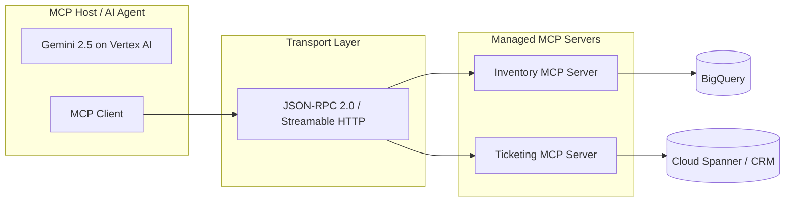
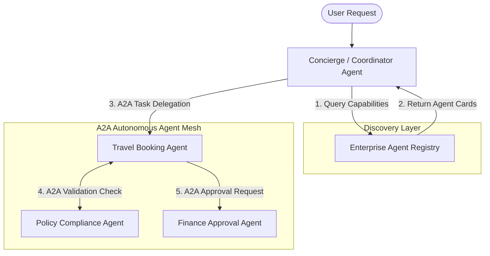
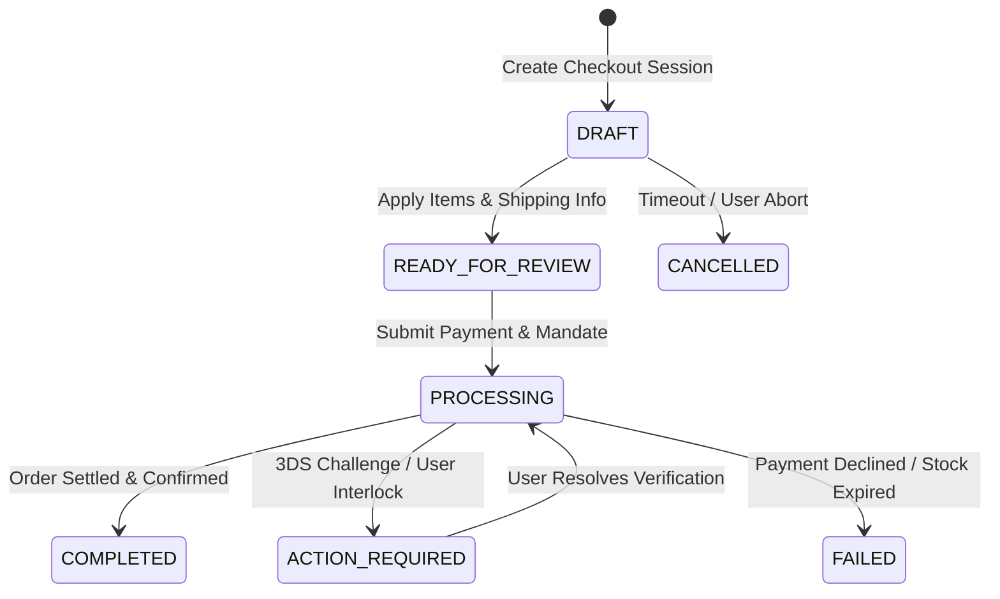
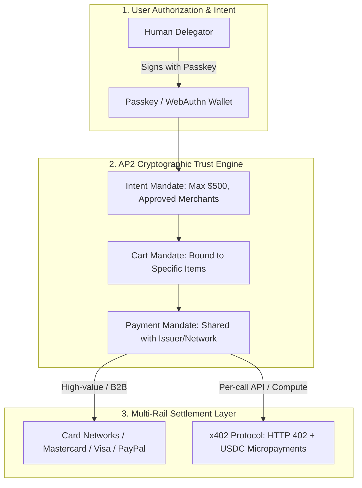
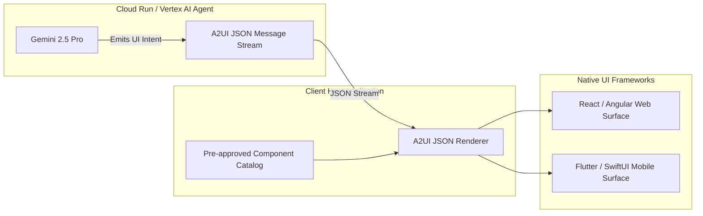
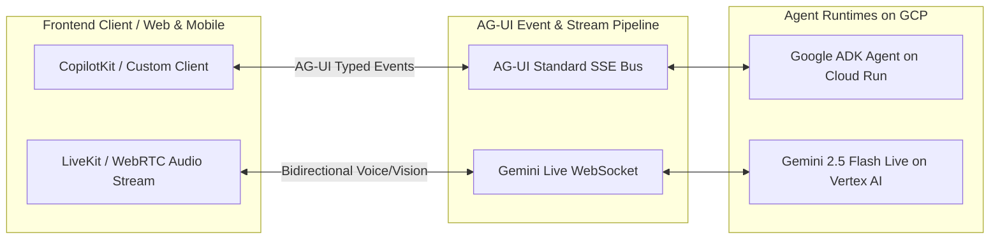
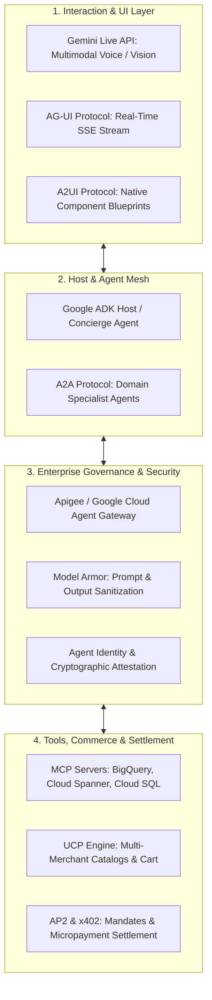

# Architecture Best Practice: The Open AI Agent Protocol Stack on Google Cloud (MCP · A2A · UCP · AP2/x402 · A2UI · AG-UI)

**Topics:** #agent-protocols #mcp #a2a #ap2 #generative-ui #google-cloud #agentic-commerce #enterprise-architecture

> **Source:** [Architecture Best Practice: The Open AI Agent Protocol Stack on Google Cloud](https://docs.google.com/document/d/1f_JXAmSvkJRK2xQmHj9DmCaZwLOWJ_1u88wQ1j9spWY/edit) · Converted from Google Docs

---

## FDE Project Grading Rubric Enforcement & Prevailing Customer Alignment

> **Mandatory Governance Standard:** Every project, prototype, or production agent built using the patterns in this concept **must pass the [Google Cloud FDE Field-Readiness & Project Grading Rubric](/concepts/00-fde-field-readiness-and-grading-rubric.md)** (aligned with the [Cloud FDE Team Charter](https://g3doc.corp.google.com/company/teams/cloud-fde/index.md?cl=head)). Scoring Requirement: **Average >= `2.0 (Competent)`** across both **Part A (Presentation & Advisory Rigor)** and **Part B (Engineering & Implementation Excellence)**, with **zero `0 (Not Demonstrated)` scores** on any single metric.

### 1. Part A — Presentation & Advisory Rigor Enforcement for This Concept

- **A.1 Strategic Delivery & Value Articulation:** Articulate why open, interoperable protocols (`MCP`, `A2A`, `UCP`, `AP2/x402`, `A2UI`, `AG-UI`) prevent vendor lock-in and N×M integration sprawl across enterprise business units.
- **A.5 Futures / Roadmap:** Present a phased protocol adoption roadmap from internal MCP tool wrappers to cross-departmental A2A meshes and cryptographic AP2 commerce mandates.

### 2. Part B — Engineering & Implementation Excellence Cutlines for This Concept

- **B.1.1 Agentic & Multi-Agent Systems:** Use MCP for vertical agent-to-tool execution and A2A (`AgentCard` discovery + asynchronous task lifecycles) for horizontal peer-to-peer agent collaboration.
- **B.2.5 Decision Records (ADRs) & B.2.6 API Documentation:** Document explicit protocol selection trade-offs and publish contract-first OpenAPI / MCP JSON schemas and A2A `AgentCard` descriptors.
- **B.7.3 API Design & Versioning:** Enforce backward-compatible schema evolution across MCP tool servers, A2UI generative UI catalogs, and AP2 verifiable credentials.

### 3. Prevailing Customer Best-Practice Exemplars to Cite in Panel Reviews

- **Grounded Enterprise Scenarios:** Global Omnichannel Retail Supply Chain (MCP inventory tools), Corporate Travel & Expense Concierge (A2A multi-agent negotiation), Multi-Brand Global Marketplace (UCP), Automated Multi-Cloud FinOps Agent (AP2 + x402 cryptographic payment mandates), and Healthcare Claims Dispute Intake (A2UI).
- **Cross-Reference:** See [Concept 00 — FDE Field-Readiness & Project Grading Rubric](/concepts/00-fde-field-readiness-and-grading-rubric.md) for the complete 0–3 grading scale, 31-competency matrix, and disqualifier remediation rules.

---
## Architectural Best Practice: Key Guidelines & Takeaways

### Core Principles

- **Layer separation is the organizing principle.** Tool execution (MCP), agent orchestration (A2A), UI generation (A2UI), interaction transport (AG-UI), and payment authorization (AP2/x402) are never mixed. A layered stack is what keeps an enterprise agent platform maintainable and auditable; collapsing layers is how platforms become unmaintainable glue.
- **Decouple the reasoning engine from tool implementations.** MCP is an open client-server contract modeled on the Language Server Protocol, collapsing the N×M integration matrix to N+M.
- **Discovery is a runtime property, not a build-time dependency.** MCP clients resolve tool schemas at connection time; A2A coordinators query a registry for Agent Cards.
- **MCP connects an agent to a *tool*; A2A connects an agent to an *autonomous peer*.** The distinction is about where reasoning and accountability live, not about transport.
- **Federation preserves data boundaries and divisional ownership.** Each domain agent enforces its own authentication, data boundary, and tool routing; peers exchange scoped task contracts and versioned artifacts, not raw conversation logs.
- **In agentic commerce the merchant stays the Merchant of Record.** Legal accountability and data sovereignty cannot be centralized into the AI platform.
- **Commercial state must be a deterministic machine.** Transactional consistency cannot rely on a stochastic reasoning loop.
- **Payment authorization and payment settlement are different layers.** AP2 supplies the cryptographic trust layer; card networks or x402 perform settlement.
- **Generative UI must be declarative and non-executable.** The agent emits structured JSON component blueprints; the host maps them to pre-approved native components.
- **Stream UI as a flat adjacency list, not a nested tree.** A flat list streams incrementally and degrades gracefully.
- **Agent interaction is an event stream, not a request/response.** REST cannot express an agent that thinks aloud, calls tools mid-thought, and pauses for approval.
- **Governance belongs at the gateway, uniformly.** Per-agent security is unenforceable at fleet scale.
- **Everything runs stateless and containerized** on Cloud Run or GKE, over Streamable HTTP and JSON-RPC 2.0.

### Mandatory Requirements / Golden Rules

1. Solve the **N×M integration problem** with an open client-server contract (MCP), not N×M custom integrations.
2. Prefer **dynamic runtime discovery** — tool schemas over MCP, Agent Cards over A2A — to hardcoded endpoint dependencies.
3. Federate by domain: each business unit keeps its own model, data boundary, auth, and tool routing; the coordinator delegates via **A2A task contracts**, never by absorbing their logic.
4. In commerce, preserve the **Merchant of Record** and drive a deterministic state machine (UCP) rather than scraping or sharing databases.
5. Separate **authorization (AP2 mandates) from settlement (card rails or x402 micropayments)** — the model never touches a raw credential.
6. Never let a model emit executable UI. Stream **non-executable declarative JSON** (A2UI) into a pre-approved native component catalog.
7. Wrap the runtime in a **typed event stream** (AG-UI over SSE/WebSocket) so tool progress, state deltas, and HITL pauses are first-class.
8. Govern the whole surface at the edge: Apigee / Agent Gateway, Model Armor, Agent Identity, OpenTelemetry.
9. Zero raw credentials in the LLM prompt context — they terminate at the gateway or inside the tool server.
10. Reserve `stdio` transport for local sub-process use; use **Streamable HTTP with SSE** for production cloud-native deployment.
11. Validate every AP2 mandate before dispatch — expiry, merchant allow-list, amount ceiling, and signature against the user DID — and fail closed on any unmet condition.
12. Every x402 call must execute inside a validated AP2 Intent Mandate: x402 settles, it does not authorize.
13. Keep AG-UI and A2UI distinct — AG-UI defines *how* the runtime communicates, A2UI defines *what* to render; A2UI blueprints travel as a payload type inside AG-UI events.

### Anti-Patterns / Guardrails

- **N×M bespoke integrations** — the problem the entire stack exists to eliminate.
- **Hardcoding tool schemas into system prompts** — token burn plus tight coupling plus no observability.
- **Using `stdio` transport for distributed cloud services** — it is a local-process mechanism only.
- **Reaching past an autonomous domain agent to its database** — MCP is not a substitute for A2A.
- **Unstructured broadcast messaging between agents** instead of explicit contract handshakes.
- **Passing raw conversational logs across an organizational boundary** rather than scoped parameters and versioned artifacts.
- **Web scraping or DB sharing as a commerce integration strategy.**
- **Centralizing Merchant-of-Record status or merchant data** into the AI platform.
- **Credentials in prompt context** — in any form, for any rail.
- **Settling without an authorization layer** (x402 without AP2) or authorizing without enforcing the cap in code.
- **Any client-side `eval()` of model output**, including JSX, HTML, or JavaScript; never inject into `innerHTML`; never render model output in an unrestricted WebView.
- **Streaming rendered images as a UI strategy** — kills latency, touch, and accessibility.
- **Modeling an agent interaction as a single REST request/response** — it cannot express mid-thought tool calls, state deltas, or HITL pauses.

---

**Knowledge Base Entry** | Source: tutored session transcript — *AI Agent Protocols Masterclass* (6-module curriculum, 6/6 assessed correct) **Primary reference:** Google Developers Blog — *A Developer's Guide to AI Agent Protocols*, plus Google Cloud enterprise multi-agent architecture patterns **Format of source:** concept + visual → GCP customer scenario → Python/ADK implementation → PCA-style pop quiz → evaluation → progress tracker **Evaluation lens:** GCP Well-Architected Framework — Security, Reliability, Operational Excellence, Performance Efficiency, Cost Optimization

---

## 1. Executive Summary

**Context.** Enterprise agent platforms have moved past monolithic prompts and bespoke glue code. What replaced them is a **layered stack of open protocols**, each owning exactly one concern: how an agent reaches tools and data (MCP), how agents delegate to each other across organizational boundaries (A2A), how commerce is transacted without per-merchant adapters (UCP), how spending is cryptographically authorized and settled (AP2 and x402), how the agent describes a user interface without shipping executable code (A2UI), and how the runtime interaction streams to the client in real time (AG-UI, with Gemini Live for multimodal). This session walked all six layers with diagrams, GCP reference architectures, Python/ADK samples, and a PCA-style scenario per module.

**Core Recommendation.** Adopt the **full layered protocol stack and refuse to collapse layers**. Concretely:

1. Solve the **N×M integration problem** with an open client-server contract (MCP), not N×M custom integrations.
2. Prefer **dynamic runtime discovery** — tool schemas over MCP, Agent Cards over A2A — to hardcoded endpoint dependencies.
3. Federate by domain: each business unit keeps its own model, data boundary, auth, and tool routing; the coordinator delegates via **A2A task contracts**, never by absorbing their logic.
4. In commerce, preserve the **Merchant of Record** and drive a deterministic state machine (UCP) rather than scraping or sharing databases.
5. Separate **authorization (AP2 mandates) from settlement (card rails or x402 micropayments)** — the model never touches a raw credential.
6. Never let a model emit executable UI. Stream **non-executable declarative JSON** (A2UI) into a pre-approved native component catalog.
7. Wrap the runtime in a **typed event stream** (AG-UI over SSE/WebSocket) so tool progress, state deltas, and HITL pauses are first-class.
8. Govern the whole surface at the edge: Apigee / Agent Gateway, Model Armor, Agent Identity, OpenTelemetry.

---

## 2. Core Architectural Principles & Decisions

### Decision 1 — Layer separation is the organizing principle

Tool execution (MCP), agent orchestration (A2A), UI generation (A2UI), interaction transport (AG-UI), and payment authorization (AP2/x402) are never mixed. *Rationale:* a layered stack is what keeps an enterprise agent platform maintainable and auditable; collapsing layers is how platforms become unmaintainable glue.

### Decision 2 — Decouple the reasoning engine from tool implementations

MCP is an open client-server contract explicitly modeled on the Language Server Protocol: tools, resources, and prompts are discovered dynamically over standard transports. *Rationale:* connecting N models to M tools previously required N×M bespoke integrations; the protocol collapses that matrix to N+M.

### Decision 3 — Discovery is a runtime property, not a build-time dependency

MCP clients resolve tool schemas at connection time; A2A coordinators query a registry for Agent Cards. *Rationale:* hardcoded endpoints force redeploys of the orchestrator whenever any team ships a change.

### Decision 4 — MCP connects an agent to a *tool*; A2A connects an agent to an *autonomous peer*

Using MCP where A2A belongs — e.g., exposing divisional databases directly to a central concierge — bypasses the division's business rules, compliance logic, and validation engines. *Rationale:* the distinction is about where reasoning and accountability live, not about transport.

### Decision 5 — Federation preserves data boundaries and divisional ownership

Each domain agent independently enforces its own authentication, data boundary, and internal tool routing; peers exchange scoped task contracts and versioned artifacts, not raw conversation logs. *Rationale:* prevents prompt leakage and PII spread, and keeps deterministic validation and auditability.

### Decision 6 — In agentic commerce the merchant stays the Merchant of Record

UCP standardizes discovery, cart, identity linking, and checkout while the merchant retains ownership of customer data, inventory logic, and pricing policy. *Rationale:* legal accountability and data sovereignty cannot be centralized into the AI platform; any design that demands merchants surrender their database or their MoR status is unshippable.

### Decision 7 — Commercial state must be a deterministic machine

UCP's six-state checkout lifecycle exists to prevent phantom stock reservations and double-billing across agent handoffs. *Rationale:* transactional consistency cannot rely on a stochastic reasoning loop.

### Decision 8 — Payment authorization and payment settlement are different layers

AP2 supplies the trust layer — cryptographically signed W3C Verifiable Credential mandates binding human intent — while card networks or x402 perform settlement. *Rationale:* agentic commerce breaks the assumption that a human is present clicking "Pay," so authorization, authenticity, and non-repudiation must be established independently of the rail.

### Decision 9 — Generative UI must be declarative and non-executable

The agent emits structured JSON component blueprints; the host maps them to pre-approved native components. *Rationale:* letting a model emit raw HTML/JS or JSX evaluated client-side is a direct XSS and session-hijacking vector, and it breaks the design system besides.

### Decision 10 — Stream UI as a flat adjacency list, not a nested tree

A2UI components reference child IDs rather than nesting. *Rationale:* an LLM streaming a deeply nested, valid JSON tree in one shot is fragile; a flat list streams incrementally and degrades gracefully.

### Decision 11 — Agent interaction is an event stream, not a request/response

AG-UI standardizes typed events over SSE or WebSocket: incremental tokens, tool-call start/end, state deltas, and HITL requests. *Rationale:* REST's single-request/single-response shape cannot express an agent that thinks aloud, calls tools mid-thought, and pauses for approval.

### Decision 12 — Governance belongs at the gateway, uniformly

Apigee / Agent Gateway applies rate limiting, OpenTelemetry observability, Model Armor sanitization, and cryptographic Agent Identity headers across every protocol. *Rationale:* per-agent security is unenforceable at fleet scale; credentials and business logic stay isolated from the LLM context.

### Decision 13 — Everything runs stateless and containerized

Agents and tool servers deploy as stateless microservices on Cloud Run or GKE, using Streamable HTTP and JSON-RPC 2.0. *Rationale:* independent scaling, isolated lifecycle management, and scale-to-zero economics.

---

## 3. Best Practice Guidelines & Recommended Patterns

### Pattern: MCP Tool Server per Domain

- **Description:** Independent services expose three primitives — **Tools** (executable functions with I/O JSON schemas), **Resources** (read-only contextual data: file contents, log streams, metrics), and **Prompts** (server-defined templates and workflows) — to an MCP Client embedded in the host application.
- **Implementation Guidance:** Deploy each server as an isolated Cloud Run microservice behind an API Gateway. The host manages user context, LLM orchestration, identity propagation, and Model Armor checks; the client manages connection lifecycle, schema resolution, and connection pooling. In ADK, `McpToolset` over a `StreamableHttpTransport` auto-discovers schemas — attach an IAM ID token and an `X-Agent-Identity` header on the transport.
- **Transport choice:** `stdio` for local sub-process use (IDE extensions, CLI tools, local development); **Streamable HTTP with SSE** for production cloud-native deployment — streaming updates plus stateless JSON-RPC request/response over HTTPS.
- **Guardrails:** Tools enforce least-privilege execution and parameter validation. Resources carry access-control policies. Zero raw credentials in the LLM prompt context.

### Pattern: A2A Federated Agent Mesh

- **Description:** Four primitives carry the collaboration — the **Agent Card** (`agent.json`: machine-readable capabilities, I/O contracts, owner, SLA, endpoint, auth type), the **Task Delegation Contract** (sub-task, deadline, context boundary, expected outcome), **Context Scoping & Redaction** (only task-relevant parameters cross the boundary), and **Stateful Artifact Exchange** (versioned business objects, not chat logs).
- **Implementation Guidance:** Publish an Agent Card per domain agent; register cards in an enterprise Agent Registry; the coordinator queries the registry, then dispatches a structured `TaskRequest` with explicit `parameters` and `context_constraints` (e.g., `max_budget_usd`, `allow_first_class: False`) to the peer endpoint. Authenticate with IAM OIDC. Handshakes are asynchronous, multi-turn, and resumable.
- **Guardrails:** Pass constraints, never raw context. Peers own their own LLM and domain autonomy — the coordinator must not assume a shared model version or shared memory.

### Pattern: UCP Standardized Commerce

- **Description:** An open industry standard (Google with Shopify, Walmart, Target, Etsy, Wayfair and major payment networks) covering **Catalog & Discovery** (real-time variants, stock truth, dynamic pricing via `schema.org/Product` and `schema.org/Offer` JSON-LD), **Cart Capability** (multi-item atomic operations with server-side reservation locks), **Identity Linking** (consumer OAuth bound to merchant loyalty accounts), and a **Checkout Engine** (deterministic state machine).
- **Implementation Guidance:** UCP rides over REST, MCP toolsets, or A2A delegation contracts — it is a schema and lifecycle standard, not a new transport. Ingest merchant feeds into BigQuery and Vertex AI Vector Search for discovery; use UCP MCP connectors for real-time stock lookup; advance the session through the state machine explicitly.
- **Guardrails:** The merchant remains Merchant of Record throughout. Reservation locks and state transitions are server-side; the agent advances state, it does not compute it.

### Pattern: AP2 Mandate Chain

- **Description:** Non-repudiation through W3C Verifiable Credentials. **Intent Mandate** (human-not-present, delegated: signed upfront with constraints such as "up to $250 on cloud GPU compute before Oct 1"), **Cart Mandate** (human-present: merchant signs the finalized cart, user cryptographically signs the total), **Payment Mandate** (delivered to gateway/issuer, signaling agent involvement, presence status, and verified consent), and **Payment Receipt** (cryptographic proof of settlement for immutable ledgers).
- **Implementation Guidance:** Validate every mandate before dispatch — expiry, merchant allow-list, amount ceiling, and signature against the user DID. Sign with passkeys/WebAuthn at the human boundary; hold agent wallet keys in Cloud KMS. AP2 was developed with 60+ partners including Mastercard, American Express, PayPal and Coinbase, and contributed to the FIDO Alliance.
- **Guardrails:** The mandate is the spending cap — enforce it in code before the rail is touched, and fail closed on any unmet condition.

### Pattern: x402 Machine-to-Machine Micropayment

- **Description:** Activates the HTTP `402 Payment Required` status for instant stablecoin settlement on sub-dollar machine transactions — per-token inference, pay-per-call data APIs, compute-on-demand.
- **Implementation Guidance:** On receiving 402, sign an `X-PAYMENT` payload (ECDSA) and retry with payment headers carrying protocol, amount, currency, and the governing AP2 mandate ID.
- **Guardrails:** x402 settles; it does not authorize. Every x402 call must execute inside a validated AP2 Intent Mandate.

### Pattern: A2UI Declarative Generative UI

- **Description:** Four message types drive the surface lifecycle — `createSurface` (instantiate an isolated canvas with a `surfaceId` and catalog ID), `updateComponents` (stream component definitions as a flat adjacency list), `updateDataModel` (update bound values via JSON Pointers like `/user/budget` without re-rendering layout), and `deleteSurface` (teardown).
- **Implementation Guidance:** Components carry `id`, `component` type, `properties`, and `children` as ID references. Bind inputs with `valueBinding` pointers rather than embedding state. The host renders against a pre-approved component catalog (React, Angular, Flutter GenUI SDK, SwiftUI, Jetpack Compose).
- **Guardrails:** The payload must be non-executable JSON. Never `eval()` model output; never inject into `innerHTML`; never render model output in an unrestricted WebView.

### Pattern: AG-UI Runtime Event Stream

- **Description:** A vendor-agnostic typed event stream over SSE or WebSocket carrying `TEXT_MESSAGE_CONTENT` (incremental tokens), `TOOL_CALL_START` / `TOOL_CALL_END` (live progress chips while an MCP server is queried), `STATE_SYNC` (shared application state such as active filters and form inputs), `HUMAN_IN_THE_LOOP_REQUEST` (halts until the user approves or clarifies), and `A2UI_SURFACE_DELTA` (embeds A2UI blueprints inside the AG-UI stream).
- **Implementation Guidance:** Wrap an ADK agent in an AG-UI stream adapter behind a FastAPI `StreamingResponse` with `media_type="text/event-stream"`, emitting `data: {...}\n\n` frames. Pair with the Gemini Live API over WebSocket for bidirectional speech-to-speech and live video at sub-second latency.
- **Guardrails:** AG-UI defines *how* the runtime communicates; A2UI defines *what* to render. Keep the two distinct — A2UI blueprints travel as a payload type inside AG-UI events.

### Pattern: Enterprise Agent Gateway Governance

- **Description:** A uniform control plane fronting every protocol surface.
- **Implementation Guidance:** Apigee / Google Cloud Agent Gateway for rate limiting and centralized API observability; Model Armor for prompt and output sanitization; cryptographic Agent Identity and attestation headers; OpenTelemetry-compliant telemetry throughout.
- **Guardrails:** Credentials and sensitive business logic never enter the LLM context window — they terminate at the gateway or inside the tool server.

---

## 4. Trade-Off Analysis & Pitfalls

| Option / Decision | Advantages | Trade-Offs / Risks | Mitigations |
| :---- | :---- | :---- | :---- |
| **MCP servers on Cloud Run + Streamable HTTP, governed by Apigee** *(chosen, M1)* | Independent scaling and isolated lifecycle per tool provider; zero credential exposure to prompt context; open protocol with streaming telemetry and centralized observability | New protocol surface to operate; gateway is on the critical path | Per-server least-privilege identity; OpenTelemetry at the gateway; schema versioning |
| OpenAPI YAML hardcoded into `system_instruction` | No extra infrastructure | Burns context-window tokens; tight coupling; no centralized security or observability | Externalize to discoverable tool servers |
| All tools in one monolithic K8s pod over Unix sockets / stdio | No network overhead | Negates independent scaling and lifecycle management; `stdio` is strictly for local process execution, not distributed microservices | Reserve stdio for local dev and IDE/CLI use only |
| Tool logic as BigQuery UDFs driven by NL2SQL | Reuses the warehouse | Forces transactional, non-analytical actions into SQL; injection and accidental-mutation risk; cannot reach external REST/gRPC systems | Keep NL2SQL for analytical reads; use tools for actions |
| **A2A Agent Cards + registry + async task delegation** *(chosen, M2)* | Dynamic runtime discovery; preserves divisional data, auth, and logic boundaries; supports heterogeneous model versions per domain | Requires registry operation and card/schema governance | Versioned Agent Cards; IAM OIDC between peers; strict context scoping |
| Merge all domain prompts, functions, and vector stores into one agent | Single deployable | Prompt bloat; model drift risk; tight coupling; violates divisional ownership | Federate by domain |
| Expose divisional SQL databases to a central agent via MCP tools | Direct and fast | Bypasses division-specific business rules, compliance logic, and validation engines — MCP connects an agent to a *tool*, not to another autonomous domain | Delegate to the domain agent over A2A instead |
| Pub/Sub broadcast chat between agents | Fully decoupled | Race conditions; non-deterministic execution; token waste; no explicit contract handshake | Use structured A2A task contracts |
| **UCP with JSON-LD catalogs and the 6-state checkout** *(chosen, M3)* | No per-vendor adapters; merchant stays MoR; deterministic transitions prevent phantom reservations and double-billing | Requires merchant-side protocol adoption | Run UCP over existing REST/MCP/A2A surfaces to ease adoption |
| Headless Puppeteer fleet navigating merchant sites | Works without merchant cooperation | Brittle against DOM changes; slow; no transactional guarantee; no legal accountability | Rejected — adopt the protocol |
| Retailers hand over raw read-write DB connection strings | Trivial integration | Catastrophic security and data-corruption exposure; bypasses validation and inventory locks | Rejected outright |
| Force all merchants onto one shared Spanner instance | Uniform data model | Infeasible commercially; violates data sovereignty; breaks merchant isolation | Rejected — federate via schema, not storage |
| **AP2 Intent Mandate + x402 settlement** *(chosen, M4)* | Cryptographic proof of human budget approval; zero runtime friction; hard caps on merchant and amount | Emerging rails; wallet/key management to operate | Keys in Cloud KMS; validate mandate before every call; immutable receipt ledger |
| Credit card numbers in agent prompt instructions + web-form scraping | Works with any merchant | Token leakage, prompt injection, replay attacks; no programmatic spending cap | Rejected outright |
| Monthly PDF invoices to accounts payable | Familiar finance process | Human bottleneck; incompatible with sub-cent real-time consumption | Reserve for low-frequency, high-value procurement |
| Shared Cloud SQL + end-of-year wire transfers | Simple ledger | Violates network security boundaries across external SaaS providers; no real-time settlement | Rejected |
| **A2UI declarative JSON into a native catalog** *(chosen, M5)* | Non-executable payload eliminates XSS; 100% native design-system consistency and accessibility | Requires maintaining a component catalog and renderer per platform | Version the catalog; validate every blueprint against schema |
| Model emits raw React JSX, client runs `eval()` in an unrestricted WebView | Maximum UI flexibility | Critical XSS, data theft, session hijacking; breaks app styling | Rejected outright |
| Embedded iframes | Sandboxed-ish | Heavy memory overhead; disjointed UX; rigid sizing | Prefer declarative native rendering |
| Plain-text-only agent + emailed PDF forms | Trivially safe | High drop-off; defeats the purpose of an interactive workflow | Use A2UI for structured collection |
| Headless Chrome screenshots streamed as PNG | Pixel-perfect server rendering | Massive latency and compute; broken touch and accessibility; poor mobile scalability | Rejected |
| **AG-UI + Gemini Live + A2UI + A2A together** *(chosen, capstone)* | Sub-second multimodal interaction, live tool-progress chips, safe native widgets, cross-org delegation — each concern in its own layer | Four protocols to operate and version | Uniform gateway governance; keep layer boundaries strict |
| Monolithic Express REST + iframes + partner DB read replicas | Familiar stack | No streaming; unsafe UI; partner coupling via raw data replication | Rejected |
| stdio transports + CLI on a bastion host | Simple and local | Unusable for clinicians; no streaming, no mobile, no multimodal | Rejected |
| Raw token long-polling + client-side `eval()` | Minimal backend work | Latency plus arbitrary code execution — worst of both | Rejected |

**Antipatterns to Avoid**

- **N×M bespoke integrations** — the problem the entire stack exists to eliminate.
- **Hardcoding tool schemas into system prompts** — token burn plus tight coupling plus no observability.
- **Using `stdio` transport for distributed cloud services** — it is a local-process mechanism only.
- **Reaching past an autonomous domain agent to its database** — MCP is not a substitute for A2A.
- **Unstructured broadcast messaging between agents** instead of explicit contract handshakes.
- **Passing raw conversational logs across an organizational boundary** rather than scoped parameters and versioned artifacts.
- **Web scraping or DB sharing as a commerce integration strategy.**
- **Centralizing Merchant-of-Record status or merchant data** into the AI platform.
- **Credentials in prompt context** — in any form, for any rail.
- **Settling without an authorization layer** (x402 without AP2) or authorizing without enforcing the cap in code.
- **Any client-side `eval()` of model output**, including JSX, HTML, or JavaScript.
- **Streaming rendered images as a UI strategy** — kills latency, touch, and accessibility.
- **Modeling an agent interaction as a single REST request/response** — it cannot express mid-thought tool calls, state deltas, or HITL pauses.

---

## 5. Real-World / Customer Scenarios

**Scenario 1: Global Omnichannel Retail Supply Chain (MCP)**

- *Context & Constraints:* Customer service and logistics agents need real-time stock levels in BigQuery, order status in Cloud Spanner, and third-party shipping updates — without hardcoding API logic into the orchestrator.
- *Applied Architecture:* ADK host agent on Cloud Run powered by `gemini-2.5-flash`; tool servers packaged as isolated Cloud Run microservices exposing MCP over Streamable HTTP; traffic routed through Apigee / Agent Gateway with Model Armor sanitization and cryptographic Agent Identity headers.
- *Outcomes:* New data sources land as new MCP servers with no orchestrator change; credentials stay out of the model context.

**Scenario 2: Financial Services Analytical Tool Platform (MCP quiz)**

- *Context & Constraints:* Hundreds of modular tools — real-time fraud scoring, credit history lookups, account balances — serving multiple Vertex AI conversational agents. Mandates: independent scaling and isolated lifecycle per tool provider, zero raw credential sharing with prompt context, open-protocol communication with streaming telemetry and centralized observability.
- *Applied Architecture:* Containerized MCP servers on Cloud Run over Streamable HTTP, governed by Apigee / Agent Gateway with Agent Identity and OpenTelemetry-compliant observability.
- *Outcomes:* Each tool team ships on its own cadence; the platform gets uniform rate limiting, metrics, and identity.

**Scenario 3: Corporate Travel & Expense Concierge (A2A)**

- *Context & Constraints:* A multi-leg client trip must be booked, checked against dynamic travel policy, and escalated for executive approval when over budget.
- *Applied Architecture:* Coordinator agent on Vertex AI; Travel Agent and Expense Policy Agent running independently on GKE or Cloud Run; the Travel Agent publishes an Agent Card, receives a delegated task with `max_budget_usd` and `allow_first_class` constraints, and calls the Policy Agent over A2A to validate corporate caps before presenting options.
- *Outcomes:* Policy logic stays owned by the policy team; the coordinator never encodes travel rules.

**Scenario 4: Federated Multi-Division Customer Care (A2A quiz)**

- *Context & Constraints:* Retail Banking, Mortgage Lending, and Wealth Management each run autonomous agents built by separate teams on different Vertex AI model versions. A concierge must handle cross-domain questions ("Can I refinance my mortgage using funds from my wealth portfolio?") without centralizing domain data or logic; each division enforces its own data boundary, auth, and tool routing; discovery must be dynamic.
- *Applied Architecture:* Each domain agent publishes an A2A Agent Card; the concierge discovers capabilities through a central Agent Registry and orchestrates sub-goals via asynchronous task delegation contracts.
- *Outcomes:* Divisional sovereignty preserved; heterogeneous models coexist; no hardcoded endpoints.

**Scenario 5: Multi-Brand Global Marketplace (UCP)**

- *Context & Constraints:* A Gemini shopping concierge must search millions of products across thousands of independent Shopify, Salesforce Commerce Cloud, and custom stores, assemble a unified cart, and purchase in-conversation.
- *Applied Architecture:* ADK concierge on Vertex AI / Cloud Run; UCP catalog service ingesting live merchant feeds into BigQuery and Vertex AI Vector Search with real-time stock lookup via UCP MCP connectors; checkout advanced through the 6-state engine with each merchant remaining MoR.
- *Outcomes:* One integration pattern instead of thousands of adapters; merchants keep pricing, fulfillment, and settlement authority.

**Scenario 6: Conversational E-Commerce Engine (UCP quiz)**

- *Context & Constraints:* Third-party retailers must remain legal MoR with full authority over inventory reservation, pricing, and fulfillment; the agent must discover products, sync cart state across steps, and apply loyalty discounts without per-vendor scrapers; the lifecycle must be a standardized state machine preventing phantom reservations and double-billing.
- *Applied Architecture:* UCP with `schema.org` JSON-LD catalog exposure and stateful checkout handoffs through the deterministic 6-state engine.
- *Outcomes:* Transactional consistency across agent handoffs; no brittle point-to-point adapters.

**Scenario 7: Automated Multi-Cloud FinOps Agent (AP2 + x402)**

- *Context & Constraints:* Autonomous FinOps agents must provision spot GPU compute from third-party providers when Google Cloud capacity spikes, paying per GPU-minute without sharing corporate cards across external APIs.
- *Applied Architecture:* The IT Director signs an AP2 Intent Mandate capping spot compute at $1,000/month; the agent runs on Cloud Run; the provider returns HTTP 402; the agent signs an x402 payload with its enterprise wallet keyed in Cloud KMS and streams USDC micropayments per GPU-minute, strictly inside the mandate limits.
- *Outcomes:* Cryptographic proof of human delegation, zero runtime friction, hard programmatic spending ceiling.

**Scenario 8: High-Frequency Market Data Purchasing (AP2 quiz)**

- *Context & Constraints:* A fleet of agents buys real-time market data from dozens of SaaS providers at $0.002 per call. Management requires cryptographic proof an employee approved the budget, zero human friction or invoice reconciliation at runtime, and strict prevention of runaway or unauthorized spend.
- *Applied Architecture:* Manager-signed AP2 Intent Mandate defining allowed merchants and budget limits; x402 over HTTP settling per-call stablecoin micropayments instantly.
- *Outcomes:* Authorization and settlement cleanly separated; spend bounded in code, not policy.

**Scenario 9: Healthcare Claims Dispute Intake (A2UI)**

- *Context & Constraints:* Collecting supporting medical records and consent signatures for a denied-claim dispute takes 10+ confusing chat turns in plain text.
- *Applied Architecture:* Python agent on Cloud Run and Vertex AI; on recognizing dispute intent it streams an A2UI JSON surface containing a structured dispute form with date pickers, secure document upload widgets, and a digital signature pad; the patient's Flutter GenUI app renders native iOS/Android Material Design 3 components.
- *Outcomes:* One structured interaction replaces a long parsing-error-prone chat loop, with accessibility preserved.

**Scenario 10: Investment Account Opening Portal (A2UI quiz)**

- *Context & Constraints:* Conversational agents must present multi-step interactive forms, risk-tolerance sliders, and agreement checkboxes across iOS, Android, and Web using the bank's certified native component libraries — and the LLM may never stream raw HTML or executable JavaScript.
- *Applied Architecture:* A2UI streaming of declarative, non-executable JSON component definitions mapped by each native client to its pre-approved design system.
- *Outcomes:* Compliance-grade branding and accessibility with the XSS vector structurally removed.

**Scenario 11: Multimodal Field Turbine Diagnostics (AG-UI + Gemini Live)**

- *Context & Constraints:* Field engineers inspecting gas turbines need hands-free help — pointing a camera at an engine, describing vibration sounds verbally, and receiving audio guidance plus interactive telemetry on a tablet.
- *Applied Architecture:* Gemini Live API streaming audio and camera frames over WebSocket to Vertex AI; ADK runtime wrapped in AG-UI on Cloud Run; sensor health charts streamed as A2UI blueprints carried inside the AG-UI SSE stream.
- *Outcomes:* Sub-second hands-free interaction with live visual telemetry, no app freeze during background queries.

**Scenario 12: Capstone — Real-Time Healthcare Telemetry Assistant**

- *Context & Constraints:* Four simultaneous requirements — hands-free voice and live camera inspection at sub-second latency; real-time status chips showing background query start/completion without freezing the UI; dynamic patient risk scoreboards and triage forms rendered in the hospital's certified native library with no untrusted script execution; and delegation of specialized oncology inquiries to an external partner hospital's autonomous diagnostic agent across organizational boundaries.
- *Applied Architecture:* Gemini Live API for bidirectional multimodal streaming; AG-UI for runtime event streaming (`TOOL_CALL_START`, `TEXT_MESSAGE_CONTENT`, `STATE_SYNC`); A2UI for declarative native triage widgets; A2A with Agent Cards for cross-organization delegation with strict context scoping.
- *Outcomes:* Each requirement maps to exactly one protocol layer — the clearest demonstration in the session that layer separation is what makes complex requirements tractable.

---

## 6. Topic Modeling & Taxonomic Tags

**Domain Taxonomy** `ai-agents` · `agent-protocols` · `cloud-infrastructure` · `distributed-systems` · `api-design` · `security-and-compliance` · `agentic-commerce` · `fintech-and-payments` · `human-computer-interaction` · `multimodal-ai`

**Key Entity & Technology Tags** `mcp` · `a2a-protocol` · `ucp` · `ap2` · `x402` · `a2ui` · `ag-ui` · `gemini-live-api` · `gemini-2-5-pro` · `gemini-2-5-flash` · `google-adk` · `vertex-ai` · `vertex-ai-vector-search` · `model-armor` · `apigee` · `agent-gateway` · `agent-identity` · `cloud-run` · `gke` · `bigquery` · `cloud-spanner` · `cloud-sql` · `cloud-kms` · `pubsub` · `json-rpc-2-0` · `streamable-http` · `server-sent-events` · `websockets` · `stdio-transport` · `opentelemetry` · `openapi` · `json-ld` · `schema-org` · `w3c-verifiable-credentials` · `decentralized-identifiers` · `passkeys-webauthn` · `fido-alliance` · `ecdsa` · `usdc-stablecoin` · `oauth2` · `iam-oidc` · `fastapi` · `flutter-genui` · `react` · `angular` · `swiftui` · `jetpack-compose` · `copilotkit` · `livekit-webrtc` · `shopify` · `salesforce-commerce-cloud`

**Thematic & Pattern Tags** `protocol-layering` · `n-times-m-problem` · `separation-of-concerns` · `dynamic-capability-discovery` · `agent-card-discovery` · `tool-schema-resolution` · `federated-multi-agent-mesh` · `task-delegation-contract` · `context-scoping` · `artifact-exchange` · `domain-autonomy` · `data-boundary-enforcement` · `merchant-of-record` · `deterministic-state-machine` · `inventory-reservation-locks` · `idempotent-checkout` · `cryptographic-mandates` · `non-repudiation` · `delegated-authorization` · `human-not-present-transactions` · `spending-guardrails` · `micropayments` · `http-402` · `authorization-vs-settlement` · `generative-ui` · `declarative-ui` · `non-executable-payloads` · `adjacency-list-model` · `json-pointer-data-binding` · `component-catalog-validation` · `xss-prevention` · `event-driven-streaming` · `incremental-token-streaming` · `tool-progress-signaling` · `state-synchronization` · `human-in-the-loop` · `bidirectional-multimodal-streaming` · `sub-second-latency` · `stateless-microservices` · `scale-to-zero` · `least-privilege` · `gateway-governance` · `centralized-observability`

---

## 7. Appendix: Reference Matrices & Architecture Map

### A. The Full Protocol Stack

| Layer | Protocol(s) | Responsibility |
| :---- | :---- | :---- |
| User Experience | A2UI + Gemini Live API | What to render; voice and vision |
| Interaction Transport | AG-UI | Streaming SSE, tool states, HITL events |
| Agent Federation | A2A | Agent-to-agent discovery and delegation |
| Tools & Data | MCP | Access to databases, APIs, resources, prompts |
| Commerce & Payments | UCP + AP2 / x402 | Catalog and cart; cryptographic mandates and settlement |

### B. MCP vs. A2A

| Dimension | Model Context Protocol (MCP) | Agent2Agent Protocol (A2A) |
| :---- | :---- | :---- |
| Relationship | Host → Tool / Resource Server | Agent ⟷ Peer Agent |
| Execution Model | Synchronous function invocation | Asynchronous, multi-turn task handshake |
| Reasoning Engine | Host holds the LLM; server is passive | Both sides hold independent LLMs and domain autonomy |
| Discovery Unit | Tool JSON Schema | Agent Card (`agent.json`) |
| Primary Use Case | Querying a DB, reading a file, calling an API | Delegating end-to-end multi-step sub-goals |

### C. AP2 vs. x402

| Feature | Agent Payments Protocol (AP2) | x402 Protocol |
| :---- | :---- | :---- |
| Primary Layer | Authorization, trust and intent | Execution and settlement |
| Payment Instrument | Cards, ACH, real-time bank rails, stablecoins | Stablecoins (USDC) over HTTP |
| Authentication | Passkeys, DIDs, W3C Verifiable Credentials | Public/private key ECDSA in `X-PAYMENT` header |
| Sweet Spot | Enterprise procurement, retail checkout, SaaS contracts | Per-call API monetization, compute-on-demand, sub-cent streaming |

### D. Generative UI Approaches

| Approach | Rendering Mechanism | Security | Design Consistency |
| :---- | :---- | :---- | :---- |
| Raw HTML / JS injection | Client evaluates arbitrary code (`innerHTML`, `eval()`) | Critical risk — XSS, session hijacking | Inconsistent; breaks app styles |
| Embedded iframes | External page in a sandboxed frame | Moderate; heavy memory overhead | Disjointed UX; rigid sizing |
| A2UI declarative spec | Native widgets matched to pre-validated JSON schemas | Enterprise-safe — non-executable JSON | 100% native design system |

### E. Reference Enterprise Architecture

### F. Curriculum Coverage

Module 01 MCP · Module 02 A2A · Module 03 UCP · Module 04 AP2 & x402 · Module 05 A2UI · Module 06 AG-UI & Gemini Live — all six assessed, **6/6 correct** (B, B, A, B, B, A).

### G. Three Closing Takeaways

1. **Layer separation.** Never mix tool execution (MCP), agent orchestration (A2A), UI generation (A2UI), and payment authorization (AP2). The layered stack is what keeps the platform maintainable and secure.
2. **Security and non-repudiation.** Models never handle raw credentials and never emit executable code. Use AP2 Intent Mandates, A2UI non-executable JSON, and Agent Identity via Apigee / Agent Gateway.
3. **Enterprise scalability.** Build every agent and tool server as a stateless containerized microservice on Cloud Run or GKE, over Streamable HTTP and JSON-RPC 2.0.
