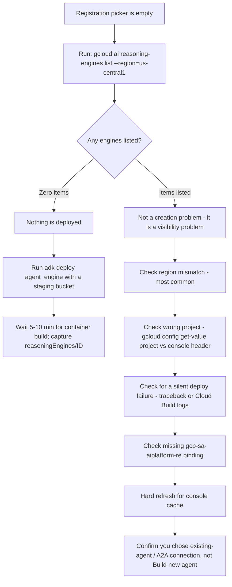
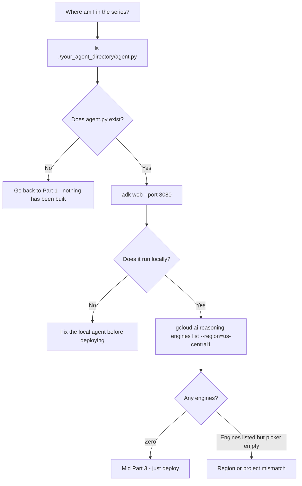

# Architecture Best Practice: Deploying to Agent Runtime — Prerequisites, Cloud Shell Execution & Deployment Troubleshooting

**Topics:** #gemini-enterprise #agent-runtime #deployment #google-cloud #troubleshooting #cloud-shell #iam #memory-bank

> **Source:** [Architecture Best Practice: Deploying to Agent Runtime](https://docs.google.com/document/d/1N5N-KVQwIpeEaN8aXMX1l6pdPjMnmAxFEZABT_7ZL3E/edit) · Converted from Google Docs

---


## FDE Project Grading Rubric Enforcement & Prevailing Customer Alignment

> **Mandatory Governance Standard:** Every project, prototype, or production agent built using the patterns in this concept **must pass the [Google Cloud FDE Field-Readiness & Project Grading Rubric](/concepts/00-fde-field-readiness-and-grading-rubric.md)** (aligned with the [Cloud FDE Team Charter](https://g3doc.corp.google.com/company/teams/cloud-fde/index.md?cl=head)). Scoring Requirement: **Average >= `2.0 (Competent)`** across both **Part A (Presentation & Advisory Rigor)** and **Part B (Engineering & Implementation Excellence)**, with **zero `0 (Not Demonstrated)` scores** on any single metric.

### 1. Part A — Presentation & Advisory Rigor Enforcement for This Concept

- **A.4 AI-Driven Development Discussion:** Show how reproducible Cloud Shell / CLI deployment harnesses and pre-flight verification scripts eliminate environment drift between local ADK development and managed Agent Runtime.
- **A.5 Futures / Roadmap:** Map the transition from initial Reasoning Engine deployment to multi-region HA, Terraform IaC, and Dataplex catalog governance.

### 2. Part B — Engineering & Implementation Excellence Cutlines for This Concept

- **B.2.7 Operational Documentation:** Provide step-by-step pre-flight checklists, IAM role binding matrices, and troubleshooting runbooks (resolving empty deployment pickers, cross-project Firestore access, and staging bucket permissions).
- **B.6.2 Infrastructure as Code (IaC):** Automate API enablement (`aiplatform.googleapis.com`, `discoveryengine.googleapis.com`), service account provisioning, and Reasoning Engine deployment via scripts and Terraform.
- **B.7.2 Configuration Management:** Externalize project IDs, regions, staging buckets, and Memory Bank resource names into environment variables.

### 3. Prevailing Customer Best-Practice Exemplars to Cite in Panel Reviews

- **Grounded Enterprise Scenarios:** Provisioning a fresh GCP project end-to-end for Vertex AI Agent Runtime, resolving cross-project Firestore IAM bindings, and configuring long-running multi-day stateful workflows.
- **Cross-Reference:** See [Concept 00 — FDE Field-Readiness & Project Grading Rubric](/concepts/00-fde-field-readiness-and-grading-rubric.md) for the complete 0–3 grading scale, 31-competency matrix, and disqualifier remediation rules.

---
## Architectural Best Practice: Key Guidelines & Takeaways

### Core Principles

- **State management is consumed as infrastructure, not written into the app.** Deploying to Agent Runtime provisions Sessions and Memory Bank natively — no custom database connections or vector stores in application code.
- **Sessions and Memory are different durations with different structures.** A Session is the turn-by-turn state of one conversation (events + state); Memory is long-term persistence across many sessions, isolated per identity. The session is the messy desk; memory is the organized filing cabinet.
- **Memory Bank is an asynchronous LLM-driven ETL** — extraction → consolidation → retrieval, running in the background so the user never waits.
- **Retrieval timing is an explicit architectural choice** — proactive (`PreloadMemoryTool`) versus reactive (Memory-as-a-Tool), chosen per workload rather than globally.
- **The tutorial series is cumulative.** Through Parts 1 and 2 the agent is a local Python object with no cloud resource; Part 3 is what makes it a cloud resource.
- **"Agent" names three distinct artifacts** — the ADK agent object, the Agent Engine instance (`reasoningEngines/<ID>`), and the Gemini Enterprise registration. The registration picker reads only the second one.
- **Deploy first, register second.** The picker is a mirror of what you have deployed, not a catalog of what you could deploy.
- **Managed does not mean unsized.** Agent Runtime has real compute limits that must be measured and tuned.
- **Treat deployment as a three-layer prerequisite problem** — knowledge, cloud configuration, and local environment — with a strict ordering dependency, provisioned from a script rather than by hand.

### Mandatory Requirements / Golden Rules

- **Complete Parts 1 and 2 before Part 3.** The agent definition and the Firestore-backed tools must already exist on disk.
- **Billing is a hard gate.** Vertex AI APIs will not enable without it — validate billing before anything else.
- **Enable the required APIs**: `aiplatform.googleapis.com`, `firestore.googleapis.com`, `iam.googleapis.com`, `cloudresourcemanager.googleapis.com`, and optionally `discoveryengine.googleapis.com`, plus `cloudbuild` and `artifactregistry` because deployment builds a container image.
- **Keep all lab code and the virtualenv under `$HOME`** in Cloud Shell — `python -m venv ~/adk-env`. Only `$HOME` survives VM recycling.
- **Make provisioning scripts idempotent and dry-runnable.** Run with `DRY_RUN=true` first; reruns are an expected part of the workflow, not an error path.
- **Use `--condition=None` on IAM bindings** to keep them unconditional and reruns idempotent.
- **Create a staging bucket before deploying** — it is mandatory; the deploy fails outright without it.
- **Match the region.** Agent Engine deploys are always regional; Gemini Enterprise often defaults its location to `global`.
- **Rerun the provisioning script after the first deploy** to complete the Reasoning Engine service-agent (`gcp-sa-aiplatform-re`) binding, which legitimately fails on a fresh project.
- **Diagnose an empty picker with one command**: `gcloud ai reasoning-engines list --region=us-central1`. Zero items → deploy; items listed → region/project mismatch.
- **Redact PII on the way into storage** (e.g. Model Armor), not after — once written, the exposure has already occurred.
- **Size Agent Runtime deliberately.** Start a long-running singleton at 1 vCPU / 1 GiB; monitor utilization and tune. Ceiling is 32 GiB at roughly 4 GiB per vCPU.
- **Plan context compaction and summarization early** rather than retrofitting it.

### Anti-Patterns / Guardrails

- **Starting at Part 3.** It deploys an agent it assumes already exists on disk.
- **Reading the registration picker as a catalog.** It mirrors what you have deployed in that exact project and region.
- **Looking for an Agent Studio agent under reasoning engines.** Different surface, different inventory.
- **Treating Agent Garden samples as deployed agents.** They are templates; browsing one creates nothing.
- **Assuming `global` and a deploy region are interchangeable.** Agent Engine is always regional.
- **Deploying without a staging bucket.** The deploy fails outright.
- **Deploying a directory lacking a proper `agent.py` / `root_agent` export.** It builds successfully and yields a non-functional engine — a silent failure.
- **Treating the Reasoning Engine service-agent binding failure as a script bug.** The service agent does not exist until first deploy.
- **Installing packages outside `$HOME` in Cloud Shell.** `pip install` vanishes on recycle.
- **Carrying lab IAM breadth (`aiplatform.admin`, `datastore.owner`) or open Firestore rules into production.** Both are explicitly flagged as things not to carry forward.
- **Guessing memory allocation high "to be safe."** Overprovisioning inflates cost linearly; measure, don't guess.
- **Deferring context compaction.** Long histories raise cost and latency and degrade quality.

---

**Knowledge Base Entry** | Source: working session transcript — planning, provisioning, and debugging *Gemini Enterprise Agent Platform Part 3: Scaling with Agent Runtime & Memory* (Medium, Google Cloud publication)

**Entry type:** Implementation runbook — lesson plan, prerequisite matrix, provisioning script, diagnostic decision trees

**Supersedes:** *Platform-Native State Management with Gemini Enterprise Agent Runtime & Memory Bank* (see §8 — that entry summarized the same article at section level; this one covers the executable layer)

**Related:** *Context Engineering for Stateful AI Agents on Google Cloud* — the conceptual treatment of the same sessions/memory architecture

---

## 1. Executive Summary

**Context.** This session works through what it actually takes to run Part 3 of the Gemini Enterprise Agent Platform tutorial: decomposing the article into a lesson plan, establishing the three layers of prerequisites, deciding where to execute the lab, generating an idempotent provisioning script, and then diagnosing the most common blocker — an empty agent picker at registration time. The technical substance is operational rather than architectural: sizing, IAM, environment durability, and the ordering dependencies that make or break a first deployment.

**Core Recommendation.** Treat the deployment as a **three-layer prerequisite problem with a strict ordering dependency**, and provision it from a script rather than by hand. Specifically:

1. The series is **cumulative** — Part 3 deploys an agent that Parts 1 and 2 built on disk. Starting at Part 3 cannot work.
2. Run the whole lab in **Cloud Shell**, with a `$HOME`-resident virtualenv to survive VM recycling.
3. Provision APIs, IAM, and the service account with an **idempotent, dry-runnable script** — reruns are expected, because one binding legitimately fails until first deploy.
4. Understand that **"agent" names three different artifacts**; the registration picker reads only the second one.
5. Expect **region mismatch** to be the default explanation when a deployed agent doesn't appear — Agent Engine is regional, Gemini Enterprise often defaults to `global`.
6. Size Agent Runtime deliberately: exceeding memory terminates the instance, overprovisioning inflates cost linearly.

---

## 2. Core Architectural Principles & Decisions

### Decision 1 — State management is consumed as infrastructure, not written into the app

Deploying to Agent Runtime provisions Sessions and Memory Bank natively; no custom database connections or vector stores in application code. *Rationale:* the stated purpose of Part 3 is converting a stateless agent into a stateful one without hand-rolling persistence.

### Decision 2 — Sessions and Memory are different durations with different structures

A **Session** is the turn-by-turn state of one conversation, composed of **events** (user input, agent response, tool call, tool output) plus **state** (a structured scratchpad). **Memory** is long-term persistence across many sessions, isolated per identity. The session is the messy desk; memory is the organized filing cabinet. *Rationale:* conflating them either loses personalization at session close or bloats every turn.

### Decision 3 — Memory Bank is an asynchronous LLM-driven ETL

Extraction → consolidation → retrieval, with consolidation able to merge, delete, or create memories, running in the background so the user never waits. *Rationale:* the same non-blocking principle documented at length in the Context Engineering entry, here provided as a managed service.

### Decision 4 — Retrieval timing is an explicit architectural choice

**Proactive** (`PreloadMemoryTool`, loads every turn) versus **reactive** (Memory-as-a-Tool, the agent decides). *Rationale:* proactive retrieval adds overhead on turns that don't need memory; the trade is latency against the risk of the model failing to invoke the tool.

### Decision 5 — The tutorial series is cumulative and the agent exists locally for two parts before it exists in the cloud

Part 1 builds the ADK `root_agent` in `agent.py`; Part 2 attaches native Python tools and the Firestore data layer; Part 3 deploys. Through Parts 1 and 2 the agent is a **local Python object with no cloud resource**. *Rationale:* this is the single most important sequencing fact in the session, and the direct cause of the empty-picker confusion.

### Decision 6 — "Agent" names three distinct artifacts

**(1) The ADK agent object** — a Python variable (`root_agent = Agent(...)`), nothing in Google Cloud. **(2) The Agent Engine instance** — a deployed, billable cloud resource with a `reasoningEngines/<ID>` name. **(3) The Gemini Enterprise registration** — pointing the app at the deployed engine so end users can reach it. *Rationale:* the registration picker is artifact 3 asking for the output of artifact 2; it is a mirror of what you have deployed, not a catalog of what you could deploy.

### Decision 7 — Deploy first, register second

The picker is empty until `adk deploy agent_engine` produces a resource. *Rationale:* order of operations, not a bug or a missing entitlement.

### Decision 8 — Agent Studio and ADK are separate surfaces with separate inventories

An agent built in the Agent Studio UI lives in Gemini Enterprise and will never appear under reasoning engines. Agent Garden samples are templates copied locally — browsing one creates nothing. *Rationale:* two surfaces, two lists; looking in the wrong one produces a false "nothing exists" conclusion.

### Decision 9 — Cloud Shell is sufficient for the entire lab

Python 3.10+, `gcloud`, ADC authentication, an editor, and `git` are all pre-provisioned; only `google-adk` must be installed. *Rationale:* most prerequisites are satisfied by default, making it easier than local setup rather than a compromise.

### Decision 10 — Only `$HOME` survives Cloud Shell VM recycling

Keep all lab code and the virtualenv under `~/`. *Rationale:* `pip install` performed outside a home-resident venv vanishes on recycle — the single largest source of friction, and fully avoidable with one decision made up front.

### Decision 11 — Provisioning scripts must be idempotent and dry-runnable

Reruns are an expected part of the workflow, not an error path. *Rationale:* the Reasoning Engine service agent does not exist until the first deploy, so its IAM binding legitimately fails on a fresh project and succeeds on a later run.

### Decision 12 — Region and project alignment is the default suspect for missing resources

Agent Engine deploys are always **regional**; Gemini Enterprise often defaults its location to **global**. *Rationale:* this mismatch accounts for most "my agent isn't there" reports.

### Decision 13 — Managed does not mean unsized

Agent Runtime has real compute limits: default 512 MiB (service) / 2 GiB (instance), a 32 GiB ceiling, and roughly 4 GiB per vCPU. Instances exceeding their memory limit are **terminated**; overprovisioning directly inflates cost. *Rationale:* monitor utilization and tune rather than guessing high — a long-running singleton agent starts reasonably at 1 vCPU / 1 GiB.

### Decision 14 — Lab-grade permissions are not production-grade

`roles/aiplatform.admin` and `roles/datastore.owner` are acceptable for a lab and too broad for production. Open Firestore security rules carried over from Part 2 are development-only. *Rationale:* both are explicitly flagged as things not to carry forward.

### Decision 15 — Redact PII before persistence, not after

Sanitize on the way into storage (e.g. Model Armor). *Rationale:* once written, the exposure has already occurred.

### Decision 16 — Plan context compaction before it becomes a problem

Long histories raise cost and latency and degrade quality. *Rationale:* compaction and summarization are cheaper to design in than to retrofit.

---

## 3. Best Practice Guidelines & Recommended Patterns

### Pattern: Lesson-Plan Decomposition of the Tutorial

- **Description:** The article maps to seven modules with distinct objectives.
- **Structure:**

| Module | Objective | Core content |
|---|---|---|
| 0 — Framing | Understand why stateless bots fail | Session vs. memory distinction; desk vs. filing cabinet |
| 1 — Agent Runtime | Get the agent off the laptop | Fully managed, no infrastructure to provision; built-in observability; sub-second cold starts; multi-day workflows up to 7 days pausing for webhooks or human approval and resuming without losing state |
| 2 — Sessions | Maintain in-flight conversation state | Natively provisioned; events + state; per-user ACL isolation, PII redaction, TTL, deterministic event ordering |
| 3 — Memory Bank | Make the agent expert on the *user* | Personalized persistent memories isolated per identity; async ETL; ADK integration via `Vertex AiMemoryBankService` |
| 4 — Extraction config | Decide what gets remembered | Topics, TTL, natural-language customization; proactive vs. reactive retrieval |
| 5 — Testing | Prove retention works | Test conversations across turns and sessions |
| 6 — Console validation | Verify at the platform layer | Inspect sessions and stored memories in Console |

- **Guardrails:** Modules 0–3 are conceptual and map onto the Context Engineering KB; Modules 4–6 are platform-specific and only exist in this managed context.

### Pattern: Three-Layer Prerequisite Matrix

- **Description:** Knowledge, cloud configuration, and local environment must each be satisfied independently.
- **Knowledge layer:** Parts 1 and 2 completed (the agent definition and the Firestore-backed tools must already exist on disk); familiarity with GenAI on Google Cloud, prompting, and tool-calling; conceptual grounding in the session/memory split.
- **Cloud layer:** A project with **billing enabled**, plus APIs — `aiplatform.googleapis.com` (Agent Runtime, Gemini, Memory Bank, evaluations), `firestore.googleapis.com` (Part 2 data layer), `iam.googleapis.com` (agent service account / Agent Identity), `cloudresourcemanager.googleapis.com` (IAM policy binding), and optionally `discoveryengine.googleapis.com` (datastore grounding). Caller roles: `roles/aiplatform.admin`, `roles/datastore.owner`, `roles/iam.serviceAccountAdmin`. Authentication via `gcloud auth application-default login` locally, or a service account in production.
- **Local layer:** Python 3.10+, `gcloud` CLI, `pip install google-adk` plus the Vertex AI / Agent Platform SDK, and an editor.
- **Guardrails:** Billing is a hard gate — Vertex AI APIs will not enable without it, so validate it before anything else.

### Pattern: Cloud Shell as the Lab Environment

- **Description:** Execute the entire tutorial in the browser.
- **What is free:** Python 3.10+, `gcloud` (pre-authenticated), ADC as the console identity, Cloud Shell Editor, `git`. Only `google-adk` needs installing.
- **Module-to-surface mapping:** API enablement and IAM → Console UI or `gcloud services enable`; code editing → Cloud Shell Editor; local test (`adk web`) → Cloud Shell + Web Preview; deploy → Cloud Shell terminal; session and memory inspection → Console → Vertex AI → Agent Engine; Part 2 data → Console → Firestore Studio.
- **Web Preview detail:** run `adk web --port 8080` and use Web Preview on 8080 — 8080 is the default preview port, so choosing it over ADK's default 8000 avoids an extra "change port" click.
- **Guardrails:** 20-minute idle timeout kills running processes; only `$HOME` persists across VM recycle; 5 GB home quota; 50 hrs/week cap; `gcloud config set project` must be set explicitly. For multi-day Agent Runtime workflows with zero timeout risk, a small Vertex AI Workbench instance is the alternative.

### Pattern: Home-Resident Virtualenv

- **Description:** One decision that neutralizes the biggest Cloud Shell annoyance.
- **Implementation:** `python -m venv ~/adk-env && source ~/adk-env/bin/activate`, with all lab code under `~/`.
- **Guardrails:** Cloud Shell will not auto-activate it — add the `source` line to `~/.bashrc` for persistence across sessions.

### Pattern: Idempotent Provisioning Script

- **Description:** A single script that enables APIs, grants operator IAM, creates and authorizes the agent service account, and builds the persistent venv.
- **Structural conventions demonstrated:** `set -euo pipefail` with a restricted `IFS`; readonly configuration overridable by environment variable; colourized `log_info` / `log_warn` / `log_error` / `log_step` helpers; an `EXIT` trap reporting non-zero exit codes; explicit dependency checking for `gcloud` and `python3`; a validation phase confirming authentication, project existence, and billing before any mutation; a `run()` wrapper that prints instead of executing when `DRY_RUN=true`; batch API enablement in a single call rather than twelve sequential ones; `--condition=None` on IAM bindings to keep them unconditional and reruns idempotent; existence checks before service-account creation; and a closing summary printing the exact environment exports needed per session.
- **Roles granted:** operator — `aiplatform.admin`, `aiplatform.user`, `datastore.owner`, `iam.serviceAccountAdmin`, `iam.serviceAccountUser`, `storage.admin`, `logging.viewer`. Agent service account — `aiplatform.user`, `datastore.user`, `storage.objectUser`, `logging.logWriter`, `monitoring.metricWriter`. Plus `aiplatform.user` for the Reasoning Engine service agent `service-<PROJECT_NUMBER>@gcp-sa-aiplatform-re.iam.gserviceaccount.com`.
- **APIs enabled:** the five required above plus `iamcredentials`, `serviceusage`, `storage`, `logging`, `monitoring`, `cloudbuild`, and `artifactregistry` — the last two because agent deployment builds a container image.
- **Guardrails:** Run with `DRY_RUN=true` first. IAM grants fail as warnings rather than errors when the caller lacks Project IAM Admin, so the script completes and surfaces what was skipped. The Reasoning Engine binding is expected to fail on a fresh project — rerun after the first deploy.

### Pattern: Deploy-Then-Register Sequence

- **Description:** Producing the cloud resource the registration step consumes.
- **Implementation:** Activate the venv; export `GOOGLE_CLOUD_PROJECT`, `GOOGLE_CLOUD_LOCATION`, `GOOGLE_GENAI_USE_VERTEXAI=TRUE`, and a `STAGING_BUCKET`; create the bucket (mandatory — deploy fails without it); run `adk deploy agent_engine` with project, region, staging bucket, display name, and the agent directory.
- **Guardrails:** First deploy takes 5–10 minutes because it builds a container. The `reasoningEngines/<ID>` resource name in the output is the proof of success. Deploying from a directory without a proper `agent.py` / `root_agent` export will **build successfully but produce a non-functional engine**.

### Pattern: Empty-Picker Diagnostic Tree

- **Description:** One command splits the problem cleanly.
- **Implementation:** `gcloud ai reasoning-engines list --region=us-central1`. **Zero items** → nothing is deployed; run the deploy. **Items listed but picker empty** → a region or project mismatch, not a creation problem.
- **Secondary causes in priority order:** region mismatch (most common); wrong project (`gcloud config get-value project` versus the console header); a deploy that failed silently (re-read output for a traceback; check Cloud Build logs); the missing `gcp-sa-aiplatform-re` binding warned about during setup; console cache (hard refresh); or choosing "Build new agent" instead of the existing-agent / A2A connection option.



### Pattern: Position Self-Diagnosis

- **Description:** Three commands locate you in the series.
- **Implementation:** `ls ./your_agent_directory/agent.py` — does Part 1's artifact exist? `adk web --port 8080` — does it run locally? `gcloud ai reasoning-engines list --region=us-central1` — does Part 3's artifact exist?
- **Interpretation:** No `agent.py` → go back to Part 1, nothing has been built. Runs locally with zero engines → mid Part 3, just deploy. Engines listed with an empty picker → region/project mismatch.
- **Guardrails:** Run the `ls` first. If `agent.py` isn't there, the gap is Part 1 and no amount of console configuration will fill the dropdown.



---

## 4. Trade-Off Analysis & Pitfalls

| Option / Decision | Advantages | Trade-Offs / Risks | Mitigations |
|---|---|---|---|
| **Cloud Shell as the lab environment** *(recommended in session)* | Python, `gcloud`, ADC, editor and `git` pre-provisioned; nothing to install locally; identity already correct | 20-min idle timeout kills processes; only `$HOME` persists; 5 GB quota; 50 hrs/week cap | `$HOME` virtualenv; keep code under `~/`; re-run `adk web` after reconnect |
| Local development machine | No timeout; full control | Must install Python 3.10+, `gcloud`, SDKs; authenticate manually; environment drift between operators | Viable, but strictly more setup for the same result |
| Vertex AI Workbench instance | Zero timeout risk; suits multi-day Agent Runtime workflows | Additional cost and provisioning; overkill for a single lab | Reserve for genuinely long-running work |
| **Proactive memory retrieval** (`PreloadMemoryTool`) | Memory always present; no reliance on the model choosing to fetch | Adds latency and cost on turns that don't need memory | Cache, or switch to reactive |
| **Reactive memory retrieval** (Memory-as-a-Tool) | No overhead on irrelevant turns | The model may fail to invoke the tool | Choose per workload, not globally |
| Broad lab IAM (`aiplatform.admin`, `datastore.owner`) | Unblocks the lab immediately | Far beyond least privilege | Tighten before anything production-facing |
| Open Firestore rules inherited from Part 2 | Works in dev | Development-only; unsafe in production | Do not carry forward |
| Overprovisioned Agent Runtime memory | No OOM terminations | Cost inflates directly with allocation | Monitor utilization and tune; start at 1 vCPU / 1 GiB for a long-running singleton |
| Underprovisioned Agent Runtime memory | Cheapest | Instances exceeding the limit are **terminated** | Same — measure, don't guess |
| Redacting PII after persistence | Simpler pipeline | The exposure has already happened | Redact on the way in (e.g. Model Armor) |
| Deferring context compaction | Ships sooner | Long histories raise cost and latency and degrade quality | Plan compaction/summarization early |

**Antipatterns and Pitfalls to Avoid**

- **Starting at Part 3.** It deploys an agent it assumes already exists on disk.
- **Reading the registration picker as a catalog.** It mirrors what you have deployed in that exact project and region.
- **Looking for an Agent Studio agent under reasoning engines.** Different surface, different inventory.
- **Treating Agent Garden samples as deployed agents.** They are templates; browsing one creates nothing.
- **Assuming `global` and a deploy region are interchangeable.** Agent Engine is always regional.
- **Deploying without a staging bucket.** The deploy fails outright.
- **Deploying a directory lacking a proper `agent.py` / `root_agent` export.** It builds successfully and yields a non-functional engine — a silent failure.
- **Treating the Reasoning Engine service-agent binding failure as a script bug.** The service agent does not exist until first deploy.
- **Installing packages outside `$HOME` in Cloud Shell.**
- **Carrying lab IAM breadth or open Firestore rules into production.**
- **Guessing memory allocation high "to be safe."**

---

## 5. Real-World / Operational Scenarios

**Scenario 1: The Empty Deployment Picker**

- *Context & Constraints:* At the Gemini Enterprise registration step, the agent dropdown shows nothing to select. The operator has completed the tutorial reading and expects to choose an agent.
- *Root Cause:* Expected state. The picker lists agents already deployed to Vertex AI Agent Engine in that exact project and region. Nothing had been deployed yet — the agent existed only as local Python from Parts 1 and 2.
- *Applied Resolution:* Run `gcloud ai reasoning-engines list --region=us-central1` to split the diagnosis. Zero items → run `adk deploy agent_engine` with a staging bucket, then wait 5–10 minutes for the container build and capture the `reasoningEngines/<ID>`. Items listed → correct the console region or project selector.
- *Outcomes:* The distinction between "not created" and "not visible" is resolved by one command rather than console exploration.

**Scenario 2: Locating Yourself in a Cumulative Series**

- *Context & Constraints:* An operator unsure whether the missing agent indicates a deployment bug or an incomplete prerequisite.
- *Applied Resolution:* Three checks in order — does `agent.py` exist, does it run under `adk web`, and do any reasoning engines exist. Each outcome maps to exactly one position: back to Part 1, mid Part 3, or a region/project mismatch.
- *Outcomes:* Prevents the common failure of debugging the console when the actual gap is two tutorial parts upstream.

**Scenario 3: Provisioning a Fresh Project End to End**

- *Context & Constraints:* A new project requiring twelve APIs, seven operator roles, a service account with five roles, a Reasoning Engine service-agent binding, and a durable Python environment.
- *Applied Resolution:* A single idempotent script validating dependencies, authentication, project existence and billing before mutating anything; batch-enabling APIs; granting bindings with `--condition=None`; creating the service account only if absent; building a `$HOME` venv; and printing the per-session environment exports at the end. Previewed with `DRY_RUN=true`.
- *Outcomes:* Reproducible setup where partial failures surface as warnings rather than aborting, and the one legitimately-deferred binding is documented as a rerun.

**Scenario 4: Cross-Project Firestore Access**

- *Context & Constraints:* The Part 2 Firestore database lives in a different project from the agent.
- *Applied Resolution:* Explicitly grant the Gemini Enterprise service account `service-<PROJECT_NUMBER>@gcp-sa-gemini-enterprise.iam.gserviceaccount.com` the Cloud Datastore Import Export Admin role.
- *Outcomes:* A specific, easily-missed binding that the default single-project setup never surfaces.

**Scenario 5: Long-Running and Multi-Day Workflows**

- *Context & Constraints:* Workflows that pause for webhooks or human approval and must resume without losing state.
- *Applied Resolution:* Agent Runtime supports runs up to 7 days with sub-second cold starts, resuming without state loss. For the development environment supporting such work, prefer a Vertex AI Workbench instance over Cloud Shell to avoid the idle timeout.
- *Outcomes:* The runtime capability and the developer-environment choice are linked decisions, not independent ones.

---

## 6. Topic Modeling & Taxonomic Tags

**Domain Taxonomy** `ai-agents` · `cloud-infrastructure` · `platform-engineering` · `devops-and-automation` · `identity-and-access-management` · `developer-experience` · `troubleshooting-and-diagnostics` · `state-management`

**Key Entity & Technology Tags** `gemini-enterprise-agent-platform` · `agent-runtime` · `agent-engine` · `reasoning-engines` · `agent-sessions` · `agent-memory-bank` · `vertex-ai` · `vertex-ai-workbench` · `google-adk` · `adk-web` · `adk-deploy` · `agent-studio` · `agent-garden` · `rag-engine` · `preload-memory-tool` · `vertex-aimemorybankservice` · `cloud-shell` · `cloud-shell-editor` · `web-preview` · `gcloud-cli` · `firestore` · `firestore-studio` · `cloud-build` · `artifact-registry` · `cloud-storage` · `cloud-logging` · `cloud-monitoring` · `model-armor` · `discovery-engine` · `iam-service-accounts` · `application-default-credentials` · `python-virtualenv` · `bash-scripting` · `gemini-2-5-flash`

**Thematic & Pattern Tags** `deploy-then-register` · `cumulative-tutorial-dependency` · `local-object-vs-cloud-resource` · `artifact-disambiguation` · `managed-runtime` · `sub-second-cold-start` · `multi-day-workflows` · `session-events-and-state` · `cross-session-memory` · `asynchronous-memory-etl` · `proactive-vs-reactive-retrieval` · `memory-extraction-configuration` · `ttl-policies` · `per-user-isolation` · `pii-redaction-before-persistence` · `context-bloat` · `compaction-planning` · `three-layer-prerequisites` · `billing-as-hard-gate` · `batch-api-enablement` · `idempotent-provisioning` · `dry-run-preview` · `unconditional-iam-bindings` · `service-agent-lazy-creation` · `least-privilege-gap` · `ephemeral-vm-persistence` · `home-resident-virtualenv` · `idle-timeout` · `regional-vs-global-mismatch` · `staging-bucket-requirement` · `silent-build-success` · `diagnostic-decision-tree` · `position-self-diagnosis` · `runtime-sizing` · `memory-ceiling` · `vcpu-memory-ratio` · `oom-termination-vs-overprovisioning`

---

## 7. Appendix: Reference Tables

### A. Tutorial Series Progression

| Part | Theme | Focus | Agent exists where? | In deploy picker? |
|---|---|---|---|---|
| Part 1 | Build | Platform foundations, ADK, Agent Studio, Agent Garden, RAG Engine | Local filesystem | No |
| Part 2 | Build | Native Python tools, external data (Firestore asset DB) | Local filesystem | No |
| Part 3 | Scale | Agent Runtime deployment + Sessions + Memory Bank | Vertex AI Agent Engine | Yes — first time |

### B. The Three Meanings of "Agent"

| # | Artifact | Form | Cloud resource? |
|---|---|---|---|
| 1 | ADK agent object | `root_agent = Agent(...)` in `agent.py` | No |
| 2 | Agent Engine instance | `reasoningEngines/<ID>`, billable | Yes — what the picker reads |
| 3 | Gemini Enterprise registration | App pointed at the deployed engine | Consumes #2 |

### C. Required APIs

| API | Purpose |
|---|---|
| `aiplatform.googleapis.com` | Agent Runtime, Gemini models, Memory Bank, evaluations |
| `firestore.googleapis.com` | Part 2 data layer |
| `iam.googleapis.com` | Agent service account / Agent Identity |
| `cloudresourcemanager.googleapis.com` | IAM policy binding |
| `discoveryengine.googleapis.com` | Optional — datastore grounding |
| `cloudbuild` · `artifactregistry` | Container build and image storage during deploy |
| `storage` · `logging` · `monitoring` · `serviceusage` · `iamcredentials` | Staging, observability, enablement, impersonation |

### D. IAM Roles

| Principal | Roles |
|---|---|
| Operator | `aiplatform.admin`, `aiplatform.user`, `datastore.owner`, `iam.serviceAccountAdmin`, `iam.serviceAccountUser`, `storage.admin`, `logging.viewer` |
| Agent service account | `aiplatform.user`, `datastore.user`, `storage.objectUser`, `logging.logWriter`, `monitoring.metricWriter` |
| Reasoning Engine service agent | `aiplatform.user` — binding deferred until after first deploy |
| Gemini Enterprise SA (cross-project Firestore only) | Cloud Datastore Import Export Admin |

### E. Agent Runtime Sizing

| Setting | Value |
|---|---|
| Default memory | 512 MiB (service) / 2 GiB (instance) |
| Memory ceiling | 32 GiB |
| Scaling ratio | ~4 GiB per vCPU (1 vCPU → 4 GiB; 8 vCPU → 32 GiB) |
| Long-running singleton starting point | 1 vCPU / 1 GiB |
| Over-limit behavior | Instance terminated |

### F. Cloud Shell Capability Matrix

| Prerequisite | Status |
|---|---|
| Python 3.10+ | Pre-installed |
| `gcloud` CLI | Pre-installed and pre-authenticated |
| ADC authentication | Already the console identity |
| Code editor | Cloud Shell Editor |
| `git` | Pre-installed |
| `google-adk` | Must be installed |

### G. Cloud Shell Constraints

| Constraint | Mitigation |
|---|---|
| 20-minute idle timeout | Keep the tab active; re-run `adk web` after reconnect |
| Only `$HOME` persists | Keep all code under `~/` |
| 5 GB home quota | Sufficient for the lab; avoid large datasets |
| 50 hrs/week cap | Rarely binding for a single lab |
| `pip install` lost on recycle | `python -m venv ~/adk-env` |
| Project not set | `gcloud config set project YOUR_PROJECT_ID` |

### H. Script Configuration Surface

| Variable | Default | Purpose |
|---|---|---|
| `PROJECT_ID` | current `gcloud` project | Target project |
| `REGION` | `us-central1` | Agent Runtime / Memory Bank region |
| `SA_NAME` | `agent-runtime-sa` | Agent service account name |
| `VENV_PATH` | `$HOME/adk-env` | Persistent virtualenv location |
| `DRY_RUN` | `false` | Print commands instead of executing |

### I. Per-Session Environment Exports

```bash
source ~/adk-env/bin/activate
export GOOGLE_CLOUD_PROJECT=<PROJECT_ID>
export GOOGLE_CLOUD_LOCATION=<REGION>
export GOOGLE_GENAI_USE_VERTEXAI=TRUE
adk web --port 8080
```

---

## 8. Scope, Confidence & Relationship to Existing Entries

**Supersession.** An earlier entry — *Platform-Native State Management with Gemini Enterprise Agent Runtime & Memory Bank* — was synthesized from a brief summary of this same Medium article and was explicitly flagged as a thin reference stub with no scenarios and no examined trade-offs. This entry covers the same source at the executable layer and substantially supersedes it. **Recommendation:** fold that entry into this one, or retire it, rather than maintaining both.

**Relationship to the Context Engineering entry.** That document treats sessions and memory as an architecture the team designs and operates — event/state separation, tiered persistence, recursive summarization, asynchronous consolidation ETL, provenance, tenant partitioning, intent-scoped retrieval. This entry documents the **managed realization** of those same concerns plus the operational work of standing it up. The open question between them remains unanswered by either source: which Context Engineering patterns stay the team's responsibility once Agent Runtime provisions Sessions and Memory Bank natively.

**Verification status.** The following are reported as stated in the session and have **not** been independently verified against current Google Cloud documentation: the Agent Runtime sizing figures (512 MiB / 2 GiB defaults, 32 GiB ceiling, ~4 GiB per vCPU), the 7-day maximum for long-running workflows, Cloud Shell quotas (5 GB home, 50 hrs/week, 20-minute idle timeout), the exact service-agent address formats, and the completeness of the API and role lists. The provisioning script was authored in-session and **was not executed**, so it is unvalidated against a live project.
