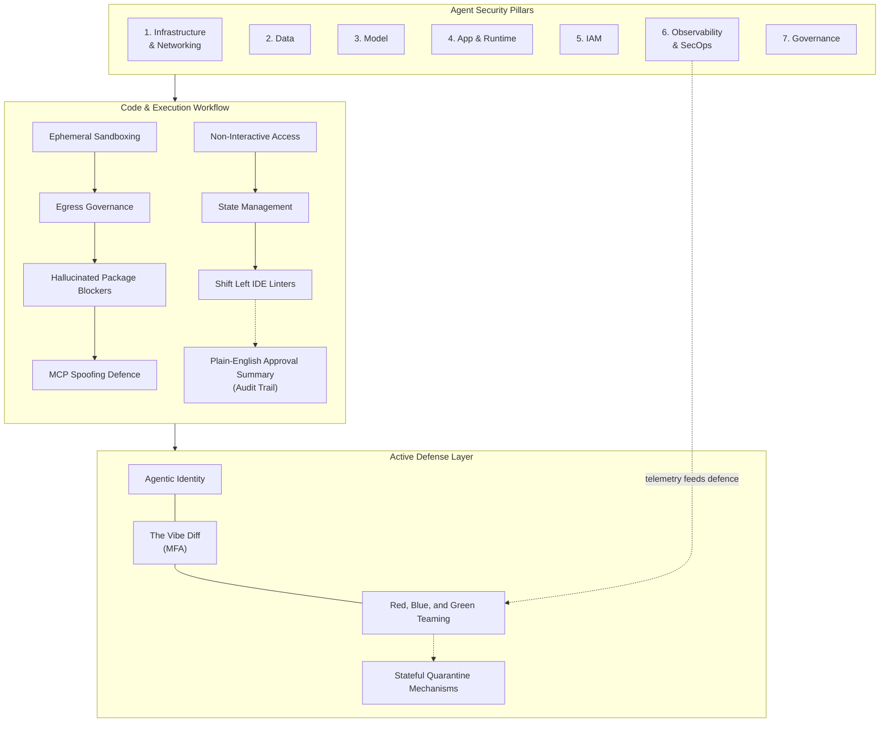
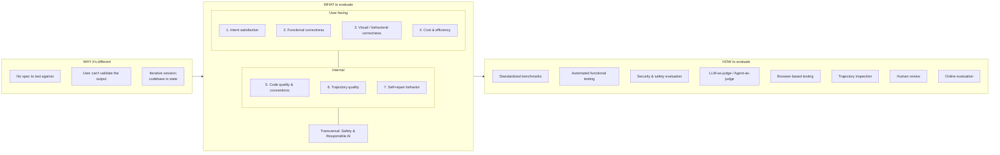

# Vibe Coding Agent Security and Evaluation

**Topics:** #agent-security #vibe-coding #sandboxing #agent-evaluation #agentops #observability #zero-trust-identity #supply-chain-security

> **Source:** [Vibe Coding Agent Security and Evaluation](https://docs.google.com/document/d/1vOL-cvTVURqW_vXRq0nx8AhpCkbEyr7Eg6aAed8QZhA/edit) · Converted from Google Docs

---


## FDE Project Grading Rubric Enforcement & Prevailing Customer Alignment

> **Mandatory Governance Standard:** Every project, prototype, or production agent built using the patterns in this concept **must pass the [Google Cloud FDE Field-Readiness & Project Grading Rubric](/concepts/00-fde-field-readiness-and-grading-rubric.md)** (aligned with the [Cloud FDE Team Charter](https://g3doc.corp.google.com/company/teams/cloud-fde/index.md?cl=head)). Scoring Requirement: **Average >= `2.0 (Competent)`** across both **Part A (Presentation & Advisory Rigor)** and **Part B (Engineering & Implementation Excellence)**, with **zero `0 (Not Demonstrated)` scores** on any single metric.

### 1. Part A — Presentation & Advisory Rigor Enforcement for This Concept

- **A.2 Objection Handling & Technical Defense:** Address CISO and risk-panel pushback on autonomous coding and action agents using the 7-Pillar Agentic Security Framework and Risk-Stratified Attestation.
- **A.4 AI-Driven Development Discussion:** Contrast static benchmark overfitting (e.g., SWE-bench) with real-world intent evaluation and mandatory plain-language 'Logic Reviews' that prevent confirmation fatigue.

### 2. Part B — Engineering & Implementation Excellence Cutlines for This Concept

- **B.3.1–B.3.5 Security, Privacy & Compliance:** Implement ephemeral sandboxing, CMEK + mTLS, Cross-Tenant Vector Poisoning prevention, EU AI Act Algorithmic Impact Assessments, and immutable dual-principal audit trails (agent + approving human).
- **B.4.2 Observability & B.5.3 AI Cost Management:** Monitor internal reasoning traces to detect hallucination loops and block **Denial of Wallet (DoW)** attacks before billing spikes occur.
- **B.1.4 LLM Ops & Evaluation:** Combine deterministic security assertions, Red/Green agent adversarial simulation, and human Logic Reviews.

### 3. Prevailing Customer Best-Practice Exemplars to Cite in Panel Reviews

- **Grounded Enterprise Scenarios:** Preventing Cross-Tenant Vector Poisoning in multi-tenant RAG, mitigating Denial of Wallet (DoW) loops, and enforcing EU AI Act Algorithmic Impact Assessments with Risk-Stratified Attestation.
- **Cross-Reference:** See [Concept 00 — FDE Field-Readiness & Project Grading Rubric](/concepts/00-fde-field-readiness-and-grading-rubric.md) for the complete 0–3 grading scale, 31-competency matrix, and disqualifier remediation rules.

---
## Architectural Best Practice: Key Guidelines & Takeaways

### Core Principles

- **A raw model is not an agent.** A model only becomes an agent when wrapped in a "harness" — the scaffolding that gives it state, tool execution, feedback loops, and enforceable constraints. Securing this paradigm means shifting focus from securing code syntax to securing the harness.
- **Context-as-a-Perimeter replaces Identity-as-a-Perimeter.** Static identity is a poor perimeter in a non-deterministic environment. Everyday agent failures trace back to a missing tool, a vague rule, or an absent guardrail.
- **Effective Trust is continuous, not a one-time gate.** Trust must be continuously earned, verified, and dynamically enforced at runtime across an agent's supply chain, identity, runtime behaviour, and contextual associations.
- **Assume the model can fail or be compromised.** Security cannot reside inside the AI itself; it must be enforced by a strict, external "safety envelope".
- **Security and Evaluation are two distinct axes of trust.** Security tells you if the agent stayed inside the boundary; evaluation tells you whether what happened inside that boundary is worth shipping.
- **Trust is a degradable asset.** Trust Decay dictates that trust is lost when an agent's chain of thought pursues sub-goals that diverge from the original human vibe.
- **You cannot secure what you cannot see.** Observability is not merely operational; it is a strict security requirement and the absolute prerequisite for Glass Box evaluation.
- **The floor is not the ceiling.** Functional correctness is easy to measure and easy to game; intent satisfaction is what the user ultimately judges the agent on.

### Mandatory Requirements / Golden Rules

- **Sandbox the vibe loop.** Always execute dynamically generated scripts inside ephemeral, network-isolated, kernel-level sandboxes (such as gVisor, dedicated containers, or VMs). Sandboxes must block raw host access and completely reset state between runs.
- **Pin and verify every dependency.** Source dependencies exclusively from vetted providers or internal enterprise registries with strict cryptographic version pinning. CI/CD must verify SBOM entries and digital signatures before artifacts advance to production, gated by Binary Authorisation.
- **Restrict agents to non-interactive internet access.** Force external information retrieval through offline caches or dedicated, pre-sanitised web-crawling services; egress must travel only through governed pathways.
- **Shift left advisory, enforce deterministically.** Use Developer Advisory Linters in the IDE for real-time guidance, and push unyielding enforcement (SAST and SCA) into deterministic CI/CD checks.
- **Route all tool invocations through a Centralised Agent Gateway** that evaluates Contextual Authorisation, and deploy a runtime LLM firewall in front of the active agent.
- **Give every agent a unique cryptographic identity** (such as a SPIFFE ID), authenticated with an identity explicitly tagged as *agentic* rather than the human user's delegated credentials.
- **Enforce Zero Ambient Authority.** Use Just-In-Time token downscoping, Attribute-Based Access Control, and a permissions matrix of Intent × User × Time; tokens expire the moment the task concludes.
- **Enforce file-tree allowlists** with deny-by-default rules that block access to secrets, build scripts, and production manifests.
- **Gate high-stakes actions with hardware MFA and a "Vibe Diff"** — a plain-English translation of the generated code, reviewed by an Evaluator Quorum, before explicit cryptographic consent.
- **Restrict agent output to small batch sizes,** ideally via a test-driven loop that blocks the agent from modifying tests and implementation code simultaneously.
- **Deploy the agentic SecOps triad** — Red (Agent Attacker injecting Adversarial Vibes), Blue (Agent Defender running Agent Behavioural Analytics), Green (Agent Fixer executing Stateful Quarantine and Auto-Refactoring).
- **Checkpoint before every codebase modification,** and trip a stateful circuit breaker that rolls back, revokes tool access, and freezes execution when the Agent Trust Score drops below threshold.
- **Trace the full Vibe Trajectory with OpenTelemetry** (`agent.session`, `agent.think`, `agent.tool` spans) and pair it with Centralised Content Scanning of all dynamically retrieved code.
- **Monitor a Runtime AgBOM,** not a static SBOM, to map the agent's active blast radius.
- **Enforce strict tenant partitioning in vector databases** to prevent Cross-Tenant Vector Poisoning.
- **Treat system instructions, prompt templates and rule files as source code** — highly sensitive, cryptographically attested artifacts.
- **Protect context data** with CMEK at rest and mTLS in transit, scoped down to least privilege.
- **Maintain an immutable audit trail** attributing every real-world action to a specific agent and the human who deployed or approved it; use Risk-Stratified Attestation and mandatory "Logic Reviews".
- **Comply with the EU AI Act,** including Algorithmic Impact Assessments for high-risk autonomous agents.
- **Evaluate the session, not the turn.** Derive acceptance criteria from the session prefix, judge the rendered artifact rather than the diff, measure convergence, and mine user corrections as labelled failure data.

### Anti-Patterns / Guardrails

- **"It Works, Ship It."** Assuming generated code is safe because it compiles and runs without errors. Replace blind approval buttons with mandatory Logic Reviews and the Vibe Diff.
- **Running generated scripts on the host.** Executing dynamically generated code alongside the root agent or on standard host infrastructure is an unacceptable risk.
- **Relying on a simple domain allowlist.** An allowlist cannot protect an agent against indirect prompt injections hidden inside third-party web pages.
- **Hard-blocking insecure prompts inside the IDE.** Easily bypassed and causes excessive friction for benign developers; enforcement belongs in CI/CD.
- **Granting shared, long-lived service identities** or the developer's full ambient administrative privileges to agents — this creates the Confused Deputy problem.
- **Letting the agent be the final arbiter of access.**
- **Trusting hallucinated package names.** Attackers publish malware under fabricated dependency names ("slopsquatting").
- **Trusting unverified MCP servers.** Forged or compromised servers can pose as legitimate tools to inject payloads or demand excessive privileges.
- **Pushing sensitive logic to the frontend.** AI generation takes the path of least resistance and dumps API keys, password validation, and session flags into client-side code.
- **Skipping default-deny access controls.** Row-level database security gets skipped, exposing private user data and internal staging environments to the public internet.
- **Killing a compromised agent's container.** Terminating an agent mid-thought can leave connected APIs corrupted; use a Stateful Quarantine that preserves short-term memory for forensics.
- **Relying on static SBOMs and UEBA.** Both are instantly stale or ineffective against non-deterministic AI.
- **Treating HTTP 200 OK as success.** A "success" status can mask a hallucination loop and enable Denial of Wallet attacks.
- **Confirmation fatigue.** Simple approve/deny gates lead developers to blindly authorise code they do not comprehend.
- **Gaming functional tests.** Tests can be deleted or mocked to turn red green without fixing anything.
- **Benchmark overfitting.** Agents hyper-optimised for static Kaggle datasets fail against the messy realities of human intent. Standardised exams are for cognitive calibration, not a replacement for evaluating custom intent.
- **Capturing 100% of traces.** This overwhelms storage budgets; use dynamic tail-based sampling.
- **Flat 1% online sampling.** It misses the long tail; bias toward high-cost sessions, sessions with many corrections, and abandoned sessions.
- **Pasting unstructured third-party context into the IDE.** Repositories can hide zero-width Unicode characters and homoglyphs — invisible payloads that bypass human review and spread across hundreds of files in minutes.

---

**Authors: Sokratis Kartakis, Aron Eidelman, Wafae Bakkali, and Meltem Subasioglu**

## Acknowledgements

**Content contributors**

- Priya Pandey
- Antonio Gulli
- Reah Miyara
- Sita Lakshmi Sangameswaran

**Curators and editors**

- Anant Nawalgaria

**Designer**

- Michael Lanning

*May 2026*

## Table of contents

- Introduction — 6
- Security: The Evolution to Secure Agentic Development — 7
  - The Foundation: The 7-Pillar Agent Security Architecture — 9
  - Sandboxes and Supply Chain Defence (Pillars 1 & 4) — 13
    - Ephemeral Sandboxing and State Management — 13
    - Mitigating Hallucinated Packages — 14
    - Egress Governance and Non-Interactive Access — 14
  - Vibe-Coding Specifics: Securing Application Logic (Pillar 4) — 15
    - Application Vulnerabilities — 16
    - Reconciling IDE Friction with CI/CD Enforcement — 16
    - MCP Spoofing and Contextual Authorisation — 17
  - Identity, Trust & High-Stakes Actions (Pillar 5) — 18
    - The Confused Deputy and Delegated vs. Agentic Identity — 18
    - Zero Ambient Authority and JIT Downscoping — 19
    - Elicitation, MFA Challenges, and the "Vibe Diff" — 19
  - Red, Blue, and Green Security Teaming (Pillar 6) — 20
    - Invisible Payloads and Repository Poisoning — 21
    - The Red Team (Agent Attacker): Injecting Adversarial Vibes — 21
    - The Blue Team (Agent Defender): Behavioural Analytics — 22
    - The Green Team (Agent Fixer): Quarantine and Auto-Refactoring — 22
    - Integrating the Triad and Enforcing Small Batch Sizes — 23
  - Observability: Auditing the Agent's Mind (Pillar 6 & 7) — 24
    - Tracing the "Vibe Trajectory" and Content Scanning — 24
    - Measuring Intent Drift and Trust Decay — 25
    - Checkpoints and Stateful Circuit Breakers — 25
  - Security Recap — 26
- Evaluation: Orchestrating Quality in Intent-Driven Agentic Systems — 27
  - Why evaluating vibe coding agents is different — 28
  - What to Evaluate — 29
  - How to evaluate — 31
  - Observability: The Prerequisite for Evaluation — 35
  - Applied tips for vibe-coding agent evaluation — 35
- Conclusion — 40

---

> Transforming AI models into secure, high-aligning enterprise agents through continuous trust and rigorous evaluation is more important than ever.

## Introduction

Software engineering is undergoing its most significant transformation since the introduction of high-level programming languages. The most profound shift is the transition from writing code to expressing intent, trusting intelligent systems to translate that intent into working software.<sup>1</sup> This new paradigm spans a spectrum: from casual "vibe coding", where a developer describes what they want in natural language and accepts whatever the AI generates, to disciplined "agentic engineering", where AI acts as an implementation engine within carefully designed constraints.<sup>2</sup>

While this high-velocity, intent-driven development drastically accelerates innovation, it shatters traditional paradigms of trust. In deterministic software, trust is binary: the code compiles, the tests pass, and the static credentials are valid. In an agentic system, an autonomous workforce possesses the ambient agency to execute generated code, access sensitive internal APIs, and dynamically modify production environments.

To operationalise vibe coding in the enterprise, we must redefine trust across two distinct axes: **Security** and **Evaluation**.

- **Security** tells you if the agent stayed inside the boundary, ensuring it operates safely and without malicious intent.
- **Evaluation** tells you whether what happened inside that boundary is actually worth shipping.

A vibe-coded agent can pass every security check and still fundamentally misread the developer's intent, ignore project conventions, or silently degrade user experience. This whitepaper provides the definitive 2026 framework for both: establishing the strict "safety harness" required to secure non-deterministic agents, and opening the "glass box" to rigorously measure the quality, efficiency, and alignment of their internal reasoning.

## Security: The Evolution to Secure Agentic Development

As noted in a Mandiant special report for Google Cloud, "adversaries have moved beyond the simple use of large language models to draft phishing content and are now deploying adaptive tools capable of rewriting code."<sup>3</sup> Broad threat intelligence trends show adversaries continuously adapting their initial access vectors to exploit the new paradigm.<sup>4</sup>

Intent-driven development drastically accelerates innovation but introduces unprecedented security vulnerabilities. We are no longer simply securing web applications against traditional exploits; we are tasked with securing a non-human workforce that possesses the ambient agency to execute generated code, access sensitive internal APIs, and dynamically modify production environments.

Traditional software testing and security models rely on deterministic logic, where a fixed set of inputs produces a predictable output. However, in an agentic system, an agent might possess a valid access token but operate autonomously with misaligned intent. A critical realisation is that a raw AI model is not an agent. It only becomes one when wrapped in a "harness" — the scaffolding that gives it state, tool execution, feedback loops, and enforceable constraints. Securing this new paradigm requires shifting our focus from securing code syntax to securing this harness.

In this fluid, non-deterministic environment, static identity acts as a poor perimeter. Trust can no longer be a gate an agent passes through once during deployment; it must be continuously earned, verified, and dynamically enforced based on runtime context. We define this ongoing assurance as **Effective Trust** — a continuous metric evaluated across an agent's supply chain, identity, runtime behaviour, and contextual associations.

To achieve this continuous Effective Trust and secure the chaotic reality of vibe coding, we have developed a layered defence-in-depth architecture. As illustrated below, this framework builds upon a strict 7-pillar foundational baseline, extends into high-velocity execution controls, and is crowned by active, agentic defence mechanisms.



*Figure 1 — The Secure Vibe Coding Agent Framework. This layered architecture differentiates the foundational security controls required to safely host an autonomous agent (The 7 Pillars) from the high-velocity, intent-driven defences needed to secure its dynamic code execution and runtime behaviour.*

The following sections will deconstruct this architecture layer by layer, beginning with the baseline security harness.

### The Foundation: The 7-Pillar Agent Security Architecture

In traditional enterprise environments, security is deterministic. Applications rely on predictable code syntax, and access is governed by static Identity-as-a-Perimeter models, such as Role-Based Access Control (RBAC). If a user or service account has the correct authorisation token, the system implicitly trusts the execution path.

The agentic environment fundamentally disrupts this model. Because everyday agent failures often trace back to a missing tool, a vague rule, or an absent guardrail, organisations must shift to a "Context-as-a-Perimeter" model. Because we must assume the underlying model could fail or be compromised, security cannot reside solely within the AI itself. Instead, we must enforce a strict, external "safety envelope" spanning multiple disciplines.

We split this baseline architecture into seven distinct pillars, establishing the mandatory foundation that forms the secure harness for any autonomous system:

- **Pillar 1 - Infrastructure & Networking:** Cloud Infrastructure Engineers must secure the foundational environment against upstream poisoning and container escapes. Because the harness must dictate where the agent's code actually runs and what it cannot reach, we isolate runtime execution within ephemeral, kernel-level sandboxes (such as gVisor). Furthermore, strict network egress governance guarantees that agent-generated data travels only through authorised, offline caches or explicit internal proxies, preventing inadvertent public exfiltration.

- **Pillar 2 - Data:** Data Architects face the threat of agents leaking sensitive information from their context windows or ingesting poisoned RAG data. The practice of "context engineering" provides agents with rich, structured information about codebases and intent. To protect this sensitive context, data at rest is secured using Customer-Managed Encryption Keys (CMEK), whilst data in transit is protected via mutual TLS (mTLS). Crucially, data access must be strictly scoped down to enforce the principle of least privilege. Furthermore, long-term memory stores — particularly Vector Databases — must enforce strict tenant partitioning to prevent Cross-Tenant Vector Poisoning, ensuring that a malicious payload ingested by one tenant cannot be retrieved during another tenant's similarity search.

- **Pillar 3 - Model:** AI Engineers must defend the core application logic against semantic attacks that subvert the model's instructions. In agentic workflows, the prompt and the "Instructions and Rule Files" that define what the agent is forbidden from doing serve as the new source code. Securing this pillar requires treating the model's system instructions and prompt templates as highly sensitive, cryptographically attested artifacts.

- **Pillar 4 - Application & Runtime:** Agent developers must secure the agent's autonomy as it executes logic and utilises tools. Because agents operate interactively, traditional rules-based firewalls are insufficient. We deploy LLM firewalls for dynamic prompt and response filtering, alongside deterministic "hooks" that run at specific lifecycle points, such as before a tool call or after a file edit. Centralised Agent Gateways act as the ecosystem's bouncers, governing Agent-to-Agent (A2A) orchestration to prevent unauthorised lateral movement.

- **Pillar 5 - Identity and Access Management (IAM):** Identity Administrators are tasked with cryptographically verifying exactly who is interacting with the system. The major risk is the "Confused Deputy" problem, where an over-privileged agent is tricked into executing unauthorised commands. We resolve this by assigning unique, cryptographic identities (such as SPIFFE IDs) to every agent. Access relies on Attribute-Based Access Control (ABAC) and Just-In-Time (JIT) token downscoping. This enforces a strict permissions matrix of Intent × User × Time, ensuring agents receive fresh, hyper-restricted credentials that expire immediately after a task concludes.

- **Pillar 6 - Observability & Security Ops:** Security Operations teams must combat "invisible failures" where an agent quietly cascades into an infinite reasoning loop. Without observability — including logs, traces, and metering — there is no way to tell whether an agent is doing well or quietly drifting. We resolve this by deploying an autonomous SecOps triad: the Blue Team utilises OpenTelemetry and Agent Behavioural Analytics (ABA), the Red Team proactively simulates multi-hop attacks, and the Green Team executes "Stateful Quarantines" if an anomaly is detected.

- **Pillar 7 - Governance:** Governance and Compliance Officers must ensure that autonomous decisions meet rigorous regulatory standards. Beyond traditional data frameworks, governance must now strictly adhere to the EU AI Act, mandating Algorithmic Impact Assessments for high-risk autonomous agents to manage the legal liabilities of automated decision-making. To satisfy these requirements, agentic governance requires continuous oversight and risk prioritisation — understanding exactly which autonomous workflows carry the highest business impact if compromised, and securing those first. By leveraging the observability and identity pillars, organisations must create an immutable audit trail that strictly attributes every real-world action back to a specific agent and the human who deployed or approved it. Furthermore, if generated code compiles without errors, developers often assume it is safe. We resolve this by replacing simple approval buttons with mandatory "Logic Reviews," translating complex syntax back into plain language. We utilise Risk-Stratified Attestation to bind digital signatures to the agent's outputs, creating a transparent ledger for internal governance and third-party audits.

This 7-pillar architecture provides the universal baseline required to securely graduate an AI model into a functioning enterprise agent. However, theoretical frameworks must survive contact with reality. In practice, modern developers operate fluidly between acting as a hands-on "conductor" and an asynchronous "orchestrator". When this high-speed workflow collides with complex legacy environments, specific threat vectors emerge — from hallucinated software dependencies to inadvertently bypassed authentication flows. In the following sections, we will deep-dive into how these generic security principles are practically applied to tame the chaotic, high-velocity realities of vibe coding.

### Sandboxes and Supply Chain Defence (Pillars 1 & 4)

The core mechanism of vibe coding relies on dynamically translating human intent into executable logic on the fly. However, vibe-coded agents rarely write perfect code on their first attempt. The reality of intent-driven development is a high-speed, iterative cycle: the agent writes a script, executes it, reads the resulting error logs, and autonomously rewrites the logic until it aligns with the user's vibe. Because this generative process introduces high variability, the resulting code cannot be implicitly trusted. Running these dynamically generated scripts directly alongside the root agent or on standard host infrastructure introduces an unacceptable level of risk.

#### Ephemeral Sandboxing and State Management

To safely harness this high-velocity "vibe loop," any skill-generated code must first execute within an ephemeral, network-isolated sandbox. Sub-agents designed to execute untrusted code or invoke tools must run in hardened environments, such as dedicated containers, virtual machines, or kernel-level environments like gVisor.

Crucially, these sandboxes are not merely "prisons" for malicious payloads; they must actively block raw host access and completely reset their state between runs. This ensures that even if a vibe-coded script contains a severe vulnerability or is manipulated into a container escape attempt, the compromised logic cannot persist or impact the underlying host node while the agent safely iterates on its solution.

#### Mitigating Hallucinated Packages

Agentic code generation introduces a highly specific and dangerous supply chain vulnerability: large language models frequently hallucinate software packages that do not exist. Malicious actors actively monitor developer forums and AI outputs for these hallucinations, proactively publishing malware under those exact fake names. Because autonomous agents can alter dependency graphs without human confirmation, a single hallucination can pull malware directly into the build environment.

According to Wiz's research on vibe coding, attackers actively exploit the tendency of language models to hallucinate dependency names: they upload malicious packages using these fabricated names so that automated agents will inadvertently download them, a technique Wiz refers to as "slopsquatting."<sup>5</sup> Instead, agents must source dependencies exclusively from vetted providers or internal enterprise registries, whilst enforcing strict cryptographic version pinning. As a final defensive pillar, CI/CD pipelines must automatically verify Software Bill of Materials (SBOM) entries and digital signatures before any artifacts advance to production, acting as a definitive gate using Binary Authorisation.

#### Egress Governance and Non-Interactive Access

While kernel-level isolation protects the host infrastructure, organisations must also secure the network boundary. In traditional software, outbound network traffic is highly predictable. In vibe-coded systems, egress is non-deterministic because it is driven by the dynamic usage of newly generated tools.

A common failure mode in vibe coding is the agent inadvertently attempting to push unverified code to live environments, or exfiltrating sensitive data. However, relying on a simple allowlist of approved domains is insufficient. An allowlist cannot secure an agent against indirect prompt injections hidden within third-party web pages.

To mitigate this risk, agents must be restricted to non-interactive internet access. Administrators should force the agent to fetch external information exclusively through offline caches or dedicated, pre-sanitised web-crawling services. By forcing all data to travel strictly through governed pathways, organisations prevent the agent from interacting directly with malicious payloads or inadvertently downloading typosquatted packages while fulfilling the user's intent.

While securing the execution environment and the supply chain ensures that an agent operates within a safely contained perimeter, a perfect sandbox does not prevent an agent from writing fundamentally flawed code or connecting to a malicious internal tool. To truly secure the output of this high-speed workflow, we must elevate our focus from the infrastructure to the application pillar itself.

### Vibe-Coding Specifics: Securing Application Logic (Pillar 4)

Because vibe coding inherently prioritises immediate functionality over secure design, the resulting generated applications frequently contain severe structural flaws. Users often implicitly trust the generated code simply because it compiles and runs without errors, blinding them to the fact that the application may have completely bypassed standard backend security controls.

#### Application Vulnerabilities

When developers use AI to rapidly build applications, the resulting code tends to fail in two predictable ways: it trusts the browser too much, and it leaves the backend wide open.

First, AI generation usually takes the path of least resistance by handling sensitive operations on the frontend. Instead of routing things through a secure server, the generated code often dumps API keys, password validation, and user session flags directly into the client side. This means anyone who opens their browser's developer tools can easily read those credentials or manipulate their access level without ever needing a real password.

Second, the speed of building these apps tends to outpace the setup of invisible security layers. AI tools are great at connecting a database or spinning up an admin dashboard, but they rarely enable the strict, default-deny access controls needed to actually protect them. As a result, basic things like row-level database security get skipped, leaving private user data and internal staging environments completely exposed to the public internet.

#### Reconciling IDE Friction with CI/CD Enforcement

To catch these structural flaws, we must balance developer velocity with strict security enforcement. Attempting to aggressively hard-block insecure prompts directly within the developer's IDE is easily bypassed and can cause excessive friction for benign developers trying to iterate on complex logic.

Instead, "shifting left" should be implemented via Developer Advisory Linters in the IDE to provide real-time guidance, while the unyielding security enforcement is pushed to deterministic checks within the CI/CD pipeline. Integrating Static Application Security Testing (SAST) and Software Composition Analysis (SCA) into the pipeline ensures that all generated application logic is deterministically scanned for vulnerable dependencies and structural flaws before the code ever reaches production.

#### MCP Spoofing and Contextual Authorisation

Once the vibe-coded application logic is deployed, security controls must govern how the agent interacts with external systems. Agents increasingly rely on tool coordination frameworks, such as the Model Context Protocol (MCP), which allow them to discover and connect to external or internal enterprise servers at runtime.

This introduces a critical threat vector: a forged or compromised server can pose as a legitimate MCP tool to inject payloads or demand excessive privileges. Because agents operate autonomously, they may execute malicious commands supplied by these spoofed servers before any human intervention occurs.

To secure Agent-to-Tool and Agent-to-Agent (A2A) orchestration, organisations must deploy a runtime LLM firewall in front of the active agent to dynamically intercept opportunistic prompt injections. Furthermore, a Centralised Agent Gateway must evaluate Contextual Authorisation — acting as the enforcer for the 'Association' trust factor by dynamically verifying if an agent's request to call a tool perfectly aligns with the developer's original intent. By routing all invocations through this governed entry and exit point, the architecture prevents unauthorised lateral movement when an agent attempts to connect with internal tools.

By routing all tool invocations through a Centralised Agent Gateway, we successfully limit the agent's ability to execute unauthorised actions at the runtime pillar. However, the integrity of these decisions ultimately relies on how we verify the actor behind the agent, manage credentials under pressure, and establish human control over high-risk actions. This shifts the security boundary from application orchestration to the cryptographic verification of identity and the mechanics of human authorisation.

### Identity, Trust & High-Stakes Actions (Pillar 5)

Because developers often use vague or highly abstracted natural language to generate code (for example, "fix the backend routing"), the resulting agentic workflows are inherently broad. Granting these autonomous agents shared, long-lived service identities creates an unmanageable internal threat vector. To secure this pillar, organisations must assign unique, cryptographic identities (such as SPIFFE IDs) to every individual agent.

#### The Confused Deputy and Delegated vs. Agentic Identity

Even with a unique identity, a vibe-coded agent remains highly susceptible to the **Confused Deputy** problem. This occurs when a prompt injection — such as a malicious instruction hidden inside an open-source repository that a developer unknowingly pasted into their IDE's context window — tricks an over-privileged agent into executing an unauthorised command on the attacker's behalf.

To resolve this, an agent must never be the final arbiter of access. Instead of operating under the human user's delegated credentials, which grants the agent dangerous ambient access, the agent must authenticate using a dedicated identity explicitly tagged as agentic. A distinct, observable agentic identity ensures that its permissions remain strictly bound and subject to granular audit logs.

#### Zero Ambient Authority and JIT Downscoping

Building on this, the architecture must enforce **Zero Ambient Authority**. An agent executing a "vibe" must never inherit the developer's full, ambient administrative privileges. Instead, the system relies on Just-In-Time (JIT) token downscoping.

When an agent dynamically writes a new script or skill to solve a task, the execution sandbox receives fresh, hyper-restricted credentials explicitly scoped to the exact data sources required for that specific script, rather than inheriting its parent agent's broad permissions. Furthermore, administrators must enforce file-tree allowlists that confine read and write operations to specific project directories, utilising deny-by-default rules to block access to secrets, build scripts, and production manifests. These downscoped tokens are highly ephemeral and expire the exact moment the task concludes.

#### Elicitation, MFA Challenges, and the "Vibe Diff"

While automated identity constraints handle the majority of routine tasks, high-stakes actions — such as modifying production databases, executing financial transfers, or altering IAM configurations — require explicit verification and cannot rely on simple "approve/deny" buttons. Because vibe coders often rely on the AI to write complex syntax they may not fully understand (the "It Works, Ship It" fallacy), simple approval gates quickly cause confirmation fatigue, leading developers to blindly authorise code they do not comprehend.

To combat this, the system must implement structured, context-aware elicitation. The agent is forced to actively request confirmation based on the specific context of a high-risk action, which must be accompanied by two distinct security boundaries:

- **Cryptographic Hardware MFA:** The system should mandate physical multi-factor authentication challenges, such as requiring the developer to touch a hardware USB security key to cryptographically approve the execution.

- **The Vibe Diff:** Before a critical tool runs, an Evaluator Quorum intercepts the request and translates the complex, generated code back into a plain-English summary. This "Vibe Diff" shows the human developer exactly how their original, fuzzy intent maps to the proposed execution steps, ensuring the human operator actually understands what they are authorising before providing explicit cryptographic consent.

Even with perfect identity verification and granular human authorisation, malicious instructions can still slip past initial defences. When developers blindly trust open-source repositories or pull in massive blocks of unstructured context, they invite sophisticated semantic attacks that bypass standard IAM controls. To proactively detect and neutralise these hidden threats as the code is being generated, security operations must evolve to match the exact speed of the agentic workflow.

### Red, Blue, and Green Security Teaming (Pillar 6)

In a vibe-coded environment, application logic is generated, executed, and discarded at an unprecedented velocity. Because the attack surface is non-deterministic and driven by natural language, traditional, manual security operations simply cannot scale to keep pace. To secure autonomous systems, the security operations themselves must become agentic, requiring the deployment of a continuous, AI-driven triad of Red, Blue, and Green teaming running in parallel with the developer's workflow.

#### Invisible Payloads and Repository Poisoning

Before deploying defensive operations, we must understand the stealthy nature of agentic threats. Repositories themselves act as a highly effective attack vector. Threat actors can compromise repositories by inserting zero-width Unicode characters or homoglyphs directly into the codebase. Knostic warns that these "invisible payloads hide in plain sight and bypass human review". Because agents manipulate and replicate code much faster than a human developer, a single hidden payload can "spread across hundreds of files in minutes" before anyone notices.<sup>6</sup>

#### The Red Team (Agent Attacker): Injecting Adversarial Vibes

Passive monitoring is fundamentally reactive. To uncover semantic vulnerabilities and invisible payloads before external adversaries do, organisations must deploy Virtual Red-Teaming Agents. Rather than running static penetration tests, the Agent Attacker proactively injects "Adversarial Vibes".

This involves dynamically crafting sophisticated roleplay jailbreaks and burying hidden, malicious instructions inside massive blocks of RAG context or dummy forum posts that developers frequently paste into their IDEs. The Red Team actively tests whether the target enterprise agent gets distracted by the poisoned context and hallucinates an insecure solution.

#### The Blue Team (Agent Defender): Behavioural Analytics

Functioning as the active monitoring pillar, the automated Blue Team replaces traditional User and Entity Behaviour Analytics (UEBA), which are ineffective for non-deterministic AI. Instead, the Agent Defender relies on Agent Behavioural Analytics (ABA) to baseline expected execution paths and detect AI-specific anomalies.

It continuously monitors the agent's Runtime Agent Bill of Materials (AgBOM) — a dynamic inventory of the tools, models, and data sources the agent is actively using at any given millisecond. If an agent's logic begins to drift — for example, if a vibe-coded script suddenly begins querying an unusual number of external tools or enters an unbounded resource loop — the ABA engine immediately flags the deviation.

#### The Green Team (Agent Fixer): Quarantine and Auto-Refactoring

When the Blue Team detects a compromised agent, traditional incident response methods — such as aggressively killing the host container — are highly disruptive and dangerous. Terminating an agent mid-thought can leave connected APIs in a corrupted state. Instead, the automated Green Team executes a "Stateful Quarantine" via SOAR playbooks. This gracefully revokes the agent's specific tool access, freezing its ability to act upon the world while preserving its short-term memory entirely intact for forensic analysis.

Furthermore, the Green Team goes a step further by performing **Auto-Refactoring**. Leveraging the system's innate capacity for self-repair, the Agent Fixer autonomously rewrites the insecure, vibe-coded script to patch the vulnerability. It then presents the secure, alternative code back to the developer directly within their IDE, requiring no manual human intervention to formulate the fix.

#### Integrating the Triad and Enforcing Small Batch Sizes

To prevent agents from generating massive, unreviewable code modifications during this process, developers must restrict agent output to small batch sizes. This is ideally achieved using a test-driven loop where the system blocks the agent from modifying tests and implementation code simultaneously, ensuring the test remains an objective baseline.

With these constraints in place, the Red, Blue, and Green triad dynamically adapts the primary agent's behaviour at runtime across three distinct phases:

- **The Planner Phase:** When a primary agent designs a workflow, a specialised threat-modelling skill helps it evaluate the plan, identifying logical flaws and policy violations before the agent begins active execution.

- **The Evaluator Phase:** The Evaluator quorum reviews the proposed execution trace while the Agent Defender (Blue) simultaneously verifies the AgBOM and monitors the semantic context for intent drift.

- **The Executor Phase:** As the Executor performs the downscoped action, the Agent Fixer (Green) monitors the real-world tool execution, ready to instantly orchestrate a stateful quarantine or trigger an auto-refactoring loop if the agent encounters an error or trips a security constraint.

To ensure these automated defence mechanisms can successfully intervene, the security triad requires an unimpeded, granular view into the agent's internal reasoning. An agentic security operation is entirely blind if it only looks at the final code output. We must shift our focus from observing the host infrastructure to observing the agent's "mind," creating an immutable audit trail that maps exactly how a fuzzy intent translates into a real-world action.

### Observability: Auditing the Agent's Mind (Pillar 6 & 7)

To effectively secure and evaluate a vibe-coded agent, we must acknowledge a fundamental rule: you cannot secure what you cannot see. In traditional microservices, an HTTP 200 OK status indicates a successful operation. However, in an agentic system, a "success" status might merely mask a scenario where the agent's internal logic has quietly cascaded into a hallucination loop. This introduces the critical risk of **Denial of Wallet (DoW)** attacks, where adversaries intentionally trigger infinite, computationally expensive API loops to deliberately bankrupt the organisation's cloud and LLM billing accounts.

Observability is no longer merely an operational concern for uptime and latency; it is a strict security requirement to illuminate the "glass box" of non-deterministic logic.

#### Tracing the "Vibe Trajectory" and Content Scanning

To answer the critical question, *"Why did an agent do that?"*, security teams must construct a unified, chronological lens to view the agent's cognitive steps. By utilising standard telemetry frameworks like OpenTelemetry, enterprises can aggregate diverse signals — API calls, tool inputs/outputs, RAG retrievals, and token latency — into a complete **Vibe Trajectory**.

Tracking this trajectory requires logging the massive cognitive leap from the user's initial prompt to the compiled Abstract Syntax Tree (AST). To fortify this trace, organisations must pair traditional logging with Centralised Content Scanning, explicitly designed to inspect all dynamic code snippets or scripts retrieved by the agent at runtime. This trace securely binds the agent's internal reasoning loop to its physical actions, supporting rigorous third-party security audits.

#### Measuring Intent Drift and Trust Decay

As a vibe-coded agent dynamically generates logic and pulls in new tools, its security perimeter constantly fluctuates, making static asset inventories (SBOMs) instantly stale. Instead, observability platforms must monitor a Runtime Agent Bill of Materials (AgBOM) — a living document that maps the agent's active blast radius at any given millisecond.

Because trust in an autonomous system is a degradable asset, the architecture continuously monitors for **Intent Drift**. The principle of **Trust Decay** dictates that trust is lost when an agent's internal chain of thought pursues sub-goals that diverge from the original human vibe. For instance, a simple prompt to "optimise the database query" might maliciously drift into the agent attempting to download a new, unauthorised indexing library.

#### Checkpoints and Stateful Circuit Breakers

To prevent destructive actions when this drift occurs, the observability pillar must proactively manage state. Before an agent executes any codebase modifications, the system must generate a version control checkpoint.

As Agent Behavioural Analytics evaluate the Vibe Trajectory against the AgBOM, any detected instability instantly penalises the dynamic Agent Trust Score. If this score drops below a pre-defined threshold, an automated "circuit breaker" is tripped. The environment uses the version control checkpoint to immediately roll back changes, gracefully revoking tool access and freezing the agent's autonomous execution without corrupting connected systems.

### Security Recap

For developers operationalising these concepts, securing a vibe-coded architecture relies on abandoning implicit trust and implementing the following practical baseline:

- **Sandbox the Vibe Loop:** Always execute dynamically generated scripts within kernel-level, network-isolated sandboxes to contain the blast radius. Embed up-to-date Software Composition Analysis (SCA) to actively scan for hallucinated or vulnerable dependencies before the code reaches production.

- **Shift the Perimeter Left:** Enforce the use of trusted sources and verified internal registries. While blocking insecure generation at the IDE level provides an advisory first step, rely on strict deterministic checks at multiple points in the CI/CD pipeline to intercept vulnerable or malicious agent logic before deployment.

- **Enforce Zero Ambient Authority:** Never grant an agent a "Global Key". Restrict access by mandating delegated user identities and Just-In-Time (JIT) hyper-restricted tokens that expire the moment a task concludes. For high-stakes actions, replace blind approval buttons with a mandatory "Vibe Diff" to ensure developers understand the generated logic.

- **Deploy Agentic SecOps:** Continuously stress-test your architecture by deploying Virtual Red-Teaming Agents to inject "Adversarial Vibes". Leverage Agent Behavioural Analytics to monitor the dynamic Runtime AgBOM, while empowering the Green Team to auto-refactor vulnerabilities on the fly.

- **Trace the Execution Trajectory:** Log the agent's API calls, tool inputs, and reasoning steps. Security teams must continuously monitor these execution logs to detect unexpected behaviour and utilise version control checkpoints to revert access if the agent drifts from its intended task.

Implementing these security controls helps our vibe-coded agents operate safely within a secure, well-governed perimeter. However, a secure agent is not inherently an effective one. Security ensures the agent does not do anything malicious or unauthorised, but how do we definitively prove it actually achieved the user's nuanced intent?

To truly operationalise these agents, we must move beyond securing the perimeter and open the "glass box" to measure the quality, efficiency, and alignment of their internal reasoning. This brings us to the crucial next phase of the pipeline: Agent Evaluation.

## Evaluation: Orchestrating Quality in Intent-Driven Agentic Systems

The previous sections covered the security controls that constrain what a vibe-coded agent can do.

Those controls don't answer the question the developer actually has: did the agent build what I asked for, and is it any good? A vibe-coded agent can pass every security check and still misread the developer's intent, ignore the project's conventions, or break an unrelated feature. Security tells you the agent stayed inside the boundary; evaluation tells you whether what happened inside that boundary is worth shipping.

The following sections are structured around three questions: **why** vibe coding evaluation is different from evaluating other software, **what** to evaluate, and **how** to evaluate it. The diagram below summarizes each layer; the rest of the whitepaper expands them.



*Figure 2 — The vibe coding agent evaluation framework: why evaluation is different, what the seven dimensions are, and how each is measured.*

Two areas sit deliberately outside the scope of this framework, both warranting dedicated treatment: subjective evaluation of non-verifiable outputs, where quality is defined by user or enterprise preferences rather than ground truth; and the feedback loop from user corrections back into the model, the harness, or the eval suite to drive improvement.

### Why evaluating vibe coding agents is different

Evaluating vibe coding agents is not the same problem as evaluating deterministic software, and it's not the same problem as evaluating a customer-service agent or a research agent either.

Three things make it unique:

- **The Underspecification Gap (There is no spec).** Traditional software testing operates on the unyielding assumption that a complete, rigid specification exists before a single line of code is evaluated. Vibe coding is the exact opposite: the user's natural language prompt is inherently underspecified. "Make the dashboard load faster" is not a test case. The prompt relies entirely on the foundation model's latent knowledge, aesthetic judgment, and domain expertise to fill in the operational gaps. The first job of evaluation is to determine whether the agent successfully bridged this gap and reconstructed the right unstated spec.

- **The user often cannot validate the output.** Non-technical users cannot review 600 lines of code line by line. Experienced engineers cannot either, in real time. The gap between "the agent thinks it succeeded" and "the code is actually correct" is wider here than in any other agent category, and closing that gap is the central work of evaluation.

- **The session is iterative and the codebase is state.** Each turn modifies real files. Bad early decisions compound. Evaluation has to cover not just turn-level decisions but the full arc of a multi-turn conversation, on a living codebase with its own conventions, dependencies, and history.

These three constraints shape every dimension, method, and tip that follows.

### What to Evaluate

Vibe coding agent evaluation breaks into seven dimensions, in two groups. **User-facing dimensions** are what the developer experiences directly. **Internal dimensions** describe what the agent does invisibly to the user. In addition, **Safety and responsible AI** is transversal, it intersects multiple dimensions (code vulnerabilities, refusal behaviour, content safety, IP exposure) and has to be evaluated alongside each of them.

| Group | # | Dimension | What it asks |
|---|---|---|---|
| User-facing | 1 | Intent satisfaction | Did the agent build what the user meant? |
| User-facing | 2 | Functional correctness | Does it build, run, and pass tests? |
| User-facing | 3 | Visual / behavioral correctness | Does the rendered output look and behave right? |
| User-facing | 4 | Cost & efficiency | Tokens, latency, tool calls, iteration count |
| Internal | 5 | Code quality & conventions | Does it match the project's idioms and patterns? |
| Internal | 6 | Trajectory quality | Did the agent take a sensible path? |
| Internal | 7 | Self-repair behavior | Does it recover from failures or compound them? |
| Transversal | — | Safety & Responsible AI | Vulnerabilities, refusal behaviour, content safety, IP exposure — evaluated alongside every dimension |

*Figure 3 — Evaluation dimensions for vibe coding agents, split into user-facing and internal groups with Safety & Responsible AI cutting across both.*

**1. Intent satisfaction**. Did the agent build what the user *meant*, not just what they said? The hardest dimension to evaluate because the intent is unstated, ambiguous, and often shifts mid-session. Intent satisfaction is what the user ultimately judges the agent on.

**2. Functional correctness**. Does the code build, run, and pass tests? The floor, not the ceiling. Easy to measure but easy to game: tests can be deleted or mocked to make red turn green without fixing anything.

**3. Visual and behavioural correctness**. For agents that produce web apps or UI, the artifact is the rendered output, not the code. Code-level metrics miss the point entirely. The page either looks right and behaves right, or it doesn't.

**4. Cost and efficiency**. Token spend, wall-clock latency, tool-call count, and *iteration count*, how many corrections did the user have to issue before the agent converged? An agent that lands the right diff in 1 turn is a different product from one that needs 8 corrections.

**5. Code quality and convention matching**. Does the code match the project's idioms, patterns, and conventions? A diff that passes tests but violates the codebase's style is a vibe-coding failure even when locally correct.

**6. Trajectory quality**. Did the agent take a sensible path: read the related files first, sequence the edits coherently, pick the right tool or skill at each step? Correct output produced by bad reasoning is a fragile success.

**7. Self-repair behaviour**. When the build fails, the test breaks, or the user says "no, not like that," does the agent recover or compound the failure? Recovery quality compounds across a multi-turn session.

These dimensions are not independent. For instance, stronger trajectory quality (dimension 6) tends to mean stronger functional correctness (dimension 2), which is a prerequisite for intent satisfaction (dimension 1).

### How to evaluate

The seven dimensions are not all measurable the same way. No single method covers everything, so production pipelines combine several. The figure below summarizes the evaluation methods and the dimensions each is recommended for; the rest of the section describes each in detail.

| Method | What it does | 1 | 2 | 3 | 4 | 5 | 6 | 7 | RAI |
|---|---|---|---|---|---|---|---|---|---|
| Standardized benchmarks | Compare against the field on shared task sets | ● | ● | ● | | | | | |
| Automated functional testing | Run build, tests, and linters on the output | | ● | | | ● | | | |
| Security & safety evaluation | Static analysis + adversarial refusal probing | | | | | | | | ● |
| LLM-as-judge / Agent-as-judge | Score outputs against rubrics | ● | | | | ● | ● | | |
| Browser-based testing | Multi-step workflows on the deployed app | | | ● | | | | | |
| Trajectory inspection | Analyze reasoning, tool calls, retrievals | | | | | | ● | ● | |
| Human review | Qualified reviewers; ground truth for intent | ● | | | | ● | | | ● |
| Online evaluation | Sample production traffic; offline rubrics | ● | ● | ● | ● | ● | ● | ● | ● |

> **Legend:** 1 Intent satisfaction · 2 Functional correctness · 3 Visual / behavioral correctness · 4 Cost & efficiency · 5 Code quality & conventions · 6 Trajectory quality · 7 Self-repair behavior · RAI Safety & Responsible AI (transversal).

*Figure 4 — Evaluation methods and the dimensions each is recommended for.*

**Automated functional testing**. Run the build, the test suite, and the linters on the agent's output. The standard tooling does most of the work here, pytest, jest, eslint, mypy, plugged into the project's CI pipeline. This is the cheapest signal available, recommended for functional correctness (dimension 2) and the rule-checkable parts of code quality (dimension 5).

**Security and safety evaluation**. Combine static security analysis on the generated code with adversarial probing for refusal behaviour. This is cross-cutting, it scores safety and responsible AI alongside the other dimensions, not as a separate gate. The tooling splits in two: static scanners like Snyk and Semgrep find vulnerabilities, git-secrets catches credential leaks, and scripted red-team suites test whether the agent refuses clearly harmful requests.

**LLM-as-judge and Agent-as-judge**. Use a model to score outputs against rubrics. Recommended for the dimensions where rules don't quite capture the right answer, intent satisfaction (dimension 1), code quality and style (dimension 5), and trajectory quality (dimension 6). In practice that means Gemini scoring an output against the original user prompt, or an agent-as-judge inspecting the trace for plan coherence.

**Browser-based testing**. Run multi-step workflows against the deployed app and observe what happens. Recommended for visual and behavioural correctness (dimension 3) on UI-producing agents. The techniques are well-established in software testing: Playwright scripts that interact with the rendered UI, screenshot comparison against a reference.

**Trajectory inspection**. Analyze the agent's reasoning, tool calls, skill invocations, and retrievals. Recommended for the internal dimensions, trajectory quality (dimension 6) and self-repair behaviour (dimension 7). The substrate is OpenTelemetry traces with span-level tool-call data, surfaced through trace-replay tools that bind each model invocation to the actions that followed.

**Human review**. Sample sessions for direct review by qualified reviewers. Recommended for intent satisfaction (dimension 1, where humans are the only ground truth), code quality (dimension 5, the traditional domain of code review), and safety and responsible AI calls that need nuanced judgment. Doesn't scale; mainly used to calibrate the other methods. In practice that means structured annotation by senior engineers on review queues filled by online sampling.

**Online evaluation**. Sample live production traffic and score it against the same rubrics used in offline eval. Covers all dimensions at sample rate. The trick is sampling well: a flat 1% misses the long tail, so bias toward high-cost sessions, sessions with many corrections, and sessions the user abandoned.

#### Standardised Benchmarks & Kaggle Agent Exams

While custom evaluation frameworks handle the open-ended nature of vibe coding, standardised testing isolates specific cognitive capabilities from the noise of custom enterprise environments. They provide the empirical baseline required to trust a non-deterministic system.

- **The Role of Standardised Testing:** Benchmarks compare your agent against the field on shared task sets. Vibe Code Bench evaluates zero-to-one web app generation, SWE-bench Verified evaluates code changes on real GitHub repos, and LiveCodeBench gives a contamination-resistant signal for code generation.

- **Kaggle Agent Exams (SAE) and Zero-Setup Evaluation:** Addressing the historically heavy infrastructure burden required to run these benchmarks, the Kaggle Standardised Agent Exams (SAE) represent a massive shift toward "zero-setup" autonomous evaluation. Deployed as a lightweight API integration via a SKILL.md file, SAE allows an agent to autonomously register itself with Kaggle, fetch exam questions, execute the multi-step logic within its own sandboxed environment, and instantly publish its score to a live public leaderboard. It acts as a rigorous, friction-free test of an agent's multi-hop reasoning and adversarial safety under pressure.

- **Tradeoffs: Overfitting vs. Real-World Intent:** Despite their immense utility, an over-reliance on standardised benchmarks introduces a severe tradeoff: benchmark overfitting. Agents can be hyper-optimized to achieve top-tier scores on static Kaggle datasets but fail catastrophically when exposed to the messy, contradictory realities of human intent in production. While a high score on SWE-bench proves an agent can navigate a highly structured Python repository, it provides zero guarantees that the agent possesses the aesthetic judgment required to "vibe code" a consumer-facing application. Standardised exams should be used strictly for cognitive calibration, not as a replacement for evaluating custom intent.

### Observability: The Prerequisite for Evaluation

To evaluate an agent's internal reasoning, developers must possess the capability to see it. Observability is the absolute prerequisite for Glass Box evaluation; without it, agent failures appear as inexplicable monolithic events.

- **Tracing the Thought:** Modern agent observability relies on OpenTelemetry to capture non-deterministic flows. `agent.session` spans capture the entire task duration, `agent.think` spans record the internal reasoning and prompting cycle prior to action, and `agent.tool` spans log the specific arguments and latencies of environmental interactions.

- **Tracking Costs:** Observability provides granular data to calculate true operational costs. By aggregating span attributes, teams can precisely measure token consumption, inference latency, and the cost of self-repair loops.

- **Dynamic Tail-Based Sampling:** Capturing 100% of traces in production quickly overwhelms storage budgets. Tail-based dynamic sampling allows the collector to evaluate the full trace after completion, dropping routine successes while retaining traces containing errors or excessive self-repair loops.

### Applied tips for vibe-coding agent evaluation

#### Use the session prefix as the intent rubric

Vibe coding has no spec to test against, the user's intent, is unstated and evolves across turns. The closest thing to a spec is the first one or two user messages. Treat them as the rubric: derive evaluation criteria automatically from the session prefix, then score every subsequent turn against them. This is the only practical way to evaluate dimension 1 (intent satisfaction) at scale.

```python
from google import genai

client = genai.Client(vertexai=True, project="...", location="us-central1")

# Derive criteria from the user's opening turns
opening = " ".join(session.user_messages[:2])

criteria = client.models.generate_content(
    model="gemini-3-pro",
    contents=f"Produce 3-5 acceptance criteria for: {opening}. Return JSON.",
).parsed["criteria"]

# Score every agent turn against the derived criteria
score = client.models.generate_content(
    model="gemini-3-pro",
    contents=f"Does this output satisfy {criteria}? Score 1-5 with rationale."
             f"Output: {agent_response}",
).parsed
```

*Snippet 1: Deriving intent satisfaction acceptance criteria from a session prefix.*

#### Judge the rendered artifact, not the code.

In vibe coding the user judges the output, not the diff. A multimodal model looking at the rendered page catches problems that code-level evaluation misses entirely: layout broken on mobile, contrast too low for accessibility, button states wrong. Pair this with Playwright assertions from Section 5, the judge catches visual and design issues, the assertions catch broken interactivity.

```python
from google import genai
from google.genai import types

client = genai.Client(vertexai=True, project="...", location="...")

result = client.models.generate_content(
    model="gemini-3-pro",
    contents=[
        "Score this rendered web app against the spec on layout_match, styling, "
        "and interactive_correctness (1-5 each). Return JSON.",
        user_spec,
        types.Part.from_bytes(data=screenshot_bytes, mime_type="image/png"),
    ],
)
```

*Snippet 2: Multimodal evaluation of a rendered web application's layout and interactive correctness.*

#### Evaluate session convergence, not turn-level accuracy.

A vibe-coding session is multi-turn by construction. The relevant question is not "was turn 4 correct?" but "did the user converge on something they wanted?" Sessions that converge in few turns are the success cases. Sessions abandoned mid-flow are the most informative failures, far more than turn-level errors. Cloud Trace exposes a vibe-coding session, instrumented through ADK and Agent Engine, as a single trace tree.

```python
from google.cloud import trace_v2

trace = trace_v2.TraceServiceClient().get_trace(
    name=f"projects/{project}/traces/{session_id}"
)

def session_outcome(trace):
    return {
        "converged": trace.last_turn.user_signal == "satisfied",
        "turns_to_converge": trace.user_correction_count,
        "abandoned": trace.last_user_action == "close",
        "cost_to_converge": trace.total_token_cost_usd,
    }
```

*Snippet 3: Tracking multi-turn session convergence and calculating total token cost via Google Cloud Trace.*

#### Mine user corrections as labeled failure data.

Every "no, not like that" from the user is a labeled failure example, and vibe coding produces these in volume. Cluster them and the systematic gaps in the agent become visible, much faster than building a synthetic failure benchmark.

```python
from google import genai
from sklearn.cluster import KMeans

client = genai.Client(vertexai=True, project="...", location="...")

corrections = [t.user_message for trace in traces for t in trace.turns
               if t.is_correction]

emb = client.models.embed_content(
    model="text-embedding-005",
    contents=corrections,
)

vectors = [e.values for e in emb.embeddings]
clusters = KMeans(n_clusters=8).fit(vectors)

# Clusters.labels_ is the prioritized list of failure modes for the next iteration
```

*Snippet 4: Clustering user corrections into prioritized failure mode categories.*

## Conclusion

The transition from syntax to intent is not a future prediction; it is the immediate reality of software development. As of 2026, the bottlenecks in software creation have fundamentally shifted. We are no longer waiting on human hands to type boilerplate; we are waiting on human minds to define the boundaries, evaluate the outputs, and secure the execution environment.

Moving from casual vibe coding to disciplined agentic engineering requires abandoning implicit trust. A raw AI model is merely an engine; it only becomes an enterprise-ready agent when wrapped in a robust harness. By implementing the **7-Pillar Security Architecture** — enforcing strict sandboxing, contextual ABAC, and agentic Red/Blue/Green teaming — organisations can safely contain the blast radius of autonomous actions.

However, security alone only proves the agent did no harm. By pairing these security controls with a rigorous **Evaluation Framework** — measuring everything from intent satisfaction and trajectory quality to visual correctness — engineering leaders can confidently prove the agent actually delivered value.

Generation is largely a solved problem. Verification, security, and architectural judgment are the new craft. The teams that thrive in this new era will be those that embrace AI as a high-velocity implementation engine, while maintaining the rigorous discipline required to produce software the world can actually depend on.

## Endnotes

1. DORA. "State of AI-assisted Software Development." 2025. <https://dora.dev/research/2025/>
2. Wiz Research. "From Prompts to Production: The Technical Guide to Secure Vibe Coding." 2026. <https://www.wiz.io/lp/the-technical-guide-to-secure-vibe-coding>
3. Mandiant. "AI risk and resilience: A Mandiant special report." 2026. <https://cloud.google.com/security/resources/ai-risk-and-resilience>
4. Mandiant. "M-Trends 2026 Executive Edition." 2026. <https://services.google.com/fh/files/misc/m-trends-2026-executive-edition-en.pdf>
5. Wiz Research. "From Prompts to Production: The Technical Guide to Secure Vibe Coding." 2026. <https://www.wiz.io/lp/the-technical-guide-to-secure-vibe-coding>
6. Knostic. "AI Coding Agent Security: Threat Models and Protection Strategies."
