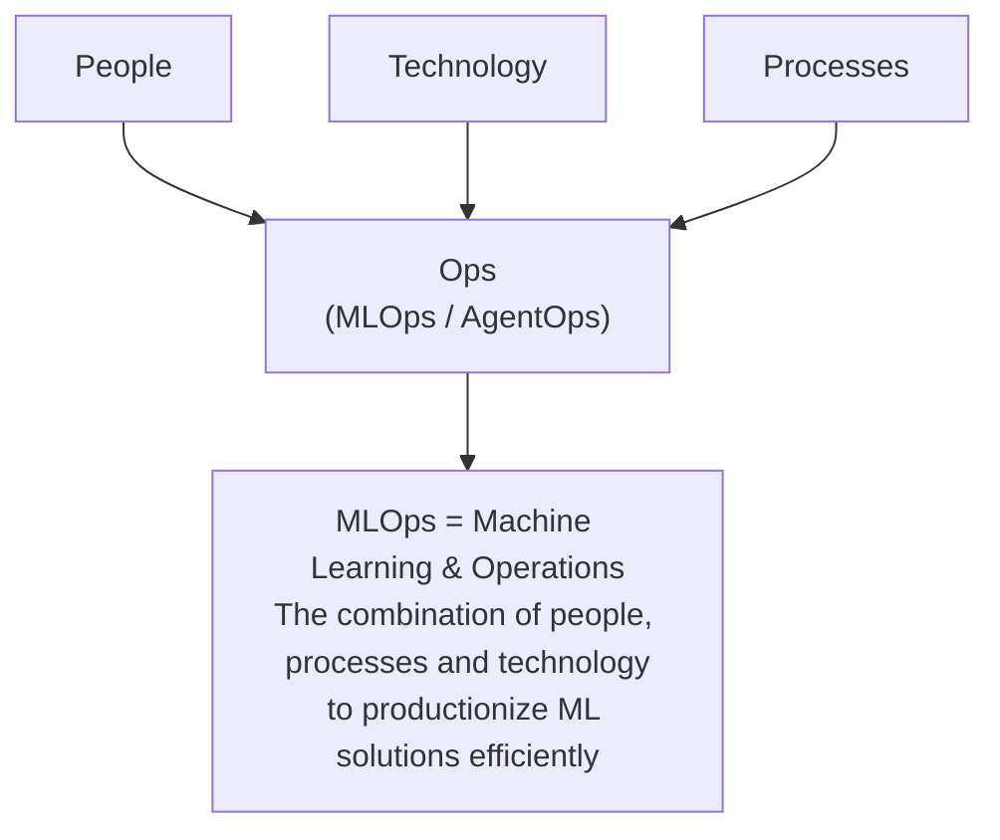
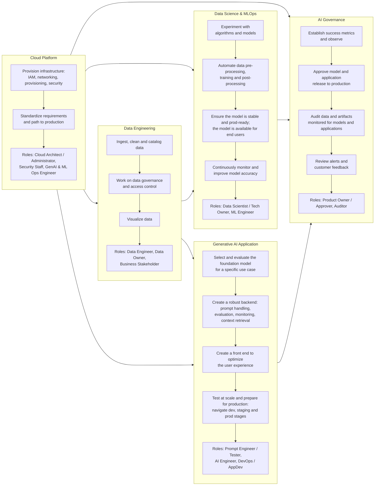
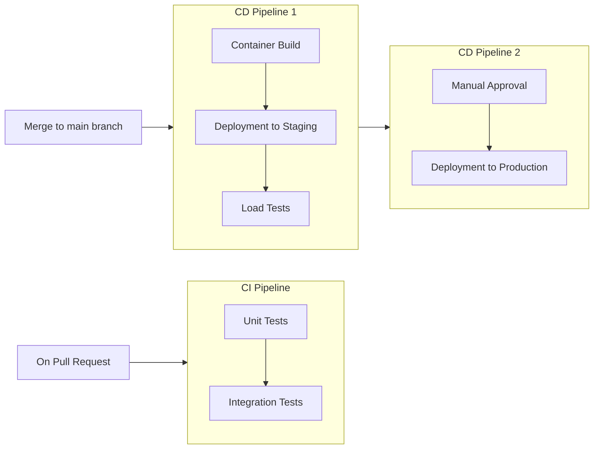
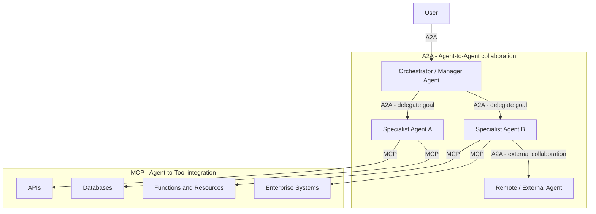

# Prototype to Production

**Topics:** #agentops #prototype-to-production #cicd #agent-evaluation #observability #a2a-protocol #mcp #google-cloud

> **Source:** [Prototype to Production](https://docs.google.com/document/d/1VU-Bgnp7fHb_3qrOamByEEI0vzctfnhGlW2a1ztmK2k/edit) · Converted from Google Docs

---


## FDE Project Grading Rubric Enforcement & Prevailing Customer Alignment

> **Mandatory Governance Standard:** Every project, prototype, or production agent built using the patterns in this concept **must pass the [Google Cloud FDE Field-Readiness & Project Grading Rubric](/concepts/00-fde-field-readiness-and-grading-rubric.md)** (aligned with the [Cloud FDE Team Charter](https://g3doc.corp.google.com/company/teams/cloud-fde/index.md?cl=head)). Scoring Requirement: **Average >= `2.0 (Competent)`** across both **Part A (Presentation & Advisory Rigor)** and **Part B (Engineering & Implementation Excellence)**, with **zero `0 (Not Demonstrated)` scores** on any single metric.

### 1. Part A — Presentation & Advisory Rigor Enforcement for This Concept

- **A.1 Strategic Delivery & Value Articulation:** Bridge the 'Prototype-to-Production Chasm' by proving why a notebook demo (80% happy-path accuracy) requires systematic reliability, security, and FinOps engineering to survive enterprise reality.
- **A.5 Futures / Roadmap:** Present a concrete, gated production readiness roadmap across CI/CD, evaluation, observability, security, and shadow/canary rollout.

### 2. Part B — Engineering & Implementation Excellence Cutlines for This Concept

- **B.2.2 Technical Scope & Constraints:** Define production non-functional requirements (P95/P99 latency, RPS throughput, error budgets, CMEK/VPC-SC boundaries) prior to build.
- **B.6.1 CI/CD & Deployment & B.6.3 AI Lifecycle Management:** Build automated AgentOps pipelines with versioned artifacts (code + prompt + model + tool schemas), offline evaluation gates, and safe traffic splitting.
- **B.4.4 Graceful Degradation:** Engineer circuit breakers, retry budgets, and deterministic human fallback paths.

### 3. Prevailing Customer Best-Practice Exemplars to Cite in Panel Reviews

- **Grounded Enterprise Scenarios:** Transitioning an ADK prototype into a production-grade Gemini Enterprise deployment with automated CI/CD evaluation gates, shadow traffic validation, and SRE operational runbooks.
- **Cross-Reference:** See [Concept 00 — FDE Field-Readiness & Project Grading Rubric](/concepts/00-fde-field-readiness-and-grading-rubric.md) for the complete 0–3 grading scale, 31-competency matrix, and disqualifier remediation rules.

---
## Architectural Best Practice: Key Guidelines & Takeaways

### Core Principles

- **AgentOps is an evolution of DevOps/MLOps, not a reuse of it.** Principles from DevOps and MLOps provide a critical foundation but aren't enough on their own — agents are autonomously interactive, stateful, and follow dynamic execution paths, which demands an evolution in operational discipline.
- **The "last mile" is where the effort lives.** Roughly 80% of the effort observed in practice with customers is spent not on the agent's core intelligence, but on the infrastructure, security, and validation needed to make it reliable and safe.
- **Three foundational pillars:** Automated Evaluation, Automated Deployment (CI/CD), and Comprehensive Observability.
- **Evaluation-Gated Deployment.** No agent version should reach users without first passing a comprehensive evaluation that proves its quality and safety.
- **Evaluate behavioral quality, not just functional correctness.** Evaluating an agent is distinct from evaluating an LLM: it requires assessing the entire *trajectory* of reasoning and actions, not just the final answer. An agent can pass 100 unit tests for its tools and still fail by choosing the wrong tool or hallucinating.
- **Shift left.** A robust pipeline is a funnel that catches errors as early and as cheaply as possible, separating fast pre-merge checks from comprehensive, resource-intensive post-merge deployments.
- **People and process before technology.** The best technology in the world is ineffective without the right team to build, manage, and govern it.
- **Operate on a continuous Observe → Act → Evolve loop** rather than static monitoring.
- **Security is embedded from day one**, as a comprehensive governance strategy — not added as an afterthought.
- **Protocol layering:** MCP is the domain of tools and resources ("Do this specific thing"); A2A is the domain of other agents ("Achieve this complex goal"). They are complementary, not competing.

### Mandatory Requirements / Golden Rules

- **Rigorous versioning of every component.** Code, prompts, model endpoints, tool schemas, memory structures, and even evaluation datasets must be versioned — this is what enables instant rollback to a known-good state.
- **Deployment must be programmatically blocked** if key metrics (e.g. "tool call success rate" or "helpfulness") fall below a predefined threshold.
- **Production deployment is almost never fully automatic.** Phase 3 typically requires a Product Owner sign-off, ensuring human-in-the-loop; the exact artifact validated in staging is the artifact promoted to production.
- **Manage secrets properly.** Sensitive information such as tool API keys must be managed with a service like Secret Manager and injected at runtime, never hardcoded in the repository.
- **Define infrastructure as code.** Tools like Terraform define environments programmatically so they are identical, repeatable, and version-controlled.
- **Externalized state management is non-negotiable.** Since LLMs are stateless, memory must be persisted externally; design the agent as a stateless, containerized service so any instance can handle any request.
- **Design "safe-to-retry" (idempotent) tools** and retry failures with exponential backoff, to prevent bugs like duplicate charges.
- **Roll out gradually.** Use canary, blue-green, A/B testing, or feature flags rather than switching 100% of users at once.
- **Three layers of security defense:** policy definition and System Instructions; guardrails, safeguards and filtering (input filtering, agent gateway/output filtering, HITL escalation); and continuous assurance and testing (rigorous evaluation, dedicated RAI testing, proactive red teaming).
- **Any change to the model or its safety systems must trigger a full re-run** of a comprehensive evaluation pipeline.
- **Every A2A request must carry a unique trace ID.** Distributed tracing and robust state management are the two non-negotiable technical requirements for autonomous multi-agent collaboration.
- **Turn production failures into test cases.** Update evaluation datasets from production incidents so every incident makes the agent stronger.

### Anti-Patterns / Guardrails

- **Skipping the final steps** — agents tricked into giving products away free (missing guardrails), users reaching a confidential internal database (misconfigured authentication), a large weekend consumption bill nobody can explain (no monitoring), or a working agent that suddenly stops (no continuous evaluation).
- **Relying on traditional software tests alone** for systems that reason and adapt.
- **Treating security as a bolt-on.** A perfectly deployed agent can still cause harm if it wasn't built with proper security and responsibility measures.
- **Specific agent risk vectors to guard against:** prompt injection and rogue actions, data leakage, and memory poisoning (false information stored in memory corrupting all future interactions).
- **"Observations without action are just expensive dashboards."** Observability with no operational levers attached is wasted.
- **Slow feedback loops.** Observing that 30% of users fail at a task is useless if it takes six months to deploy a fix.
- **Treating safety as a one-time setup** rather than constant evaluation and adaptation.
- **Building a registry too early.** Registries offer discovery and governance at the cost of maintenance — start without one and build it only when your ecosystem's scale demands centralized management.
- **Over-using A2A.** A2A is best for formal, cross-team integrations requiring a durable service contract; for tightly coupled tasks within a single application, lightweight local sub-agents often remain the more efficient choice.
- **Siloed agents.** Every team rebuilding the same capabilities while critical insights stay trapped in silos.

---

*Updated May 2026*

**Authors: Sokratis Kartakis, Gabriela Hernandez Larios, Ran Li, Elia Secchi, Huang Xia, and Anant Nawalgaria**

## Acknowledgements

**Content contributors**

- Derek Egan
- Chase Lyall
- Lavi Nigam
- Kanchana Patlolla
- Michael Vakoc

**Curators and editors**

- Anant Nawalgaria
- Kanchana Patlolla

**Designer**

- Michael Lanning

---

## Table of contents

| Section | Page |
|---|---|
| Abstract | 5 |
| Introduction: From Prototype to Production | 6 |
| People and Process | 8 |
| The Journey to Production | 11 |
| — Evaluation as a Quality Gate | 12 |
| — The Automated CI/CD Pipeline | 13 |
| — Safe Rollout Strategies | 15 |
| — Building Security from the Start | 17 |
| Operations in-Production | 19 |
| — Observe: Your Agent's Sensory System | 19 |
| — Act: The Levers of Operational Control | 20 |
| —— Managing System Health: Performance, Cost, and Scale | 20 |
| —— Managing Risk: The Security Response Playbook | 22 |
| — Evolve: Learning from Production | 22 |
| — The Engine of Evolution: An Automated Path to Production | 23 |
| — The Evolution Workflow: From Insight to Deployed Improvement | 24 |
| — Evolving Security: The Production Feedback Loop | 25 |
| Beyond Single-Agent Operations | 26 |
| A2A - Reusability and Standardization | 27 |
| — A2A Protocol: From Concept to Implementation | 28 |
| — How A2A and MCP Work Together | 33 |
| — Registry Architectures: When and How to Build Them | 35 |
| Putting It All Together: The AgentOps Lifecycle | 36 |
| Conclusion: Bridging the Last Mile with AgentOps | 38 |
| Endnotes | 40 |

---

> Building an agent is easy. Trusting it is hard.

## Abstract

This whitepaper provides a comprehensive technical guide to the operational life cycle of AI agents, focusing on deployment, scaling, and productionizing. Building on Day 4's coverage of evaluation and observability, this guide emphasizes how to build the necessary trust to move agents into production through robust CI/CD pipelines and scalable infrastructure. It explores the challenges of transitioning agent-based systems from prototypes to enterprise-grade solutions, with special attention to Agent2Agent (A2A) interoperability. This guide offers practical insights for AI/ML engineers, DevOps professionals, and system architects.

## Introduction: From Prototype to Production

You can spin up an AI agent prototype in minutes, maybe even seconds. But turning that clever demo into a trusted, production-grade system that your business can depend on? That's where the real work begins. Welcome to the **"last mile" production gap**, where we consistently observe in practice with customers that roughly 80% of the effort is spent not on the agent's core intelligence, but on the infrastructure, security, and validation needed to make it reliable and safe.

Skipping these final steps could cause several problems. For example:

- **A customer service agent is tricked into giving products away for free** because you forgot to set up the right guardrails.
- **A user discovers they can access a confidential internal database** through your agent because authentication was improperly configured.
- **An agent generates a large consumption bill over the weekend**, but no one knows why because you didn't set up any monitoring.
- **A critical agent that worked perfectly yesterday suddenly stops**, but your team is scrambling because there was no continuous evaluation in place.

These aren't just technical problems; they are major business failures. And while principles from DevOps and MLOps provide a critical foundation, they aren't enough on their own. Deploying agentic systems introduces a new class of challenges that require an **evolution in our operational discipline**. Unlike traditional ML models, agents are autonomously interactive, stateful, and follow dynamic execution paths.

This creates unique operational headaches that demand specialized strategies:

- **Dynamic Tool Orchestration:** An agent's "trajectory" is assembled on the fly as it picks and chooses tools. This requires robust versioning, access control, and observability for a system that behaves differently every time.
- **Scalable State Management:** Agents can remember things across interactions. Managing session and memory securely and consistently at scale is a complex systems design problem.
- **Unpredictable Cost & Latency:** An agent can take many different paths to find an answer, making its cost and response time incredibly hard to predict and control without smart budgeting and caching.

To navigate these challenges successfully, you need a foundation built on three key pillars: **Automated Evaluation**, **Automated Deployment (CI/CD)**, and **Comprehensive Observability**.

This whitepaper is your step-by-step playbook for building that foundation and navigating the path to production! We'll start with the pre-production essentials, showing you how to set up automated CI/CD pipelines and use rigorous evaluation as a critical quality check. From there, we'll dive into the challenges of running agents in the wild, covering strategies for scaling, performance tuning, and real-time monitoring. Finally, we'll look ahead to the exciting world of multi-agent systems with the Agent-to-Agent protocol and explore what it takes to get them communicating safely and effectively.

> **Practical Implementation Guide**
>
> Throughout this whitepaper, practical examples reference the Google Cloud Platform Agent Starter Pack<sup>1</sup> — a Python package providing production-ready Generative AI agent templates for Google Cloud. It includes **pre-built agents**, **automated CI/CD setup**, **Terraform deployment**, **Agent platform evaluation integration** and built-in Google Cloud **observability**. The starter pack demonstrates the concepts discussed here with working code you can deploy in minutes.

## People and Process

After all that talk of CI/CD, observability, and dynamic pipelines, why the focus on people and process? Because the best technology in the world is ineffective without the right team to build, manage, and govern it.

That customer service agent isn't magically prevented from giving away free products; an AI Engineer and a Prompt Engineer design and implement the guardrails. The confidential database isn't secured by an abstract concept; a Cloud Platform team configures the authentication. Behind every successful, production-grade agent there is a well-orchestrated team of specialists, and in this section, we'll introduce the key players.



*Figure 1 — "Ops" is the intersection of people, processes, and technology.*

In a traditional MLOps landscape, this involves several key teams:

- **Cloud Platform Team:** Comprising cloud architects, administrators, and security specialists, this team manages the foundational cloud infrastructure, security, and access control. The team grants engineers and service accounts least-privilege roles, ensuring access only to necessary resources.
- **Data Engineering Team:** Data engineers and data owners build and maintain the data pipelines, handling ingestion, preparation, and quality standards.
- **Data Science and MLOps Team:** This includes data scientists who experiment with and train models, and ML engineers who automate the end-to-end ML pipeline (e.g., preprocessing, training, post-processing) at scale using CI/CD. MLOps Engineers support this by building and maintaining the standardized pipeline infrastructure.
- **Machine Learning Governance:** This centralized function, including product owners and auditors, oversees the ML lifecycle, acting as a repository for artifacts and metrics to ensure compliance, transparency, and accountability.

Generative AI introduces a new layer of complexity and specialized roles to this landscape:

- **Prompt Engineers:** While this role title is still evolving in the industry, these individuals blend technical skill in crafting prompts with deep domain expertise. They define the right questions and expected answers from a model, though in practice this work may be done by AI Engineers, domain experts, or dedicated specialists depending on the organization's maturity.
- **AI Engineers:** They are responsible for scaling GenAI solutions to production, building robust backend systems that incorporate evaluation at scale, guardrails, and RAG/tool integration.
- **DevOps/App Developers:** These developers build the front-end components and user-friendly interfaces that integrate with the GenAI backend.

The scale and structure of an organization will influence these roles; in smaller companies, individuals may wear multiple hats, while mature organizations will have more specialized teams. Effectively coordinating all these diverse roles is essential for establishing a robust operational foundation and successfully productionizing both traditional ML and generative AI initiatives.



*Figure 2 — How multiple teams collaborate to operationalize both models and GenAI applications.*

## The Journey to Production

Now that we've established the team, we turn to the process. How do we translate the work of all these specialists into a system that is trustworthy, reliable, and ready for users?

The answer lies in a disciplined pre-production process built on a single core principle: **Evaluation-Gated Deployment**. The idea is simple but powerful: no agent version should reach users without first passing a comprehensive evaluation that proves its quality and safety. This pre-production phase is where we trade manual uncertainty for automated confidence, and it consists of three pillars: a rigorous evaluation process that acts as a quality gate, an automated CI/CD pipeline that enforces it, and safe rollout strategies to de-risk the final step into production.

### Evaluation as a Quality Gate

Why do we need a special quality gate for agents? Traditional software tests are insufficient for systems that reason and adapt. Furthermore, evaluating an agent is distinct from evaluating an LLM; it requires assessing not just the final answer, but the entire trajectory of reasoning and actions taken to complete a task. An agent can pass 100 unit tests for its tools but still fail spectacularly by choosing the wrong tool or hallucinating a response. We need to evaluate its *behavioral quality*, not just its functional correctness. This gate can be implemented in two primary ways:

1. **The Manual "Pre-PR" Evaluation:** For teams seeking flexibility or just beginning their evaluation journey, the quality gate is enforced through a team process. Before submitting a pull request (PR), the **AI Engineer** or **Prompt Engineer** (or whoever is responsible for agent behavior) runs the evaluation suite locally and attaches the results for peer review.
2. **The Automated In-Pipeline Gate:** For mature teams, the evaluation harness — built and maintained by the **Data Science and MLOps Team** — is integrated directly into the CI/CD pipeline. A failing evaluation automatically blocks the deployment, providing rigid, programmatic enforcement of quality standards that the **Machine Learning Governance** team has defined. This approach trades the flexibility of manual review for the consistency of automation. The CI/CD pipeline can be configured to automatically trigger an evaluation job that compares the new agent's responses against a golden dataset. The deployment is programmatically blocked if key metrics, such as "tool call success rate" or "helpfulness," fall below a predefined threshold.

Regardless of the method, the principle is the same: no agent proceeds to production without a quality check. We covered the specifics of what to measure and how to build this evaluation harness in our deep dive on **Day 4: Agent Quality: Observability, Logging, Tracing, Evaluation, Metrics**, which explored everything from crafting a 'golden dataset' (a curated, representative set of test cases designed to assess an agent's intended behavior and guardrail compliance) to implementing LLM-as-a-judge techniques, to finally using a service like Agent Platform's Agent Evaluation<sup>2</sup> to power evaluation.

### The Automated CI/CD Pipeline

An AI agent is a composite system, comprising not just source code but also prompts, tool definitions, and configuration files. This complexity introduces significant challenges: how do we ensure a change to a prompt doesn't degrade the performance of a tool? How do we test the interplay between all these artifacts before they reach users?

The solution is a CI/CD (Continuous Integration/Continuous Deployment) pipeline. It is more than just an automation script; it's a structured process that helps different people in a team collaborate to manage complexity and ensure quality. It works by testing changes in stages, incrementally building confidence before the agent is released to users.

A robust pipeline is designed as a funnel. It catches errors as early and as cheaply as possible, a practice often called "shifting left." It separates fast, pre-merge checks from more comprehensive, resource-intensive post-merge deployments. This progressive workflow is typically structured into three distinct phases:

1. **Phase 1: Pre-Merge Integration (CI).** The pipeline's first responsibility is to provide rapid feedback to the **AI Engineer** or **Prompt Engineer** who has opened a pull request. Triggered automatically, this CI phase acts as a gatekeeper for the main branch. It runs fast checks like unit tests, code linting, and dependency scanning. Crucially, this is the ideal stage to run the **agent quality evaluation suite** designed by Prompt Engineers. This provides immediate feedback on whether a change improves or degrades the agent's performance against key scenarios before it is ever merged. By catching issues here, we prevent polluting the main branch. The PR checks configuration template<sup>3</sup> generated with the Agent Starter Pack<sup>1</sup> (ASP) is a practical example of implementing this phase with Cloud Build.<sup>4</sup>
2. **Phase 2: Post-Merge Validation in Staging (CD).** Once a change passes all CI checks — including the performance evaluation — and is merged, the focus shifts from code and performance correctness to the operational readiness of the integrated system. The Continuous Deployment (CD) process, often managed by the **MLOps Team**, packages the agent and deploys it to a staging environment — a high-fidelity replica of production. Here, more comprehensive, resource-intensive tests are run, such as **load testing** and **integration tests** against remote services. This is also the critical phase for internal user testing (often called "dogfooding"), where humans within the company can interact with the agent and provide qualitative feedback before it reaches the end user. This ensures that the agent as an *integrated system* performs reliably and efficiently under production-like conditions before it is considered for release. The staging deployment template<sup>5</sup> from ASP shows an example of this deployment.
3. **Phase 3: Gated Deployment to Production.** After the agent has been thoroughly validated in the staging environment, the final step is deploying to production. This is almost never fully automatic, typically requiring a **Product Owner** to give the final sign-off, ensuring human-in-the-loop. Upon approval, the exact deployment artifact that was tested and validated in staging is promoted to the production environment. This production deployment template<sup>6</sup> generated with ASP shows how this final phase retrieves the validated artifact and deploys it to production with appropriate safeguards.



*Figure 3 — The different stages of the CI/CD process: pre-merge CI on pull requests, post-merge container build plus staging deployment and load tests, then a manually approved production deployment.*

Making this three-phase CI/CD workflow possible requires robust automation infrastructure and proper secrets management. This automation is powered by two key technologies:

- **Infrastructure as Code (IaC):** Tools like Terraform define environments programmatically, ensuring they are identical, repeatable, and version-controlled. For example, this template generated with Agent Starter Pack<sup>7</sup> provides Terraform configurations for complete agent infrastructure including Agent Platform, Cloud Run, and BigQuery resources.
- **Automated Testing Frameworks:** Frameworks like Pytest execute tests and evaluations at each stage, handling agent-specific artifacts like conversation histories, tool invocation logs, and dynamic reasoning traces.

Furthermore, sensitive information like API keys for tools should be managed securely using a service like Secret Manager<sup>8</sup> and injected into the agent's environment at runtime, rather than being hardcoded in the repository.

### Safe Rollout Strategies

While comprehensive pre-production checks are essential, real-world application inevitably reveals unforeseen issues. Rather than switching 100% of users at once, consider minimizing risk through gradual rollouts with careful monitoring.

Here are four proven patterns that help teams build confidence in their deployments:

- **Canary:** Start with 1% of users, monitoring for prompt injections and unexpected tool usage. Scale up gradually or roll back instantly.
- **Blue-Green:** Run two identical production environments. Route traffic to "blue" while deploying to "green," then switch instantly. If issues emerge, switch back — zero downtime, instant recovery.
- **A/B Testing:** Compare agent versions on real business metrics for data-driven decisions. This can happen either with internal or external users.
- **Feature Flags:** Deploy code but control release dynamically, testing new capabilities with select users first.

All these strategies share a foundation: **rigorous versioning**. Every component — code, prompts, model endpoints, tool schemas, memory structures, even evaluation datasets — must be versioned. When issues arise despite safeguards, this enables instant rollback to a known-good state. See this as your production "undo" button!

You can deploy agents using Agent Runtime<sup>9</sup> or Cloud Run<sup>10</sup>, then leverage Cloud Load Balancing<sup>11</sup> for traffic management across versions or connect to other microservices. The Agent Starter Pack<sup>1</sup> provides ready-to-use templates with GitOps workflows — where every deployment is a git commit, every rollback is a git revert, and your repository becomes the single source of truth for both current state and complete deployment history.

### Building Security from the Start

Safe deployment strategies protect you from bugs and outages, but agents face a unique challenge: they can reason and act autonomously. A perfectly deployed agent can still cause harm if it hasn't been built with proper security and responsibility measures. This requires a comprehensive governance strategy embedded from day one, not added as an afterthought.

Unlike traditional software that follows predetermined paths, agents make decisions. They interpret ambiguous requests, access multiple tools, and maintain memory across sessions. This autonomy creates distinct risks:

- **Prompt Injection & Rogue Actions:** Malicious users can trick agents into performing unintended actions or bypassing restrictions.
- **Data Leakage:** Agents might inadvertently expose sensitive information through their responses or tool usage.
- **Memory Poisoning:** False information stored in an agent's memory can corrupt all future interactions.

Fortunately, frameworks like Google's Secure AI Agents approach<sup>12</sup> and the Google Secure AI Framework (SAIF)<sup>13</sup> address these challenges through three layers of defense:

1. **Policy Definition and System Instructions (The Agent's Constitution):** The process begins by defining policies for desired and undesired agent behavior. These are engineered into **System Instructions (SIs)** that act as the agent's core constitution.
2. **Guardrails, Safeguards, and Filtering (The Enforcement Layer):** This layer acts as the hard-stop enforcement mechanism.
   - **Input Filtering:** Use classifiers and services like the Perspective API to analyze prompts and block malicious inputs before they reach the agent.
   - **Agent Gateway & Output Filtering:** After the agent generates a response, **Agent Platform's built-in safety filters** provide a final check for harmful content, PII, or policy violations. For example, before a response is sent to the user, it is passed through Agent Platform's built-in safety filters<sup>14</sup>, which can be configured to block outputs containing specific PII, toxic language, or other harmful content. Furthermore centralized controls are also needed to ensure safety. For example, before a response is sent to the user, it is passed through the Agent Gateway and Model Armor<sup>14</sup>, providing a final check against harmful content, prompt injection, tool poisoning, and sensitive data leakage.
   - **Human-in-the-Loop (HITL) Escalation:** For high-risk or ambiguous actions, the system must pause and escalate to a human for review and approval.
3. **Continuous Assurance and Testing:** Safety is not a one-time setup. It requires constant evaluation and adaptation.
   - **Rigorous Evaluation:** Any change to the model or its safety systems must trigger a full re-run of a comprehensive evaluation pipeline using **Agent Platform's evaluation and observability suite**.
   - **Dedicated RAI Testing:** Rigorously test for specific risks either by creating dedicated datasets or using simulation agents, including **Neutral Point of View (NPOV) evaluations** and **Parity evaluations**.
   - **Proactive Red Teaming:** Actively try to break the safety systems through creative manual testing and AI-driven **persona-based simulation**.

## Operations in-Production

Your agent is live. Now the focus shifts from development to a fundamentally different challenge: **keeping the system reliable**, **cost-effective**, **and safe as it interacts with thousands of users**. A traditional service operates on predictable logic. An agent, in contrast, is an autonomous actor. Its ability to follow unexpected reasoning paths means it can exhibit emergent behaviors and accumulate costs without direct oversight.

Managing this autonomy requires a different operational model. Instead of static monitoring, effective teams adopt a continuous loop: Observe the system's behavior in real-time, Act to maintain performance and safety, and Evolve the agent based on production learnings. This integrated cycle is the core discipline for operating agents successfully in production.

### Observe: Your Agent's Sensory System

To trust and manage an autonomous agent, you must first understand its process. Observability provides this crucial insight, acting as the sensory system for the subsequent "Act" and "Evolve" phases. A robust observability practice is built on three pillars that work together to provide a complete picture of the agent's behavior:

- **Logs:** The granular, factual diary of what happened, recording every tool call, error, and decision.
- **Traces:** The narrative that connects individual logs, revealing the causal path of why an agent took a certain action.
- **Metrics:** The aggregated report card, summarizing performance, cost, and operational health at scale to show how well the system is performing.

For example, in Google Cloud, this is achieved through the operations suite: a user's request generates a unique ID in Cloud Trace<sup>15</sup> that links the Agent Runtime<sup>9</sup> invocation, model calls, and tool executions with visible durations. Detailed logs flow to Cloud Logging<sup>16</sup>, while Cloud Monitoring<sup>17</sup> dashboards alert when latency thresholds are exceeded. The Agent Development Kit (ADK)<sup>18</sup> provides built-in Cloud Trace integration for automatic instrumentation of agent operations.

By implementing these pillars, we move from operating in the dark to having a clear, data-driven view of our agent's behavior, providing the foundation needed to manage it effectively in production. (For a full discussion of these concepts, see **Agent Quality: Observability, Logging, Tracing, Evaluation, Metrics**).

### Act: The Levers of Operational Control

Observations without action are just expensive dashboards. The "Act" phase is about real-time intervention — the levers you pull to manage the agent's performance, cost, and safety based on what you observe.

Think of "Act" as the system's automated reflexes designed to maintain stability in real-time. In contrast, "Evolve", which will be covered later, is the strategic process of learning from behavior to create a fundamentally better system.

Because an agent is autonomous, you cannot pre-program every possible outcome. Instead, you must build robust mechanisms to influence its behavior in production. These operational levers fall into two primary categories: managing the system's health and managing its risk.

#### Managing System Health: Performance, Cost, and Scale

Unlike traditional microservices, an agent's workload is dynamic and stateful. Managing its health requires a strategy for handling this unpredictability.

- **Designing for Scale:** The foundation is decoupling the agent's logic from its state.
  - **Horizontal Scaling:** Design the agent as a stateless, containerized service. With external state, any instance can handle any request, enabling serverless platforms like Cloud Run<sup>10</sup> or the managed Vertex AI Agent Engine Runtime<sup>9</sup> to scale automatically.
  - **Asynchronous Processing:** For long-running tasks, offload work using event-driven patterns. This keeps the agent responsive while complex jobs process in the background. On Google Cloud, for example, a service can publish tasks to Pub/Sub<sup>19</sup>, which can then trigger a Cloud Run service for asynchronous processing.
  - **Externalized State Management:** Since LLMs are stateless, persisting memory externally is non-negotiable. This highlights a key architectural choice: **Agent Runtime** provides built-in Sessions and a Memory Bank for persistent, long-term context across multi-day workflows, while **Cloud Run** offers the flexibility to integrate directly with databases like AlloyDB<sup>20</sup> or Cloud SQL<sup>21</sup>.
- **Balancing Competing Goals:** Scaling always involves balancing three competing goals: speed, reliability, and cost.
  - **Speed (Latency):** Keep your agent fast by designing it to work in parallel, aggressively caching results, and using smaller, efficient models for routine tasks.
  - **Reliability (Handling Glitches):** Agents must handle temporary failures. When a call fails, automatically retry, ideally with *exponential backoff* to give the service time to recover. This requires designing "safe-to-retry" (*idempotent*) tools to prevent bugs like duplicate charges.
  - **Cost:** Keep the agent affordable by shortening prompts, using cheaper models for easier tasks, and sending requests in groups (batching).

#### Managing Risk: The Security Response Playbook

Because an agent can act on its own, you need a playbook for rapid containment. When a threat is detected, the response should follow a clear sequence: **contain, triage, and resolve**.

The first step is **immediate containment**. The priority is to stop the harm, typically with a "circuit breaker" — a feature flag to instantly disable the affected tool.

Next is **triage**. With the threat contained, suspicious requests are routed to a human-in-the-loop (HITL) review queue to investigate the exploit's scope and impact.

Finally, the focus shifts to a **permanent resolution**. The team develops a patch — like an updated input filter or system prompt — and deploys it through the automated CI/CD pipeline, ensuring the fix is fully tested before blocking the exploit for good.

### Evolve: Learning from Production

While the "Act" phase provides the system's immediate, tactical reflexes, the "Evolve" phase is about long-term, strategic improvement. It begins by looking at the patterns and trends collected in your observability data and asking a crucial question: "How do we fix the root cause so this problem never happens again?"

This is where you move from reacting to production incidents to proactively making your agent smarter, more efficient, and safer. You turn the raw data from the "Observe" phase into durable improvements in your agent's architecture, logic, and behavior.

### The Engine of Evolution: An Automated Path to Production

An insight from production is only valuable if you can act on it quickly. Observing that 30% of your users fail at a specific task is useless if it takes your team six months to deploy a fix.

This is where the **automated CI/CD pipeline** you built in pre-production (Section 3) becomes the most critical component of your operational loop. It is the engine that powers rapid evolution. A fast, reliable path to production allows you to close the loop between observation and improvement in hours or days, not weeks or months.

When you identify a potential improvement — whether it's a refined prompt, a new tool, or an updated safety guardrail — the process should be:

1. **Commit the Change:** The proposed improvement is committed to your version-controlled repository.
2. **Trigger Automation:** The commit automatically triggers your CI/CD pipeline.
3. **Validate Rigorously:** The pipeline runs the full suite of unit tests, security scans, and the agent quality evaluation suite against your updated datasets.
4. **Deploy Safely:** Once validated, the change is deployed to production using a safe rollout strategy.

This automated workflow transforms evolution from a slow, high-risk manual project into a fast, repeatable, and data-driven process.

### The Evolution Workflow: From Insight to Deployed Improvement

1. **Analyze Production Data:** Identify trends in user behavior, task success rates, and security incidents from production logs.
2. **Update Evaluation Datasets:** Transform production failures into tomorrow's test cases, augmenting your golden dataset.
3. **Refine and Deploy:** Commit improvements to trigger the automated pipeline — whether refining prompts, adding tools, or updating guardrails.

This creates a virtuous cycle where your agent continuously improves with every user interaction.

>**An Evolve Loop in Action**
>
> A retail agent's logs (**Observe**) show that 15% of users receive an error when asking for 'similar products.' The product team **Acts** by creating a high-priority ticket. The **Evolve** phase begins: production logs are used to create a new, failing test case for the evaluation dataset. An **AI Engineer** refines the agent's prompt and adds a new, more robust tool for similarity search. The change is committed, passes the now-updated evaluation suite in the CI/CD pipeline, and is safely rolled out via a canary deployment, resolving the user issue in under 48 hours.

### Evolving Security: The Production Feedback Loop

While the foundational security and responsibility framework is established in pre-production (Section 3.4), the work is never truly finished. Security is not a static checklist; it is a dynamic, continuous process of adaptation. The production environment is the ultimate testing ground, and the insights gathered there are essential for hardening your agent against real-world threats.

This is where the **Observe** → **Act** → **Evolve** loop becomes critical for security. The process is a direct extension of the evolution workflow:

1. **Observe:** Your monitoring and logging systems detect a new threat vector. This could be a novel prompt injection technique that bypasses your current filters, or an unexpected interaction that leads to a minor data leak.
2. **Act:** The immediate security response team contains the threat (as discussed in Section 4.2).
3. **Evolve:** This is the crucial step for long-term resilience. The security insight is fed back into your development lifecycle:
   - **Update Evaluation Datasets:** The new prompt injection attack is added as a permanent test case to your evaluation suite.
   - **Refine Guardrails:** A **Prompt Engineer** or **AI Engineer** refines the agent's system prompt, input filters, or tool-use policies to block the new attack vector.
   - **Automate and Deploy:** The engineer commits the change, which triggers the full CI/CD pipeline. The updated agent is rigorously validated against the newly expanded evaluation set and deployed to production, closing the vulnerability.

This creates a powerful feedback loop where every production incident makes your agent stronger and more resilient, transforming your security posture from a defensive stance to one of continuous, proactive improvement.

To learn more about Responsible AI and securing AI Agentic Systems, please consult the whitepaper Google's Approach for Secure AI Agents<sup>12</sup> and the Google Secure AI Framework (SAIF)<sup>13</sup>.

## Beyond Single-Agent Operations

You've mastered operating individual agents in production and can ship them at high velocity. But as organizations scale to dozens of specialized agents — each built by different teams with different frameworks — a new challenge emerges: these agents can't collaborate. The next section explores how standardized protocols can transform these isolated agents into an interoperable ecosystem, unlocking exponential value through agent collaboration.

## A2A - Reusability and Standardization

You've built dozens of specialized agents across your organization. The customer service team has their support agent. Analytics built a forecasting system. Risk management created fraud detection. But here's the problem: these agents can't talk to each other - whether that be because they were created in different frameworks, projects or different clouds altogether.

This isolation creates massive inefficiency. Every team rebuilds the same capabilities. Critical insights stay trapped in silos. What you need is interoperability — the ability for any agent to leverage any other agent's capabilities, regardless of who built it or what framework they used.

To solve this, a principled approach to standardization is required, built on two distinct but complementary protocols. While the **Model Context Protocol (MCP<sup>22</sup>)**, which we covered in detail on **Agent Tools and Interoperability with MCP**, provides a universal standard for tool integration, it is not sufficient for the complex, stateful collaboration required between intelligent agents. This is the problem the **Agent2Agent (A2A<sup>23</sup>)** protocol, now governed by the Linux Foundation, was designed to solve.

The distinction is critical. When you need a simple, stateless function like fetching weather data or querying a database, you need a tool that speaks MCP. But when you need to delegate a complex goal, such as "analyze last quarter's customer churn and recommend three intervention strategies," you need an intelligent partner that can reason, plan, and act autonomously via A2A. In short, MCP lets you say, "Do this specific thing," while A2A lets you say, "Achieve this complex goal."

### A2A Protocol: From Concept to Implementation

The A2A protocol is designed to break down organizational silos and enable seamless collaboration between agents. Consider a scenario where a fraud detection agent spots suspicious activity. To understand the full context, it needs data from a separate transaction analysis agent. Without A2A, a human analyst must manually bridge this gap — a process that could take hours. With A2A, the agents collaborate automatically, resolving the issue in minutes.

The first step of the collaboration is discovering the right agent to delegate to - this is made possible through Agent Cards,<sup>24</sup> which are standardized JSON specifications that act as a business card for each agent. An Agent Card describes what an agent can do, its security requirements, its skills, and how to reach out to it (url), allowing any other agent in the ecosystem to dynamically discover its peers. See example Agent Card below:

**Python**

```json
{
  "name": "check_prime_agent",
  "version": "1.0.0",
  "description": "An agent specialized in checking whether numbers are prime",
  "capabilities": {},
  "securitySchemes": {
    "agent_oauth_2_0": {
      "type": "oauth2",
    }
  }
  "defaultInputModes": ["text/plain"],
  "defaultOutputModes": ["application/json"],
  "skills": [
    {
      "id": "prime_checking",
      "name": "Prime Number Checking",
      "description": "Check if numbers are prime using efficient algorithms",
      "tags": ["mathematical", "computation", "prime"]
    }
  ],
  "url": "http://localhost:8001/a2a/check_prime_agent"
}
```

*Snippet 1: A sample agent card for the check_prime_agent*

Adopting this protocol doesn't require an architectural overhaul. Frameworks like the ADK simplify this process significantly (docs<sup>25</sup>). You can make an existing agent A2A-compatible with a single function call, which automatically generates its AgentCard and makes it available on the network.

**Python**

```python
# Example using ADK: Exposing an agent via A2A

from google.adk.a2a.utils.agent_to_a2a import to_a2a

# Your existing agent
root_agent = Agent(
    name='hello_world_agent',
    # ... your agent code ...
)

# Make it A2A-compatible
a2a_app = to_a2a(root_agent, port=8001)

# Serve with uvicorn
# uvicorn agent:a2a_app --host localhost --port 8001

# Or serve with Agent Engine
# from vertexai.preview.reasoning_engines import A2aAgent
# from google.adk.a2a.executor.a2a_agent_executor import A2aAgentExecutor
# a2a_agent = A2aAgent(
#     agent_executor_builder=lambda: A2aAgentExecutor(agent=root_agent)
# )
```

*Snippet 2: Using the ADK's to_a2a utility to wrap an existing agent and expose it for A2A communication*

Once an agent is exposed, any other agent can consume it by referencing its AgentCard. For example, a customer service agent can now query a remote product catalog agent without needing to know its internal workings.

**Python**

```python
# Example using ADK: Consuming a remote agent via A2A

from google.adk.agents.remote_a2a_agent import RemoteA2aAgent

prime_agent = RemoteA2aAgent(
    name="prime_agent",
    description="Agent that handles checking if numbers are prime.",
    agent_card="http://localhost:8001/a2a/check_prime_agent/.well-known/agent-card.json"
)
```

*Snippet 3: Using the ADK's RemoteA2aAgent class to connect to and consume a remote agent*

This unlocks powerful, hierarchical compositions. A root agent can be configured to orchestrate both a local sub-agent for a simple task and a remote, specialized agent via A2A, creating a more capable system.

**Python**

```python
# Example using ADK: Hierarchical agent composition

# ADK Local sub-agent for dice rolling
roll_agent = Agent(
    name="roll_agent",
    instruction="You are an expert at rolling dice."
)

# ADK Remote A2A agent for prime checking
prime_agent = RemoteA2aAgent(
    name="prime_agent",
    agent_card="http://localhost:8001/.well-known/agent-card.json"
)

# ADK Root orchestrator combining both
root_agent = Agent(
    name="root_agent",
    instruction="""Delegate rolling dice to roll_agent, prime checking to prime_agent.""",
    sub_agents=[roll_agent, prime_agent]
)
```

*Snippet 4: Using a remote A2A agent (prime_agent) as a sub-agent within a hierarchical agent structure in the ADK*

However, enabling this level of autonomous collaboration introduces two non-negotiable technical requirements. First is **distributed tracing**, where every request carries a unique trace ID, which is essential for debugging and maintaining a coherent audit trail across multiple agents. Second is robust **state management**. A2A interactions are inherently stateful, requiring a sophisticated persistence layer for tracking progress and ensuring transactional integrity.

**A2A is best suited for formal, cross-team integrations** that require a durable service contract. For tightly coupled tasks within a single application, **lightweight local sub-agents often remain a more efficient choice**. As the ecosystem matures, new agents should be built with native support for both protocols, ensuring every new component is immediately discoverable, interoperable, and reusable, compounding the value of the whole system.

### How A2A and MCP Work Together



*Figure 4 — A2A and MCP collaboration at a single glance: A2A carries goal-level delegation between autonomous agents, while MCP carries structured tool and resource calls beneath each agent.*

A2A and MCP are not competing standards; they are complementary protocols designed to operate at different levels of abstraction. The distinction depends on what an agent is interacting with. MCP is the domain of **tools and resources** — primitives with well-defined, structured inputs and outputs, like a calculator or a database API. A2A is the domain of other **agents** — autonomous systems that can reason, plan, use multiple tools, and maintain state to achieve complex goals.

The most powerful agentic systems use both protocols in a layered architecture. An application might primarily use A2A to orchestrate high-level collaboration between multiple intelligent agents, while each of those agents internally uses MCP to interact with its own specific set of tools and resources.

A practical analogy is an auto repair shop staffed by autonomous AI agents.

1. **User-to-Agent (A2A):** A customer uses A2A to communicate with the "Shop Manager" agent to describe a high-level problem: "My car is making a rattling noise."
2. **Agent-to-Agent (A2A):** The Shop Manager engages in a multi-turn diagnostic conversation and then delegates the task to a specialized "Mechanic" agent, again using A2A.
3. **Agent-to-Tool (MCP):** The Mechanic agent now needs to perform specific actions. It uses MCP to call its specialized tools: it runs `scan_vehicle_for_error_codes()` on a diagnostic scanner, queries a repair manual database with `get_repair_procedure()`, and operates a platform lift with `raise_platform()`.
4. **Agent-to-Agent (A2A):** After diagnosing the issue, the Mechanic agent determines a part is needed. It uses A2A to communicate with an external "Parts Supplier" agent to inquire about availability and place an order.

In this workflow, A2A facilitates the higher-level, conversational, and task-oriented interactions between the customer, the shop's agents, and external suppliers. Meanwhile, MCP provides the standardized plumbing that enables the mechanic agent to reliably use its specific, structured tools to do its job.

### Registry Architectures: When and How to Build Them

Why do some organizations build registries while others don't need them? The answer lies in scale and complexity. When you have fifty tools, manual configuration works fine. But when you reach five thousand tools distributed across different teams and environments, you face a discovery problem that demands a systematic solution.

To solve these discovery and governance challenges at scale, the Gemini Enterprise Agent Platform provides a native Agent Registry. This centralized catalog allows teams to discover, track, and manage all agents, tools, and MCP servers across the organization. Paired with Agent Identity — which assigns a unique cryptographic ID to every agent — it enables robust governance and secure access control out of the box. However, if you are building outside of this integrated ecosystem, understanding the underlying registry architecture remains critical.

A **Tool Registry** uses a protocol like MCP to catalog all assets, from functions to APIs. Instead of giving agents access to thousands of tools, you create curated lists, leading to three common patterns:

- **Generalist agents:** Access the full catalog, trading speed and accuracy for scope.
- **Specialist agents:** Use predefined subsets for higher performance.
- **Dynamic agents:** Query the registry at runtime to adapt to new tools.

The primary benefit is human discovery — developers can search for existing tools before building duplicates, security teams can audit tool access, and product owners can understand their agents' capabilities.

An **Agent Registry** applies the same concept to agents, using formats like A2A's AgentCards. It helps teams discover and reuse existing agents, reducing redundant work. This also lays the groundwork for automated agent-to-agent delegation, though this remains an emerging pattern.

Registries offer discovery and governance at the cost of maintenance. You can consider starting without one and only build it when your ecosystem's scale demands centralized management!

> **Note — Decision Framework for Registries**
>
> **Tool Registry:** Build when tool discovery becomes a bottleneck or security requires centralized auditing.
>
> **Agent Registry:** Build when multiple teams need to discover and reuse specialized agents without tight coupling.

## Putting It All Together: The AgentOps Lifecycle

We can now assemble these pillars into a single, cohesive reference architecture! The life cycle begins in the **developer's inner loop** — a phase of rapid local testing and prototyping to shape the agent's core logic. Once a change is ready, it enters the formal pre-production engine, where automated evaluation gates validate its quality and safety against a golden dataset. From there, safe rollouts release it to production, where comprehensive observability captures the real-world data needed to fuel the continuous evolution loop, turning every insight into the next improvement.

```mermaid
flowchart LR
    subgraph CIE["Cloud Infrastructure Environment"]
        direction TB
        I1["Infrastructure as Code"]
        I2["Central Cloud Security"]
        I3["Central Cloud Observability"]
        I4["Central Cloud Billing"]
        I5["Central Env / User Governance"]
        I6["Central Agent Code Templates"]
    end

    subgraph DLE["Data Lake / Mesh Environment"]
        direction TB
        DG["Data Governance"]
        D1["Data Storage, Lineage and Cataloging"]
        D2["Data Preparation"]
        D3["Agent Evaluation Data"]
        D4["Data Tools"]
        D5["RAG"]
        D6["Long-term Memory"]
    end

    subgraph DEV["Development Environment"]
        direction TB
        subgraph EXP["Experimentation"]
            X1["Agent Experimentation"]
        end
        subgraph BLD["Development"]
            B1["AI Agent"]
            B2["AI Application: Backend and Frontend"]
            B3["Context Management"]
            B4["Monitoring Mechanism"]
        end
        subgraph SEC["AI Security"]
            S1["AI Model Gateway"]
            S2["Guardrails"]
        end
    end

    subgraph STG["Staging Environment"]
        direction TB
        T1["AI Agent / App Deployment"]
        T2["Automatic Tests at Scale"]
        T3["Automatic Evaluation at Scale"]
        T4["Agent Simulation"]
    end

    subgraph PRD["Production Environment"]
        direction TB
        P1["AI Agent / App Deployment"]
        P2["AI Agent / App Serving"]
        P3["Short-term Memory"]
        P4["Observability and Logs"]
        P5["Security, RAI, Agent Alerts and Vulnerabilities"]
        P6["Monitoring"]
    end

    subgraph GOVE["AI Governance Environment"]
        direction TB
        V1["Artifacts: Repositories and CI/CD Pipelines"]
        V2["Agents: Agent Registry and Agent Governance"]
        V3["Tools: Tool Registry and Tool Governance"]
    end

    CIE --> DEV
    CIE --> STG
    CIE --> PRD
    CIE --> DLE
    DLE --> DEV
    DLE --> STG
    DLE --> PRD
    DEV -->|"Commit and CI"| STG
    STG -->|"Gated promotion"| PRD
    PRD -->|"Observe and Evolve feedback"| DEV
    GOVE --- DEV
    GOVE --- STG
    GOVE --- PRD
```

For a comprehensive walkthrough of operationalizing AI agents, including evaluation, tool management, CI/CD standardization, and effective architecture designs, watch the AgentOps: Operationalize AI Agents video<sup>26</sup> on the official Google Cloud YouTube channel.



*Figure 5 — AgentOps core capabilities, environments, and processes: shared cloud infrastructure and data foundations underpin development, staging and production, with an AI governance environment spanning artifacts, agents and tools, and a production feedback loop back into development.*

## Conclusion: Bridging the Last Mile with AgentOps

Moving an AI prototype to a production system is an organizational transformation that requires a new operational discipline: **AgentOps**.

Most agent projects fail in the "last mile" not due to technology, but because the operational complexity of autonomous systems is underestimated. This guide maps the path to bridge that gap. It begins with establishing **People and Process** as the foundation for governance. Next, a **Pre-Production** strategy built on evaluation-gated deployment automates high-stakes releases. Once live, a continuous **Observe** → **Act** → **Evolve** loop turns every user interaction into a potential insight. Finally, **Interoperability** protocols scale the system by transforming isolated agents into a collaborative, intelligent ecosystem.

The immediate benefits — like preventing a security breach or enabling a rapid rollback — justify the investment. But the real value is velocity. Mature AgentOps practices allow teams to deploy improvements in hours, not weeks, turning static deployments into continuously evolving products.

### Your Path Forward

- **If you're starting out,** focus on the fundamentals: build your first evaluation dataset, implement a CI/CD pipeline, and establish comprehensive monitoring. The Agent Starter Pack is a great place to start — it creates a production-ready agent project in minutes with these foundations already built-in.
- **If you're scaling**, elevate your practice: automate the feedback loop from production insight to deployed improvement and standardize on interoperable protocols to build a cohesive ecosystem, not just point solutions.

The next frontier is not just building better individual agents, but orchestrating sophisticated multi-agent systems that learn and collaborate. The operational discipline of AgentOps is the foundation that makes this possible.

We hope this playbook empowers you to build the next generation of intelligent, reliable, and trustworthy AI. Bridging the last mile is therefore not the final step in a project, but the first step in creating value!

## Endnotes

1. https://github.com/GoogleCloudPlatform/agent-starter-pack
2. https://docs.cloud.google.com/gemini-enterprise-agent-platform/optimize/evaluation/agent-evaluation
3. https://github.com/GoogleCloudPlatform/agent-starter-pack/blob/example-agent/example-agent/.cloudbuild/pr_checks.yaml
4. https://cloud.google.com/build
5. https://github.com/GoogleCloudPlatform/agent-starter-pack/blob/example-agent/example-agent/.cloudbuild/staging.yaml
6. https://github.com/GoogleCloudPlatform/agent-starter-pack/blob/example-agent/example-agent/.cloudbuild/deploy-to-prod.yaml
7. https://github.com/GoogleCloudPlatform/agent-starter-pack/blob/example-agent/example-agent/terraform
8. https://cloud.google.com/secret-manager
9. https://docs.cloud.google.com/gemini-enterprise-agent-platform/build/runtime
10. https://cloud.google.com/run
11. https://cloud.google.com/load-balancing/docs/https/traffic-management
12. https://research.google/pubs/an-introduction-to-googles-approach-for-secure-ai-agents/
13. https://safety.google/cybersecurity-advancements/saif/
14. https://cloud.google.com/vertex-ai/generative-ai/docs/multimodal/configure-safety-attributes
15. https://cloud.google.com/trace
16. https://cloud.google.com/logging
17. https://cloud.google.com/monitoring
18. https://google.github.io/adk-docs/observability/cloud-trace/
19. https://cloud.google.com/pubsub
20. https://cloud.google.com/alloydb
21. https://cloud.google.com/sql
22. https://modelcontextprotocol.io/
23. https://a2a-protocol.org/latest/specification/
24. https://a2a-protocol.org/latest/specification/#5-agent-discovery-the-agent-card
25. https://google.github.io/adk-docs/a2a/
26. https://www.youtube.com/watch?v=kJRgj58ujEk
