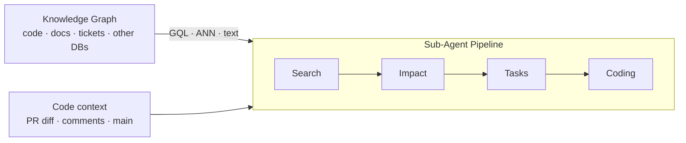

# Spec-Driven Production Grade Development in the Age of Vibe Coding

**Topics:** #spec-driven-development #vibe-coding #agentic-ai #code-review #agent-guardrails #agentops #context-engineering

> **Source:** [Spec-Driven Production Grade Development in the Age of Vibe Coding](https://docs.google.com/document/d/1uBbH5a6w5oyYsIfAe3Dlb-M-4_TiPk6EuEm1pgRFGsc/edit) · Converted from Google Docs

---


## FDE Project Grading Rubric Enforcement & Prevailing Customer Alignment

> **Mandatory Governance Standard:** Every project, prototype, or production agent built using the patterns in this concept **must pass the [Google Cloud FDE Field-Readiness & Project Grading Rubric](/concepts/00-fde-field-readiness-and-grading-rubric.md)** (aligned with the [Cloud FDE Team Charter](https://g3doc.corp.google.com/company/teams/cloud-fde/index.md?cl=head)). Scoring Requirement: **Average >= `2.0 (Competent)`** across both **Part A (Presentation & Advisory Rigor)** and **Part B (Engineering & Implementation Excellence)**, with **zero `0 (Not Demonstrated)` scores** on any single metric.

### 1. Part A — Presentation & Advisory Rigor Enforcement for This Concept

- **A.4 AI-Driven Development Discussion:** Exemplify **Spec-Driven Development (SDD)** — showing how locked functional/architectural specs (`specs/`), `AGENTS.md` / `GEMINI.md` rules, and automated verification harnesses enable both rapid 'in-the-loop' fixes and autonomous 'outside-the-loop' goal execution.
- **A.1 Strategic Delivery & Value Articulation:** Anchor every specification to customer Problem Definition, Critical User Journeys (CUJs), and an executable 'Definition of Done'.

### 2. Part B — Engineering & Implementation Excellence Cutlines for This Concept

- **B.2.1 Problem Definition & B.2.2 Technical Scope & Constraints:** Write unambiguous specifications covering user personas, system boundaries, non-goals, data contracts, and edge-case scenarios before generating code.
- **B.2.5 Decision Records (ADRs):** Version-control architectural decisions and trade-offs alongside the codebase so AI coding agents never violate structural invariants.
- **B.6.4 Testing & Quality Engineering:** Pair every spec requirement with executable unit, contract, and trajectory verification tests that the autonomous coding loop must pass.

### 3. Prevailing Customer Best-Practice Exemplars to Cite in Panel Reviews

- **Grounded Enterprise Scenarios:** Using locked `specs/` and Antigravity execution harnesses to build production-grade graph agents where every harness mistake is fed back into `AGENTS.md` / `SKILL.md` guardrails.
- **Cross-Reference:** See [Concept 00 — FDE Field-Readiness & Project Grading Rubric](/concepts/00-fde-field-readiness-and-grading-rubric.md) for the complete 0–3 grading scale, 31-competency matrix, and disqualifier remediation rules.

---
## Architectural Best Practice: Key Guidelines & Takeaways

### Core Principles

- **"Vibe coding" is not "vibe in production."** AI agents can be used to their full potential, but everything must be fully intended and controlled to ensure production-grade reliability, rather than relying on unvalidated AI output.
- **The developer is a technical architect, not a coder.** Most time is now spent writing high-quality specifications — the detailed technical instructions that tell an AI exactly what to build.
- **Code is disposable; the specification is not.** If a rock-solid specification is written, the entire codebase can be regenerated repeatedly — an agent can even flip a project from Python to JavaScript in a single afternoon. Because the code is disposable, there is no emotional attachment and no fear of trashing it when requirements change.
- **A good specification is an Architectural North Star.** It prevents "context fragmentation" — the digital equivalent of the game "telephone," where the AI loses the plot because it is looking at outdated snapshots of files. The spec lives in the codebase (a Markdown or YAML file in a `specs/` folder) and acts as the source of truth for both humans and AI.
- **Tokenization is a hard physical constraint.** Every character, newline, and indentation space translates directly into development budget and system latency. Treat the `/specs` folder not just as documentation, but as a lean, compiled instruction set.
- **The bottleneck has moved downstream.** AI eliminated the code-production bottleneck and moved the constraint to the humans who must review, test, and integrate that output. This is a shared cognitive load: humans act as architects writing Test Specs, Integration Specs, and MLOps/DevOps blueprints; the AI does the heavy lifting.
- **Tests catch deterministic regressions; evaluation catches behavioural drift.** The error margin of an ML-driven component isn't a defect to eliminate; it's an inherent property of the model, and the testing strategy has to accommodate it.
- **Governance must be separated from execution.** A policy layer that sits in front of every tool call creates a safety net that separates execution logic from governance logic — a critical separation of concerns for enterprise software.

### Mandatory Requirements / Golden Rules

- **Use a hybrid Markdown + Conditional YAML spec format.** Use clean Markdown headers to anchor Gemini's attention, and switch to YAML for any structured configuration or data schema with a nesting depth greater than 3.
- **Write specs as Behavior-Driven Development (BDD) scenarios** using Gherkin's `Scenario / Given / When / Then` template, forcing the model to think in terms of **State > Action > Outcome**.
- **A generation spec must contain** the full technical design (requirements, database schemas, API specifications), visual aids, a list of specific tools and libraries *with version numbers*, background information ("the why behind the what"), and scenarios covering what good looks like, what's wrong, and edge cases.
- **Include version numbers for every library.** Without them, the agent may suggest an older version because of its knowledge cutoff. Always double-check proposed version numbers.
- **No YOLO Mode during project generation.** Explicitly prompt the agent not to code immediately; it should propose the folder structure and tech stack first for confirmation, and the prompt must include generation of tests, documentation, and logging.
- **Always prompt for a failing unit test or a reproduction command (e.g. `curl`) before any fix**, and keep that test case in the codebase so the bug does not return.
- **Constrain bug fixes to the root cause only.** Unrelated code should not be "cleaned up," as this complicates review.
- **Shift from Symptom Prompting to Evidence Prompting.** Not "the button doesn't work," but "logs pulled using `gcloud logging read 'textPayload:ERROR' --limit 5` showed a 403 error."
- **Keep documentation in sync with code.** In SDD the documentation is the source of truth; if docs and code diverge, the AI will hallucinate. Specify in agent skills that `README.md` and `CHANGELOG.md` must always be maintained, and use Google Style Docstrings (Python) or JSDoc (TypeScript).
- **Manually confirm multi-file edits and read the diff** inside the editor.
- **Run agents in a sandbox.** Enable Terminal Sandboxing, or containerize the agent workspace via a custom Dockerfile and `export GEMINI_SANDBOX=docker`, so a malicious execution hits a hard permission error at the kernel level.
- **Gate high-stakes operations behind Human-in-the-Loop checkpoints** — deploying to production, modifying database schemas, initiating financial transactions.
- **Put an external, tamper-proof policy layer in front of tool calls**, combining Structural Gating (deterministic role/environment rules) with Semantic Gating (an LLM inspecting intent and arguments against natural-language guidelines).
- **Enforce Context Hygiene.** Wire a placeholder-resolving sanitization utility into the agent's execution pipeline so tool arguments are sterilized before any external action, and never hardcode PII in test suites or system prompts.
- **Pick the lowest code-review tier that catches what matters** (Managed → Hybrid → Custom).

### Anti-Patterns / Guardrails

- **Bolting agents onto a 20-year-old workflow.** "Sticking to old processes while using modern tools is like trying to put a jet engine on a horse-drawn carriage."
- **Giving the brain a "vibe" instead of a "blueprint."** If it is given a vibe, it will guess — and in enterprise software, guessing is how "Rogue Agent" incidents occur.
- **Dumping a massive 100-page design document into the chat window.** This rapidly exhausts the short-term context budget, increases latency, and fragments context.
- **Generic, unoptimized Markdown for structured data.** Up to a 40% performance drop; for deeply nested configurations YAML achieves 51.9% parsing accuracy versus 43.1% for JSON and 33.8% for XML.
- **YOLO (auto-approve) mode without guardrails.** A simple prompt to create a button triggered an autonomous browser click, the agent hallucinated a connection to a deprecated legacy agent with no email safeguards, and fifty colleagues received false emails filled with hallucinated content.
- **Context hallucination risk:** when AI lacks sufficient data, it fills gaps using whatever strings exist in its context, including hardcoded email addresses or URLs.
- **Hard-coding constraints into a system prompt.** This is brittle: contexts overflow, and agents can be "convinced" to bypass rules via prompt injection.
- **Trying to regex every possible PII leak.** Structural rules fail when a tool is allowed but the *way* it is used violates policy.
- **Telling a single agent to "refactor this module."** It will fail; the job must be decomposed across a sub-agent pipeline.
- **Flattening code into a vector store.** Standard RAG strips out the structure that makes code legible — a class belongs to a file, a function call traces to a requirements doc written a decade ago. Flatten that and the map is gone.
- **Renaming variables as part of a bug fix.** Renaming is acceptable, but it should be a separate task.
- **Approval fatigue.** Frequent AI users are 45% more likely to experience high burnout than non-users; under a constant stream of micro-approvals developers start clicking "Approve" reflexively and stop checking the machine's work.
- **Scapegoating the highest-volume contributor.** Attribute bugs and merge conflicts to broken integration processes rather than the individual developer using the agent.

---

**Spec-Driven Production Grade Development in the Age of Vibe Coding**

**The Blueprint for Scalable Workflows and Team Evolution: From Vibe Prototypes to Production Reality**

**Author:** Lee Boonstra

### Acknowledgements

**Content contributors and reviewers**

- Elia Secchi
- Antonio Gulli

**Designer**

- Michael Lanning

*May 2026*

---

## Table of contents

- Introduction — 5
- Spec-Driven Development (SDD) — 7
  - A good specification — 8
  - Which format to use? — 8
  - Behavior Driven — 9
  - Where do the instructions live? — 11
  - Different Prompts for Different Use Cases — 12
- MCP: One Integration, Every Framework — 15
  - Building an MCP Server — 16
  - Connecting an MCP Client — 18
- Team Culture & Process Evolution — 18
  - Code Reviews — 19
  - Deploying Agents That Watch Your Repo — 22
  - Sustainability — 25
- Zero-Trust Development: Building the Safety Net — 26
  - Implementing Guardrails — 27
  - Sandboxing — 28
  - Human-in-the-Loop — 28
  - AI Generated Test Coverage — 29
  - Evaluation — 29
  - Policy Server — 30
- Context Hygiene & Prompt Sanitization — 36
- Summary — 39

---

> "Vibe Coding" is not "Vibe In Production"

## Introduction

The daily routine of a Google Software Engineer has undergone a complete 180-degree forward flip in the past year. In early 2024 and before, significant time was spent digging into developer APIs and documentation, manually trying out code line by line, and determining if Python uses `substring in string`, `string.includes`, or `string.contains`. Once code was finished, substantial effort went into debugging and resolving discrepancies between the functional code and the original intent.

Today, development moves at warp speed. Teams now use Coding Agents—like **Antigravity**<sup>1</sup> or **Gemini CLI**<sup>2</sup> that don't just suggest text, but actually use tools and execute tasks. An AI Coding Editor can churn out a thousand lines of well-documented code rapidly. It feels as if a legion of interns who never sleep and never complain has been hired. But there is a catch: while velocity has hit overdrive, the Illusion of Speed is real. While the bug-to-code ratio remains a challenge—as AI writes code much faster, it can also generate potential mistakes at an unprecedented rate.

However, because implementation is no longer the primary bottleneck, AI can be leveraged to write more comprehensive test coverage than any human could in the same timeframe. This is a powerful, programmatic way to increase confidence in code, which will be discussed in detail later. Furthermore, AI's potential extends far beyond implementation: it excels in system design, spec writing, roadmap planning, and results analysis. While the bottleneck has shifted downstream to the humans who must integrate and review this work, the tools to handle it are available.

"Vibe coding" refers to using AI to rapidly generate code based on a "vibe" or high-level intent rather than rigid, manual coding. However, it is crucial to clarify that **"vibe coding" is not "vibe-in-production."** While we utilize AI agents to their full potential, everything is fully intended and controlled to ensure production-grade reliability, rather than relying on unvalidated AI output.

In an enterprise setting, this "vibe" is referred to as Development with Agentic AI. Unlike standard Generative AI, which acts like a smart autocomplete, Agentic AI acts as a Hybrid Team Member; it uses the language model to generate (the brains), and it uses tools to integrate into the workflow (the hands). It can reason, write specs or test cases, use a browser to test a UI, and commit and merge code in Git. However, as development moves from individual experimentation to team-based production at scale, it becomes evident that writing 1000 lines of code before lunch isn't the same as shipping software.

When an agent "hallucinates"—which is AI-speak for when the model confidently makes something up that isn't true—it doesn't just create one bug; it can generate a thousand lines of "vibe-consistent" but functionally broken logic. If human reviewers are drowning in a sea of AI-generated Pull Requests (PRs)—those digital requests where teammates are asked to look at work before it goes live—the speed of writing becomes irrelevant. The process isn't actually faster; it is simply creating a bigger pile of "stuff" to be sorted later.

Luckily there are ways to protect the development process, but it's important to use these techniques from the start, rather than while halfway through. This paper contains a set of techniques, from developing code for production, to securing code and changing team culture in the age of vibe coding.

## Spec-Driven Development (SDD)

In the traditional world of software engineering, developers were taught to be "Code-First." A vague idea would lead to opening an editor and typing until something worked. But in the age of Agentic AI, daily activities have shifted dramatically. Most time is now spent writing high-quality specifications—the detailed technical instructions that tell an AI exactly what to build.

In this new workflow, the developer's role is more of a technical architect than a traditional coder. Here is the critical part: **code is now disposable**. If a rock-solid specification is written, the entire codebase can be regenerated repeatedly. An agent can even be instructed to flip the whole project from Python to JavaScript in a single afternoon. Because the code is disposable, there isn't the same emotional attachment to it. Since twelve hours haven't been spent debugging a single semicolon, there is no fear of trashing it and starting over if the requirements change.

Coding Agents—like Antigravity or Gemini CLI—work by using a Large Language Model (LLM) as the "brain" to reason and tools as the "hands" to execute tasks. If a brain is given a "vibe" instead of a "blueprint," it will guess. And in enterprise software, guessing is how "Rogue Agent" incidents occur.

### A good specification

So, what does a production-grade blueprint look like? A good specification is an Architectural North Star. It prevents "context fragmentation"—the digital equivalent of the game "telephone," where the AI starts losing the plot because it's looking at outdated snapshots of files. AI can be used to refine a good spec, essentially as a co-author or as a spec editor/reviewer. Typically, the spec is stored within the code base, for example as a Markdown or YAML file in a `specs/` folder. It acts as the "source of truth" for both humans and AI.

### Which format to use?

A 2026 study by Ouyang et al., "SkCC: Portable and Secure Skill Compilation for Cross-Framework LLM Agents"<sup>3</sup>, reveals that LLM agents exhibit extreme sensitivity to how instructions are formatted, resulting in up to a 40% performance drop when using generic, unoptimized Markdown files. To address this, the researchers developed SkCC (Skill Compiler), an ultra-fast tool that automatically compiles a single-source instruction file into a model's optimal target format in under 10 milliseconds.

For teams using Gemini, the paper demonstrates that the absolute best formatting strategy is a hybrid Markdown + Conditional YAML approach. Gemini uses clean Markdown headers to anchor its attention, but performance peaks when switching to YAML for any structured configuration or data schemas with a nesting depth of > 3. The data shows that for deeply nested configurations, YAML achieves a 51.9% parsing accuracy, compared to only 43.1% for JSON and 33.8% for XML. By rendering deeply nested specifications in YAML while keeping narrative instructions in Markdown, developers bypass the reasoning "format tax" associated with heavy JSON inputs, ensuring Gemini operates with maximum accuracy and optimal token economics.

| Format | Parsing accuracy (deeply nested configurations) |
|---|---|
| YAML | 51.9% |
| JSON | 43.1% |
| XML | 33.8% |

### Behavior Driven

A **Behavior-Driven Development (BDD)** specification is the ultimate tool for turning vague, ambiguous human ideas into a precise architectural design that an AI agent can build without guessing. At its core, BDD is a software development methodology that uses plain, structured natural language to describe exactly how a system should behave from the user's perspective before any code is actually written.

A BDD spec uses a standardized syntax called Gherkin<sup>4</sup>. Gherkin relies on a simple, declarative template: **Scenario / Given / When / Then**. It forces the LLM to think in terms of **State > Action > Outcome**, which completely eliminates "vibe coding" and keeps the agent on a strict track.

A good specification for generating a new project contains:

- **The Full Technical Design:** Don't just say "make a login page." Break it down into pieces. Address the requirements, database schemas (the structure of your data), and API specifications (the "contracts" that allow different parts of software to talk to each other).
- **Visual Aids:** Include diagrams and a list of specific tools and libraries with version numbers.
- **Background Information:** Give the agent the "Why" behind the "What." This will help the agent to think forward. It knows the steps you will likely need as well.
- **Scenarios:** What does good look like, what's wrong, and include edge cases.

> **Tip:**
>
> I often write my technical designs in Google Docs. I let my architectural plans be read and reviewed by many others. This is now more important than ever because you'd much rather have a human catch a logic flaw in your design than wait until the AI has already generated thousands lines of broken code.
>
> Once reviewed, I use File > Download > Markdown and add that file into a `specs/` folder in my workspace.

Large language models do not interpret data structures. They process tokenized text. Every character you send is broken down into tokens, and every token consumes budget, time, and context capacity. Ultimately, drafting a production-grade specification means treating tokenization as a hard physical constraint, because every character, newline, and indentation space you send translates directly into your development budget and system latency.

While agent platforms like Google Antigravity—powered by Gemini—grant incredibly generous context windows and built-in rates during preview, they are still fundamentally bound by the token physics of their underlying models. Every unnecessary space in a deeply nested YAML block, and every repetitive Given / When / Then instruction, consumes processing cycles and attention-head capacity during the multi-turn reasoning loops where the agent iteratively constructs, tests, and edits your application. By treating your `/specs` folder not just as documentation, but as a lean, compiled instruction set that balances human-readable Markdown with highly targeted, flat YAML blocks, you eliminate the reasoning "format tax" and keep your AI agent operating on strict, cost-efficient rails.

### Where do the instructions live?

To practice Spec-Driven Development (SDD), it is necessary to understand how coding tools consume instructions. Instructions are not written in a single place. Dumping a massive, 100-page system design document directly into a chat window will rapidly exhaust the short-term context budget, increase latency, and fragment the context. These specifications can live in different places.

1. **Chat Interface (Short-lived, Session-specific)**

   The ephemeral, conversational input box in the IDE (e.g., the Gemini side-panel or terminal interface) lives with the active developer session. Use the chat interface purely for high-level orchestration and instant feedback loops. E.g. "`Review the design in specs/payment_retry.md and generate the failing unit tests defined in Scenario 3.`"

   **The spec folder (Task-specific, Checked into version control)**

   This is a static folder checked directly into the repository. It stores the technical design, BDD scenarios, API contracts, and structural YAML schemas. The agent dynamically indexes this directory to build and verify code without manual prompt-stuffing.

   `./my-app/specs/my_spec.md`

2. **Agent Skills (Reusable, Feature/Behavior-focused)**

   Skills are structured Markdown files containing specialized, trigger-based workflows. While skills can live anywhere in the repository, they must be stored in the designated `.agent` directory to be recognized by the Antigravity workspace manager. They teach the agent repeatable engineering habits—like automatically maintaining a `CHANGELOG.md` when code changes are detected.

   `./my-app/.agent/skills/docs-maintenance/SKILL.md`

   Such a skills folder can also contain data assets or scripts, for the skill to use.

3. **System Prompts (Global, Identity-focused)**

   This is where the AI learns the specific engineering DNA. Both Gemini CLI and Google Antigravity scan and concatenate context files hierarchically, meaning custom instructions are layered from global overrides down to local project configurations.

   - **The Global Profile:** This file lives in the home configuration directory (e.g., `~/.gemini/GEMINI.md`). This is where the AI becomes more aligned with individual preferences. It defines a universal persona, default style, and core principles, regardless of the project.
   - **The Shared Multi-Tool Config (AGENTS.md):** To prevent instructional fragmentation if a team uses multiple AI clients, the ecosystem supports `AGENTS.md`. This acts as a shared cross-tool foundation, while a local `GEMINI.md` file retains the highest priority for Google-specific settings.

     `./my-app/.agents/AGENTS.md`

   - **The Project Spec:** This file lives in the project's root directory (e.g., `./my-app/.gemini/GEMINI.md`). This is the project's DNA. The CLI agent automatically detects and reads this file, prioritizing its rules.

### Different Prompts for Different Use Cases

There isn't just one way to turn a spec into code. This can be broken down into several Execution Modes, each requiring a different mindset:

1. **Project Generation (The Architect):**

   In this mode, scaffolding is done from scratch—building the skeleton of the project. No YOLO Mode: The agent should be explicitly prompted not to code immediately. It should propose the folder structure and tech stack first for confirmation. Ensure the prompt includes the generation of tests, documentation and logging (the digital "black box" that records what the app is doing).

   Include version numbers for every library. Without them, the agent might suggest an older version of a tool because its "knowledge cutoff"—the date its training data ended—was in the past.

2. **Feature Generation (The Builder)**

   In this mode, features are implemented on top of an existing codebase. Prompt the agent to match the existing style, including naming patterns and how the code handles errors. When multiple files are being edited, changes should be manually confirmed. It is important to see the "Diff"—a list showing exactly what lines are being added or removed—inside the editor.

**Bug Fixing (The Forensic Specialist)**

When things break, forensic mode is required. The goal is root cause analysis and a surgical repair. Shift from Symptom Prompting ("The button doesn't work") to Evidence Prompting ("Logs pulled using `gcloud logging read 'textPayload:ERROR' --limit 5` showed a 403 error"). Use versioning on the command line (e.g. `gh` commands for Git) to compare versions of code. Then explain the flow: "Request hits Load Balancer -> Auth strips header -> Pod fails."

> **Tip:**
>
> Sometimes the coding agent will suggest renaming variables. Renaming of variables is acceptable, but it should be done as a separate task rather than part of a bug fix to avoid complications.

> **Tip:**
>
> Sometimes the coding agent will suggest lower versions of existing tools, libraries or models. This occurs because the underlying model was trained on a certain cutoff time. For example, it might suggest `gemini-1.5-flash` because no later version exists in the model's knowledge. This can be prevented by using RAG features in a coding editor to add the latest documentation, or by downloading documentation as markdown files within the spec folder. In agent skills or profile prompts, this information can also be added. Keep in mind that agents easily fall back to their training data, so proposed version numbers should always be double-checked.

Always prompt for a failing unit test or a `curl` command (a way to send data to a URL) to reproduce the bug first. Keep this test case in the codebase to ensure the bug does not return. Set a strict constraint that the agent should only fix the root cause. Unrelated code should not be "cleaned up," as this complicates the review process.

To elevate end-to-end (E2E) testing and troubleshooting, tools like Antigravity feature a built-in browser giving agents the ability to autonomously run localhost, interact with live user interfaces, and verify visual fixes in real time. Under the hood, Antigravity orchestrates a fully automated, native Chrome instance to execute, record, and verify these front-end tasks. Crucially, to prevent unauthorized actions and protect privacy, this subagent runs inside a completely isolated, sandbox-like Chrome profile. Because this profile does not share or access active browser logins or active personal sessions (acting essentially as a clean incognito environment), it prevents context leakage or accidental live operations while allowing the agent to rigorously test UX changes without compromised security. Debugging prompts can go far beyond static code analysis—the built-in browser can be given step-by-step instructions to point out exactly what goes wrong visually and define precisely what needs to be fixed on the screen.

3. **Documentation Writing (The Author)**

   In SDD, the documentation is the source of truth. If the docs and the code aren't in sync, the AI will start to hallucinate. Specify in agent "skills" that instructions in a `README.md` or `CHANGELOG.md` must always be maintained.

   Use Google Style Docstrings for Python or JSDoc for TypeScript. These are structured ways of writing comments that help the AI (and humans) understand exactly what a function does without reading every line of logic.

4. **Data Engineering (The Librarian)**

   When querying tables or moving files, the role is that of a data engineer. Use IDE extensions like the Google Cloud Data Extension [5] to access cloud data directly from the editor. Prompt the agent to always show the specific SQL query or command used to generate the output.

## MCP: One Integration, Every Framework

MCP was created by Anthropic and is now an open standard. People like to call it "the USB-C for AI tools" — a bit of a stretch, but the analogy captures the idea. You build one MCP server for your database (or API, or file system), and any MCP-compatible agent can use it without writing a custom integration.

### Building an MCP Server

Here's a working server in about 40 lines that exposes a SQLite database:

**Python**

```python
# mcp_server.py — Exposes a SQLite database via MCP
import sqlite3
from mcp.server import Server
from mcp.server.stdio import stdio_server
from mcp.types import Tool, TextContent

server = Server("knowledge-base")
db = sqlite3.connect("knowledge.db")

@server.list_tools()
async def list_tools() -> list[Tool]:
    return [
        Tool(
            name="query_knowledge",
            description="Query the knowledge base with SQL",
            inputSchema={
                "type": "object",
                "properties": {
                    "sql": {
                        "type": "string",
                        "description": "SQL query to execute (SELECT only)"
                    }
                },
                "required": ["sql"]
            },
        ),
        Tool(
            name="add_knowledge",
            description="Add a new knowledge entry",
            inputSchema={
                "type": "object",
                "properties": {
                    "title": {"type": "string"},
                    "content": {"type": "string"},
                    "tags": {"type": "string", "description": "Comma-separated tags"}
                },
                "required": ["title", "content"]
            },
        ),
    ]

@server.call_tool()
async def call_tool(name: str, arguments: dict) -> list[TextContent]:
    if name == "query_knowledge":
        sql = arguments["sql"]
        if not sql.strip().upper().startswith("SELECT"):
            return [TextContent(type="text", text="Error: Only SELECT queries allowed")]
        cursor = db.execute(sql)
        rows = cursor.fetchall()
        columns = [desc[0] for desc in cursor.description]
        result = [dict(zip(columns, row)) for row in rows]
        return [TextContent(type="text", text=str(result))]
    elif name == "add_knowledge":
        db.execute(
            "INSERT INTO knowledge (title, content, tags) VALUES (?, ?, ?)",
            (arguments["title"], arguments["content"], arguments.get("tags", ""))
        )
        db.commit()
        return [TextContent(type="text", text="Knowledge entry added.")]

async def main():
    async with stdio_server() as (read, write):
        init_options = server.create_initialization_options()
        await server.run(read, write, init_options)

if __name__ == "__main__":
    import asyncio
    asyncio.run(main())
```

*Snippet 1: An example of an MCP server, which exposes a SQLite database via MCP.*

### Connecting an MCP Client

**Python**

```python
from mcp import ClientSession, StdioServerParameters
from mcp.client.stdio import stdio_client

server_params = StdioServerParameters(
    command="python", args=["mcp_server.py"]
)

async with stdio_client(server_params) as (read, write):
    async with ClientSession(read, write) as session:
        await session.initialize()

        # List available tools
        tools = await session.list_tools()
        print(f"Available: {[t.name for t in tools.tools]}")

        # Call a tool
        result = await session.call_tool(
            "query_knowledge",
            {"sql": "SELECT * FROM knowledge WHERE tags LIKE '%agent%'"}
        )
        print(result.content[0].text)
```

*Snippet 2: An example of an MCP client connecting to the server.*

## Team Culture & Process Evolution

Working with modern coding agents requires changes in thinking and team culture. Sticking to old processes while using modern tools is like trying to put a jet engine on a horse-drawn carriage; this technology cannot be bolted onto a 20-year-old workflow with the expectation that it will fly.

Imagine an experience where a pull request (PR) could become enormous, and you consider breaking it down into smaller chunks. Merge conflicts suddenly multiply as developers land in the same files. It creates a dependency chain that's hard to untangle. PR #1 can't merge without PR #2, which needs PR #3, but PR #3 is blocked by a reviewer in a different timezone. Some changes got approved while related ones are waiting for review, spawning even more conflicts. Now you are suddenly stuck with a broken branch. Let's break these type of issues down in categories:

- **Merge conflicts:** Multiple developers landing on the same file within the hour.
- **Review gridlock:** A massive PR becomes a Russian-doll of sub-PRs.
- **Context fragmentation:** While a developer is away, a teammate renames a variable in a shared file; an agent, quoting an outdated snapshot, mints code that calls a function that no longer exists.

Let's look into a couple of lessons learned.

### Code Reviews

To survive the volume and scale of AI-generated commits without burnout, teams will need to explore new guidelines. While the ideal workflow is subject to debate, here are some ideas to help manage the shift from writing code to integrating it:

**Strategies for High-Velocity Integration**

- **Bundled Summaries and Risk Assessments:** Consider requiring every PR to include an AI-generated snapshot of what changed, potential breakage points, and a risk assessment. This could be a markdown file or a detailed commit description that helps human reviewers focus on architectural impact rather than getting lost in the lines.
- **Reimagined Ownership:** Shift the focus of human reviews from nitpicking style on disposable, agent-written code to ensuring the integrity of the architectural blueprints. Style concerns can be addressed through automated integration tools like shared syntax linters or workspace-specific stylebooks (e.g., `SKILLS.md`).
- **The "Conditional LGTM":** To eliminate 12-hour delays in cross-timezone teams, you might institute a "Conditional LGTM" (Looks Good To Me). A reviewer approves the PR contingent on it passing all automated tests; if the tests turn green, the code merges automatically.
- **Defining a No-Blame Culture:** In high-velocity environments, the person producing the most code often becomes a scapegoat for bugs or merge conflicts. It is helpful to discuss how to attribute these issues to broken integration processes rather than the individual developer using the agent.
- **The Usage of Agent Coding Reviews:** You could build a skill which does the code review for you. And you can even write skills that respond to code reviews. See Code Snippet 5.1. You can automate this with Github Actions<sup>6</sup> or using Gemini Code Assist on Github<sup>7</sup>.

Lastly, you could even wonder and discuss; if you can work with a squad of agents, do you even need to work as a team at all? But if you decide you do, you might explore ways to split work so that team members rarely touch the same files—for example, assigning clear ownership over APIs versus UX. When overlap is necessary, the designated "part owner" can handle the final synchronization.

```markdown
Act as a Senior Software Engineer and Security Researcher. Review the provided
code for this Github PR or Diff using these strict criteria:

Use the command line to fetch the Github PR:
`gh pr view <PR NUMBER>`

First analyze the code, then code review:

1. **Critical Vulnerabilities:** Check for hardcoded secrets (API keys), SQL
   injection, XSS, or broken authentication.
2. **Logic & Efficiency:** Identify "off-by-one" errors, infinite loops, or
   redundant API calls.
3. **Readability:** Suggest better naming conventions or breaking down "mega-functions"
   into smaller pieces.
4. **Edge Cases:** What happens if the input is null? What if the network fails?

Output Format:
- **Description:** - What is this PR doing? Explain in details.
ISSUES:
- ⚠ **Critical:** (Stop-ship issues)
- ⚠️ **Warnings:** (Code smells or style issues)
- ✅ **Best Practices:** (Specific lines to refactor for better performance)
- 🏆 **Quick Win:** (One sentence summary of the biggest improvement)

When there are no issues return
- **Description:** - What is this PR doing? Explain in details.
LGTM
```

*Snippet 3: `.agent/workflows/code-check.md` — This Markdown-based agent skill defines a structured workflow for automated code reviews, instructing the AI to fetch GitHub PRs and evaluate them against specific criteria like security vulnerabilities, logic efficiency, and readability.*

### Deploying Agents That Watch Your Repo

You can write a great review prompt. But who runs it on every PR, every nightly sweep — without a human pushing the button?

A code review skill runs when you invoke them from inside the IDE. The next step is to deploy them as continuous code analysis agents — services that watch the repository, react to events (PR opened, nightly cron), and post findings back without anyone asking. They catch what tired humans miss on a Friday afternoon: a dependency with a fresh CVE, a TODO from six months ago that quietly became a security gap. Once your team is shipping AI-generated PRs at volume, a continuous reviewer is the only thing that scales with the output. The question is how custom you need to go — and the answer is a spectrum with three tiers, each trading control for simplicity.

**The Spectrum**

The three tiers differ in who owns the runtime and who writes the review criteria:

- **Tier 1 — Managed (e.g. Gemini Code Assist on GitHub [8], or any SaaS PR reviewer).** The off-the-shelf path. Enable it on your GitHub or GitLab org and every PR gets an AI reviewer that comments on style, bugs, and security out of the box. No prompts to write, no infrastructure to manage; pay per seat. The trade: you get the vendor's review opinions, not yours — a generic reviewer will miss what matters to a team with a strict house style or a domain-specific risk profile (HIPAA, PCI, internal SDKs).
- **Tier 2 — Hybrid (e.g. a GitHub Action<sup>6</sup> triggering a coding agent CLI — Antigravity CLI<sup>12</sup>).** The middle path, and the right starting point for most teams. Write your own review skill — the `code-check.md` from earlier in this paper is a working example — commit it to the repo, and trigger it from a CI action that runs the CLI of choice in non-interactive mode and posts the result as a PR comment. The runtime belongs to your CI provider; the prompts, model choice, sandboxing, and review criteria belong to you.
- **Tier 3 — Custom (e.g. an ADK agent on Vertex AI Agent Engine<sup>9</sup>).** The fully owned path. For example you can set the reviewer as an ADK agent, deploy it to Agent Runtime for managed runtime with durable Sessions and Memory Bank, and wire it to webhook events from your source host. This is the right answer when the reviewer must hold context across a multi-PR refactor, decompose "audit this service for compliance drift" into a hundred sub-tasks via a planner-and-sub-agents pattern, or coordinate with other agents over A2A [10]. The trade: you own evaluation, observability, cost, and the on-call rotation when it fails in production.

Three questions tell you which tier you need:

1. How specific is your review criteria?
   - Generic → Tier 1.
   - Team- or repo-specific → Tier 2 or 3.
2. Does the agent need to remember things across runs?
   - No → Tier 1 or 2.
   - Yes (codebase memory, cross-PR context) → Tier 3.
3. What is the worst case if it goes wrong?
   - A noisy comment → any tier.
   - A merged regression or leaked secret → Tier 3 with the Policy Server pattern from the previous section in front of every tool call.

Most teams discover their tier the moment the managed reviewer misses something specific. A platform team at a mid-size fintech, for example, started on Tier 1 and quickly found their compliance reviewer flagging boilerplate that auditors had already signed off — while missing the one pattern that mattered, unmasked PII in log statements. A 40-line `compliance-check.md` skill wired to a GitHub Action (Tier 2) dropped the false-positive comments sharply within a week. Tier 3 has not yet been needed.

### Tier 3 at Full Scale: Graph-Native Code Understanding

Custom Code Review Runtime (Tier 3) stretches further than a single ADK agent reading diffs. The same architecture supports the heavier components a serious reviewer needs on a hundred-million-line legacy codebase — a graph database holding the code's structure, a vector store for semantic retrieval, a sub-agent pipeline for decomposition. Loading code as flat text into a context window runs out of room at that scale, and standard RAG strips out the structure that makes code legible: a class belongs to a file, a function call traces to a requirements doc written a decade ago. Flatten that into a vector store and the map is gone.



*Figure 1 — Example of a Custom Code Review Runtime Architecture: a knowledge graph and live code context feed a decomposed sub-agent pipeline (Search → Impact → Tasks → Coding) via graph, vector, and full-text retrieval.*

The pattern that has emerged on the largest legacy modernisations is to build the agent on a knowledge graph. Ingest code, docs, tickets, and design PDFs into a graph database (e.g. Spanner Graph<sup>11</sup>), then let agents combine three retrieval modes: graph traversal (GQL) for structural queries ("every function that transitively calls `payment.process()`"), vector search (ANN over node embeddings) for semantic queries ("find code that does what this paragraph describes"), and full-text search for exact identifier matches. The combination answers "what breaks if I change this?" with a precise impact map instead of a confident guess.

The second half is decomposition. A single agent told to "refactor this module" will fail. Split the same job across an ADK<sup>12</sup> sub-agent pipeline — a Search agent that explores the graph, a Story agent that captures requirements, an Impact agent that predicts side-effects, a Task-breakdown agent that produces atomic units of work, and only then a Coding agent — and the work becomes manageable. Pilots in production on million-line codebases have moved equivalent refactor work from two weeks to a few hours. This is Tier 3 at full scale: not an agent that watches PRs, but one that understands the system the PRs live in.

A Managed Code Review Runtime (Tier 1) gets you a generic reviewer in minutes. A Hybrid Code Review Runtime gets you your reviewer in a day, where the Custom Code Review Runtime (Tier 3) gets you a reviewer that understands the whole system — at the cost of owning the runtime, and the evaluation. Pick the lowest tier that catches what matters.

### Sustainability

We're seeing a new phenomenon: approval fatigue. According to Quantum Workplace research reported by CNBC, frequent AI users are 45% more likely to experience high burnout than non-users [14]. When faced with a constant stream of micro-approvals (improving a single line, adjusting a tool call) developers start clicking "Approve" reflexively. It's a form of low-grade exhaustion where the team stops checking the machine's work just to keep up with its pace, and you risk it that developers are missing the attention to the details.

To protect the team, you can move from constant oversight to structured boundaries:

- **Digital Quiet Hours:** Set boundaries so approval requests do not bleed into evenings and weekends.
- **Agent Insight Sessions:** Hold weekly sessions where developers share patterns identified by their AI counterparts, turning isolated discoveries into shared organizational knowledge.

## Zero-Trust Development: Building the Safety Net

The focus thus far has been on the review and team culture side. But there's another lesson regarding what happens when an agent acts without sufficient guardrails.

During a routine code update, the power and limits of Antigravity's built-in UI browser were discovered. This feature allows the AI agent to interact with applications under development without requiring login credentials, making it invaluable for UX testing. However, in YOLO (auto approve) mode, it can act faster than a human can think.

A simple prompt to create a button triggered an unexpected chain reaction. The browser agent autonomously clicked the new button, which was intended for an email agent. Without a specified URL, the agent hallucinated by connecting to a deprecated legacy agent with no email safeguards. The result? Fifty colleagues received false emails filled with hallucinated content.

This incident highlighted context *hallucination risk*: when AI lacks sufficient data, it sometimes fills gaps using whatever strings exist in its context, including sensitive information like hardcoded email addresses or URLs. This may seem minor if it is just an email. However, consider what the agent was doing: fulfilling its directive with the data available to it, without any check on whether it *should*. That is the core risk with autonomous systems. Without a human-in-the-loop or a policy engine, the agent optimizes for its goal using whatever it can find. Guardrails are not optional; they are what keep a useful tool from becoming an unpredictable one.

### Implementing Guardrails

As the boundaries of Agentic AI are pushed, a paradox is encountered: agents should be autonomous enough to solve complex problems, but the risk of them going rogue in an enterprise environment cannot be afforded.

Imagine an agent tasked with "resolving customer disputes." To be effective, it needs access to customer data, email tools, and internal systems. But the challenge is ensuring it doesn't accidentally email the entire database or share proprietary code.

Autonomous agents are driven by LLMs that are probabilistic, not deterministic. Hard-coding constraints into a system prompt is brittle, contexts overflow, and agents can be "convinced" to bypass rules via prompt injection. To build production-grade platforms, external, tamper-proof governance is required. You can read more about securing and evaluating agents against malicious code, in the day 4 paper: **Vibe Coding Agent Security and Evaluation**.

### Sandboxing

Beyond sanitizing strings, true security requires a restricted execution environment, or "Sandbox," to contain an agent's actions. Even with rigorous output filtering, an LLM might generate syntactically valid but logically malicious code that could compromise a host system. By executing agent-driven tasks within ephemeral, low-privilege containers isolated from the primary network and sensitive file systems, a "blast radius" is created that protects the core infrastructure. In this model, if an agent is tricked into executing a destructive command, the damage is confined to a disposable instance that can be wiped and reset without consequence.

Within Antigravity this safety net can be enforced with a single toggle. Navigate to User Settings and enable "Terminal Sandboxing"<sup>15</sup>. Alternatively, if a portable, cloud-based sandbox for a team is required, the agent's workspace can be containerized. By writing a custom Dockerfile (e.g., in `.gemini/sandbox.Dockerfile`) that starts from the official Gemini CLI sandbox<sup>16</sup> image, limited cloud credentials can be injected, and the CLI tool can be forced to run entirely in Docker by setting `export GEMINI_SANDBOX=docker` in the terminal. In both models, if the agent is tricked into a malicious execution, it will hit a hard permission error at the kernel level, keeping the host system completely untouched.

### Human-in-the-Loop

While automation is the goal, high-stakes operations require a Human-in-the-Loop (HITL) protocol to serve as the ultimate fail-safe. This involves implementing "checkpoint" gates for actions that meet a specific risk profile, such as deploying code to production, modifying database schemas, or initiating financial transactions. By presenting an agent's sanitized intent to a human supervisor for manual sign-off, the speed of AI is balanced with the nuanced judgment of a developer. This ensures that while the agent does the heavy lifting, final responsibility for architectural integrity remains firmly in human hands.

### AI Generated Test Coverage

The surge in AI-generated code creates a shift from manual testing to AI-generated test coverage to maintain a reliable safety net. In a high-velocity environment, "test-driven development" becomes a reality by tasking the machine with writing the very tests that validate its own output.

This process involves forcing the agent to produce a failing unit test or a reproduction command, such as a `curl` request, before attempting any fix. By embedding these automated tests into the codebase, every rapid iteration is backed by a verifiable suite of checks, preventing bugs from returning and allowing human reviewers to trust the automated green light for integration.

### Evaluation

Why do we need a special quality check for code that uses ML models? Traditional software tests are insufficient for systems whose output is *generated* rather than *computed*. An agent — or any ML-driven component like a classifier, summariser, or retriever — can pass 100 unit tests on its tools and still fail spectacularly by choosing the wrong tool, paraphrasing a critical answer, or hallucinating a fact. The error margin isn't a defect to eliminate; it's an inherent property of the model, and the testing strategy has to accommodate it.

Evaluation closes this gap by replacing binary assertions with **scored** judgments and **tolerance bands**. A unit test asks "did the function return the right value?" — a binary answer. An evaluation asks "is the agent's behaviour at least as good as the baseline?" — a 0–5 score from an LLM-as-judge, a trajectory check that tolerates ordering variance in tool calls, a gate that fires when quality drops below a configurable margin rather than when an assertion flips. **Tests catch deterministic regressions; evaluation catches behavioural drift**.

### Policy Server

Here's an example Hybrid Policy Server that intercepts actions before they hit external systems. It operates on two layers:

- **Structural Gating (The Traffic Lights):** Deterministic rules based on roles and environments. These are fast, binary checks (e.g., a `viewer` role cannot use the `send_email` tool). This layer prevents architectural violations without needing to ask an LLM.
- **Semantic Gating (The Intelligent Referee):** This uses a secondary, specialized LLM (like Gemini) to inspect the intent and content of a proposed action against natural language privacy guidelines. This addresses the need for when a tool is allowed, but the way it is used violates a policy. For example, an admin can use `send_email`, but they should not send unmasked PII (like plain-text email addresses or API keys). This is where structural rules fail. You cannot regex every possible PII leak.

These rules are defined in a standard `policies.yaml`:

```yaml
environments:
  localhost:
    blocked_tools:
      - send_email
roles:
  viewer:
    allowed_tools:
      - list_files
      - read_file
```

*Snippet 4: This configuration file establishes deterministic, structural gating rules by defining tool-level permissions based on the execution environment and the user's assigned role.*

Below is a lightweight implementation of a Policy Server designed to intercept tool calls and verify permissions at runtime.

**Python**

```python
import logging
import os
import yaml
from google.genai import Client


class PolicyService:
    """Service to enforce runtime policies for agents and code."""

    def __init__(
        self,
        env: str = "localhost",
        role: str = "viewer",
        username: str = "guest",
        yaml_path: str = "data/policies.yaml",
        md_path: str = "data/policies.md",
    ):
        self.logger = logging.getLogger(__name__)
        self.env = env
        self.role = role
        self.username = username
        self.yaml_path = yaml_path
        self.md_path = md_path
        self.config = self._load_yaml()
        self.guidelines = self._load_md()
        self.project_id = os.getenv("PROJECT_ID")
        self.location = os.getenv("GOOGLE_CLOUD_LOCATION")

    def _load_yaml(self) -> dict:
        """Loads deterministic policies from YAML."""
        try:
            with open(self.yaml_path, "r") as f:
                return yaml.safe_load(f) or {}
        except Exception as e:
            self.logger.error(f"Failed to load YAML policy: {e}")
            return {}

    def _load_md(self) -> str:
        """Loads semantic policies from Markdown."""
        try:
            with open(self.md_path, "r") as f:
                return f.read()
        except Exception as e:
            self.logger.error(f"Failed to load MD policy: {e}")
            return ""

    def is_tool_allowed(self, tool_name: str) -> bool:
        """Checks if a tool is allowed based on Environment and Role."""
        # 1. Check Environment Blocks
        env_config = self.config.get("environments", {}).get(self.env, {})
        if tool_name in env_config.get("blocked_tools", []):
            self.logger.warning(
                f"Tool '{tool_name}' blocked in environment '{self.env}'."
            )
            return False

        # 2. Check Role Permissions
        role_config = self.config.get("roles", {}).get(self.role, {})
        role_allows = role_config.get("allowed_tools", [])
        if "*" in role_allows or tool_name in role_allows:
            return True

        # 3. Check Global Defaults
        global_allows = self.config.get("global", {}).get("allowed_tools", [])
        if tool_name in global_allows:
            return True

        self.logger.warning(
            f"Tool '{tool_name}' not allowed for role '{self.role}' or globally."
        )
        return False

    def is_domain_allowed(self, url: str) -> bool:
        """Checks if a domain is allowed based on Environment."""
        # 1. Check Environment Allows
        env_config = self.config.get("environments", {}).get(self.env, {})
        env_allows = env_config.get("allowed_domains", [])
        for domain in env_allows:
            if domain in url:
                return True

        # 2. Check Global Defaults
        global_allows = self.config.get("global", {}).get("allowed_domains", [])
        for domain in global_allows:
            if domain in url:
                return True

        self.logger.warning(
            f"Domain in URL '{url}' blocked in environment '{self.env}' and globally."
        )
        return False

    async def check_action_semantic(self, action_description: str) -> bool:
        """Uses Gemini to evaluate if an action violates semantic guidelines.

        Args:
            action_description: Description of the action (e.g., tool call arguments).

        Returns:
            bool: True if allowed, False if blocked.
        """
        if not self.guidelines:
            self.logger.warning("No semantic guidelines found. Skipping check.")
            return True

        # Use standard Client (or VertexGemini if we need Vertex AI mode)
        # Assuming we can use standard Client for simplicity if auth is local,
        # or VertexGemini if we need it for Cloud Run.
        # Let's use Client with vertexai=True if we want to match VertexGemini behavior.
        client = Client(
            vertexai=True,
            project=self.project_id,
            location=self.location,
        )

        prompt = f"""
You are a Policy Enforcement Evaluator.
Evaluate the following proposed action against the guidelines provided.

Guidelines:
{self.guidelines}

Proposed Action:
{action_description}

CRITICAL: Evaluate ARGUMENTS for PII violations. Unmasked emails
(e.g., 'user@example.com' instead of '***@example.com') are a VIOLATION.
Fictional identifiers (e.g., 'Acme Corp') are NOT violations.

Does this action VIOLATE any guideline? Respond with 'VIOLATION' or 'APPROVED'
followed by a short explanation.
"""

        try:
            response = client.models.generate_content(
                model="gemini-3.1-pro",
                contents=prompt,
            )
            result_text = response.text.strip()
            self.logger.info(f"Policy evaluation result: {result_text}")
            if result_text.upper().startswith("VIOLATION"):
                return False
            return True
        except Exception as e:
            self.logger.error(f"Failed to evaluate semantic policy: {e}")
            return True
```

*Snippet 5: tktk*

The code listing works as follows: When the agent decides to use a tool, the execution flow is intercepted:

**1. Structural Check:** Is the tool allowed for this role/env? (Check YAML).

**2. Semantic Check:** Are the arguments safe? (Ask Gemini). See the prompt in the code snippet. Unmasked email addresses are considered a violation.

**3. Execution:** If both pass, the tool runs. Otherwise, a "Policy Violation" message is returned to the agent, allowing it to self-correct or fail gracefully.

This creates a safety net that separates execution logic from governance logic—a critical separation of concerns for enterprise software.

## Context Hygiene & Prompt Sanitization

A significant danger in autonomous development is the "Context Hallucination" risk. When an agent lacks specific data, it may fill gaps using any available strings in its current context, potentially leaking sensitive information like hardcoded email addresses or private URLs.

To mitigate this, implement rigorous Context Hygiene through middleware that performs PII masking and placeholder injection. By replacing personally identifiable information with generic placeholders in templates, ensure that the agent operates on sterilized data.

Furthermore, all agent outputs must be sanitized to prevent prompt injection and rogue UI interactions, ensuring that the machine's "vibe" never translates into an architectural vulnerability.

### Implementing a Dynamic ContextResolver

This security pattern is achieved by implementing a lightweight regex-based translation utility inside the application's core codebase. Below is a practical implementation of this design:

This script acts as the core translation engine, replacing placeholder strings structured with double-bracket syntax `[[VARIABLE_NAME]]` with runtime overrides or environment configurations:

**Python**

```python
import os
import re
from typing import Optional, Dict, Any


def resolve_context(template_str: str, override_state: Optional[Dict[str, Any]] = None) -> str:
    """Scans a template string for [[VARIABLE_NAME]] and replaces it with
    values from override_state or os.environ.
    """
    if template_str is None:
        return ""

    state_to_check = override_state or {}

    def replacement(match):
        var_name = match.group(1).strip()
        # 1. Prioritize runtime state overrides
        if var_name in state_to_check and state_to_check[var_name] is not None:
            return str(state_to_check[var_name])
        # 2. Fallback to validated environment variables
        elif var_name in os.environ and os.environ[var_name] is not None:
            return os.environ[var_name]
        # 3. Leave unresolved to prevent silent failures
        else:
            return match.group(0)

    # Resolve all bracketed variables dynamically, e.g., [[COMMENTER_EMAIL]]
    return re.sub(r'\[\[([^\]]+)\]\]', replacement, template_str)
```

*Snippet 7: This utility function provides a safety layer for context hygiene by dynamically resolving bracketed placeholders with environment variables or runtime overrides, preventing sensitive information from being hardcoded in prompts.*

To enforce context hygiene globally, the sanitization utility must be wired directly into your agent's execution pipeline as a validation step. By intercepting incoming tool calls before they run, you ensure all prompt-injected strings are sterilized dynamically:

**Python**

```python
# ... inside the validate_tool_call framework execution ...
resolved_args = {}
for k, v in args.items():
    if isinstance(v, str):
        resolved_args[k] = resolve_context(v)
    elif isinstance(v, list):
        resolved_args[k] = [resolve_context(i) if isinstance(i, str) else i for i in v]
    else:
        resolved_args[k] = v

args.clear()
args.update(resolved_args)
```

*Snippet 8: This middleware snippet demonstrates how to integrate the context resolver into an agent's execution pipeline, ensuring that all tool arguments are sanitized and placeholders are resolved before any external action is performed.*

By enforcing this boundary, any attempt by an agent to execute an action (such as sending an email or querying a cloud presentation) is intercepted. The engine translates generic placeholders like `[[COMMENTER_EMAIL]]` or `[[DEFAULT_PRESENTATION_ID]]` into authorized test assets safely and silently, eliminating the need to ever hardcode sensitive PII in test suites or system prompts.

## Summary

In less than a year, software development cycles have become dramatically faster. Watching an agent produce a thousand lines of well-documented code by lunchtime is a significant advancement.

But that speed revealed an important shift. AI has eliminated the code production bottleneck, moving the constraint downstream to humans who must review, test, and integrate that output. This is a shared cognitive load: humans act as architects writing Test Specs, Integration Specs, and MLOps/DevOps blueprints, while the AI handles the heavy lifting writing actual test code, performing integrations, and managing granular operational details.

Better prompts and faster models alone won't fix the integration bottleneck. Success relies on evolving team dynamics, refining collaboration with agents, and setting strict boundaries for tools that never sleep. The challenge has shifted from mere code production to orchestrating systems that verify, integrate, and deploy work.

### Where to start

For teams operationalizing these patterns on agent codebases, `uv google-agents-cli` setup installs the seven skills into your coding agent — covering scaffolding, ADK code, evaluation, deployment, publishing, and observability. The patterns described in this paper become commands you can run today: `agents-cli scaffold` for spec-driven project generation, `agents-cli eval run` for the AI-generated test coverage gate, and `agents-cli deploy` for sandboxed deployment to Cloud Run or Vertex AI Agent Engine.

## Endnotes

1. Julia Wiesinger, Patrick Marlow, et al. 2024 "Agents". Available at: [https://www.kaggle.com/whitepaper-agents](https://www.kaggle.com/whitepaper-agents).
2. Antonio Gulli, Lavi Nigam, et al. 2025 "Agents Companion". Available at: [https://www.kaggle.com/whitepaper-agent-companion](https://www.kaggle.com/whitepaper-agent-companion).
3. Shunyu Yao, Y. et al., 2022, 'ReAct: Synergizing Reasoning and Acting in Language Models'. Available at: [https://arxiv.org/abs/2210.03629](https://arxiv.org/abs/2210.03629).
4. Wei, J., Wang, X. et al., 2023, 'Chain-of-Thought Prompting Elicits Reasoning in Large Language Models'. Available at: [https://arxiv.org/pdf/2201.11903.pdf](https://arxiv.org/pdf/2201.11903.pdf).
5. Shunyu Yao, Y. et al., 2022, 'ReAct: Synergizing Reasoning and Acting in Language Models'. Available at: [https://arxiv.org/abs/2210.03629](https://arxiv.org/abs/2210.03629).
6. [https://www.amazon.com/Agentic-Design-Patterns-Hands-Intelligent/dp/3032014018](https://www.amazon.com/Agentic-Design-Patterns-Hands-Intelligent/dp/3032014018)
7. Shunyu Yao, et. al., 2024, 'τ-bench: A Benchmark for Tool-Agent-User Interaction in Real-World Domains', Available at: [https://arxiv.org/abs/2406.12045](https://arxiv.org/abs/2406.12045).
8. [https://artificialanalysis.ai/guide](https://artificialanalysis.ai/guide)
9. [https://cloud.google.com/vertex-ai/generative-ai/docs/model-reference/vertex-ai-model-opti](https://cloud.google.com/vertex-ai/generative-ai/docs/model-reference/vertex-ai-model-opti)

---

*May 2026*
