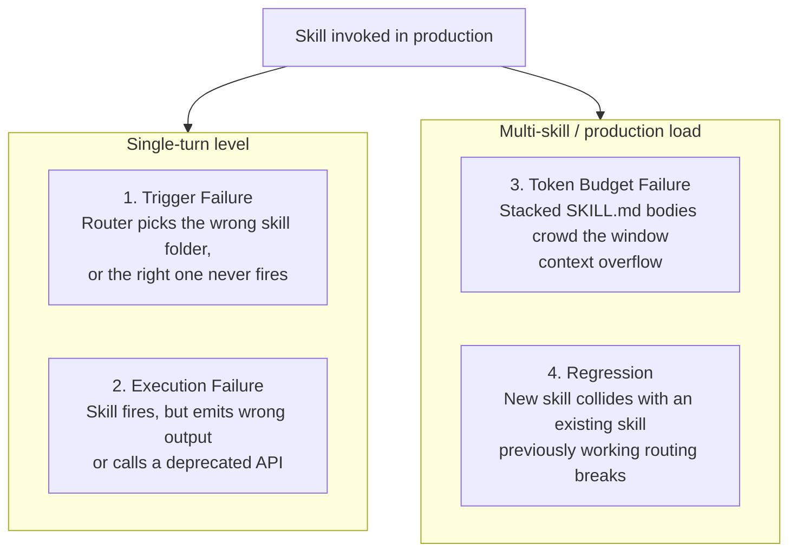
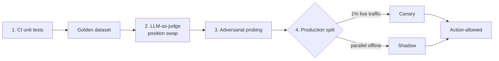
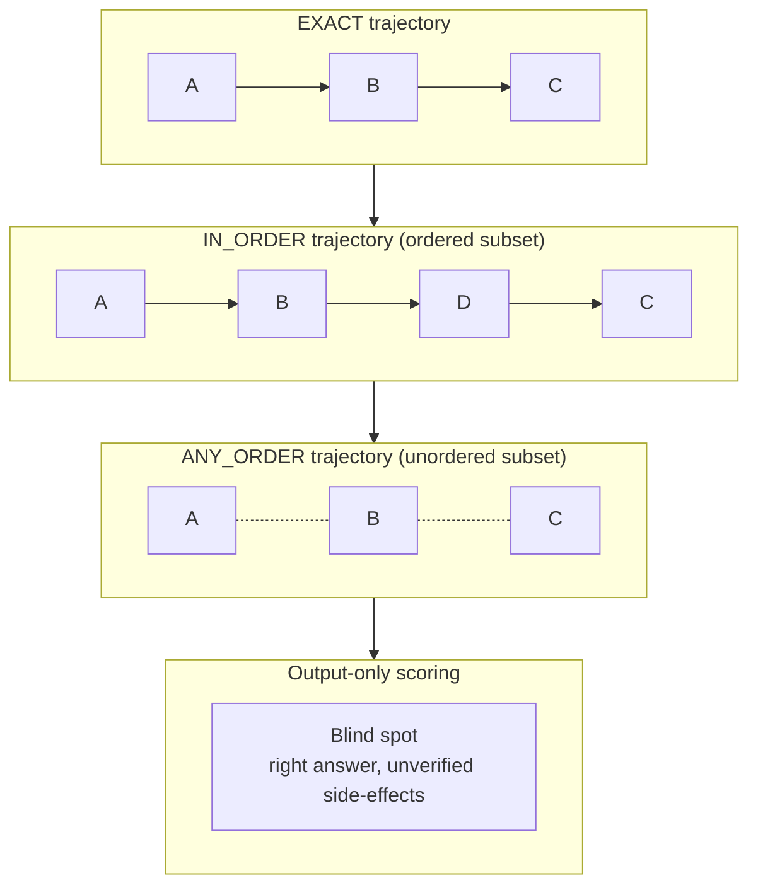
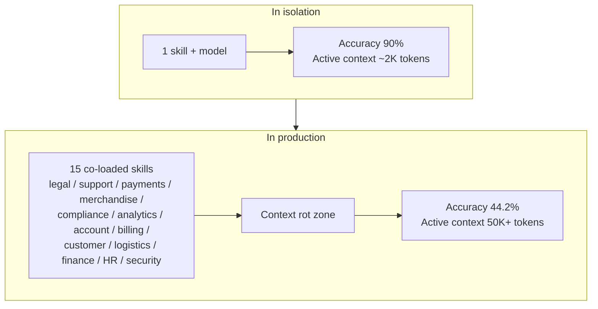
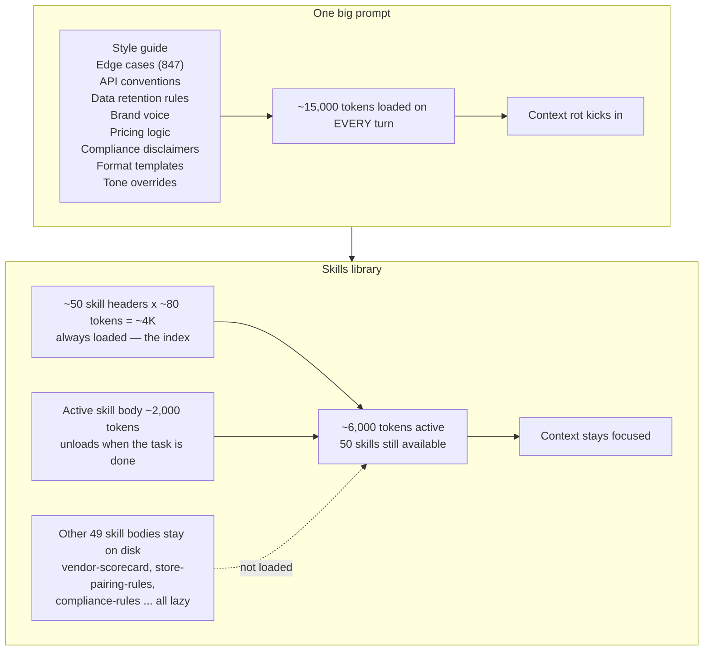
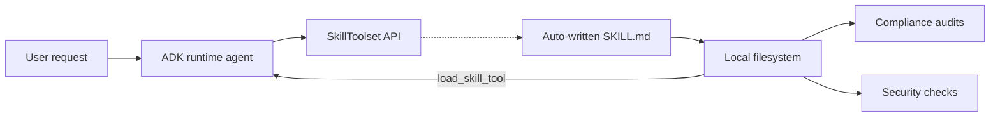
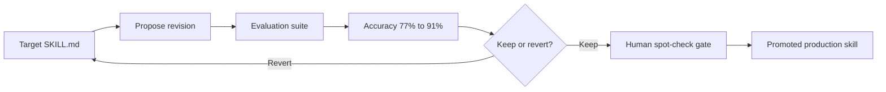
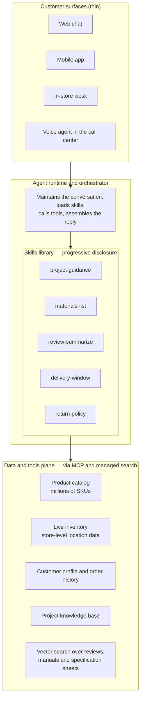

# Agent Skills

**Topics:** #agent-skills #progressive-disclosure #context-engineering #agent-evals #adk #agentops #skill-governance

> **Source:** [Agent Skills](https://docs.google.com/document/d/1AISjY31IgfCrOhi_xZv3kHzINnF5IR8CIstzAuWd2kM/edit) · Converted from Google Docs

---


## FDE Project Grading Rubric Enforcement & Prevailing Customer Alignment

> **Mandatory Governance Standard:** Every project, prototype, or production agent built using the patterns in this concept **must pass the [Google Cloud FDE Field-Readiness & Project Grading Rubric](/concepts/00-fde-field-readiness-and-grading-rubric.md)** (aligned with the [Cloud FDE Team Charter](https://g3doc.corp.google.com/company/teams/cloud-fde/index.md?cl=head)). Scoring Requirement: **Average >= `2.0 (Competent)`** across both **Part A (Presentation & Advisory Rigor)** and **Part B (Engineering & Implementation Excellence)**, with **zero `0 (Not Demonstrated)` scores** on any single metric.

### 1. Part A — Presentation & Advisory Rigor Enforcement for This Concept

- **A.1 Strategic Delivery & Value Articulation:** Demonstrate how 'Domain Expertise as Code' (`SKILL.md`) lets enterprises scale 100+ regional or vertical process variants without multiplying agent deployments or token costs.
- **A.2 Objection Handling & Technical Defense:** Cite empirical findings (SkillsBench & Latitude trajectory studies) to explain how to avoid skill degradation and why trajectory-aware scoring is mandatory for action-taking skills.

### 2. Part B — Engineering & Implementation Excellence Cutlines for This Concept

- **B.1.5 Domain-Applied AI/ML Expertise & B.7.1 Modularity:** Package domain procedures into modular `SKILL.md` folders (`references/`, `assets/`, `scripts/`) composed cleanly with MCP tools and sub-agents.
- **B.5.3 AI Cost Management:** Use progressive disclosure so agents load full skill instructions only when activated.
- **B.1.4 LLM Ops & Evaluation:** Evaluate skills on both final output quality and intermediate tool-call trajectory accuracy (closing the 20–40% gap between output-only and trajectory-aware scoring).

### 3. Prevailing Customer Best-Practice Exemplars to Cite in Panel Reviews

- **Grounded Enterprise Scenarios:** Vertical Skills in Retail (Appendix B case study: store operations, returns, and localized compliance across 100+ process variants) and Logistics route-constraint skill composition.
- **Cross-Reference:** See [Concept 00 — FDE Field-Readiness & Project Grading Rubric](/concepts/00-fde-field-readiness-and-grading-rubric.md) for the complete 0–3 grading scale, 31-competency matrix, and disqualifier remediation rules.

---
## Architectural Best Practice: Key Guidelines & Takeaways

### Core Principles

- **Progressive disclosure is the architecture.** Skills load in three levels: metadata (name + description) is always in context; the `SKILL.md` body loads only when the skill triggers; bundled resources load strictly as needed, and scripts execute without ever polluting the token window. This is what lets you install a hundred skills and pay only the tiny metadata cost per turn.
- **Skills are procedural memory.** LLMs already have analogs for episodic memory (what happened) and semantic memory (facts). Agent Skills are the first credible *procedural memory* primitive — remembering *how* to do things step by step.
- **Active context is a budget, not a vessel.** Every token in front of the model takes attention from every other. Treat the system prompt the way infra teams treat memory: a finite resource, allocated deliberately. Capacity is the wrong metric — a 1M-token window can show significant degradation at 50K tokens.
- **The expertise lives in the skills, not the runtime.** The runtime has commoditized; the skills library is the durable asset. As foundation models converge in baseline reasoning, the differentiator for autonomous reliability is the deterministic engineering around the model — and the unit that gets composed and reused there is the skill.
- **Skills are the unit of improvement.** Each skill is a small, owned, testable unit of capability. They are *conditional* (loaded only on description match), *composable* (one skill can chain to another without either knowing about the other), and *owned* (versioned folder, clear author, distributed improvement rather than a central-team bottleneck).
- **The description is the routing algorithm.** It is the only thing the model sees when deciding whether to load a skill. Spend more time there than anywhere else.
- **Skills and MCP compose; they do not compete.** MCP is about *reach* (connecting the agent to external systems). A Skill is about *know-how* (teaching the agent how to think about a kind of work). When a Skill needs data, it tells the agent to call a tool — typically one provided by an MCP server.
- **Shift intelligence left.** Instead of hoping an LLM correctly interprets complex rules at runtime, push logic out of the prompt and into standard, testable scripts. This reduces the chaotic surface area of the application.

### Mandatory Requirements / Golden Rules

**The five rules**

1. **One skill, one job.** If you cannot describe what the skill does in one sentence, it is two skills. Decompose before writing.
2. **Descriptions are an interface.** The agent picks skills by reading descriptions. A vague description means an unused skill.
3. **Skills are dependencies.** Treat them like libraries. Version them, pin them, review them in PRs. *A skill without a test is a hope, not a capability.*
4. **The right team owns the right skill.** Domain experts own domain skills. Do not let the AI team become a bottleneck for the organization's domain knowledge.
5. **The agent runtime is interchangeable.** Do not tie skills to one runtime. Portability is part of the value.

**Eval coverage — all four conditions must be satisfied**

- ☐ **Trigger.** Positive AND negative test cases. Target 90% trigger accuracy.
- ☐ **Execution.** Correct outputs across a representative range of inputs.
- ☐ **Regression.** Adding this skill causes zero drops in the existing library suite.
- ☐ **Token budget.** Co-loaded with 5 to 15 frequently-active skills, does not degrade unrelated turns.

Any failure holds the skill at the draft tier, regardless of happy-path performance.

**Graduation ladder (read / draft / act)**

- **Read-Only:** LLM-as-Judge eval; 90% trigger accuracy.
- **Draft-Only (human review):** Golden dataset of 20+ cases; human approval.
- **Action-Allowed:** Full adversarial red-teaming; sustained success across multiple runs (not a single lucky pass); no rollback events; sustained pass^k.

**Non-negotiables when evaluating**

- Write 3 positive and 3 negative triggers for every skill.
- Use Evaluation-Driven Development: write three JSON eval cases (Input, Expected Tools, Expected Output) *before* drafting the `SKILL.md`.
- When using LLM-as-Judge, swap the positions of reference and actual outputs to eliminate ordering bias, and calibrate against human ratings until you hit 90% agreement.
- Match trajectory scoring to tier: read-only skills may use `ANY_ORDER`; action-allowed skills require `IN_ORDER` or `EXACT`.
- Never evaluate a skill purely in isolation — production agents co-load 5 to 15 skills simultaneously.
- Anything an agent writes enters the library at the draft tier, regardless of how confident the meta-skill is.

**Deployment checklist**

- ☐ Frontmatter validates (lint passes)
- ☐ Description includes what + when + when-not
- ☐ Scripts have unit tests passing in CI
- ☐ Eval suite passes in CI with min-pass threshold
- ☐ Security scan clean (no secrets, no untrusted deps)
- ☐ Description reviewed by someone other than the author
- ☐ Cross-tool install paths tested if shipping publicly
- ☐ Org-level admin provisioning updated (if applicable)

### Anti-Patterns / Guardrails

- **Don't write vague descriptions** like "helps with documents". Use specific verbs, trigger phrases, and a when-not-to-use clause.
- **Don't write `SKILL.md` bodies over 5,000 words.** Move detail to `references/`. A body exceeding ~5,000 tokens may work alone but will cause context rot when co-loaded.
- **Don't hard-code paths or secrets.**
- **Don't embed "always do X" rules** that are more appropriate for AGENTS.md. Models learn to ignore capitalized imperatives exactly as developers ignore a wall of warning text — this is **Context Debt**.
- **Don't install untrusted third-party libraries or Skills without scanning.**
- **Don't reinvent MCP as scripts.**
- **Don't use the LLM context window as a database.** Pass only URIs or pointers to subagents via the file system or message bus.
- **Don't over-engineer the `SKILL.md` for a specific model** to make a failing test pass — it ruins portability. Isolate execution logic from routing instead.
- **Don't start with meta-skills.** Get the manual authoring loop working first. The fastest way to get a bad library is to point an agent at an empty folder and ask it to generate fifty skills.
- **Don't reach for multi-agent when skills will do** — but equally, don't assume skills replace multi-agent where there is genuine parallelism, real capability/security boundaries, or heterogeneous models.

**Skill smells (revise if you see these)**

- Over 5,000 words — probably two skills, or reference material that belongs in `references/`.
- Two domain teams could plausibly own it — not yet decomposed; split along team boundaries.
- You can't write three test cases for it — description too vague; skill does too many things.
- It does not reference any other resource — might just be a long instruction that belongs in the system prompt.
- You keep adding "edge cases" sections — each edge case probably wants its own skill.
- Its description starts with "a helpful skill for…" — rewrite. The description should name the trigger, the inputs, and the output.

---

**Authors: Tanvi Singhal, Gabriela Hernandez Larios, Debanshu Dus, Lavi Nigam, and Smitha Kolan**

**Acknowledgements**

**Curators and editors:** Shubham Saboo

**Designer:** Michael Lanning

*May 2026*

---

## Table of contents

1. Introduction
2. What is an Agent Skill (and How to Build Your First One)
   - Skill Anatomy & Progressive Disclosure
   - Path A: Translating what you already know
   - Path B: Crystallizing what the agent just did
   - Trying it out & How to install Skills today
   - Wait but how does a Skill differ from MCP and AGENTS.md?
3. Why did Agent Skills become so popular, so fast?
   - Skills for chatbots, for coding agents, or for multi-agent enterprise use cases?
4. Evaluating Skills
   - The Evaluation Toolkit
   - The trigger is the first gate
   - Output quality and tool trajectory
   - System vs. Skill: The Evaluation Illusion
   - Token budget: isolation is a trap
   - What "eval coverage" means
5. From Prototype to Production
   - What's actually inside an agent runtime
   - Why skills are the unit of improvement
   - The failure mode that breaks demos: context overflow
   - What this means for the token budget
6. On Meta-Skills and Self-Improving Skills
   - Where this falls apart
   - Where this is going
7. Composing and Packaging Skills
   - Execution Routing: DAG Orchestration
   - Environment Packaging: Capability Profiles
   - Populating the Graph: The Canonical Skill Taxonomy
   - Context Debt and Shifting Intelligence Left
   - Architectural Tradeoffs
   - Actionable Best Practices
8. How to Decide Among the Hundreds of Skills That Exist
9. Conclusion

**Appendix A – The Practical Cheatsheet**

- The minimal SKILL.md
- The folder structure
- Naming
- The description field
- The five rules
- The quality principles
- Do's and Don'ts
- Skill smells (revise if you see these)
- Eval coverage checklist
- Deployment checklist
- One-line mental model
- Where to start tomorrow

**Appendix B – Case Study: Domain Expertise as Code (Vertical Skills in Retail)**

- Why retail is the canonical case for skills
- What the architecture looks like
- An illustrative skills library
- How does the same query route through the library
- Ownership: who writes which skill
- The read / draft / act ladder
- Why is this harder to compete with than a custom agent
- Cold start: where to actually begin

---

> Agent Skills turn any general purpose agent into a specialist on demand. No context bloat. Portable and lightweight.

## 1. Introduction

Agent Skills are a way to equip your agent with knowledge and company context. An Agent Skill is a folder containing a `SKILL.md` file, with `scripts/`, `references/`, and `assets/` directories. **Section 2** covers the anatomy in detail.

Agent Skills are becoming the standard for cross-platform portability. But why the sudden adoption velocity? We believe Agent Skills tackle four main friction points in AI agent development:

**1. Too many instructions, worse results**. Dumping every instruction you can think of into a single system prompt inevitably degrades Large Language Model (LLM) performance, a problem known as context rot. Skills solve this by loading exclusively on demand. **Section 5** unpacks the research behind this.

**2. Knowing how, not just knowing what**. LLMs already have reasonable analogs for remembering what happened (episodic memory) and remembering facts (semantic memory). What they've lacked is a way to remember how to do things step by step, which is called procedural memory. Agent Skills can be seen as the first credible **procedural memory** primitive for LLM Agents.

**3. Multi-agent overload**. The ecosystem was flooded with complex multi-agent systems that are notoriously hard to build and maintain. While still necessary for certain tasks, Skills allow a single general-purpose agent to seamlessly flex into many specialist roles. **Section 3** develops this argument in depth, with a worked example.

**4. Portability**. A folder with a markdown file is a remarkably lightweight primitive. Any agent with filesystem access can use them, making them perfectly portable across a multi-vendor AI landscape.

In this whitepaper, we cater to two personas: Builders (those using Skills) and Developers (those creating, versioning, and managing them). We'll gently walk through what a Skill is and how to use it (**Sections 2 to 3**), before diving into complex Developer topics like evaluation, production readiness, meta-skills, and composition (**Sections 4 to 8**).

(Impatient? **Appendix A** offers a printable operational cheat sheet, and **Appendix B** walks through a retail case study).

## 2. What is an Agent Skill (and How to Build Your First One)

Agent Skills are a primitive for giving a general-purpose agent on-demand specialist competence. Yes, a Skill can be as simple as a single markdown file, but it doesn't have to stop there, and the paradigm behind it is quite innovative.

Today we are seeing Agent Skills emerge through two distinct patterns:

**The first path is driven by subject matter experts**, who already have institutional knowledge written down somewhere. Think of a compliance officer with a 30-page runbook, or an HR manager with onboarding guides for new hires. None of them need to learn to code to write and start using a Skill. They already have the content; the only job left is to translate it into a format the agent can use smartly.

**The second path involves developers** wrapping agentic or coded workflows into Skills. If an agent successfully executes a non-trivial, repetitive task, you don't want it to have to figure out the process from scratch next time. Instead, you want the agent to create a Skill out of this successful run. In short, we are observing an emerging pattern: anything that is a good, reusable workflow becomes a Skill, and you don't have to write it yourself, the agent does, you review. This is already meta-skills territory, which we introduce gently here before going deep on it in **Section 6**.

Both groups produce the same artifact, a **Skill** folder anchored by the `SKILL.md` primitive, but the journey to get there is different.

### Skill Anatomy & Progressive Disclosure

Before going into the different paths, let's review the Skill anatomy. Every skill lives in its own directory and must contain a `SKILL.md`. To see the full canonical structure, as defined by the open standard at agentskills.io, let's look at a practical example.

Below is an illustrative folder for a Skill designed to conduct daily cafe preparation. (Remember, the only mandatory file is `SKILL.md`. The rest is optional):

```text
cafe-preparation/
├── SKILL.md                        # Required: metadata + instructions
├── scripts/                        # Optional: executable code (any language)
│   ├── calc_quantities.py          # Estimates lattes, croissants, etc.
│   └── convert_to_ingredients.py   # Converts drinks and pastries into..
├── references/                     # Optional: supplementary context
│   ├── menu_and_recipes.md         # Matcha latte: 3g powder, 200ml...
│   └── minimums.md                 # Always prep for at least 40 lattes...
└── assets/                         # Optional: templates, configs, schemas
    ├── prep_sheet_template.md      # The final layout for the kitchen staff
    └── shopping_list_template.md   # The layout for vendor ordering
```

*Snippet 1: Directory tree structure showing the standard layout and progressive disclosure design for the `cafe-preparation` skill.*

The innovative piece is the **progressive disclosure**. Skills load in three levels:

1. **Metadata** (name + description) is always in the agent's context.
2. **`SKILL.md` body** is loaded only when the skill triggers.
3. **Bundled resources** are loaded strictly as needed (and scripts execute without ever polluting the token window).

This means you can have a hundred installed skills but only pay the tiny token cost for their metadata on every turn. Let's get practical and look at how to build one.

### Path A: Translating what you already know

A minimal `SKILL.md` template lives in Appendix A. You can copy it directly. The piece worth focusing on first is the YAML frontmatter, because it's the activation trigger:

```yaml
---
name: cafe-preparation
description: |
  Calculates daily ingredient needs and generates prep sheets for cafe operations.
  Use when the user asks to estimate daily quantities, convert drinks to
  ingredients, or generate shopping lists.

  Do NOT use for employee shift scheduling or financial accounting.
---
```

*Snippet 2: YAML frontmatter configuration for the `cafe-preparation` skill.*

There are two things worth getting right from the start: naming and the description field.

**Naming**. When naming, be obvious and boring: use snake_case for directories (e.g., `bigquery_ingestion`), kebab-case for skill names (e.g., `pdf-processing`), and prefer the gerund form like `managing-databases`. Avoid generic names such as `utils` or `tools` and omit any internal jargon.

**Description**. This is your routing algorithm. It is the only thing the model sees to decide whether to load the Agent Skill. State what it does, front-load trigger keywords, be pushy if the model under-triggers, and explicitly state what it is not for.

Once the `SKILL.md` is drafted, you build out the rest of the folder. This is where **progressive disclosure** starts paying off. Anything that doesn't need to be in the `SKILL.md` body goes somewhere else:

- **Scripts**. Deterministic work (parsing exports, math, formatting) lives in `scripts/`. The model decides what to do; the script does the heavy lifting.
- **References**. Knowledge that is only relevant once the skill is running (domain principles, definitions, edge case handling) lives in `references/` and loads on demand.
- **Assets**. Templates and schemas live in `assets/`.

Rule of thumb: if the `SKILL.md` is starting to get long, the next paragraph probably belongs in `references/` and not in the body.

(Impatient? **Appendix A** offers a printable operational cheat sheet with curated Do's and Don'ts to guide your initial Skill development).[^1]

### Path B: Crystallizing what the agent just did

The second path starts from the other end. Instead of translating something you already have, you're crystallizing something the agent just did.

The agent completed a task successfully. You noticed the workflow was reusable. You want the next instance of that kind of task to benefit from what was just learned.

This is the meta-skills territory: Skills whose job is to capture or improve other Skills. Tools like Anthropic's `skill-creator`[^2], Nous Research's Hermes Agent[^3], and the self-improving agent-skills pattern from `awesome-llm-apps`[^4] all support this workflow. The agent watches a successful trajectory and proposes a `SKILL.md` draft. You review, instead of authoring.

The same quality bar applies. A reviewed, iterated, agent-drafted Skill can be excellent. An un-reviewed agent-drafted Skill is often worse than no Skill at all. We come back to this whole topic with much more depth in **Section 6**, where we cover meta-skills.

### Trying it out & How to install Skills today

Once the folder is ready (whether you wrote it or an agent drafted it for you), it is time to try it out. Drop it in the right place for your tool, restart the agent, and test it with a natural prompt. Watch the trace to confirm the skill actually triggered. Then try a prompt where it should NOT trigger and confirm it stays quiet.

But where exactly is the "right place"?

This is where things get a bit nuanced, and it's one of the downsides of the exploding popularity of Skills. Every agent or coding tool has converged on the format, but they each look in a slightly different place for it. Broadly, there are three paradigms for how you will interact with and install Skills today:

1. **The File Drop (Coding Agents & CLIs)**: For local environments, the pattern is file-based, you drop or install the skill folder into a specific hidden directory and the agent picks it up. While a highly welcome cross-tool convention is emerging around a shared `.agents/skills/` folder at your project root, many tools still protect their own bespoke paths.

   > **Pro tip:** If you bounce between multiple CLI tools and IDEs, community managers like `skillport` or `openskills` will automatically symlink your central skills library to every tool's expected location.

2. **The UI Install (Web & Enterprise Workspaces)**: If you are using web-based collaborative platforms or consumer AI chatbots, you rarely touch a terminal or a hidden folder. These platforms allow you to install, upload, or manage your Skill folders directly through a visual UI registry with just a few clicks, handling the routing behind the scenes for your whole team.

3. **The Programmatic Route (Custom Frameworks)**: If you are building bespoke, non-coding agents from scratch (for example, using the Google Agent Development Kit), you load skills programmatically. You point your code to the folder path—such as registering it through a `SkillToolset` class[^5], which seamlessly auto-generates the necessary `load_skill` routing tools for the model under the hood.

The overall pattern is the same everywhere: drop the skill folder into the right directory, restart the agent, and it picks it up. The "right directory" is what changes depending on the tool.

A piece of advice: check the documentation of your specific coding agent or AI chatbot before assuming. The format is shared, but the install path, the activation rules, and the per-tool details (allowed-tools whitelisting, security gates, plugin bundling) are not.

### Wait but how does a Skill differ from MCP and AGENTS.md?

To establish the architectural fit of Agent Skills, it helps to map these primitives.

**Skill vs. MCP**. These do not compete, they compose. Model Context Protocol is about reach: an MCP server connects the agent to an external system (Drive, Salesforce, BigQuery, or an internal API). A Skill is about know-how: it teaches the agent how to think about a particular kind of work. When a Skill needs data, it tells the agent to call a tool, typically one provided by an MCP server.

**Skill vs. AGENTS.md**. From one side AGENTS.md is always loaded within the project; Skills load on demand. The cleanest setups use both. Keep AGENTS.md tight (project conventions, stack, build commands, etc.) and if needed use it also as a router into the Skills library, with a short catalog at the bottom that tells the agent what's available.

## 3. Why did Agent Skills become so popular, so fast?

Imagine it's early 2025. You are asked to build a system that offload repetitive back office work: generating slide decks from briefs while adhering to the company style, parsing structured invoicing PDFs, drafting HR onboarding guides, summarising weekly compliance reports, and tackling a long tail of similar tasks that will inevitably grow as the team finds new things to automate.

Most likely, you would have defaulted to a multi-agent architecture. A router agent at the top dispatching to a handful of specialist sub-agents beneath it. You would then spend agonizing hours on CI/CD pipelines, orchestration logic, and ensuring that a deployment for the new HR sub-agent didn't break the invoice sub-agent.

With the release of Agent Skills, this workflow becomes vastly simpler. This friction is exactly how the Skill format was first created by Anthropic, with the first skills for reading PDFs and creating slides[^6], which represents a much lighter version to accomplish this. Instead of a router dispatching subagents, you have one agent with a library of skills. Skills can run commands, call MCP servers, and bundle Python scripts. The agent decides which to load when. You maintain skills, not agents, and the operational surface can shrink.

To be **very** clear: Agent Skills do not kill multi-agent architectures.

Multi-agent remains the absolute right answer when you have genuine parallelism, real capability boundaries (different access, different security postures, different external systems), hierarchical decomposition where the abstraction layers actually differ, adversarial or check-and-balance setups, sub-agent intercommunication, or heterogeneous models. This list isn't exhaustive.

What Skills did was introduce a missing architectural primitive. Many systems that were built multi-agent *by default* can now be elegantly simplified to single-agent-with-skills *by design*.

### Skills for chatbots, for coding agents, or for multi-agent enterprise use cases?

The first publicly visible skills were AI chatbot-shaped. The coding-agent narrative arrived within days or weeks. And once it did, skills exploded. They landed straight into the vibe-coding fever and turned out to be the format developers had been wanting.

In some multi-agentic architectures, by definition, each sub-agent is already a specialist. A research agent might not need a research skill. Skills are more useful in scenarios when one general-purpose agent has the flexibility to become a specialist across different things, by design. However, there might be cases where multi-agent and skills do compose well, for example, if there is a need for each specialized agent to have its own scoped skill library.

Now consider a logistics company with 100 process variants depending on product type, tools, route constraints, customer SLAs, regulatory zones, etc. How could this be solved elegantly and lightweight:

- **One agent, one giant context window**. Causes immediate context rot and exorbitant token costs.
- **RAG over the runbooks**. Probably the right answer two years ago. But you're now running a vector DB, an embedding model, and a chunking strategy whose quality has nothing to do with the actual procedures.
- **Multi-agent, one subagent per process**. 100 subagents, each with a process-specific system prompt. An operational nightmare of 100 deployments, 100 evaluation surfaces, and complex routing layers.
- **One agent, 100 skills**. This fits the skills format as there are many variants for the same job. The progressive disclosure of skills means 100 skills cost ~100 × 50 tokens = ~5,000 tokens of always-loaded metadata. Logistics requests carry strong activation cues: SKU, origin, weight, hazmat flag, SLA, which makes skill descriptions sharp and selection reliable. Procedures live in version control. Adding the 101st variant is a new folder, not a new deployment. Easier to maintain and to scale.

However, the most important part is to always have a strict evaluation process and compare different performances to make the final decision (**Section 4** covers what that evaluation work actually looks like in practice).

As a mental note, adoption follows the path of least resistance. Anyone who can write documentation can write a skill. That lowers the barrier and the latent procedural knowledge sitting in wikis, runbooks, and engineers' heads finally has somewhere structured to flow.

## 4. Evaluating Skills

Now you have a first skill, or maybe a small library of them. The question that immediately follows is: how do you know they actually work? How skills fail, how to test them, and the four conditions every skill should pass before it earns a place in your library.

> **Note:** An Agent Skill without a test is a hope, not a capability.

When researchers recently benchmarked 84 real-world agent tasks in SkillsBench (2025)[^7], they found that 19% performed worse with a skill than without one. These poorly designed skills were not just neutral noise, they actively degraded capability. Fortunately, these failures are predictable and fall into four distinct modes:

1. **Trigger Failure:** The wrong skill fires, or the correct one fails to fire.
2. **Execution Failure:** The skill triggers correctly, but produces incorrect output or errant tool calls.
3. **Token Budget Failure:** A massive skill body crowds the context window, degrading performance on unrelated turns.
4. **Regression:** A newly added skill overlaps with an existing one, breaking previously working routing.

Trigger failures surface in routing logs; execution failures in output quality; token budget failures under realistic context load; regression failures only when the full library is exercised together.



*Figure 1 — The four skill failure modes. Trigger and execution failures happen at the single-turn level, while token budget and regression failures only appear when multiple skills interact under heavy production load.*

### The Evaluation Toolkit

Five complementary testing patterns cover the full failure surface.

| Pattern | Description | Example | Failure Mode Addressed | When Required |
|---|---|---|---|---|
| Eval-as-Unit-Test | Test file for the skill running in CI on every change | Three JSON eval cases run via `agenteval` on every push; a failing test blocks merges | All | Every skill, every change |
| Golden Dataset | Curated, versioned (input, expected output) pairs stored with the skill | 30 representative queries with expected tool calls/formats committed in the skill directory | Execution, Trigger | Draft tier and above |
| LLM-as-Judge | A peer model evaluates output against a rubric at scale | Reference-guided scoring across three rubric dimensions, run twice with swapped positions to neutralize ordering bias | Execution | Read-only and draft |
| Adversarial / Red-Team | Systematic probing designed to expose failure modes | One rephrasing and one negative boundary case for every positive trigger; `agentregress` flags regressions | Trigger, Execution | Before action-allowed graduation |
| Canary / Shadow Mode | Deployment to controlled traffic before full rollout | Shadow: parallel offline comparison. Canary: 1% live traffic monitored via `selftune` for 24 hours | Regression | Before each action-allowed release |

*Table 1: The Evaluation Toolkit, outlining five complementary testing patterns designed to cover the full failure surface of Agent Skills.*



*Figure 2 — The evaluation gauntlet. A skill passes through CI unit tests, a golden dataset, position-swapped LLM-as-judge scoring and adversarial probing before it is split into canary and shadow traffic, and only then graduates to action-allowed.*

### The trigger is the first gate

A skill that never fires cannot help. A skill that fires too broadly injects irrelevant context.

Vercel's production analysis[^8] revealed a 56% non-invocation rate for skills expected to activate consistently. More critically, a skill stripped of its instructions scored 58%, while the agent without the skill scored 63%. This 5-point deficit demonstrates that a poorly-designed skill can actively subtract capability.

In this same study, Vercel also noted that a passive `AGENTS.md` index of project conventions achieved a 100% pass rate against a 53% baseline. This reinforces that skills are best reserved for narrow, action-specific workflows, whereas global context should remain in passive, always-accessible documentation.

Now, to hit the industry-standard 90% trigger accuracy rate, your `SKILL.md` description, the **only** thing the model sees during routing, must pass four checks:

- **Testable specificity:** You must write 3 positive and 3 negative triggers.
- **Clarity:** Ambiguous queries don't overlap with adjacent skills.
- **Execution fidelity:** It describes actual performance, not aspirational behavior.
- **Rephrasing stability:** It routes consistently regardless of how the user phrases the intent.

### Output quality and tool trajectory

Once a skill triggers, test both the final output (what the agent says) and the tool trajectory (what the agent does) separately.

A smart way to do this is to use **Evaluation-Driven Development (EDD)**. Invert the workflow by writing three JSON evaluation cases (Input, Expected Tools, Expected Output) before drafting the `SKILL.md`. It forces a clear functional spec upfront. When using **LLM-as-Judge** to score outputs at scale, remember two non-negotiables: swap the positions of the reference and actual outputs to eliminate ordering bias, and calibrate against human ratings until you hit 90% agreement.

Latitude's analysis (March 2026)[^9] found that final-output-only scoring passes 20% to 40% more cases than trajectory-aware scoring. This gap represents instances where the agent reached the correct answer via an incorrect sequence of tool calls. Acceptable in read-only scenarios. Critical in action-allowed skills, where incorrect tool trajectories can cause irreversible side effects.

The Google ADK eval framework[^10] offers three trajectory scoring modes: `EXACT` (exact order), `IN_ORDER` (ordered subset), and `ANY_ORDER` (unordered subset). Trajectory validation should align with the skill tier: read-only skills can use `ANY_ORDER`, action-allowed skills require `IN_ORDER` or `EXACT`.



*Figure 3 — The three ADK trajectory scoring modes, and the blind spot left by output-only scoring: the agent can reach the right answer through an unverified sequence of tool calls.*

### System vs. Skill: The Evaluation Illusion

Trajectory testing evaluates the composite system of the host agent interacting with the skill rather than the skill in isolation. When a multi-skill trajectory fails, it is often impossible to decouple agent routing, instruction quality, or execution fidelity. To simplify calibration, evaluate skills via a "Single-Skill Sub-Agent pattern" (Agent + 1 Skill vs. Base Agent); save complex multi-skill co-loading for advanced production staging.

**Evaluation-Driven Development** (EDD)[^11] inverts the workflow by writing three JSON evaluation cases (Input, Expected Tools, Expected Output) before drafting the `SKILL.md`. This forces a clear functional specification upfront. A minimal eval case looks like this:

```json
{
  "case_id": "refund_dup_charge_001",
  "input": "I was charged twice for order #4521 last Tuesday",
  "expected_skill": "refund_processor",
  "expected_tool_calls": [
    {"tool": "lookup_order", "args": {"order_id": "4521"}},
    {"tool": "check_duplicate_charge", "args": {"order_id": "4521"}}
  ],
  "expected_output_format": "confirmation_with_refund_id",
  "rubric": ["acknowledges duplicate", "cites order id", "provides next step"]
}
```

*Snippet 3: A minimal JSON evaluation case example used in Evaluation-Driven Development (EDD) to explicitly define input parameters, expected tool trajectories, and evaluation rubrics upfront.*

Drafting three such cases upfront surfaces description ambiguities and tool-trajectory errors before they compound in the skill body.

When using LLM-as-Judge to score outputs at scale, remember two non-negotiables: swap the positions of the reference and actual outputs to eliminate ordering bias, and calibrate against human ratings until you hit 90% agreement.

### Token budget: isolation is a trap

Never evaluate a skill purely in isolation. Agents in production co-load 5 to 15 skills simultaneously. A skill body exceeding 5,000 tokens might work perfectly alone, but it will cause context rot when co-loaded.

**The Compound Evaluation Trap: Skill vs. Agent**

Trajectory testing evaluates the composite system — the skill and the host agent together. If a test fails, avoid over-engineering the `SKILL.md` for a specific model, which ruins portability. Instead, isolate execution logic from routing by using a "Two-Tiered Assert Framework": validate underlying tool code independently, and audit `SKILL.md` triggers across multiple model families to catch brittle, architecture-locked descriptions.

MCPVerse[^12] noted an 18.2% accuracy drop in Claude-4-Sonnet due to tool proliferation and context attention competition. Additionally, Chroma Research (2025)[^13] found that all frontier models degrade as input grows, particularly when hindered by co-loaded noise.



*Figure 4 — The performance gap between a single running skill and 15 co-loaded skills. Passing an isolated test is a false positive for production readiness.*

Because of this, skills must graduate through strict tiers of authority:

- **Read-Only:** LLM-as-Judge eval; 90% trigger accuracy.
- **Draft-Only (Human Review):** Golden dataset of 20+ cases; human approval.
- **Action-Allowed:** Full adversarial red-teaming; sustained success across multiple runs (not just a single lucky pass); no rollback events; sustained pass^k.

**pass^k** measures consistent, rather than occasional, success by running the evaluation *k* times and requiring success on every run. On tau-bench (Yao et al., 2024)[^14], GPT-4o scored 61% on pass^1 but dropped below 25% on pass^8, demonstrating that single-run success is a poor predictor of production reliability.

When calibrating these thresholds, two factors are critical:

1. **Production Degradation:** ReliabilityBench[^15] shows that production performance typically drops 20% to 30% compared to offline benchmark pass@1 numbers.
2. **Simulation Bias:** Simulation-based evaluations can suffer from an optimistic bias of up to 9% (the "Lost in Simulation"[^16] finding).

Consequently, human review of representative outputs remains the ultimate validation signal for action-allowed graduation.

### What "eval coverage" means

A skill achieves complete eval coverage by satisfying four conditions mapped directly to the primary failure modes:

- **Trigger Failure:** Verifying trigger behavior with both positive (should fire) and negative (should not fire) test cases.
- **Execution Failure:** Ensuring correct outputs across a representative range of expected inputs.
- **Regression:** Confirming that adding the skill causes zero performance drops in the existing library.
- **Token Budget Failure:** Bounding the skill's token footprint to ensure it does not degrade performance on unrelated turns.

This checklist governs graduation; failure on any single condition holds the skill in the draft tier, regardless of its happy-path performance. Once verified, the skill and its accompanying eval suite are ready for production deployment (detailed in **Section 5**).

## 5. From Prototype to Production

**Sections 1 to 4** covered what skills are, how to write one, and how to evaluate them. This section is about what changes when you put a working prototype in front of a real customer. The short version: the model is no longer the interesting part, and skills are the engineering primitive that lets you ship reliably.

**Google's Agents CLI**[^17] in Agent Platform is a CLI and skills package for building, evaluating, and deploying AI agents on Google Cloud. Agents are built with Google's Agent Development Kit (ADK) and Agents CLI handles everything around it: scaffolding, evaluation, deployment, and observability.

```mermaid
flowchart LR
    subgraph Step1["1. One command"]
        CMD["uvx google-agents-cli setup"]
    end
    subgraph Step2["2. Seven skills installed into the existing coding agent"]
        W["workflow — lifecycle + orchestration"]
        AC["adk-code — ADK Python, agents, tools, state"]
        SC["scaffold — create + enhance + upgrade"]
        EV["eval — metrics, evalset, LLM-as-judge"]
        DP["deploy — Agent Runtime + Cloud Run"]
        PB["publish — Gemini Enterprise registration"]
        OB["observability — Cloud Trace + BigQuery analytics"]
    end
    subgraph Step3["3. Any compliant coding agent gains the full lifecycle"]
        G["Gemini CLI"]
        CC["Claude Code"]
        CX["Codex CLI"]
        AG["Antigravity"]
        OT["...any other compliant agent"]
    end
    Step1 --> Step2 --> Step3
```



*Figure 5 — The Agents CLI install flow. One `uvx` command installs seven skills into the developer's existing coding agent, covering the full agent lifecycle. Google packaged its ADK expertise as skills rather than a monolithic IDE, so it composes with tooling the developer already uses.*

The working example points to three properties that generalize beyond Google's setup:

- **The expertise lives in the skills, not the runtime**. The runtime is commoditized; the seven skills are the durable asset.
- **The skills package composes with what you already use**. Install the skills and your existing coding tool gains new capabilities; the same pattern to aim for internally: capabilities that compose into existing tooling, not another portal.
- **The full lifecycle ships as skills**. Scaffold, build, evaluate, deploy, publish, observe. Every stage that once needed its own tooling now fits the skills format.

### What's actually inside an agent runtime

Underneath the framework, the agent loop has converged across vendors: the runtime maintains a conversation, calls the model, executes tools, reads files, returns a response. What's striking inside one of these runtimes is how little of the code is about reasoning.

A recent reverse-engineering of Claude Code v2.1.88 (Liu, Zhao, Shang, and Shen, 2026)[^18] found that 98.4% of the codebase is operational infrastructure: permission classifiers, context compaction pipelines, subagent delegation, session storage — and only 1.6% is the agent loop itself. The model sits behind a remote API; the engineering around it is what makes the system production-grade. The companion site `ccunpacked.dev` maps the same architecture visually.

This is the architectural insight behind everything that follows. As foundation models converge in baseline reasoning, the differentiator for autonomous reliability becomes the deterministic engineering around the model and, inside that engineering, the unit that gets composed and reused is the skill.


*Figure 6 — The demo-to-deploy gap. Team confidence peaks early, then collapses on contact with a real customer environment. The instinct is to call it a model problem; it almost never is.*

### Why skills are the unit of improvement

The naive theory of agent improvement is that better models produce better agents. In production, the model is the infrastructure and skills are the primitive that lets improvements ship. Each new skill is a small, owned, testable unit of capability (as we set up in **Section 1**). When a new edge case appears, it takes editing one `SKILL.md`; the agent's effective capability grows without the challenges of monolithic prompt engineering.

Three properties of skills make this work:

- **They are conditional**. Loaded only when their description matches the task.
- **They are composable**. One skill can call tools from another, or chain downstream, without either knowing about the other (**Section 7** develops the composition story in depth).
- **They are owned**. Each lives in a versioned folder with a clear author, so improvement is distributed rather than bottlenecked through a central platform team.

Compare against the alternatives:

| Improvement style | Cycle time | Failure mode | Who can do it | Context Tax |
|---|---|---|---|---|
| Model swap | Days to weeks | Regression in unrelated tasks | ML/platform team | None (weights-based) |
| System prompt edit | Minutes to hours | Context rot, instruction conflict | Whoever owns the prompt file | Static (every turn pays) |
| Fine-tune | Weeks to months | Catastrophic forgetting, overfitting | ML team only | None (weights-based) |
| New skill | Hours to days | Bounded with only matching turns | Any domain team | Dynamic (loaded on-demand when triggered) |

*Table 2: Comparison of agent improvement methodologies across cycle times, failure modes, organizational ownership, and context costs.*

### The failure mode that breaks demos: context overflow

The most common failure mode of agents in production is not hallucination. It is context overflow: the model receiving more context than it can effectively use, and degrading silently before the operator notices. Two strands of research ground this:

**Lost in the Middle (Liu et al., TACL 2024**[^19]**)**. Across multi-document QA and retrieval, performance is highest when relevant information sits at the start or end of the input and degrades in the middle; a U-curve that holds even for models trained on long contexts.

**Context Rot (Chroma Research, 2025**[^20]**)**. Across 18 frontier models — Claude 4 Opus and Sonnet, Gemini 2.5, Qwen3 — performance degrades as input grows, even when task difficulty is held constant. Every model gets worse, and faster when relevant content is hard to distinguish from distractors. The noise typical of real agent contexts (tool outputs, half-relevant retrievals, intermediate reasoning) is among the worst.


*Figure 7 — Context rot in practice. As prompt size grows, accuracy on a fixed task degrades long before the context window fills. The dashed line shows the naive expectation; the curve shows what 18 frontier models actually do (Liu et al. 2024; Chroma 2025).*

### What this means for the token budget

Progressive disclosure, covered in **Section 2**, is the architectural answer: metadata for every skill loads at startup, a skill's body loads only when its description matches, and supporting files load only when the body references them.

The math is worth showing. Consider an agent with fifty distinct workflows. As a single system prompt, it loads 15,000 tokens every turn. As a skills library, it loads ~4,000 tokens of descriptions plus the ~2,000-token body of the one active skill — ~6,000 tokens total, with the other forty-nine bodies on disk. Anthropic has published examples where converting a workflow to skills cut active context from roughly 150,000 tokens to 2,000, a reduction of more than 98 percent.



*Figure 8 — Token economics: a single big prompt versus a fifty-skill library. The library has fifty units of capability available, but only the active body sits in context at any moment. Same workflow capability, far fewer tokens loaded at any given moment.*

Three practical implications follow:

- **Capacity is the wrong metric**. A 1M-token window can show significant degradation at 50K tokens.
- **Active context is a budget, not a vessel**. Every token in front of the model takes attention from every other. Treat the system prompt the way infra teams treat memory: a finite resource, allocated deliberately.
- **Skills resolve the constraint**. They keep active context small while keeping available capability effectively unbounded.

Once a team has a working library, the questions shift from maintaining a single skill to evolution, composition, and the larger ecosystem.

## 6. On Meta-Skills and Self-Improving Skills

So far, every skill in this document has been written by a human. A domain expert sits down, drafts a `SKILL.md`, tests it, ships it. That's the right place to start. But once you have a working library, the natural next question is: can the agent help write, evaluate, and improve skills too?

This is the meta-skills territory. Skills whose job is to author, evaluate, or improve other skills. In practice, these "meta-skills" fall into four buckets:

**1. Authoring**. Skills that take a description of a workflow and produce a draft `SKILL.md`. Google's ADK[^21] has a "skill factory" pattern that does this through its `SkillToolset`. Anthropic ships a `skill-creator` Skill[^22] that walks you through creation, evaluation, and tuning.

**2. Assisted authoring from traces**. Instead of asking a human to describe a workflow, watch the agent do it successfully a few times, then turn that trace into a skill. The `skill-creator` workflow[^23] supports this directly through trace-based harvesting. The human's job shifts from writing the skill to confirming that the harvested version captures the right steps.



*Figure 9 — Trace-based skill harvesting. Successful production histories are turned into reliable procedural memories without manual human drafting: the runtime writes a `SKILL.md` through the SkillToolset API to the local filesystem, from which it is reloaded via the load-skill tool and subjected to compliance and security review.*

**3. Improvement**. Skills that take an existing skill plus a set of failing evaluation cases and propose edits. Saboo's SkillOptimizer[^24] and Anthropic's description-optimization loop are both examples. Another is Karpathy's `autoresearch` pattern[^25], where an agent proposes a change to a target file, runs a bounded experiment, and keeps the change only if a metric improves.



*Figure 10 — The self-improvement loop, with evaluation gating. The agent can suggest changes to descriptions or instructions, but it cannot commit them to the library unless the unit tests pass — and a human spot-check sits in front of promotion.*

**4. Library evolution**. Skills that grow the library over time, the way Voyager grew its own Minecraft skill library[^26]. The agent finishes a task it had no skill for, notices that it just solved a recurring problem, and proposes adding a new skill to cover it. Schmid's `self-learning-skill`[^27] is a community reference implementation of this pattern.

### Where this falls apart

Meta-skills only work if your evaluation suite is good. An agent that's allowed to edit its own skills will happily optimize for whatever metric you point it at, including metrics that are easy to game. The Section 4 evaluation work is what keeps this honest. Without solid trigger accuracy tests, regression tests, and human spot-checks, an autonomous improvement loop will quietly make your library worse while reporting that it's getting better.

A few habits that have held up:

- **Anything an agent writes enters the library at the draft tier**, regardless of how confident the meta-skill is. It graduates through the same Read / Draft / Act ladder from **Section 4** as any human-written skill.
- **Keep a human in the loop for the first few edits**. Even when the metric clearly improves, scan the diff. The kind of mistake an agent makes (overfitting the description to a few test cases, breaking a downstream skill it didn't know existed) is exactly the kind a human catches in 30 seconds.
- **Don't start with meta-skills**. Get the manual authoring loop working first. The fastest way to get a bad library is to point an agent at an empty folder and ask it to generate fifty skills.

### Where this is going

The pattern is settling into something like: humans write the first version of every skill, meta-skills handle the repetitive part of maintenance (tuning descriptions, adding test cases, surfacing regressions), and a small subset of teams experiment with full self-extension. The interesting frontier is the third category, where the agent proposes new skills based on what it sees in production traffic. It's promising. It's also where things go wrong fastest if the evaluation gates aren't tight.

The practical version of this is in **Appendix A**, where the cheatsheet covers what to do (and not do) when you're tempted to let the agent write its own skills.

## 7. Composing and Packaging Skills

Real workflows do not fit inside a skill. The composition problem is how skills reference each other, pass state, and avoid circular dependencies.

Passing raw LLM outputs between isolated skills in a monolithic system is ineffective: state gets obfuscated, execution becomes non-deterministic, and debugging is hard. Agent architecture has evolved from naive prompt chaining to predictable orchestration.

### Execution Routing: DAG Orchestration

Early architectures proved brittle and susceptible to compounding errors when early stages hallucinated. The industry solution is Directed Acyclic Graph (DAG) orchestration.

- **Decoupled State:** State routing in a DAG architecture does not rely on accumulating execution history within the LLM's prompt.
- **File Message Bus:** The DAG controller orchestrates handoffs by passing structured schema references between subagent nodes.
- **Protected Attention:** Abstracting the payload from the model's text input prevents context window bloat and preserves the model's capacity.

### Environment Packaging: Capability Profiles

Activating every skill degrades natural language routing and overwhelms the context window. Architects should utilize tools to manage "Capability Profiles," which function as specialized personas tailored to specific execution states. A profile acts as a modular tool bundle defining:

- Active skills and tool access.
- System instructions and operational guardrails.
- Automated workflows and subagent topologies.
- LLM parameters, such as model choice and temperature.

During execution, the orchestration layer unloads previous system instructions and flushes stale variables before swapping the new Capability Profile into memory. This strict teardown and rebuild process prevents context loss.

### Populating the Graph: The Canonical Skill Taxonomy

To build a DAG, discrete engineering capabilities map to specific node functions within an execution graph:

- **Generator:** Convert user intent into structured artifacts.
- **Reviewer & Gate:** Deterministic gates blocking execution if validation fails.
- **Pipeline:** Orchestrate linear paths within the broader DAG environment.
- **Inversion & Recovery:** Force the agent to clarify assumptions before execution.
- **Domain Context Wrappers:** Act as reference nodes teaching domain conventions.

### Context Debt and Shifting Intelligence Left

Skills burn model attention, which is a scarce resource. When authors attempt deterministic behavior at runtime by bloating skill descriptions (e.g., "ALWAYS DO X"), they accumulate **Context Debt**. Models learn to ignore these capitalized imperatives, exactly as a human developer ignores a wall of unreadable warning text.

The engineering best practice is to **Shift Intelligence Left**. Instead of hoping an LLM correctly interprets complex rules at runtime, distill subjective judgments into skills. By pushing logic out of the LLM's prompt and into standard, testable scripts, you reduce the chaotic surface area of your application.

### Architectural Tradeoffs

| Architecture | Mechanism | Primary Benefit | Best For |
|---|---|---|---|
| Linear Pipelines | Sequential text passing between fixed nodes. | Low engineering overhead and rapid prototyping. | Single-domain, low-complexity generative tasks. |
| DAG Orchestration | Graph-based parallel execution with file bus state passing via schema references. | Cycle prevention and strict context isolation. | Multi-agent workflows requiring high reliability. |
| Capability Profiles | Swappable, version-controlled parameter and tool bundles. | Rapid persona switching with lifecycle memory purging. | Role-based deployment and domain-specific agents. |

*Table 3: Architectural Tradeoffs among Linear Pipelines, DAG Orchestration, and Capability Profiles in multi-agent skill systems.*

### Actionable Best Practices

- **Write Software, Not Rules:** Replace negative LLM instructions with deterministic software constraints that make invalid actions impossible.
- **Implement Progressive Disclosure:** Load complex instructions dynamically only when the skill is explicitly invoked.
- **Decouple State:** Never use the LLM context window as a database. Pass only URIs or pointers to the subagents via the file system or message bus.

## 8. How to Decide Among the Hundreds of Skills That Exist

By early 2026, public skill marketplaces had crossed 40,000 listings, with the leading platform reporting tens of thousands of new skills published in the first weeks of January alone. At Google Cloud Next 2026, Google launched its official Agent Skills repository at `github.com/google/skills`, with skills installable via `npx skills install github.com/google/skills` for use across Antigravity CLI, and any other coding agent that supports the Skills standard. The Anthropic skills repository, the Google ADK skill library, the Google official skills repository, and community marketplaces such as `awesome-llm-apps` now host more skills than any practitioner could review individually. The selection problem is real and growing.

Three heuristics help.

1. First, **prefer first-party skills for vendor-specific tools**. Google's BigQuery skill, the official Stripe skill, anything written by the people who built the underlying system. They will be more correct and more maintained than community alternatives.
2. Second, **pin everything you depend on**. Community skills evolve, and an unpinned dependency that worked yesterday can fail tomorrow.
3. Third, **audit before adopting**. A skill is code that runs in your context. Treat it like any other dependency, with the same supply-chain hygiene.

Not all sources are equal. Three categories of skill source exist in early 2026, and the right operational stance is different for each:

| Source | Trust default | Examples | Who maintains it |
|---|---|---|---|
| First-party vendor skills | Trust by default; pin a version | `google/agents-cli`[^28], `google/skills`[^29], `google-gemini/gemini-skills`[^30], `anthropics/skills`[^31], `stripe/ai`[^32], `microsoft/skills`[^33] | The team that built the underlying product |
| Organization-curated skills | Trust within the org; review on adoption | `your-org/retail-skills`, `your-org/finance-skills` (private, internally maintained) | Your own domain teams, with PR review |
| Community skills | Audit before adopting; pin aggressively | `VoltAgent/awesome-agent-skills`[^34], SkillsMP marketplace[^35], `addyosmani/agent-skills`[^36], individual GitHub repos | Volunteer authors, varying maintenance commitment |

*Table 4: Overview of Agent Skill sources categorized by trust defaults, official examples, and maintenance ownership.*

## 9. Conclusion

We began this whitepaper by looking at a surprisingly simple concept: a folder containing a markdown file and a few optional scripts. Yet, this lightweight structure, the Agent Skill, is fundamentally reshaping how we build AI Agents. It finally provides foundation models with true, testable procedural memory, allowing them to remember how to execute tasks step-by-step. By relying on the magic of progressive disclosure, skills solve the problem of context rot. A single, general-purpose agent can now seamlessly access many specialized workflows without choking its token budget.

The pattern we keep coming back to in this paper is that the format is deliberately small so that the interesting work happens around it, not inside it. Evaluating Skills under realistic co-loaded conditions is interesting. Composing Skills into workflows without using the context window as a message bus is interesting. Letting agents draft Skills from successful traces, with humans reviewing rather than authoring, is interesting. Encoding two decades of institutional knowledge into a versioned, testable, governable library is interesting. All of these are now tractable in a way they weren't twelve months ago, because the primitive exists.

Throughout this paper, we have also tried to be specific about what's settled, what's still emerging, and what's likely to change. The format is settled: agentskills.io is now an open standard with adoption across every major coding agent, AI chatbot, and agent framework that matters. The architecture around it is still emerging: evaluation under co-loaded conditions, Skills-library-level optimization, agent-driven Skill creation, and the governance patterns that make all of this safe at scale.

If you are starting today, our suggestion is the one we've made throughout: start small, start with knowledge you already have, treat Skills as code, measure what you ship, and don't reach for a multi-agent architecture when a Skill will do. The teams that figure this out now will build cleaner systems than the teams that wait for the industry consensus to catch up. The format is settled. The work is just beginning.

## Appendix A – The Practical Cheatsheet

This section is designed to be printable and standalone. It compresses the rest of the whitepaper into the decisions a team will face.

### The minimal SKILL.md

Copy-paste this. Adjust the placeholders. Done.

```markdown
---
name: skill-name
description: |
  [What it does in one verb-led sentence.] Use this skill when the user
  [trigger phrase 1], [trigger phrase 2], or [trigger phrase 3].

  Do NOT use for [anti-trigger 1] or [anti-trigger 2].
version: 1.0.0
license: MIT
allowed-tools: [Optional] Read Bash Write
metadata:
  author: [Optional] your-handle
---

# Skill Name

## When to use
- [Concrete scenario]
- [Concrete scenario]

## When NOT to use
- [Out-of-scope scenario]

## Workflow
1. [Step]
2. [Step]
3. See `references/advanced.md` for [edge case].

## Examples
- Input: "..." → Output: "..."

## Output format
- Use `assets/template.md` etc.

## Anti-patterns to avoid
- Don't [...]
```

### The folder structure

```text
skill_name/
├── SKILL.md      # Required: YAML frontmatter + markdown instructions
├── scripts/      # Optional: executable helper scripts (Python, Bash)
├── references/   # Optional: supplementary context loaded as needed
├── assets/       # Optional: files used in output (templates, resources)
└── ...           # Any additional files or directories
```

### Naming

- Directory name: `snake_case`
- Skill name: `kebab-case`
- Prefer gerund form: `processing-pdfs`, not `pdf-processor`
- Avoid generic names: `helper`, `utils`, `tools`, `data`
- Avoid vendor prefixes: `claude-*`, `gemini-*`, `anthropic-*`
- Avoid internal jargon outsiders won't recognize

### The description field

The description is the routing algorithm. Spend more time here than anywhere else.

- State **what it does** AND **when to use it**
- Front-load trigger keywords ("Generate a commit message…", not "This skill helps with…")
- Include **when NOT to use** to prevent over-triggering
- Be pushy when the model under-triggers
- ≤200 chars for API; ≤1024 chars in YAML. Most authors aim for ~50 words

### The five rules

1. **One skill, one job**. If you cannot describe what the skill does in one sentence, it is two skills. Decompose before writing.
2. **Descriptions are an interface**. The agent picks skills by reading descriptions. A vague description means an unused skill.
3. **Skills are dependencies**. Treat them like libraries. Version them, pin them, review them in PRs. A skill without a test is a hope, not a capability.
4. **The right team owns the right skill**. Domain experts own domain skills. Do not let the AI team become a bottleneck for the organization's domain knowledge.
5. **The agent runtime is interchangeable**. Do not tie skills to one runtime. Portability is part of the value.

### The quality principles

1. **Run the task yourself first**. Real failure produces signal. Speculation produces noise.
2. **Give the reason, not just the rule**. Models generalize wonderfully to edge cases when they understand *why* an instruction exists. If you find yourself typing "ALWAYS" or "NEVER" in caps, pause and try explaining the rationale instead.
3. **Every line should earn its place**. Keep gotchas, exact commands, business logic, anti-patterns. Cut boilerplate the model already knows such as "always validate output".
4. **One skill, one job**. If the description needs "and" between unrelated capabilities, split it.
5. **Make instructions verifiable**. If the agent can't tell whether it followed the rule, the rule is too vague.
6. **Bundle what repeats**. Helper code the agent keeps re-deriving belongs in `scripts/`.

### Do's and Don'ts

**Do:**

- Start small and concrete
- Spend disproportionate time on the description field. It is the routing algorithm. Always include what it does, when to use, and when not to use
- Trust progressive disclosure
- Bundle deterministic work in `scripts/`, not as instructions
- Treat Skills as code
- Remember: Skills + MCPs, not Skills vs. MCPs
- Have test cases and controlled, programmatic evaluation (see **Section 4** for how to actually do this)

**Don't:**

- Write vague descriptions like "helps with documents". Use specific verbs, trigger phrases, and a when-not-to-use clause
- Write `SKILL.md` bodies over 5,000 words. Move detail to `references/`
- Hard-code paths or secrets
- Embed "always do X" rules that are more appropriate for AGENTS.md
- Install untrusted third-party libraries or Skills without scanning
- Reinvent MCP as scripts

### Skill smells (revise if you see these)

- **Over 5,000 words**. Probably two skills, or reference material that should live in `references/`
- **Two domain teams could plausibly own it**. Not yet decomposed. Split along team boundaries
- **You can't write three test cases for it**. Description is too vague; skill does too many things
- **It does not reference any other resource**. Might just be a long instruction that belongs in the system prompt
- **You keep adding "edge cases" sections**. Each edge case probably wants its own skill
- **Its description starts with "a helpful skill for…"**. Rewrite. The description should name the trigger, the inputs, and the output

### Eval coverage checklist

A skill is "evaluated" only when all four are satisfied:

- ☐ **Trigger**. Positive AND negative test cases. Target 90% trigger accuracy
- ☐ **Execution**. Correct outputs across a representative range of inputs
- ☐ **Regression**. Adding this skill causes zero drops in the existing library suite
- ☐ **Token budget**. Co-loaded with 5 to 15 frequently-active skills, does not degrade unrelated turns

Any failure holds the skill at the draft tier, regardless of happy-path performance.

### Deployment checklist

- ☐ Frontmatter validates (lint passes)
- ☐ Description includes what + when + when-not
- ☐ Scripts have unit tests passing in CI
- ☐ Eval suite passes in CI with min-pass threshold
- ☐ Security scan clean (no secrets, no untrusted deps)
- ☐ Description reviewed by someone other than the author
- ☐ Cross-tool install paths tested if shipping publicly
- ☐ Org-level admin provisioning updated (if applicable)

### One-line mental model

> **System prompt = instinct. AGENTS.md = project README. Tools / MCP = hands. RAG = library. Skills = the runbook the experienced colleague hands you on day one, and that the AI never forgets.**

### Where to start tomorrow

1. Take your most experienced practitioner aside for an hour. Ask them to narrate three workflows they do regularly. Record it.
2. Pick the most repeated workflow. Run the prompts yourself, without any skill loaded. Note where the agent fails.
3. Draft a `SKILL.md` from the transcript. Write three eval cases (two positive, one negative) before drafting the body.
4. Ship to a read-only tier. Test in production-like conditions. Iterate the description until trigger accuracy clears 90%.

**Repeat. Build the library one workflow at a time. Resist the urge to let an LLM generate fifty skills on day one.**

## Appendix B – Case Study: Domain Expertise as Code (Vertical Skills in Retail)

This section is the worked example of the whitepaper. It walks through how a large retailer would structure a skills library to capture the institutional knowledge that differentiates the brand from its competitors, and why that library, rather than any specific custom agent, is the durable strategic asset. Several major retailers have publicly described AI assistants with capabilities that match the architecture below. We describe the pattern, not the implementation of any single vendor.

### Why retail is the canonical case for skills

Two retailers running on the same agent runtime, accessing similar data through similar APIs, will produce wildly different shopping experiences. Retail expertise is the kind of knowledge that has historically been stuck in three places that AI systems have struggled to reach: in the heads of senior buyers, merchandisers, and category managers; in thirty-page operational runbooks that no one reads; and in Slack channels where the answer to "should we recommend this product with that one?" lives in a thread from 2023.

Skills capture this knowledge in a form that the company's customer-facing systems will actually use.

### What the architecture looks like



*Figure 11 — A skills-first retail architecture (illustrative). Customer surfaces sit above an agent runtime that loads skills carrying merchandising, category, and compliance knowledge. The tools below are accessed via MCP and managed search integrations.*

The architecture has three layers. The top layer is the customer surface: chat on the website, the mobile app, an in-store kiosk, a voice agent in the call center. Each surface is thin. It forwards user input to the runtime and renders the response.

The middle layer is the agent runtime and the orchestrator that maintains the conversation, loads skills, calls tools, and assembles the reply.

The bottom layer is the data and tools plane: the product catalog (often millions of SKUs), live inventory with store-level location data, customer profile and order history, the project knowledge base, and vector search over reviews, manuals, and specification sheets.

What matters for this whitepaper is the middle layer. The runtime itself is generic: Google's Agent Development Kit, Anthropic's Claude Agent SDK, or any of the other runtimes that support the open Skills standard. The skills loaded into that runtime are specific to the retailer's domain, and they are what carry the brand's expertise to the customer.

### An illustrative skills library

What does that library actually look like? Below is a representative set of skills a major home-improvement retailer would plausibly maintain. Each is one folder. Each has a single owner. Each has its own eval suite (using the patterns from Section 4). Together, they constitute the company's working memory of how it serves customers.

- **`project-guidance`**. Encodes the trades' knowledge that turns a vague query ("how do I tile a shower?") into a step-by-step plan. Includes structural dependencies (substrate must be waterproofed before tiling), ordering logic (cuts before installation), and common-mistake callouts. Owned by the trades knowledge team. Read-only tier.
- **`materials-list`**. Takes a project description (voice, text, or partial list) and produces a grouped bill-of-materials, including items the contractor is likely to forget. Owned by Pro merchandising. Draft-only tier: the customer reviews before purchasing.
- **`review-summarize`**. Condenses long product reviews into pros, cons, and common use cases. Triggered when the customer asks about real-world experience with a product. Owned by personalization. Read-only tier.
- **`delivery-window`**. Computes last-mile delivery options and ETAs given the customer's location, the store's availability, and the company's freight network. Owned by fulfillment. Read-only tier.
- **`return-policy`**. Encodes the company's return rules, including the dozens of exceptions for special-order items, hazardous materials, custom cuts, and contract pricing. Owned by customer service. Read-only tier. Promotion to action-allowed (e.g. issuing a refund) requires a second skill with much tighter review.

Each one is small enough to be reviewed, tested, and shipped independently.

### How does the same query route through the library

Consider what happens when a customer asks: "I want to remodel my kids' bathroom, what do I need?"

The runtime loads the L1 descriptions of all skills at session start (~30 to 80 tokens each, ~2KB total). It identifies that `project-guidance` matches and loads its body, which produces an outline of the renovation steps. If the customer follows up about delivery, the `delivery-window` skill loads. If they ask about returns on a specific item, `return-policy` loads. The previous skills can stay in context or be released as the conversation moves.

Notice what does not happen. There is no monolithic "remodeling assistant" agent that has been trained on every possible remodeling scenario. Each piece of expertise is loaded into context only when the conversation reaches it. The active context stays small. The available capability is effectively unbounded.

### Ownership: who writes which skill

The single most important governance decision a retailer makes about its skills library is who owns each skill. The principle is to distribute ownership to the teams that already own the underlying expertise:

| Skill family | Owner team | Why |
|---|---|---|
| `project-guidance`, `product-fit` | Trades knowledge / category mgmt. | These teams hold the merchandising and trade rules; they edit them weekly anyway |
| `materials-list` | Pro merchandising | The Pro segment's specific BOM logic is owned by the Pro team |
| `delivery-window` | Store operations / fulfillment | Real-time inventory and freight rules change constantly; the team that handles them owns the skill |
| `review-summarize` | Personalization / data science | Closest to the underlying NLP and customer feedback signals |

*Table 5: Distributed ownership model mapping retail skill families to the domain teams responsible for their underlying business logic.*

### The read / draft / act ladder

The second governance decision is what each skill is allowed to do. This is the same tier model from Section 4, applied with retail-specific examples:

| Tier | Capability | Review | Examples |
|---|---|---|---|
| Read-Only | May fetch, query, or describe data; cannot mutate state | Domain team approval | `review-summarize`, `store-locator`, `project-guidance` |
| Draft-Only | May produce content for human review; cannot send or commit | Domain team + format owner | `draft-customer-email`, `materials-list` |
| Action-Allowed | May execute irreversible operations on real systems | Domain team + security/compliance + executive sign-off | `issue-refund`, `send-customer-message`, `reserve-inventory` |

*Table 6: The read/draft/act governance ladder classifying skill capabilities, review requirements, and operational examples.*

This is far more defensible to a security team, and to the regulator who eventually shows up, than the alternative: a black-box agent that does whatever its training plus its system prompt produce.

### Why is this harder to compete with than a custom agent

If the competitor and our retailer are both running on the same generic agent runtime (and they are, because the runtime has commoditized), then matching the runtime is trivial. The skills library encodes the company's accumulated patterns. This is the central strategic point of the whitepaper.

A retailer that invests heavily in custom agents but neglects its skills library is investing in the part of the stack that competitors will reach for free. A retailer that invests in skills, even on a generic runtime, is building a durable asset that captures what the company actually knows.

### Cold start: where to actually begin

A useful exercise: take the team's most experienced practitioner aside for an hour, ask them to narrate three workflows they do regularly, and record the conversation. The transcript is, almost literally, the first draft of three skills. This is the kind of work that, before skills, had no obvious home. It now has one.

## References

Ling, G., Zhong, S., & Huang, R. (2026). *Agent Skills: A Data-Driven Analysis of Claude Skills for Extending Large Language Model Functionality.* arXiv:2602.08004. Analysis of 40,285 publicly listed skills from a major marketplace.

Google Cloud Blog. (2026, April). *Level Up Your Agents: Announcing Google's Official Skills Repository.* [cloud.google.com](https://cloud.google.com/blog/topics/developers-practitioners/level-up-your-agents-announcing-googles-official-skills-repository). Repository: [github.com/google/skills](https://github.com/google/skills). Installable via `npx skills install github.com/google/skills` for Antigravity, and any compliant coding agent.

## Endnotes

[^1]: https://codelabs.developers.google.com/getting-started-with-antigravity-skills?utm_campaign=CDR_0xf9030db1_default_b513044940&utm_medium=external&utm_source=blog#0
[^2]: https://github.com/anthropics/skills/tree/main/skills/skill-creator
[^3]: https://hermes-agent.nousresearch.com/docs/user-guide/features/skills
[^4]: https://github.com/Shubhamsaboo/awesome-llm-apps/tree/main/awesome_agent_skills/self-improving-agent-skills
[^5]: https://adk.dev/skills/
[^6]: https://www.anthropic.com/engineering/equipping-agents-for-the-real-world-with-agent-skills
[^7]: https://arxiv.org/abs/2602.12670
[^8]: https://vercel.com/blog/agents-md-outperforms-skills-in-our-agent-evals
[^9]: https://latitude.so/blog/agent-first-comparison-guide-vs-braintrust
[^10]: https://adk.dev/evaluate/
[^11]: https://arxiv.org/html/2411.13768v2
[^12]: https://arxiv.org/abs/2508.16260
[^13]: https://research.trychroma.com/context-rot
[^14]: https://arxiv.org/abs/2406.12045
[^15]: https://arxiv.org/abs/2601.06112
[^16]: https://arxiv.org/abs/2601.17087
[^17]: https://google.github.io/agents-cli/
[^18]: Liu, Zhao, Shang, and Shen (2026), reverse-engineering of Claude Code v2.1.88; companion site `ccunpacked.dev`
[^19]: Liu et al., "Lost in the Middle" (TACL 2024). https://arxiv.org/abs/2601.06112
[^20]: Chroma Research, "Context Rot" (2025). https://arxiv.org/abs/2601.17087
[^21]: https://developers.googleblog.com/en/developers-guide-to-building-adk-agents-with-skills/
[^22]: https://github.com/anthropics/skills
[^23]: https://github.com/anthropics/skills/blob/main/skills/skill-creator/SKILL.md
[^24]: https://github.com/Shubhamsaboo/awesome-llm-apps/tree/main/awesome_agent_skills/self-improving-agent-skills
[^25]: https://github.com/karpathy/autoresearch
[^26]: https://arxiv.org/abs/2305.16291
[^27]: https://github.com/philschmid/self-learning-skill
[^28]: Google. (2026). *Agents CLI: Unified CLI for the full ADK agent development lifecycle.* https://google.github.io/agents-cli/. Source repository: https://github.com/google/agents-cli. The framework ships seven skills covering scaffold, build, eval, deploy, publish, and observability for agents built on Google Cloud, designed to plug into any coding agent that supports the Agent Skills standard.
[^29]: Google Cloud Blog. (2026, April). *Level Up Your Agents: Announcing Google's Official Skills Repository.* https://cloud.google.com/blog/topics/developers-practitioners/level-up-your-agents-announcing-googles-official-skills-repository. Repository: https://github.com/google/skills. Installable via `npx skills install github.com/google/skills` for Antigravity and any compliant coding agent.
[^30]: Google Developers Blog. (2026, March). *Closing the knowledge gap with agent skills.* https://developers.googleblog.com/closing-the-knowledge-gap-with-agent-skills/. Reports the Gemini API developer skill improving Gemini 3.1 Pro from 28.2% to 96.6% on SDK code generation across 117 prompts. Source skill: https://github.com/google-gemini/gemini-skills.
[^31]: Anthropic. (2025–2026). *anthropics/skills — Public repository for Agent Skills.* https://github.com/anthropics/skills. Contains Anthropic's reference implementation of the Skills standard plus example skills for documents (docx, pdf, xlsx, pptx), MCP server building, and skill creation itself.
[^32]: Stripe. (2026). *stripe/ai — One-stop shop for building AI-powered products and businesses with Stripe.* https://github.com/stripe/ai. Includes the `stripe-best-practices` skill (`skills/stripe-best-practices/SKILL.md`) for API selection, Connect setup, billing, and security; published and maintained by Stripe.
[^33]: Microsoft. (2026). *microsoft/skills — Skills, MCP servers, Custom Agents, Agents.md for SDKs to ground Coding Agents.* https://github.com/microsoft/skills. Microsoft's official skill collection for grounding coding agents in Azure SDKs and Microsoft Foundry.
[^34]: VoltAgent. (2026). *awesome-agent-skills — A curated collection of 1000+ agent skills from official dev teams and the community.* https://github.com/VoltAgent/awesome-agent-skills. Features official skills from Anthropic, Google Labs, Vercel, Stripe, Cloudflare, Netlify, Trail of Bits, Sentry, Expo, Hugging Face, Figma, and others, alongside community-built skills. Compatible with Claude Code, Codex, Antigravity, Cursor, GitHub Copilot, OpenCode, and Windsurf.
[^35]: Skills Marketplace. (2026). https://skillsmp.com. An independent community-aggregated marketplace of 1.2M+ skills sourced from public GitHub repositories, with semantic search, occupation filtering, and minimum-quality indicators (2-star threshold). Marketplace operator explicitly recommends inspecting community skills before installation.
[^36]: Osmani, A. (2026). *addyosmani/agent-skills — Production-grade engineering skills for AI coding agents.* https://github.com/addyosmani/agent-skills.
