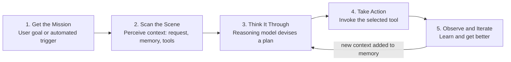
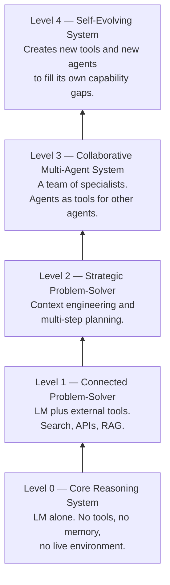
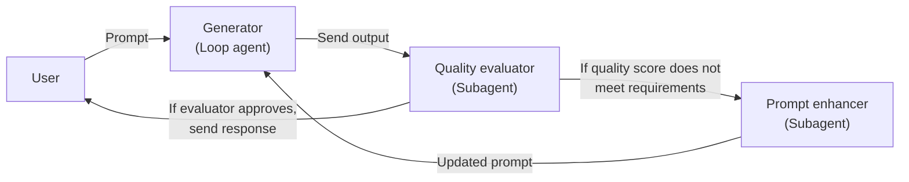
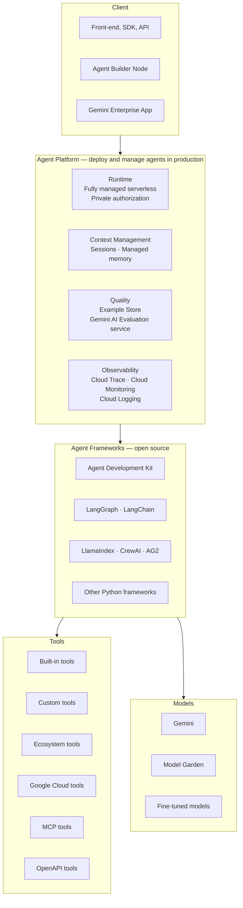
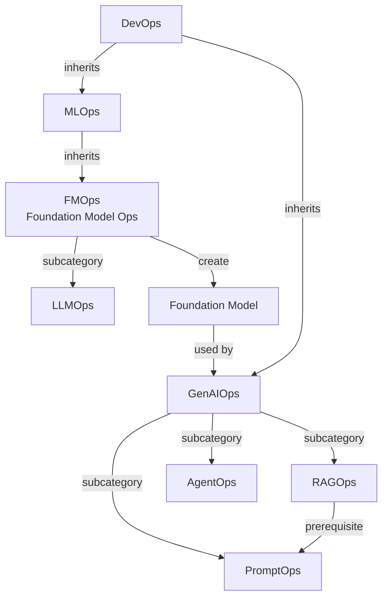
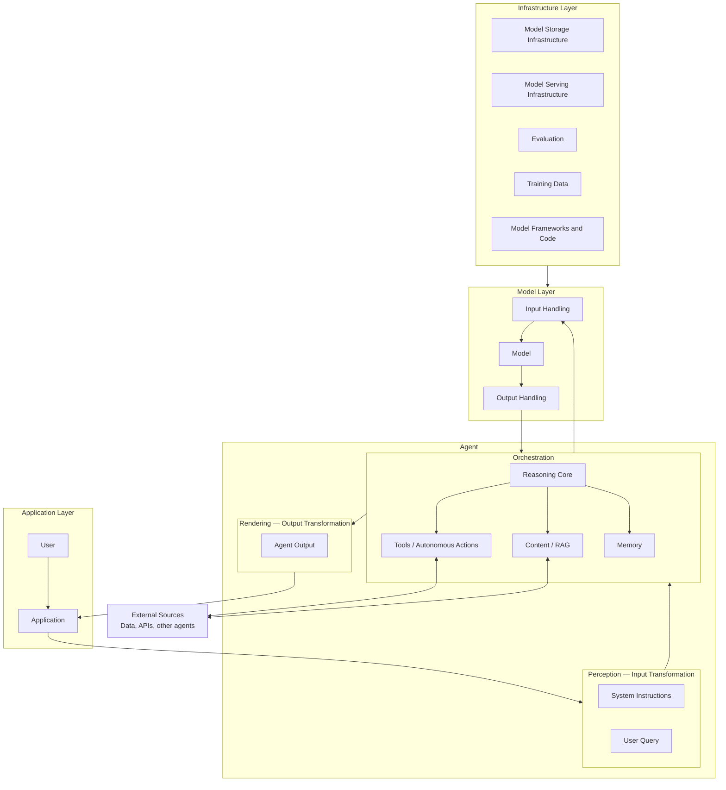
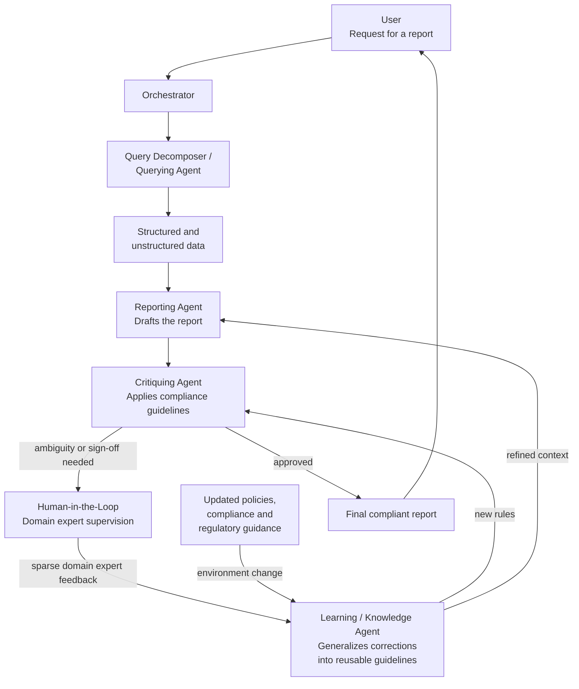
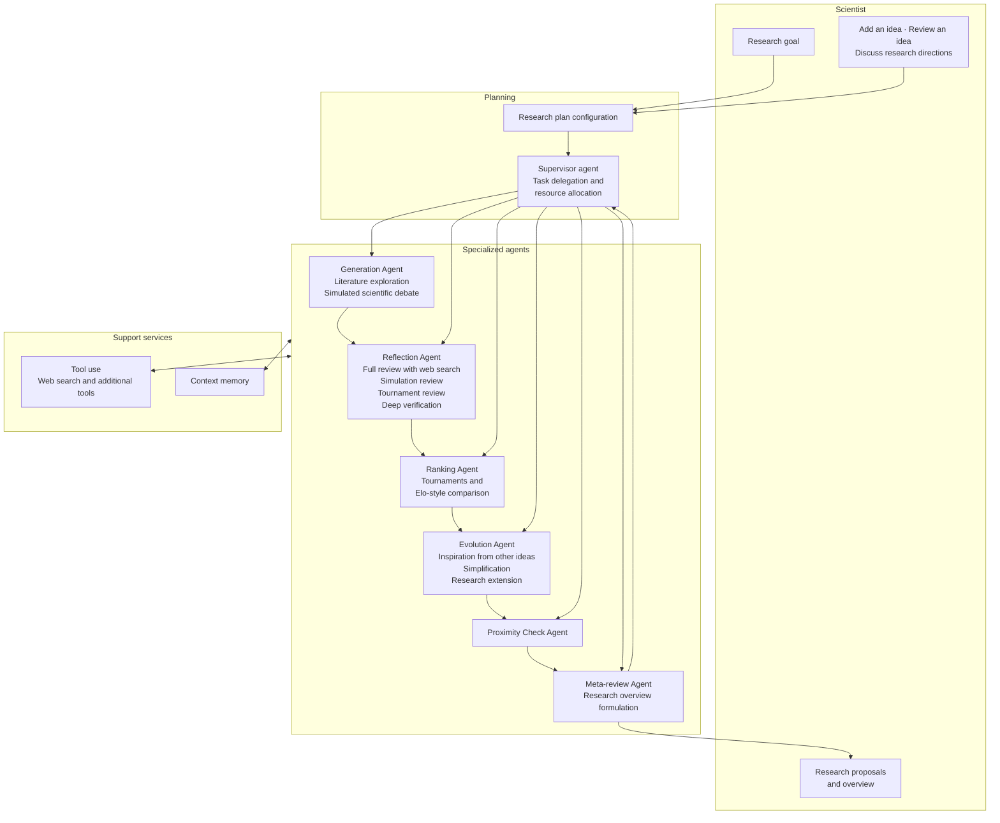
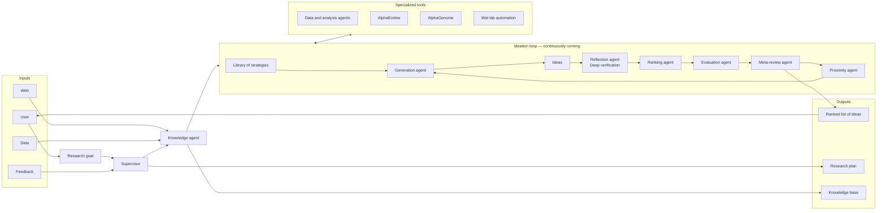
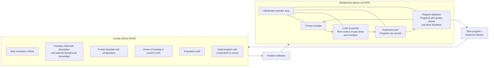

# Introduction to Agents

**Topics:** #ai-agents #agent-architecture #agent-ops #multi-agent-systems #agent-security #tool-use #context-engineering #google-cloud

> **Source:** [Introduction to Agents](https://docs.google.com/document/d/1ALKaVbC7jPxjpbt19ET2cL1MaMO0Cs3CM0IWw0GXmAg/edit) · Converted from Google Docs

---

## FDE Project Grading Rubric Enforcement & Prevailing Customer Alignment

> **Mandatory Governance Standard:** Every project, prototype, or production agent built using the patterns in this concept **must pass the [Google Cloud FDE Field-Readiness & Project Grading Rubric](/concepts/00-fde-field-readiness-and-grading-rubric.md)** (aligned with the [Cloud FDE Team Charter](https://g3doc.corp.google.com/company/teams/cloud-fde/index.md?cl=head)). Scoring Requirement: **Average >= `2.0 (Competent)`** across both **Part A (Presentation & Advisory Rigor)** and **Part B (Engineering & Implementation Excellence)**, with **zero `0 (Not Demonstrated)` scores** on any single metric.

### 1. Part A — Presentation & Advisory Rigor Enforcement for This Concept

- **A.1 Strategic Delivery & Value Articulation:** Clearly explain the taxonomy of AI systems (Passive LLMs → RAG → Tool-Using Agents → Autonomous Multi-Agent Systems) and justify why an agentic architecture is warranted for the customer's problem.
- **A.5 Futures / Roadmap:** Guide customers through the evolutionary maturity curve from single-turn assistants to collaborative multi-agent ecosystems on Google Cloud.

### 2. Part B — Engineering & Implementation Excellence Cutlines for This Concept

- **B.1.1 Agentic & Multi-Agent Systems:** Architect the core anatomy of an agent: Model (Reasoning Engine), Tools (Action/Retrieval), Orchestration Layer (Planning/ReAct/State Graph), and Runtime Infrastructure.
- **B.1.3 Model Selection & B.2.4 System Design Artifacts:** Select appropriate models per cognitive role and document clear visual control-loop architectures.
- **B.3.4 AI-Specific Security:** Embed identity, guardrails, and HITL oversight into the cognitive loop from Day 1.

### 3. Prevailing Customer Best-Practice Exemplars to Cite in Panel Reviews

- **Grounded Enterprise Scenarios:** Mapping customer workloads to the right level of agency (avoiding over-engineering simple deterministic workflows while equipping complex multi-step CUJs with ADK orchestration).
- **Cross-Reference:** See [Concept 00 — FDE Field-Readiness & Project Grading Rubric](/concepts/00-fde-field-readiness-and-grading-rubric.md) for the complete 0–3 grading scale, 31-competency matrix, and disqualifier remediation rules.

---
## Architectural Best Practice: Key Guidelines & Takeaways

### Core Principles

- **An agent is four things, not one.** Every autonomous system decomposes into the **Model** (the "Brain"), **Tools** (the "Hands"), the **Orchestration Layer** (the "Nervous System"), and **Deployment** (the "Body and Legs"). A short definition: "LMs in a loop with tools to accomplish an objective."
- **Agents are context-window curators.** In essence, an agent is a relentless loop of assembling context, prompting the model, observing the result, and re-assembling context for the next step. This sophisticated management of the model's attention is what lets its reasoning solve novel problems.
- **The five-step loop is the unit of behavior.** Get the Mission → Scan the Scene → Think It Through → Take Action → Observe and Iterate. The "Think, Act, Observe" cycle continues until the plan is complete and the Mission is achieved.
- **Scope the agent level deliberately.** Classify what you are building — Level 0 (Core Reasoning System), Level 1 (Connected Problem-Solver), Level 2 (Strategic Problem-Solver), Level 3 (Collaborative Multi-Agent System), Level 4 (Self-Evolving System) — before you build it.
- **Prefer a team of specialists over a super-agent.** Segment a complex process into discrete sub-tasks, each assigned to a dedicated specialized agent. Each agent then becomes simpler, more focused, and easier to build, test, and maintain.
- **The developer is a director, not a bricklayer.** Instead of writing explicit code for every action, you set the scene (instructions and prompts), select the cast (tools and APIs), and provide the context (the data).
- **Agents are a new class of principal.** Distinct from human users (OAuth/SSO) and service accounts (IAM), agents are autonomous actors that require their own verifiable identity.

### Mandatory Requirements / Golden Rules

- **Select the model against *your* business metrics, not leaderboards.** Define the business problem first, then test models against metrics that map to that outcome — your private codebase, your document formats. The "best" model sits at the optimal intersection of quality, speed, and price for your specific task.
- **Route across a team of models.** Use a frontier model for heavy planning and complex reasoning, and route simpler, high-volume tasks to a faster, cheaper model. Model routing is a key strategy for optimizing both performance and cost.
- **Give every tool a structured contract.** Use longstanding standards like the **OpenAPI** specification, or open standards like the **Model Context Protocol (MCP)**, so the model can generate the correct function call every time and interpret the response.
- **Ground before speaking.** Use RAG, vector databases, knowledge graphs, and NL2SQL so the agent looks things up before answering — this dramatically reduces hallucinations.
- **Choose an open, controllable, observable framework.** It must be open (plug in any model or tool, no vendor lock-in), provide precise control (hybrid LM reasoning governed by hard-coded business rules), and be built for observability (detailed traces exposing the entire reasoning trajectory).
- **Adopt Agent Ops from day one.** Traditional unit tests asserting `output == expected` do not work when the response is probabilistic by design.
- **Instrument business KPIs, not just correctness.** Goal completion rates, user satisfaction, task latency, operational cost per interaction, and impact on revenue, conversion, or retention.
- **Evaluate quality with an LM as Judge against a golden dataset.** Assess output against a predefined rubric: right answer? factually grounded? followed instructions? Evaluation results should always be reviewed by a domain expert before being accepted as valid.
- **Make deployment a metrics-driven go/no-go.** Run the new version against the entire evaluation dataset and compare scores directly to the production version. Use A/B deployments to roll out slowly.
- **Trace everything with OpenTelemetry.** Capture the exact prompt, the model's internal reasoning, the tool chosen, the parameters generated, and the raw observation returned.
- **Close the loop on human feedback.** Capture the report, replicate the issue, and convert that scenario into a new permanent test case in the evaluation dataset.
- **Issue every agent a cryptographically verifiable identity** (e.g. via standards like SPIFFE) and grant it its own specific, least-privilege permissions.
- **Apply least privilege while remaining contextually relevant.** Constrain access to the subset of APIs, data, tools, and agents required to get the job done.
- **Defend in depth, in layers.** Deterministic guardrails first (hardcoded policy chokepoints outside the model's reasoning), reasoning-based defenses second (adversarial training, specialized guard models that inspect the plan *before* execution).
- **Route all agentic traffic through a control plane.** A central gateway is the architectural chokepoint for authentication ("Do I know who this actor is?") and authorization ("Do they have permission to do this?"), plus a single pane of glass for observability.
- **Back the gateway with a central registry.** An enterprise app store for agents and tools that enables discovery, reuse, security review before publication, versioning, and fine-grained access policies.

### Anti-Patterns / Guardrails

- **Do not pick the model with the highest benchmark score.** Treating model choice as a leaderboard exercise is "a common path to failure" — production success is rarely determined by generic academic benchmarks.
- **Do not use a sledgehammer to crack a nut.** Sending every high-volume, low-complexity task to a frontier model wastes cost and latency.
- **Do not adopt a "set it and forget it" mindset.** The model you choose today will be superseded in six months; without a CI/CD pipeline that continuously evaluates new models, upgrades become architectural overhauls.
- **Do not assert `output == expected`.** Deterministic unit testing is invalid for stochastic agents.
- **Do not rely solely on the AI model's judgment for security** — it can be manipulated by techniques like prompt injection.
- **Do not build a single, all-powerful "super-agent"** as tasks grow in complexity; it becomes inefficient.
- **Do not treat human feedback as an annoyance.** A bug report or a "thumbs down" is the most valuable, data-rich resource you have.
- **Do not let agents and tools proliferate ungoverned.** "Agent sprawl" creates a tangled, unauditable network of interactions and vulnerabilities — the metropolis without traffic lights, license plates, or a control system.
- **Do not confuse agents with tools.** Connecting agents to each other is a different problem from connecting an agent to data and APIs.
- **Do not deploy an agent without an identity construct.** Without one, agents cannot work on behalf of humans with limited delegated authority, and the blast radius of a compromised agent is unbounded.
- **Do not use traces as a performance overview.** Reviewing traces is primarily for debugging; important trace details may be promoted to metrics, but traces are not dashboards.

---

Updated May 2026

## Introduction to Agents

**Authors: Alan Blount, Antonio Gulli, Shubham Saboo, Michael Zimmermann, and Vladimir Vuskovic**

### Acknowledgements

**Content contributors**

- Enrique Chan
- Mike Clark
- Derek Egan
- Kanchana Patlolla
- Julia Wiesinger

**Curators and editors**

- Anant Nawalgaria
- Kanchana Patlolla

**Designer**

- Michael Lanning

---

## Table of contents

| Section | Page |
|---|---|
| From Predictive AI to Autonomous Agents | 6 |
| Introduction to AI Agents | 8 |
| The Agentic Problem-Solving Process | 10 |
| A Taxonomy of Agentic Systems | 14 |
| Level 0: The Core Reasoning System | 15 |
| Level 1: The Connected Problem-Solver | 15 |
| Level 2: The Strategic Problem-Solver | 16 |
| Level 3: The Collaborative Multi-Agent System | 17 |
| Level 4: The Self-Evolving System | 18 |
| Core Agent Architecture: Model, Tools, and Orchestration | 19 |
| Model: The "Brain" of your AI Agent | 19 |
| Tools: The "Hands" of your AI Agent | 20 |
| Retrieving Information: Grounding in Reality | 21 |
| Executing Actions: Changing the World | 21 |
| Function Calling: Connecting Tools to your Agent | 22 |
| The Orchestration Layer | 22 |
| Core Design Choices | 23 |
| Instruct with Domain Knowledge and Persona | 23 |
| Augment with Context | 24 |
| Multi-Agent Systems and Design Patterns | 24 |
| Agent Deployment and Services | 26 |
| Agent Ops: A Structured Approach to the Unpredictable | 27 |
| Measure What Matters: Instrumenting Success Like an A/B Experiment | 29 |
| Quality Instead of Pass/Fail: Using a LM Judge | 29 |
| Metrics-Driven Development: Your Go/No-Go for Deployment | 30 |
| Debug with OpenTelemetry Traces: Answering "Why?" | 30 |
| Cherish Human Feedback: Guiding Your Automation | 31 |
| Agent Interoperability | 31 |
| Agents and Humans | 32 |
| Agents and Agents | 33 |
| Agents and Money | 34 |
| Securing a Single Agent: The Trust Trade-Off | 35 |
| Agent Identity: A New Class of Principal | 36 |
| Securing an ADK Agent | 38 |
| Scaling Up from a Single Agent to an Enterprise Fleet | 40 |
| Security and Privacy: Hardening the Agentic Frontier | 40 |
| Agent Governance: A Control Plane instead of Sprawl | 41 |
| How agents evolve and learn | 43 |
| How agents learn and self evolve | 43 |
| Simulation and Agent Gym - the next frontier | 46 |
| Examples of advanced agents | 47 |
| Google Co-Scientist | 47 |
| AlphaEvolve Agent | 49 |
| Conclusion | 51 |
| Endnotes | 52 |

---

> Agents are the natural evolution of Language Models, made useful in software.

## From Predictive AI to Autonomous Agents

Artificial intelligence is changing. For years, the focus has been on models that excel at passive, discrete tasks: answering a question, translating text, or generating an image from a prompt. This paradigm, while powerful, requires constant human direction for every step. We're now seeing a paradigm shift, moving from AI that just predicts or creates content to a new class of software capable of autonomous problem-solving and task execution.

This new frontier is built around AI agents. An agent is not simply an AI model in a static workflow; it's a complete application, making plans and taking actions to achieve goals. It combines a Language Model's (LM) ability to **reason** with the practical ability to **act**, allowing it to handle complex, multi-step tasks that a model alone cannot. The critical capability is that agents can work on their own, figuring out the next steps needed to reach a goal without a person guiding them at every turn.

This document is the first in a five-part series, acting as a formal guide for the developers, architects, and product leaders transitioning from proofs-of-concept to robust, production-grade agentic systems. While building a simple prototype is straightforward, ensuring security, quality and reliability is a significant challenge. This paper provides a comprehensive foundation:

- **Core Anatomy:** Deconstructing an agent into its three essential components: the reasoning Model, actionable Tools, and the governing Orchestration Layer.
- **A Taxonomy of Capabilities:** Classifying agents from simple, connected problem-solvers to complex, collaborative multi-agent systems.
- **Architectural Design:** Diving into the practical design considerations for each component, from model selection to tool implementation.
- **Building for Production:** Establishing the Agent Ops discipline needed to evaluate, debug, secure, and scale agentic systems from a single instance to a fleet with enterprise governance.

Building on the previous Agents whitepaper1 and Agent Companion2; this guide provides the foundational concepts and strategic frameworks you will need to successfully build, deploy, and manage this new generation of intelligent applications which can reason, act and observe to accomplish goals3.

> *Words are insufficient to describe how humans interact with AI. We tend to anthropomorphize and use human terms like "think" and "reason" and "know." We don't yet have words for "know with semantic meaning" vs "know with high probability of maximizing a reward function." Those are two different types of knowing, but the results are the same 99.X% of the time.*

---

## Introduction to AI Agents

In the simplest terms, an AI Agent can be defined as the combination of models, tools, an orchestration layer, and runtime services which uses the LM in a loop to accomplish a goal. These four elements form the essential architecture of any autonomous system.

- **The Model (The "Brain"):** The core language model (LM) or foundation model that serves as the agent's central reasoning engine to process information, evaluate options, and make decisions. The type of model (general-purpose, fine-tuned, or multimodal) dictates the agent's cognitive capabilities. An agentic system is the ultimate curator of the input context window the LM.
- **Tools (The "Hands"):** These mechanisms connect the agent's reasoning to the outside world, enabling actions beyond text generation. They include API extensions, code functions, and data stores (like databases or vector stores) for accessing real-time, factual information. An agentic system allows a LM to plan which tools to use, executes the tool, and puts the tool results into the input context window of the next LM call.
- **The Orchestration Layer (The "Nervous System"):** The governing process that manages the agent's operational loop. It handles planning, memory (state), and reasoning strategy execution. This layer uses prompting frameworks and reasoning techniques (like Chain-of-Thought4 or ReAct5) to break down complex goals into steps and decide when to think versus use a tool. This layer is also responsible for giving agents the memory to "remember."
- **Deployment (The "Body and Legs"):** While building an agent on a laptop is effective for prototyping, production deployment is what makes it a reliable and accessible service. This involves hosting the agent on a secure, scalable server and integrating it with essential production services for monitoring, logging, and management. Once deployed, the agent can be accessed by users through a graphical interface or programmatically by other agents via an Agent-to-Agent (A2A) API.

At the end of the day, building a generative AI agent is a new way to develop solutions to solve tasks. The traditional developer acts as a "bricklayer," precisely defining every logical step. The agent developer, in contrast, is more like a director. Instead of writing explicit code for every action, you set the scene (the guiding instructions and prompts), select the cast (the tools and APIs), and provide the necessary context (the data). The primary task becomes guiding this autonomous "actor" to deliver the intended performance.

You'll quickly find that an LM's greatest strength—its incredible flexibility—is also your biggest headache. A large language model's capacity to do *anything* makes it difficult to compel it to do *one specific thing* reliably and perfectly. What we used to call "prompt engineering" and now call "context engineering" guides LMs to generate the desired output. For any single call to a LM, we input our instructions, facts, available tools to call, examples, session history, user profile, etc – filling the context window with just the right information to get the outputs we need. Agents are software which manage the inputs of LMs to get work done.

Debugging becomes essential when issues arise. "Agent Ops" essentially redefines the familiar cycle of measurement, analysis, and system optimization. Through traces and logs, you can monitor the agent's "thought process" to identify deviations from the intended execution path. As models evolve and frameworks improve, the developer's role is to furnish critical components: domain expertise, a defined personality, and seamless integration with the tools necessary for practical task completion. It's crucial to remember that comprehensive evaluations and assessments often outweigh the initial prompt's influence.

When an agent is precisely configured with clear instructions, reliable tools, and an integrated context serving as memory, a great user interface, the ability to plan and problem solve, and general world knowledge, it transcends the notion of mere "workflow automation." It begins to function as a collaborative entity: a highly efficient, uniquely adaptable, and remarkably capable new member of your team.

> *In essence, an agent is a system dedicated to the art of context window curation. It is a relentless loop of assembling context, prompting the model, observing the result, and then re-assembling a context for the next step. The context may include system instructions, user input, session history, long term memories, grounding knowledge from authoritative sources, what tools could be used, and the results of tools already invoked. This sophisticated management of the model's attention allows its reasoning capabilities to problem solve for novel circumstances and accomplish objectives.*

---

## The Agentic Problem-Solving Process

We have defined an AI agent as a complete, goal-oriented application that integrates a reasoning model, actionable tools, and a governing orchestration layer. A short version is "LMs in a loop with tools to accomplish an objective."

But how does this system actually *work*? What does an agent do from the moment it receives a request to the moment it delivers a result?

At its core, an agent operates on a continuous, cyclical process to achieve its objectives. While this loop can become highly complex, it can be broken down into five fundamental steps as discussed in detail in the book Agentic System Design:6

1. **Get the Mission:** The process is initiated by a specific, high-level goal. This mission is provided by a user (e.g., "Organize my team's travel for the upcoming conference") or an automated trigger (e.g., "A new high-priority customer ticket has arrived").
2. **Scan the Scene:** The agent perceives its environment to gather context. This involves the orchestration layer accessing its available resources: "What does the user's request say?", "What information is in my term memory? Did I already try to do this task? Did the user give me guidance last week?", "What can I access from my tools, like calendars, databases, or APIs?"
3. **Think It Through:** This is the agent's core "think" loop, driven by the reasoning model. The agent analyzes the **Mission** (Step 1) against the **Scene** (Step 2) and devises a plan. This isn't a single thought, but often a chain of reasoning: "To book travel, I first need to know who is on the team. I will use the `get_team_roster` tool. Then I will need to check their availability via the `calendar_api`."
4. **Take Action:** The orchestration layer executes the first concrete step of the plan. It selects and invokes the appropriate **tool**—calling an API, running a code function, or querying a database. This is the agent *acting* on the world beyond its own internal reasoning.
5. **Observe and Iterate:** The agent observes the *outcome* of its action. The `get_team_roster` tool returns a list of five names. This new information is added to the agent's context or "memory." The loop then repeats, returning to Step 3: "Now that I have the roster, my next step is to check the calendar for these five people. I will use the `calendar_api`."

This "Think, Act, Observe" cycle continues - managed by the **Orchestration Layer**, reasoned by the **Model**, and executed by the **Tools** until the agent's internal plan is complete and the initial **Mission** is achieved.

*Figure 1 — The agentic AI problem-solving process: a five-step loop that repeats until the mission is achieved.*

Let's take a real-world example of how a Customer Support Agent would operate in this 5-step cycle:

Imagine a user asks, "Where is my order #12345?"

Instead of immediately acting, the agent first enters its **"Think It Through"** phase to devise a complete strategy. It reasons:

> *"The user wants a delivery status. To provide a complete answer, I need a multi-step plan:*
>
> ***1. Identify:** I must first find the order in our internal database to confirm it exists and get its details.*
>
> ***2. Track:** From those details, I'll need to extract the shipping carrier's tracking number. Then, I'll query the external carrier's API for the live status.*
>
> ***3. Report:** Finally, I must synthesize the information I've gathered into a clear, helpful response for the user."*

With this **multi-step plan** in mind, the agent begins execution.

In its first "Act" phase, it executes step one of its plan, calling the `find_order("12345")` tool. It observes the result—a full order record, including the tracking number "ZYX987."

The agent's orchestration layer recognizes that the first part of its plan is complete and immediately proceeds to the second. It acts by calling the `get_shipping_status("ZYX987")` tool. It observes the new result: "Out for Delivery."

Finally, having successfully executed the data-gathering stages of its plan, the agent moves to the "Report" step. It perceives it has all the necessary components, plans the final message, and acts by generating the response: "Your order #12345 is 'Out for Delivery'!"

---

## A Taxonomy of Agentic Systems

Understanding the 5-step operational loop is the first part of the puzzle. The second is recognizing that this loop can be scaled in complexity to create different classes of agents. For an architect or product leader, a key initial decision is scoping *what kind* of agent to build.

We can classify agentic systems into a few broad levels, each building on the capabilities of the last.

*Figure 2 — A taxonomy of agentic systems: five levels, each building on the capabilities of the last.*

### Level 0: The Core Reasoning System

Before we can have an agent, we must start with the "Brain" in its most basic form: the reasoning engine itself. In this configuration, a Language Model (LM) operates in isolation, responding solely based on its vast pre-trained knowledge without any tools, memory, or interaction with the live environment.

Its strength lies in this extensive training, allowing it to explain established concepts and plan how to approach solving a problem with great depth. The trade-off is a complete lack of real-time awareness; it is functionally "blind" to any event or fact outside its training data.

For instance, it can explain the rules of professional baseball and the complete history of the New York Yankees. But if you ask, "What was the final score of the Yankees game last night?", it would be unable to answer. That game is a specific, real-world event that happened *after* its training data was collected, so the information simply doesn't exist in its knowledge.

### Level 1: The Connected Problem-Solver

At this level, the reasoning engine becomes a functional agent by connecting to and utilizing external tools - the "Hands" component of our architecture. Its problem-solving is no longer confined to its static, pre-trained knowledge.

Using the 5-step loop, the agent can now answer our previous question. Given the "Mission": "What was the final score of the Yankees game last night?", its "Think" step recognizes this as a real-time data need. Its "Act" step then invokes a tool, like a Google Search API with the proper date and search terms. It "Observes" the search result (e.g., "Yankees won 5-3"), and synthesizes that fact into a final answer.

This fundamental ability to interact with the world - whether using a search tool for a score, a financial API for a live stock price, or a database via Retrieval-Augmented Generation (RAG) is the core capability of a Level 1 agent.

### Level 2: The Strategic Problem-Solver

Level 2 marks a significant expansion in capability, moving from executing simple tasks to strategically planning complex, multi-part goals. The key skill that emerges here is **context engineering**: the agent's ability to actively select, package, and manage the most relevant information for each step of its plan.

An agent's accuracy depends on a focused, high-quality context. Context engineering curates the model's limited attention to prevent overload and ensure efficient performance.

For instance, consider the "Mission": **"Find a good coffee shop halfway between my office at 1600 Amphitheatre Parkway, Mountain View, and my client's office at 1 Market St, San Francisco."**

A Level 2 agent will start creating a plan:

1. **Think:** "I must first find the halfway point."
   - **Act:** Call the `Maps` tool with both addresses.
   - **Observe:** "The halfway point is Millbrae, CA."
2. **Think:** "Now I must find coffee shops in Millbrae. The user asked for 'good' ones, so I will search for places with a 4-star rating or higher."
   - **Act:** Call the `google_places` tool with `query="coffee shop in Millbrae, CA", min_rating=4.0`. (This is context engineering - it automatically created a new, focused search query from the previous step's output.)
   - **Observe:** "The search returns 'Millbrae Coffee' and 'The Daily Grind'."
3. **Think:** "I will synthesize these results and present them to the user."

This strategic planning also enables proactive assistance, like an agent that reads a long flight confirmation email, engineers the key context (flight number, date), and acts by adding it to your calendar.

### Level 3: The Collaborative Multi-Agent System

At the highest level, the paradigm shifts entirely. We move away from building a single, all-powerful "super-agent" and toward a "team of specialists" working in concert, a model that directly mirrors a human organization. The system's collective strength lies in this division of labor.

Here, agents treat other agents as tools. Imagine a "Project Manager" agent receiving a "Mission": "Launch our new 'Solaris' headphones."

The Project Manager agent doesn't do the entire work itself. It Acts by creating new Missions for its team of specialized agents much like how it works in the real life:

1. **Delegates to MarketResearchAgent:** "Analyze competitor pricing for noise-canceling headphones. Return a summary document by tomorrow."
2. **Delegates to MarketingAgent:** "Draft three versions of a press release using the 'Solaris' product spec sheet as context."
3. **Delegates to WebDevAgent:** "Generate the new product page HTML based on the attached design mockups."

This collaborative model, while currently constrained by the reasoning limitations of today's LMs, represents the frontier of automating entire, complex business workflows from start to finish.

### Level 4: The Self-Evolving System

Level 4 represents a profound leap from delegation to autonomous creation and adaptation. At this level, an agentic system can identify gaps in its own capabilities and dynamically create new tools or even new agents to fill them. It moves from using a fixed set of resources to actively expanding them.

Following our example, the "Project Manager" agent, tasked with the 'Solaris' launch, might realize it needs to monitor social media sentiment, but no such tool or agent exists on its team.

1. **Think (Meta-Reasoning):** "I must track social media buzz for 'Solaris,' but I lack the capability."
2. **Act (Autonomous Creation):** Instead of failing, it invokes a high-level AgentCreator tool with a new mission: "Build a new agent that monitors social media for keywords 'Solaris headphones', performs sentiment analysis, and reports a daily summary."
3. **Observe:** A new, specialized SentimentAnalysisAgent is created, tested, and added to the team on the fly, ready to contribute to the original mission.

This level of autonomy, where a system can dynamically expand its own capabilities, turns a team of agents into a truly learning and evolving organization.

---

## Core Agent Architecture: Model, Tools, and Orchestration

We know what an agent does and how it can scale. But how do we actually *build* it? The transition from concept to code lies in the specific architectural design of its three core components.

### Model: The "Brain" of your AI Agent

The LM is the reasoning core of your agent, and its selection is a critical architectural decision that dictates your agent's cognitive capabilities, operational cost, and speed. However, treating this choice as a simple matter of picking the model with the highest benchmark score is a common path to failure. An agent's success in a production environment is rarely determined by generic academic benchmarks.

Real-world success demands a model that excels at **agentic fundamentals**: superior **reasoning** to navigate complex, multi-step problems and reliable **tool use** to interact with the world7.

To do this well, start by defining the business problem, then test models against metrics that directly map to that outcome. If your agent needs to write code, test it on your private codebase. If it processes insurance claims, evaluate its ability to extract information from your specific document formats. This analysis must then be cross-referenced with the practicalities of cost and latency. The "best" model is the one that sits at the optimal intersection of quality, speed, and price for *your* specific task8.

You may choose more than one model, a "team of specialists." You don't use a sledgehammer to crack a nut. A robust agent architecture might use a frontier model like **Gemini 3.2 Pro** for the heavy lifting of initial planning and complex reasoning, but then intelligently route simpler, high-volume tasks—like classifying user intent or summarizing text—to a much faster and more cost-effective model like **Gemini 3.2 Flash** series or open models like **Gemma 4**. Model routing might be automatic or hard-coded but is a key strategy for optimizing both performance and cost9.

The same principle applies to handling diverse data types. While a natively multimodal model like Gemini live mode10 offers a streamlined path to processing images and audio, an alternative is to use specialized tools like the Cloud Vision API11 or Speech-to-Text API12. In this pattern, the world is first converted to text, which is then passed to a language-only model for reasoning. This adds flexibility and allows for best-of-breed components, but also introduces significant complexity.

Finally, the AI landscape is in a state of constant, rapid evolution. The model you choose today will be superseded in six months. A "set it and forget it" mindset is unsustainable. Building for this reality means investing in a nimble operational framework—an "Agent Ops" practice13. With a robust CI/CD pipeline that continuously evaluates new models against your key business metrics, you can de-risk and accelerate upgrades, ensuring your agent is always powered by the best brain available without requiring a complete architectural overhaul.

### Tools: The "Hands" of your AI Agent

If the model is the agent's brain, tools are the hands that connect its reasoning to reality. They allow the agent to move beyond its static training data to retrieve real-time information and take action in the world. A robust tool interface is a three-part loop: defining what a tool can do, invoking it, and observing the result.

Here are a few of the main types of tools agent builders will put into the "hands" of their agents. For a more complete deep dive see the agent tools focused whitepaper in this series.

#### Retrieving Information: Grounding in Reality

The most foundational tool is the ability to access up-to-date information. **Retrieval-Augmented Generation (RAG)** gives the agent a "library card" to query external knowledge, often stored in **Vector Databases** or **Knowledge Graphs**, ranging from internal company documents to web knowledge via Google Search. For structured data, **Natural Language to SQL (NL2SQL)** tools allow the agent to query databases to answer analytic questions like, "What were our top-selling products last quarter?" By looking things up before speaking—whether in a document or a database—the agent grounds itself in fact, dramatically reducing hallucinations.

#### Executing Actions: Changing the World

The true power of agents is unleashed when they move from reading information to actively doing things. By wrapping existing **APIs** and code functions as tools, an agent can send an email, schedule a meeting, or update a customer record in ServiceNow. For more dynamic tasks, an agent can **write and execute code on the fly**. In a secure sandbox, it can generate a SQL query or a Python script to solve a complex problem or perform a calculation, transforming it from a knowledgeable assistant into an autonomous actor14.

This also includes tools for human interaction. An agent can use a **Human in the Loop (HITL)** tool to pause its workflow and ask for confirmation (e.g., `ask_for_confirmation()`) or request specific information from a user interface (e.g., `ask_for_date_input()`), ensuring a person is involved in critical decisions. HITL could be implemented via SMS text messaging and a task in a database.

#### Function Calling: Connecting Tools to your Agent

For an agent to reliably do "function calling" and use tools, it needs clear instructions, secure connections, and orchestration15. Longstanding standards like the **OpenAPI** specification provide this, giving the agent a structured contract that describes a tool's purpose, its required parameters, and its expected response. This schema lets the model generate the correct function call every time and interpret the API response. For simpler discovery and connection to tools, open standards like the **Model Context Protocol (MCP)** have become popular because they are more convenient16. Additionally, a few models have native tools, like Gemini with native Google Search, where the function invocation happens as part of the LM call itself17.

### The Orchestration Layer

If the model is the agent's brain and the tools are its hands, the orchestration layer is the central nervous system that connects them. It is the engine that runs the "Think, Act, Observe" loop, the state machine that governs the agent's behavior, and the place where a developer's carefully crafted logic comes to life. This layer is not just plumbing; it is the conductor of the entire agentic symphony, deciding when the model should reason, which tool should act, and how the results of that action should inform the next movement.

#### Core Design Choices

The first architectural decision is determining the agent's degree of autonomy. The choice exists on a spectrum. At one end, you have deterministic, predictable workflows that call an LM as a tool for a specific task—a sprinkle of AI to augment an existing process. At the other end, you have the LM in the driver's seat, dynamically adapting, planning and executing tasks to achieve a goal.

A parallel choice is the implementation method. No-code builders offer speed and accessibility, empowering business users to automate structured tasks and build simple agents rapidly. For more complex, mission-critical systems, code-first frameworks, such as **Google's** Agent Development Kit (ADK)18, provide the deep control, customizability, and integration capabilities that engineers require.

Regardless of the approach, a production-grade framework is essential. It must be **open**, allowing you to plug in any model or tool to prevent vendor lock-in. It must provide precise control, enabling a hybrid approach where the non-deterministic reasoning of an LM is governed by hard-coded business rules. Most importantly, the framework must be built for **observability**. When an agent behaves unexpectedly, you cannot simply put a breakpoint in the model's "thought." A robust framework generates detailed traces and logs, exposing the entire reasoning trajectory: the model's internal monologue, the tool it chose, the parameters it generated, and the result it observed.

#### Instruct with Domain Knowledge and Persona

Within this framework, the developer's most powerful lever is to instruct the agent with domain knowledge and a distinct persona. This is accomplished through a system prompt or a set of core instructions. This isn't just a simple command; it is the agent's constitution.

Here, you tell it, `You are a helpful customer support agent for Acme Corp, ...` and provide constraints, desired output schema, rules of engagement, a specific tone of voice, and explicit guidance on when and why it should use its tools. A few example scenarios in the instructions are usually very effective.

#### Augment with Context

The agent's "memory" is orchestrated into the LM context window at runtime. For a more complete deep dive see the agent memory focused whitepaper in this series.

Short-term memory is the agent's active "scratchpad," maintaining the running history of the current conversation. It tracks the sequence of (Action, Observation) pairs from the ongoing loop, providing the immediate context the model needs to decide what to do next. This may be implemented as abstractions like state, artifacts, sessions or threads.

Long-term memory provides persistence across sessions. Architecturally, this is almost always implemented as another specialized tool—a RAG system connected to a vector database or search engine. The orchestrator gives the agent the ability to pre-fetch and to actively query its own history, allowing it to "remember" a user's preferences or the outcome of a similar task from weeks ago for a truly personalized and continuous experience.19

### Multi-Agent Systems and Design Patterns

As tasks grow in complexity, building a single, all-powerful "super-agent" becomes inefficient. The more effective solution is to adopt a "team of specialists" approach, which mirrors a human organization. This is the core of a **multi-agent system**: a complex process is segmented into discrete sub-tasks, and each is assigned to a dedicated, specialized AI agent. This division of labor allows each agent to be simpler, more focused, and easier to build, test, and maintain, which is ideal for dynamic or long-running business processes.

Architects may rely on proven agentic design patterns, though agent capabilities and thus patterns are evolving rapidly.20 For dynamic or non-linear tasks, the **Coordinator** pattern is essential. It introduces a "manager" agent that analyzes a complex request, segments the primary task, and intelligently routes each sub-task to the appropriate specialist agent (like a researcher, a writer, or a coder). The coordinator then aggregates the responses from each specialist to formulate a final, comprehensive answer.

*Figure 3 — The "iterative refinement" pattern, from [cloud.google.com/architecture/choose-design-pattern-agentic-ai-system](https://cloud.google.com/architecture/choose-design-pattern-agentic-ai-system).*

For more linear workflows, the **Sequential** pattern is a better fit, acting like a digital assembly line where the output from one agent becomes the direct input for the next. Other key patterns focus on quality and safety. The **Iterative Refinement** pattern creates a feedback loop, using a "generator" agent to create content and a "critic" agent to evaluate it against quality standards. For high-stakes tasks, the **Human-in-the-Loop (HITL)** pattern is critical, creating a deliberate pause in the workflow to get approval from a person before an agent takes a significant action.

---

## Agent Deployment and Services

After you have built a local agent, you will want to deploy it to a server where it runs all the time and where other people and agents can use it. Continuing our analogy, deployment and services would be the body and legs for our agent. An agent requires several services to be effective, session history and memory persistence, and more. As an agent builder, you will also be responsible for deciding what you log, and what security measures you take for data privacy and data residency and regulation compliance. All of these services are in scope, when deploying agents to production.

Luckily, builders can rely on the newly launched **Gemini Enterprise Agent Platform**, which provides a single destination for technical teams to build, scale, govern, and optimize agents. This includes the new **Agent Studio** for seamless transitions from prompting to deployment, and a revamped **Agent Runtime** delivering sub-second cold starts, support for autonomous **multi-day workflows**, and **Memory Bank** for persistent long-term context across sessions, everything else one platform21. For software developers who want to control their application stacks more directly, or deploy agents within their existing DevOps infrastructure, any agent and most agent services can be added to a docker container and deployed onto industry standard runtimes like Cloud Run or GKE22.

*Figure 4 — The Gemini Enterprise Agent Platform: client surfaces on top of a managed agent platform, open-source agent frameworks, tools, and models. See [cloud.google.com/products/gemini-enterprise-agent-platform](https://cloud.google.com/products/gemini-enterprise-agent-platform).*

If you are not a software developer and a DevOps expert, the process of deploying your first agent might be daunting. Many agent frameworks make this easy with a `deploy` command or a dedicated platform to deploy the agent, and these should be used for early exploration and onboarding. Ramping up to a secure and production ready environment will usually require a bigger investment of time and application of best practices, including CI/CD and automated testing for your agents23.

---

## Agent Ops: A Structured Approach to the Unpredictable

As you build your first agents, you will be manually testing the behavior, over and over again. When you add a feature, does it work? When you fix a bug, did you cause a different problem? Testing is normal for software development but it works differently with generative AI.

The transition from traditional, deterministic software to stochastic, agentic systems requires a new operational philosophy. Traditional software unit tests could simply assert `output == expected`; but that doesn't work when an agent's response is probabilistic by design. Also, because language is complicated, it usually requires a LM to evaluate "quality" – that the agent's response does all of what it should, nothing it shouldn't, and with proper tone.

*Figure 5 — Relationships between the operational domains of DevOps, MLOps, and GenAIOps. FMOps producers and fine-tuners create the foundation model; GenAIOps consumers build on it. From [medium.com/@sokratis.kartakis/genai-in-production-mlops-or-genaiops-25691c9becd0](https://medium.com/@sokratis.kartakis/genai-in-production-mlops-or-genaiops-25691c9becd0).*

Agent Ops is the disciplined, structured approach to managing this new reality. It is a natural evolution of DevOps and MLOps, tailored for the unique challenges of building, deploying, and governing AI agents, turning unpredictability from a liability into a managed, measurable, and reliable feature.24 For a more complete deep dive see the agent quality focused whitepaper in this series.

### Measure What Matters: Instrumenting Success Like an A/B Experiment

Before you can improve your agent, you must define what "better" means in the context of your business. Frame your observability strategy like an A/B test and ask yourself: what are the Key Performance Indicators (KPIs) that prove the agent is delivering value? These metrics should go beyond technical correctness and measure real-world impact: goal completion rates, user satisfaction scores, task latency, operational cost per interaction, and—most importantly—the impact on business goals like revenue, conversion or customer retention. This top-down view will guide the rest of your testing, puts you on the path to metrics driven development, and will let you calculate a return on investment.

### Quality Instead of Pass/Fail: Using a LM Judge

Business metrics don't tell you if the agent is behaving correctly. Since a simple pass/fail is impossible, we shift to evaluating for quality using an "LM as Judge." This involves using a powerful model to assess the agent's output against a predefined rubric: Did it give the right answer? Was the response factually grounded? Did it follow instructions? This automated evaluation, run against a golden dataset of prompts, provides a consistent measure of quality.

Creating the evaluation datasets—which include the ideal (or "golden") questions and correct responses—can be a tedious process. To build these, you should sample scenarios from existing production or development interactions with the agent. The dataset must cover the full breadth of use cases that you expect your users to engage with, plus a few unexpected ones. While investment in evaluation pays off quickly, evaluation results should always be reviewed by a domain expert before being accepted as valid. Increasingly, the curation and maintenance of these evaluations is becoming a key responsibility for Product Managers with the support from Domain experts. To operationalize this, the Gemini Enterprise Agent Platform provides dedicated tools like **Agent Simulation** and **Agent Evaluation**, allowing teams to automatically score, stress-test, and guarantee quality before launching into production.

### Metrics-Driven Development: Your Go/No-Go for Deployment

Once you have automated dozens of evaluation scenarios and established trusted quality scores, you can confidently test changes to your development agent. The process is simple: run the new version against the entire evaluation dataset, and directly compare its scores to the existing production version. This robust system eliminates guesswork, ensuring you are confident in every deployment. While automated evaluations are critical, don't forget other important factors like latency, cost, and task success rates. For maximum safety, use A/B deployments to slowly roll out new versions and compare these real-world production metrics alongside your simulation scores.

### Debug with OpenTelemetry Traces: Answering "Why?"

When your metrics dip or a user reports a bug, you need to understand "why." An OpenTelemetry trace is a high-fidelity, step-by-step recording of the agent's entire execution path (trajectory), allowing you to debug the agent's steps.25 With traces, you can see the exact prompt sent to the model, the model's internal reasoning (if available), the specific tool it chose to call, the precise parameters it generated for that tool, and the raw data that came back as an observation. Traces can be complicated the first time you look at them but they provide the details needed to diagnose and fix the root cause of any issue. Important trace details may be turned into metrics, but reviewing traces is primarily for debugging, not overviews of performance. Trace data can be seamlessly collected in platforms like **Google Cloud Trace**, which visualize and search across vast quantities of traces, streamlining root cause analysis. With the Gemini Enterprise Agent Platform, developers can now also leverage **Agent Observability** for visual debugging of full reasoning chains, and **Agent Optimizer** to auto-cluster failures and automatically suggest fixes for system prompts.

### Cherish Human Feedback: Guiding Your Automation

Human feedback is not an annoyance to be dealt with; it is the most valuable and data-rich resource you have for improving your agent. When a user files a bug report or clicks the "thumbs down" button, they are giving you a gift: a new, real-world edge case that your automated eval scenarios missed. Collecting and aggregating this data is critical; when you see a statistically significant number of similar reports or metric dips, you must tie the occurrences back to your analytics platform to generate insights and trigger alerts for operational issues. An effective Agent Ops process "closes the loop" by capturing this feedback, replicating the issue, and converting that specific scenario into a new, permanent test case in your evaluation dataset. This ensures you not only fix the bug but also vaccinate the system against that entire class of error ever happening again.

---

## Agent Interoperability

Once you build your high quality agents, you want to be able to interconnect them with users and other agents. In our body parts analogy, this would be the face of the Agent. There is a difference between connecting to agents versus connecting agents with data and APIs; Agents are not tools26. Let's assume you already have tools wired into your agents, now let's consider how you bring your agents into a wider ecosystem.

### Agents and Humans

The most common form of agent-human interaction is through a user interface. In its simplest form, this is a chatbot, where a user types a request and the agent, acting as a backend service, processes it and returns a block of text. More advanced agents can provide structured data, like JSON, to power rich, dynamic front-end experiences. Human in the loop (HITL) interaction patterns include intent refinement, goal expansion, confirmation, and clarification requests.

Computer use is a category of tool where the LM takes control of a user interface, often with human interaction and oversight. A computer use enabled agent can decide that the next best action is to navigate to a new page, highlight a specific button, or pre-fill a form with relevant information27.

Instead of an agent using an interface on behalf of the user, the LM can change the UI to meet the needs of the moment. This can be done with Tools which control UI (MCP UI)28, or specialized UI messaging systems which can sync client state with an agent (AG UI)29, and even generation of bespoke interfaces (A2UI)30. These dynamic interactions are now natively supported via the **Agent-to-UI protocol (A2UI)** in the Gemini Enterprise app, allowing custom agents to dynamically generate rich, native UI components, like interactive data visualizations and structured forms, directly within the user's workspace.

Of course, human interaction is not limited to screens and keyboards. Advanced agents are breaking the text barrier and moving into real-time, multimodal communication with "live mode" creating a more natural, human-like connection. Technologies like the Gemini Live API31 enable bidirectional streaming, allowing a user to speak to an agent and interrupt it, just as they would in a natural conversation.

This capability fundamentally changes the nature of agent-human collaboration. With access to a device's camera and microphone, the agent can see what the user sees and hear what they say, responding with generated speech at a latency that mimics human conversation. This opens up a vast array of use cases that are simply impossible with text, from a technician receiving hands-free guidance while repairing a piece of equipment to a shopper getting real-time style advice. It makes the agent a more intuitive and accessible partner.

### Agents and Agents

Just as agents must connect with humans, they must also connect with each other. As an enterprise scales its use of AI, different teams will build different specialized agents. Without a common standard, connecting them would require building a tangled web of brittle, custom API integrations that are impossible to maintain. The core challenge is twofold: discovery (how does my agent find other agents and know what they can do?) and communication (how do we ensure they speak the same language?).

The **Agent2Agent (A2A) protocol** is the open standard designed to solve this problem. It acts as a universal handshake for the agentic economy. A2A allows any agent to publish a digital "business card," known as an Agent Card. This simple JSON file advertises the agent's capabilities, its network endpoint, and the security credentials required to interact with it. This makes discovery simple and standardized. As opposed to MCP which focuses on solving transactional requests, Agent 2 Agent communication is typically for additional problem solving.

Once discovered, agents communicate using a task-oriented architecture. Instead of a simple request-response, interactions are framed as asynchronous "tasks." A client agent sends a task request to a server agent, which can then provide streaming updates as it works on the problem over a long-running connection. This robust, standardized communication protocol is the final piece of the puzzle, enabling the collaborative, Level 3 multi-agent systems that represent the frontier of automation. A2A transforms a collection of isolated agents into a true, interoperable ecosystem.

### Agents and Money

As AI agents do more tasks for us, a few of those tasks involve buying or selling, negotiating or facilitating transactions. The current web is built for humans clicking "buy," the responsibility is on the human. If an autonomous agent clicks "buy" it creates a crisis of trust – if something goes wrong, who is at fault? These are complex issues of authorization, authenticity, and accountability. To unlock a true agentic economy, we need new standards that allow agents to transact securely and reliably on behalf of their users.

This emerging area is far from established, but two key protocols are paving the way. The **Agent Payments Protocol (AP2)** is an open protocol designed to be the definitive language for agentic commerce. It extends protocols like A2A by introducing cryptographically-signed digital "mandates." These act as verifiable proof of user intent, creating a non-repudiable audit trail for every transaction. This allows an agent to securely browse, negotiate, and transact on a global scale based on delegated authority from the user. Complementing this is **x402**, an open internet payment protocol that uses the standard HTTP 402 "Payment Required" status code. It enables frictionless, machine-to-machine micropayments, allowing an agent to pay for things like API access or digital content on a pay-per-use basis without needing complex accounts or subscriptions. Together, these protocols are building the foundational trust layer for the agentic web.

---

## Securing a Single Agent: The Trust Trade-Off

When you create your first AI agent, you immediately face a fundamental tension: the trade-off between utility and security. To make an agent useful, you must give it power—the autonomy to make decisions and the tools to perform actions like sending emails or querying databases. However, every ounce of power you grant introduces a corresponding measure of risk. The primary security concerns are **rogue actions**—unintended or harmful behaviors—and **sensitive data disclosure**. You want to give your agent a leash long enough to do its job, but short enough to keep it from running into traffic, especially when that traffic involves irreversible actions or your company's private data.32

To manage this, you cannot rely solely on the AI model's judgment, as it can be manipulated by techniques like prompt injection33. Instead, the best practice is a hybrid, defense-in-depth approach.34 The first layer consists of **traditional, deterministic guardrails**—a set of hardcoded rules that act as a security chokepoint outside the model's reasoning. This could be a policy engine that blocks any purchase over $100 or requires explicit user confirmation before the agent can interact with an external API. This layer provides predictable, auditable hard limits on the agent's power.

The second layer leverages **reasoning-based defenses**, using AI to help secure AI. This involves training the model to be more resilient to attacks (adversarial training) and employing smaller, specialized "guard models" that act like security analysts. These models can examine the agent's proposed plan *before* it's executed, flagging potentially risky or policy-violating steps for review. This hybrid model, combining the rigid certainty of code with the contextual awareness of AI, creates a robust security posture for even a single agent, ensuring its power is always aligned with its purpose.

### Agent Identity: A New Class of Principal

In the traditional security model, there are human users which might use OAuth or SSO, and there are services which use IAM or service accounts. Agents add a 3rd category of principle. An agent is not merely a piece of code; it is an autonomous actor, a new kind of *principal* that requires its own verifiable identity. Just as employees are issued an ID badge, each agent on the platform must be issued a secure, verifiable "digital passport." This Agent Identity is distinct from the identity of the user who invoked it and the developer who built it. This is a fundamental shift in how we must approach Identity and Access Management (IAM) in the enterprise.

Having each identity be verified and having access controls for all of them, is the bedrock of agent security. Once an agent has a cryptographically verifiable identity (often using standards like SPIFFE35), it can be granted its own specific, least-privilege permissions. The `SalesAgent` is granted read/write access to the CRM, while the `HRonboardingAgent` is explicitly denied. This granular control is critical. It ensures that even if a single agent is compromised or behaves unexpectedly, the potential blast radius is contained. Without an agent identity construct, agents cannot work on behalf of humans with limited delegated authority. The Gemini Enterprise Agent Platform now also natively enforces this via the **Agent Identity** feature, ensuring every agent receives a unique cryptographic ID. This creates a clear, auditable trail mapped back to defined enterprise authorization policies.

| Principal entity | Authentication / Verification | Notes |
|---|---|---|
| Users | Authenticated with OAuth or SSO | Human actors with full autonomy and responsibility for their actions |
| Agents (new category of principals) | Verified with SPIFFE | Agents have delegated authority, taking actions on behalf of users |
| Service accounts | Integrated into IAM | Applications and containers, fully deterministic, no responsibility for actions |

*Table 1: A non-exhaustive example of different categories of actors for authentication.*

### Policies to Constrain Access

A policy is a form of authorization (AuthZ), distinct from authentication (AuthN). Typically, policies limit the capabilities of a principal; for example, "Users in Marketing can only access these 27 API endpoints and cannot execute DELETE commands." As we develop agents, we need to apply permissions to the agents, their tools, other internal agents, context they can share, and remote agents. Think about it this way: if you add all the APIs, data, tools, and agents to your system, then you must constrain access to a subset of just those capabilities required to get their jobs done. This is the recommended approach: applying the principle of least privilege while remaining contextually relevant.36

### Securing an ADK Agent

With the core principles of identity and policy established, securing an agent built with the Agent Development Kit (ADK) becomes a practical exercise in applying those concepts through code and configuration37.

As described above, the process requires a clear definition of identities: user account (for example OAuth), service account (to run code), agent identity (to use delegated authority). Once authentication is handled, the next layer of defense involves establishing policies to constrain access to services. This is often done at the API governance layer, along with governance supporting MCP and A2A services.

The next layer is building guardrails into your tools, models, and sub-agents to enforce policies. This ensures that no matter what the LM reasons or what a malicious prompt might suggest, the tool's own logic will refuse to execute an unsafe or out-of-policy action. This approach provides a predictable and auditable security baseline, translating abstract security policies into concrete, reliable code38.

For more dynamic security that can adapt to the agent's runtime behavior, ADK provides **Callbacks and Plugins**. A `before_tool_callback` allows you to inspect the parameters of a tool call before it runs, validating them against the agent's current state to prevent misaligned actions. For more reusable policies, you can build plugins. A common pattern is a "Gemini as a Judge"39 that uses a fast, inexpensive model like Gemini Flash-Lite or your own fine-tuned Gemma model to screen user inputs and agent outputs for prompt injections or harmful content in real time.

Within the Gemini Enterprise Agent Platform, **Agent Gateway** acts as the air traffic control for your ecosystem. It provides secure, unified connectivity while natively enforcing **Model Armor** protections to safeguard against prompt injection and data leakage. Model Armor acts as a specialized security layer that screens prompts and responses for a wide range of threats, including prompt injection, jailbreak attempts, sensitive data (PII) leakage, and malicious URLs40. By offloading these complex security tasks to a dedicated service, developers can ensure consistent, robust protection without having to build and maintain these guardrails themselves. This hybrid approach within ADK—combining strong identity, deterministic in-tool logic, dynamic AI-powered guardrails, and optional managed services like Model Armor—is how you build a single agent that is both powerful and trustworthy.

*Figure 6 — Security and Agents: the agent, model, and infrastructure layers that must each be secured, from [saif.google/focus-on-agents](https://saif.google/focus-on-agents).*

---

## Scaling Up from a Single Agent to an Enterprise Fleet

The production success of a single AI agent is a triumph. Scaling to a fleet of hundreds is a challenge of architecture. If you are building one or two agents, your concerns are primarily about security. If you are building many agents, you must design systems to handle much more. Just like API sprawl, when agents and tools proliferate across an organization, they create a new, complex network of interactions, data flows, and potential security vulnerabilities. Managing this complexity requires a higher-order governance layer integrating all your identities and policies and reporting into a central control plane.

### Security and Privacy: Hardening the Agentic Frontier

An enterprise-grade platform must address the unique security and privacy challenges inherent to generative AI, even when only a single agent is running. The agent itself becomes a new attack vector. Malicious actors can attempt **prompt injection** to hijack the agent's instructions, or **data poisoning** to corrupt the information it uses for training or RAG. Furthermore, a poorly constrained agent could inadvertently leak sensitive customer data or proprietary information in its responses.

A robust platform provides a defense-in-depth strategy to mitigate these risks. It starts with the data, ensuring that an enterprise's proprietary information is never used to train base models and is protected by controls like VPC Service Controls. It requires input and output filtering, acting like a firewall for prompts and responses. Finally, the platform must offer contractual protections like intellectual property indemnity for both the training data and the generated output, giving enterprises the legal and technical confidence they need to deploy agents in production.

### Agent Governance: A Control Plane instead of Sprawl

As agents and their tools proliferate across an organization, they create a new, complex network of interactions and potential vulnerabilities, a challenge often called "agent sprawl." Managing this requires moving beyond securing individual agents to implementing a higher-order architectural approach: a central gateway that serves as a control plane for all agentic activity.

Imagine a bustling metropolis with thousands of autonomous vehicles—users, agents, and tools—all moving with purpose. Without traffic lights, license plates and a central control system, chaos would reign. The gateway approach creates that control system, establishing a mandatory entry point for all agentic traffic, including user-to-agent prompts or UI interactions, agent-to-tool calls (via MCP), agent-to-agent collaborations (via A2A), and direct inference requests to LMs. By sitting at this critical intersection, an organization can inspect, route, monitor, and manage every interaction.

This control plane serves two primary, interconnected functions:

1. **Runtime Policy Enforcement:** This control plane is operationalized via the new **Agent Gateway**, which enforces consistent security policies across any environment. It acts as the architectural chokepoint for implementing security. It handles authentication ("Do I know who this actor is?") and authorization ("Do they have permission to do this?"). Centralizing enforcement provides a "single pane of glass" for observability, creating common logs, metrics, and traces for every transaction. This transforms the spaghetti of disparate agents and workflows into a transparent and auditable system.
2. **Centralized Governance:** To enforce policies effectively, the gateway needs a source of truth. This is provided by a central registry—an enterprise app store for agents and tools. This registry allows developers to discover and reuse existing assets, preventing redundant work, while giving administrators a complete inventory. More importantly, it enables a formal lifecycle for agents and tools, allowing for security reviews before publication, versioning, and the creation of fine-grained policies that dictate which business units can access which agents. This is managed through the new **Agent Registry**, a central library that indexes every internal agent, tool, and skill (including reusable **Skills** for codified workflows), simplifying discovery and ensuring only approved assets are available.

By combining a runtime gateway with a central governance registry, an organization transforms the risk of chaotic sprawl into a managed, secure, and efficient ecosystem.

### Cost and Reliability: The Infrastructure Foundation

Ultimately, enterprise-grade agents must be both reliable and cost-effective. An agent that frequently fails or provides slow results has a negative ROI. Conversely, an agent that is prohibitively expensive cannot scale to meet business demands. The underlying infrastructure must be designed to manage this trade-off, securely and with regulatory and data sovereignty compliance.

In some cases, the feature you need is scale-to-zero, when you have irregular traffic to a specific agent or sub-function. For mission-critical, latency-sensitive workloads, the platform must offer dedicated, guaranteed capacity, such as Provisioned Throughput41 for LM services or 99.9% Service Level Agreements (SLAs) for runtimes like Cloud Run42. This provides a predictable performance, ensuring that your most important agents are always responsive, even under heavy load. By providing this spectrum of infrastructure options, coupled with comprehensive monitoring for both cost and performance, you establish the final, essential foundation for scaling AI agents from a promising innovation into a core, reliable component of the enterprise.

---

## How agents evolve and learn

Agents deployed in the real world operate in dynamic environments where policies, technologies, and data formats are constantly changing. Without the ability to adapt, an agent's performance will degrade over time—a process often called "aging"—leading to a loss of utility and trust. Manually updating a large fleet of agents to keep pace with these changes is uneconomical and slow. A more scalable solution is to design agents that can learn and evolve autonomously, improving their quality on the job with minimal engineering effort.43

### How agents learn and self evolve

Much like humans, agents learn from experience and external signals. This learning process is fueled by several sources of information:

- **Runtime Experience:** Agents learn from runtime artifacts such as session logs, traces, and memory, which capture successes, failures, tool interactions, and decision trajectories. Crucially, this includes Human-in-the-Loop (HITL) feedback, which provides authoritative corrections and guidance.
- **External Signals:** Learning is also driven by new external documents, such as updated enterprise policies, public regulatory guidelines, or critiques from other agents.

This information is then used to optimize the agent's future behavior. Instead of simply summarizing past interactions, advanced systems create generalizable artifacts to guide future tasks. The most successful adaptation techniques fall into two categories:

- **Enhanced Context Engineering:** The system continuously refines its prompts, few-shot examples, and the information it retrieves from memory. By optimizing the context provided to the LM for each task, it increases the likelihood of success.
- **Tool Optimization and Creation:** The agent's reasoning can identify gaps in its capabilities and act to fill them. This can involve gaining access to a new tool, creating a new one on the fly (e.g., a Python script), or modifying an existing tool (e.g., updating an API schema).

Additional optimization techniques, such as dynamically reconfiguring multi-agent design patterns or using Reinforcement Learning from Human Feedback (RLHF), are active areas of research.

#### Example: Learning New Compliance Guidelines

Consider an enterprise agent operating in a heavily regulated industry like finance or life sciences. Its task is to generate reports that must comply with privacy and regulatory rules (e.g., GDPR).

This can be implemented using a multi-agent workflow:

1. A **Querying Agent** retrieves raw data in response to a user request.
2. A **Reporting Agent** synthesizes this data into a draft report.
3. A **Critiquing Agent**, armed with known compliance guidelines, reviews the report. If it encounters ambiguity or requires final sign-off, it escalates to a human domain expert.
4. A **Learning Agent** observes the entire interaction, paying special attention to the corrective feedback from the human expert. It then generalizes this feedback into a new, reusable guideline (e.g., an updated rule for the critiquing agent or refined context for the reporting agent).

*Figure 7 — A sample multi-agent workflow for learning new compliance guidelines: query, report, critique, escalate, and generalize.*

For instance, if a human expert flags that certain household statistics must be anonymized, the Learning Agent records this correction. The next time a similar report is generated, the Critiquing Agent will automatically apply this new rule, reducing the need for human intervention. This loop of critique, human feedback, and generalization allows the system to autonomously adapt to evolving compliance requirements44.

### Simulation and Agent Gym - the next frontier

The design pattern we presented can be categorized as in-line learning, where agents need to learn with the resources and design pattern they were engineered with. More advanced approaches are now being researched, where there is a dedicated platform that is engineered to optimize the multi-agent system in offline processes with advanced tooling and capabilities, which are not part of the multi-agent run-time environment. The key attributes of such an Agent Gym45 are:

1. It is not in the execution path. It is a standalone off-production platform, and therefore can have the assistance of any LM model, and offline tools, cloud application and more.
2. It offers a simulation environment, so the agent can 'exercise' on new data and learn. This simulation environment is excellent for 'trial-and-error' with many optimizations pathways.
3. It can call advance synthetic data generators, which guide the simulation to be as real as possible, and pressure test the agent (this can include advance techniques, such as red-teaming, dynamic evaluation and a family of critiquing agents).
4. The arsenal of the optimization tools is not fixed, and it can adopt new tools (either through open protocols such as MCP or A2A), or in a more advanced setting - learn new concepts and craft tools around them.
5. Finally, even constructs such as Agent Gym, may not be able to overcome certain edge case (due to the well known problem of 'tribal knowledge' in the enterprise). In those cases we see the Agent Gym able to connect to the human fabric of domain experts, and consult with them on the right set of outcomes to guide the next set of optimizations.

---

## Examples of advanced agents

### Google Co-Scientist

Co-Scientist is an advanced AI agent designed to function as a virtual research collaborator, accelerating scientific discovery by systematically exploring complex problem spaces. It enables researchers to define a goal, ground the agent in specified public and proprietary knowledge sources, and then generate and evaluate a landscape of novel hypotheses.

In order to be able to achieve this, Co-Scientist spawns a whole ecosystem of agents collaborating with each other.

*Figure 8 — The AI co-scientist design system: a Supervisor agent delegates to a team of specialized generation, reflection, ranking, evolution, proximity and meta-review agents.*

Think of the system as a research project manager. The AI first takes a broad research goal and creates a detailed project plan. A "Supervisor" agent then acts as the manager, delegating tasks to a team of specialized agents and distributing resources like computing power. This structure ensures the project can easily scale up and that the team's methods improve as they work toward the final goal.

*Figure 9 — The co-scientist multi-agent workflow: a continuously running ideation loop fed by a knowledge agent and specialized tools, producing ranked ideas, a research plan, and a knowledge base.*

The various agents work for hours, or even days, and keep improving the generated hypotheses, running loops and meta loops that improve not only the generated ideas, but also the way that we judge and create new ideas.

### AlphaEvolve Agent

Another example of an advanced agentic system is AlphaEvolve, an AI agent that discovers and optimizes algorithms for complex problems in mathematics and computer science.

AlphaEvolve works by combining the creative code generation of our Gemini language models with an automated evaluation system. It uses an evolutionary process: the AI generates potential solutions, an evaluator scores them, and the most promising ideas are used as inspiration for the next generation of code.

This approach has already led to significant breakthroughs, including:

- Improving the efficiency of Google's data centers, chip design, and AI training.
- Discovering faster matrix multiplication algorithms.
- Finding new solutions to open mathematical problems.

AlphaEvolve excels at problems46 where verifying the quality of a solution is far easier than finding it in the first place.

*Figure 10 — The AlphaEvolve design system: the human defines the problem and the evaluation criteria; AlphaEvolve runs an evolutionary loop of prompt sampling, LLM generation, evaluation, and program-database selection.*

AlphaEvolve is designed for a deep, iterative partnership between humans and AI. This collaboration works in two main ways:

- **Transparent Solutions:** The AI generates solutions as human-readable code. This transparency allows users to understand the logic, gain insights, trust the results, and directly modify the code for their needs.
- **Expert Guidance:** Human expertise is essential for defining the problem. Users guide the AI by refining evaluation metrics and steering the exploration, which prevents the system from exploiting unintended loopholes in the problem's definition. This interactive loop ensures the final solutions are both powerful and practical.

The result of the agent is a continuous improvement of the code that keeps improving the metrics specified by the human.

*Figure 11 — Algorithm evolution: successive AlphaEvolve iterations of the same program, each scored and used as inspiration for the next generation.*

---

## Conclusion

Generative AI agents mark a pivotal evolution, shifting artificial intelligence from a passive tool for content creation to an active, autonomous partner in problem-solving. This document has provided a formal framework for understanding and building these systems, moving beyond the prototype to establish a reliable, production-grade architecture.

We have deconstructed the agent into its three essential components: the reasoning **Model** (the "Brain"), the actionable **Tools** (the "Hands"), and the governing **Orchestration Layer** (the "Nervous System"). It is the seamless integration of these parts, operating in a continuous "Think, Act, Observe" loop, that unlocks an agent's true potential. By classifying agentic systems - from the Level 1 Connected Problem-Solver to the Level 3 Collaborative Multi-Agent System - architects and product leaders can now strategically scope their ambitions to match the complexity of the task at hand.

The central challenge, and opportunity, lies in a new developer paradigm. We are no longer simply "bricklayers" defining explicit logic; we are "architects" and "directors" who must guide, constrain, and debug an autonomous entity. The flexibility that makes LMs so powerful is also the source of their unreliability. Success, therefore, is not found in the initial prompt alone, but in the engineering rigor applied to the entire system: in robust tool contracts, resilient error handling, sophisticated context management, and comprehensive evaluation.

The principles and architectural patterns outlined here serve as a foundational blueprint. They are the guideposts for navigating this new frontier of software, enabling us to build not just "workflow automation," but truly collaborative, capable, and adaptable new members of our teams. As this technology matures, this disciplined, architectural approach will be the deciding factor in harnessing the full power of agentic AI.

---

## Endnotes

1. Julia Wiesinger, Patrick Marlow, et al. 2024 "Agents". Available at: [https://www.kaggle.com/whitepaper-agents](https://www.kaggle.com/whitepaper-agents).
2. Antonio Gulli, Lavi Nigam, et al. 2025 "Agents Companion". Available at: [https://www.kaggle.com/whitepaper-agent-companion](https://www.kaggle.com/whitepaper-agent-companion).
3. Shunyu Yao, Y. et al., 2022, 'ReAct: Synergizing Reasoning and Acting in Language Models'. Available at: [https://arxiv.org/abs/2210.03629](https://arxiv.org/abs/2210.03629).
4. Wei, J., Wang, X. et al., 2023, 'Chain-of-Thought Prompting Elicits Reasoning in Large Language Models'. Available at: [https://arxiv.org/pdf/2201.11903.pdf](https://arxiv.org/pdf/2201.11903.pdf).
5. Shunyu Yao, Y. et al., 2022, 'ReAct: Synergizing Reasoning and Acting in Language Models'. Available at: [https://arxiv.org/abs/2210.03629](https://arxiv.org/abs/2210.03629).
6. [https://www.amazon.com/Agentic-Design-Patterns-Hands-Intelligent/dp/3032014018](https://www.amazon.com/Agentic-Design-Patterns-Hands-Intelligent/dp/3032014018)
7. Shunyu Yao, et. al., 2024, 'τ-bench: A Benchmark for Tool-Agent-User Interaction in Real-World Domains'. Available at: [https://arxiv.org/abs/2406.12045](https://arxiv.org/abs/2406.12045).
8. [https://artificialanalysis.ai/guide](https://artificialanalysis.ai/guide)
9. [https://cloud.google.com/vertex-ai/generative-ai/docs/model-reference/vertex-ai-model-optimizer](https://cloud.google.com/vertex-ai/generative-ai/docs/model-reference/vertex-ai-model-optimizer)
10. [https://gemini.google/overview/gemini-live/](https://gemini.google/overview/gemini-live/)
11. [https://cloud.google.com/vision](https://cloud.google.com/vision?e=48754805&hl=en)
12. [https://cloud.google.com/speech-to-text](https://cloud.google.com/speech-to-text?e=48754805&hl=en)
13. [https://medium.com/google-cloud/genaiops-operationalize-generative-ai-a-practical-guide-d5bedaa59d78](https://medium.com/google-cloud/genaiops-operationalize-generative-ai-a-practical-guide-d5bedaa59d78)
14. [https://cloud.google.com/vertex-ai/generative-ai/docs/agent-engine/code-execution/overview](https://cloud.google.com/vertex-ai/generative-ai/docs/agent-engine/code-execution/overview)
15. [https://ai.google.dev/gemini-api/docs/function-calling](https://ai.google.dev/gemini-api/docs/function-calling)
16. [https://github.com/modelcontextprotocol/](https://github.com/modelcontextprotocol/)
17. [https://ai.google.dev/gemini-api/docs/google-search](https://ai.google.dev/gemini-api/docs/google-search)
18. [https://google.github.io/adk-docs/](https://google.github.io/adk-docs/)
19. [https://google.github.io/adk-docs/sessions/memory/](https://google.github.io/adk-docs/sessions/memory/)
20. [https://cloud.google.com/architecture/choose-design-pattern-agentic-ai-system](https://cloud.google.com/architecture/choose-design-pattern-agentic-ai-system)
21. [https://cloud.google.com/vertex-ai/generative-ai/docs/agent-engine/overview](https://cloud.google.com/vertex-ai/generative-ai/docs/agent-engine/overview)
22. [https://cloud.google.com/kubernetes-engine/docs/concepts/gke-and-cloud-run](https://cloud.google.com/kubernetes-engine/docs/concepts/gke-and-cloud-run)
23. [https://github.com/GoogleCloudPlatform/agent-starter-pack](https://github.com/GoogleCloudPlatform/agent-starter-pack)
24. Sokratis Kartakis, 2024, 'GenAI in Production: MLOps or GenAIOps?'. Available at: [https://medium.com/google-cloud/genai-in-production-mlops-or-genaiops-25691c9becd0](https://medium.com/google-cloud/genai-in-production-mlops-or-genaiops-25691c9becd0).
25. Guangya Liu, Sujay Solomon, March 2025 "AI Agent Observability - Evolving Standards and Best Practice". Available at: [https://opentelemetry.io/blog/2025/ai-agent-observability/](https://opentelemetry.io/blog/2025/ai-agent-observability/).
26. [https://discuss.google.dev/t/agents-are-not-tools/192812](https://discuss.google.dev/t/agents-are-not-tools/192812)
27. Damien Masson et. al, 2024, 'DirectGPT: A Direct Manipulation Interface to Interact with Large Language Models'. Available at: [https://arxiv.org/abs/2310.03691](https://arxiv.org/abs/2310.03691).
28. MCP UI is a system of controlling UI via MCP tools [https://mcpui.dev/](https://mcpui.dev/).
29. AG UI is a protocol of controlling UI via event passing and optionally shared state [https://ag-ui.com/](https://ag-ui.com/).
30. A2UI is a protocol of generating UI via structured output and A2A message passing [https://github.com/google/A2UI](https://github.com/google/A2UI).
31. [https://cloud.google.com/vertex-ai/generative-ai/docs/models/gemini/2-5-flash-live-api](https://cloud.google.com/vertex-ai/generative-ai/docs/models/gemini/2-5-flash-live-api).
32. [https://saif.google/focus-on-agents](https://saif.google/focus-on-agents).
33. [https://simonwillison.net/series/prompt-injection/](https://simonwillison.net/series/prompt-injection/).
34. [https://storage.googleapis.com/gweb-research2023-media/pubtools/1018686.pdf](https://storage.googleapis.com/gweb-research2023-media/pubtools/1018686.pdf).
35. [https://spiffe.io/](https://spiffe.io/).
36. [https://openreview.net/pdf?id=l9rATNBB8Y](https://openreview.net/pdf?id=l9rATNBB8Y).
37. [https://google.github.io/adk-docs/safety/](https://google.github.io/adk-docs/safety/).
38. [https://google.github.io/adk-docs/callbacks/design-patterns-and-best-practices/#guardrails-policy-enforcement](https://google.github.io/adk-docs/callbacks/design-patterns-and-best-practices/#guardrails-policy-enforcement)
39. TKTK
40. [https://cloud.google.com/security-command-center/docs/model-armor-overview](https://cloud.google.com/security-command-center/docs/model-armor-overview)
41. [https://cloud.google.com/vertex-ai/generative-ai/docs/provisioned-throughput/overview](https://cloud.google.com/vertex-ai/generative-ai/docs/provisioned-throughput/overview)
42. [https://cloud.google.com/run/sla](https://cloud.google.com/run/sla)
43. [https://github.com/CharlesQ9/Self-Evolving-Agents](https://github.com/CharlesQ9/Self-Evolving-Agents)
44. Juraj Gottweis, et. al., 2025, 'Accelerating scientific breakthroughs with an AI co-scientist'. Available at: [https://research.google/blog/accelerating-scientific-breakthroughs-with-an-ai-co-scientist/](https://research.google/blog/accelerating-scientific-breakthroughs-with-an-ai-co-scientist/).
45. Deepak Nathani et. al. 2025, 'MLGym: A New Framework and Benchmark for Advancing AI Research Agents'. Available at: [https://arxiv.org/abs/2502.14499](https://arxiv.org/abs/2502.14499).
46. [https://deepmind.google/blog/alphaevolve-impact/](https://deepmind.google/blog/alphaevolve-impact/)
