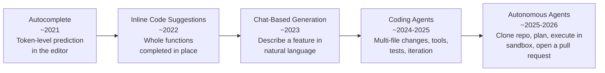
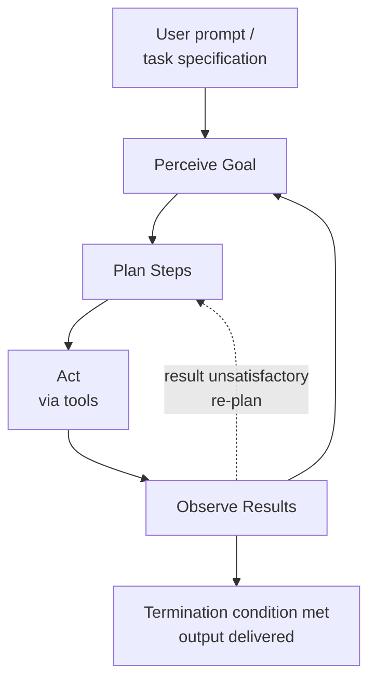
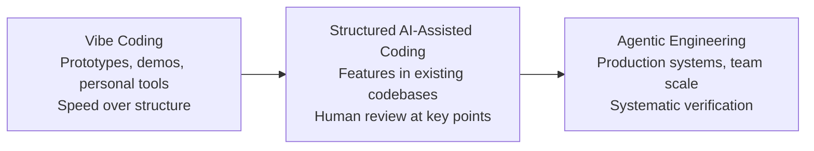
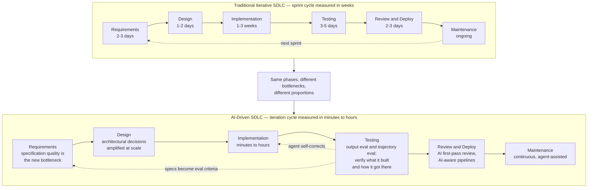
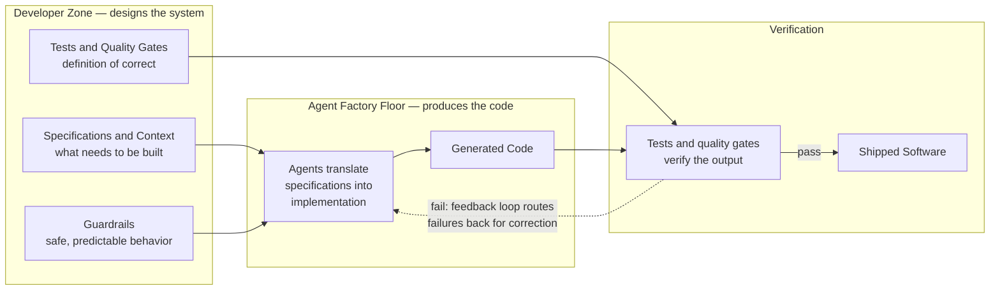
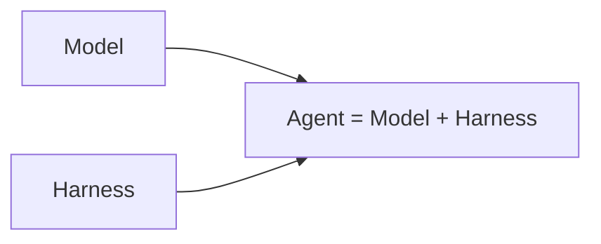
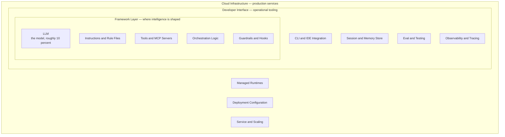

# The New SDLC With Vibe Coding: From ad-hoc prompting to Agentic Engineering

**Topics:** #vibe-coding #agentic-engineering #sdlc #context-engineering #harness-engineering #ai-coding-agents #developer-productivity

> **Source:** [The New SDLC With Vibe Coding: From ad-hoc prompting to Agentic Engineering](https://docs.google.com/document/d/1-5JB5qi5zIQTBUivakDj7URi99n84xepyTDvk1Yf6qY/edit) · Converted from Google Docs

---


## FDE Project Grading Rubric Enforcement & Prevailing Customer Alignment

> **Mandatory Governance Standard:** Every project, prototype, or production agent built using the patterns in this concept **must pass the [Google Cloud FDE Field-Readiness & Project Grading Rubric](/concepts/00-fde-field-readiness-and-grading-rubric.md)** (aligned with the [Cloud FDE Team Charter](https://g3doc.corp.google.com/company/teams/cloud-fde/index.md?cl=head)). Scoring Requirement: **Average >= `2.0 (Competent)`** across both **Part A (Presentation & Advisory Rigor)** and **Part B (Engineering & Implementation Excellence)**, with **zero `0 (Not Demonstrated)` scores** on any single metric.

### 1. Part A — Presentation & Advisory Rigor Enforcement for This Concept

- **A.4 AI-Driven Development Discussion:** Articulate the shift from ad-hoc 'vibe coding' to disciplined **Agentic Software Engineering (AI-Native SDLC)** where the developer acts as Architect & Verifier orchestrating goal-driven agent loops.
- **A.2 Objection Handling & Technical Defense:** Address engineering leadership concerns around AI-generated technical debt, security vulnerabilities, and verification bottlenecks.

### 2. Part B — Engineering & Implementation Excellence Cutlines for This Concept

- **B.2.2 Technical Scope & B.2.5 Decision Records:** Ground AI coding agents in living architecture specifications, style guides, and ADRs.
- **B.6.1 CI/CD & B.6.4 Testing & Quality Engineering:** Build automated verification harnesses (linters, type checkers, unit tests, security scanners, and trajectory evals) that run inside the agent's self-healing loop.
- **B.7.1 Modularity & Abstraction:** Enforce small, modular blast radii and strict interface contracts so agent-authored PRs remain reviewable and maintainable.

### 3. Prevailing Customer Best-Practice Exemplars to Cite in Panel Reviews

- **Grounded Enterprise Scenarios:** Configuring an AI-Native SDLC harness where 'in-the-loop' IDE assistance and 'outside-the-loop' autonomous goal agents iterate against deterministic lint/test/security gates.
- **Cross-Reference:** See [Concept 00 — FDE Field-Readiness & Project Grading Rubric](/concepts/00-fde-field-readiness-and-grading-rubric.md) for the complete 0–3 grading scale, 31-competency matrix, and disqualifier remediation rules.

---
## Architectural Best Practice: Key Guidelines & Takeaways

### Core Principles

- **Intent is the new interface.** The developer's primary interface with the machine is shifting from syntax to intent. The human provides intent, architecture, and judgment; the machine handles implementation.
- **Vibe coding and agentic engineering are endpoints on a spectrum, not a binary.** The key differentiator is not whether you use AI — it is how much structure, verification, and human judgment surrounds the AI's output.
- **Context engineering, not prompt cleverness, determines quality.** The quality of AI-generated code depends less on the cleverness of prompts and more on the quality of the *context* provided: instructions, knowledge, memory, examples, tools, and guardrails.
- **The static/dynamic context boundary is a first-class architectural decision.** Too much static context wastes tokens and dilutes signal; too little means the agent forgets critical rules. The best systems review and version this boundary like any other configuration.
- **Agent = Model + Harness.** A raw model is not an agent. Most agent behaviour developers experience is dominated by the harness — prompts, tools, context policies, hooks, sandboxes, sub-agents, observability — not by which model is underneath.
- **The factory model: the developer's primary output is not code, it's the system that produces code.** A factory manager does not assemble every widget by hand; they design the assembly line and ensure quality control.
- **AI amplifies the engineering culture it lands in.** It is a force multiplier that multiplies both strengths and weaknesses.
- **Context engineering is a financial strategy, not just a technical skill.** In the token economy, a dense high-signal payload raises first-pass success rates and lowers operational cost.

### Mandatory Requirements / Golden Rules

- **Set up an `AGENTS.md` (or equivalent) for every project.** Start with ten lines: stack, conventions, hard rules, workflow. Add a rule every time the agent does something it should not do again.
- **Write the tests and evals before generating the code.** Together they are the contract with the AI, and they are what turns AI-assisted development from vibe coding into agentic engineering.
- **Require both tests and evals.** Tests verify the deterministic parts; evals verify the non-deterministic parts (trajectory, tool choice, final response quality). Without both, the practice is always vibe coding, regardless of how sophisticated the prompts are.
- **Review every line the agent produces that is going to ship.** Be skeptical of anything that looks clever. Check imports for real packages. Verify that error handling covers realistic failure modes.
- **Treat context engineering as a first-class engineering practice.** `AGENTS.md`, system prompts, eval suites, and skill libraries are code: reviewed in pull requests, versioned with the project, owned by named engineers.
- **Set the bar at the eval, not the demo.** Require eval coverage with explicit rubrics — task success, tool use quality, trajectory compliance, hallucination, response quality — as a precondition for shipping any agent into a shared workflow.
- **Make the prototype/production boundary explicit in team norms:** which projects, which branches, which environments warrant which mode of working.
- **Invest in the production substrate before scale:** trajectory and final-response evals run in CI, traces of every agent run, scoped permissions per agent, and security review tuned to the failure modes of generated code — built *before* the first production agent ships.
- **Adopt open standards** — Model Context Protocol (MCP) for tool access and Agent2Agent (A2A) for cross-agent delegation — to keep vendor and framework options open.
- **Route models intelligently.** Use large, advanced models for complex work (requirements, architecture, initial implementation); route deterministic, lower-complexity work (test generation, code review, CI/CD monitoring) to smaller, faster, cheaper models.
- **Maintain your developer skills.** Debugging, system design, and intuition for performance and correctness must stay sharp; AI is a way to apply expertise at greater scale, not a substitute for it.

### Anti-Patterns / Guardrails

- **Vibe coding anything that production depends on.** "Telling a CTO that your team is vibe coding their payment processing system will, and should, raise alarm bells."
- **Blaming the model first.** Most agent failures, examined honestly, are configuration failures — a missing tool, a vague rule, an absent guardrail, or a context window stuffed with noise.
- **Treating the model as the system.** Investing only in model upgrades while neglecting the harness is the wrong investment.
- **Dumping massive, unstructured files into the context window** and repeatedly asking the model to fix its own unverified mistakes — an expensive "prompting loop" with low first-pass success rates.
- **Passing an entire 100,000-token repository into every prompt.** Financially unviable at scale.
- **Relying on a single massive frontier model for every interaction,** paying premium token prices to fix a typo or generate a basic unit test.
- **Shipping without an automated evaluation harness.** Rapid generation of code becomes rapid generation of vulnerabilities; fixing a security flaw in production is exponentially more expensive than catching it at design time.
- **Accepting the 80% and assuming the rest is easy.** The remaining 20% — edge cases, error handling, integration points, subtle correctness requirements — demands deep contextual knowledge current models often lack, and its failures are insidious because the code "looks right" and may pass basic tests.
- **Letting the conductor become the bottleneck.** If the developer personally directs every keystroke, the throughput improvement from AI is limited.
- **Keeping the prototype/production distinction blurry.** Teams that do "produce prototypes that ship by accident."
- **Rolling out a coding agent without scaffolding** (eval coverage, observability, architectural standards) produces speed without quality, compounding technical debt faster than any team can pay it down.
- **Letting the harness drift.** Without the discipline of versioned, owned context artifacts, agent behaviour becomes irreproducible across the team.

---

**Authors: Addy Osmani, Shubham Saboo, and Sokratis Kartakis**

## Acknowledgements

**Content contributors**
Elia Secchi
Julia Wiesinger
Anant Nawalgaria

**Curators and editors**
Anant Nawalgaria

**Designer**
Michael Lanning

*May 2026*

---

## Table of contents

- Introduction — 6
  - Why this paper, why now — 9
  - Who this paper is for — 9
- The shift from syntax to intent — 10
  - AI Agents: A Quick Refresher — 10
  - What is vibe coding? — 11
  - The spectrum: vibe coding to agentic engineering — 12
  - Context engineering: the real skill — 15
- The new software development life cycle — 19
  - The traditional SDLC under pressure — 19
  - How AI transforms each phase — 21
    - Requirements and planning — 21
    - Design and architecture — 21
    - Implementation — 22
    - Testing and quality assurance — 22
    - Code review and deployment — 23
    - Maintenance and evolution — 24
  - The factory model: building the system that builds software — 24
- Harness Engineering: What surrounds the model — 26
  - What's in the harness — 28
  - Harness in SDLC — 29
    1. Requirements, Planning, & Architecture (Configuring the Harness) — 29
    2. Implementation (Running the Harness) — 29
    3. Testing & QA (The Feedback Loop) — 30
    4. Code Review, Deployment, & Maintenance (Observing the Harness) — 30
- The developer's evolving role: conductors and orchestrators — 31
  - The conductor: hands-on, real-time direction — 32
  - The orchestrator: async, multi-agent delegation — 33
  - The 80% problem — 34
- Coding agents in practice — 35
  - Where coding agents fit in the developer's day — 35
  - Vibe Coding Production-ready Agents — 36
- The Economics of AI Development — 39
  - The Hidden Debt of Vibe Coding (Low CapEx, High OpEx) — 40
  - The Investment of Agentic Engineering (High CapEx, Low OpEx) — 41
  - Context Engineering as a Financial Lever — 41
  - Scaling Efficiency via Dynamic Context and Skills — 42
  - Intelligent Model Routing — 42
- Where to start — 43
  - For individual developers — 43
  - For engineering leaders — 44
  - For organizations — 45
- Conclusion: Intent as the new Interface — 47
- Endnotes — 49

---

> The most profound shift in software engineering isn't a new language, framework, or cloud service. It's the transition from writing code to expressing intent, and trusting intelligent systems to translate that intent into working software.

## Introduction

For most of computing history, programming has been an act of translation: understand the problem in human terms, design a solution in abstract terms, then render it in syntax a machine can execute. Each step introduces friction. That friction is now collapsing. Software engineering is undergoing its most significant transformation since the introduction of high-level programming languages. For decades, the developer's primary interface with the machine has been syntax: curly braces, semicolons, type annotations, and the precise grammar of programming languages. That era is ending.

A new paradigm has arrived in which developers express what they want to build rather than how to build it. The machine handles implementation. The human provides intent, architecture, and judgment. This isn't a distant future - it's the daily reality for a rapidly growing number of professional developers. As of early 2026, 85% of professional developers regularly use AI Coding Agents, 51% use them daily, and an estimated 41% of all new code is AI-generated.<sup>1</sup>

This shift didn't happen overnight. It began with autocomplete - simple token prediction in the editor. Then came inline code suggestions that could complete entire functions. Next, chat-based interfaces allowed developers to describe features in natural language and receive working implementations. Now, fully autonomous agents can clone repositories, plan multi-file changes, execute them in sandboxed environments, run tests, and submit pull requests - all without a human typing a single line of code.



*Figure 1 — From Autocomplete to Autonomy. Each generation preserved what came before while raising the ceiling on what one engineer could accomplish, moving the developer's interface from syntax toward intent.*

The implications for the software development life cycle (SDLC) are profound. Every phase - from requirements gathering to deployment to maintenance - is being reshaped by AI capabilities. But this transformation isn't uniform or simple. The spectrum ranges from casual "vibe coding," where a developer prompts an AI and accepts whatever comes back, to disciplined "agentic engineering," where AI acts as a powerful implementation engine within carefully designed systems of constraints, tests, and feedback loops, with humans retaining oversight over architecture, correctness, and quality.

The distinction matters. Telling a CTO that your team is vibe coding their payment processing system will, and should, raise alarm bells. Telling that same CTO that your team practices agentic engineering, with AI handling implementation under human-designed constraints while test coverage ensures correctness, is a fundamentally different conversation.

This paper provides the foundation for that conversation. We trace the spectrum from casual vibe coding to disciplined agentic engineering, examine how the developer's role is shifting from writing code to exercising judgment — from conductor to orchestrator — and lay out what it takes to adopt these tools in ways that produce software you can actually depend on.

### Why this paper, why now

New tools, capabilities, and paradigms emerge weekly. Engineering teams need a framework for making sense of this landscape - not a snapshot that will be outdated in months, but a set of principles and mental models that will remain useful as the specific tools evolve.

### Who this paper is for

This paper is for software engineers, engineering managers, architects, and technical leaders who want to understand how AI is reshaping the SDLC and adopt these new capabilities without sacrificing the discipline that production software demands. We assume familiarity with modern software development practices but not with the specifics of AI or machine learning.

---

## The shift from syntax to intent

Before we go further, we need a shared picture of what an agent is and what vibe coding actually means. Both terms have accumulated enough meanings that they need to be unpacked carefully.

### AI Agents: A Quick Refresher

An AI agent is a software system that perceives a goal, plans steps to reach it, takes actions through tools, observes the results, and iterates until the goal is met or it hits a stopping condition. Where a chatbot produces a response and waits for the next prompt, an agent runs its own loop. You give it a goal at the top, then it decides what to do next at each step.



*Figure 2 — The Agent Loop: perceive, plan, act, observe, iterate. The dashed edge is the self-correcting path taken when a result does not meet the bar.*

Every agent, however simple or sophisticated, is built from five parts. The November 2025 *Introduction to Agents* whitepaper covers each in depth.<sup>2</sup> For our purposes here, the short version:

- **The model** is the reasoning engine. It reads the current context, decides what should happen next, and produces the next thought, the next tool call, or the next message.
- **Tools** connect the model to the world. They include APIs the agent can call, code it can execute, databases it can query, and other agents it can delegate to.
- **Memory** is the state. It allows the agent to recall past interactions, retrieve project-specific rules, and retain context across sessions so it never starts from a blank slate.
- **Orchestration** is the code that runs the loop. It assembles the context for each model call, dispatches tool calls, captures their results, and decides whether to continue.
- **Deployment** is what turns the prototype into a service: hosting, identity, observability, and the production infrastructure the agent runs on.

These four parts work together in a continuous loop: get the mission, scan the scene, think it through, take action, observe and iterate. The loop is the beating heart of every agent. Everything else in this paper, and everything in the rest of the course, is a variation on this loop.

### What is vibe coding?

In February 2025, Andrej Karpathy posted a description of a new way of programming that resonated widely across the software engineering community. He described an approach where you "fully give in to the vibes, embrace exponentials, and forget that the code even exists." In this mode, a developer describes what they want in natural language, accepts the AI's output, and when something breaks, copies the error message back into the prompt and asks the AI to fix it.<sup>2</sup>

The term went viral because it captured something real: many developers were already working this way but hadn't had language for it. Within months, "vibe coding" became a common descriptor for any AI-assisted development workflow, which created confusion. Is a senior engineer using an AI assistant to implement a well-specified feature "vibe coding"? Is a team using AI agents to execute a carefully planned architecture? The term was applied so broadly it began to lose meaning.

By early 2026, Karpathy himself acknowledged that the original framing was too narrow, introducing the term "agentic engineering" to describe the more disciplined end of the spectrum.<sup>4</sup>

### The spectrum: vibe coding to agentic engineering

Rather than treating vibe coding and agentic engineering as a binary, we find it more useful to think of them as endpoints on **a spectrum**. The key differentiator is not whether you use AI. It's how much structure, verification, and human judgment surrounds the AI's output.

| Dimension | Vibe Coding | Structured AI-Assisted Coding | Agentic Engineering |
|---|---|---|---|
| Intent specification | Casual natural language prompts | Detailed prompts with examples and constraints | Formal specs, architecture docs, memory files |
| Verification | "Does it seem to work?" | Manual testing, spot-checking | Automated test suites, CI/CD gates, LM judges |
| Codebase understanding | Minimal; developer may not read the generated code | Selective review of critical paths | Comprehensive review of architecture; AI handles implementation details |
| Error handling | Copy-paste error messages back to the AI | Developer diagnoses root cause, AI implements fix | Agents self-diagnose within defined bounds; humans handle architectural issues |
| Appropriate scope | Prototypes, scripts, personal projects, hackathons | Features within established codebases | Production systems, team-scale development |
| Risk profile | High; acceptable for disposable code | Moderate; human judgment at key checkpoints | Low; systematic verification at every stage |

*Table 1: The Spectrum from Vibe Coding to Agentic Engineering*



*Figure 3 — The Vibe Coding to Agentic Engineering Spectrum. The differentiator is not whether you use AI, but how much structure, verification, and human judgment surrounds the output.*

>**Applied Tip:**
>
> The right position on this spectrum depends on the stakes. A weekend prototype can be pure vibe coding. A production API handling financial transactions demands agentic engineering. Most real work falls somewhere in between, and the skill is knowing where to draw the line for each task.

The single biggest differentiator between the two ends is how outputs get verified. In vibe coding, verification is optional; the developer runs the code and checks if it seems right. In agentic engineering, two mechanisms work together. **Tests** verify the deterministic parts of the system: a function given this input produces that output. **Evaluations**, or *evals*, verify the parts that are not deterministic: did the agent take the right trajectory of steps, choose the right tools, and produce a final response that meets the quality bar. Tests are checked by code; evals are checked by labelled datasets, scoring rubrics, and LM judges. Without both, the practice is always vibe coding, regardless of how sophisticated the prompts are.

### Context engineering: the real skill

As the field has matured, a key insight has emerged: the quality of AI-generated code depends less on the cleverness of your prompts and more on the quality of the *context* provided. This realization has given rise to the concept of context engineering, the practice of providing AI agents with rich, structured information about your codebase, architecture, conventions, and intent.<sup>5</sup>

Developers must consider six primary types of context:

- **Instructions:** The agent's core role, goals, and operational boundaries.
- **Knowledge:** Retrieved documents, architectural diagrams, and domain-specific data.
- **Memory:** Short-term session logs (what just happened) and long-term persistent state (what the project is).
- **Examples:** Few-shot behavioral demonstrations and codebase reference patterns.
- **Tools:** The precise definitions of the APIs, scripts, and external services the agent can invoke.
- **Guardrails:** Hard constraints, formatting rules, and safety validations.

In AI code generation, context engineering involves carefully balancing which of these six elements the agent possesses *upfront* versus what it can retrieve on *demand*. This creates a critical separation between static and dynamic context.

**Static context** is always loaded: system instructions, rule files (`AGENTS.md`, `CLAUDE.md`, `GEMINI.md`), global memory, and persona definitions. It defines who the agent is and how it behaves. Static context is expensive because every token is present in every interaction, regardless of relevance.

**Dynamic context** is loaded on demand: skill instructions triggered by task matching, tool results retrieved during execution, documents fetched from RAG pipelines, and windowed session history. Dynamic context is efficient because the agent pays the token cost only when the information is needed.

The design decision of what belongs in static context versus dynamic context is a genuine engineering trade-off. Too much static context wastes tokens and dilutes signals. Too little means the agent forgets critical rules. The best systems treat this boundary as a first-class architectural decision, reviewed and versioned like any other configuration.

```mermaid
flowchart LR
    subgraph SIX["Six types of agent context"]
        C1["Instructions<br/>roles, goals, boundaries"]
        C2["Knowledge<br/>documents, diagrams, domain data"]
        C3["Memory<br/>session logs, persistent state"]
        C4["Examples<br/>few-shot demos, reference patterns"]
        C5["Tools<br/>APIs, scripts, external services"]
        C6["Guardrails<br/>hard constraints, safety rules"]
    end

    SIX --> DEC{"Design decision:<br/>what goes where?"}

    subgraph STATIC["Static Context — always loaded, every interaction"]
        S1["System instructions"]
        S2["Rule files such as AGENTS.md"]
        S3["Global memory"]
        S4["Core guardrails"]
        S5["Token cost: high<br/>Expensive but reliable;<br/>the agent never forgets these"]
    end

    subgraph DYNAMIC["Dynamic Context — loaded on demand, per task"]
        D1["Agent Skills triggered by task match"]
        D2["Tool results retrieved during execution"]
        D3["Retrieved documents from RAG"]
        D4["Windowed session history"]
        D5["Token cost: low per turn<br/>Efficient and scalable;<br/>pay only for what you use"]
    end

    DEC --> STATIC
    DEC --> DYNAMIC
```



*Figure 4 — Context Engineering: Static vs. Dynamic. The best systems treat the static/dynamic boundary as a first-class architectural decision, reviewed and versioned like code.*

The most powerful pattern for managing dynamic context is **Agent Skills**: structured, portable packages of procedural knowledge that the agent loads only when the task calls for it.

Rather than embedding every piece of specialized knowledge into the agent's system prompt, skills allow the agent to remain a lightweight generalist that flexes into specialist roles on demand through progressive disclosure. The agent sees only lightweight metadata at startup, loads full instructions when a task matches, and pulls deep reference material only when explicitly needed. The result is that an agent can carry dozens of specialized capabilities while paying the token cost for only the one it is actively using.

Agent Skills have seen rapid adoption across major coding agents and enterprise platforms because they solve four problems that have plagued AI agent development:

- Context rot from overloaded prompts
- Absence of procedural memory for LLMs
- Operational overhead of multi-agent architectures
- Need for portability across tools and vendors

This section introduced the core principles of context engineering: the six types of context every agent needs, the trade-off between static and dynamic context, and Agent Skills as the key pattern for managing that trade-off at scale.

The companion Day-3 paper in this series on *Context Engineering: Sessions, Skills & Memory* takes each of these ideas further, covering how to design and manage sessions, write and evaluate skills, build persistent memory across interactions, and optimize token economics for production systems.

The shift from "prompt engineering" to "context engineering" reflects a deeper truth about working with AI. Models don't need cleverly worded instructions as much as they need the same context that a skilled human developer would need to do good work. The question isn't "how do I trick the AI into writing good code?" It's "what would a new team member need to know to contribute effectively, and how do I encode that knowledge in a form the AI can use?"

Context engineering is the bridge between vibe coding and agentic engineering. It is also the bridge between this section and the next one, where we look at the structure that surrounds every model and makes it useful.

---

## The new software development life cycle

By shifting our focus from writing syntax to engineering this context, the bottlenecks in software creation fundamentally change. We are no longer waiting on human hands to type boilerplate; we are waiting on human minds to define the boundaries. This necessitates a complete reimagining of the traditional Software Development Life Cycle (SDLC), as the systems we use to build software now dictate the speed at which it is delivered.

### The traditional SDLC under pressure

The software development life cycle has already been through one major transformation. Over the past two decades, most enterprises moved from sequential waterfall processes to iterative models: Agile sprints, continuous integration, DevOps pipelines, and rapid release cycles. That shift shortened feedback loops, brought testing closer to development, and made deployment a continuous process rather than a quarterly event.

AI compresses this cycle dramatically, but unevenly: implementation that once took weeks can now be done in hours, while requirements, architecture, and verification remain stubbornly human-paced. The result is not a faster version of the old SDLC. It is a different workflow, where the boundaries between phases blur, iteration cycles shorten from weeks to minutes, and the developer's role shifts from primary implementor to system designer and quality arbiter.



*Figure 5 — Traditional SDLC vs. AI-Driven SDLC. The phases persist; the bottlenecks, proportions, and cycle time change.*

> **A note on pace of change:** The phase-by-phase picture described above reflects the state of AI-driven SDLC as of mid-2026. It is shifting fast. Early signs suggest that the compression will spread beyond implementation: teams are already experimenting with workflows where developers go directly from specs to review, with AI agents handling implementation, testing, and deployment in the background. The boundaries drawn in this section may look different in 12 months. What will remain constant is human judgment, taste, and the skill to verify AI output as the machines take on more of the implementation.

### How AI transforms each phase

#### Requirements and planning

Requirements is the phase where the gap between intent and implementation has historically been widest. Translating business needs into technical specifications has been a manual, error-prone process that creates a persistent gap between what stakeholders want and what engineers build.

Modern AI tools can participate directly in requirements refinement: generating user stories from product briefs, identifying edge cases that humans miss, producing API schemas from natural-language descriptions, and generating interactive prototypes from specification documents. Agentic development environments allow developers to go from a description to a working prototype in minutes, collapsing the requirements-to-prototype feedback loop to near zero.

Requirements stop being a document handed off between teams. They become a conversation between humans and AI that produces specification and initial implementation simultaneously.

#### Design and architecture

Architecture remains the most stubbornly human-centric phase of the SDLC, and for good reason. Architectural decisions are fundamentally about trade-offs: consistency vs. availability, complexity vs. flexibility, build vs. buy. These trade-offs depend on business context, organisational constraints, and long-term strategic considerations that AI cannot fully grasp.

AI excels at implementing architectural decisions once they are made. Given a clear architecture document, AI agents can scaffold entire applications, generate consistent patterns across modules, and ensure that new code conforms to established conventions. The developer's role shifts from writing boilerplate to making and documenting the structural decisions that boilerplate implements.

#### Implementation

Modern coding agents can generate entire features from natural-language descriptions, implement complex algorithms, and produce multi-file changes that work together correctly. The productivity gains are real: industry surveys report 25 to 39% productivity improvements, with some tasks seeing larger gains.<sup>7</sup>

The picture is more nuanced than headline numbers suggest. A study by METR found that experienced developers using AI assistants actually took 19% longer on certain tasks, largely because of the time spent verifying, debugging, and correcting AI output.<sup>8</sup> AI does not eliminate implementation work so much as transform it from writing to reviewing, guiding, and verifying.

#### Testing and quality assurance

Testing AI-generated code requires evaluating not just what the agent produced, but how it got there. Output evaluation checks the final artifact: does the code compile, do the tests pass? Trajectory evaluation checks the full sequence of tool calls and intermediate reasoning. Both are necessary because a fluent output that skipped its verification steps is a more dangerous failure than one with a visible error.

AI also transforms test generation itself. Agents can produce test cases, including edge cases and property-based tests, that humans might not think of. More importantly, tests and evals become the primary mechanism for communicating intent to AI agents: a well-written eval suite tells the AI what "correct" means and provides an automated way to verify it.

These practices are most effective when wired into a continuous quality flywheel: evaluate against a benchmark suite, diagnose failures by clustering root causes, optimize the prompts or tools that caused them, verify fixes against a regression suite, and monitor production traffic for new failure modes. Each cycle compounds.

#### Code review and deployment

The review process itself is being augmented, with AI serving as a first-pass reviewer that can identify potential bugs, style violations, security vulnerabilities, and performance issues before a human reviewer sees the code. This does not replace human review, since context-dependent decisions about design, maintainability, and strategic alignment still require human judgment, but it significantly reduces the cognitive burden on reviewers.

Deployment pipelines are becoming AI-aware as well. AI agents can monitor deployment health, automatically roll back problematic releases, and predict deployment risks based on the nature and scope of changes. Modern deployment platforms increasingly integrate with AI-powered observability to create feedback loops between production behaviour and development decisions.

Day 5 in this series covers what changes for human reviewers when PR volume scales with agent output — bundled summaries, conditional LGTM, agent-driven code-review skills.

#### Maintenance and evolution

Perhaps the most underestimated transformation is in maintenance. Legacy codebases that were once impenetrable to new team members can now be navigated, understood, and modified with AI assistance. An AI agent can read a codebase, understand its patterns, identify the relevant files for a change, and implement modifications while respecting the existing architecture.

This has significant implications for technical debt. Code that was considered "too risky to touch" because only its original authors understood it can now be safely refactored, modernized, and extended. AI agents can systematically migrate codebases between frameworks, update deprecated APIs, and modernize test suites - tasks that were previously so tedious and risky that they simply never happened.

### The factory model: building the system that builds software

The mental model that ties these transformations together is what we call the factory model. In this model, the developer's primary output is not code - it's the system that produces code. This system includes:<sup>8</sup>

- Specifications and context that define what needs to be built
- Agents that translate specifications into implementation
- Tests and quality gates that verify correctness
- Feedback loops that route failures back to agents for correction
- Guardrails that constrain agents to safe, predictable behavior

A factory manager does not assemble every widget by hand. They design the assembly line and ensure quality control. The modern developer designs the development system and ensures that its output meets the required standard. Success comes from giving agents success criteria rather than step-by-step instructions, then letting them iterate.



*Figure 6 — The Factory Model. The developer designs the system, agents produce the code, and tests verify the output. The developer's primary output is not code — it is the system that produces code.*

This raises the question that drives the rest of this paper: what is the central machine in the factory? What does the agent itself, the thing doing the work inside the assembly line, actually look like?

---

## Harness Engineering: What surrounds the model

If the developer is the factory manager, the AI model is merely the raw engine on the factory floor. An engine on its own cannot manufacture a car; it needs belts, gears, safety sensors, and an assembly line. In the context of AI-assisted development, this surrounding machinery is known as the Harness.

There is a temptation, when builders start working with AI agents, to treat the model as the system. A new model comes out, the agent gets smarter. An older model and the agent gets worse. The model becomes the explanation for everything good and bad.

That intuition is wrong, and it leads to the wrong investments. The model is one input into a running agent. Everything else, the prompts, the tools, the context policies, the hooks, the sandboxes, the sub-agents, the observability, is the harness: the scaffolding wrapped around the model that lets it actually finish something.<sup>11</sup>

A useful equation:



*Figure — The useful equation: Agent = Model + Harness.*

A raw model is not an agent. It becomes one once a harness gives it state, tool execution, feedback loops, and enforceable constraints. The behaviour developers experience when working with Claude Code, Cursor, Codex, Antigravity, Aider, or Cline is dominated by what the harness does, not just by which model is underneath.



*Figure 7 — Harness Anatomy. Agent = Model + Harness. The model is roughly 10% of what determines behaviour; the surrounding harness layers are the other 90%. The model is the engine; the harness is the car, the road, and the traffic laws.*

### What's in the harness

Concretely, a harness includes:

- **Instructions and Rule Files:** The text that defines who the agent is, what it cares about, and what it is forbidden from doing. This includes `AGENTS.md`, `CLAUDE.md`, `GEMINI.md`, skill files, and sub-agent prompts.
- **Tools:** The functions, MCP servers, and APIs the agent can call, plus the prose around them that tells the model when and how to call them.
- **Sandboxes and execution environments:** Where the agent's code actually runs, what it has access to, what it cannot reach.
- **Orchestration logic:** Sub-agent spawning, model routing, hand-offs between specialists, and the rules that govern when each one fires.
- **Guardrails or Hooks:** Deterministic code that runs at specific lifecycle points: before a tool call, after a file edit, before a commit. Hooks are the place for things the agent should never forget but often does.
- **Observability:** Logs, traces, evaluations, cost and latency metering. Without observability, there is no way to tell whether the agent is doing well or quietly drifting.

If that sounds like a lot of surface area, it is. And it is the team's surface area, not the model provider's.

### Harness in SDLC

While the model itself determines *how* to accomplish a task, the harness is the scaffolding that provides access to the tools, sandboxes, and orchestration needed to execute it. Therefore, this harness must be present in every phase where an AI agent operates.

Here is how the harness actively operates across the different phases of the new SDLC:

#### 1. Requirements, Planning, & Architecture (Configuring the Harness)

This is where the harness is configured and calibrated. Before the AI writes any production code, the developer must set up the agent's environment.

- **Harness Configuration:** Providing the Instructions and Rule Files (e.g., creating the `AGENTS.md` and defining architectural constraints) that the harness will load and make available to the model.
- **The Action:** The developer defines the tools the agent will have access to (like specific APIs or database schemas) and sets the fundamental rules the agent cannot break.

#### 2. Implementation (Running the Harness)

During active coding, the harness acts as the boundary that keeps the AI model focused, secure, and productive.

- **Harness Components Used:** Sandboxes, Execution Environments, and Tools.
- **The Action:** As the model generates code, it executes it within the harness's isolated sandbox. If the model needs to read a file or search the web, it uses the tools provided by the harness.

#### 3. Testing & QA (The Feedback Loop)

Testing in an agentic workflow relies heavily on the harness to facilitate autonomous self-correction.

- **Harness Components Used:** Orchestration Logic and Guardrails.
- **The Action:** When the agent writes a function, the harness provides the execution environment (such as a sandboxed terminal) that allows the automated tests to be executed. If a test fails, the orchestration logic captures the error output from that environment and routes it back to the model, asking it to try again. The harness is what creates this automated 'think -> act -> observe' loop.

#### 4. Code Review, Deployment, & Maintenance (Observing the Harness)

Even after the code is written, the harness ensures the agent behaves safely in live or near-live environments.

- **Harness Components Used:** Hooks and Observability.
- **The Action:** The harness runs deterministic hooks (e.g., blocking a commit if the agent tries to push a hard-coded password). Furthermore, the observability layer tracks token costs, latency, and agent drift, allowing human engineers to audit exactly *why* an agent made a specific deployment decision.

The transition from 'vibe coding' to 'agentic engineering' is not simply about the tools you use—a developer can vibe code or apply agentic engineering using the exact same agent. Instead, it is defined by how deliberately you configure and apply the harness. Vibe coding relies on minimal or implicit scaffolding aimed purely at rapid implementation. Agentic engineering relies on clear, extensive harness abstractions that guide the AI from the very first planning document all the way through to production monitoring.

The impact of this deliberate configuration is highly measurable. Public benchmarks make the size of the harness effect concrete. On Terminal Bench 2.0, one team moved a coding agent from outside the Top 30 to the Top 5 by changing only the harness, with no model change at all. A separate study at LangChain raised a coding agent's score on the same benchmark by 13.7 points by tweaking only the system prompt, tools, and middleware around a fixed model.

The everyday version of this observation is crucial for teams adopting AI across the SDLC: when an agent does something wrong, the first instinct is to blame the model. More often, the failure traces back to a missing tool, a vague rule, an absent guardrail, or a context window stuffed with noise. Most agent failures, examined honestly, are configuration failures.

---

## The developer's evolving role: conductors and orchestrators

As AI takes over more of the implementation work, the developer's role is transforming in ways that are both exciting and disorienting. We find it useful to think of two modes that developers move between fluidly: conductor and orchestrator.<sup>12</sup>

| | **The Conductor** — hands-on, real-time direction | **The Orchestrator** — async, multi-agent delegation |
|---|---|---|
| Mode | Synchronous, in-the-loop | Asynchronous, out-of-the-loop |
| Interaction | Line-by-line guidance in the IDE; watching code appear | Goal assignment, then periodic review of results |
| Best for | Complex logic, tricky debugging, unfamiliar codebases | Bug fixes, established patterns, codebase migrations, test generation |
| Representative tools | GitHub Copilot, Gemini Code Assist, Cursor, Windsurf | Google Jules, GitHub Copilot agent mode, Cursor background agents, Claude Code |
| Key skills | Deep expertise in syntax, language idioms, and the codebase | Specification, decomposition, evaluation, system design |
| Main risk | The developer becomes the throughput bottleneck | Ambiguous specs produce confidently wrong output |

*Figure 8 — Conductor vs. Orchestrator: two modes of working with AI agents. Developers move between both modes fluidly; the choice depends on the task, not the tool.*

### The conductor: hands-on, real-time direction

In conductor mode, a developer works in real-time with an AI pair-programmer. They're in the IDE, watching code appear, guiding the AI with prompts and corrections, and maintaining fine-grained control over what gets written. The AI is a powerful instrument, but the developer is actively directing every movement.

This mode is typical when working on complex logic, debugging tricky issues, or working in unfamiliar codebases where the developer needs to understand each change as it's made. Tools like GitHub Copilot, Google's Gemini Code Assist, Cursor, and Windsurf primarily support this mode through inline completions, chat interfaces, and edit-in-place capabilities.

The conductor mode is natural for developers who come from traditional engineering backgrounds. It preserves the sense of understanding and control that many engineers value. The risk is that it can also become a bottleneck - if the developer is personally directing every keystroke, the throughput improvement from AI is limited.

### The orchestrator: async, multi-agent delegation

In orchestrator mode, the developer operates at a higher level of abstraction. They define goals, assign them to agents, and review results - but they're not watching code appear line by line. Agents may be working in the background, in parallel, on different parts of a codebase. The developer checks in periodically, reviews output, and provides course corrections.

This mode is typical for well-defined tasks like bug fixes, feature implementations against established patterns, codebase migrations, and test generation. Tools like Google's Jules, GitHub Copilot's agent mode, Cursor's background agents, and Claude Code support this mode through async task execution, often working in sandboxed environments with full access to the repository, build tools, and test suites.<sup>13</sup>

The orchestrator mode requires a different skill set. Instead of deep expertise in syntax and language idioms, it demands strong skills in:

- **Specification:** Defining tasks precisely enough that an agent can execute them without ambiguity
- **Decomposition:** Breaking large tasks into appropriately sized units for agent execution
- **Evaluation:** Quickly assessing whether agent output meets quality standards
- **System design:** Designing the constraints, tests, and feedback loops that keep agents productive

### The 80% problem

A persistent challenge in AI-assisted development is what we call the 80% problem: AI agents can rapidly generate approximately 80% of the code for a feature, but the remaining 20% - the edge cases, error handling, integration points, and subtle correctness requirements - demands deep contextual knowledge that current models often lack.<sup>14</sup>

The nature of AI errors has evolved from simple syntax mistakes to more insidious conceptual failures: wrong assumptions about business logic, failure to seek clarification on ambiguous requirements, missing edge cases, and architectural decisions that create subtle long-term maintenance burdens. These errors are harder to detect precisely because the code "looks right" and may even pass basic tests.

The developers who navigate this challenge most effectively adopt a specific posture: they use AI for what it's good at (rapid implementation of well-specified tasks) while reserving their own attention for what AI struggles with (ambiguous requirements, architectural trade-offs, and correctness verification). They don't try to be faster by accepting everything the AI produces. They try to be faster by focusing their expertise where it matters most.

Navigating this 80% problem effectively requires applying the right tool to the right phase of work. A developer operating as a 'Conductor' needs a different set of tools than one operating as an 'Orchestrator'. To understand how to map these operational modes to your daily workflow, we must categorise the current landscape of AI agents based on their autonomy and integration.

---

## Coding agents in practice

A developer building an agent today does most of the work from a terminal, often in natural language, often with another coding agent doing the typing. This is new. A year ago the same task meant frameworks, SDKs, and cloud consoles. The patterns that have replaced them are worth naming clearly, both for the developer who wants to use coding agents in their day, and for the developer who wants to build agents of their own.

### Where coding agents fit in the developer's day

Coding agents show up in three places in everyday work. Most developers use all three at once.

**In the editor:** Inline completion that suggests the next line as the developer types. Chat panels that explain or modify code in place. Whole-codebase awareness inside the IDE. This is where most people first meet AI in coding, and where the work stays in flow. Examples include GitHub Copilot, Cursor, Windsurf, JetBrains AI Assistant.

**In the terminal:** Coding agents that the developer launches from the command line, hand a goal to in plain language, and let work across the codebase. Full file system access, multi-file edits, the ability to run tools and tests and iterate based on results. This is where serious vibe coding happens today. Examples include Antigravity CLI, Claude Code, Codex CLI, Open Code, and Cline.

**In the background:** Agents that take a task and run autonomously in cloud-hosted sandboxes, often for hours, often producing a pull request as output. The developer hands off and reviews it later. Examples include Google Jules, GitHub Copilot agent mode, Cursor's background agents and Google's specialized AlphaEvolve agent for designing advanced algorithms.

In practice, an editor agent helps when the developer is in the middle of writing code and wants suggestions, quick edits, or explanations without leaving flow. A terminal agent fits multi-file work, exploration of unfamiliar codebases, and tasks where the agent needs to run code and react to what it observes. A background agent fits well-specified tasks the developer can describe in a paragraph and walk away from, like fixing a known bug, generating a test suite, or migrating code from one framework to another. The same developer often uses all three in a single day.

The right starting point depends on the task, not on which category sits highest on some autonomy ladder.

### Vibe Coding Production-ready Agents

Everything discussed so far has been about using coding agents to build software: writing features, fixing bugs, generating tests, refactoring code. But what happens when the thing you need to build is itself an agent?

A customer support bot that handles refund requests. A research assistant that cross-references sources and produces grounded reports. An internal tool that monitors compliance and flags anomalies. These are not tasks you solve with a coding agent in your terminal. They are products that need their own tools, their own memory, their own evaluation, and their own deployment infrastructure.

The same terminal-based workflow that produces prototype scripts now reaches these production agents. Building, evaluating, and deploying a real agent that runs at scale, with persistent memory, governance, and observability, has moved from a framework and cloud console task into something that happens in the same terminal, often by talking to the same coding agent the developer was already using.

This workflow matters when the builder needs an agent that runs reliably for real users: persistent memory across sessions, scoped permissions on tools and data, eval coverage that catches regressions before they ship, observability that traces what the agent actually did. For one-off scripts or personal automation, a regular coding agent is enough; the agent is the destination. For agents that serve real users at scale, the agent is the product, and it needs the substrate underneath.

Google's **Agents CLI** is built around this idea.<sup>14</sup> It is a small command-line tool that bundles a set of skills for building agents on Google Cloud, and crucially, it works with whichever coding agent the developer prefers, Claude Code, Codex, or another. After a one-time install, the coding agent gains seven new skills covering the full ADK lifecycle: scaffolding a project, writing the agent code, evaluating it, deploying it to Agent Runtime, and wiring up observability. The developer does not learn a new SDK. They describe what they want, and the coding agent uses the skills to do the right thing at each step.

Concretely, the entire build-evaluate-deploy loop looks like this:

```bash
# One-time setup
uvx google-agents-cli setup

# Then in your coding agent:
> Build a support agent that answers questions from our docs.
> evaluate it on the FAQ dataset
> Deploy it to Agent Engine
```

*Snippet 1: Agents CLI Setup and Build.*

Behind that single instruction, the coding agent scaffolds a project from a template, writes the ADK code, generates an evalset, runs it against the agent, deploys to Agent Runtime, and reports back. For developers who prefer to drive directly, the same operations are available as plain CLI commands (`agents-cli create`, `agents-cli playground`, `agents-cli eval`, `agents-cli deploy`).

Production agents used to require a separate stack and a separate workflow from prototypes. Now the prototype that ran on the developer's laptop yesterday can become the production agent serving real users today, without a rewrite.

The same workflow scales from one agent to many. ADK provides graph-based workflows, multi-agent workflows for building collaborative agents and interaction mechanisms like shared session state, LLM-driven delegation, and explicit invocation, that combine into whatever multi-agent pattern fits the problem.

Coordination across agents happens through shared session state for simple cases, through Model Context Protocol (MCP) for tool access, and through the Agent2Agent (A2A) protocol for cross-agent delegation.<sup>15</sup> Anthropic's engineering team published an experiment in early 2026 in which agent teams running on this kind of architecture built a working C compiler in Rust over two weeks, with humans setting direction and reviewing output but not writing the implementation.<sup>16</sup> The bottleneck moved from writing the code to specifying what it should do and verifying that the agents did it.

For builders, the practical implication is simple. The same vibe coding workflow that produces a script today produces a production agent tomorrow. The lifecycle, build, evaluate, deploy, observe, refine, lives in one place. The path from idea to running agent has collapsed from weeks to hours, and most of the work now happens in natural language.

The practices that make this workflow production-grade at team scale, from spec-driven development and structured code review to guardrails, sandboxing, and zero-trust development, are covered in the Day 5 companion paper: *Spec-Driven Production Grade Development in the Age of Vibe Coding*.

---

## The Economics of AI Development

When evaluating the impact of AI on the software development life cycle, the conversation often begins and ends with developer velocity: *how fast can we write code?* However, for engineering leaders, the more critical metric is the Total Cost of Ownership (TCO).

To understand the true cost of AI-assisted development, we must look at how different workflows shift the financial and operational burdens between Capital Expenditure (CapEx)—the upfront investment to build something—and Operational Expenditure (OpEx)—the ongoing cost to run, fix, and maintain it. Crucially, in the AI era, OpEx is heavily dictated by the **token economy**.


*Figure 9 — The Economics of AI Development. Vibe coding is low CapEx and high OpEx; agentic engineering is high CapEx and low OpEx, and the curves cross as the number of shipped features grows.*

### The Hidden Debt of Vibe Coding (Low CapEx, High OpEx)

At first glance, vibe coding appears incredibly cost-effective. The barrier to entry is essentially zero: a standard monthly subscription to an AI assistant and a few casual prompts. The CapEx is negligible because the developer relies entirely on the model's baseline capabilities rather than investing time in system design.

However, the economics of vibe coding hide a massive, compounding OpEx burden:

- **The Token Burn Rate:** Every interaction with a Large Language Model (LLM) incurs a cost based on input and output tokens. In vibe coding, developers often dump massive, unstructured files into the context window and repeatedly ask the model to fix its own unverified mistakes. This creates an expensive "prompting loop" that burns through API tokens with low first-pass success rates.
- **Maintenance Tax:** Code written through ad-hoc prompting often lacks structural consistency. When a bug arises six months later, human engineers must spend days reverse-engineering unstructured, AI-generated "spaghetti" code.
- **Security Remediation:** Without an automated evaluation harness, the rapid generation of code leads to the rapid generation of vulnerabilities. The cost of fixing a security flaw in production is exponentially higher than catching it during the design phase.

### The Investment of Agentic Engineering (High CapEx, Low OpEx)

Agentic engineering flips this economic model. It requires a deliberate, upfront investment of engineering time and resources before a single line of production code is generated.

The CapEx in agentic engineering includes designing API schemas, building deterministic test suites, and, most importantly, structuring the agent's context. While this upfront cost is higher, the marginal cost of shipping and maintaining a feature drops dramatically. The AI operates within a strictly governed "factory," meaning its output is structurally sound, pre-tested, and aligned with company standards.

### Context Engineering as a Financial Lever

In the token economy, context engineering is not just a technical skill—it is a financial strategy. LLMs charge for every piece of information you send them. Passing an entire 100,000-token repository into every prompt is financially unviable at scale.

Effective context engineering ensures the model receives a dense, high-signal payload (such as a precise `AGENTS.md` file and architectural guardrails) rather than a sprawling, noisy one. By providing the right context upfront, developers dramatically increase the agent's first-pass success rate, avoiding the costly trial-and-error loops that plague vibe coding.

### Scaling Efficiency via Dynamic Context and Skills

To truly optimize OpEx, advanced agentic engineering relies on **dynamic context** through the use of "skills" or tool calling (such as Model Context Protocol servers) which we cover in detail in the day-3 paper.

### Intelligent Model Routing

Furthermore, agentic engineering allows for intelligent model routing. In a vibe coding workflow, a developer typically relies on a single, massive frontier model for every interaction—paying premium token prices just to ask the AI to fix a typo or generate a basic unit test.

A well-designed factory model avoids this waste. It uses large, advanced models for highly complex tasks (Requirements, Architecture, and initial Implementation) but automatically routes deterministic, lower-complexity tasks (Test Generation, Code Review, and CI/CD monitoring) to smaller, faster, and significantly cheaper models. By orchestrating a multi-model ecosystem, engineering teams can maintain peak output quality while systematically driving down the operational token cost.

---

## Where to start

The shift from syntax to intent is not a future state. It is the work in front of us today. Whether reading this as an individual builder or as a leader thinking about how a team or organisation adopts these tools, the same underlying principle holds: AI amplifies the engineering culture it lands in. The practices below translate that principle into action.

### For individual developers

1. **Set up an `AGENTS.md` (or equivalent) for the project.** Pick the convention that matches the coding agent of choice. Start with ten lines: stack, conventions, hard rules, workflow. Add a rule every time the agent does something it should not do again.
2. **Install a set of skills** for your coding agents (like Agents CLI) to build, evaluate, deploy and optimize agents.
3. **Pick one repetitive workflow and make it the first agent.** A research workflow, a code review process, a recurring report, a piece of content produced regularly. Use a coding agent for the prototype, and graduate it to a production agent through Agents CLI when it earns its keep. Building one agent end to end teaches more than reading about a hundred.
4. **Write the tests and evals before generating the code.** Together they are the contract with the AI. A well-written test and eval suite communicates intent more precisely than any natural-language prompt, and turns AI-assisted development from vibe coding into agentic engineering.
5. **Review every line the agent produces that is going to ship.** Be skeptical of anything that looks clever. Check imports for real packages. Verify that error handling covers realistic failure modes. Code that the team does not understand becomes debugging cost the team cannot afford.
6. **Maintain your developer skills.** AI handles the routine so the developer can focus on the challenging. That arrangement only works if the foundational skills, debugging, system design, intuition for performance and correctness, stay sharp. Treat AI as a way to apply expertise at a greater scale, not as a substitute for it. Regular practice with complex debugging, code review of AI output, and architecture discussions stay essential to growing as an engineer.

### For engineering leaders

1. **Make context engineering a first-class engineering practice on the team.** Treat `AGENTS.md`, system prompts, eval suites, and skill libraries as code: reviewed in pull requests, versioned with the project, owned by named engineers. Without this discipline, the harness drifts and agent behaviour becomes irreproducible across the team.
2. **Set the bar at the eval, not the demo.** A working demo proves an agent can succeed once. A passing eval suite proves it succeeds reliably. But an eval without a clear rubric measures nothing. Define what you are scoring: task success, tool use quality, trajectory compliance, hallucination, and response quality. Require eval coverage with explicit rubrics as a precondition for any agent shipping into a shared workflow, the same way test coverage gates a service deployment.
3. **Re-shape code review for AI-generated code.** AI-generated code requires the same or greater scrutiny than human-written code, with extra attention to hallucinated dependencies, inadequate error handling, and subtle correctness gaps that look right at a glance. Train reviewers on the failure modes of generated code, and tune review checklists accordingly.
4. **Distinguish prototyping work from production work in team norms.** Vibe coding is the right speed for exploration. Agentic engineering is the right discipline for production. Make the boundary explicit: which projects, which branches, which environments warrant which mode of working. Teams that keep this distinction blurry produce prototypes that ship by accident.
5. **Invest in the harness components as a shared team asset.** Reusable system prompts, skill libraries, MCP server connections, and evaluation harnesses compound across projects. Treat them as infrastructure: documented, maintained, and improved deliberately. The teams that compound the most value from AI-assisted development are the ones that build their harness once and refine it many times.

### For organizations

1. **Treat AI-assisted development as an engineering investment, not a productivity feature.** The teams seeing the largest gains pair AI tooling with eval coverage, observability, and clear architectural standards. Rolling out a coding agent without that scaffolding produces speed without quality, which compounds into technical debt faster than any team can pay it down.
2. **Invest in the production substrate before scale.** A vibe-coded prototype on a laptop is not a production system. What graduates one to the other is the operations discipline around it: trajectory and final-response evals run in CI, traces of every agent run, scoped permissions per agent, and security review tuned to the failure modes of generated code. Build this substrate before the first production agent ships, not after.
3. **Adopt open standards for tools and inter-agent communication.** Model Context Protocol (MCP) for tool access and Agent2Agent (A2A) for cross-agent delegation are converging into the connective tissue of multi-agent systems. Choosing them now keeps the option to mix vendors and frameworks open, and avoids re-platforming later.
4. **Plan for hybrid teams of humans and agents, not human-only or agent-only workflows.** The strongest production results in the past year come from architectures where humans set direction, agents do the implementation, and clear handoff protocols govern the boundary. Code review processes, on-call rotations, and team structures all need to evolve to reflect that agents are now participants, not just tools.
5. **Reframe hiring and skill development around judgment, not just implementation.** As implementation becomes faster and more automated, the bottleneck shifts to specification, evaluation, architectural judgment, and review. Hire and develop for those skills deliberately. The most valuable engineers in the next several years will be the ones who can direct agents well, not the ones who can write the most code.

---

## Conclusion: Intent as the new Interface

The transition from syntax to intent is not a future prediction - it's a present reality. Developers are already spending more time describing what they want than specifying how to build it. The SDLC is already being compressed, restructured, and reimagined around AI capabilities. The question is not whether this transformation will happen, but how effectively individual developers, teams, and organizations will navigate it.

The framework we've presented in this paper - the spectrum from vibe coding to agentic engineering, the conductor-to-orchestrator model of developer roles, the taxonomy of ambient, workflow, and autonomous agents, and the factory model of software production - provides a set of mental models for making sense of a rapidly evolving landscape. These models will remain useful even as the specific tools and capabilities evolve.

Three principles stand out as durable:

1. **Structure scales, vibes don't.** Vibe coding is a valid approach for exploration, prototyping, and personal projects. But for software that organizations depend on, the discipline of agentic engineering - specifications, tests, guardrails, and human oversight of architecture - is not optional. The gap between "it seems to work" and "it works correctly under all conditions" is where production outages, security vulnerabilities, and maintenance nightmares live.
2. **AI amplifies your engineering culture.** Organizations with strong testing practices, clear architectural standards, and healthy code review processes get dramatically more value from AI-assisted development than those without. AI is a force multiplier - and it multiplies both your strengths and your weaknesses.
3. **The human role is evolving, not diminishing.** The builders who understand architecture, can define precise specifications, evaluate output critically, and design effective systems of constraints and feedback loops are more valuable than ever. The skills that matter are shifting from implementation to judgment, from writing code to designing the systems that produce code.

We're at the beginning of a transformation that will reshape not just how software is built, but what kind of software is possible to build. Smaller teams will be able to tackle larger problems. Individual developers will be able to build and maintain systems that previously required entire departments. The barrier to creating software will continue to fall, opening the practice of software development to a broader population.

The teams that thrive will be those that embrace AI as a powerful tool while maintaining the engineering discipline that has always been the foundation of reliable software. They'll be the ones who understand that the future of software engineering isn't about choosing between human expertise and AI capability - it's about designing systems where both contribute their unique strengths.

*Generation is solved. Verification, judgment, and direction are the new craft.*

---

## Endnotes

1. GetPanto, "AI Coding Assistant Statistics 2025-2026," [https://www.getpanto.ai/blog/ai-coding-assistant-statistics](https://www.getpanto.ai/blog/ai-coding-assistant-statistics); Index.dev, "Developer Productivity Statistics with AI Tools," [https://www.index.dev/blog/developer-productivity-statistics-with-ai-tools](https://www.index.dev/blog/developer-productivity-statistics-with-ai-tools)
2. Karpathy, A., "Vibe Coding," X/Twitter post, February 2025. [https://x.com/karpathy/status/1886192184808149383](https://x.com/karpathy/status/1886192184808149383); Wikipedia, "Vibe coding," [https://en.wikipedia.org/wiki/Vibe_coding](https://en.wikipedia.org/wiki/Vibe_coding)
3. Osmani, A., "Agentic Engineering," [https://addyosmani.com/blog/agentic-engineering/](https://addyosmani.com/blog/agentic-engineering/)
4. Karpathy, A., "From Vibe Coding to Agentic Engineering," 2026; The New Stack, "Vibe Coding is Passe," [https://thenewstack.io/vibe-coding-is-passe/](https://thenewstack.io/vibe-coding-is-passe/)
5. Glide Blog, "What is Agentic Engineering?" [https://www.glideapps.com/blog/what-is-agentic-engineering](https://www.glideapps.com/blog/what-is-agentic-engineering); The New Stack, "Vibe Coding, Agentic Engineering," [https://thenewstack.io/vibe-coding-agentic-engineering/](https://thenewstack.io/vibe-coding-agentic-engineering/)
6. CircleCI, "AI-Native SDLC," [https://circleci.com/blog/ai-sdlc/](https://circleci.com/blog/ai-sdlc/)
7. GroovyWeb, "SDLC in the AI Era: Software Development 2026," [https://www.groovyweb.co/blog/sdlc-ai-era-software-development-2026](https://www.groovyweb.co/blog/sdlc-ai-era-software-development-2026); EPAM, "From Traditional Software to a Native AI SDLC," [https://www.epam.com/about/newsroom/in-the-news/2026/from-traditional-software-to-a-native-ai-sdlc-how-genai-is-redefining-engineering](https://www.epam.com/about/newsroom/in-the-news/2026/from-traditional-software-to-a-native-ai-sdlc-how-genai-is-redefining-engineering)
8. Osmani, A., "The Factory Model," [https://addyosmani.com/blog/factory-model/](https://addyosmani.com/blog/factory-model/)
9. Deloitte, "AI in Software Engineering: Productivity Gains 2025-2026," projecting 30-35% gains across the full development process.
10. METR, "Uplift Update: Measuring the Impact of AI Coding Tools," February 2026, [https://metr.org/blog/2026-02-24-uplift-update/](https://metr.org/blog/2026-02-24-uplift-update/)
11. Google, "Introduction to Agents," Agents Whitepaper Series, November 2025.
12. Osmani, A., "From Conductors to Orchestrators: The Future of Agentic Coding," [https://addyosmani.com/blog/future-agentic-coding/](https://addyosmani.com/blog/future-agentic-coding/)
13. Google, "Jules: AI-Powered Coding Agent," [https://developers.googleblog.com/en/the-next-chapter-of-the-gemini-era-for-developers/](https://developers.googleblog.com/en/the-next-chapter-of-the-gemini-era-for-developers/)
14. Osmani, A., "The 80% Problem in Agentic Coding," [https://addyo.substack.com/p/the-80-problem-in-agentic-coding](https://addyo.substack.com/p/the-80-problem-in-agentic-coding)
15. Medium, Dave Patten, "The State of AI Coding Agents 2026: From Pair Programming to Autonomous AI Teams," [https://medium.com/@dave-patten/the-state-of-ai-coding-agents-2026-from-pair-programming-to-autonomous-ai-teams-b11f2b39232a](https://medium.com/@dave-patten/the-state-of-ai-coding-agents-2026-from-pair-programming-to-autonomous-ai-teams-b11f2b39232a)
16. Lawfare, "When the Vibes Are Off: The Security Risks of AI-Generated Code," [https://www.lawfaremedia.org/article/when-the-vibe-are-off--the-security-risks-of-ai-generated-code](https://www.lawfaremedia.org/article/when-the-vibe-are-off--the-security-risks-of-ai-generated-code)
17. Google, "Introduction to Agents," Multi-Agent Systems and Design Patterns section, November 2025.
18. Google, "Agent Development Kit (ADK)," [https://google.github.io/adk-docs/](https://google.github.io/adk-docs/); Kartakis, S., "From Zero to Multi-Agents: A Beginner's Guide to Google Agent Development Kit (ADK)," [https://medium.com/@sokratis.kartakis/from-zero-to-multi-agents-a-beginners-guide-to-google-agent-development-kit-adk-b56e9b5f7861](https://medium.com/@sokratis.kartakis/from-zero-to-multi-agents-a-beginners-guide-to-google-agent-development-kit-adk-b56e9b5f7861)
19. Google, "Agent-to-Agent (A2A) Protocol," [https://google.github.io/a2a-protocol/](https://google.github.io/a2a-protocol/); Kartakis, S. and Hotz, H., "Generative AI in the Real World: Understanding A2A," O'Reilly Podcast, [https://www.oreilly.com/radar/podcast/generative-ai-in-the-real-world-understanding-a2a-with-heiko-hotz-and-sokratis-kartakis/](https://www.oreilly.com/radar/podcast/generative-ai-in-the-real-world-understanding-a2a-with-heiko-hotz-and-sokratis-kartakis/)
20. TLDL, "AI Coding Tools 2026," [https://www.tldl.io/resources/ai-coding-tools-2026](https://www.tldl.io/resources/ai-coding-tools-2026); Kanerika, "GitHub Copilot vs Claude Code vs Cursor vs Windsurf," [https://kanerika.com/blogs/github-copilot-vs-claude-code-vs-cursor-vs-windsurf/](https://kanerika.com/blogs/github-copilot-vs-claude-code-vs-cursor-vs-windsurf/)
21. Google, "Gemini Code Assist," [https://cloud.google.com/gemini/docs/codeassist/overview](https://cloud.google.com/gemini/docs/codeassist/overview)
22. Dark Reading, "Coders Adopt AI Agents, but Security Pitfalls Lurk in 2026," [https://www.darkreading.com/application-security/coders-adopt-ai-agents-security-pitfalls-lurk-2026](https://www.darkreading.com/application-security/coders-adopt-ai-agents-security-pitfalls-lurk-2026)
23. Google, "Gemini CLI," [https://github.com/google-gemini/gemini-cli](https://github.com/google-gemini/gemini-cli).
24. Google, "Agent Tools: Interoperability with Model Context Protocol (MCP)," Agents Whitepaper Series, November 2025
25. Google, "Agent Quality" and "Prototype to Production," Agents Whitepaper Series, November 2025
26. Lawfare, "When the Vibes Are Off: The Security Risks of AI-Generated Code," [https://www.lawfaremedia.org/article/when-the-vibe-are-off--the-security-risks-of-ai-generated-code](https://www.lawfaremedia.org/article/when-the-vibe-are-off--the-security-risks-of-ai-generated-code)
27. DevOps.com, "AI-Generated Code Packages Can Lead to Slopsquatting Threat," [https://devops.com/ai-generated-code-packages-can-lead-to-slopsquatting-threat/](https://devops.com/ai-generated-code-packages-can-lead-to-slopsquatting-threat/)
28. Osmani, A., "Beyond Vibe Coding," O'Reilly Media, 2025-2026, [https://www.oreilly.com/library/view/beyond-vibe-coding/9798341634749/](https://www.oreilly.com/library/view/beyond-vibe-coding/9798341634749/)
29. "Awesome LLM Apps," [https://github.com/Shubhamsaboo/awesome-llm-apps](https://github.com/Shubhamsaboo/awesome-llm-apps)
30. Osmani, A., "My LLM Coding Workflow Going Into 2026," [https://addyosmani.com/blog/ai-coding-workflow/](https://addyosmani.com/blog/ai-coding-workflow/)
31. Questera, "7 AI Coding Trends to Watch in 2026," [https://www.questera.ai/blogs/7-ai-coding-trends-to-watch-in-2026](https://www.questera.ai/blogs/7-ai-coding-trends-to-watch-in-2026)
32. DEV Community, "Programming in the Age of AI: From Code to Intent," [https://dev.to/robertobutti/programming-in-the-age-of-ai-from-code-to-intent-46eo](https://dev.to/robertobutti/programming-in-the-age-of-ai-from-code-to-intent-46eo)

*May 2026*
