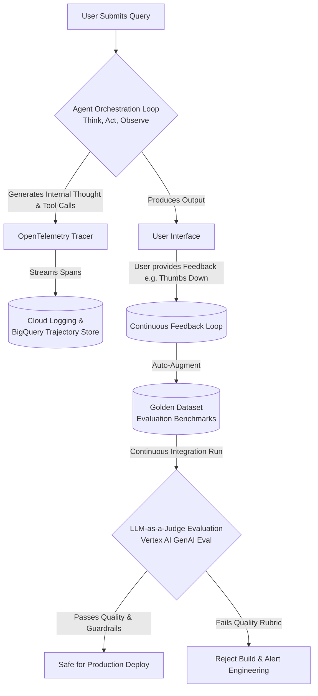
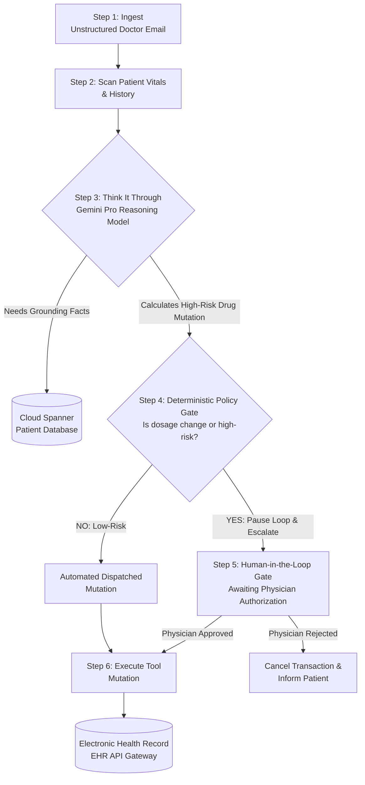
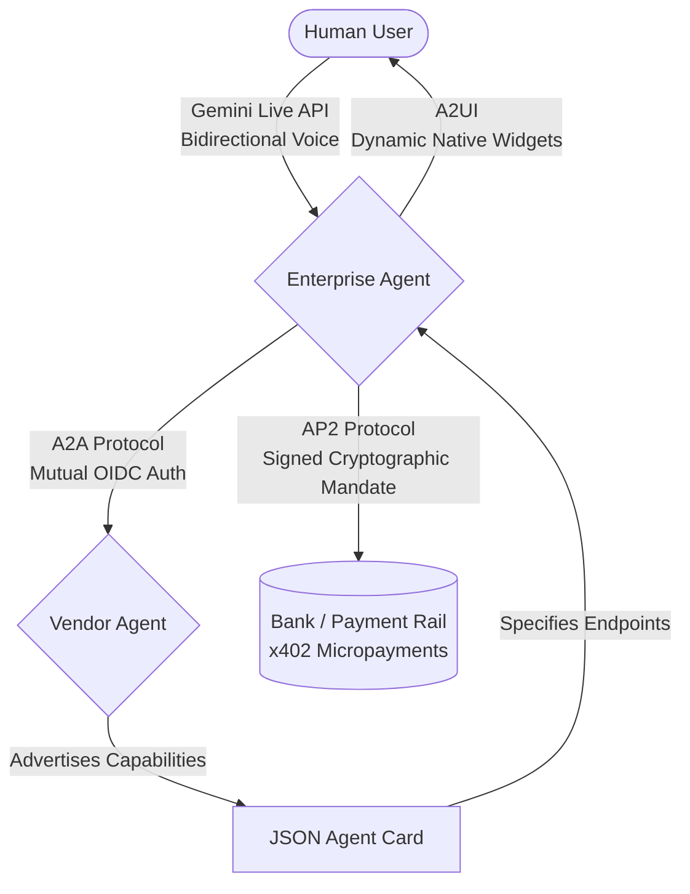
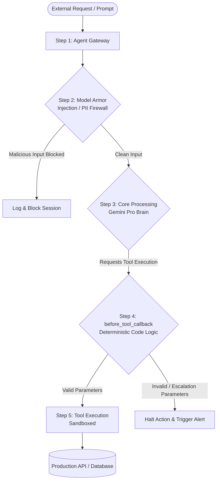
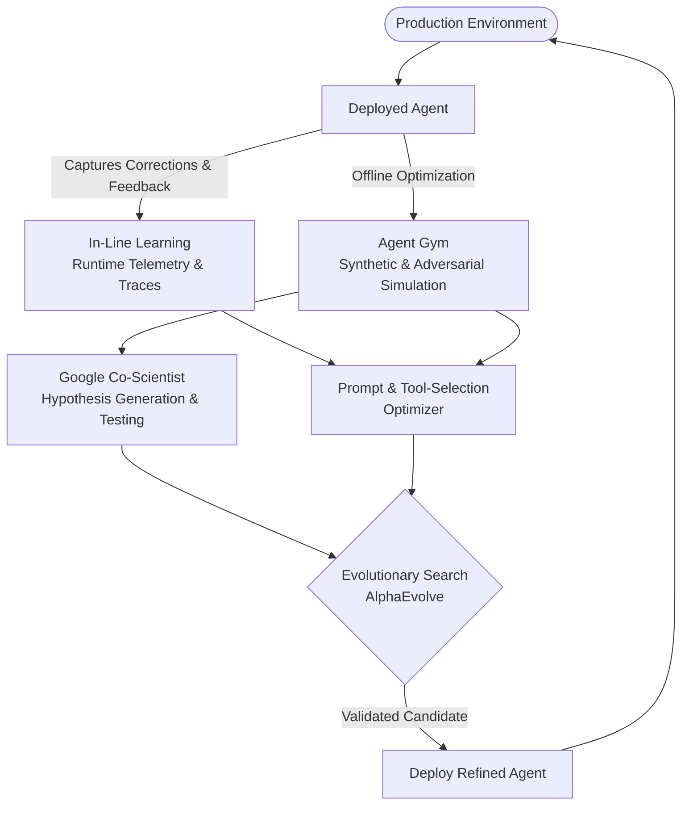

# Agents Concepts Visually Explained

**Topics:** #ai-agents #agent-architecture #adk #mcp-a2a-ap2 #agent-security #agentops #google-cloud #multi-agent-systems

> **Source:** [Agents Concepts Visually Explained](https://docs.google.com/document/d/1FEZZSHrp9_c5AnjJh2AJkwbfPsM0ST0qtizm46JnxT8/edit) · Converted from Google Docs

---

## FDE Project Grading Rubric Enforcement & Prevailing Customer Alignment

> **Mandatory Governance Standard:** Every project, prototype, or production agent built using the patterns in this concept **must pass the [Google Cloud FDE Field-Readiness & Project Grading Rubric](/concepts/00-fde-field-readiness-and-grading-rubric.md)** (aligned with the [Cloud FDE Team Charter](https://g3doc.corp.google.com/company/teams/cloud-fde/index.md?cl=head)). Scoring Requirement: **Average >= `2.0 (Competent)`** across both **Part A (Presentation & Advisory Rigor)** and **Part B (Engineering & Implementation Excellence)**, with **zero `0 (Not Demonstrated)` scores** on any single metric.

### 1. Part A — Presentation & Advisory Rigor Enforcement for This Concept

- **A.3 Presentation Skills & A.1 Strategic Delivery:** Use crisp visual mental models and architectural topology diagrams to align executive and technical stakeholders rapidly without jargon overload.
- **A.2 Objection Handling & Technical Defense:** Walk through visual sequence flows to answer panel questions on latency hops, token growth, and security boundaries.

### 2. Part B — Engineering & Implementation Excellence Cutlines for This Concept

- **B.2.4 System Design Artifacts:** Deliver publication-grade architecture diagrams, data-flow topologies, and sequence diagrams mapping every component (Model, Runner, Session, Memory Bank, Skills, MCP, A2A, Model Armor, Agent Gateway).
- **B.1.1 Agentic & Multi-Agent Systems:** Visually map Coordinator, Sequential, Parallel, Loop, and Hierarchical multi-agent patterns to concrete customer journeys.

### 3. Prevailing Customer Best-Practice Exemplars to Cite in Panel Reviews

- **Grounded Enterprise Scenarios:** Visual reference blueprints for executive briefings and technical design reviews across retail, banking, and healthcare agent deployments.
- **Cross-Reference:** See [Concept 00 — FDE Field-Readiness & Project Grading Rubric](/concepts/00-fde-field-readiness-and-grading-rubric.md) for the complete 0–3 grading scale, 31-competency matrix, and disqualifier remediation rules.

---
## The Four Core Agentic Elements

| Component | Biological Analogy | Role in Enterprise Systems | GCP Well-Architected Implementation | Primary Failure If Missing |
| --- | --- | --- | --- | --- |
| **Model** | The Brain | Cognitive reasoning, intent classification, multi-step decomposition, and synthesis. | Vertex AI Gemini 3.2 Pro / Flash (configured with appropriate system instructions). | System cannot understand nuance, resolve ambiguity, or plan next steps. |
| **Tools** | The Hands | Real-time grounding (read) and external workflow execution (write/mutate). | Cloud Run microservices, BigQuery NL2SQL, OpenAPI / Model Context Protocol (MCP) servers. | Hallucinations; inability to access live enterprise facts or execute business actions. |
| **Orchestration Layer** | The Nervous System | State machine, context window curation, reasoning loops, memory scratchpad, and security callbacks. | Google GenAI Agent Development Kit (ADK), Vertex AI Agent Engine, LangGraph. | Single-turn dead ends; infinite execution loops; inability to recover from API errors. |
| **Deployment & Services** | The Body & Legs | Managed hosting, persistent sessions, IAM identity delegation, auto-scaling, and telemetry. | Cloud Run / GKE, Cloud Spanner (session state), Cloud Trace / Cloud Logging (OpenTelemetry). | Inability to scale; security breaches via uncontrolled credentials; lack of auditability. |

*Figure 1 — Concept matrix mapping the four core agentic elements to a biological analogy, their enterprise role, a concrete GCP implementation, and the failure mode each one prevents.*

The figure frames an agent as four cooperating parts rather than "a prompt plus a model." Each row pairs a capability with the specific thing that breaks when it is absent — a useful checklist when auditing whether a design is genuinely agentic or just a chat wrapper.

---

## The 5-Step Operational Lifecycle

| Step | Phase Name | System Action | State & Context Window Behavior | GCP Native Infrastructure |
| --- | --- | --- | --- | --- |
| Step 1 | **Get the Mission** | Ingests the high-level objective via user prompt, API trigger, or Pub/Sub event. | Initializes session state and injects primary objective into system prompt. | Cloud Pub/Sub · Eventarc · API Gateway |
| Step 2 | **Scan the Scene** | Evaluates current environment, active conversation turns, and available tool declarations. | Pulls relevant history and memory bank records into working context. | Cloud Spanner · Vertex Vector Search |
| Step 3 | **Think It Through** | Decomposes the task, evaluates trade-offs, and plans the immediate next step. | Model generates internal monologue / thought and decides on tool invocation. | Vertex AI Gemini 2.5 Pro (Reasoning Mode) |
| Step 4 | **Take Action** | Dispatches a structured tool call with typed arguments to external systems. | Emits function call payload to the orchestrator layer. | Cloud Run · Cloud Functions · VPC Service Controls |
| Step 5 | **Observe & Iterate** | Ingests the tool's raw execution output and errors back into the context window. | Appends `tool_response` to context; evaluates if the goal is complete or if another loop is needed. | Agent Runtime · BigQuery Trajectory Store |

*Figure 2 — The five-step operational lifecycle of an agent turn, shown alongside what happens to session state and which GCP service backs each phase.*

This is the agent loop expressed operationally: mission intake, environment scan, reasoning, action, then observation that either closes the goal or re-enters the loop. The "State & Context Window Behavior" column is the key detail — each step is defined by what it adds to or pulls into the context window.

---

## The 5 Levels of Agentic Systems

| Level | Formal Name | Cognitive & Execution Capability | Context & State Architecture | Enterprise GCP Example |
| --- | --- | --- | --- | --- |
| **Level 0** | Core Reasoning System | Static inference in isolation. Pre-trained weights only; no live data or tool access. | Ephemeral, stateless prompt/response context. | Base Gemini 2.5 Pro running in Vertex AI Studio without search or tools. |
| **Level 1** | Connected Problem-Solver | Single-hop grounding. Retrieves external data or executes simple predefined tool actions. | Dynamic prompt injection with live data retrieval (RAG). | Vertex AI Search grounding widget for HR employee handbook Q&A. |
| **Level 2** | Strategic Problem-Solver | Multi-hop reasoning and context engineering. Decomposes tasks into sub-plans and chains tools across multiple turns. | Stateful session scratchpad, working memory, and dynamic tool re-routing. | IT Support Agent querying Active Directory, resetting VPN tokens in Cloud SQL, and updating ServiceNow. |
| **Level 3** | Collaborative Multi-Agent System | Multi-agent specialization. Teams of distinct autonomous agents collaborating, where agents treat other agents as tools. | Distributed state graphs, inter-agent messaging protocols (A2A), shared memory banks. | Enterprise Loan Underwriting: Document Ingestion Agent, Fraud Detection Agent, and Underwriting Agent supervised by a Manager. |
| **Level 4** | Self-Evolving System | Meta-reasoning and autonomous expansion. Detects its own capability gaps and writes, tests, and deploys new tools or agents dynamically. | Code-execution sandboxes, automated reflection, self-critique, and dynamic tool registry updates. | Cyber Defense Agent: detects an unknown zero-day attack vector, writes a custom Python log parser in a sandbox, validates it, and deploys it. |

*Figure 3 — A five-level maturity ladder for agentic systems, from stateless inference up to systems that extend themselves.*

The progression tracks three things rising together: reasoning depth, state architecture, and autonomy. Levels 0–1 are essentially enriched prompting; the jump to Level 2 introduces persistent session state, Level 3 introduces agent-to-agent protocols, and Level 4 introduces the ability to author new capability at runtime.

---

## Model Tiers & Tool Protocols

| Architectural Layer | Component / Standard | Primary Enterprise Function | Latency & Cost Profile | GCP Cloud Native Service |
| --- | --- | --- | --- | --- |
| **Frontier Reasoning Model** | Gemini 2.5 Pro | Task decomposition, multi-step planning, dynamic replanning, conflict arbitration. | Higher cognitive depth; higher token latency and cost. | Vertex AI Model Garden (Gemini 2.5 Pro) |
| **High-Throughput Worker** | Gemini 2.5 Flash / Gemma 4 | High-volume classification, tool argument validation, summarization, entity extraction. | Sub-second response; drastically lower cost per million tokens. | Vertex AI (Gemini 2.5 Flash / Vertex AI Model Armor) |
| **Grounding Interface (Read)** | RAG / BigQuery NL2SQL | Factual grounding in enterprise data; read-only verification. | Deterministic read performance; zero parameter hallucination. | Vertex AI Search & BigQuery Studio |
| **Action Interface (Write)** | Cloud Run Sandboxes | State mutations, API writes, code compilation, database inserts. | Isolated runtime boundary; strict VPC Service Controls. | Cloud Run / Eventarc / Secret Manager |
| **Standardized Protocols** | OpenAPI & MCP | Uniform JSON schema definitions for tool discovery, input parameters, and resource access. | Standardized tool interoperability without brittle bespoke SDK code. | Google GenAI ADK / OpenAPI 3.0 / MCP Servers |

*Figure 4 — Concept matrix pairing model tiers and tool protocols with their function, cost profile, and backing GCP service.*

The figure argues for a tiered model mesh rather than one model everywhere: expensive frontier reasoning is reserved for planning and arbitration, while high-volume mechanical work drops to a fast, cheap tier. The lower rows separate read grounding from write actions and put standardized protocols (OpenAPI, MCP) underneath both.

---

## Observability & the Evaluation Feedback Loop

*Figure 5 — Trajectory tracing and the closed evaluation loop that gates a production deploy.*

Two streams leave the orchestration loop: telemetry (internal thoughts and tool calls, emitted as OpenTelemetry spans into a trajectory store) and the user-visible output. Negative user feedback auto-augments a golden evaluation dataset, which an LLM-as-a-Judge run then uses as a CI gate — passing builds deploy, failing ones are rejected and alert engineering.

---

## The 4 Golden Design Patterns

| Pattern | Topology | Best Enterprise Use Case | How It Prevents Failure |
| --- | --- | --- | --- |
| **Coordinator (Manager)** | Hub-and-Spoke — one central manager directs specialized worker agents. | Dynamic, unpredictable requests (e.g. general customer support triage and execution). | The Coordinator validates the results of each worker before assembling the final response. |
| **Sequential** | Pipeline / assembly line — Agent A → Agent B → Agent C. | Highly structured, predictable, multi-step workflows (e.g. Document Intake → Data Extraction → Database Entry). | Each step acts as a deterministic schema validator for the upstream agent's output. |
| **Iterative Refinement** | Feedback loop — Generator Agent produces ↔ Critic Agent evaluates. | Precision-critical outputs (e.g. code generation, legal contract drafting, regulatory analysis). | The Critic rejects drafts and provides structured feedback until the output passes quality thresholds. |
| **Human-in-the-Loop (HITL)** | Deterministic gate — agent pauses execution → alerts human → awaits sign-off. | High-consequence mutations (e.g. database schema changes, wire transfers, sending customer communications). | Limits the agent's blast radius by ensuring critical real-world mutations cannot happen without human authorization. |

*Figure 6 — The four golden multi-agent design patterns, their topologies, and the specific failure each one guards against.*

Pattern choice follows predictability: sequential pipelines suit known workflows, a coordinator handles unpredictable routing, iterative refinement buys precision through critique, and HITL inserts a deterministic human gate ahead of irreversible actions.

---

## Worked Example — Human-in-the-Loop Gate in a Clinical Agent

*Figure 7 — A worked example running the five-step lifecycle through a prescription-refill scenario with a deterministic HITL gate.*

The reasoning model does not decide whether escalation is needed — a deterministic policy gate does. Low-risk mutations dispatch automatically; anything classified as a dosage change or high-risk pauses the loop until a physician approves or rejects, and only then does the tool call reach the EHR gateway.

---

## From DevOps/MLOps to AgentOps — Three Pillars

| Pillar | What It Captures | Why It Matters |
| --- | --- | --- |
| **Trajectory Tracing (OpenTelemetry)** | Every turn's internal thought, action call, argument payload, and environment feedback. | Standard application logs cannot explain *why* an agent acted; the trajectory can. |
| **Evaluation (LM-as-a-Judge)** | A rigorous, automated jury of models scoring agent outputs against a verified "Golden Dataset" of correct answers. | Turns subjective output quality into a repeatable, gateable metric. |
| **Continuous Feedback Loops** | Live user interactions (e.g. "thumbs down") injected automatically back into the training and evaluation datasets. | Prevents regressions by converting real failures into permanent test cases. |

*Figure 8 — The three pillars that distinguish AgentOps from conventional DevOps/MLOps.*

The figure marks the transition point: shipping agents requires observability of the *reasoning trajectory*, automated judging against a golden dataset, and a feedback loop that folds production failures back into the evaluation set.

---

## The Three Interoperability Frontiers — A2UI, A2A, AP2

| Frontier | Protocol / Standard | Shift It Represents | Mechanism |
| --- | --- | --- | --- |
| **Agent-to-Human** | A2UI | From static text chat to dynamically generated interactive UI. | Generates native UI components on the fly — a calendar selector, live map, or custom checkout form — or uses low-latency streaming voice such as the Gemini Live API. |
| **Agent-to-Agent** | A2A | From isolated agents to a discoverable, collaborating fleet. | Independent agents discover, authenticate, and collaborate with one another using standardized digital business cards called **Agent Cards**. |
| **Agent-to-Money** | AP2 & x402 | From passive recommendations to active financial transactions. | Instead of asking the user to copy-paste credit card details, agents use cryptographic **AP2 (Agent Payments Protocol)** mandates to authorize secure, capped transactions. |

*Figure 9 — The three protocol frontiers extending agents outward: toward humans, toward other agents, and toward payments.*

Each frontier replaces an ad-hoc integration with a standard. A2UI makes the interface generative rather than fixed, A2A replaces bespoke agent wiring with discoverable Agent Cards, and AP2 replaces raw credential sharing with signed, capped payment mandates.

---

## Worked Example — An Interoperable Enterprise Agent

*Figure 10 — All three interoperability frontiers operating together around a single enterprise agent.*

The same agent talks to a human over streaming voice and dynamically generated widgets, to a vendor agent over A2A with mutual OIDC authentication, and to a payment rail via a signed AP2 mandate. Discovery is indirect: the vendor advertises capabilities through a JSON Agent Card, which tells the enterprise agent which endpoints to call.

Two properties make this safe at enterprise scale:

* **Zero-Trust & Inter-Agent Security.** Hardcoding static API keys or credentials across independent enterprise boundaries is a major security hazard. Standardized Agent Cards allow secure service-to-service discovery under OAuth2/OIDC federated identity.
* **Capped Cryptographic Mandates.** AP2 builds financial authorization directly into the transaction protocol. The agent never touches raw bank accounts; it is issued a cryptographically signed, tamper-proof mandate restricting spending to a specific vendor, a defined SKU, and a maximum budget.

---

## The Principle of the Leash — Agent Security

Giving an AI agent tool access is like handing the keys to a company vehicle to a new employee. Without a speed limiter, GPS tracking, and geofencing, you are exposing the company to massive liability.

Because language models are stochastic, they can be manipulated via prompt injection or malicious inputs. You must never rely *solely* on prompt instructions (e.g. *"Do not delete files"*) for security. Instead, wrap the agent's execution layer in a deterministic, zero-trust security perimeter:

1. **Dynamic Callbacks (`before_tool_callback`)** — intercept and audit tool arguments in code *before* they hit APIs.
2. **Model Armor** — sanitize and scrub incoming prompts and outgoing generations for data leaks or jailbreaks.
3. **Agent Gateways & Registries** — establish an "air traffic control" plane to manage and monitor a growing fleet of enterprise agents.

---

## Worked Example — The Zero-Trust Execution Perimeter

*Figure 11 — The Principle of the Leash rendered as an execution pipeline with two independent deterministic checkpoints.*

Security sits outside the model, not inside the prompt. Model Armor screens input for injection and PII before the model ever sees it, and a `before_tool_callback` inspects the model's proposed tool arguments in deterministic code before any production API or database is touched — so a successfully manipulated model still cannot escalate.

---

## Escaping Agentic Aging — The Two Learning Loops

In standard machine learning, models are frozen in time after training. If an API schema changes, a competitor launches a new product, or a user changes their behavior, the model begins to degrade in utility. This is **agentic aging**.

Production-grade agents do not remain static; they evolve through two distinct learning loops:

1. **In-Line Learning (Continuous Adaptation)** — capturing runtime telemetry, traces, and human corrections, then automatically optimizing the agent's system instructions, prompt context, and tool selections.
2. **Offline Optimization (Agent Gym)** — simulating millions of interactions inside an isolated "Gym" environment using synthetic data and adversarial agents, finding and correcting logical flaws before they reach production.

At the bleeding edge of this space are systems like **Google Co-Scientist** (coordinating specialized research agents to generate and test scientific hypotheses) and **AlphaEvolve** (using genetic evolutionary algorithms to discover and refine new computing code autonomously).

*Figure 12 — The two learning loops — in-line adaptation from production traces and offline optimization in an Agent Gym — feeding a continuous redeployment cycle.*

The diagram closes the lifecycle: production behaviour feeds both a fast in-line loop that retunes instructions and tool choices, and a slower offline loop that stress-tests the agent against synthetic and adversarial scenarios. Validated improvements from either path are redeployed, so the agent keeps pace with a changing environment instead of decaying.

---

## Architectural Best Practice: Key Guidelines & Takeaways

1. **Deploy Tiered Model Meshes.** Run simple tasks (greetings, routing, entity parsing) on Gemini 2.5 Flash for sub-second latencies and low cost. Reserve Gemini 2.5 Pro for multi-step reasoning and dynamic tool coordination.
2. **Never Rely Solely on Prompts for Security.** Prompts are vulnerable to injection. Establish a zero-trust boundary using Model Armor and deterministic pre-execution callbacks (`before_tool_callback`).
3. **Control High-Risk Mutations with HITL.** Never allow an agent to execute irreversible real-world changes (wire transfers, prescription refills, schema migrations) without an explicit Human-in-the-Loop verification gate.
4. **Instrument Full Trajectory Tracing.** Standard application logs are insufficient. Use structured OpenTelemetry spans to capture the agent's internal monologue, dispatched tool names, parameters, and environmental feedback.
