# Architecture Best Practice: Build and Deploy Multi-Agent ADK Systems to Gemini Enterprise

**Topics:** #google-adk #multi-agent-systems #gemini-enterprise #agent-runtime #mcp #workflow-orchestration #state-persistence #google-cloud

> **Source:** `build_and_deploy_multi-agent_adk_systems_to_gemini_enterprise.md` · **Corpus:** `GEAPL200` (Unified L200 + L300 Open Knowledge Format v0.2 · Version `GEAPL200_2026-09-30_124746`) · **Target:** GCP Knowledge Catalog (Dataplex) & Antigravity Agentic AI Development

---

## FDE Project Grading Rubric Enforcement & Prevailing Customer Alignment

> **Mandatory Governance Standard:** Every project, prototype, or production agent built using the patterns in this concept **must pass the [Google Cloud FDE Field-Readiness & Project Grading Rubric](/concepts/00-fde-field-readiness-and-grading-rubric.md)** (aligned with the [Cloud FDE Team Charter](https://g3doc.corp.google.com/company/teams/cloud-fde/index.md?cl=head)). Scoring Requirement: **Average >= `2.0 (Competent)`** across both **Part A (Presentation & Advisory Rigor)** and **Part B (Engineering & Implementation Excellence)**, with **zero `0 (Not Demonstrated)` scores** on any single metric.

### 1. Part A — Presentation & Advisory Rigor Enforcement for This Concept

- **A.1 Strategic Delivery & Value Articulation:** Connect ADK multi-agent orchestration (`SequentialAgent`, `ParallelAgent`, `LoopAgent`, ADK 2.0 graph workflows) directly to enterprise CUJ reliability and operational impact.
- **A.4 AI-Driven Development Discussion:** Show how `adk web`, local runner harnesses, and `.evalset.json` regression suites accelerate iterative development before deploying to Vertex AI Agent Runtime.

### 2. Part B — Engineering & Implementation Excellence Cutlines for This Concept

- **B.1.1 Agentic & Multi-Agent Systems:** Coordinate specialized sub-agents using typed `session.state` (`output_key`), bounded `LoopAgent` iterations (`max_iterations`), and filtered MCP toolsets (`tool_filter`).
- **B.7.1 Modularity & B.7.4 Extensibility:** Decouple model configuration via LiteLLM/Model Garden aliases and enforce deterministic guardrails in `before_agent_callback`, `before_model_callback`, and `before_tool_callback`.
- **B.6.1 CI/CD & Deployment:** Package and deploy verified multi-agent topologies to managed Vertex AI Agent Runtime and register them in Gemini Enterprise.

### 3. Prevailing Customer Best-Practice Exemplars to Cite in Panel Reviews

- **Grounded Enterprise Scenarios:** Customer Support Billing & Account Update Pipeline (`SequentialAgent` validation followed by account mutation) and Parallel Travel/Inventory Research (`ParallelAgent` writing to distinct `session.state` keys).
- **Cross-Reference:** See [Concept 00 — FDE Field-Readiness & Project Grading Rubric](/concepts/00-fde-field-readiness-and-grading-rubric.md) for the complete 0–3 grading scale, 31-competency matrix, and disqualifier remediation rules.

---
## Architectural Best Practice: Key Guidelines & Takeaways

### Core Architectural Principles

- **Prefer deterministic workflow orchestration over open-ended LLM transfer when step ordering matters.** Basic sub-agent routing hands over full conversational control and loses multi-step context; ADK workflow agents (`SequentialAgent`, `ParallelAgent`, `LoopAgent`) and ADK 2.0 graph-based workflows enforce deterministic sequencing, fan-out concurrency, and bounded retry loops.
- **Decouple agent reasoning from model provider specifics via model-agnostic aliases.** Configure agents against logical model identifiers or Vertex AI Model Garden / LiteLLM routing layers so model upgrades and tiered Flash/Pro routing require zero orchestration code rewrites.
- **Standardize external tool and data connectivity on Model Context Protocol (MCP).** Use `McpToolset` to consume remote MCP servers or expose custom ADK tools via `FastMCP`, enforcing strict input/output JSON schemas and narrow tool filtering (`tool_filter`) per sub-agent.
- **Treat Session State (`session.state`) as a typed shared blackboard across sub-agents.** Use `output_key` and explicit state keys to pass structured intermediate artifacts between sequential and parallel nodes rather than relying on unstructured chat history.
- **Instrument lifecycle hooks (`before_agent_callback`, `before_model_callback`, `before_tool_callback`) for deterministic guardrails.** Enforce policy checks, PII redaction, and parameter validation in code callbacks before LLM inference or external tool execution occurs.
- **Bridge local development (`adk web` / `InMemoryRunner`) and cloud production (`VertexAiSessionService` / Agent Runtime) through environment-driven runner bindings.** Keep agent definition code identical across local debugging and managed Gemini Enterprise deployment.

### Mandatory Requirements & Golden Rules (Antigravity & Production Readiness)

- **Scope every sub-agent's `description` and `instruction` with explicit routing boundaries.** Root coordinators rely on sub-agent descriptions for transfer decisions; ambiguous descriptions cause routing loops and tool misfires.
- **Always pass `tool_filter` when attaching large MCP servers to specialized sub-agents.** Exposing 50+ tools to a leaf worker inflates token consumption and degrades tool-selection accuracy.
- **Bound `LoopAgent` iterations with an explicit `max_iterations` cap AND a deterministic exit tool/condition.** Never deploy an unbounded refinement loop to production.
- **Use `ParallelAgent` for independent I/O-bound data gathering, writing each branch's output to a distinct `output_key` in `session.state`.** Avoid race conditions by ensuring parallel branches never mutate the same state key.
- **Validate multi-agent trajectories offline with ADK evaluation datasets (`.evalset.json`) before registering the agent in Gemini Enterprise.** Assert both tool-call trajectory (`IN_ORDER` / `ANY_ORDER`) and final response rubric scores.
- **Deploy production multi-agent topologies to managed Vertex AI Agent Runtime (Reasoning Engine) and register them with Gemini Enterprise Agent Registry** with least-privilege IAM service accounts.

### Anti-Patterns & Guardrails

- ** Daisy-Chained Unstructured Hand-offs:** Allowing peer sub-agents to transfer control back and forth ad-hoc without a coordinator or workflow graph, leading to infinite transfer loops and lost user context.
- **Monolithic God-Agent Prompting:** Stuffing all domain instructions and 30+ tools into a single root agent instead of decomposing into specialized ADK sub-agents with isolated toolsets.
- **Prompt-Only Security Enforcement:** Relying on system instructions ('Do not query other users' accounts') instead of enforcing identity and parameter checks inside `before_tool_callback`.
- **Hardcoding Ephemeral Local Storage in Cloud Deployments:** Leaving `InMemorySessionService` active in production containers instead of binding to `VertexAiSessionService` and Vertex AI Memory Bank.

### Cross-Concept Links (OKF Knowledge Graph)

- [Google Cloud FDE Field-Readiness & Project Grading Rubric (Mandatory Standard)](/concepts/00-fde-field-readiness-and-grading-rubric.md)
- [Build Enterprise Agents with Code Execution on Gemini Enterprise Agent Platform](/concepts/22-build-enterprise-agents-with-code-execution.md)
- [Agent Context Persistence, Sessions, and Memory Engineering](/concepts/23-agent-context-persistence-and-memories.md)
- [Evaluating Generative and Agentic Systems on Google Cloud](/concepts/25-evaluate-generative-agentic-systems.md)
- [Governing the Agent Ecosystem with Agent Gateway, Agent Registry, and Policies](/concepts/35-govern-agents-with-agent-gateway-registry-policies.md)

---

## Comprehensive Technical Breakdown & Concept Trail

Google for Developers Blog

### 1. Episode Paper Trail & Interlinked Concepts

### Current Page Explored: Course Introduction | Google Skills for Partners

Core Subject: Foundations of Google's Agent Development Kit (ADK), multi-agent architectures, model configuration, and enterprise deployment.   
Google ADK

Key Components Tracked in ADK Architecture:

Agent Model & Runners: Configuring agent behavior, instructions, underlying models (e.g., Gemini via Vertex AI Model Garden or LiteLLM), and executing event loops.   
Google for Developers Blog

Tools & MCP (Model Context Protocol): Equipping agents with executable tools, pre-built search/code components, external MCP servers, and dynamic schema building.   
Google ADK

Workflows: Moving from simple sub-agent delegation to advanced ADK 2.0 graph-based workflows, state persistence, sequences, loops, and parallel execution.   
Google ADK

Lifecycle & Enterprise Deployment: Instrumentation using callbacks/plugins, evaluating behavior against datasets, deploying as a managed service on Agent Runtime, and registering within Gemini Enterprise.

### 2. Concept Graph (ADK & Gemini Enterprise Architecture)

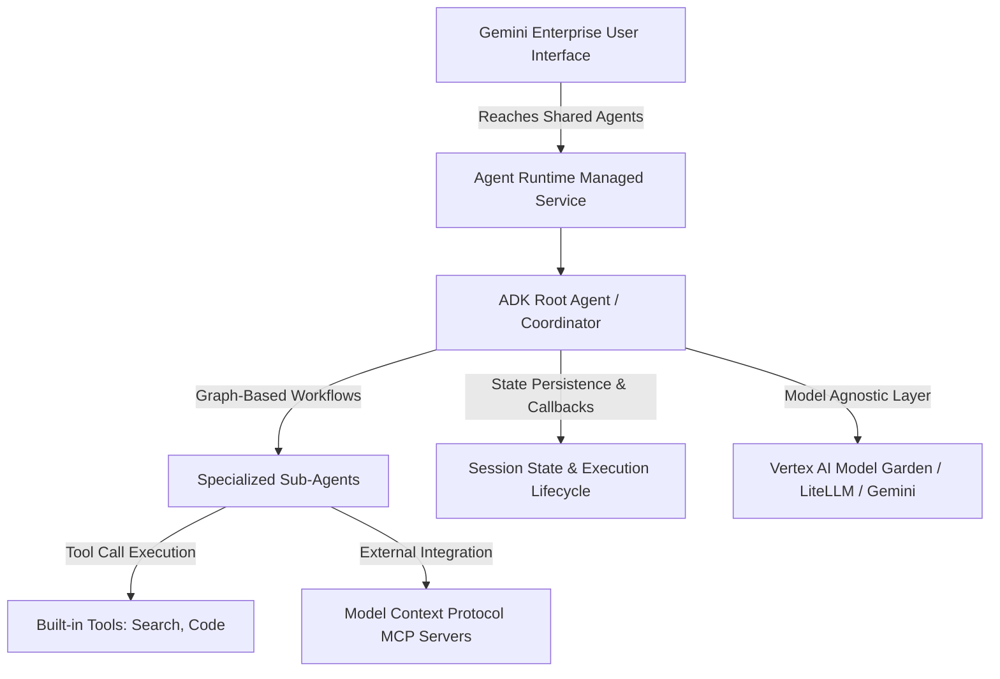

### 3. Architectural Q&A

Q1: How does ADK handle multi-agent orchestration differently from basic sub-agent routing?
Answer: In basic sub-agent setups, a root coordinator delegates a task to a specialized sub-agent (e.g., a Flight Agent), which transfers the entire conversational control away from the coordinator, often losing broader multi-step context. ADK solves this by introducing graph-based workflows and template workflow agents (sequences, loops, parallel execution). This allows a central orchestrator or state graph to systematically manage state across multiple nodes, ensuring complex dependencies (e.g., booking a flight and then securing a hotel) execute reliably in sequence.   

### Google Cloud

+ 1

Q2: What role does Model Context Protocol (MCP) play within an ADK solution?
Answer: MCP acts as an open, standardized client-server protocol enabling agents to securely connect to external data repositories, tools, and generative media services. In ADK, agents can act as MCP clients to consume remote tools or wrap custom ADK tools as an MCP server (FastMCP), maximizing code reusability across enterprise boundaries.

Would you like to proceed to the next module in your training path so we can log the next phase of your architecture paper trail?

summarize the key takeaways and definitions of this entire page. I want definitions and concepts with an example and a simple elevator speech definition in a table. All concepts related must be linked via a a graph. If trade offs are presented give it in a matrix or magic quadrant
Here is the complete architectural summary, concept mapping, and trade-off analysis based on the current page: Agents, tools, and runners: The ADK model.

### 1. Key Concepts, Definitions & Examples

| Concept / Component | Definition | Simple Elevator Speech Definition | Concrete Example (Customer Support Domain) |
| --- | --- | --- | --- |
| Agent | An autonomous unit of work powered by a language model reasoning engine that receives tasks and decides actions. | "The thinking unit that decides what to do." | A billing_agent assigned to answer account balance queries. |
| Model | The underlying LLM providing reasoning capabilities via a unified identifier string and model-agnostic layer. | "The brain behind the agent." | gemini-flash-latest configured via a model alias for future-proofing. |
| Tools | Python functions, OpenAPI specs, or MCP definitions that extend an agent's capability to take external actions. | "The hands that let agents interact with systems." | lookup_account(account_id) querying a live billing database. |
| The Runner | The engine that manages the event loop, routes messages, dispatches tool calls, and streams results. | "The runtime manager powering local tests and cloud deployments." | Running adk web to initialize the local runner and test the agent. |
| Workflow Agents | Specialized structural agents (SequentialAgent, ParallelAgent, LoopAgent) that orchestrate sub-agents without model decisions. | "Pre-configured pipelines for multi-step agent flow." | Running a billing validation step sequentially followed by an account update. |

### 2. Concept Graph

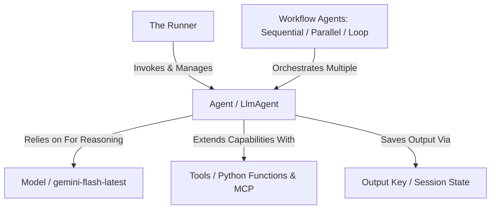

### 3. Trade-off Matrix: ADK vs. Direct Model API Calls

When building production-grade generative AI systems, developers must choose between writing direct API integration code or using an abstraction framework like ADK.

| Dimension | Direct Model API Calls | Google Agent Development Kit (ADK) |
| --- | --- | --- |
| Boilerplate & Infrastructure | High: Manual handling of context windows, retry loops, error recovery, and tool execution dispatch. | Low: Handled out-of-the-box by the framework runner and structured component model. |
| Orchestration & Multi-Agent Flow | Complex: Requires custom state-machine code to route messages between multiple specialist agents. | Native: Built-in workflow agents (Sequential, Parallel, Loop) and state persistence keys (output_key). |
| Observability & Debugging | Manual: Requires custom logging per API call and prompt payload. | Integrated: Built-in trace view via adk web showing exact tool calls, model reasoning steps, and inputs/outputs. |
| Portability & Vendor Lock-in | Variable: Tightly coupled to specific provider schemas and SDK implementations. | Model-Agnostic: Abstracts providers via LiteLLM and open standards, allowing seamless model swapping. |

Would you like to move on to the next module in your training path to expand our multi-page concept paper trail?

summarize the key takeaways and definitions of this entire page. I want definitions and concepts with an example and a simple elevator speech definition in a table. All concepts related must be linked via a a graph. If trade offs are presented give it in a matrix or magic quadrant. If there are any diagrams on this page a mermaid.js diagram of that diagram and give me its key takeaways in a concise bullet points.
Here is the summary, concept breakdown, trade-off matrix, and structural architecture diagram for the page ADK tools, context, and state.

### 1. Key Concepts, Definitions & Examples

| Concept / Component | Definition | Simple Elevator Speech Definition | Concrete Example |
| --- | --- | --- | --- |
| Tool Schema Generation | ADK inspects Python function signatures, docstrings, and type hints to build JSON schemas for model tool selection. | "Translating Python code into model-readable instructions." | Using account_id: str type hints and clear docstrings so Gemini knows how to call get_account_balance(). |
| ToolContext | An automatically injected object providing tools with advanced state access, control flags, and artifacts. | "The superpower object giving tools system hooks." | Using tool_context.state to check if a user is authorized before running an account query. |
| Session State Scopes | Key-value store scopes (session, user:, app:, temp:) controlling how long and widely data persists. | "The shared scratchpad with variable lifespans." | Storing user language preferences under user:language so they persist across sessions. |
| Callbacks & Plugins | Interception functions and runner-level hooks that monitor or short-circuit execution at lifecycle checkpoints. | "Guards and loggers wrapping the agent lifecycle." | Registering a LoggingPlugin to print every tool invocation across all agents uniformly. |

### 2. Concept Graph

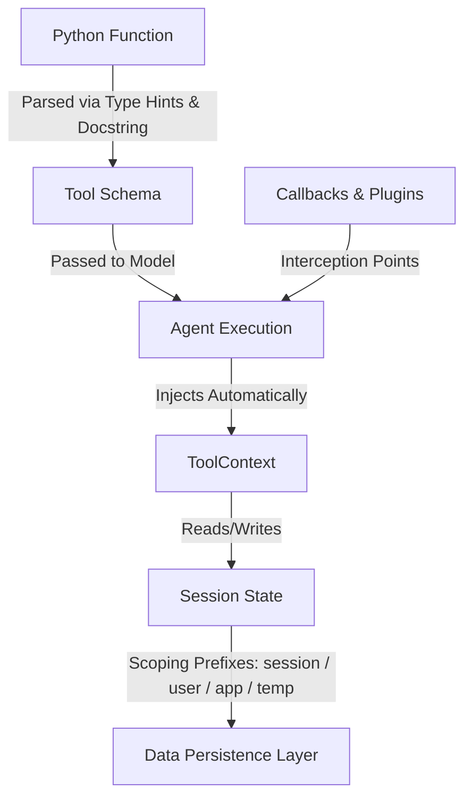

### 3. Callback vs. Plugin Trade-off Matrix

When implementing monitoring, security checks, or data logging in an ADK system, developers choose between agent-level callbacks and runner-level plugins:

| Dimension | Agent-Level Callbacks (before_agent_callback, etc.) | Runner-Level Plugins (BasePlugin) |
| --- | --- | --- |
| Scope & Reusability | Granular: Configured per individual agent; tailored to specific isolated tasks. | Global / Cross-Cutting: Applied uniformly across every agent, model, and tool managed by the runner. |
| Execution Order | Executes after plugin hooks at the same lifecycle checkpoint. | Executes first, with the power to short-circuit and skip agent-level callbacks entirely. |
| State & Lifecycle | Bound closely to session scopes and individual agent executions. | Initialized once per runner; instance variables accumulate over the full application lifetime. |
| Best Used For | Task-specific validation, localized guarding rules, or conditional agent routing. | Universal logging, system-wide safety guardrails, metrics monitoring, and response caching. |

### 4. Agent Execution Flow & Lifecycle Diagram

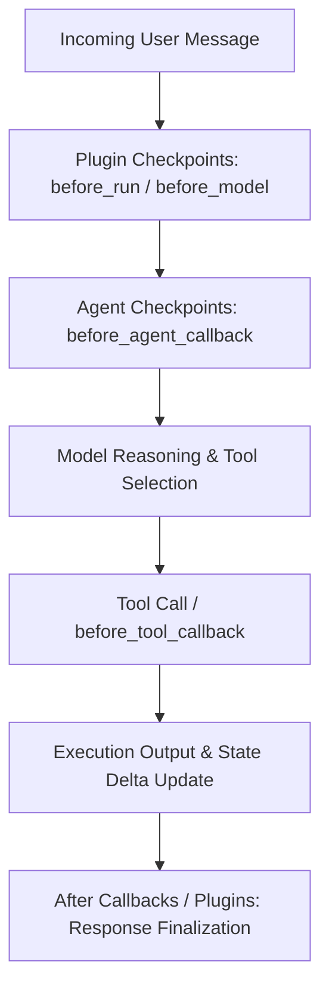

Key Takeaways from the Flow Diagram:
Pre-Execution Hooks: Plugins always execute before agent-level callbacks, allowing cross-cutting infrastructure to intercept requests early.

Short-Circuit Capability: If any callback or plugin returns a non-None value, it short-circuits the execution path, immediately bypassing the next step or model call.

Granular Checkpoints: Six distinct lifecycle points allow intervention around the agent run, model calls, and tool calls.

what about session states and multi-agent coordination 
In Google's Agent Development Kit (ADK), session states and multi-agent coordination solve the fundamental challenge of how separate, specialized agents share data, track context, and pass work back and forth cleanly without tight coupling or messy global state pollution.

### 1. Key Concepts, Definitions & Examples

| Concept / Component | Definition | Simple Elevator Speech Definition | Concrete Example (Support Multi-Agent System) |
| --- | --- | --- | --- |
| Session State | A shared key-value scratchpad persisting across an entire conversation, holding serializable values. | "The shared memory bank for the conversation." | Storing account_id so all subsequent agents know which user is being helped. |
| State Scoping Prefixes | Prefixes (user:, app:, temp:, or un-prefixed) dictating how long and widely state variables persist. | "Lifespan controls for shared data." | Setting user:language so it stays across multiple support ticket sessions. |
| Instruction Template Substitution | Automatic injection of session state keys into agent instructions using {key} syntax. | "Personalizing agents via injected context variables." | instruction="Helping {user:name} with billing." |
| output_key Coordination Pattern | A native agent configuration property that automatically saves an agent's final text response into state under a specified key. | "The zero-code handoff between specialist agents." | Saving a fraud_check_agent output under fraud_status so the root_agent can read it. |

### 2. Concept Graph (Session State & Multi-Agent Flow)

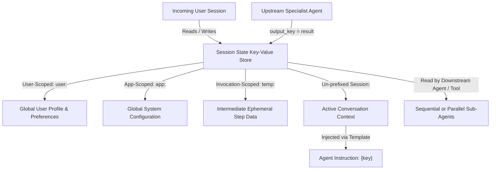

### 3. Trade-off Matrix: State Management Patterns

When designing multi-agent coordination pipelines, developers choose between different state writing and passing mechanisms:

| Dimension | output_key Property | Direct Tool / Callback Assignment (tool_context.state) | Unmanaged Direct State Mutation |
| --- | --- | --- | --- |
| Ease of Use | High: Configured declaratively on the agent definition with zero custom Python code. | Medium: Requires injecting ToolContext or CallbackContext inside tools/callbacks. | Low / Dangerous: Requires writing directly to raw underlying session objects. |
| Event Tracking & Persistence | Fully Tracked: Automatically recorded in event state deltas for database session services. | Fully Tracked: Captured as state deltas; safe and compatible across all storage engines. | Bypassed: Fails to record event deltas, breaking database persistence and parallel safety. |
| Best Used For | Passing a specialist agent's final text summary or result straight to the next workflow step. | Performing authorization checks, validation flags, or setting programmatic state variables. | Never recommended in production architectures. |

summarize the key takeaways and definitions of this entire page. I want definitions and concepts with an example and a simple elevator speech definition in a table. All concepts related must be linked via a a graph. If trade offs are presented give it in a matrix or magic quadrant. Cover every single concept mentioned in this page. 
Here is the comprehensive architectural summary, concept definitions, comparison matrix, and structural diagrams covering every single concept from the Multi-agent orchestration: Template workflows and ADK 2.0 page.

### 1. Key Concepts, Definitions & Examples

| Concept / Component | Definition | Simple Elevator Speech Definition | Concrete Example |
| --- | --- | --- | --- |
| Agent (LlmAgent) | An autonomous, model-backed reasoning unit that processes tasks within a single context window. | "The foundational thinking unit of an ADK system." | A single billing_agent answering account questions. |
| SequentialAgent | A deterministic template workflow agent that runs sub-agents one after another in a fixed order. | "An ordered pipeline of specialist steps." | Running a data-gathering agent followed immediately by a summarization agent. |
| ParallelAgent | A deterministic template workflow agent that executes independent sub-agents concurrently. | "Running independent tasks at the same time." | Checking inventory, promos, and account standing simultaneously. |
| LoopAgent | A deterministic template workflow agent that executes sub-agents iteratively until a termination condition is met. | "An iterative refinement loop with a safety ceiling." | A draft agent and quality agent refining copy until a score threshold is reached (max_iterations=5). |
| Workflow (ADK 2.0) | A dynamic orchestration class in ADK 2.0 that models execution as an explicit directed graph. | "An expressive graph engine combining code and AI nodes." | A customer support graph with branching conditionals and parallel fan-outs. |
| Node | A unit of work in an ADK 2.0 Workflow, which can be an Agent, a Python function, a tool, or a nested Workflow. | "Any processing block inside a graph workflow." | A standard Python function def router(node_input: str):. |
| Event | A structured object carrying a node's output data and an optional routing signal (Event(route=...)). | "The data packet passed between graph nodes." | Returning Event(route="BILLING") to direct workflow traffic. |
| JoinNode | A synchronization node that collects outputs from all incoming parallel branches and passes them together. | "The convergence point for parallel tasks." | Merging data streams from billing, shipping, and returns agents. |
| Task-Based Collaboration | A coordination pattern where a coordinator agent uses model reasoning to dynamically delegate tasks to specialists. | "Intelligent delegation by a central manager." | A support_coordinator calling request_task_billing_agent. |
| Chat Mode | A delegation mode where the specialist agent can directly interactively converse with the user. | "Interactive delegation passing control to the specialist." | A specialist asking the user for missing verification details. |
| Task Mode | A delegation mode where work is assigned and completed sequentially while maintaining a dedicated branch audit trail. | "Sequential task delegation with audit tracking." | Executing a multi-step form-filling sub-agent. |
| Single-Turn Mode | Fully autonomous delegation where a specialist completes a task with zero user interaction and returns a structured result. | "Autonomous background work returning a clean result." | Running billing_agent with an output_schema=BillingResult. |

### 2. Comprehensive Concept Graph

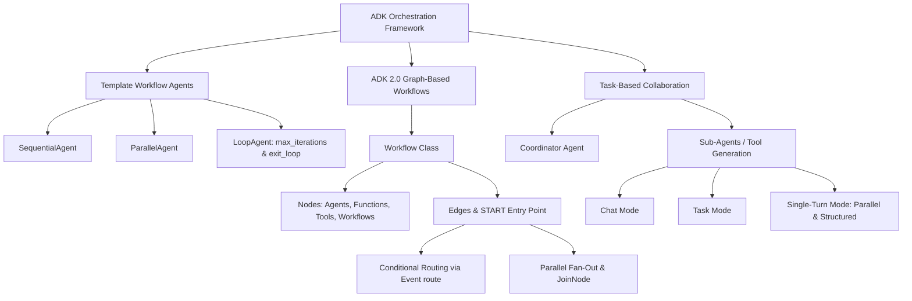

### 3. Trade-off Matrix: Deterministic Workflows vs. Dynamic Agent Collaboration

When designing multi-agent architecture in ADK, developers choose between structured deterministic pipelines and dynamic model-driven collaboration:

| Dimension | Template / Graph Workflows (Deterministic) | Task-Based Collaboration (Dynamic / Model-Driven) |
| --- | --- | --- |
| Routing Control | Explicit & Rigid: Controlled entirely by code definitions, edge maps, or router functions. | Flexible & Autonomous: The coordinator LLM decides which specialist tool to call based on the user prompt. |
| Testability & Predictability | High: Execution paths are fixed, making debugging and unit testing straightforward. | Variable: Dependent on model reasoning accuracy and prompt engineering for correct routing. |
| Parallel Execution | Native: Handled cleanly via ParallelAgent or parallel workflow edges into a JoinNode. | Restricted: Limited exclusively to single_turn sub-agents called in the same turn. |
| Best Used For | Well-defined pipelines (e.g., ETL, multi-step classification, rigid multi-stage forms). | Open-ended assistance requiring adaptive intent interpretation and dynamic task delegation. |

### 4. Architecture & Workflow Diagrams (Visualized via Mermaid)

### Diagram A: Multi-Category Graph Routing Flow

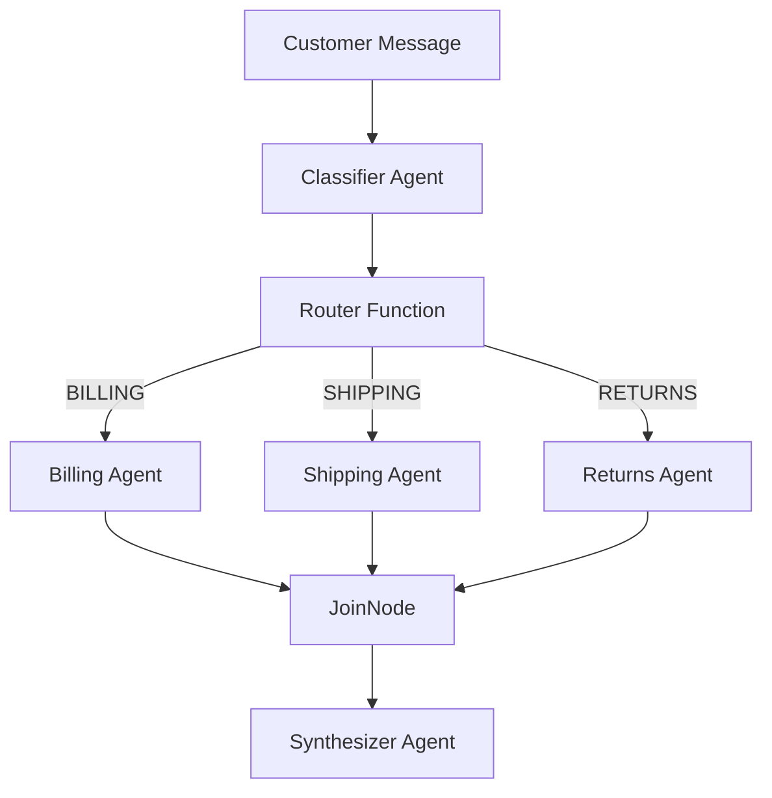

Key Takeaways:

Classifier Integration: The classifier uses an output_schema=str to categorize requests.

Parallel Fan-Out: When a query spans multiple categories, the router triggers all matching specialist agents concurrently without route strings.

Convergence: The JoinNode cleanly aggregates the concurrent branches before final synthesis.

### Diagram B: Task-Based Delegation & Mode Execution

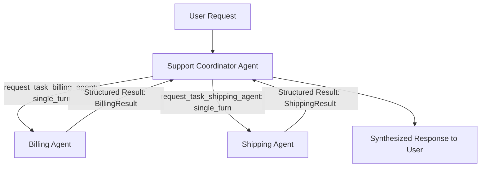

Key Takeaways:

Dynamic Tool Generation: ADK automatically creates request tools (e.g., request_task_billing_agent) for each sub-agent.

Parallel Single-Turn Execution: Single-turn agents run concurrently in the same turn because they operate autonomously without user interaction.

Context Isolation: Specialists operate with full bidirectionally isolated context; the coordinator sees only the structured response and tool-call record, protecting internal reasoning.

summarize the key takeaways and definitions of this entire page. I want definitions and concepts with an example and a simple elevator speech definition in a table. All concepts related must be linked via a a graph. If trade offs are presented give it in a matrix or magic quadrant. Cover every single concept mentioned in this page. 
Here is the comprehensive architectural summary, concept definitions, comparison matrix, and structural diagram covering every single concept from the Grounding and enterprise data integration page.

### 1. Key Concepts, Definitions & Examples

| Concept / Component | Definition | Simple Elevator Speech Definition | Concrete Example |
| --- | --- | --- | --- |
| Grounding | Anchoring every agent response to content retrieved at query time from a verified source you control. | "Preventing hallucinations by forcing agents to look up real facts." | Forcing a research agent to cite source URLs from google_search. |
| google_search Tool | A built-in ADK tool connecting the agent to the live public web for current events and external pricing. | "The tool that connects agents to the live internet." | Fetching up-to-date public stock prices or news updates. |
| VertexAiSearchTool | A built-in ADK tool connecting the agent to a private Vertex AI Search datastore of indexed internal documents. | "Searching your company’s internal wikis and policy files." | Querying HR policy manuals securely using VertexAiSearchTool(data_store_id=...). |
| Knowledge Routing | Directing user queries by intent to the correct underlying retrieval store or tool. | "Sending the right question to the right library." | Routing billing questions to SQL and policy questions to enterprise search. |
| Structured Data | Databases, CRM records, and transactional stores providing precise figures and counts ("what"). | "Rigid systems of record with rows and columns." | Querying BigQuery tables for order fulfillment status. |
| Unstructured Data | PDFs, policy documents, and wikis providing the context and rationale behind numbers ("why"). | "Free-form text documents and guides." | Reading a product return policy PDF. |
| Schema Hallucination | A failure mode where an LLM generates SQL queries referencing columns or tables that do not exist. | "Making up fake database columns." | Generating a query for customer_id when the actual column is client_key. |
| Semantic Drift | An unstructured retrieval failure where retrieved text passages are topically close but irrelevant. | "Pulling documents that sound related but miss the point." | Retrieving a generic shipping guide instead of the specific fragile-item policy. |
| Model Context Protocol (MCP) | An open standard allowing agents to consume tools hosted by external servers without custom client code. | "The universal adapter for external tools and databases." | Connecting to a remote filesystem or external vector DB via MCP. |
| McpToolset | An ADK connection component that discovers external MCP servers, converts tools, and proxies calls. | "The bridge between ADK and an external MCP server." | Wrapping the @modelcontextprotocol/server-filesystem server. |
| Tool Filtering (tool_filter) | A least-privilege security control exposing only the specific operations an agent needs from an MCP server. | "Restricting an agent to only the tools it's allowed to use." | Setting tool_filter=["list_directory", "read_file"]. |
| Connection Parameters | Setup configurations (StdioConnectionParams vs. StreamableHTTPConnectionParams) for local or remote MCP servers. | "Choosing how your agent talks to an MCP server." | Using standard input/output (Stdio) for local dev and HTTP streams for production. |

### 2. Comprehensive Concept Graph

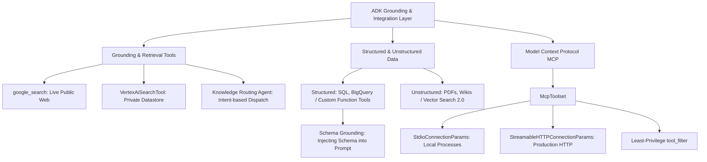

### 3. Trade-off Matrix: Custom Function Tools vs. MCP Integrations

When extending an ADK system to connect with external data stores or specialized services, developers choose between writing custom function tools or leveraging MCP servers:

| Dimension | Custom Function Tools (Python Code) | Model Context Protocol (MCP) Integration |
| --- | --- | --- |
| Control & Customization | Full Control: Direct access to execution paths, custom error handling, and authorization checks (ToolContext). | Delegated: Relies on the external server implementation; limited customization of the remote tool logic. |
| Implementation Effort | Higher Code Overhead: Requires writing boilerplate database connection code, schemas, and wrappers. | Rapid Reuse: Instantly reuses existing, standardized MCP-compliant servers without custom client code. |
| Ecosystem & Portability | Tightly Coupled: Specific to your codebase and internal SDK implementations. | Standardized: Open protocol compatible with external systems (e.g., Pinecone, Spanner, MongoDB via MCP). |
| Best Used For | Core enterprise databases (BigQuery, transactional SQL) requiring rigorous security and custom error states. | Connecting to third-party services, standard filesystems, or external vector databases with existing MCP servers. |

### 4. Architecture & Knowledge Routing Flow Diagram

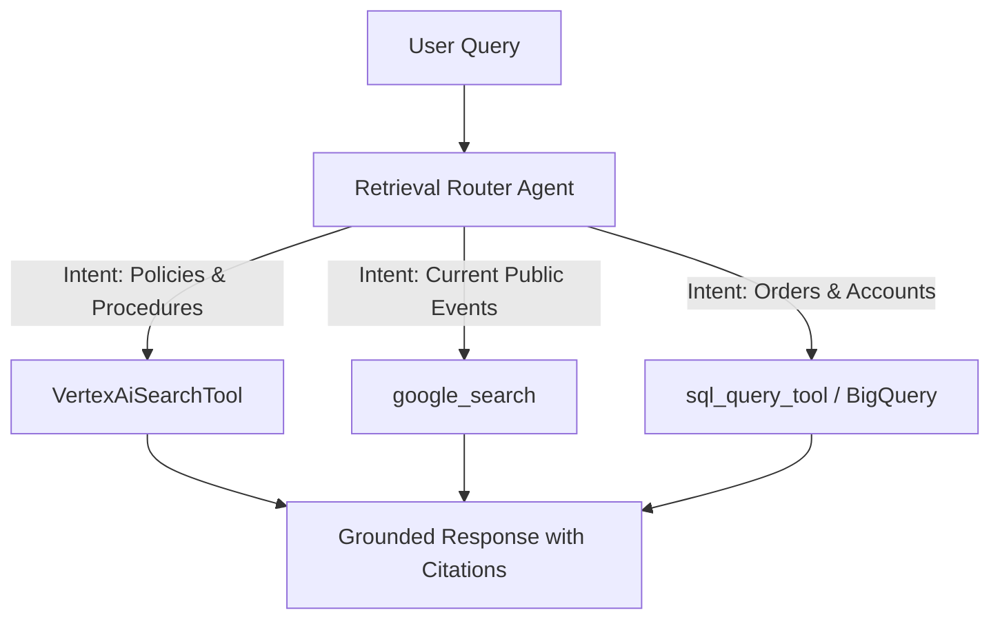

Key Takeaways from the Flow Diagram:
Intent-Based Dispatch: A dedicated routing agent examines the prompt's intent rather than letting the base model guess blindly.

Specialized Paths: Each knowledge store (public web, private enterprise docs, transactional SQL) remains independent, tunable, and separately audited.

Traceable Grounding: Every factual assertion feeds back through verifiable source metadata or citations.

summarize the key takeaways and definitions of this entire page. I want definitions and concepts with an example and a simple elevator speech definition in a table. All concepts related must be linked via a a graph. If trade offs are presented give it in a matrix or magic quadrant. Cover every single concept mentioned in this page. 
Here is the comprehensive architectural summary, concept definitions, comparison matrix, and structural diagrams covering every single concept from the Deploying agents to Gemini Enterprise page.

### 1. Key Concepts, Definitions & Examples

| Concept / Component | Definition | Simple Elevator Speech Definition | Concrete Example |
| --- | --- | --- | --- |
| Gemini Enterprise Agent Platform | Google Cloud's managed platform for building, deploying, governing, and optimizing AI agents. | "The all-in-one cloud platform for enterprise agent lifecycle management." | Consolidating Vertex AI, Agent Builder, and Agent Engine. |
| Agent Runtime | The fully managed service (formerly Agent Engine) hosting deployed agents, handling scaling, concurrency, and sessions. | "The serverless engine that keeps your agents running reliably at scale." | Hosting an order support agent behind a scalable reasoningEngine resource. |
| Agent Registry | A centralized catalog within the platform's Govern pillar tracking approved agents, tools, and MCP servers. | "The corporate directory of verified AI assets." | Discovering approved financial tool definitions across an organization. |
| Gemini Enterprise | The end-user web application where employees interactively invoke deployed and shared AI agents. | "The chat interface where everyday users access custom agents." | Open-ended querying of the order support agent inside a corporate chat portal. |
| reasoningEngine Resource | The deployable cloud unit representing a hosted ADK agent and its sub-agent tree. | "The packaged cloud artifact of your multi-agent system." | projects/PROJECT_ID/locations/LOCATION/reasoningEngines/123456. |
| ADK CLI | A standard command-line tool (adk deploy agent_engine) for direct agent deployment with explicit configuration control. | "The direct command line path to deploy agent code." | Running adk deploy agent_engine --project=$ID support_agent. |
| Agents CLI | A scaffolded deployment tool providing pre-configured environments with CI/CD and Terraform integration. | "Production-ready scaffolding with automated pipelines." | Provisioning enterprise-grade infrastructure via Infrastructure-as-Code. |
| Vertex AI SDK (client.agent_engines.create) | The programmatic Python API underlying all deployment paths, allowing custom source and configuration specs. | "The programmatic API to fine-tune deployment behavior." | Passing an in-memory agent object or custom CPU limits programmatically. |
| Discovery Engine API | The foundational search and indexing API powering Gemini Enterprise apps and agent registration. | "The search and discovery backbone of Gemini Enterprise." | Enabling underlying data connectors and application routing. |
| Workforce Identity Federation | An external identity management model used within the sharing controls to grant broad user access. | "Linking external corporate identities to enterprise agents." | Granting access to contractor pools via external identity providers. |

### 2. Comprehensive Concept Graph

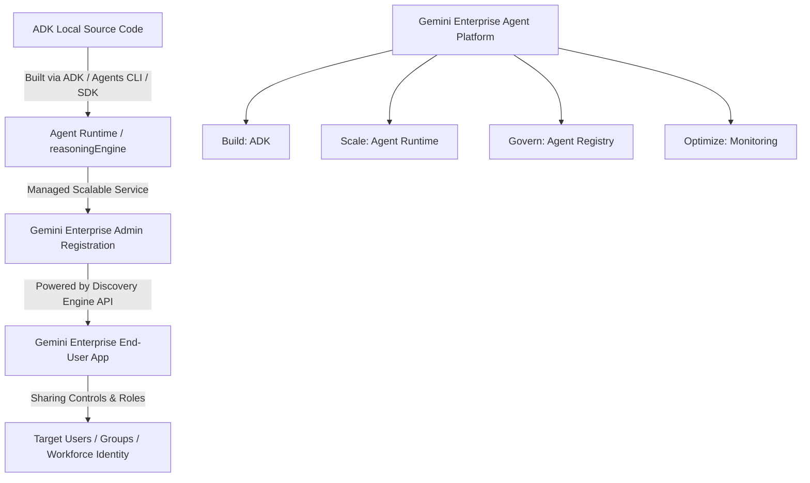

### 3. Trade-off Matrix: Deployment Tools & Sources

When moving an ADK agent from local development to production on Agent Runtime, developers choose between CLI workflows and programmatic SDK calls:

| Dimension | ADK CLI (adk deploy) | Agents CLI | Vertex AI SDK (client.agent_engines.create) |
| --- | --- | --- | --- |
| Setup Overhead | Low: Quickest path if you have an authenticated gcloud session and local agent folder. | Medium: Sets up project structure, CI/CD, and Terraform infrastructure automatically. | High: Requires writing custom Python orchestration scripts to manage deployment calls. |
| Control & Customization | Direct: Good control over display names, regions, and arguments via command flags. | Standardized: Best for teams adopting uniform company-wide deployment pipelines. | Maximum: Granular control over instance bounds, memory limits, containers, and repositories. |
| Best Used For | Rapid iteration, local-to-cloud testing, and straightforward developer deployments. | Standardized production setups requiring CI/CD automation and infrastructure-as-code. | Notebook development, advanced container tuning, or custom deployment pipelines. |

### 4. End-to-End Deployment Flow Diagram

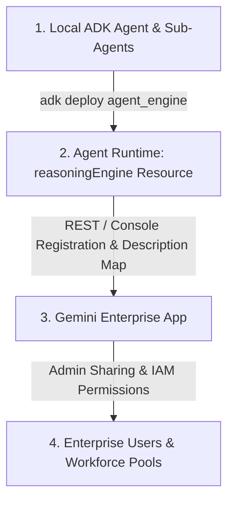

Key Takeaways from the Flow Diagram:
Multi-Agent Packaging: An entire coordinator and its sub-agent tree deploy together as a single unified reasoningEngine resource.

Description-Driven Routing: During registration, the agent's description is critical because Gemini Enterprise's meta-model reads it to decide when to route user prompts to that agent.

Granular Access Control: Once registered, sharing permissions determine whether an agent is exposed to individual emails, workforce pools, or the entire organization.

answer the following question: When deploying a multi-agent system to Agent Runtime using the ADK CLI or Agents CLI, what specific resource is created that serves as the deployable unit?
A reasoningEngine resource
A JoinNode container
A sequential sub-agent cluster
A ToolContext object
The correct answer is:

A reasoningEngine resource

When deploying an ADK multi-agent system to Agent Runtime via the ADK CLI or Agents CLI, the framework packages the entire agent graph and its configuration into a managed cloud unit known as a reasoningEngine resource.

answer the following question: When defining a tool schema for a Python function, which component serves as the model's primary guide for deciding when and why to invoke the tool?
The output_schema parameter.
The ToolContext parameter.
The function's name.
The function's docstring.
The correct answer is:

The function's docstring.

When building tool schemas in ADK, the underlying LLM relies primarily on the function's docstring and type hints to understand the purpose of the tool, what inputs it expects, and why or when it should be invoked.

answer the following question: Within the Gemini Enterprise Agent Platform ecosystem, which specific pillars encompass the Agent Development Kit (ADK) and the managed Agent Runtime service, respectively?
Optimize and Scale
Build and Govern
Build and Scale
Govern and Optimize
The correct answer is:

Build and Scale

Within the Gemini Enterprise Agent Platform ecosystem, the Agent Development Kit (ADK) corresponds to the Build pillar (for creating and authoring agent logic and multi-agent systems), while the managed Agent Runtime service corresponds to the Scale pillar (for hosting, managing, and scaling deployed agent workloads).

answer the following question: Which tool connects an agent directly to external servers implementing an open standard for accessing capabilities?
google_search
VertexAiSearchTool
JoinNode
McpToolset
The correct answer is:

McpToolset

The McpToolset in ADK is specifically designed to connect an agent directly to external Model Context Protocol (MCP) servers implementing open standards for securely sharing tools and capabilities.

what is the correct answer to this question: How do plugin callbacks behave in relation to agent-level callbacks within the ADK lifecycle?
Plugin callbacks execute concurrently with agent-level callbacks.
Plugin callbacks are triggered only if an agent-level callback returns an error.
Plugin callbacks execute before the corresponding agent-level callbacks.
The correct answer is:

Plugin callbacks execute before the corresponding agent-level callbacks.

Explanation:
Within the ADK execution lifecycle, runner-level plugins act as global interceptors and execute before local agent-level callbacks, giving plugins the ability to monitor, modify context, or short-circuit execution prior to individual agent handlers.

answer the following question: During the process of registering a deployed agent in the Gemini Enterprise web application, why is the description parameter critical?
It automatically generates the required authentication permissions for Workforce Identity Federation.
It defines the explicit REST endpoint path for the reasoningEngine resource.
It creates the schema that prevents structured data retrieval from hallucinating database columns.
The platform's model reads the description to decide when to route user requests to the agent.
The correct answer is:

The platform's model reads the description to decide when to route user requests to the agent.

Explanation:
When an agent is registered in Gemini Enterprise, its description is used by the platform's routing model as metadata to understand the agent's capabilities, allowing it to intelligently direct relevant user prompts and tasks to the correct deployed agent.

answer the following question: Which of the following defines the primary mechanism for an agent to consult external, verified sources instead of relying on its parametric memory?
Grounding
Callbacks
Sequential orchestration
ToolContext
The correct answer is:

Grounding

Explanation:
Grounding anchors an agent's responses to external, verified retrieval sources (such as google_search or private datastores accessed via VertexAiSearchTool), preventing it from relying solely on its internal parametric memory and reducing hallucinations.

answer the following question: When setting up task-based collaboration, which delegation mode is best suited for scenarios requiring structured results from specialists without any user interaction?
task
chat
fan-out
single_turn
The correct answer is:

single_turn

Explanation:
In task-based collaboration within ADK, the single_turn delegation mode is designed for fully autonomous sub-agent execution where the specialist completes the task in a single turn without any interactive user conversation and returns a structured result (such as a typed Pydantic object or data schema) to the coordinator.

answer the following question: What is the purpose of the output_key parameter when configuring an agent?
It assigns a unique string identifier to the agent for routing purposes.
It instructs ADK to write the agent's final text response into session state under a specified key.
It enforces a structured JSON output format for the agent's responses.
It defines the condition under which a LoopAgent will terminate.
The correct answer is:

It instructs ADK to write the agent's final text response into session state under a specified key.

Explanation:
In ADK, the output_key parameter enables declarative inter-agent communication and state persistence by automatically saving an agent's final text response directly into the session state under the designated key name. This allows downstream agents or subsequent workflow steps to easily retrieve and reference that output without custom extraction code.

answer the following question: In ADK 2.0 graph workflows, how is conditional routing primarily implemented?
A router function returns an Event object containing a specific route string.
A ParallelAgent is configured with a list of sub-agents and a routing condition.
The agent modifies the tool_context.actions.transfer_to_agent property.
A node returns a plain value without an Event wrapper.
The correct answer is:

A router function returns an Event object containing a specific route string.

Explanation:
In ADK 2.0 graph workflows, conditional routing is implemented by using a router function that evaluates node state or inputs and returns an Event object containing a specific route string, which the workflow engine then uses to determine the next destination node in the graph.
