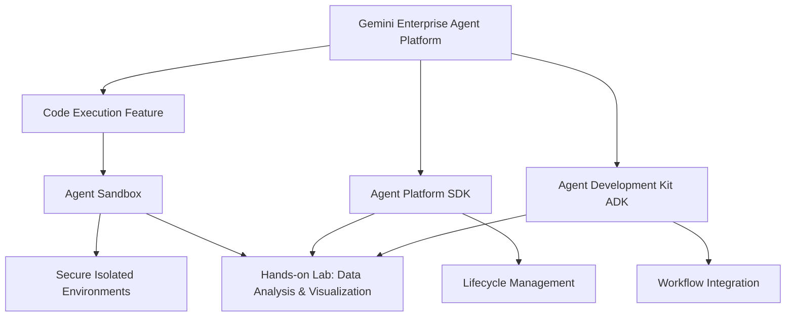
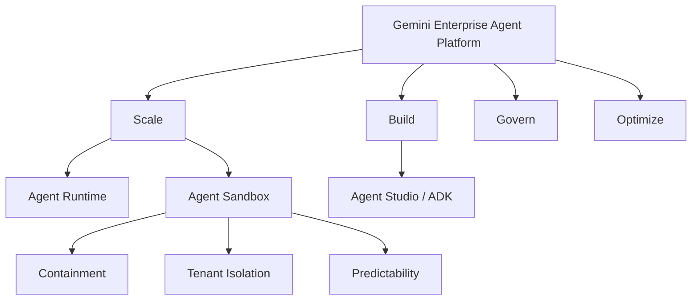
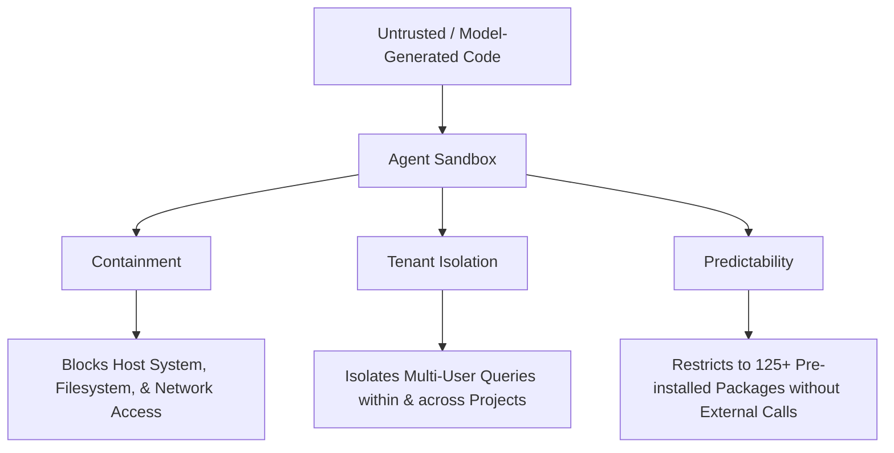
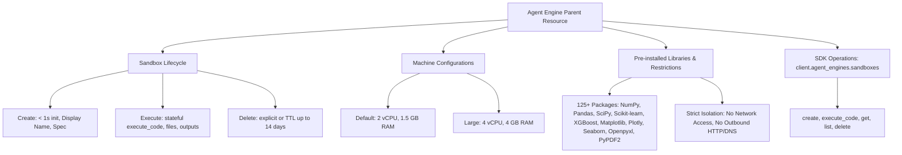
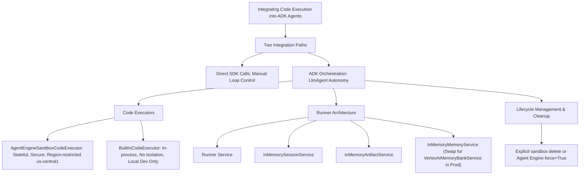

# Architecture Best Practice: Build Enterprise Agents with Code Execution on Gemini Enterprise Agent Platform

**Topics:** #code-execution #agent-sandbox #gemini-enterprise #google-adk #agent-security #stateful-sandbox #data-analysis #google-cloud

> **Source:** `build_enterprise_agents_with_code_execution_on_gemini_enterprise_agent_platform.md` · **Corpus:** `GEAPL200` (Unified L200 + L300 Open Knowledge Format v0.2 · Version `GEAPL200_2026-09-30_124746`) · **Target:** GCP Knowledge Catalog (Dataplex) & Antigravity Agentic AI Development

---

## FDE Project Grading Rubric Enforcement & Prevailing Customer Alignment

> **Mandatory Governance Standard:** Every project, prototype, or production agent built using the patterns in this concept **must pass the [Google Cloud FDE Field-Readiness & Project Grading Rubric](/concepts/00-fde-field-readiness-and-grading-rubric.md)** (aligned with the [Cloud FDE Team Charter](https://g3doc.corp.google.com/company/teams/cloud-fde/index.md?cl=head)). Scoring Requirement: **Average >= `2.0 (Competent)`** across both **Part A (Presentation & Advisory Rigor)** and **Part B (Engineering & Implementation Excellence)**, with **zero `0 (Not Demonstrated)` scores** on any single metric.

### 1. Part A — Presentation & Advisory Rigor Enforcement for This Concept

- **A.1 Strategic Delivery & Value Articulation:** Justify offloading complex financial math, tabular data analysis, and charting from probabilistic LLM token prediction to deterministic **Agent Sandbox** Code Execution.
- **A.2 Objection Handling & Technical Defense:** Defend the security isolation of dynamic code execution using kernel/container sandboxing, zero internet egress, and strict TTL reaping.

### 2. Part B — Engineering & Implementation Excellence Cutlines for This Concept

- **B.1.1 Agentic & Multi-Agent Systems:** Integrate the Gemini Enterprise Agent Platform SDK `AgentSandbox` with ADK agents for stateful multi-turn Python data analysis.
- **B.3.2 Infrastructure & Network Security:** Execute all model-generated code inside isolated sandboxes (never in-process `exec()`), enforcing CPU/memory ceilings and zero ambient credential access.
- **B.5.2 Resource Efficiency:** Configure explicit `sandbox_ttl` and session-end teardown hooks to eliminate zombie compute costs.

### 3. Prevailing Customer Best-Practice Exemplars to Cite in Panel Reviews

- **Grounded Enterprise Scenarios:** Enterprise Financial & Operational Data Analyst Agent executing deterministic Pandas/Matplotlib transformations over uploaded CSVs inside a session-scoped `AgentSandbox`.
- **Cross-Reference:** See [Concept 00 — FDE Field-Readiness & Project Grading Rubric](/concepts/00-fde-field-readiness-and-grading-rubric.md) for the complete 0–3 grading scale, 31-competency matrix, and disqualifier remediation rules.

---
## Architectural Best Practice: Key Guidelines & Takeaways

### Core Architectural Principles

- **Offload math, tabular data transformation, and algorithmic logic from LLM token prediction to deterministic Code Execution.** LLMs are probabilistic reasoners; equipping them with an isolated Python execution environment eliminates arithmetic hallucination and enables verifiable data analysis.
- **Never execute model-generated code in the host agent runtime process.** All dynamic code generated by an agent must run inside a hardened, ephemeral **Agent Sandbox** with strict kernel, filesystem, and network isolation.
- **Decouple the Agent Orchestration Lifecycle from the Sandbox Execution Lifecycle.** Use the Agent Platform SDK to provision, configure, and tear down sandboxes with explicit TTLs (`sandbox_ttl`) and resource ceilings.
- **Use stateful sandbox sessions selectively for iterative multi-turn data exploration.** Maintain in-memory DataFrames and generated chart artifacts across turns within a single user session while guaranteeing zero cross-tenant state bleed.
- **Enforce strict egress and dependency controls inside the code execution environment.** Default to zero internet egress inside the sandbox; pre-install vetted scientific/data libraries (`pandas`, `numpy`, `matplotlib`, `scikit-learn`) in the sandbox image.

### Mandatory Requirements & Golden Rules (Antigravity & Production Readiness)

- **Always execute dynamic code inside `AgentSandbox` / Vertex AI Code Execution rather than local `exec()` or `subprocess` calls.**
- **Configure explicit CPU, memory, and execution timeout limits on every sandbox invocation** to prevent runaway loops or resource exhaustion attacks (Denial of Wallet / DoS).
- **Sanitize and validate all file inputs uploaded into the sandbox and scan generated output artifacts** before rendering them to the end user or passing them to downstream tools.
- **Bind sandbox instances to a single `session_id` and destroy or recycle the sandbox upon session termination.**
- **Log both the generated source code and the sandbox `stdout`/`stderr`/exit code in OpenTelemetry `tool.execute` spans** for full auditability and trajectory debugging.

### Anti-Patterns & Guardrails

- **In-Process `eval()` / `exec()`:** Running LLM-generated Python directly inside the ADK container where ambient service account credentials and VPC network routes are exposed.
- **Unbounded Sandbox Lifetimes:** Provisioning persistent sandboxes without idle timeouts or TTL reaping, inflating compute costs and increasing the window for state contamination.
- **Passing Raw Database Credentials into Sandbox Code:** Injecting production DB connection strings into generated Python scripts instead of fetching filtered datasets via a governed ADK tool and passing only the resulting CSV/JSON into the sandbox.

### Cross-Concept Links (OKF Knowledge Graph)

- [Google Cloud FDE Field-Readiness & Project Grading Rubric (Mandatory Standard)](/concepts/00-fde-field-readiness-and-grading-rubric.md)
- [Build and Deploy Multi-Agent ADK Systems to Gemini Enterprise](/concepts/21-build-and-deploy-multi-agent-adk-systems.md)
- [Securing AI and Agentic Deployments with Google Cloud Model Armor](/concepts/33-model-armor-securing-ai-deployments.md)
- [Securing Enterprise Agents with Gemini Enterprise Agent Platform](/concepts/34-secure-your-agents-with-gemini-enterprise-agent-platform.md)

---

## Comprehensive Technical Breakdown & Concept Trail

## Course Introduction: Build Enterprise Agents with Code Execution on Gemini Enterprise Agent Platform

### Concept Graph & Key Ideas

### Key Concepts & Methods Matrix

| Component / Concept | Description & Function | Architectural Lens / GCP Well-Architected Context |
| --- | --- | --- |
| Agent Sandbox | Provides secure, isolated execution environments for running Python code generated by AI agents. | Security & Isolation: Protects core enterprise infrastructure from arbitrary or untrusted code execution risks. |
| Agent Platform SDK | A software development kit used to manage the full lifecycle of Code Execution sandboxes. | Operational Excellence: Streamlines configuration, provisioning, and lifecycle management through programmatic interfaces. |
| Agent Development Kit (ADK) | Framework enabling developers to build AI agents integrated with secure code execution capabilities. | Reliability & Performance: Standardizes agent workflows, ensuring stateful and reliable tool execution. |
| Data Analysis & Visualization Lab | Hands-on capstone component where agents analyze data, compute metrics, and generate visual artifacts. | Security & Usability: Demonstrates stateful sandbox data handling and secure retrieval of generated file artifacts. |

### Summary Takeaways

Infrastructure Protection: The Agent Sandbox isolates code execution to shield enterprise networks and systems from vulnerabilities.

Lifecycle Governance: The Agent Platform SDK allows precise, end-to-end operational control over sandboxed environments.

Workflow Integration: Using the Agent Development Kit (ADK), developers can build robust, stateful agents capable of running Python code, processing datasets, and outputting actionable file visualizations safely.

Are you ready to move on to the next page of the course, or would you like to explore a specific concept in more detail?

new page. If there are pictures in the page create mermaid diagram equivalents of those. 
Gemini Enterprise Agent Platform & Agent Sandbox

### Concept Graph

Architectural Capabilities Matrix

| Platform Pillar | Core Components | Enterprise Function & GCP Well-Architected Context |
| --- | --- | --- |
| Build | Agent Studio, ADK, Sub-agents, Agent Garden | Developer Experience & Agility: Provides low-code and code-first tools for authoring multi-agent workflows. |
| Scale | Agent Runtime, Agent Sandbox | Reliability & Security: Separates trusted orchestration logic from isolated, ephemeral code execution environments. |
| Govern | Compliance controls, auditability guardrails | Security & Compliance: Ensures agents adhere to strict enterprise compliance and defense standards. |
| Optimize | Continuous evaluation and feedback loops | Performance & Cost Optimization: Fine-tunes agent accuracy and resource utilization over time. |

Agent Runtime vs. Agent Sandbox Comparison

| Dimension | Agent Runtime (Trusted) | Agent Sandbox (Isolated) |
| --- | --- | --- |
| Trust Domain | Fully trusted components written and controlled by engineers. | Untrusted, model-generated or dynamically synthesized code. |
| Capabilities | Orchestration logic, tool declarations, memory access, and infrastructure connectivity. | Ephemeral execution state, restricted filesystem, no network access. |
| Risk Profile | Requires standard enterprise security review and deployment vetting. | Bounded risk; failure or edge-case exceptions are contained locally without impacting the core system. |

### Summary Takeaways

Unified Lifecycle Platform: The Gemini Enterprise Agent Platform consolidates model selection, development, scaling, and governance into a single framework.

Separation of Concerns: Agent Runtime handles orchestration logic securely, while Agent Sandbox safely executes arbitrary, model-generated Python code (such as data analysis or calculations).

Enterprise-Grade Isolation: The sandbox guarantees containment, tenant isolation, and predictability, mitigating the security risks associated with processing complex or untrusted inputs (like custom CSV files).

Are you ready to advance to the next page of the course?

why does isolation matter ? Can you give the take aways for that 
Why Isolation Matters for Enterprise Agents

Core Security Properties & GCP Well-Architected Framework Alignment

| Property | Description | GCP Well-Architected / Enterprise Lens |
| --- | --- | --- |
| Containment | Sandboxed code cannot reach host system resources, environment variables, internal services, or the external network. | Security (Defense in Defense): Limits the blast radius of unexpected or vulnerable code execution, making capabilities safe for regulated industries. |
| Tenant Isolation | Each sandbox remains strictly partitioned from other sandboxes within the same project or across different customers. | Reliability & Multi-tenancy: Prevents cross-contamination in high-concurrency, multi-user analyst environments. |
| Predictability | Execution environments are constrained to a fixed set of over 125 trusted libraries (e.g., NumPy, Pandas) with zero dynamic package installation. | Operational Excellence & Governance: Standardizes the attack surface and ensures reproducible, auditable behavior for compliance teams. |

Key Takeaways
Mitigating Model-Induced Risks: Because code is synthesized dynamically based on user prompts or external files (like customer CSVs), execution errors or edge-case anomalies are safely contained.

Defending the Attack Surface: Strict isolation guarantees that malicious or erroneous script actions cannot compromise core production systems or data.

Enterprise Compliance Readiness: Isolation provides the auditability and boundary enforcement required by security teams to deploy advanced agent capabilities safely in production.

Would you like to explore the pre-installed library list or advance to the next course topic?

I am on a new page now.
Code Execution Deep Dive: Sandboxes, State, and the SDK

### Concept Graph

### Core Concepts & SDK Operations Matrix

| Operation / Component | Description & Functionality | Architectural Lens / GCP Well-Architected Context |
| --- | --- | --- |
| Sandbox Lifecycle | Managed via three phases: Create (< 1s), Execute (execute_code with persistent state), and Delete (explicit or via 14-day TTL). | Operational Excellence: Fast provisioning and lifecycle governance reduce operational overhead and ensure resources are cleaned up. |
| State Persistence | Variables, imported libraries (import pandas as pd), and loaded data (df) persist across sequential execute_code calls within the same sandbox. | Performance & Stateful Design: Enables iterative, multi-step analytical workflows without re-transmitting or re-loading data. |
| Machine Configurations | Flexible specs ranging from the default (2 vCPU, 1.5 GB RAM) to high-headroom setups (4 vCPU, 4 GB RAM). | Cost & Performance Optimization: Matches compute resources to specific workload demands (e.g., training a scikit-learn model). |
| Security & Library Guardrails | Pre-installed suite of over 125 data science packages with zero outbound network access (no HTTP/DNS). | Security & Defense in Depth: Eliminates exfiltration risks and standardizes runtime behaviors for model-generated code. |
| SDK Namespace | Accessible through client.agent_engines.sandboxes covering create, execute_code, get, list, and delete. | Developer Experience: Clean, programmatic control surface for embedding sandboxes into enterprise agent apps. |

### Summary Takeaways

Rapid Provisioning: Sandboxes spin up in under a second and are owned by a parent Agent Engine resource container.

Incremental Statefulness: Unlike stateless serverless functions, sandbox memory persists across multiple calls, allowing clean separation between loading data, cleaning datasets, computing metrics, and generating charts.

Regulated Execution: With strict network isolation and pre-installed libraries (such as NumPy, Pandas, and Matplotlib), enterprise agents can safely run complex, model-generated data science scripts without exposing internal infrastructure.

Are you ready to move on to the next page of the course?

I am on the next page
Integrating Code Execution into Agent Workflows

### Concept Graph

Integration Approaches & Executor Comparison

| Integration Pattern / Feature | Description & Functionality | Architectural Lens / GCP Well-Architected Context |
| --- | --- | --- |
| Direct SDK Calls | Developer manages the control loop directly, deciding when to call execute_code and handling payloads. | Flexibility: Ideal for custom orchestration layers outside the Agent Development Kit (ADK). |
| ADK Orchestration (LlmAgent) | The model autonomously determines when code is needed, generates Python, executes it, and synthesizes the output. | Developer Agility: Transforms code execution into a seamless, native agentic tool capability. |
| AgentEngineSandboxCodeExecutor | Connects the agent to a managed, stateful sandbox (us-central1) with over 125 pre-installed libraries. | Security & Reliability: Provides full containerized isolation for production enterprise workloads. |
| BuiltInCodeExecutor | Executes Python in the same local process as the agent without sandbox isolation or state preservation. | Operational Simplicity: Designed specifically for rapid local prototyping and lightweight development. |

### Key Architectural Takeaways

Autonomous Execution Loop: By attaching a code executor to an LlmAgent in the ADK, the model handles the entire reasoning-to-execution cycle: deciding when code is required, passing inputs, and interpreting results.

Persistent State Across Turns: Multi-turn conversational patterns maintain execution state in the sandbox. Data loaded or computed in turn one remains accessible in subsequent turns without re-transmission.

Production Resource Governance: Enterprise applications must incorporate rigorous lifecycle cleanup (using explicit deletion or TTL timeouts) to keep cloud infrastructure costs predictable and secure.

Would you like to review sample code for setting up the ADK Runner or advance to the next section?

Answer this question: When analyzing data using the execute_code SDK operation, how does the platform deliver generated file artifacts, such as a chart PNG?
As an interactive HTML element rendered directly within the agent's internal Agent Session history.
As a single base64-encoded string embedded within the standard stdout msg_out JSON payload.
As a direct URL link to a Cloud Storage bucket where the file was automatically uploaded by the platform.
As separate Chunk objects in the response outputs list, containing the raw file bytes and a mime_type matching the file type.
The correct answer is:

As separate Chunk objects in the response outputs list, containing the raw file bytes and a mime_type matching the file type.

Explanation & Context
When you execute code that generates file artifacts (such as a chart PNG via Matplotlib or Plotly) using the execute_code SDK operation on the Gemini Enterprise Agent Platform, the platform returns the files as raw bytes encapsulated within the response payload's output chunks (Chunk objects), complete with their respective mime_type (e.g., image/png). Your code or application logic then extracts these raw bytes and writes them to local disk or handles them in memory.

Answer this question: 2.

Why is it necessary to execute model-generated Python code within the Agent Sandbox rather than the Agent Runtime?
Because the Agent Sandbox is the primary Build tool used by developers to author multi-agent workflows.
Because the Sandbox is the only environment that supports sub-second cold starts for the agent's core orchestration logic.
Because the Agent Runtime is reserved exclusively for long-term memory storage and cannot process any logic.
Because the Sandbox provides a fully isolated environment with no network access, ensuring untrusted code cannot compromise the host system or other infrastructure.
The correct answer is:

Because the Sandbox provides a fully isolated environment with no network access, ensuring untrusted code cannot compromise the host system or other infrastructure.

Explanation & Context
In the Gemini Enterprise Agent Platform, the Agent Runtime is a trusted, long-running control plane responsible for handling core agent orchestration logic, memory access, and tool coordination.

Conversely, the Agent Sandbox is an ephemeral, isolated container designed explicitly for running arbitrary, model-synthesized or user-uploaded code (such as data analysis scripts or financial models). By keeping code execution inside the sandbox—which features strict security boundaries like zero network access and pre-installed packages—the platform ensures that vulnerabilities or bugs in dynamic code cannot compromise the production host or surrounding enterprise infrastructure.

Answer this question: When integrating code execution into an enterprise multi-turn agent conversation, which ADK executor should you choose to ensure stateful, isolated execution?
BuiltInCodeExecutor.
VertexAiMemoryBankService.
AgentEngineSandboxCodeExecutor.
InMemoryArtifactService.
The correct answer is:

AgentEngineSandboxCodeExecutor.

Explanation & Context
When building multi-turn agent conversations using the Agent Development Kit (ADK) on the Gemini Enterprise Agent Platform, you use the AgentEngineSandboxCodeExecutor (configured with your SANDBOX_RESOURCE_NAME) to route model-generated code into a secure, stateful, and isolated container. This ensures that execution state (such as loaded dataframes or computed variables) persists across turns while keeping your production environment completely isolated from untrusted code.

Answer this question: When integrating Code Execution into an application, what is the primary advantage of using ADK orchestration via an LlmAgent rather than making direct SDK calls?
The ADK automatically bypasses the sandbox's network restrictions to allow the agent to safely download external Python libraries.
The LlmAgent runs the code directly within the trusted Agent Runtime, ensuring faster execution by bypassing the sandbox creation step.
The agent autonomously manages the full cycle, from receiving a prompt, generating code, executing it, and interpreting the result to answer the user.
ADK orchestration permanently saves the agent's execution state to the host system's local filesystem for long-term storage across sessions.
The correct answer is:

The agent autonomously manages the full cycle, from receiving a prompt, generating code, executing it, and interpreting the result to answer the user.

Explanation & Context
When integrating an Agent Development Kit (ADK) LlmAgent with a code executor (such as the AgentEngineSandboxCodeExecutor), you hand over control of the iterative loop to the model. Instead of writing manual orchestration logic or separate SDK calls for every turn, the agent uses its reasoning capabilities to:

Understand the user's natural-language intent.

Autonomously write and execute the required Python code inside the secure sandbox.

Inspect and interpret the stdout or file outputs (like calculated metrics or charts) to formulate a helpful, human-readable response.

Answer the following question: If you want to permanently remove an Agent Engine and immediately cascade the deletion to all sandboxes it owns, which command configuration should you use?
Call the delete method on the Agent Engine with the cascade=All parameter.
Let the 14-day TTL expire, which automatically deletes the Agent Engine and its child sandboxes.
Call the delete method on the Agent Engine with the force=True parameter.
Use the get operation to individually list and remove each sandbox before deleting the engine.
The correct answer is:

Call the delete method on the Agent Engine with the force=True parameter.

Explanation & Context
When deleting parent resources like an Agent Engine that still contain active child resources (such as a Code Execution sandbox), the platform normally prevents deletion to avoid accidental orphaned workloads or data loss. Passing force=True (e.g., agent_engine.delete(force=True)) instructs the platform to intentionally and immediately cascade the deletion to all child sandboxes, cleaning up all associated cloud infrastructure and stopping any ongoing resource charges.

Answer the following question: What happens to variables and imported data when making multiple consecutive execute_code calls within the same sandbox?
They are automatically cleared after each call, requiring you to reload the data for every new computation.
They are permanently deleted unless you explicitly save them to a connected external cloud storage bucket.
They persist in the sandbox's memory, allowing subsequent code executions to build upon previously loaded data and computations.
They are transferred to the Agent Memory Bank for long-term storage across entirely different sandbox sessions.
The correct answer is:

They persist in the sandbox's memory, allowing subsequent code executions to build upon previously loaded data and computations.

Explanation & Context
Within a Code Execution sandbox on the Gemini Enterprise Agent Platform, state is fully preserved across multiple sequential execute_code calls in the same session. This means variables, custom functions, imported libraries (such as pandas or matplotlib), and loaded DataFrames (like df) remain available in memory, allowing you to build multi-step analytical pipelines without needing to re-upload data or re-run setup code on every step.

Answer the following question: Which property of the Agent Sandbox guarantees that executing code cannot reach out to external services or download unauthorized packages?
Orchestration, which delegates the execution loop to the managed LlmAgent rather than the underlying infrastructure.
Predictability, which ensures the sandbox automatically deletes itself after a fixed time interval.
Containment, which enforces strict network isolation and prevents code from reaching the host system's resources or internet.
Tenant isolation, which separates sandboxes belonging to different customers in the same project.
The correct answer is:

Containment, which enforces strict network isolation and prevents code from reaching the host system's resources or internet.

Explanation & Context
Within the Gemini Enterprise Agent Platform, Containment is the core security property of the Agent Sandbox that establishes rigid boundaries. By enforcing strict network isolation (disallowing outbound HTTP or DNS requests) and blocking access to the underlying host filesystem or internal services, containment ensures that arbitrary or untrusted model-generated code cannot compromise production infrastructure.

How does the time-to-live (TTL) behavior function during the lifecycle of a Code Execution sandbox?
The TTL is permanently fixed at creation and cannot be extended, requiring a new sandbox every 60 minutes.
The TTL must be manually extended using the get SDK operation after every successful code execution.
The TTL resets automatically every time an execute_code call is made, keeping the active sandbox alive for up to 14 days.
The TTL immediately expires the sandbox as soon as the first Python script successfully completes its execution.
The correct answer is:

The TTL resets automatically every time an execute_code call is made, keeping the active sandbox alive for up to 14 days.

Explanation & Context
During the lifecycle of a Code Execution sandbox on the Gemini Enterprise Agent Platform, sandboxes are designed with an automated time-to-live (TTL) mechanism. Each time you invoke an execute_code call, the TTL timer resets, allowing active analytical sessions or multi-turn agent interactions to stay alive for up to 14 days without requiring you to manually recreate or extend the environment.
