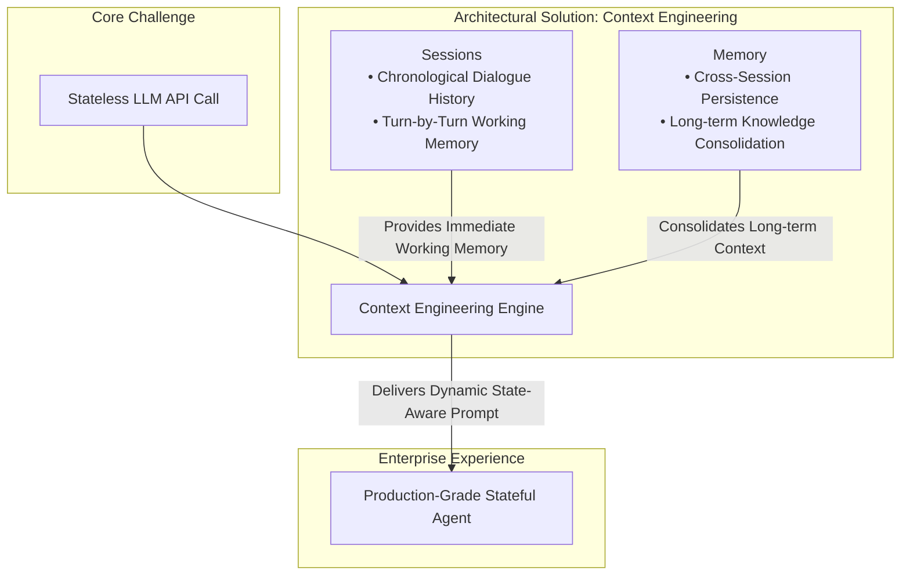
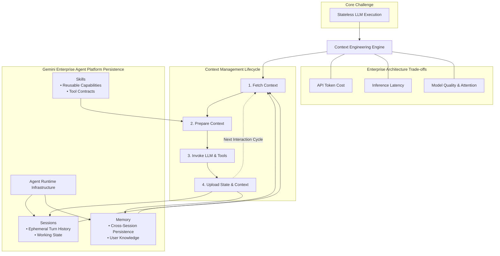
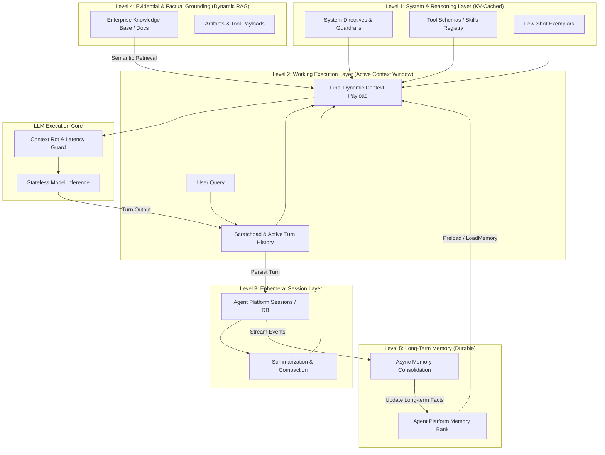
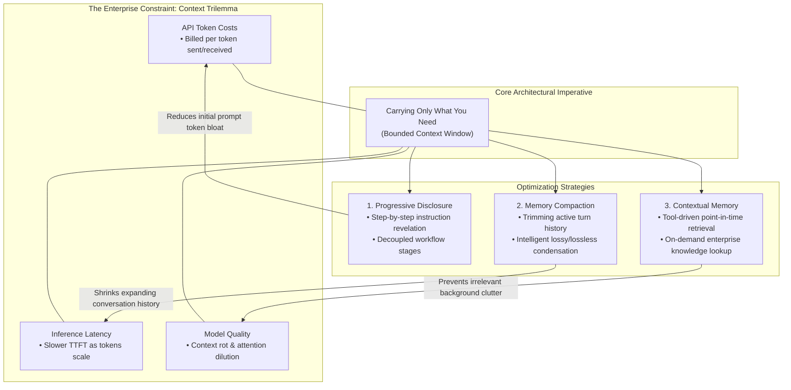
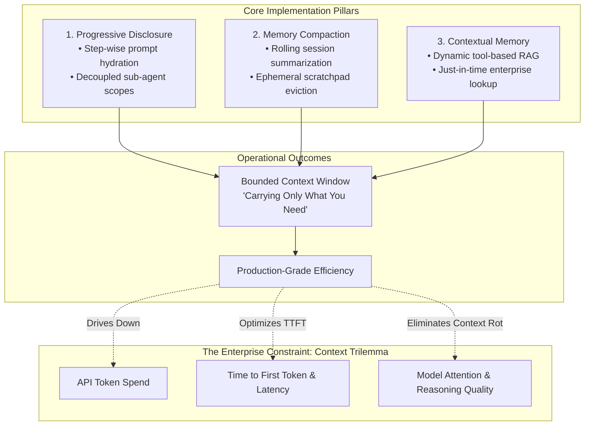
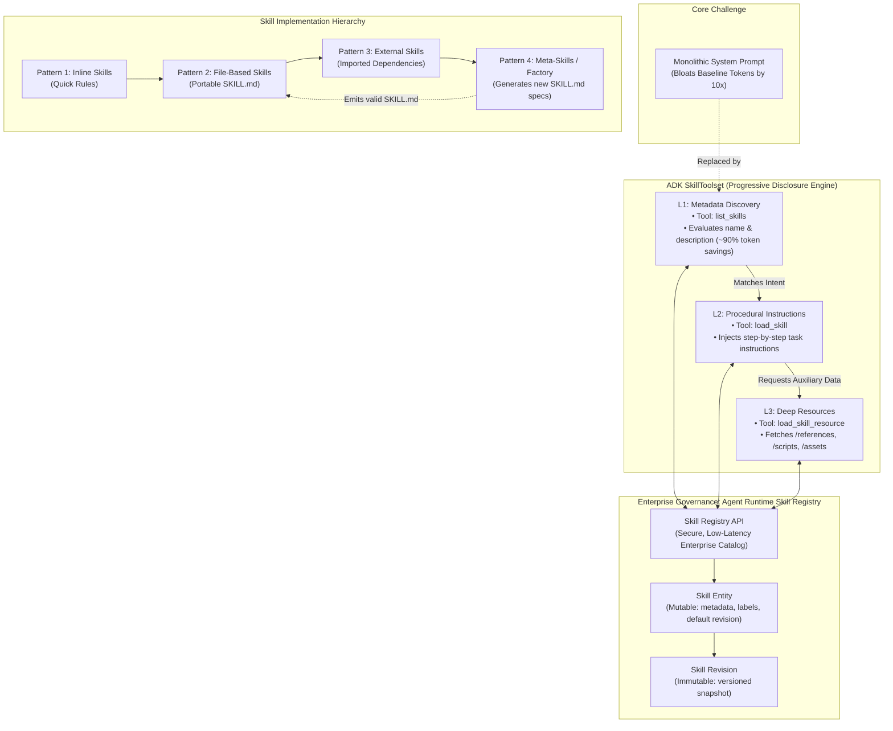
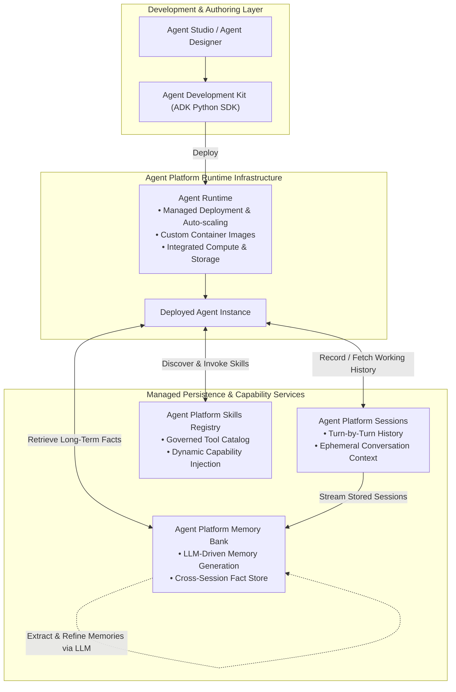

# Architecture Best Practice: Agent Context Persistence, Sessions, and Memory Engineering

**Topics:** #context-engineering #session-management #agent-memory #memory-bank #google-adk #stateful-agents #context-window-optimization #google-cloud

> **Source:** `agent_context_persistence_and_memories.md` · **Corpus:** `GEAPL200` (Unified L200 + L300 Open Knowledge Format v0.2 · Version `GEAPL200_2026-09-30_124746`) · **Target:** GCP Knowledge Catalog (Dataplex) & Antigravity Agentic AI Development

---


## FDE Project Grading Rubric Enforcement & Prevailing Customer Alignment

> **Mandatory Governance Standard:** Every project, prototype, or production agent built using the patterns in this concept **must pass the [Google Cloud FDE Field-Readiness & Project Grading Rubric](/concepts/00-fde-field-readiness-and-grading-rubric.md)** (aligned with the [Cloud FDE Team Charter](https://g3doc.corp.google.com/company/teams/cloud-fde/index.md?cl=head)). Scoring Requirement: **Average >= `2.0 (Competent)`** across both **Part A (Presentation & Advisory Rigor)** and **Part B (Engineering & Implementation Excellence)**, with **zero `0 (Not Demonstrated)` scores** on any single metric.

### 1. Part A — Presentation & Advisory Rigor Enforcement for This Concept

- **A.1 Strategic Delivery & Value Articulation:** Articulate how the three-pillar Agent Platform persistence stack (**Sessions**, **Memory Bank**, and **Skills Registry**) solves LLM statelessness at enterprise scale.
- **A.2 Objection Handling & Technical Defense:** Explain how Level 1–3 context hierarchy engineering and prefix KV-caching prevent context rot and runaway token bills.

### 2. Part B — Engineering & Implementation Excellence Cutlines for This Concept

- **B.1.1 Agentic & Multi-Agent Systems:** Architect clean separation between short-term turn history (`Sessions`), long-term user knowledge (`Memory Bank`), and reusable capabilities (`Skills Registry`).
- **B.5.3 AI Cost Management:** Leverage Vertex AI Context Caching for Level 1 static system/skill directives and prune raw tool outputs before appending to session history.
- **B.3.3 Data Protection & Privacy:** Enforce tenant isolation and DLP sanitization before persisting facts to long-term memory.

### 3. Prevailing Customer Best-Practice Exemplars to Cite in Panel Reviews

- **Grounded Enterprise Scenarios:** Enterprise Customer Advisor combining Level 1 cached Skill Registry schemas, Level 2 Memory Bank user preferences, and Level 3 sliding-window session history.
- **Cross-Reference:** See [Concept 00 — FDE Field-Readiness & Project Grading Rubric](/concepts/00-fde-field-readiness-and-grading-rubric.md) for the complete 0–3 grading scale, 31-competency matrix, and disqualifier remediation rules.

---
## Architectural Best Practice: Key Guidelines & Takeaways

### Core Architectural Principles

- **Context Engineering replaces static prompt engineering in stateful enterprise agents.** Because LLMs are inherently stateless per API call, the runtime must dynamically assemble a curated, high-signal context payload on every turn from instructions, active session events, structured state, and retrieved long-term memories.
- **Separate Short-Term Working Memory (`Sessions`) from Long-Term Cross-Session Knowledge (`Memory`).** Sessions capture the chronological turn-by-turn event log and scratchpad state (`session.state`) of a single conversation; Memory extracts, consolidates, and persists durable user facts, preferences, and episodic takeaways across sessions.
- **More context is not better context — combat Context Rot and attention dilution.** Appending raw tool payloads and unbounded multi-turn transcripts degrades reasoning recall ('lost in the middle') and causes quadratic token cost growth across multi-hop trajectories.
- **Use scoped prefixes (`app:`, `user:`, `temp:`) in ADK state keys to control persistence lifecycles.** Explicitly distinguish turn-ephemeral scratchpad variables (`temp:`) from session-scoped state and user-scoped persistent attributes (`user:`).
- **Perform asynchronous memory extraction and consolidation off the critical user-facing latency path.** Use managed Vertex AI Memory Bank background consolidation to distill raw conversational turns into deduplicated, conflict-resolved semantic facts.

### Mandatory Requirements & Golden Rules (Antigravity & Production Readiness)

- **Never dump raw, unpruned API or database responses directly into the conversational event history.** Summarize or extract only the required fields in the tool wrapper, or store large payloads in external artifact storage and pass a reference handle.
- **Use `InMemorySessionService` strictly for local unit testing; mandate `VertexAiSessionService` (or Cloud Spanner/AlloyDB-backed session services) for all staging and production deployments.**
- **Implement sliding-window compaction or hierarchical summarization when session turn counts exceed threshold limits (e.g., > 15–20 turns).**
- **Retrieve long-term memories selectively via semantic similarity search (`PreloadMemoryTool` / `LoadMemoryTool`) rather than injecting the user's entire memory profile into every prompt.**
- **Enforce strict tenant and `user_id` isolation on all session and memory reads/writes** plus TTL/GDPR deletion hooks (`DeleteMemory` / `PurgeSessions`) for compliance.

### Anti-Patterns & Guardrails

- **Infinite Transcript Append:** Re-sending the entire unfiltered chat and tool-call history on every turn until hitting context window limits or P99 latency SLO breaches.
- **Confusing RAG with Agent Memory:** Treating static enterprise document retrieval (Vertex AI Search) as a substitute for dynamic, user-specific episodic and declarative memory (Memory Bank).
- **Storing Sensitive PII/Secrets in Long-Term Memory:** Allowing raw credit card numbers, passwords, or regulated health data to be consolidated into persistent memory vectors without Model Armor / Cloud DLP redaction.

### Cross-Concept Links (OKF Knowledge Graph)

- [Google Cloud FDE Field-Readiness & Project Grading Rubric (Mandatory Standard)](/concepts/00-fde-field-readiness-and-grading-rubric.md)
- [Stateful Agents with Persistent Memories and Vertex AI Memory Bank](/concepts/24-agent-with-persistent-memories-deep-dive.md)
- [Build and Deploy Multi-Agent ADK Systems to Gemini Enterprise](/concepts/21-build-and-deploy-multi-agent-adk-systems.md)
- [Cost Estimation, FinOps, and Token Optimization for Agentic Solutions](/concepts/28-cost-estimation-and-optimization-for-agentic-solutions.md)

---

## Comprehensive Technical Breakdown & Concept Trail

### Key Concepts and Principles Matrix

| Dimension / Category | Concept / Architectural Element | Concrete Description & Enterprise Implications |
| --- | --- | --- |
| Core Challenge | LLM Statelessness | • Models are inherently confined to the context window of a single API call.<br>• Requires explicit architectural patterns to supply working memory and historical context. |
| Paradigm Shift | Context Engineering | • Evolves beyond static prompt engineering by dynamically assembling state-aware prompts.<br>• Synthesizes user data, conversation history, and external knowledge on a per-turn basis. |
| Runtime State | Sessions | • Immediate container for an active conversation.<br>• Holds chronological dialogue history and turn-by-turn working memory. |
| Persistence | Memory | • Long-term persistence mechanism spanning multiple sessions.<br>• Captures and consolidates key information for continuous, personalized user experiences. |

### Concept Graph



---

### Core Concepts & Principles Matrix

| Dimension / Topic | Architectural Focus | Concrete Description & Enterprise Implications |
| --- | --- | --- |
| Foundation | LLM Statelessness | • Models process each call independently without native continuity.<br>• Requires curating history, facts, and context into a state-aware payload per turn. |
| Engineering Domain | Context Engineering | • Shifts beyond static prompt engineering to dynamic runtime data assembly.<br>• Synthesizes immediate dialogue, persistent knowledge, and relevant facts. |
| Lifecycle | Context Management | • Four continuous phases: Fetch → Prepare → Invoke (LLM / Tools) → Upload Context.<br>• Governs state synchronization between external stores and runtime execution. |
| Trade-offs | Cost vs Quality vs Latency | • Balances context window expansion against token cost and time-to-first-token (TTFT).<br>• Mitigates context pollution to preserve output quality and relevance. |
| Platform Infrastructure | Gemini Enterprise Agent Platform | • Decoupled state tiers: Sessions (ephemeral/dialogue), Memory (long-term persistence), and Skills (agent capabilities).<br>• Backed by production-grade Agent Runtime persistence infrastructure. |

### Concept Graph



Ready when you are. Navigate to the next page in your browser and type "next page".

next page cover a multi level context engineering and give me the state of the art
Multi-Level Context Engineering & SOTA Principles Matrix

| Layer / Level | Scope & Components | Concrete Mechanisms & Operational Behavior | SOTA / Enterprise Architecture Pattern |
| --- | --- | --- | --- |
| Level 1: System & Reasoning Directives (Static to Quasi-Static) | • System Prompts & Personas<br>• Tool / API OpenAPI Schemas<br>• Few-shot dynamic demonstrations<br>• Directs model constraints, guardrails, reasoning patterns, and tool-call contracts.<br>• Loaded at initialization or dynamically bound on demand.<br>• Prompt Caching: Persistent prefix KV-cache reuse in Vertex AI / Gemini.<br>• Skill Registries: Dynamic skill injection to avoid catalog bloat and tool interference. |  |  |
| Level 2: Working Memory & Immediate Execution (Turn-by-Turn Dynamic) | • Active Turn Scratchpad<br>• Conversation History<br>• Current User Prompt<br>• Manages working context for the current turn.<br>• Retains the sequence of reasoning, observations, and tool responses.<br>• Rolling Sliding Windows & Truncation.<br>• Context Rot Mitigation: Prunes scratchpad clutter and intermediate tool payloads before final synthesis. |  |  |
| Level 3: Ephemeral Dialogue Sessions (Multi-Turn Scoped) | • Session History<br>• Intermediate Task State<br>• Delegated Sub-Agent Outputs<br>• Tracks multi-turn state across an interaction boundary.<br>• Externalized from compute into managed storage.<br>• ADK DatabaseSessionService / Vertex AI Sessions.<br>• Context Compaction: Hierarchical message summarization preserving key facts while shrinking token counts. |  |  |
| Level 4: Factual & Evidential Grounding (Task & Retrieval Scoped) | • RAG Knowledge Stores<br>• Enterprise Search / BigQuery<br>• Modality Artifacts (Docs, Images)<br>• Injects dynamic, high-density facts as concrete grounding evidence.<br>• Retrieved per turn based on semantic/hybrid search.<br>• Hybrid Search & Re-ranking: BM25 + dense embeddings.<br>• Contextual Needle Routing: Selective RAG injection to prevent distracting context clutter. |  |  |
| Level 5: Long-Term Cross-Session Memory (Durable Entity Persistence) | • User Profiles & Preferences<br>• Cross-session Learnings<br>• Extracted Fact Banks<br>• Persists facts beyond conversation boundaries.<br>• Consolidates and updates entity knowledge over time.<br>• Agent Platform Memory Bank (Vertex AI).<br>• Async Memory Consolidation: Background LLM extraction into structured entity graphs. |  |  |

Multi-Level Context Engineering Concept Graph



Core State-of-the-Art (SOTA) Takeaways
The Problem of "Context Rot": Despite 1M+ token capacity, research proves model reasoning drops on ambiguous tasks, high distractor volume, and excessive needle depth. SOTA systems do not dump raw history into the window.   
sprAI & prAI

Separation of Runtime and State: Production ADK architectures decouple the agent runtime (e.g., GKE or Cloud Run) from state tiers (VertexAISessionService for sessions and VertexAiMemoryBankService for consolidated facts).

Selective Ingestion vs. Complete History: SOTA context engineering is a filtering and distillation pipeline:

Summarize & Evict intermediate tool logs from the session.

Extract & Consolidate high-value facts into long-term memory asynchronously, avoiding inference latency on active user turns.   

### Google Cloud Documentation

Cache Static Prefixes (system prompts and tool schemas) using context caching to cut TTFT and token expense.

Navigate to the next page when ready and type "next page".

next
Here is the architectural breakdown of the Define context engineering page from the Build and Deploy Agents with Agent Development Kit (ADK) course.

### Core Concepts & Architectural Matrix

| Category / Layer | Element | Concrete Architectural Specifications |
| --- | --- | --- |
| Paradigm Shift | Prompt vs Context Engineering | • Prompt Engineering: Static, handcrafted system instructions.<br>• Context Engineering: Dynamic runtime assembly of state-aware payloads combining dialogue, memory, and external systems. |
| Failure Modes | Token Economics & Context Rot | • Cost & Latency: Linear-to-quadratic scaling of cost and time-to-first-token (TTFT) as history expands.<br>• Context Rot: Model attention degradation and instruction loss caused by token saturation and distracting context. |
| Context Anatomy | 1. Reasoning Guidance | • Directives governing agent persona and boundaries (System Instructions).<br>• Execution contracts and schema signatures (Tool Definitions).<br>• In-context learning patterns (Few-Shot Examples). |
| Context Anatomy | 2. Evidential & Factual Data | • Cross-session state persistence (Long-Term Memory).<br>• Dynamic retrieval augmentations (External Knowledge / RAG).<br>• Structured execution returns (Tool & Sub-Agent Outputs).<br>• Multimodal user files and payloads (Artifacts). |
| Context Anatomy | 3. Working Context | • Chronological turn transcript (Conversation History).<br>• Ephemeral scratchpad for multi-step reasoning (State / Scratchpad).<br>• Immediate user query driving the turn (User Prompt). |
| Persistence Stack | ADK Core Abstractions | • Session: Manages turn-by-turn state and transient working history for a single conversation.<br>• Memory: Filing cabinet capturing durable facts across multiple conversations.<br>• Skills: On-demand modular capabilities and tool packages dynamically loaded into execution. |
| Enterprise Platform | Gemini Enterprise Agent Platform | • Agent Platform Sessions: Managed enterprise service for session history storage and querying.<br>• Agent Platform Memory Bank: Autonomous service generating and persisting long-term memories from interactions.<br>• Agent Platform Skills Registry: Low-latency, private, and governed catalog for enterprise skills. |

### Concept Graph

```mermaid
graph TD
    subgraph "Context Management Lifecycle"
        S1[1. Fetch Context] --> S2["2. Prepare Context<br>Prune & Summarize"]
        S2 --> S3["3. Invoke LLM & Tools"]
        S3 --> S4[4. Upload Context]
        S4 -.->|Next Turn| S1
    end

    subgraph "Context Anatomy (The Injected Payload)"
        subgraph "Reasoning Guidance"
            SI[System Instructions]
            TD[Tool Definitions]
            FS[Few-Shot Examples]
        end

        subgraph "Evidential & Factual Data"
            LTM[Long-Term Memory]
            RAG[External Knowledge / RAG]
            TO["Tool & Sub-Agent Outputs"]
            ART[Artifacts]
        end

        subgraph "Working Context"
            CH[Conversation History]
            SC[State / Scratchpad]
            UP[User Prompt]
        end
    end

    subgraph "Persistence Architecture Mapping"
        subgraph "ADK Abstraction Layer"
            ADK_SESS[Session]
            ADK_MEM[Memory]
            ADK_SKILL[Skills]
        end

        subgraph "Gemini Enterprise Agent Platform"
            AP_SESS[Agent Platform Sessions]
            AP_MEM[Agent Platform Memory Bank]
            AP_SKILL[Agent Platform Skills Registry]
        end
    end

    %% Mappings and Connections
    ADK_SESS <--> AP_SESS
    ADK_MEM <--> AP_MEM
    ADK_SKILL <--> AP_SKILL

    AP_SESS -->|Hydrates| CH
    AP_MEM -->|Hydrates| LTM
    AP_SKILL -->|Injects| TD

    SI --> S2
    TD --> S2
    FS --> S2
    LTM --> S2
    RAG --> S2
    TO --> S2
    ART --> S2
    CH --> S2
    SC --> S2
    UP --> S2

    S2 -->|Optimized Payload (Mitigates Context Rot)| S3
    S4 -->|Persist Working State| AP_SESS
    S4 -->|Consolidate Facts| AP_MEM
```

Navigate to the next page when you are ready to review the next topic

next 
Here is the architectural breakdown of the Evaluate the cost implications of agent context page from the Google Skills course.

### Core Concepts & Cost Optimization Matrix

| Optimization Vector | Concept / Architectural Pattern | Concrete Description & Enterprise Implications |
| --- | --- | --- |
| Core Constraint | The Suitcase Dilemma (Trilemma) | • Overpacking: Bloats token usage, inflates per-turn API costs, slows TTFT, and degrades attention (context rot).<br>• Underpacking: Drops critical state (identity, instructions, past decisions), causing hallucinations or broken execution.<br>• Goal: Carrying only the exact context required for the immediate turn. |
| Strategy 1 | Progressive Disclosure | • Stages instructions and schemas on-demand across workflow steps rather than loading a monolithic prompt at turn 0.<br>• Example: Disclose Step 1 instructions first; reveal Step 2 rules only upon Step 1 validation. |
| Strategy 2 | Memory Compaction | • Condenses active conversation transcripts using compaction algorithms.<br>• Trims non-essential dialogue and intermediate tool payloads while preserving critical semantic context. |
| Strategy 3 | Contextual Memory (Dynamic RAG / Tools) | • Replaces full history injection with point-in-time querying via tools and external data stores.<br>• Dynamically retrieves organizational wikis, databases, or cross-session user facts only when triggered by relevant user queries. |

### Concept Graph



Navigate to the next page when ready to analyze the next topic

how do we balance cost speed and quality
Architectural Balance Matrix: Cost, Speed & Quality

| Optimization Vector | Architectural Mechanism | Cost Impact | Latency / Speed Impact | Quality / Accuracy Impact |
| --- | --- | --- | --- | --- |
| Progressive Disclosure | Staged instruction revelation across multi-agent workflows. | High Reduction: Avoids paying for unused step tokens on earlier turns. | High Gain: Minimizes prompt size, drastically cutting Time-To-First-Token (TTFT). | High Gain: Eliminates instruction competition; focuses the LLM purely on the immediate step. |
| Memory Compaction | Lossy/lossless pruning and rolling summarization of session dialogue. | Medium–High Reduction: Prevents linear-to-quadratic token growth as turns accumulate. | High Gain: Bounds generation latency by maintaining a steady working window size. | Controlled Trade-off: Prevents "lost-in-the-middle" attention drop; risks losing nuanced edge facts if over-summarized. |
| Contextual Memory (RAG / Tools) | On-demand external data retrieval via tool calls instead of pre-stuffing context. | Maximized Efficiency: Ingests only relevant snippets per user intent. | Slight Network Overhead: Adds tool invocation hops, offset by smaller overall context windows. | Maximum Grounding: Prevents hallucination with factual evidence while eliminating context rot. |

Concept & Trade-Off Graph



Concrete Implementation Playbook
Prune Intermediate Logs Immediately: Drop large raw tool JSON outputs from the active session transcript after the model extracts the required values, retaining only the structured answer.

Tier State Between Compute and Storage: Keep only immediate turn scratchpads in memory; offload conversation logs to managed session stores (VertexAISessionService) and distill cross-session user facts asynchronously into long-term memory (VertexAiMemoryBankService).

Cache System Prefixes: Leverage context caching (KV caching) for static elements (system instructions, OpenAPI tool signatures) to achieve up to an 80% discount on cached input tokens and near-instant TTFT.

---

Here is the architectural breakdown of the Add skills to agents page from the Google Skills for Partners course.

### Core Concepts & Principles Matrix

| Category / Layer | Architecture Element | Concrete Implementation & Operational Behavior |
| --- | --- | --- |
| Specification & Structure | Agent Skills Standard (agentskills.io) | • Portable, open directory format containing a required SKILL.md (metadata + execution instructions).<br>• Bundles optional directories: /scripts (executable code), /references (documentation), and /assets (templates/data).<br>• Adopted across 40+ frameworks/tools (ADK, Gemini CLI, Claude Code, Cursor). |
| Progressive Disclosure Tiers | L1: Metadata | • Surfaced via list_skills tool (~1,000 tokens across 10 skills vs 10,000 in a monolithic prompt; ~90% baseline token reduction).<br>• LLM evaluates name and description to determine activation intent. |
| Progressive Disclosure Tiers | L2: Instructions | • Surfaced via load_skill tool.<br>• Injects detailed workflow steps, rules, and logic into context only upon selection. |
| Progressive Disclosure Tiers | L3: Resources | • Surfaced via load_skill_resource tool.<br>• On-demand hydration of auxiliary schemas, scripts, references, and examples. |
| Implementation Patterns | Pattern 1: Inline Skills | • Hardcoded instructions ("sticky notes") inside Python scripts for simple, small scopes (<10 lines). |
| Implementation Patterns | Pattern 2: File-Based Skills | • Directory-backed SKILL.md ("reference binder") loaded from disk; supports modular reuse across agents. |
| Implementation Patterns | Pattern 3: External Skills | • Distributed imports loaded dynamically across external packages or networked environments. |
| Implementation Patterns | Pattern 4: Skill Factory (Meta-Skills) | • Self-extending architecture where the agent loads a skill_creator to generate new, valid SKILL.md packages on demand. |
| Platform Infrastructure | Agent Runtime Skill Registry | • Enterprise managed repository providing private, low-latency, governed skill storage.<br>• Skill: Mutable top-level entity holding metadata, labels, content, and default revision pointer.<br>• Skill Revision: Immutable versioned snapshot referenced by parent skill resources. |

Architectural Concept Graph



Navigate to the next page when you are ready to review the next topic

have we covered the current page
Yes, we have covered all the content on this page: "Add skills to agents."

Verification Checklist of Page Topics Covered:
Agent Skills Specification (agentskills.io): Defined the open folder structure (SKILL.md, /scripts, /references, /assets) and cross-agent portability.

Progressive Disclosure Hierarchy: Detailed the 3 tiers (L1 Metadata via list_skills, L2 Instructions via load_skill, and L3 Resources via load_skill_resource), achieving ~90% baseline token reduction.

The 4 Implementation Patterns: Covered Inline Skills (Pattern 1), File-Based Skills (Pattern 2), External Skills (Pattern 3), and Meta-Skills / The Skill Factory (Pattern 4).

Enterprise Best Practices: Outlined writing descriptive frontmatter, graduating from inline to files, and human-in-the-loop review for generated skills.

Agent Runtime Skill Registry: Detailed the enterprise API architecture, including mutable Skill entities, immutable Skill Revisions, and programmatic operations (CreateSkill, RetrieveSkills).

You are at the bottom summary of the page and ready to click Next in the course viewer.

Navigate to the next page and analyze its architectural concepts?

---

Here is the architectural breakdown of the Manage data persistence in Agent Platform page from the Google Skills course.

Core Persistence & Runtime Matrix

| Category / Component | Platform Service | Concrete Architectural Specifications |
| --- | --- | --- |
| State Tier 1: Ephemeral | Agent Platform Sessions | • Manages turn-by-turn dialogue history and working scratchpad state within an active conversation boundary.<br>• Provides continuous session logging used as input for long-term fact extraction. |
| State Tier 2: Durable | Agent Platform Memory Bank | • Memory Generation: Uses an LLM to asynchronously create, refine, and consolidate memories from stored conversation sessions.<br>• Managed Storage & Retrieval: Fully managed, persistent memory store enabling cross-session personalization. |
| State Tier 3: Functional | Agent Platform Skills Registry | • Governs private, versioned, low-latency agent capabilities and operational tool contracts. |
| Runtime Infrastructure | Agent Runtime | • Managed Deployment & Scaling: Fully managed environment abstracting underlying infrastructure.<br>• Custom Container Images: Customizes agent runtimes with build-time dependency installation scripts.<br>• Integrated Resource Allocation: Dynamically provisions compute and storage coupled to agent workloads. |
| Operational Lifecycle | 5-Step Deployment Workflow |  |

1. Setup Google Cloud project and install Agent Platform SDK for Python.

2. Develop the agent application.

3. Deploy the agent to managed Agent Runtime.

4. Query runtime endpoint via API requests.

5. Manage, monitor, and decommission agents.

Architectural Concept Graph


