# Architecture Best Practice: Stateful Agents with Persistent Memories and Vertex AI Memory Bank

**Topics:** #memory-bank #session-history #multi-agent-context #context-compaction #google-adk #stateful-agents #preload-memory #google-cloud

> **Source:** `agent_with_persistent_memories_2.md` · **Corpus:** `GEAPL200` (Unified L200 + L300 Open Knowledge Format v0.2 · Version `GEAPL200_2026-09-30_124746`) · **Target:** GCP Knowledge Catalog (Dataplex) & Antigravity Agentic AI Development

---


## FDE Project Grading Rubric Enforcement & Prevailing Customer Alignment

> **Mandatory Governance Standard:** Every project, prototype, or production agent built using the patterns in this concept **must pass the [Google Cloud FDE Field-Readiness & Project Grading Rubric](/concepts/00-fde-field-readiness-and-grading-rubric.md)** (aligned with the [Cloud FDE Team Charter](https://g3doc.corp.google.com/company/teams/cloud-fde/index.md?cl=head)). Scoring Requirement: **Average >= `2.0 (Competent)`** across both **Part A (Presentation & Advisory Rigor)** and **Part B (Engineering & Implementation Excellence)**, with **zero `0 (Not Demonstrated)` scores** on any single metric.

### 1. Part A — Presentation & Advisory Rigor Enforcement for This Concept

- **A.2 Objection Handling & Technical Defense:** Defend the architectural choice between **Shared Unified History** and **Separate Individual Histories (`AgentTool`)**, and between **Proactive (`PreloadMemoryTool`)** vs. **Reactive (`LoadMemoryTool`)** memory retrieval.
- **A.1 Strategic Delivery & Value Articulation:** Quantify the latency and token savings of asynchronous memory consolidation (`after_agent_callback`) and token-threshold context compaction.

### 2. Part B — Engineering & Implementation Excellence Cutlines for This Concept

- **B.1.1 Agentic & Multi-Agent Systems:** Implement the 4-stage Memory Lifecycle (Ingestion → Extraction → Consolidation → Retrieval) using Vertex AI Memory Bank and ADK callbacks.
- **B.2.5 Decision Records (ADRs):** Document explicit trade-offs for multi-agent context isolation (preventing specialist sub-agent verbosity from polluting the root coordinator's context window).
- **B.5.3 AI Cost Management:** Configure custom memory topics so only high-signal business facts are extracted and consolidated.

### 3. Prevailing Customer Best-Practice Exemplars to Cite in Panel Reviews

- **Grounded Enterprise Scenarios:** Multi-Agent Financial & Retail Concierge using `AgentTool` isolated histories for heavy research specialists and `PreloadMemoryTool` + async `after_agent_callback` consolidation on the root coordinator.
- **Cross-Reference:** See [Concept 00 — FDE Field-Readiness & Project Grading Rubric](/concepts/00-fde-field-readiness-and-grading-rubric.md) for the complete 0–3 grading scale, 31-competency matrix, and disqualifier remediation rules.

---
## Architectural Best Practice: Key Guidelines & Takeaways

### Core Architectural Principles

- **Distinguish `Session History` (the durable system-of-record log) from `Model Context` (the curated per-turn LLM input window).** The session log must remain append-only and auditable for observability, while the model context is dynamically filtered, compacted, and tailored per agent turn.
- **Choose deliberately between Shared Unified History and Separate Individual Histories in multi-agent systems.** Shared history gives sub-agents full conversational awareness for collaborative tasks; isolated sub-agent histories (via `AgentTool` or scoped context) prevent specialist verbosity and intermediate tool noise from polluting the root coordinator's context window.
- **Manage the Four-Stage Memory Lifecycle systematically: Ingestion → Extraction → Consolidation → Retrieval.** Raw session events are ingested, LLM-powered extractors identify meaningful facts, consolidation resolves contradictions/duplicates against existing memories, and retrieval injects relevant memories via proactive (`PreloadMemoryTool`) or reactive (`LoadMemoryTool`) patterns.
- **Choose Proactive vs. Reactive Memory Retrieval based on latency and personalization requirements.** `PreloadMemoryTool` deterministically injects top-K user memories before the first model call (zero extra LLM hop), whereas `LoadMemoryTool` lets the agent decide dynamically when to query memory mid-trajectory.

### Mandatory Requirements & Golden Rules (Antigravity & Production Readiness)

- **Wrap heavy, multi-step specialist sub-agents as `AgentTool` (Separate History) when the coordinator only needs their final synthesized answer.** This keeps intermediate tool retries and scratchpad tokens out of the main session history.
- **Configure custom memory topics and extraction instructions in Vertex AI Memory Bank** so only domain-relevant facts (e.g., customer tier, preferred language, architectural constraints) are persisted, filtering out transient chit-chat.
- **Trigger `generate_memories` asynchronously via `after_agent_callback` or session-end hooks** rather than blocking the synchronous user response turn.
- **Combine token-threshold compaction with semantic memory extraction:** before truncating or summarizing old session turns, ensure durable facts from those turns have been committed to Memory Bank.

### Anti-Patterns & Guardrails

- **Context Pollution in Multi-Agent Fan-Out:** Letting 5 parallel research sub-agents write 50,000 tokens of raw search snippets into a single shared session history, blinding the synthesis agent.
- **Synchronous Memory Consolidation on Every Turn:** Calling LLM-heavy memory extraction and deduplication synchronously before returning each chat message, adding 2–5 seconds of avoidable P95 latency.
- **Unscoped Memory Queries:** Querying Memory Bank without scoping to `app_name` and `user_id`, risking cross-user context leakage.

### Cross-Concept Links (OKF Knowledge Graph)

- [Google Cloud FDE Field-Readiness & Project Grading Rubric (Mandatory Standard)](/concepts/00-fde-field-readiness-and-grading-rubric.md)
- [Agent Context Persistence, Sessions, and Memory Engineering](/concepts/23-agent-context-persistence-and-memories.md)
- [Build and Deploy Multi-Agent ADK Systems to Gemini Enterprise](/concepts/21-build-and-deploy-multi-agent-adk-systems.md)
- [Cost Estimation, FinOps, and Token Optimization for Agentic Solutions](/concepts/28-cost-estimation-and-optimization-for-agentic-solutions.md)

---

## Comprehensive Technical Breakdown & Concept Trail

### Core Concepts & Architectural Distinctions

| Concept | Definition & Operational Role | Primary Mechanism | Scope |
| --- | --- | --- | --- |
| Session History | The persistent, complete, chronological log of all interactions across turns. | Raw storage of all messages, tool calls, and observations. | System-wide / Permanent |
| Model Context | The tailored payload curated and dispatched to an LLM for a specific turn. | Filtered excerpt of history, summarization, and task-specific preambles. | Single Turn / Ephemeral |
| Shared Unified History | Central log where every agent writes events and reads from a single source of truth. | Append-only event stream shared via parent runtime or state keys. | Collaborative Multi-Agent |
| Separate Histories | Isolated execution environments where each agent operates as an opaque black box. | Encapsulated execution; communication limited to inputs/outputs via tool calls or A2A. | Modular / Encapsulated |

### Comparison Matrix: Session History Paradigms

| Dimension | Shared Unified History | Separate Individual Histories |
| --- | --- | --- |
| Coupling Level | Tight coupling | Loose coupling |
| Inter-Agent Visibility | Full visibility into intermediate reasoning, tools, and thoughts | Zero visibility; black-box interaction |
| Communication Mechanism | Direct delegation (e.g., ADK sub_agents delegation) | Tool abstraction ("Agent as a Tool") or A2A Protocol |
| Context Size Impact | Accumulates rapidly; requires filtering or event labeling | Predictable and scoped per sub-task |
| Best-Fit Workflows | Multi-step problem solving, continuous refinement pipelines | Isolated domain tasks, secure sub-tasks, multi-vendor agents |

### Architectural Flow: Shared vs. Separate Histories

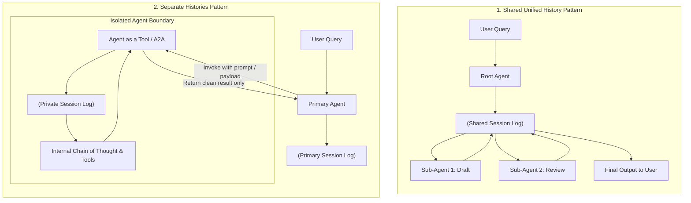

Multi-Agent Topology Matrix

| Pattern | Topology Structure | History Mechanism | Interaction Style |
| --- | --- | --- | --- |
| Single Agent | 1 LLM + Tools | Single Session | Linear tool execution loop |
| Network | Peer-to-peer mesh | Separate or Shared | Distributed collaborative messaging |
| Supervisor | Central coordinator delegating to worker nodes | Shared or Hybrid | Router/Dispatcher delegating to specialists |
| Supervisor (as tools) | Coordinator invoking worker agents as callable tools | Separate Histories | Synchronous execution returning direct outputs |
| Hierarchical | Multi-tier supervisors overseeing clustered sub-teams | Layered / Filtered | Multi-level strategic delegation |
| Custom | Arbitrary Directed Acyclic Graph (DAG) or hybrid mesh | Hybrid / Tailored | Domain-specific orchestration |

Enterprise Customer Agentic Engineering Use Cases

| Enterprise Domain | Architecture Pattern | Session History Strategy | Implementation Detail |
| --- | --- | --- | --- |
| Omnichannel Customer Support & Dispute Resolution | Supervisor with Sub-Agents | Shared Unified History | Triage Supervisor delegates to Billing and Shipping sub-agents. Maintaining a shared history prevents the customer from having to repeat context across escalations. |
| Regulated Financial Advisory & Compliance Auditing | Supervisor (as Tools) | Separate Individual Histories | The customer-facing advisor calls a Compliance Auditor Agent as a tool. Internal policy checks and sensitive raw logs stay isolated within the compliance agent's private history. |
| IT Incident Auto-Remediation & SRE Ops | Hierarchical Multi-Agent | Shared Unified History | Diagnostic, Root Cause, and Remediation agents collaborate over a shared incident timeline so each agent has access to previous diagnostic outputs. |
| Cross-Enterprise B2B Procurement | Peer Network via A2A | Separate Individual Histories | A corporate Buyer Agent interacts with external Vendor Agents using the Agent-to-Agent (A2A) protocol, exposing only formal purchase orders and quotes. |

---

Core Properties of google.adk.sessions.Session

| Property | Type / Format | Operational Definition | Role in Runtime |
| --- | --- | --- | --- |
| id | String (e.g., "test_id_modification") | Unique thread identifier | Primary key used by SessionService to retrieve, update, or delete conversation history. |
| app_name | String (e.g., "id_modifier_workflow") | Agent application name | Scopes sessions to a specific workflow or agent binary within multi-tenant deployments. |
| user_id | String (e.g., "example_user") | Unique user principal | Links interactions to an individual identity for state partitioning and authorization. |
| state | Dictionary / Key-Value Map | Mutable short-term memory | The agent's working scratchpad (holds slot values, active entities, transient workflow variables). |
| events | Chronological Event List | Interaction audit log | Append-only sequence recording raw turn interactions, tool calls, and model outputs. |
| last_update_time | Float / Unix Timestamp | Activity tracking marker | Used for cache invalidation, session timeouts, TTL enforcement, and audit logs. |

Component Matrix: Events vs. State

| Dimension | events (Chronological History) | state (Scratchpad Memory) |
| --- | --- | --- |
| Data Structure | Append-only ordered list | Mutable key-value mapping |
| Primary Contents | User inputs, agent thoughts, tool invocations, tool outputs | Extracted entities, user preferences, operational counters, workflow flags |
| Update Mechanism | Appended automatically on each interaction turn | Programmatically modified by agent actions or tools during execution |
| Model Ingestion | Rendered into prompt context window (often truncated or windowed) | Injected directly into prompt preambles or tool parameters as structured context |
| Lifecycle | Persists as an immutable audit trail of the conversation | Continually updated, overwritten, or cleared as tasks conclude |

Session Lifecycle & Architecture Flow

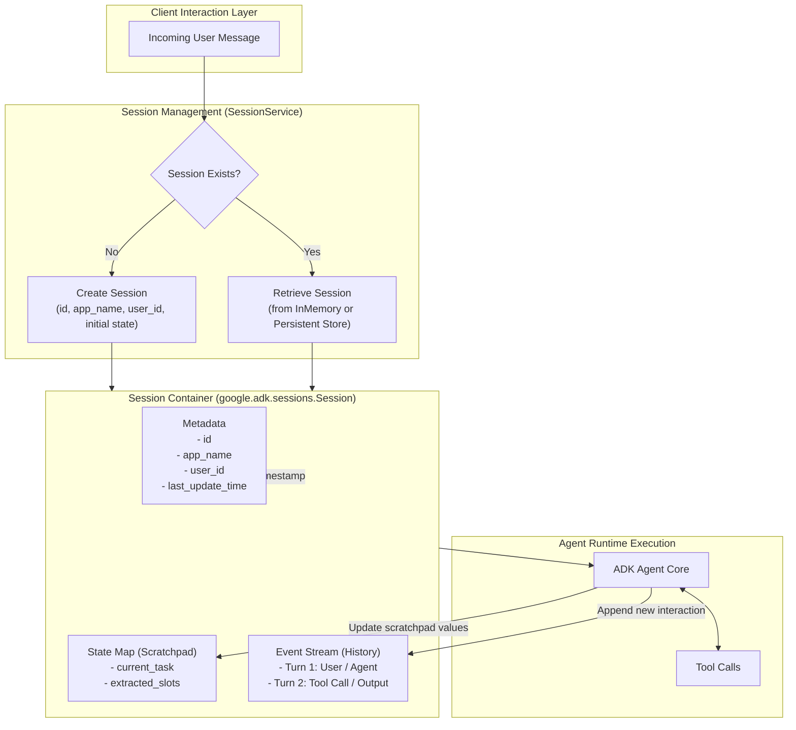

Enterprise Customer Agentic Engineering Use Cases

| Enterprise Domain | Session Object Feature | Agentic Workflow Pattern | Implementation Architecture |
| --- | --- | --- | --- |
| Multi-Step Banking Loan Application | state mapping with user_id scoping | Stateful Form Slot-Filling Agent | Maintains verified identity and income fields across long-running turns in state, preventing the agent from asking redundant qualification questions. |
| Regulated Healthcare Patient Intake | events append-only audit trail | Compliance & Audit Traceability | Preserves immutable interaction history for clinical liability, capturing exact doctor-agent and patient-agent tool dispatches with cryptographic timestamps (last_update_time). |
| Multi-Tenant SaaS Helpdesk Orchestration | app_name and id isolation | Shared Service Layer Partitioning | A unified SessionService cluster routes incoming webhooks across different client tenants, using app_name and id to guarantee tenant isolation and prevent data leakage. |
| Autonomous Supply Chain Reordering | Composite state scratchpad | Event-Driven Remediation Loop | Tracks inventory reorder thresholds and pending vendor approvals directly in state while keeping intermediate API responses and negotiation drafts in events. |

have we completed this page
Current Page Coverage Status

| Page Section / Topic | In Page Content? | Summarized in Previous Turn? | Status |
| --- | --- | --- | --- |
| Session Identification (id, app_name, user_id) | Yes | Yes (Core Properties Table & Metadata) | Covered |
| History (events) | Yes | Yes (Comparison Matrix & Lifecycle Flow) | Covered |
| Session State (state) | Yes | Yes (Comparison Matrix & State Map) | Covered |
| Activity Tracking (last_update_time) | Yes | Yes (Core Properties Table & Timestamp) | Covered |
| InMemorySessionService Lifecycle (Create / Delete) | Yes | Yes (Session Lifecycle Diagram & Use Cases) | Covered |
| Summary & Short-term Agent Memory Principles | Yes | Yes (Core Properties & Enterprise Applications) | Covered |

Page Completion Verification

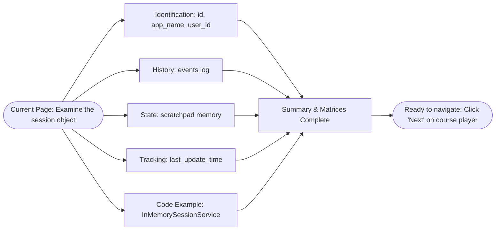

Every concept, property, code snippet, and video recap topic on this page has been mapped to matrices, architectural flow diagrams, and enterprise use cases.

To continue the series, navigate to the next page in your browser and prompt "next page".

---

### Core Concepts: Session State & Scratchpad

| Concept | Operational Definition | Role in Agent Runtime | Ingestion Mechanism |
| --- | --- | --- | --- |
| session.state | Dedicated mutable key-value map acting as the agent's scratchpad. | Tracks dynamic variables, preferences, and intermediate task calculations. | Injected into agent instructions via {key} templating. |
| Instruction Templating | Dynamic variable substitution syntax (e.g., {topic}). | Pre-populates the prompt sent to the LLM without requiring natural language chain reasoning. | Evaluated and substituted before the prompt reaches the LLM. |
| Thread-Safe State Updates | Atomic state updates tied to event emission via session_service.append_event(). | Ensures consistency, persistence, and audit synchronization across threads. | Dispatched via output_key, EventActions.state_delta, or context objects. |

### Comparison Matrix: Methods to Update Session State

| Update Method | Complexity | Primary Mechanism | Best-Fit Engineering Scenario |
| --- | --- | --- | --- |
| 1. output_key | Minimal / Easy | Automatically maps the entire final output of an agent step to a named state key. | Straightforward pipeline chaining where downstream agents require direct upstream outputs. |
| 2. EventActions.state_delta | Standard | Emits explicit key-value delta dictionaries alongside an interaction event. | Programmatic state mutations during explicit event appending. |
| 3. CallbackContext / ToolContext | Advanced | Directly modifies state within tool implementations or event callback hooks. | Interactive tools (e.g., database queries, user profile updates) that mutate state during execution. |

State Interaction & Templating Flow

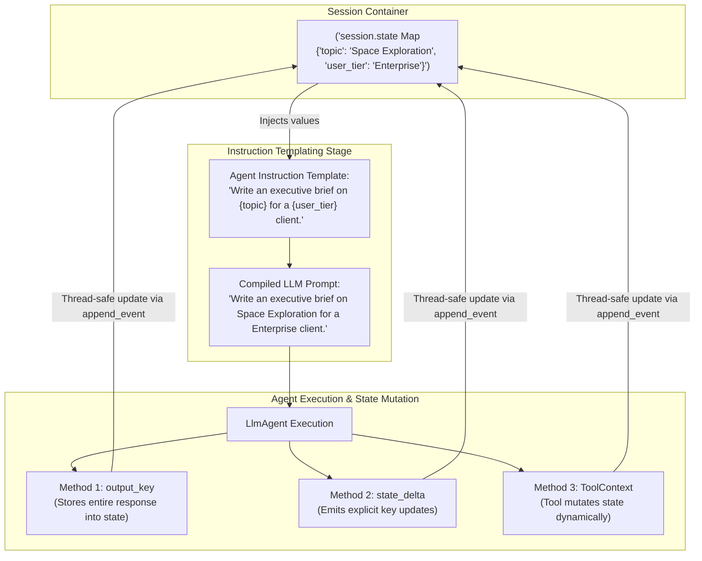

Enterprise Customer Agentic Engineering Use Cases

| Enterprise Domain | State Mechanism Applied | Operational Architecture Pattern | Enterprise Value Delivery |
| --- | --- | --- | --- |
| Context-Aware Dynamic KYC Onboarding | Instruction Templating ({user_tier}, {jurisdiction}) | Slot-driven policy injection | Adapts compliance and document collection instructions based on applicant geography without prompting the LLM to search historical messages. |
| Multi-Stage Loan Origination Pipeline | output_key Automation | Chained sequential agent workers | The Underwriting Agent writes risk scores directly to loan_risk_score using output_key, allowing the Downstream Approval Agent to consume it instantly. |
| Real-Time CRM Data Mutation | ToolContext State Updates | Tool-mediated profile synchronization | When a customer updates their address or notification tier mid-conversation, tools mutate session.state directly, updating the active session and backend databases simultaneously. |
| Adaptive E-Commerce Cart Tracking | EventActions.state_delta | Incremental cart state management | Tracks order items, discount coupons, and checkout status incrementally per turn, keeping the token budget low by preventing raw cart recalculation across long conversation histories. |

---

Core Responsibilities of SessionService

| Operational Lifecycle Stage | API / Internal Action | Functional Description | State & History Impact |
| --- | --- | --- | --- |
| Starting Conversations | create_session(...) | Spawns a fresh Session instance when a user initiates a dialogue. | Allocates initial session metadata, empty events list, and default state. |
| Resuming Conversations | get_session(session_id) | Fetches the target Session by its identifier for uninterrupted conversational continuity. | Hydrates full event stream and mutable scratchpad into agent context. |
| Saving Progress | append_event(session_id, event) | Appends user turns, model completions, and tool outputs into history. | Thread-safe mechanism used to update events and flush state deltas. |
| Listing Conversations | list_sessions(user_id, app_name) | Queries and returns all active dialogue threads matching user and app scopes. | Read-only index scan; preserves existing state. |
| Cleaning Up | delete_session(session_id) | Purges inactive, expired, or completed Session records and telemetry. | Permanently removes state map, event log, and indices from the backing store. |

### Comparison Matrix: SessionService Implementations

| Implementation | Persistence Tier | Underlying Infrastructure | Operational Overhead | Best-Fit Engineering Scenario |
| --- | --- | --- | --- | --- |
| InMemorySessionService | Ephemeral (Lost on process termination) | Local RAM (Python dictionary/hash map) | Zero configuration; no network or external database dependencies. | Local prototyping, unit testing, CI/CD automated test suites. |
| VertexAiSessionService | Managed Cloud Persistence | Google Cloud Vertex AI Agent Runtime | Fully managed by Google Cloud; observable in Agent Platform UI. | Enterprise production agents deployed directly on Vertex AI infrastructure. |
| DatabaseSessionService | Persistent Storage Tier | SQL databases via async drivers (e.g., PostgreSQL, SQLite via aiosqlite) | Requires database provisioning, connection pooling, and schema migration. | Self-hosted enterprise deployments, hybrid-cloud setups, custom DB compliance. |

7-Step Turn Execution Lifecycle Flow

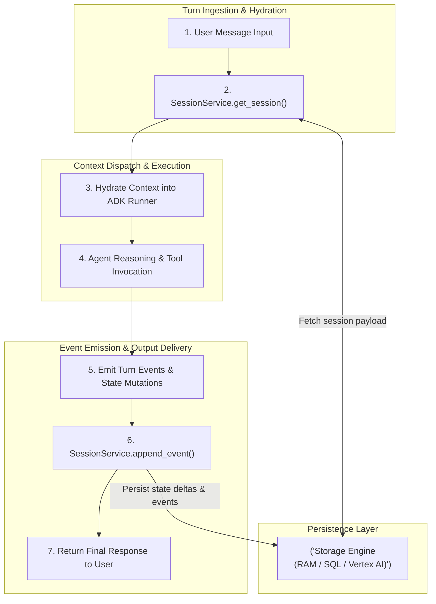

Enterprise Customer Agentic Engineering Use Cases

| Enterprise Domain | Chosen SessionService | Architectural Pattern | Production Implementation Strategy |
| --- | --- | --- | --- |
| Enterprise Cloud Contact Center | VertexAiSessionService | Managed Multi-Tenant Routing | Out-of-the-box integration with Vertex AI Agent Platform allows support managers to inspect active session IDs, user IDs, and turn-by-turn event traces from the management console. |
| Sovereign Banking On-Prem Core | DatabaseSessionService (PostgreSQL) | Regulated On-Premises Persistence | Maintains customer transactional conversations within self-hosted, encrypted PostgreSQL tables (sqlite+aiosqlite or asyncpg), adhering strictly to local financial data residency regulations. |
| Automated CI/CD Agent Evaluation | InMemorySessionService | Mocked Testing Testbeds | Spawns thousands of concurrent synthetic user conversations in parallel unit tests, tearing them down instantly without incurring external cloud or database write latencies. |
| Personalized Wealth Advisory | DatabaseSessionService + Long-Term Store | Hybrid Working Memory + User Profile Store | Uses DatabaseSessionService for short-term multi-turn conversational events while linking to an external profile store to dynamically inject long-term user investment preferences. |

Go through this video and summarize this exactly in the format that I described: https://www.youtube.com/watch?v=HDqzJJhZsxw

### Core Concepts & Architectural Distinctions

| Concept | Definition & Operational Role | Primary Mechanism | Persistence Tier |
| --- | --- | --- | --- |
| Ephemeral Memory Bottleneck | Memory loss where in-memory sessions reset upon server restart or process termination. | InMemorySessionService holding state strictly in local RAM. | Non-persistent (Process lifetime) |
| Persistent Multi-Turn Sessions | Survives application crashes, updates, and restarts across long spans of time. | DatabaseSessionService backed by durable SQL engines (e.g., SQLite, PostgreSQL). | Persistent (Session-scoped) |
| User Profile Store (Long-Term Memory) | Cross-session store that tracks preferences, traits, and facts across all sessions for a user. | Key-value/document store queried by user_id outside of individual conversation IDs. | Persistent (User-scoped) |
| get_or_create_session() Pattern | Idempotent session recovery logic checking whether to resume or start clean. | Queries backing database for existing session_id; instantiates new record if missing. | Lifecycle Control |

Architectural Matrix: Memory Layers in AI Agents

| Memory Layer | Storage Mechanism | Scope & Boundary | Data Content Stored | Lifecycle Behavior |
| --- | --- | --- | --- | --- |
| Short-Term Scratchpad | session.state | Single Session | Current step variables, task slot values, active tool inputs | Cleared or updated continuously within the active conversation. |
| Conversational Log | DatabaseSessionService | Single Session / Thread | Full turn history, event sequences, tool executions, outputs | Persists across app restarts; rehydrated when resuming that specific session_id. |
| Long-Term Personalization | User Profile Store | Global across all User Sessions | Diet restrictions, favorite topics, coding style, account tier | Persists independently of conversations; injected into prompt preambles across new threads. |

Persistent Memory & Session Resolution Architecture Flow

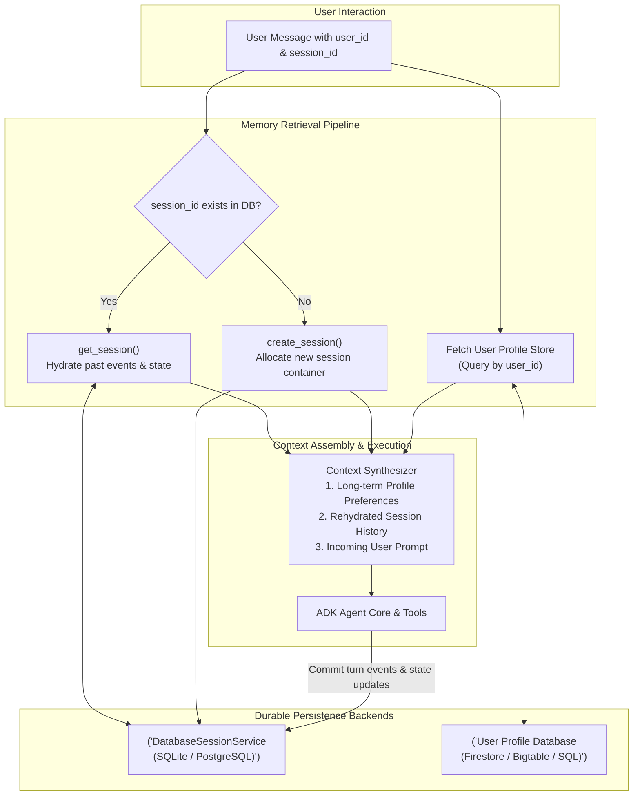

Enterprise Customer Agentic Engineering Use Cases

| Enterprise Domain | Memory Layer Applied | Architectural Implementation Pattern | Production Impact |
| --- | --- | --- | --- |
| Omnichannel Retail & E-Commerce | User Profile Store + DatabaseSessionService | Cross-session personalization with persistent cart sessions | Remembers customer sizing, dietary preferences, and brand affinities across months, while maintaining incomplete checkout session threads across browser restarts. |
| Wealth Management & Advisory | Isolated DatabaseSessionService | Durable compliance audit threads | Preserves financial risk assessment dialogues across user visits without losing past portfolio reasoning or tool calculation traces during runtime redeployments. |
| Enterprise SaaS Developer Co-pilot | Global Profile Store (Preferences) | Developer configuration injection | Injects user-level coding language preference (e.g., Python typing styles, cloud targets) into every new debugging session without requiring repetitive instructions. |
| Telehealth Patient Consultation | Resumable Session Pipeline (get_or_create_session) | Multi-day intake triage | Enables patients to pause a symptom checklist questionnaire on mobile and resume hours later on desktop with uninterrupted state and event history. |

The video Persistent Memory in AI Agents details how developers transition from volatile RAM-bound session services to production-grade persistent database storage and long-term user profile stores within the Google Agent Development Kit.

YouTube

How to add persistent memory to your AI agent 

### Google Cloud Tech

· 7:24
Opens in a new window
next

### Core Concepts & Strategic Distinctions: Long-Term Persistence with Memories

| Concept | Definition & Operational Role | Primary Mechanism | Scope & Boundary |
| --- | --- | --- | --- |
| Session History vs. Long-Term Memory | Session history preserves verbatim chronological conversation turns; memory extracts, compacts, and retains durable user insights. | Turn event appending vs. LLM-driven insight consolidation. | Single-thread conversation vs. Cross-session evolving profile. |
| Agent Memory vs. External RAG | Memory personalizes the agent around user-specific traits and history; RAG indexes static external domain/world knowledge. | Profile/collection extraction vs. Vector search over external corpora. | User-centric / Dynamic vs. Domain-centric / Authoritative. |
| Memory Lifecycle | The end-to-end autonomous transformation of raw conversational noise into actionable knowledge. | Ingestion → LLM Consolidation → Transactional Storage → Retrieval. | Continuous background optimization loop. |
| Declarative vs. Procedural Knowledge | Declarative represents explicit facts/preferences; procedural represents operational workflows and playbooks. | Key-value/structured attributes vs. Step sequences and behavioral heuristics. | Semantic facts vs. Execution methodologies. |

### Comparison Matrix: Memory Representation Patterns

| Pattern | Data Structure | Update Frequency | Retrieval Latency | Best-Fit Engineering Scenario |
| --- | --- | --- | --- | --- |
| Structured Profiles | Key-value schemas, JSON profiles | Low / Explicit (per confirmed slot) | Sub-10ms (Indexed key lookup) | Strict attribute constraints (e.g., account tier, home airport, allergy list). |
| Memory Collections | Embedded semantic item lists | Continuous (per interaction turn) | 20–80ms (Approximate Nearest Neighbor search) | Open-ended user observations, historical feedback, and contextual preferences. |
| Rolling Summaries | Progressive natural language abstracts | Periodic / End-of-session | Sub-20ms (Direct context injection) | Long-running threads needing compressed historical narrative without raw token bloat. |

The Autonomous Memory Lifecycle Pipeline

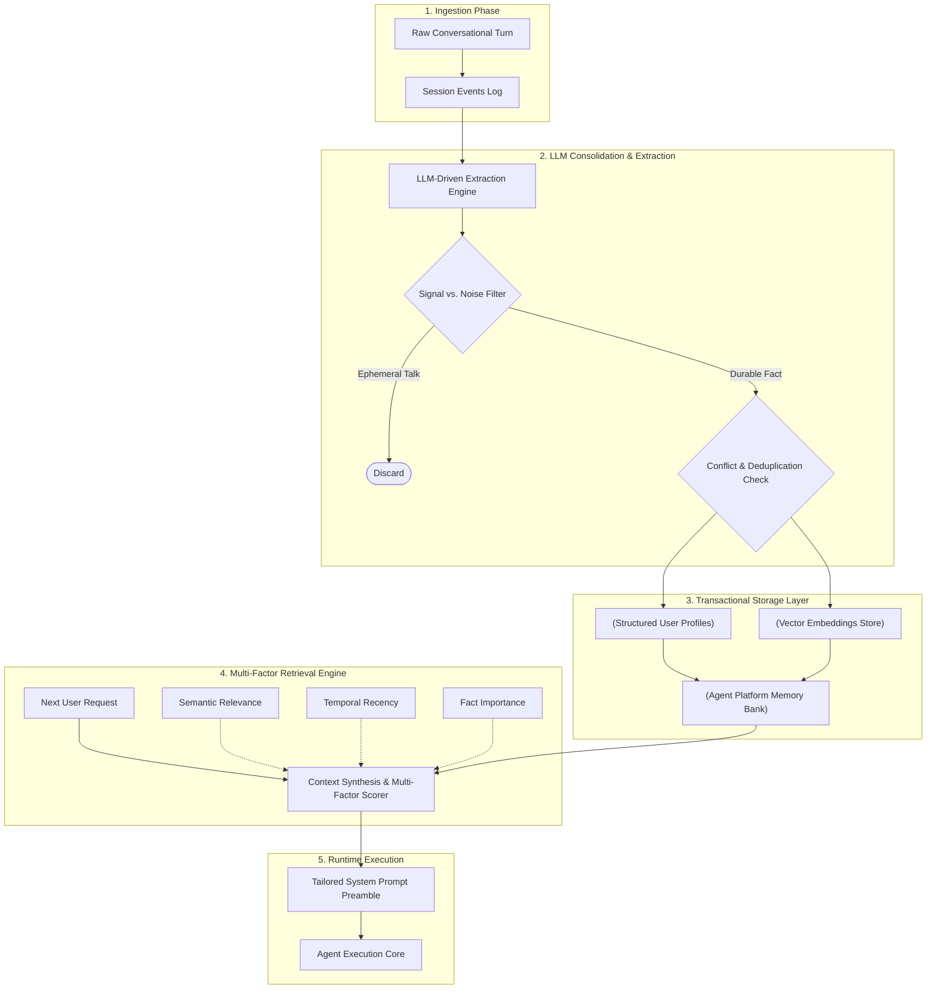

Multi-Factor Memory Retrieval Trade-Off Matrix

| Retrieval Dimension | Evaluation Criteria | Scoring Impact | Mitigation for Latency Budgets |
| --- | --- | --- | --- |
| Semantic Relevance | Cosine similarity between query and stored memories | Ensures topical alignment with current user intent. | Use pre-filtering (e.g., user ID partitions) before vector distance computation. |
| Temporal Recency | Time decay function (e |  |  |

−λΔt

| ) applied to update timestamps | Prioritizes recent preferences over outdated behaviors. | Enforce indexed timestamp bounds on database lookups. |  |
| --- | --- | --- | --- |
| Fact Importance | Static or model-assigned criticality score (1–10 scale) | Prevents high-priority facts (e.g., medical allergies, budget caps) from being pruned. | Store as an explicit indexed column; filter by threshold prior to ranking. |

Enterprise Customer Agentic Engineering Use Cases

| Enterprise Domain | Applied Memory Architecture | Lifecycle Implementation Pattern | Business & Technical Impact |
| --- | --- | --- | --- |
| Autonomous Enterprise Wealth Advisory | Structured Profiles + Agent Platform Memory Bank | Declarative risk tolerance and life-stage updates with strict data retention rules. | Automatically detects life changes (e.g., child born, retirement date adjusted) and permanently retains them for future portfolio balancing turns without retraining models. |
| B2B SaaS Technical Support Escalations | Rolling Summaries + Memory Collections | Multi-turn incident compaction across support agent handoffs. | Compresses 50+ message triage logs into rolling technical digests, saving up to 80% of context token overhead while preserving previous diagnostic commands. |
| Personalized Global Travel Concierge | Multi-Factor Hybrid Retrieval (Relevance + Recency + Importance) | Dynamically balances dietary restrictions (Importance), recent hotel feedback (Recency), and destination queries (Relevance). | Enforces sub-100ms response budgets by pre-filtering on customer profile keys before running semantic search across past vacation notes. |
| Healthcare Patient Care Coordinator | Policy-Governed Agent Platform Memory Bank | Transactional audit compliance with custom retention and privacy deletion triggers. | Isolates clinical preferences from transient chit-chat, guaranteeing GDPR/HIPAA compliance by applying automated memory pruning rules after care completion. |

---

### Core Concepts & Capabilities: Define Memory

| Concept | Operational Definition | Primary Mechanism | Architectural Role |
| --- | --- | --- | --- |
| Memory | A persistent, condensed representation of extracted, meaningful information across conversations or data sources. | LLM-based extraction and consolidation from session turns into structured snapshots. | Preserves long-term user context across sessions. |
| Memory Manager | A specialized, decoupled service managing extraction, consolidation, storage, and retrieval. | Active operational service exposing framework-agnostic data structures (strings/dictionaries). | Foundation for multi-agent interoperability and shared cross-agent knowledge bases. |
| Personalization | Tailoring interactions dynamically to user preferences, traits, and behavior over time. | Long-term attribute and memory extraction. | Enhances user experience without repetitive onboarding. |
| Context Window Management | Preventing prompt token exhaustion while maintaining relevant context. | Compacting raw multi-turn session logs into dense semantic memory summaries. | Reduces inference latency and token costs. |
| Data Mining & Insight | Extracting organizational patterns, feedback, and trends across user populations. | Aggregated semantic search and memory indexing across sessions. | Continuous enterprise analytics and observability. |
| Self-Improvement & Adaptation | Refining agent behavioral policies and execution paths based on historical outcomes. | Dynamic feedback loop updating procedural memory and task strategies. | Prevents repeated tool or task failures. |

Architectural Matrix: Memory vs. RAG

| Architectural Dimension | Memory System | Retrieval-Augmented Generation (RAG) |
| --- | --- | --- |
| Domain Focus | User-centric ("Expert on the user") | Fact/World-centric ("Expert on the facts") |
| Data Mutability | Dynamic, continuously evolving per conversation turn | Static or batch-updated external corpus |
| Source of Truth | Prior session events, user statements, behavioral observations | Enterprise documents, manuals, knowledge bases, vector indexes |
| Primary System Role | Recalls personalized traits, past user decisions, and continuity | Retrieves authoritative, verifiable enterprise/domain facts |
| Combined Synergies | Informs how to answer (tone, user context, personal constraints) | Informs what the factual answer is |

### Comparison Matrix: ADK MemoryService Implementations

| Implementation | Backing Infrastructure | Lifecycle & Scope | Overhead & Latency | Best-Fit Engineering Scenario |
| --- | --- | --- | --- | --- |
| InMemoryMemoryService | Local Host RAM | Ephemeral; reset upon application termination | Zero setup; microsecond latency | Unit testing, local agent prototyping, and automated CI test pipelines. |
| VertexAiMemoryBankService | Managed Google Cloud Vertex AI Memory Bank | Managed durable cloud persistence across sessions | Fully managed extraction, consolidation, and semantic vector indexing | Production enterprise agents deployed on Google Cloud requiring managed memory pipelines. |
| VertexAiRagMemoryService | Vertex AI RAG Corpus Engine | Scalable hybrid vector/document retrieval engine | Optimized for vector-indexed document chunks and hybrid search | Memory-intensive agents querying large volumes of semi-structured user notes or documents. |

The Collaborative Memory Stack Architecture Flow

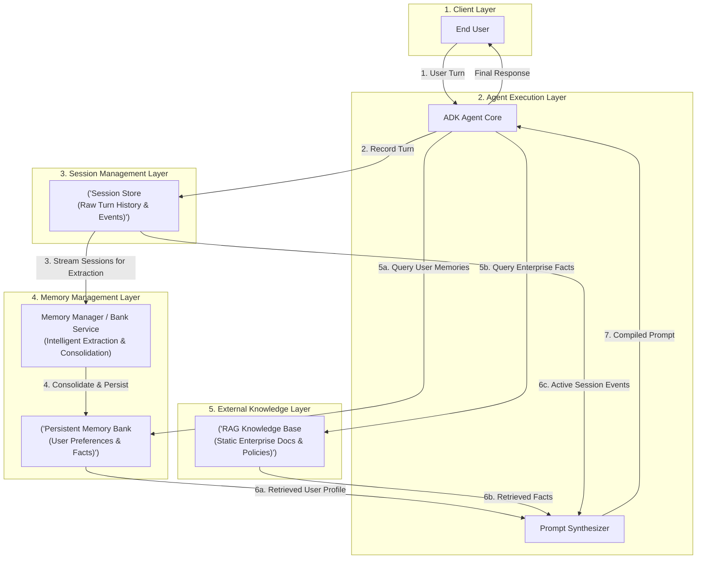

Enterprise Customer Agentic Engineering Use Cases

| Enterprise Domain | Applied Pattern / Memory Capability | Collaborative Architecture Stack | Production Business Value |
| --- | --- | --- | --- |
| Autonomous Wealth Management & Financial Planning | Memory + RAG Hybrid (VertexAiMemoryBankService) | Memory Bank tracks client life goals; RAG indexes real-time SEC filings and tax codes. | Provides hyper-personalized investment plans conforming to external regulatory statutes without asking clients to restate their risk profile. |
| B2B SaaS Technical Incident Resolution | Context Window Management & Cross-Agent Interoperability | Framework-agnostic Memory Manager sharing condensed incident state across tier-1, tier-2, and SRE agents. | Eliminates token overflow on 100+ turn outages while allowing heterogeneous diagnostic agents to collaborate through a unified memory store. |
| Enterprise Omnichannel E-Commerce Concierge | Personalization & Data Mining | VertexAiRagMemoryService indexing customer return histories, style preferences, and size profiles. | Suggests context-aware replacements immediately upon return requests, reducing refund churn while analyzing cross-customer return reasons for product teams. |
| Autonomous Developer Environment Assistant | Agent Self-Improvement & Adaptation | Persistent procedural memory tracking successful debugging strategies and failed tool runs. | Learns project-specific build commands and avoids repeating failing code execution patterns across independent terminal sessions. |

---

Core Setup Tasks: Agent Platform Memory Bank

| Step | Setup Task | Core Objective | Key Parameters / SDK Methods |
| --- | --- | --- | --- |
| 1 | Create Instance | Allocate a managed Memory Bank resource engine under Vertex AI. | client.agent_engines.create(config={"context_spec": {"memory_bank_config": ...}}) |
| 2 | Manage IAM Permissions | Grant identity roles to custom service accounts for insight operations. | aiplatform.memories.generate, aiplatform.memories.retrieve |
| 3 | Configure Rules | Define models, embeddings, topic scopes, and data expiration parameters. | generation_config, similarity_search_config, ttl_config, customization_configs |

Configuration Matrix: memory_bank_config Blocks

| Configuration Block | Primary Key / Field | Default / Example Value | Operational Function |
| --- | --- | --- | --- |
| Generation | generation_config.model | models/gemini-2.5-flash | Extracts, condenses, and synthesizes key insights from session turns. |
| Similarity Search | similarity_search_config.embedding_model | models/text-embedding-005 | Generates vector embeddings for semantic recall during agent runtime. |
| TTL & Retention | ttl_config.memory_revision_default_ttl | 31536000s (365 days) | Controls automatic expiration and pruning of stored memory revisions. |
| Customization Topics | customization_configs[].memory_topics | USER_PERSONAL_INFO, USER_PREFERENCES, KEY_CONVERSATION_DETAILS, EXPLICIT_INSTRUCTIONS | Restricts extraction boundaries so only targeted information categories are retained. |
| Consolidation | consolidation_config.revisions_per_candidate_count | 1 | Controls revision density and consolidation frequency per extracted fact. |
| Third-Party Attribution | enable_third_person_memories | False | Determines whether the bank extracts facts spoken about non-user third parties. |

End-to-End Memory Bank Lifecycle Flow

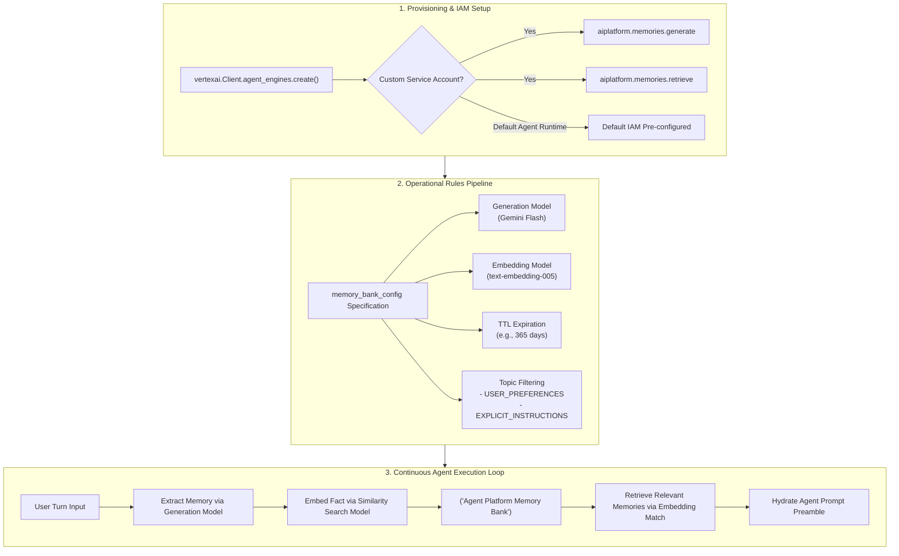

Enterprise Customer Agentic Engineering Use Cases

| Enterprise Domain | Configuration Feature Applied | Architecture Pattern | Business & Technical Impact |
| --- | --- | --- | --- |
| Regulated Retail Banking | ttl_config + Strict memory_topics | Strict Compliance Retention Agent | Automatically discards stored interaction insights after 90 days via ttl_config, while limiting extraction exclusively to EXPLICIT_INSTRUCTIONS to avoid capturing sensitive PII. |
| Multi-Brand E-Commerce Portal | USER_PREFERENCES + text-embedding-005 | Cross-Brand Personalization Concierge | Captures shopper clothing fit, brand affinities, and price sensitivities across visits; retrieves relevant preferences during future recommendations without requiring repetitive surveys. |
| Autonomous Technical Helpdesk | Custom Service Account IAM Isolation | Segregated Security Boundary | Grants aiplatform.memories.generate only to diagnostic supervisor agents, while lower-tier worker agents receive read-only aiplatform.memories.retrieve permissions. |
| Enterprise B2B Relationship Manager | enable_third_person_memories: False | Principal-Only Corporate Memory Store | Restricts the extraction pipeline to direct client instructions, preventing stray third-party vendor names or external quotes from corrupting the core stakeholder memory profile. |

---

### Core Concepts: Memory Generation & Orchestration

| Concept | Operational Definition | Primary Mechanism | Architectural Role |
| --- | --- | --- | --- |
| Memory Generation | Autonomous conversion of conversational data into structured insights. | LLM-driven ETL pipeline (Extract → Transform → Load). | Replaces manual database scripts and background batch jobs. |
| Agent as Memory Decider | Exposing memory generation as an agent-callable tool. | Explicit tool schema (e.g., generate_memories, extract_memories). | Gives the agent autonomy to identify and persist meaningful facts. |
| VertexAiMemoryBankService | ADK abstraction wrapper adhering to BaseMemoryService. | High-level methods: add_session_to_memory, search_memory. | Decouples agent logic from the raw cloud API endpoints. |
| Background vs. Blocking | Asynchronous generation (wait_for_completion: False) vs. synchronous execution. | Non-blocking execution loops running concurrently with turn replies. | Prevents LLM extraction latencies from slowing the user-facing chat loop. |

### Comparison Matrix: Memory Generation Triggering Strategies

| Trigger Strategy | Trigger Event | Latency & Cost Impact | Memory Fidelity | Best-Fit Engineering Scenario |
| --- | --- | --- | --- | --- |
| Real-Time | Every conversational turn | Highest cost; potential latency bottleneck | Highest / freshest | Critical low-turn workflows where every step holds vital user state. |
| Turn Cadence | Fixed N-turn frequency (e.g., every 5 turns) | Predictable, throttled cost | Balanced | Long interactive sessions balancing cost against memory freshness. |
| Session Completion | Dialogue thread end / user close | Minimal cost and low operational overhead | Lower (LLM summarizes large event batches) | End-of-chat summaries, post-call analytics, and ticket close-outs. |
| Explicit Command | Direct user intent (e.g., "remember this") | On-demand / Zero wasted background calls | Precise / High intent | User-controlled profile management and personalization settings. |
| Agent Tool Invocation | LLM recognizes meaningful user traits autonomously | Adaptive based on dialogue content | High / Selective | Advanced autonomous agents capable of identifying durable user facts. |

### Comparison Matrix: Generation & Ingestion APIs

| Ingestion API | Input Source | Processing Responsibility | Best-Fit Implementation |
| --- | --- | --- | --- |
| direct_contents_source (GenerateMemories) | Raw event stream / conversation turn | Memory Bank extracts, filters, and consolidates facts using an internal LLM. | Agent passes raw turns or sessions; Memory Bank handles extraction end-to-end. |
| direct_memories_source (IngestEvents) | Pre-extracted structured facts ({"fact": query}) | Memory Bank only merges, deduplicates, and vectorizes into existing memories. | The agent tool extracts specific facts itself and uses Memory Bank strictly as a consolidation store. |

Memory Generation Pipeline & Trigger Flow

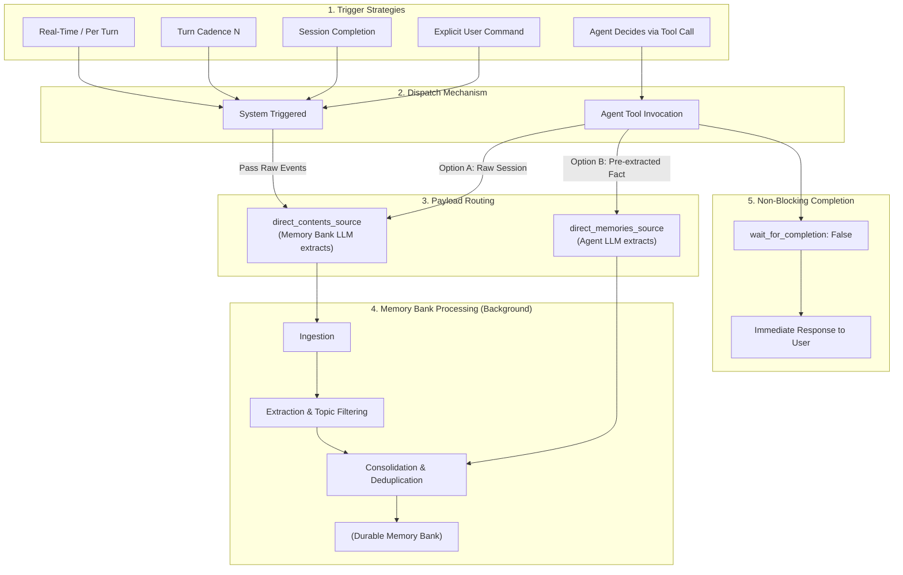

Enterprise Customer Agentic Engineering Use Cases

| Enterprise Domain | Generation Trigger & Pattern | Memory API Mechanism | Business & Production Impact |
| --- | --- | --- | --- |
| Enterprise Technical Support Escalations | Session Completion + Asynchronous ETL | direct_contents_source with wait_for_completion: False | Processes closed support tickets in the background to build engineering playbooks, offloading extraction costs from active support queues. |
| Personalized Private Banking Concierge | Agent as a Tool (extract_memories) | direct_memories_source ({"fact": query}) | The advisor agent detects when a client mentions a new financial goal (e.g., retirement horizon) and calls a tool to record the exact fact immediately. |
| SaaS B2B CRM Account Executive Agent | Turn Cadence (Every 3 Turns) | ADK add_session_to_memory | Periodically extracts multi-stakeholder contract requirements during long sales calls, ensuring data freshness if the client disconnects unexpectedly. |
| Healthcare Remote Patient Monitoring | Explicit User Command Trigger | direct_contents_source scoped to user_id | Prompts patients to review and explicitly confirm recorded chronic condition changes, maintaining strict clinical consent before updating the patient record. |

---

### Core Concepts & Principles: Memory Consolidation

| Concept | Operational Definition | Primary Mechanism | Architectural Role |
| --- | --- | --- | --- |
| Memory Consolidation | LLM-driven curation transforming isolated conversational facts into a unified knowledge base. | Compares new extractions against existing memories to update, prune, or merge. | Prevents memory stores from degrading into noisy, contradictory logs. |
| Candidate Selection | Semantic retrieval of existing memories matching newly observed insights. | Vector similarity lookup against stored user memories. | Establishes the subset of records eligible for consolidation. |
| LLM-Driven Analysis | Cognitive reasoning deciding atomic storage operations (insert, update, delete). | Evaluates factual overlap, temporal drift, and contradictions. | Replaces brittle, rule-based database overwrite logic. |
| Allowed Topics Filtering | Restricting consolidation/generation to defined semantic domains. | allowed_topics configuration list (managed_memory_topic, custom_memory_topic_label). | Protects data boundaries and reduces unnecessary extraction costs. |

Challenge vs. Consolidation Mitigation Matrix

| Conversational Challenge | Root Cause in Chat Data | Consolidation Mitigation Strategy | System Outcome |
| --- | --- | --- | --- |
| Information Duplication | Stating identical facts in distinct phrasing across chats. | Merges semantically identical observations into a single canonical entry. | Eliminates token bloat and redundant context injections. |
| Conflicting Information | User state or preferences shifting over time. | Replaces out-of-date records or removes invalid premises. | Prevents contradictory agent reasoning. |
| Information Evolution | Simple initial facts gaining detail over successive turns. | Augments existing memory records with progressive details. | Maintains nuanced user context without fracturing profiles. |
| Memory Relevance Decay | Stale, temporary, or low-confidence details persisting. | LLM defers to newer information; TTL configuration prunes aged records. | Ensures active inference relies only on trustworthy, current facts. |

### Comparison Matrix: metadata_merge_strategy

| Merge Strategy | Operational Behavior | Conflict Resolution Rule | Best-Fit Engineering Scenario |
| --- | --- | --- | --- |
| MERGE (Default) | Combines incoming and existing metadata dictionaries. | Overwrites existing keys with new incoming values; preserves unmatched keys. | Progressive user profile building across multiple interactions. |
| OVERWRITE | Replaces the metadata block of the updated memory entirely. | Discards all historical metadata keys in favor of the new payload. | Complete state resets or discrete revision bumps. |
| REQUIRE_EXACT_MATCH | Restricts updates strictly to memories sharing identical metadata. | Non-matching candidates are excluded from updates and treated as new entries. | Partitioned memory models (e.g., strict tenant, project, or role boundaries). |

Memory Consolidation Workflow Flow

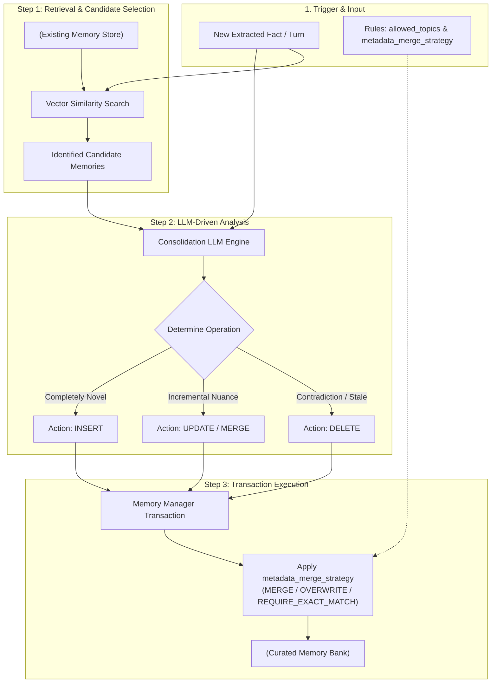

Enterprise Customer Agentic Engineering Use Cases

| Enterprise Domain | Applied Consolidation Mechanism | Architectural Implementation Pattern | Business & Technical Impact |
| --- | --- | --- | --- |
| Enterprise Flight & Travel Concierge | Conflict Resolution + MERGE Strategy | Resolves evolving user trip itineraries across fragmented booking sessions. | Overwrites outdated departure dates when travel plans change, preventing erroneous booking confirmations while preserving seat and meal preferences. |
| Healthcare Longitudinal Patient Intake | allowed_topics + Provenance Tracking | Restricts extraction strictly to clinical conditions and verified medications. | Ignores extraneous conversational chatter; merges progressive symptom updates over weeks into an auditable health profile. |
| B2B SaaS Strategic Account Management | Information Evolution Handling | Escalates account contact roles as deals mature. | Evolves simple stakeholder notes (e.g., "evaluating tool") into complex organizational hierarchies ("leading Q4 enterprise migration") without duplicate records. |
| Multi-Tenant Fintech Wealth Advisory | REQUIRE_EXACT_MATCH Partitioning | Enforces metadata isolation across distinct investment accounts or trusts. | Prevents consolidation pipelines from cross-pollinating corporate entity tax preferences into an executive's individual personal portfolio. |

---

### Core Concepts: Memory Provenance & Trustworthiness

| Concept | Operational Definition | Primary Mechanism | Architectural Role |
| --- | --- | --- | --- |
| Memory Provenance | The immutable lineage tracking the origin, source type, and historical revisions of a memory. | Tracking parent requests, source types, and child revision snapshots. | Protects agent reasoning from "confident garbage out." |
| Memory Revision Resource | A historical snapshot representing a specific state of a memory resource over time. | Child revision resources attached to parent memory entities. | Enables trend analysis and point-in-time state regeneration. |
| Confidence Scoring & Decay | Dynamic weighting of memory reliability based on multi-source corroboration and age. | Corroboration increases trust; time decay (e |  |

−λΔt

| ) lowers confidence. | Injected into the system prompt to guide LLM decision confidence. |  |  |
| --- | --- | --- | --- |
| Lineage-Aware Pruning | Regenerating derived memories after source data revocation instead of blind deletion. | Re-executing consolidation over remaining valid source revisions. | Prevents over-aggressive memory loss while honoring data privacy. |

### Comparison Matrix: Data Source Trust Tiers

| Source Type | Origin Example | Trust Level | Consolidation Weight | Best-Fit Lifecycle Use |
| --- | --- | --- | --- | --- |
| Bootstrapped Data | Pre-loaded CRM / ERP records | Highest | Dominant anchor | Solves the cold-start problem for first-time user interactions. |
| User Input (Explicit) | Form submissions, direct preferences | High | Strong weight | Authoritative statements of user requirements and intent. |
| User Input (Implicit) | Casual conversational inference | Moderate / Low | Requires corroboration | Soft preferences; validated through repetition across turns. |
| Tool Output | External API responses, web tool calls | Lowest (Discouraged) | Short-term cache only | Ephemeral scratchpad; discouraged for long-term memory. |

Methods for Ingesting Source Data in ADK

| Ingestion Method | Input Payload | Integration Mechanism | Best-Fit Architectural Scenario |
| --- | --- | --- | --- |
| Direct Events in Payload | Raw conversation event list | Sent directly in GenerateMemories requests | Ad-hoc or stateless runtime pipelines outside ADK session stores. |
| Agent Platform Sessions | Session identifiers | Memory Bank extracts directly from managed sessions | Deeply integrated Vertex AI Agent Platform session environments. |
| Pre-Extracted Facts | Structured fact key-values | Sent via IngestEvents / direct memory API | Autonomous agents with dedicated fact-extraction tools. |

Memory Lineage, Consolidation & Inference Flow

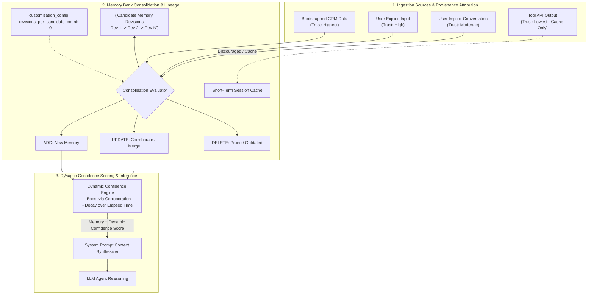

Enterprise Customer Agentic Engineering Use Cases

| Enterprise Domain | Provenance Mechanism Applied | Architecture Implementation Pattern | Business & Compliance Impact |
| --- | --- | --- | --- |
| GDPR / "Right to Be Forgotten" Data Compliance | Lineage-Aware Memory Pruning | When a customer revokes CRM marketing consent, the system regenerates affected memories using remaining audit logs rather than wiping the entire customer profile. | Ensures regulatory GDPR compliance without destroying operational customer support context. |
| Regulated Clinical & Healthcare Assistants | Multi-Source Corroboration + Source Trust Hierarchy | Explicit clinician notes override patient-inferred conversational statements; requires 2+ corroborating turns before confirming patient lifestyle factors. | Eliminates medical hallucination risks by rejecting unverified tool outputs from clinical memory banks. |
| Enterprise Private Banking Advisory | revisions_per_candidate_count: 10 | Evaluates past 10 candidate revisions during consolidation to distinguish long-term risk appetite from temporary market panic. | Prevents one-off emotional complaints during market dips from permanently downgrading a client's multi-year investment portfolio strategy. |
| Autonomous B2B Customer Support Escalations | Cold-Start Bootstrapping + Dynamic Confidence Decay | Pre-loads corporate tiering from Salesforce/ERP; applies dynamic time-decay to past transient software bug reports. | Immediately recognizes enterprise VIP accounts while naturally forgetting temporary infrastructure workarounds after 60 days. |

---

### Core Concepts & SDK Retrieval Methods

| Concept / Method | Operational Definition & SDK Syntax | Primary Role | Latency & Output Characteristic |
| --- | --- | --- | --- |
| Get memory | client.agent_engines.memories.get(name="MEMORY_NAME") | Fetches complete content and metadata of a single targeted memory resource. | Sub-10ms point lookup; returns exact memory object. |
| List memories | client.agent_engines.memories.list(parent="...") | Iterates through stored memory resources under a parent engine/user scope. | Returns an iterable pager; low compute overhead. |
| Retrieve memories | client.agent_engines.memories.retrieve(name=..., scope=..., similarity_search_params={"search_query": "...", "top_k": 3}) | Semantic similarity vector search matching intent to stored facts. | 30–80ms; returns ranked RetrieveMemoriesResponseRetrievedMemory with distance scores. |
| Profile Retrieval | Direct key-value lookup against structured user attributes. | Fetches deterministic user profile schemas (e.g., account tier, home airport). | Fast single-query read; bypasses vector search complexity. |

### Comparison Matrix: Memory Scoring Dimensions

| Scoring Dimension | Core Metric | Scoring Function / Meaning | Optimization Impact |
| --- | --- | --- | --- |
| Relevance | Semantic similarity | Vector distance (cosine / dot product) between current query and stored facts. | Ensures conceptual alignment with the immediate topic. |
| Recency | Time-based decay | Elapsed time since memory creation or latest revision. | Prevents obsolete user context from dominating active reasoning. |
| Importance | Significance weight | Integer/float score assigned during extraction or consolidation. | Retains high-priority constraints (e.g., dietary, medical, budget limits). |

### Comparison Matrix: Advanced Retrieval Techniques vs. Timing

| Dimension | Technique / Approach | Operational Mechanism | Trade-Off & Latency Impact | Best-Fit Engineering Scenario |
| --- | --- | --- | --- | --- |
| Advanced Technique | Query Rewriting | LLM reformulates ambiguous input into multi-faceted search queries. | Extra LLM inference call; increases turn latency. | Ambiguous user queries or multi-part intent resolution. |
| Advanced Technique | Reranking | Cross-encoder or second LLM re-scores candidate pool. | High accuracy at the cost of noticeable latency overhead. | Precision-critical workflows where false positives are costly. |
| Advanced Technique | Specialized Retrievers | Fine-tuned retriever models trained on domain data. | High training, data curation, and operational cost. | Highly specialized jargon, proprietary domain taxonomies. |
| Advanced Technique | Caching Layer | Key-value cache storing expensive retrieval outputs. | Reduces latency to near zero on repeat lookups; cache invalidation risk. | High-volume agents with frequent repeated topics. |
| Timing Pattern | Proactive Retrieval | Injects retrieved memories into prompt preamble before agent execution. | Guarantees context availability; risks prompt token bloat. | Personalized assistants requiring baseline user awareness every turn. |
| Timing Pattern | Reactive Retrieval | Exposes memory retrieval as an explicit tool callable by the agent. | Token-efficient (runs on demand); adds tool-calling hop. | Deep expert agents with broad, specialized memory banks. |

End-to-End Memory Retrieval Pipeline

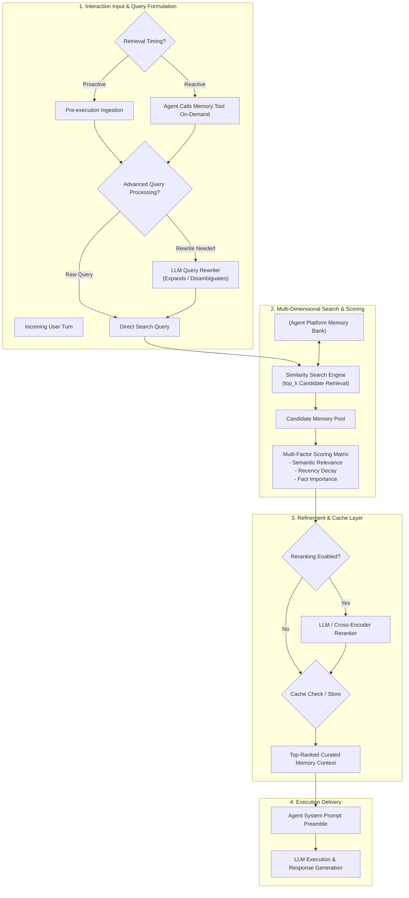

Enterprise Customer Agentic Engineering Use Cases

| Enterprise Domain | Retrieval Architecture Applied | Timing & Strategy Pattern | Production Value & Latency Delivery |
| --- | --- | --- | --- |
| Private Wealth Portfolio Manager | Hybrid Scoring (Relevance + Recency + Importance) | Proactive Retrieval with TTL Caching | Injects core investor risk profiles and recent life milestones into every turn while using cached profiles to stay within strict response-time limits. |
| Technical Escalation Support (SRE / DevOps) | Reactive Tool-Driven Retrieval + Query Rewriting | Reactive Retrieval ("Memory as a Tool") | The agent rewrites vague bug descriptions into precise architecture queries and calls memory tools only when encountering complex, multi-service outages. |
| Global Airline Concierge | Profile Lookup + Reranked Candidate Pool | Hybrid: Proactive Profiles + Reactive Trip Memories | Reads frequent flyer status via direct lookup; dynamically reranks seat and meal preferences when booking flights across multiple carrier partners. |
| Enterprise Legal & Contract Review Agent | Fine-Tuned Specialized Retriever + Reranking | Reactive Retrieval with Semantic Scoring | Uses fine-tuned legal clause retrievers to cross-reference historical contract positions without exceeding maximum token allowances. |

---

### Core Concepts: Inference with Memories

| Concept | Operational Definition | Role in Model Reasoning | Target Memory Layer |
| --- | --- | --- | --- |
| System Instruction Appending | Concatenating retrieved facts into the foundational preamble (e.g., via Jinja templates). | Establishes authoritative, permanent persona rules and user traits. | Stable, global memories (e.g., User Profile, core constraints). |
| Dialogue Injection | Inserting memories directly into the turn-by-turn conversation event list. | Provides temporal context relevant strictly to the immediate interaction. | Transient, episodic memories (e.g., recent task results, temporary slots). |
| Memory-as-a-Tool | Exposing memory retrieval as an agent tool function (e.g., load_memory). | Enables on-demand, autonomous memory lookup without upfront context pollution. | Domain-specific historical knowledge, deep archive lookups. |
| Procedural Memory vs. Fine-Tuning | Dynamic in-context behavioral steering vs. static weight updates (RLHF). | Online adaptation via injected playbooks; avoids slow offline retraining. | Evolving execution playbooks, workflow heuristics. |

### Comparison Matrix: Memory Presentation Strategies

| Strategy | Implementation Pattern | Key Advantages | Primary Technical Constraints & Risks |
| --- | --- | --- | --- |
| Append to System Instructions | Jinja templating: {{ system_instructions }} <MEMORIES>...</MEMORIES> | Clean turn history; highest model adherence and authority. |  |

Dynamic construction: Framework must rebuild prompt before every call.

Tool incompatibility: Incompatible with memory-as-a-tool.

Multimodal limits: System prompts are text-only in most LLMs.

Over-influence: Agent may artificially link unrelated topics back to instructions.

| Inject into Conversation History | Insert as synthetic turns before history or prior to the latest query. | Flexible turn-by-turn relevance; supports multimodal content in messages. |  |
| --- | --- | --- | --- |

Dialogue injection risk: Model may mistake injected memories for spoken conversation.

Perspective mismatch: Must manage 1st-person vs. 3rd-person phrasing.

Token bloat: Accumulates noise across long turns.

| Memory-as-a-Tool (Tool Calls) | LlmAgent(tools=[load_memory]) using tool_context.search_memory() | Zero upfront prompt token cost; executes on demand; handles massive memory banks. | Extra inference round-trip / tool latency; model must know when to trigger retrieval. |
| --- | --- | --- | --- |
| Hybrid Strategy (Best Practice) | Global memories in System Prompt + Transient memories via Dialogue/Tools. | Optimal balance between persistent context and flexible retrieval. | Requires dual-path memory retrieval and orchestration logic in runtime. |

### Comparison Matrix: Procedural Memory vs. Fine-Tuning

| Evaluation Dimension | Procedural Memory (In-Context Steering) | Fine-Tuning & Weight Adaptation (e.g., RLHF) |
| --- | --- | --- |
| Adaptation Speed | Fast & Online: Instant updates on the next turn | Slow & Offline: Requires training runs and evaluations |
| Operational Cost | Token cost per prompt injection | GPU compute cluster training cost |
| Model Weight Impact | Zero (Weights remain frozen) | Modifies underlying neural network weights |
| Reversibility | Instant (Remove or update memory in bank) | Difficult (Requires model rollback or checkpoint revert) |
| Mechanism | In-context playbook injection into prompt | Parameter shift through gradient descent |

Memory Placement & Inference Flow

```mermaid
flowchart TD
    subgraph RetrievalLayer["1. Memory Classification"]
        MemBank[Retrieved Memories Pool]
        MemBank --> SplitType{Memory Type?}
        SplitType -- "Stable / Global (User Profile)" --> GlobalPath[Global Memories]
        SplitType -- "Transient / Episodic (Contextual)" --> TransientPath[Episodic Memories]
        SplitType -- "On-Demand Deep Store" --> ToolPath[Tool-Managed Memories]
    end

    subgraph AssemblyLayer["2. Context Window Assembly"]
        direction TB
        GlobalPath -->|Jinja Rendering| SysPrompt["System Instructions<br/>&lt;MEMORIES&gt;* User Profile Facts&lt;/MEMORIES&gt;"]
        TransientPath -->|First-Person Normalization| HistInject["Dialogue History Injection<br/>(Injected prior to latest user turn)"]

        SysPrompt --> ContextWindow[LLM Context Window]
        HistInject --> ContextWindow
        UserQuery[Latest User Query] --> ContextWindow
    end

    subgraph ExecutionLayer["3. Inference & Tool Resolution"]
        ContextWindow --> LLM[LLM Inference]
        LLM -. "Needs deep archive?" .-> ToolCall["tool: load_memory(query)"]
        ToolPath -.-> ToolCall
        ToolCall -->|Append tool output to turns| HistInject
        LLM --> FinalResponse[Final Response to User]
    end
```

Enterprise Customer Agentic Engineering Use Cases

| Enterprise Domain | Applied Inference Strategy | Architectural Pattern | Business & Engineering Value |
| --- | --- | --- | --- |
| Enterprise B2B SaaS Support | Hybrid (System Profile + Memory-as-a-Tool) | Injects enterprise SLA and client tier into system instructions; uses load_memory to fetch past Jira tickets on demand. | Guarantees contractual SLA prioritization on every turn without loading massive historical bug logs into every prompt. |
| Financial Advisory & Wealth Planning | Procedural Memory Playbooks | Dynamically swaps investment compliance playbooks into the prompt as regulations update, bypassing model fine-tuning. | Eliminates million-dollar retraining cycles and multi-month RLHF runs when tax laws change. |
| Omnichannel Retail Concierge | History Injection with Perspective Normalization | Translates past return reasons and shoe sizes into first-person constraints and injects them prior to the shopping query. | Prevents dialogue injection hallucinations while ensuring the model doesn't recommend previously returned sizes. |
| Multimodal Field Service Inspection | Dialogue Injection for Multimodal Context | Injects past equipment service photos and repair notes into conversation history turns. | Bypasses text-only system instruction limits, allowing the vision model to compare real-time turbine damage against prior inspection photos. |

---

Core Production Principles: Production Considerations for Sessions & Memory

| Production Principle | Threat / Vulnerability Addressed | Implementation Mechanism | Architectural Objective |
| --- | --- | --- | --- |
| Data Isolation | Cross-tenant and cross-user data leakage across multi-tenant agents. | Strict Access Control Lists (ACLs) partitioned by tenant and user boundaries. | Guarantees hard boundaries between tenant sessions and memory spaces. |
| Data Sanitization & Redaction | Accidental capture and long-term storage of sensitive PII. | Automated PII masking/redaction pipelines prior to memory bank consolidation. | Ensures compliance with GDPR, HIPAA, and industry privacy mandates. |
| Procedural Anonymization | Indirect identification via unique behavioral or execution patterns. | Anonymizing procedural memory playbooks and scrubbing user markers. | Prevents model fingerprinting and reverse-engineering of user identities. |
| Memory Integrity Defense | Memory poisoning attacks (adversarial injection to skew agent actions). | Lineage verification, corroboration rules, and write-permission isolation. | Ensures stored facts cannot be manipulated by untrusted conversation inputs. |
| Granular Policy Enforcement | Over-privileged service identities accessing arbitrary memory records. | IAM Conditions evaluated via Common Expression Language (CEL). | Restricts access dynamically using runtime request attributes. |

### Comparison Matrix: Security Safeguards vs. Threat Vectors

| Security Safeguard | Addressed Threat Vector | Enforcement Layer | Target Resource Attribute |
| --- | --- | --- | --- |
| Tenant-Level ACLs | Horizontal privilege escalation across corporate tenants | Data Access / Orchestration Layer | Tenant Organization ID / Namespace |
| PII Redaction Engine | Privacy violations and compliance breach | Pre-Storage Ingestion Pipeline | Message event contents & extracted memory text |
| CEL IAM Conditions | Unauthorized cross-user data retrieval | Google Cloud IAM Plane | resource.matchLabels() or API request attributes |
| User-Scoped IAM Policies | Unauthorized access to user-specific threads | Resource / Session Service API | sessionUserId & memoryScope |

Granular Identity & Access Governance Architecture Flow

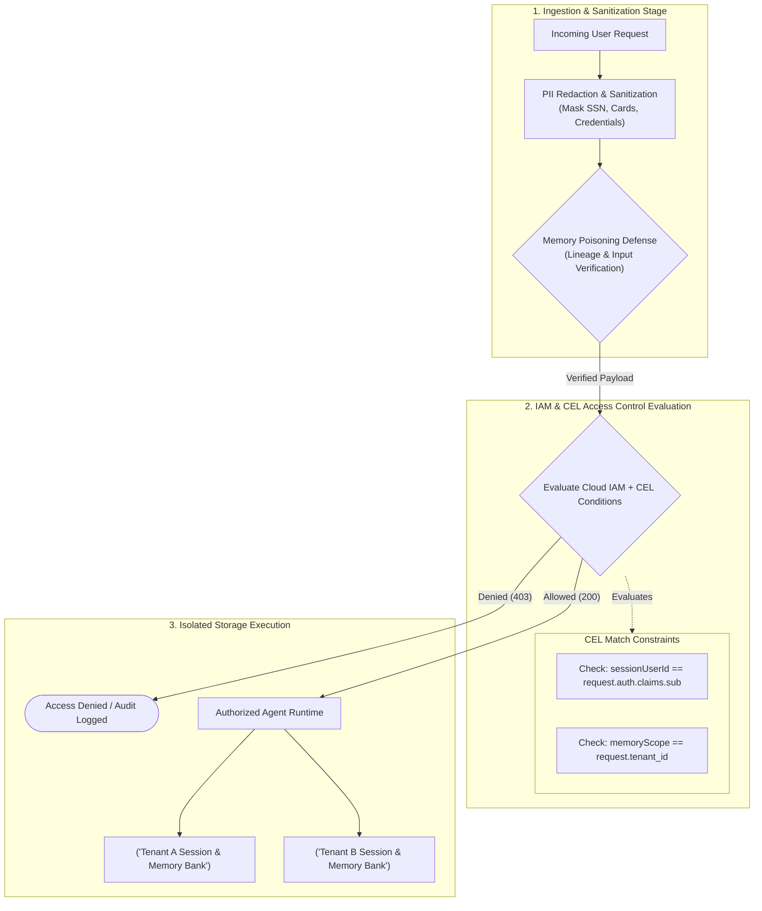

Enterprise Customer Agentic Engineering Use Cases

| Enterprise Domain | Applied Production Safeguard | Governance & Policy Mechanism | Business & Compliance Impact |
| --- | --- | --- | --- |
| Multi-Tenant Healthcare Portal | PII Redaction + Tenant-Level Data Isolation | Strips patient identifiers before memory consolidation; enforces ACLs by medical network ID. | Prevents cross-clinic data leakage and maintains HIPAA compliance for long-term patient interactions. |
| Regulated Global Fintech Banking | CEL IAM Conditions with sessionUserId | Evaluates request.auth.claims.sub == resource.sessionUserId dynamically via CEL. | Enforces zero-trust data access, ensuring banking advisors can only retrieve memory banks belonging to their assigned clients. |
| Autonomous Enterprise DevSecOps Agents | Memory Poisoning Defense + Lineage Verification | Validates prompt inputs against known command playbooks before updating procedural memory. | Defends automated CI/CD remediation pipelines against adversarial prompt injections designed to manipulate deploy scripts. |
| B2B SaaS Multi-Tenant Support Fleet | Fine-Grained memoryScope Partitioning | Scopes memory instances to enterprise subscription IDs using custom IAM labels. | Allows thousands of corporate customers to share unified LLM infrastructure without risk of cross-enterprise conversational spillage. |

---

### Core Concepts: Production Requirements for Sessions

| Pillar | Operational Definition | Enforcement Mechanism | Production Objective |
| --- | --- | --- | --- |
| Security & Privacy | Restricts session access strictly to the owner and scrubs sensitive payloads. | Per-user Access Control Lists (ACLs) + pre-storage PII redaction (e.g., Model Armor). | Prevents cross-user data exposure and ensures GDPR/CCPA regulatory compliance. |
| Data Integrity & Lifecycle Management | Maintains an auditable interaction trail while pruning inactive records. | Append-only chronological event streaming + automated Time-To-Live (TTL) expiration rules. | Preserves an immutable audit trail while preventing dead session accumulation. |
| Performance & Scalability | Optimizes network throughput and prompt processing overhead for stateless agents. | Event filtering, windowing, and session compaction prior to inference. | Minimizes round-trip network latency and reduces LLM inference costs. |

Production Session Engineering Matrix

| Dimension | Security & Privacy | Data Integrity & Lifecycle | Performance & Scalability |
| --- | --- | --- | --- |
| Primary Threat / Bottleneck | Cross-tenant data leaks, credential/PII leakage | Session data bloat, corrupted or skipped conversation states | Slow response times, token limit overflows |
| Mitigation Technique | Ownership verification, Model Armor filtering | Time-to-Live (TTL) deletion policies, append-only logs | History truncation, selective event hydration |
| Implementation Layer | Ingestion & Storage Gateways | Managed Storage (Agent Platform Sessions) | Agent Runtime / Prompt Compilation Pipeline |
| Compliance & Operational Impact | Zero-trust isolation; minimised blast radius | Automated housekeeping; auditable traces | Predictable sub-second latencies at scale |

Production Session Request Pipeline

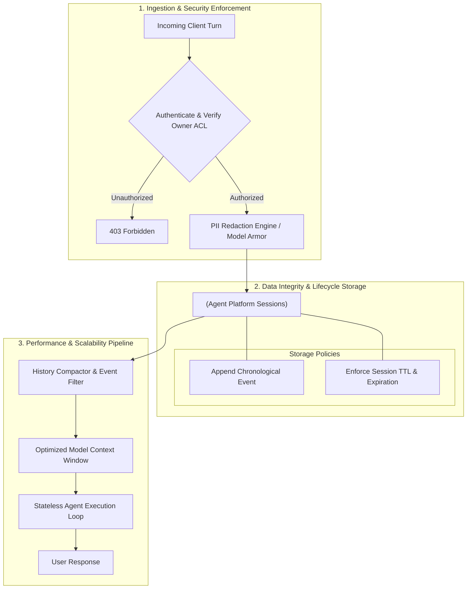

Enterprise Customer Agentic Engineering Use Cases

| Enterprise Domain | Applied Pillar | Implementation Architecture | Production & Business Value |
| --- | --- | --- | --- |
| Telehealth Consultation Agent | Security & Privacy | Model Armor PII redaction + patient-scoped ACLs | Masks patient health identifiers (PHI) before persisting session turns, fulfilling HIPAA requirements and preventing cross-patient data exposure. |
| Autonomous Banking Dispute Triage | Data Integrity & Lifecycle | Immutable append-only event stream with a 90-day TTL | Maintains a tamper-proof audit trail for regulatory compliance while automatically pruning inactive dispute sessions after resolution. |
| High-Volume E-Commerce Support | Performance & Scalability | Sliding-window session compaction for stateless agents | Compresses long multi-turn support threads into dense summaries, lowering token overhead and maintaining sub-second agent response times during peak shopping traffic. |
| Multi-Tenant SaaS DevOps Assistant | Security + Performance Hybrid | Tenant-isolated namespaces with selective event hydration | Ensures cloud remediation playbooks from one enterprise customer never spill into another, while loading only active incident logs to keep execution fast. |

---

Core Drivers of Long-Context Conversation Management

| Challenge Driver | Operational Manifestation | Technical Failure Mode | Compaction Mitigation Objective |
| --- | --- | --- | --- |
| Context Window Limits | Session history exceeds model max capacity. | Complete API request rejection / fatal error. | Truncates or compresses raw token payloads below hard context boundaries. |
| API Costs | Input token billing scales linearly with conversation turns. | Unsustainable cost inflation on long-running dialogues. | Eliminates redundant conversational filler to minimize cost per turn. |
| Inference Latency | Time-to-First-Token (TTFT) and processing duration degrade. | Sluggish user response times on turn N≫1. | Keeps prompts lean to sustain fast, interactive latency budgets. |
| Reasoning Quality | Long context noise introduces "lost-in-the-middle" effects. | Increased autoregressive errors, hallucination, and drift. | Preserves high-signal instructions and distilled facts while shedding noise. |

### Comparison Matrix: Session Compaction Strategies

| Strategy | Algorithmic Mechanism | Information Retention | Storage vs. Context Impact | ADK Implementation Class |
| --- | --- | --- | --- | --- |
| Keep Last N Turns | Sliding window over the most recent N invocations; drops older turns. | Low (Hard discard of historical context prior to window). | Context window filtered; historical events remain intact in storage. | ContextFilterPlugin(num_invocations_to_keep=N) |
| Token-Based Truncation | Counts cumulative prompt tokens; sheds earliest events exceeding threshold. | Moderate (Strict boundary enforcement). | Context strictly bounded; historical event store untouched. | Custom filter plugin / token-counter middleware. |
| Recursive Summarization | LLM condenses historical turn blocks into incremental summary snapshots. | High (Extracts semantic facts and distillations). | Summary replaces granular turns in model context; original turns archived. | EventsCompactionConfig(compaction_interval=N, overlap_size=M) |

### Comparison Matrix: Compaction Trigger Mechanisms

| Trigger Type | Firing Condition | Compute & Latency Overhead | System Predictability | Best-Fit Architectural Scenario |
| --- | --- | --- | --- | --- |
| Count-Based | Conversation event count reaches fixed threshold (e.g., every 5 turns). | Periodic, deterministic LLM summarization calls. | High (Fires on deterministic schedule). | Standard interactive dialogues with steady turn cadence. |
| Time-Based | User inactivity / idle timeout (e.g., 15–30 minutes of silence). | Offloaded completely to background idle periods. | Variable (Depends on user session rhythm). | Asynchronous customer support, ticket queues, multi-day threads. |
| Event-Based | Milestone or sub-goal completion detected by runtime/supervisor. | Targeted; executes only when meaningful state transitions occur. | Adaptive (Tied to workflow orchestration logic). | Structured multi-stage workflows (e.g., checkout completed, bug resolved). |

Long-Context Compaction & Memory Ingestion Flow

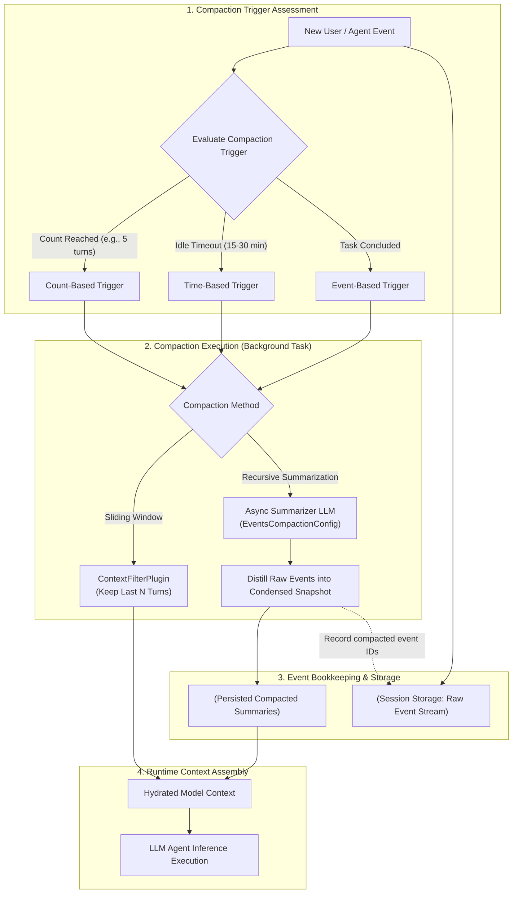

Enterprise Customer Agentic Engineering Use Cases

| Enterprise Domain | Applied Compaction Strategy | Triggering & Pipeline Mechanism | Business & Production Impact |
| --- | --- | --- | --- |
| Omnichannel Technical Support Desk | Recursive Summarization via EventsCompactionConfig | Count-Based: Runs LLM summarization every 5 turns with an overlap of 1 turn. | Preserves diagnostic details across a 40-turn troubleshooting session while keeping prompt token consumption constant, cutting per-ticket LLM API costs by up to 65%. |
| Enterprise B2B Collaborative Workspace | Idle Background Compaction | Time-Based: Triggers background summarization after 20 minutes of user inactivity. | Offloads expensive summarization tasks to non-blocking idle intervals, ensuring users experience zero latency spikes when resuming conversations the following morning. |
| Multi-Stage E-Commerce Checkout Concierge | ContextFilterPlugin + Goal Event Compaction | Event-Based: Compacts browsing history once the user adds items to the cart and enters the checkout phase. | Drops transient item browsing chatter from active context while retaining critical cart and address state, reducing reasoning errors during final payment authorization. |
| High-Frequency Financial Market Assistant | Sliding Window via ContextFilterPlugin | Count-Based: Strict num_invocations_to_keep=6 sliding window. | Enforces strict sub-800ms response latencies for rapid market queries without letting historical chart lookups degrade response speed. |

---

### Core Concepts & Pillars: Test & Evaluate Memory-Enabled Agents

| Pillar / Dimension | Evaluation Question | Measurement Mechanism | Architectural Focus |
| --- | --- | --- | --- |
| Generation Quality | "Is the agent remembering the right things?" | Comparison of extracted memories against a curated "Golden Set" of ideal facts. | Memory bank consolidation, noise filtering, and deduplication logic. |
| Retrieval Performance | "Can the agent find the right memory at the right time?" | Recall@K against target context within strict sub-second latency budgets. | Vector similarity search, embedding quality, and indexing speed on the "hot path". |
| End-to-End Task Success | "Does memory actually help the agent perform its job better?" | LLM-as-a-Judge scoring the final downstream agent output against golden answers. | Downstream task impact, persona adherence, and goal completion. |

Metrics Matrix: Memory Evaluation Taxonomy

| Layer | Metric | Mathematical / Operational Definition | Production Risk Addressed |
| --- | --- | --- | --- |
| Generation | Precision |  |  |

Total Memories Generated
Relevant Memories Generated

|  | Prevents "over-eager" memory systems that pollute the store with irrelevant conversational noise. |  |
| --- | --- | --- |
| Generation | Recall |  |

Total Expected Golden Facts
Relevant Facts Captured

|  | Prevents memory omissions where critical user constraints or facts are missed. |  |
| --- | --- | --- |
| Generation | F1-Score | 2× |

Precision+Recall
Precision×Recall

|  | Provides a balanced single quality score across noise rejection and coverage. |  |
| --- | --- | --- |
| Retrieval | Recall@K |  |

Total Relevant Memories Needed
Relevant Memories Found in Top K

|  | Ensures the right memory is present within the model's top-K context budget. |  |  |
| --- | --- | --- | --- |
| Retrieval | Latency | Milliseconds elapsed on the retrieval hot-path (e.g., <200 ms). | Prevents user-facing latency bottlenecks and timeouts during turn inference. |
| End-to-End | Task Accuracy | LLM Judge score evaluating downstream completion vs. golden benchmark. | Catches cases where memory is retrieved correctly but misapplied or ignored during reasoning. |

Continuous Evaluation & Refinement Lifecycle Flow

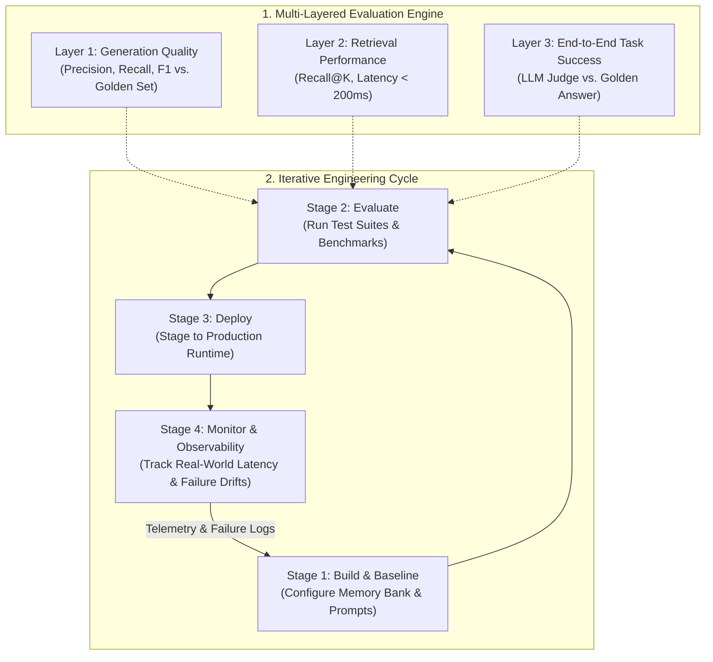

Enterprise Customer Agentic Engineering Use Cases

| Enterprise Domain | Evaluation Focus | Benchmark & Measurement Strategy | Production Impact |
| --- | --- | --- | --- |
| Private Banking Wealth Advisory | Generation Precision & LLM Judge Validation | Evaluates investor risk-profile extractions against a golden compliance set; audits final investment recommendations with an LLM compliance judge. | Prevents conversational chit-chat from corrupting risk profiles while verifying regulatory compliance on every recommendation. |
| High-Volume Telehealth Triage | Recall@K + Sub-200ms Hot-Path Latency | Tests symptom and allergy recall within top-3 retrieved records under strict <150 ms response thresholds. | Guarantees critical patient contraindications surface instantly during consultations without causing interface lag. |
| Autonomous Enterprise DevOps SRE | Generation Recall & End-to-End Resolution | Measures whether the agent captures all diagnostic steps across multi-service outages and verifies runbook completion rates. | Ensures post-incident remediation steps are preserved and used in future troubleshooting runs, reducing Mean Time to Resolution (MTTR). |
| B2B E-Commerce Customer Support | Precision vs. Latency Balancing | Uses F1-score benchmarks to tune memory extraction prompts, discarding non-essential small talk while maintaining rapid vector search. | Lowers total memory storage footprint and prevents token bloat in downstream prompts during peak shopping traffic. |

---

The Three Architectural Pillars of Memory

| Architectural Pillar | Core Engineering Definition | Primary Technical Mechanisms | System Objective |
| --- | --- | --- | --- |
| 1. Decoupling Memory Processing | Isolating compute-intensive memory generation from the user-facing chat loop. | Asynchronous non-blocking API calls, dedicated memory services, background event workers. | Prevents LLM extraction latencies from blocking conversational responsiveness. |
| 2. Resilience & Scalability | Ensuring uninterrupted availability and throughput under bursty, concurrent agent traffic. | Asynchronous message queuing (e.g., Pub/Sub, Kafka), retry policies with exponential backoff, dead-letter queues. | Absorbs traffic spikes and recovers gracefully from transient infrastructure failures. |
| 3. Data Consistency & Replication | Managing memory state synchronization across distributed regional instances. | Internal multi-region database replication, eventual consistency models, distributed conflict resolution. | Delivers low-latency global reads while preserving coherent user profiles worldwide. |

Architectural Matrix: Online vs. Offline Generation

| Dimension | Online (Real-Time) Memory Generation | Offline (Batch) Memory Processing |
| --- | --- | --- |
| Execution Trigger | Per-turn or per-interaction completion. | Scheduled batch jobs, nightly workflows, or data lake ETLs. |
| Conversational Freshness | Immediate; insights are active on subsequent turns. | Delayed until batch completion. |
| Primary Ingestion Source | Live incoming dialogue turns and tool execution outputs. | Historical transcripts, support tickets, CRM dumps, databases. |
| Compute & Cost Profile | Distributed, stream-oriented LLM API calls. | Bulk-rate LLM batch inference / distributed data pipelines. |
| Primary System Role | Conversational continuity, in-session adaptive personalization. | System bootstrapping, cold-start mitigation, historical profiling. |

Production Memory Architecture Flow

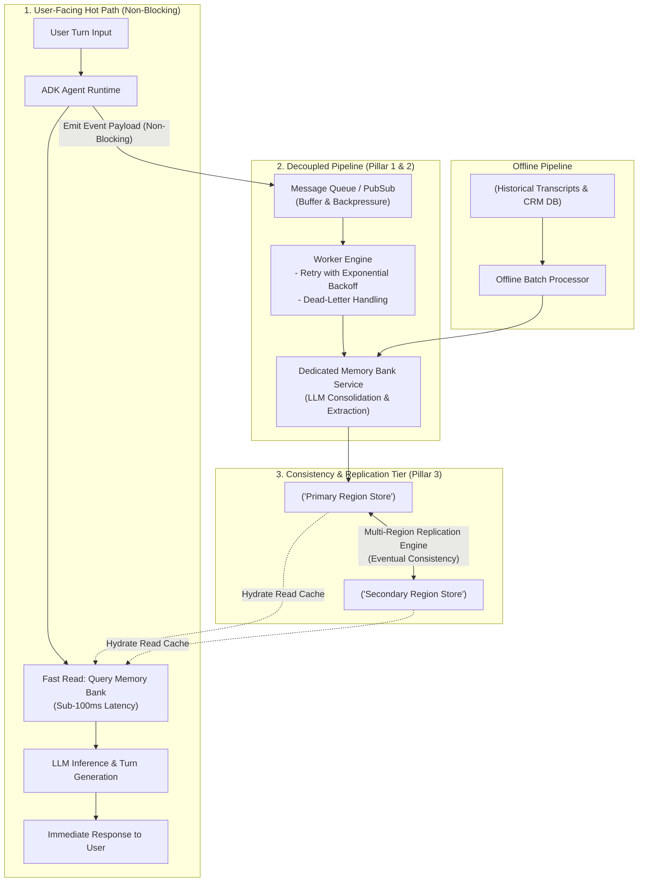

Enterprise Customer Agentic Engineering Use Cases

| Enterprise Domain | Architectural Pillar Applied | Implementation Architecture | Production & Business Value |
| --- | --- | --- | --- |
| Global Multinational Banking | Data Consistency & Replication | Multi-region active-active memory deployment with internal cross-region database replication. | Ensures a client traveling from Tokyo to New York retrieves their updated investment profile with sub-50ms latency without cross-region read penalties. |
| Enterprise Cloud Contact Center | Decoupling Memory Processing | Dual-path architecture: Non-blocking async API calls for live call turns + offline nightly batch ETL for historical tickets. | Prevents LLM extraction pipelines from adding jitter to live audio conversations while backfilling months of customer history. |
| High-Volume E-Commerce Flash Sales | Resilience & Scalability | Cloud Pub/Sub buffering between agent runtimes and memory extraction, backed by exponential backoff retries. | Shields memory databases from overload during sudden 10x traffic spikes, guaranteeing zero dropped customer interactions. |
| Field Service Diagnostic Copilot | Offline Batch Bootstrapping | Batch ingestion of machine telemetry logs and past repair tickets into the memory bank prior to field technician dispatch. | Solves the cold-start problem, providing technicians with historical context on machinery faults before their first on-site query. |

---

Core Principles: Mitigate Privacy & Security Risks

| Safeguard Principle | Threat Vector / Risk Addressed | Implementation Mechanism | System Objective |
| --- | --- | --- | --- |
| Data Isolation | Cross-tenant and cross-user data leakage. | Restrictive Access Control Lists (ACLs) partitioned at user/tenant scope. | Ensures an agent serving one user cannot access another user's stored memories. |
| User Control | Non-consensual data retention & privacy non-compliance. | Programmatic opt-out APIs and data deletion endpoints. | Provides full user authority over memory generation and archive purging. |
| PII Redaction | Regulatory non-compliance (GDPR, HIPAA) and data liability. | Automated regex/NER redaction pipelines applied before storage. | Preserves actionable insights without capturing personal liability data. |
| Data Sanitization | Prompt injection and Memory Poisoning attacks. | Pre-commit validation and safety layers (e.g., Model Armor). | Prevents untrusted user inputs from corrupting persistent long-term knowledge. |
| Procedural Anonymization | Identity reconstruction and data exfiltration. | Rigorous anonymization of shared and procedural playbooks. | Stops sensitive user attributes from leaking across organizational boundaries. |
| IAM Conditions Enforcement | Over-privileged access at the cloud project level. | Common Expression Language (CEL) conditions tied to resource attributes. | Granularly restricts session and memory APIs to authorized callers only. |

### Comparison Matrix: Granular IAM Access Control for Sessions & Memory

| Resource Type | Resource Attribute Used | CEL Attribute Function | Example Policy Role | Access Enforcement Pattern |
| --- | --- | --- | --- | --- |
| Sessions & Events | userId (arbitrary creator string) | api.getAttribute('[aiplatform.googleapis.com/sessionUserId](https://aiplatform.googleapis.com/sessionUserId)', '') | roles/aiplatform.sessionViewer | Restricts reading/writing session logs strictly to matching user identities (e.g., userA). |
| Memories & Memory Banks | scope (namespace / tenant identifier) | Dynamic memory scope attribute matching in CEL | roles/aiplatform.memoryViewer | Limits memory retrieval strictly to authorized application tiers, projects, or tenants. |

Security Safeguards & IAM Governance Flow

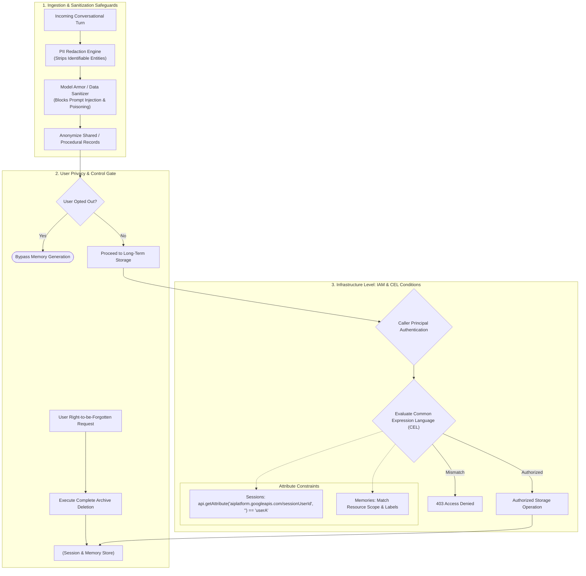

Enterprise Customer Agentic Engineering Use Cases

| Enterprise Domain | Applied Security Control | Infrastructure Implementation | Business & Compliance Impact |
| --- | --- | --- | --- |
| Regulated Digital Banking | Granular IAM Conditions (sessionUserId) | Restricts cloud session visibility using [aiplatform.googleapis.com/sessionUserId](https://aiplatform.googleapis.com/sessionUserId) == 'userA' binding on roles/aiplatform.sessionViewer. | Satisfies strict financial banking oversight by mathematically guaranteeing support operators only access their assigned customer's interaction traces. |
| Telehealth Clinical Assistant | PII Redaction + Automated Purging | Redacts clinical identifiers before memory bank commit; exposes programmatic archive deletion endpoints. | Complies with HIPAA and GDPR "Right to Be Forgotten" mandates while preserving diagnostic continuity across visits. |
| Autonomous Enterprise SRE Platform | Data Sanitization via Model Armor | Filters pipeline runbook logs through Model Armor before committing updates to procedural memories. | Neutralizes memory poisoning exploits where attackers inject malicious bash scripts into ticketing systems to hijack remediation agents. |
| Multi-Tenant SaaS HR Concierge | Anonymized Procedural Memories + Tenant ACLs | Strips employee names from onboarding playbooks while partitioning memory banks by corporate tenant ID. | Enables cross-company workflow efficiency improvements without exposing proprietary company policies or individual employee records. |

---

### Core Concepts: Course Summary & Capstone Architecture

| Course Module | Core Architecture Concept | Operational Mechanism | System Objective |
| --- | --- | --- | --- |
| Chapter 1: Context Engineering | Dynamic Context Window Assembly | Progressive disclosure & just-in-time skill loading. | Balances token cost and inference latency against prompt depth. |
| Chapter 2: Sessions | Low-Latency Conversation Container | Chronological events stream paired with mutable state scratchpad. | Tracks intermediate turn goals without losing conversational continuity. |
| Chapter 3: Memories | Long-Term Insight Extraction | Asynchronous LLM-driven consolidation & vector search. | Transforms the agent from a transactional tool into a personalized partner. |
| Chapter 4: Production Considerations | Infrastructure & Security Hardening | Token/event compaction, PII redaction, and CEL IAM isolation. | Safeguards data privacy, cuts API costs, and mitigates memory poisoning. |

End-to-End Architectural Capability Matrix

| Dimension | Chapter 1: Context Engineering | Chapter 2: Sessions | Chapter 3: Memories | Chapter 4: Production Hardening |
| --- | --- | --- | --- | --- |
| Data Scope | Single prompt payload | Single conversational thread | Multi-thread / Cross-session | System-wide infrastructure |
| Persistence Tier | In-flight context window | Ephemeral or database-backed | Managed Memory Bank / Vector index | Cloud IAM policies & gateways |
| Latency Impact | Direct impact on prompt TTFT | Sub-10ms session hydration | Decoupled background pipeline | Compaction preserves low latency |
| Failure Mode Addressed | Token overflow & hallucinations | Amnesia between turns | Lack of personalization / cold starts | Security breaches, PII leaks & high costs |

The Unified ADK Stateful Agent Lifecycle

```mermaid
flowchart TD
    subgraph ClientGateway["1. Ingestion & Security Gateway"]
        UserMsg[User Message] --> PIIFilter["PII Redaction & Sanitization<br/>(Model Armor / NER Masking)"]
        PIIFilter --> IAMCheck{"Evaluate Cloud IAM & CEL<br/>(sessionUserId == userA)"}
        IAMCheck -- Denied --> ErrBlock[403 Forbidden]
    end

    subgraph SessionLayer["2. Session Orchestration (Chapter 2)"]
        IAMCheck -- Authorized --> SessionSvc[SessionService]
        SessionSvc --> SessContainer["Active Session Container<br/>- events: Chronological Audit Log<br/>- state: Task Progress Scratchpad"]
    end

    subgraph MemoryLayer["3. Long-Term Memory Integration (Chapter 3)"]
        SessContainer -. "Async / Non-Blocking Ingestion" .-> MemETL["LLM Extraction & Consolidation"]
        MemETL --> MemBank["(Persistent Memory Bank)"]
        MemBank --> FastRetrieval["Semantic & Proactive Retrieval"]
    end

    subgraph CompactionContext["4. Context Engineering & Compaction (Chapter 1 & 4)"]
        SessContainer --> Compactor["Compaction Engine<br/>(Sliding Window / Recursive Summary)"]
        Compactor --> ContextBuilder["Dynamic Context Assembler<br/>- Progressive Skills<br/>- Injected User Memories<br/>- Compacted History"]
    end

    subgraph ModelExecution["5. Execution & Feedback Loop"]
        ContextBuilder --> LLMRun[LLM Agent Inference]
        LLMRun --> FinalResponse[Final Response to User]
        LLMRun -- "Append Turn Event & State Deltas" --> SessContainer
    end
```

Capstone Enterprise Customer Agentic Engineering Use Cases

| Enterprise Domain | Integrated Architectural Pattern | Implementation Stack | Comprehensive Business Impact |
| --- | --- | --- | --- |
| Autonomous Enterprise Wealth Management | Hybrid Session State + Scoped Memory Bank + CEL IAM | Jinja prompt assembling risk profile memories + DatabaseSessionService tracking ongoing financial trades. | Satisfies strict SEC/FINRA compliance via auditable event logs and PII masking, while recalling client life milestones across decades. |
| Global Multimodal Telehealth Concierge | PII Redaction + Recursive Compaction + Long-Term Clinical Memory | Decoupled async memory generation with Model Armor sanitization and 90-day TTL session stores. | Eliminates cross-patient data exposure, prevents multi-turn prompt token bloat during long triage calls, and maintains HIPAA compliance. |
| Enterprise SRE & Automated Cloud Remediation | Progressive Skill Loading + Anonymized Procedural Memory | Autonomous agents calling runbook skills on demand while learning past incident resolutions. | Drastically reduces Mean Time to Resolution (MTTR) by recalling past outage fixes without leaking internal cloud credentials. |
| Omnichannel Retail & E-Commerce Concierge | Event-Based Session Compaction + Managed User Profiles | Sliding-window ContextFilterPlugin for live checkout + persistent user style preferences. | Delivers fast sub-second response times during peak traffic events while retaining individual shopper sizing across web and mobile. |

You have completed the Craft ADK Agents with Persistent Memories course under the Build and Deploy Agents with Agent Development Kit (ADK) learning path.

Next steps for your certification journey:

Review entire course concepts as a study cheat sheet

Generate practice certification questions for ADK persistent memory
Skip to the latest Gemini result
