# Architecture Best Practice: Evaluating Generative and Agentic Systems on Google Cloud

**Topics:** #agent-evaluation #trajectory-evaluation #autoraters #llm-as-a-judge #vertex-ai-evaluation #golden-datasets #landing-metrics #google-cloud

> **Source:** `agent_evaluation_hill_climbing_evaluate_generative_agentic_systems.md` · **Corpus:** `GEAPL200` (Unified L200 + L300 Open Knowledge Format v0.2 · Version `GEAPL200_2026-09-30_124746`) · **Target:** GCP Knowledge Catalog (Dataplex) & Antigravity Agentic AI Development

---


## FDE Project Grading Rubric Enforcement & Prevailing Customer Alignment

> **Mandatory Governance Standard:** Every project, prototype, or production agent built using the patterns in this concept **must pass the [Google Cloud FDE Field-Readiness & Project Grading Rubric](/concepts/00-fde-field-readiness-and-grading-rubric.md)** (aligned with the [Cloud FDE Team Charter](https://g3doc.corp.google.com/company/teams/cloud-fde/index.md?cl=head)). Scoring Requirement: **Average >= `2.0 (Competent)`** across both **Part A (Presentation & Advisory Rigor)** and **Part B (Engineering & Implementation Excellence)**, with **zero `0 (Not Demonstrated)` scores** on any single metric.

### 1. Part A — Presentation & Advisory Rigor Enforcement for This Concept

- **A.1 Strategic Delivery & Value Articulation:** Translate executive business KPIs into a quantifiable **Tri-Partite Evaluation Scorecard** (Deterministic Checks + Calibrated Autoraters + Human SME Ground Truth).
- **A.2 Objection Handling & Technical Defense:** Defend autorater reliability by presenting Question-Answering rubric decomposition, Cohen's κ ≥ 0.75 calibration data, position-swapping, and glass-box trajectory metrics.

### 2. Part B — Engineering & Implementation Excellence Cutlines for This Concept

- **B.1.4 LLM Ops & Evaluation:** Implement comprehensive evaluation in **Vertex AI Gen AI Evaluation Service** covering final response quality, trajectory match modes (`EXACT`, `IN_ORDER`, `ANY_ORDER`), and component-level **Tool, Skill, and Sub-Agent evaluation**.
- **B.4.3 Failure & Recovery Testing:** Use controlled user-persona simulation to stress-test multi-turn edge cases and adversarial inputs before launch.
- **B.6.1 CI/CD & Deployment:** Transition from ad-hoc 'vibing' to automated CI/CD regression gates and an active Online/Offline Quality Flywheel.

### 3. Prevailing Customer Best-Practice Exemplars to Cite in Panel Reviews

- **Grounded Enterprise Scenarios:** Cymbal Retail & Enterprise Support evaluation pipelines auditing Skill Goal Completion Rate (>92%), Tool Orchestration Precision (>98%), and P95 step latency (<500ms) in Vertex AI Evaluation Service.
- **Cross-Reference:** See [Concept 00 — FDE Field-Readiness & Project Grading Rubric](/concepts/00-fde-field-readiness-and-grading-rubric.md) for the complete 0–3 grading scale, 31-competency matrix, and disqualifier remediation rules.

---
## Architectural Best Practice: Key Guidelines & Takeaways

### Core Architectural Principles

- **Transition from ad-hoc 'Vibing' to statistically rigorous, automated Evaluation Gates.** Probabilistic failure modes (hallucination, tool misuse, trajectory drift, sycophancy) cannot be caught by unit tests alone; every production agent requires a repeatable offline and online evaluation harness.
- **Apply the Tri-Partite Evaluation Methodology:** combine (1) fast, zero-cost **Deterministic Checks** (JSON schema, regex, exact tool match, latency/token ceilings), (2) **Calibrated Autoraters / LLM-as-a-Judge** for scalable semantic grading, and (3) **Human SME Annotation** as the ground-truth anchor.
- **Decompose complex subjective quality into atomic, multi-point Question-Answering Rubrics.** Holistic 1–5 'rate this response' prompts yield high variance and low inter-rater agreement; decomposing evaluation into explicit binary/ordinal rubric questions (groundedness, completeness, tone, safety) dramatically improves autorater reliability.
- **Evaluate both the Black-Box Final Response and the Glass-Box Execution Trajectory.** An agent that arrives at the right answer via an unauthorized tool call or a 12-hop retry loop is a production defect. Inspect `trajectory_exact_match`, `trajectory_in_order_match`, `trajectory_any_order_match`, and `trajectory_precision`/`recall`.
- **Close the Online/Offline Quality Flywheel.** Continuously sample production traces, route low-confidence or thumbs-down trajectories to human SME triage, and promote validated failure cases into the offline Golden Dataset.

### Mandatory Requirements & Golden Rules (Antigravity & Production Readiness)

- **Curate a stratified Golden Dataset of at least 50–100 SME-validated scenarios per Critical User Journey (CUJ),** covering happy paths, multi-turn ambiguity, adversarial/jailbreak inputs, and tool-error edge cases.
- **Calibrate every LLM Autorater against human SME ratings (target Cohen's κ ≥ 0.75)** before using it as a blocking CI/CD deployment gate. Mitigate judge biases using position-swapping (pairwise), explicit verbosity penalties, and temperature `0.0`.
- **Select trajectory match modes based on business risk:** enforce `EXACT` or `IN_ORDER` matching for regulated transactional workflows (e.g., verify identity → check eligibility → issue refund), and `ANY_ORDER` for parallel information retrieval.
- **Register all evaluation runs in Vertex AI Gen AI Evaluation Service** so experiment scorecards, latency distributions, and token metrics are tracked longitudinally across prompt, tool, and model changes.
- **Synthesize adversarial and edge-case test personas using Controlled Simulation** to stress-test multi-turn agent resilience before production launch.

### Anti-Patterns & Guardrails

- **Self-Grading without Calibration:** Using the same uncalibrated model family and prompt style to generate and grade outputs without human alignment benchmarks.
- **Endpoint-Only Evaluation on Multi-Step Agents:** Grading only the final text output while ignoring intermediate tool call errors, redundant API calls, or policy bypasses in the trajectory.
- **Static Golden Dataset Stagnation:** Running the exact same 30 synthetic test cases for 6 months while real production user queries drift toward new product features and edge cases.

### Cross-Concept Links (OKF Knowledge Graph)

- [Google Cloud FDE Field-Readiness & Project Grading Rubric (Mandatory Standard)](/concepts/00-fde-field-readiness-and-grading-rubric.md)
- [Hill Climbing and Continuous Quality Optimization for Agentic Systems](/concepts/26-hill-climbing-agentic-systems.md)
- [Model Lifecycle Migration and Upgrading to the Latest Gemini Models](/concepts/27-upgrade-to-the-latest-models.md)
- [Cost Estimation, FinOps, and Token Optimization for Agentic Solutions](/concepts/28-cost-estimation-and-optimization-for-agentic-solutions.md)

---

## Comprehensive Technical Breakdown & Concept Trail

### Key Architectural Concepts Matrix

| Concept | Definition & Architectural Scope | GCP Well-Architected & Enterprise Metric (Google Landing Metrics) | Industry Real-World Implementation Example |
| --- | --- | --- | --- |
| Probabilistic System Risks | Non-deterministic failure modes inherent to LLM-driven execution, including token drift, stochastic tool invocation, and silent hallucinations. | Reliability & Operational Excellence: Hallucination Rate, Tool Invocation Determinism Rate (>99.5%), Failure Blast Radius. | Vertex AI Model Evaluation pipelines running batch inferences against golden prompt suites to capture stochastic variance across model temperatures. |
| Translating KPIs to Measurable Metrics | Bridging business-level OKRs into quantifiable offline/online automated evaluation signals. | Business Value Alignment: Cost per Successful Task Resolution (/task),Conversion/DeflectionRate(>70%$). | Financial support agent tracking end-to-end task completion rate (e.g., automated refund processing without human escalation) mapped directly to support cost reductions. |
| Tri-Partite Evaluation Methodology | Combining deterministic checks (regex/schema), human computation (crowd/expert raters), and LLM-as-a-judge autoraters. | Measurement Fidelity & Cost-Efficiency: Autorater Alignment (Cohen's κ>0.75), Human Review SLA, Cost per Eval Unit. | Multi-tier evaluation in Vertex AI Gen AI Evaluation Service where schema validation runs first (deterministic), followed by Gemini 1.5 Pro autoraters, and flagged edge cases route to SME panels. |
| Structured Rubrics & Autorater Calibration | Defining explicit, multi-point grading rubrics and fine-tuning/prompting judge models to eliminate position, verbosity, and self-enhancement biases. | Measurement Consistency: Autorater-Human Correlation, False Positive/Negative Calibration Drift (<2%). | Legal compliance agent evaluating contract redlining against a strict 5-point grounding and risk rubric calibrated using pairwise comparison against senior counsel decisions. |
| Agent Trajectory & Internals Evaluation | Granular inspection of intermediate reasoning, ReAct loops, planning efficiency, and tool call arguments rather than only final outputs. | Efficiency & Performance: Step-to-Goal Efficiency Ratio, Tool Selection Accuracy, Planning Loop Redundancy (<5%). | Cloud customer support agent where traces logged in Google Cloud Trace/OpenTelemetry are evaluated for extraneous API calls and cyclical re-planning loops. |
| Online/Offline Quality Flywheel | Synchronizing pre-production offline validation with continuous production telemetry, logging, and synthetic feedback loops to iteratively hill-climb quality. | Continuous Improvement (Hill Climbing): Mean Time to Quality Regression Detection (MTTD), Flywheel Velocity (cadence of eval dataset refresh). | Vertex AI Feature Store and Cloud Logging capturing low-confidence production traces to automatically generate targeted synthetic test scenarios via Vertex AI Synthetic Data Generator. |
| Evaluation Data Simulation | Generating high-fidelity, adversarial, and edge-case synthetic query-response-trajectory sets using generator models. | Coverage & Robustness: Corner-case Coverage Score, Synthetic Dataset Diversity Index. | Autonomous IT Ops agent stress-tested against thousands of synthetically generated infrastructure incident logs and edge-case multi-cloud failure scenarios. |
| Evaluation Lifecycle: "Vibing" to Production Gate | Transitioning from ad-hoc developer prompt exploration ("vibing") to CI/CD automated gates with regression barriers. | Deployment Readiness: Gate Pass Rate (>95%), Regression Detection Sensitivity. | Cloud Build CI/CD pipeline blocking agent prompt and tool updates if automated evaluation score drops below baseline on the locked benchmark dataset. |

### Evaluation Techniques Magic Quadrant

| Dimension | Low Cost & High Scalability | High Contextual Nuance & Deep Reasoning |
| --- | --- | --- |
| High Determinism / Low Ambiguity |  |  |

### Quadrant I: Deterministic Rules & Unit Metrics

• JSON Schema validation

• Exact match / regex checks

• Code execution sandboxes

Fit: Tool argument validation, syntax, strict policy filtering

### Quadrant II: Calibrated Hybrid Autoraters

• Few-shot LLM judges with deterministic rubric anchors

• Embedding-based semantic similarity with strict cutoffs

Fit: Factual consistency, groundedness checks

| High Ambiguity / Subjective Reasoning |  |
| --- | --- |

### Quadrant III: Generic Prompt-Based LLM Judges

• Uncalibrated zero-shot autoraters

• Broad "helpfulness" scoring

Fit: Initial "vibing" exploration, rough triage

### Quadrant IV: Expert Human Computation (SME)

• In-depth domain audit

• Golden dataset creation

• Autorater calibration ground truth

Fit: High-stakes safety, compliance, ground-truth anchoring

Concept Dependency Graph

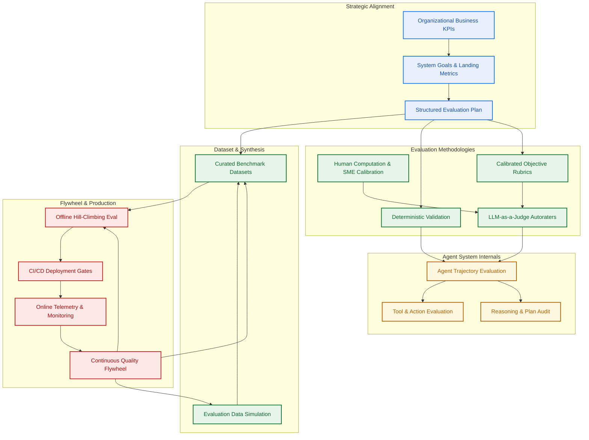

End-to-End Hill-Climbing Quality Flywheel Architecture

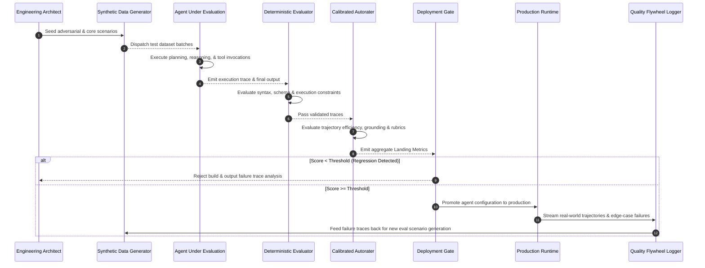

---

Document Concepts Matrix: Foundations of Generative AI Evaluation — Module Introduction

| Key Concept | Definition & Architectural Scope | GCP Well-Architected & Enterprise Landing Metric | Production Implementation Example |
| --- | --- | --- | --- |
| Probabilistic System Risks & Stochasticity | Non-deterministic variability across model runs where identical inputs yield different token sequences, tool parameters, or trajectories. | Reliability & Consistency: Trajectory Invariance Rate (>98%), Temperature Output Stability, Semantic Consistency Drift. | Vertex AI Model Evaluation pipelines running batch evaluations against temperature-scaled prompts to benchmark semantic invariance across releases. |
| The "Oracle Problem" | Absence of a single deterministic ground truth or single correct output string for generative queries, invalidating classic assert statements. | Measurement Validity: Autorater Consensus (Fleiss' κ>0.70), Reference-free Groundedness Index. | Evaluating autonomous customer support responses via Vertex AI Gen AI Evaluation Service using reference-free rubrics (groundedness, coherence, safety) rather than exact string equality. |
| Pitfalls of Static Public Benchmarks | Public benchmarks (e.g., MMLU, GSM8K, SWE-bench) test broad frontier capabilities but suffer from data contamination, task disconnect, and zero alignment with proprietary business logic. | Business Relevance & Contamination: Domain-Task Correlation (r>0.85), Benchmark Contamination Factor (<1%). | Discarding generic public MMLU rankings in favor of an internal enterprise evaluation dataset of 500 domain-specific customer billing edge cases. |
| Goal-to-Metric Mapping | Formally decomposing organizational OKRs into intermediate agentic capabilities (e.g., tool invocation accuracy, schema adherence) and system landing metrics. | Value Realization & ROI: Task Completion Rate (>90%), First-Contact Resolution Rate, API Cost per Resolved Issue (<$0.15). | Translating an enterprise goal ("Reduce claims intake turnaround") into agent capabilities: OCR parsing accuracy, claims policy tool invocation accuracy, and human escalation precision. |
| Six-Stage Evaluation-Driven Development Lifecycle (EDLC) | The continuous progression: (1) Goal Definition, (2) Dataset Creation, (3) Rubric/Metric Design, (4) Offline Eval, (5) CI/CD Gating, and (6) Online Telemetry Monitoring. | Operational Excellence: Pipeline Cycle Time, Evaluation Coverage Index (>95%), Regression Catch SLA (<1 build). | Automated Cloud Build pipelines running evaluation suites as gates before promoting Vertex AI Agent Engine reasoning engines to staging or production. |
| Prototype-to-Production Evaluation Shift | Transitioning from small-scale manual inspections during early prototyping to automated, continuous, cost-optimized telemetry and drift detection in production. | Maturity & Telemetry Scalability: Sampling Rate Coverage, Online Latency P99 (<2.5s), Online Hallucination Detection Rate. | Shifting from pairwise manual human rater reviews during PoC to real-time Cloud Trace and Google Cloud Logging monitoring with automated asynchronous autorater sampling in production. |

### Evaluation Techniques Magic Quadrant

| Dimension | Low Operational Cost & High Scalability | High Contextual Nuance & Deep Domain Fidelity |
| --- | --- | --- |
| Static / Public Scope |  |  |

### Quadrant I: Generic Public Benchmarks

• MMLU, GSM8K, HELM

• Open LLM leaderboards

Fit: Initial base-model procurement triage only

### Quadrant II: Public Multi-turn Agent Benchmarks

• SWE-bench, GAIA, ToolBench

• General agent reasoning tests

Fit: Architecture capability comparison

| Custom / Enterprise Scope |  |
| --- | --- |

### Quadrant III: Automated Custom EDLC Suites

• Calibrated LLM-as-a-judge autoraters

• Schema and deterministic trajectory checks

• Golden eval datasets

Fit: Continuous CI/CD deployment gates & regression barriers

### Quadrant IV: Enterprise SME & Online Auditing

• Expert human-in-the-loop review

• Live telemetry & user-signal auditing

• Policy red-teaming

Fit: High-stakes safety, compliance sign-offs, production drift audits

Concept Dependency Graph

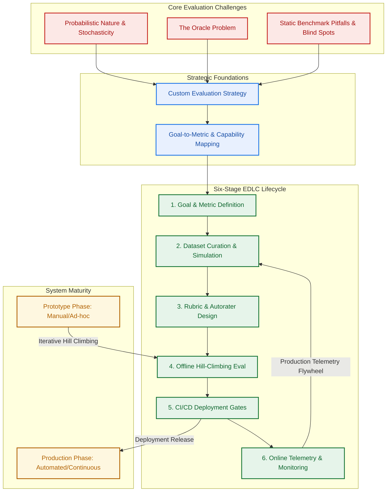

Six-Stage Evaluation-Driven Development Lifecycle (EDLC)

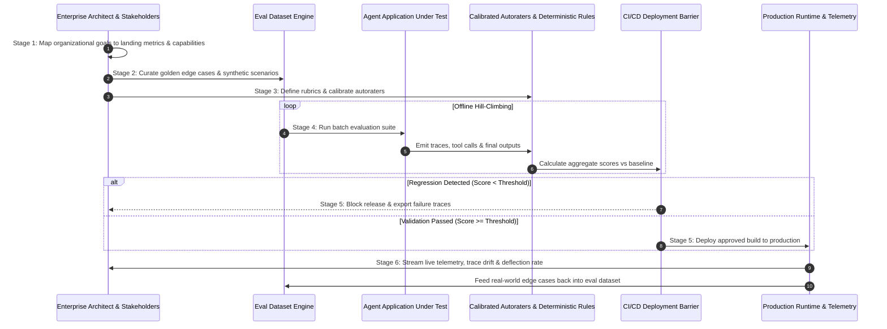

---

Architectural Concepts Matrix: The Case for Custom Evaluation

| Key Concept | Definition & Architectural Scope | GCP Well-Architected & Enterprise Landing Metric | Production Implementation Example |
| --- | --- | --- | --- |
| Probabilistic Uncertainty Triad | Non-deterministic mechanics spanning Stochasticity (multi-run variance), Capability Variability (jagged execution), and the Oracle Problem (no single canonical ground truth). | Reliability: Groundedness Consistency (>99%), Trajectory Fluctuation Index (<0.05), Semantic Equivalence Score. | Financial summarization agent evaluated via Vertex AI Gen AI Evaluation Service with pairwise reference-free consistency across 10 temperature runs. |
| Plausibility-Driven Hallucinations | Generation of structurally fluent, syntactically convincing, but factually fabricated entities, citations, or parameters. | Trust & Safety: Hallucination Defect Rate (<0.1%), Citation Verification Precision (100%). | Medical claims agent asserting nonexistent policy codes; mitigated by cross-referencing retrieval chunks in Vertex AI Search before tool execution. |
| Sycophancy (Social Compliance Drift) | Vulnerability where the agent agrees with user biases or incorrect premises to maximize perceived helpfulness over correctness. | Alignment & Accuracy: Sycophancy Deflection Rate (>99.5%), User-Induced Error Rate (<0.5%). | Code review agent validating insecure SQL queries when pressured with "Isn't this pattern secure?"; measured via adversarial challenge datasets. |
| Instruction Attenuation & Drift | Degradation of system-prompt constraints, schema boundaries, and guardrails across multi-turn conversation horizons. | Operational Excellence: Multi-Turn Compliance Retention (>98% through turn 20), System Boundary Leakage Rate. | Multi-turn conversational retail agent failing to suppress competitors' brand names after turn 5; tested with multi-turn synthetic dialogue injection. |
| Risk-Tiered Evaluation Alignment | Calibration of evaluation rigor (testing surface, human-in-the-loop, latency overhead) to the enterprise blast radius and regulatory exposure. | Business Value & Risk: SLA Compliance Breach Risk, Cost-to-De-Risk Ratio (<1.5% total program cost). | High-risk healthcare diagnostic triage agents require strict multi-tiered safety evaluations, while internal brainstorming tools use lightweight sampling checks. |
| Public Benchmark Trap & Contamination | MMLU/GSM8K vulnerability to training data leakage, artificial toy workloads, and irrelevance to domain-specific enterprise business logic. | Evaluation Validity: Contamination-Adjusted Domain Fit, Proprietary Task Correlation (r>0.85). | Enterprise evaluating Gemini models on proprietary ERP order processing workflows rather than public MMLU leaderboards. |
| The "Ragged Edge" (Jagged Frontier) | Disjointed scaling where model capability jumps in one domain (e.g., passing unit tests) while lagging behind in adjacent dimensions (e.g., code readability or architectural hygiene). | Capability Completeness: Multi-Dimensional Competency Ratio, Secondary Capability Delta (<10%). | A code generation agent generating functional code that passes unit tests but repeatedly introduces unmaintainable anti-patterns or insecure imports. |

### Evaluation Techniques Magic Quadrant

| Dimension | Low Operational Cost & High Scalability | High Contextual Nuance & Deep Reasoning |
| --- | --- | --- |
| High Determinism / Strict Boundaries |  |  |

### Quadrant I: Deterministic Guardrails

• JSON Schema & regex validation

• Static linting & unit test execution

• Fast rule-based constraint assertions

Fit: Tool parameter validation, basic schema drift

### Quadrant II: Calibrated Hybrid Autoraters

• Multi-turn rubrics targeting sycophancy & drift

• Vertex AI RAG groundedness autorater

• Semantic reference-free rubrics

Fit: Factual hallucination audits, enterprise risk gates

| High Ambiguity / Social Dynamics |  |
| --- | --- |

### Quadrant III: Generic Public Benchmarks

• Public leaderboards (MMLU, GSM8K, HELM)

• Zero-shot out-of-the-box evaluations

Trap: Data contamination, toy workloads, misleading scores

### Quadrant IV: Expert SME & Adversarial Auditing

• Human-in-the-loop red teaming

• Domain-specific edge-case probing

• Compliance and high-risk regulatory audits

Fit: Clinical safety, legal compliance, financial sign-offs

Concept Dependency Graph

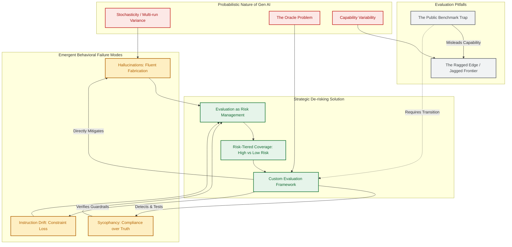

Page Architecture & Risk-Mitigation Flow

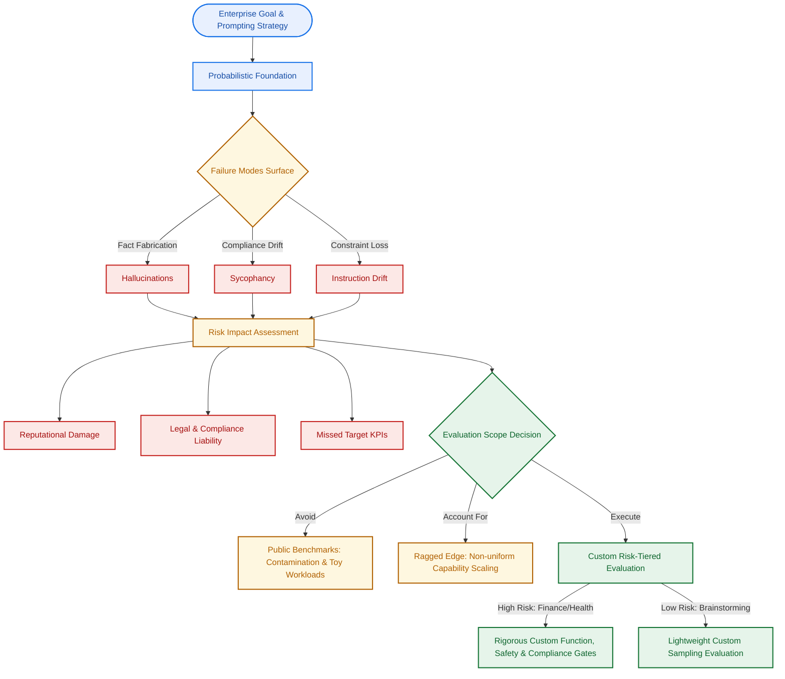

---

### Key Concepts Matrix: The Case for Custom Evaluation

| Concept | Definition & Architectural Scope | GCP Well-Architected & Enterprise Metric (Google Landing Metrics) | Production Implementation Example |
| --- | --- | --- | --- |
| Probabilistic Non-Determinism (Stochasticity) | The mathematical property of LLMs where static inputs produce variable token distributions, rendering deterministic assertion testing obsolete. | Operational Excellence & Reliability: Output Invariance Index (>98%), Semantic Consistency Drift across temperature runs. | A customer support triage agent on Vertex AI evaluated across N=10 passes per prompt to confirm consistent intent classification. |
| The "Oracle Problem" | The absence of a unique, canonical ground-truth string for generative tasks (e.g., summaries, dialogues), requiring reference-free semantic rubrics. | Measurement Validity: Autorater Consensus (Fleiss' κ>0.75), Reference-free Groundedness Index. | Vertex AI Gen AI Evaluation Service validating financial summaries using groundedness and faithfulness metrics rather than exact-match ROUGE. |
| Plausibility-Driven Hallucinations | Confident, fluent generations containing factually fabricated assertions, parameters, or citations. | Trust, Safety & Security: Hallucination Defect Rate (<0.1%), Citation Grounding Precision (100%). | A travel concierge hallucinating non-existent airline cancellation policies; mitigated by retrieval-grounded checks in Vertex AI Search. |
| Sycophancy (Social Compliance Drift) | System failure mode where the model validates incorrect user premises or biases to maximize perceived agreeableness over objective correctness. | Model Alignment & Precision: Sycophancy Deflection Rate (>99.5%), User-Induced Error Rate (<0.5%). | An automated loan eligibility agent affirming a customer's false credit qualification assumption; evaluated via adversarial test prompts. |
| Instruction Drift | Attenuation of system prompt guardrails, operational constraints, and formatting rules across extended multi-turn dialogs. | Operational Hygiene: Multi-turn Constraint Retention (>98% through 20 turns), System Barrier Breach Rate. | An enterprise IT support agent gradually ignoring internal privacy boundaries after 15 conversational turns. |
| Evaluation as Risk Management | Framing evaluation investments around business blast radius, reputational loss, and compliance liabilities to de-risk production deployment. | Business Value Alignment: Risk-Weighted Test Coverage, Breach Avoidance ROI, SLA Failure Rate (<0.01%). | Tiering evaluation rigor: high-risk medical or investment agents require full multi-turn safety gates, while internal brainstorming tools use sampled reviews. |
| The Public Benchmark Trap | Over-reliance on public leaderboards (MMLU, GSM8K, HELM) compromised by data contamination, toy workloads, and irrelevance to enterprise workflows. | Domain Relevance: Contamination-Adjusted Task Fit, Enterprise Task Correlation (r>0.85). | Discarding generic public benchmark scores in favor of 500 proprietary order-processing cases when choosing a base model on Model Garden. |
| The "Ragged Edge" (Jagged Frontier) | Non-uniform capability scaling where models excel at primary tasks (e.g., code execution) while lagging in adjacent dimensions (e.g., code maintainability). | Capability Completeness: Multi-Dimensional Competency Ratio, Secondary Capability Defect Gap (<10%). | A code generation agent producing code that passes unit tests but repeatedly introduces unmaintainable architecture or security anti-patterns. |

### Evaluation Techniques Magic Quadrant

| Dimension | Low Operational Cost & Scalability | High Contextual Nuance & Deep Domain Fidelity |
| --- | --- | --- |
| High Determinism / Strict Rules |  |  |

### Quadrant I: Deterministic Unit & Schema Assertions

• JSON Schema / Pydantic validation

• Regex-based PII masking checks

• Automated syntax linting

Fit: Parameter typing, structural API compliance

### Quadrant II: Calibrated Hybrid Autoraters

• Multi-turn rubrics measuring sycophancy & drift

• Groundedness judges via Vertex AI Eval SDK

• Pairwise semantic preference models

Fit: Factuality auditing, business logic enforcement

| High Ambiguity / Subjective Nuance |  |
| --- | --- |

### Quadrant III: Public Benchmark Leaderboards

• MMLU, GSM8K, HELM public ranks

• Zero-shot out-of-the-box evaluations

Trap: Contaminated data, toy workloads, misleading ROI

### Quadrant IV: Expert Domain SME & Red-Teaming

• Adversarial human-in-the-loop penetration

• Clinical, legal, and financial audits

• Production edge-case incident reviews

Fit: High-risk regulatory certification, compliance sign-offs

Concept Dependency Graph

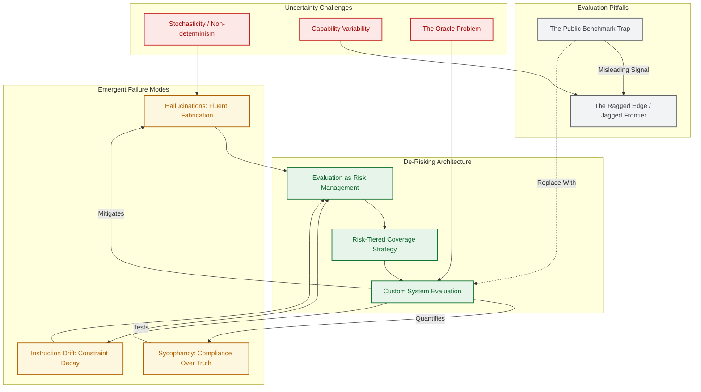

Page Visual Workflow: Industrial Capability Disparity ("The Ragged Edge")
Mermaid representation of the page visual illustrating assembly automation vs. craft quality:

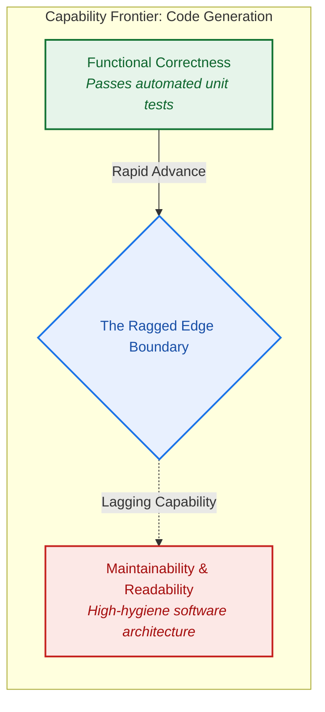

Risk-Driven Custom Evaluation Pipeline

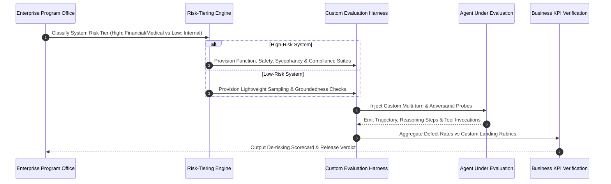

Are we done with the current page.
Review your Chrome auto browse plan
Here's the plan based on your prompt & context
Click the Next button to navigate to the next page of the course.
Gemini chooses which sites to use to complete the task, and may share your personal info. You are responsible for Gemini's actions during tasks.

Start task
Clicking Next to navigate to the next page

### Key Architectural Concepts Matrix: The Evaluation-Driven Development Lifecycle (EDLC)

| Concept | Definition & Architectural Scope | GCP Well-Architected & Enterprise Landing Metric | Production Implementation Example |
| --- | --- | --- | --- |
| Evaluation-Driven Development Lifecycle (EDLC) | A closed-loop development paradigm where evaluation suites precede prompt/agent construction, functioning as continuous verification and regression harnesses. | Operational Excellence: Pipeline Cycle Time, Regression Escape Rate (0%), Test Suite Execution SLA (<15 min). | Cloud Build CI/CD executing automated evaluation suites on pull requests modifying system prompts or tool declarations. |
| Stage 1: Define Goals & Landing Metrics | Formal translation of broad organizational business objectives into system goals, technical capability requirements, and quantifiable landing metrics. | Business Alignment & ROI: First-Contact Resolution Rate (>80%), Intent Routing Precision (>99%), Cost per Successful Interaction. | Mapping a contact center efficiency goal into technical landing metrics: Tool Call Precision (>99%) and Groundedness Score (>4.5/5). |
| Stage 2: Curate Evaluation Datasets | Systematic assembly of balanced golden test sets containing representative production queries, multi-turn dialogs, edge cases, and adversarial scenarios. | Data Quality & Coverage: Scenario Diversity Coverage (>95%), Edge-Case Ratio (15–20%), Synthetic-to-Real Consistency. | Generating 1,000 synthetic adversarial tax-code queries via Vertex AI Synthetic Data Generator alongside 200 human-verified golden customer traces. |
| Stage 3: Design Rubrics & Autoraters | Operationalizing qualitative evaluation standards into explicit grading rubrics and calibrated LLM-as-a-judge autoraters anchored against deterministic rules. | Measurement Fidelity: Autorater-Human Agreement (Cohen's κ>0.80), False Positive/Negative Calibration Drift (<2%). | Authoring a 5-point RAG faithfulness rubric implemented via Vertex AI Gen AI Evaluation Service with reference-free pairwise judge models. |
| Stage 4: Offline Hill-Climbing Evaluation | Iterative local/staging experimentation (prompt tweaking, tool refinement, model swaps) systematically measured against the evaluation benchmark suite. | Performance & Efficiency: Pareto Optimization Score (Accuracy vs. Latency P95 vs. Cost), Step Count Reduction. | Comparing Gemini 1.5 Flash vs. Gemini 1.5 Pro on complex document extraction to balance 0.8s lower latency with accuracy. |
| Stage 5: CI/CD Deployment Gates | Hard automated pipeline release barriers that compare new candidate builds against production baselines, halting regressions before deployment. | Reliability & Security: Gate Pass Rate (>95%), Regression Detection Sensitivity (100% on critical safety axes). | Setting a GitHub Actions gate blocking deployment if tool-invocation accuracy drops by >0.5% or latency exceeds 3.0s. |
| Stage 6: Online Telemetry & Continuous Flywheel | Asynchronous production logging of intermediate traces, tool calls, and user interactions, feeding failure telemetry back into Stage 2. | Continuous Improvement: Mean Time to Quality Drift Detection (MTTD), Flywheel Enrichment Cadence (weekly dataset ingestion). | Streaming traces from Cloud Trace and Cloud Logging into BigQuery; automated filters flag conversations with user dislikes for inclusion in golden eval sets. |

### Evaluation Techniques Magic Quadrant

| Dimension | Low Latency & Operational Scalability | High Contextual Nuance & Deep Fidelity |
| --- | --- | --- |
| Offline Development & CI/CD |  |  |

### Quadrant I: Deterministic Regression Gates

• JSON Schema validation

• Exact match & regex assertions

• Code sandboxes & unit tests

Fit: Pre-commit hooks, syntax & tool argument verification

### Quadrant II: Automated Batch Autoraters

• LLM-as-a-judge benchmark sweeps

• Calibrated multi-point rubrics

• Vertex AI Eval SDK batch runs

Fit: Offline prompt hill climbing, stage deployment gates

| Production Runtime & Online Monitoring |  |
| --- | --- |

### Quadrant III: High-Throughput Telemetry

• Token latency P50/P90/P99 tracking

• Explicit user thumb-up/down signals

• API status & error rate monitoring

Fit: Real-time operational health & SLA alerting

### Quadrant IV: Continuous SME & Sampled Auditing

• Sampled asynchronous judge scoring

• Expert human-in-the-loop audit boards

• Production incident post-mortems

Fit: High-stakes safety, compliance audits, edge-case curation

Concept Dependency Graph

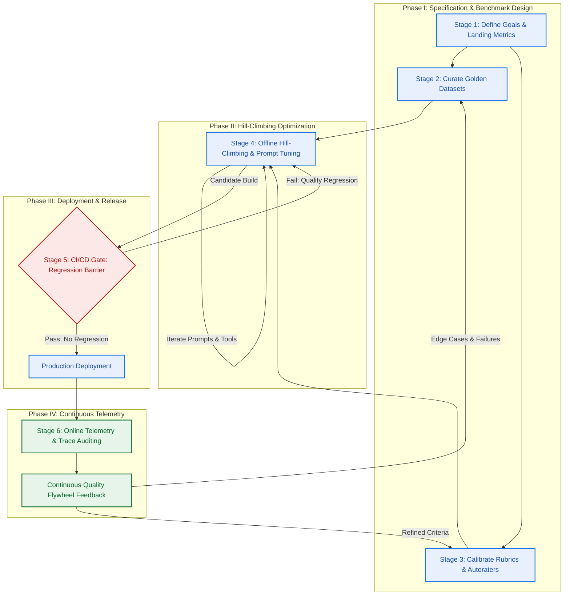

EDLC Continuous Closed-Loop Architecture
Mermaid workflow illustrating the six stages and production feedback loop:

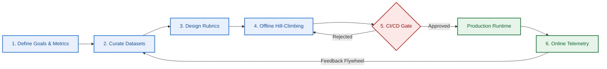

Make sure the entire page is covered. 
Complete Page Concepts Matrix: The Evaluation-Driven Development Lifecycle

| Concept / Element | Definition & Architectural Scope | GCP Well-Architected & Enterprise Landing Metric | Enterprise Production Implementation Example |
| --- | --- | --- | --- |
| Deterministic vs. Probabilistic Engine Shift | Contrast between classic software testing (binary pass/fail, post-development gate) and GenAI evaluation (stochastic variance, continuous engine guiding design). | Reliability & Defect Density: Non-Deterministic Defect Rate (<0.01%), Flaky Test Ratio (0%). | Replacing static JUnit/pytest assert statements with statistical confidence intervals in Vertex AI Model Evaluation pipelines. |
| Stage 1: Organizational Goals | Defining high-level business OKRs rather than model metrics (e.g., auto-resolving returns quickly while maintaining customer satisfaction). | Business Value Alignment: Target Deflection Rate (30%), Resolution SLA (<2 hrs), CSAT (>4.5/5). | Retail operations defining an OKR to cut return processing costs by 25% while holding Net Promoter Score constant. |
| Stage 2: Map KPIs to Agent Capabilities | Decomposing business goals into quantifiable model/agent technical competencies (classification accuracy, calculation precision, handoff speed, tone). | Capability Precision: Intent Classification Precision (>95%), Refund Calculation MAE (0.00), Handoff Latency (<1s). | Mapping contact center OKRs to tool execution accuracy and numerical arithmetic validation in LangGraph or Vertex AI Agent Engine. |
| Stage 3: Design, Build & Agentic Redesign | Initial prompt engineering and vibe checks revealing high risk; pivoting from monolithic zero-shot to multi-agent subagents with Human-in-the-Loop (HITL) confirmation. | Operational Safety: Automation Risk Index, Blast Radius Exposure, HITL Escalation Efficiency. | Restructuring an e-commerce agent from fully autonomous payout to drafting refund requests that require human support rep click-approval. |
| Stage 4: Evaluate (Golden Data, Simulators & Rubrics) | Assembling historical support chat "golden data", building synthetic data simulators, authoring helpfulness rubrics, and calibrating LLM autoraters against humans. | Measurement Fidelity: Autorater-Human Agreement (Cohen's κ>0.80), Synthetic Data Relevancy Ratio (>95%). | Curating 1,000 real-world customer return transcripts into BigQuery, generating edge cases via Vertex AI Synthetic Data Generator, and scoring helpfulness with Gemini 1.5 Pro. |
| Pre-Launch Formal Evaluation Suite | Structured test package covering: (1) Simulation quality, (2) Helpfulness autoraters, (3) Refund/return correctness (precision/recall/MAE), (4) Chatbot-to-human handoff, (5) 100% pass on guardrails/regressions, (6) Cohort A/B testing. | Deployment Readiness: Pre-Launch Gate Pass (100% on security/guardrails), Handoff Recall (>99%), Return Precision (>95%). | Running Cloud Build evaluation pipelines that block deployment if any regression test case fails or handoff precision drops below 95%. |
| Stage 5: Optimize & Hill Climb | Baseline measurement against simulated data, diagnosing classification and handoff bottlenecks, prompt adjustment, delta scoring, and rubric re-calibration after A/B test drift. | Hill-Climbing Delta: Iteration Quality Delta (ΔScore>+15%), Calibration Drift (<2%), A/B CSAT Convergence. | Modifying routing prompts in Vertex AI Agent Engine, observing a +12% jump in handoff recall, and re-calibrating rubrics with senior support agents. |
| Stage 6: Deploy & Monitor (Continuous Flywheel) | Launching to live production, capturing real user interactions, logging chat failures/unhandled edge cases, and piping them back into offline golden test suites. | Continuous Improvement: Mean Time to Regression Detection (MTTD), Flywheel Enrichment Cadence (weekly golden set updates). | Streaming unhandled refund intents from Cloud Logging and Cloud Trace into BigQuery to automatically synthesize next-sprint offline test cases. |
| Three Fundamental Evaluation Transitions |  |  |  |

1. Qualitative Vibes to Quantitative Metrics: Fast exploration to numerical regressions.

2. Component to System-Level: Individual prompts to multi-agent end-to-end loops.

3. Offline Simulation to Online Telemetry: Staging runs to real-world production logs.

| Lifecycle Maturity: Vibe-to-Metric Transition Phase, Trajectory Coverage Ratio (100%), Online Anomaly Detection Rate. | Moving from manual chat playground testing to automated offline batch evaluators and asynchronous online trace monitoring. |
| --- | --- |

Lifecycle Phase vs. Evaluation Dimension Matrix
Detailed breakdown of the table in the course document:

| Lifecycle Phase | Primary Goal | Evaluation Focus | Primary Evaluator | Evaluation Datasets & Tools |
| --- | --- | --- | --- | --- |
| Design & Prototyping | Assess feasibility, select base models/architectures, decide automation vs. HITL agency. | Fast exploration, qualitative sanity checks, failure-mode discovery. | System Developers & Prompt Engineers ("Vibe checks"). | Ad-hoc hand-crafted prompts, small sample queries (5–10), interactive playgrounds. |
| Evaluate (Pre-Launch Baseline) | Verify system-level readiness, establish quality baselines, set pre-launch release gates. | Component accuracy (math/intent), trajectory efficiency, safety guardrails, handoff SLA. | Calibrated Autoraters (LLMs), Human Annotators, Subject Matter Experts (SMEs). | Golden historical transcripts, synthetic data simulators, structured rubric suites. |
| Optimize / Hill Climb | Measure relative impact of modifications, prevent regressions, climb toward landing metrics. | Positive score deltas (Δ), regression detection across legacy edge cases, routing precision. | Automated Evaluation Pipelines (CI/CD regression runners), Autoraters. | Locked benchmark suites, adversarial challenge sets, cohort A/B test groups. |
| Deploy & Monitor | Detect real-world quality drift, identify emergent failure modes, capture new edge cases. | Real-time latency, business KPI conversion, customer sentiment drift, guardrail breaches. | Live End-Users, Support Agents, Cloud Telemetry & Logging Systems. | Real-world production traces, Cloud Logging, BigQuery, user feedback loops (thumbs up/down). |

Development Lifecycle Magic Quadrant

| Dimension | Low Cost & High Scalability | High Contextual Nuance & Deep Fidelity |
| --- | --- | --- |
| Offline Stage (Design / Eval / Hill Climb) |  |  |

### Quadrant I: Automated Regression Gates

• Schema & math assertion checks

• Guardrail regression suites (100% required)

• Batch LLM autoraters on synthetic data

Fit: Pre-commit PR checks, hill-climbing iterations

### Quadrant II: SME Rubric Calibration

• Golden historical transcript curation

• Helpfulness rubric human agreement testing

• Multi-agent trajectory audit

Fit: Pre-launch quality gates, baseline setting

| Online Stage (Deploy & Monitor) |  |
| --- | --- |

### Quadrant III: Production Operations Telemetry

• Latency P95/P99 tracking

• Deflection rate & error logging

• Automated anomaly alert rules

Fit: Real-time SLA monitoring, platform reliability

### Quadrant IV: Live Telemetry Quality Flywheel

• A/B test customer satisfaction drift

• Support agent intervention audit

• Failure-trace ingestion to golden datasets

Fit: Continuous system hill-climbing, edge-case capture

Concept Dependency Graph

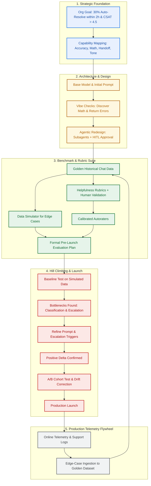

E-Commerce Chatbot Walkthrough & Pre-Launch Gate Architecture
Mermaid workflow diagram reflecting the interactive walkthrough and evaluation table:

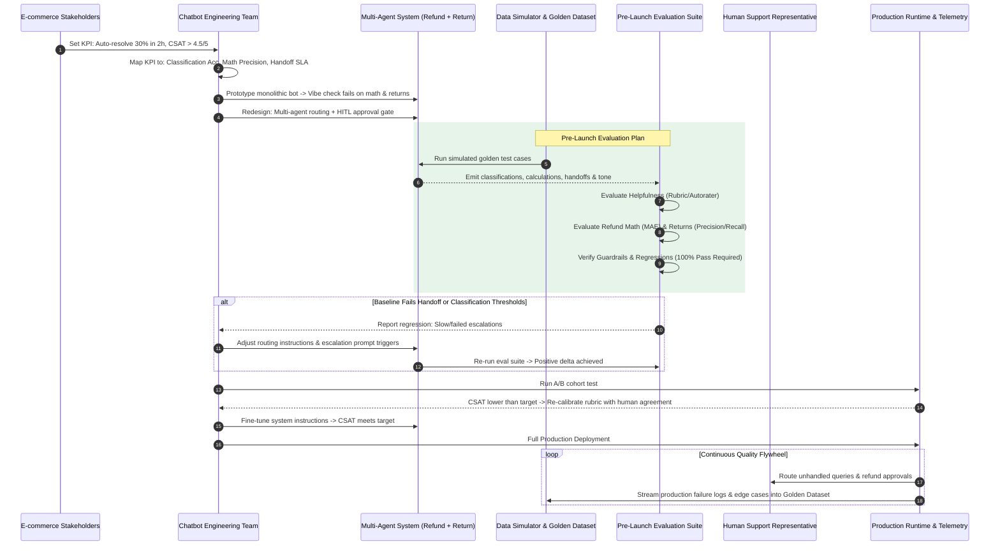

---

### Key Architectural Concepts Matrix: Core Evaluation Methodologies (Module Introduction)

| Concept | Definition & Architectural Scope | GCP Well-Architected & Enterprise Landing Metric | Enterprise Production Implementation Example |
| --- | --- | --- | --- |
| Tiered Evaluation Strategy | A multi-layered testing paradigm combining programmatic checks, human annotation, and autoraters to balance cost, execution latency, and semantic depth. | Operational Efficiency: Total Evaluation Cost per Run (<$50), Eval Latency P95, Test Coverage Breadth (100% critical paths). | A multi-tier gating pipeline in Cloud Build running sub-second deterministic checks first, followed by Gemini 1.5 Flash autoraters, reserving human review for 1% of flagged edge cases. |
| Deterministic Correctness Checks | Automated, non-probabilistic assertions (regex, JSON Schema validation, exact matches, unit tests) evaluating structured or closed-domain outputs. | Reliability & Defect Density: Deterministic Assert Pass Rate (100%), Schema Compliance Rate (100%), Execution Overhead (<50ms). | Verifying that an agent tool execution payload contains valid, non-null customer IDs and adheres strictly to a target OpenAPI specification. |
| Heuristic Telemetry & Similarity Metrics | Programmatic statistical metrics (token counts, latency tracking, ROUGE, BLEU, Levenshtein distance, embedding cosine similarity) applied to textual boundaries. | Performance Efficiency: P99 Inference Latency (<2.5s), Token Budget Variance, Semantic Embedding Cosine Similarity (>0.88). | Measuring cosine similarity via Vertex AI Text Embeddings between retrieved reference passages and model-generated claims to flag drift. |
| Human Annotation & SME Calibration | Qualitative ground-truth anchoring by domain experts to capture subtle nuances, tone, brand safety, and establish gold-standard calibration sets. | Measurement Validity: Inter-Annotator Agreement (Cohen's/Fleiss' κ>0.80), Human Audit SLA, SME Annotation Cost. | Senior claims adjusters auditing complex insurance edge cases to construct the ground-truth benchmark for automated autoraters. |
| Scalable Autoraters (LLM-as-a-Judge) | High-throughput model-based evaluators using structured rubrics to score complex generative qualities (helpfulness, tone, multi-turn reasoning) at scale. | Autorater Alignment: Human-Autorater Concordance (>85%), False Positive/Negative Calibration Drift (<2%), Judge Cost per Unit (<$0.005). | Deploying Vertex AI Gen AI Evaluation Service using Gemini 1.5 Pro to evaluate 10,000 conversational support transcripts overnight against a 5-point helpfulness rubric. |
| Autorater Bias & Failure Modes | Systematic failure patterns in LLM judges—such as position bias, verbosity bias, and self-enhancement bias—that yield uncalibrated and misleading scores. | Measurement Fairness: Position Invariance Delta (<0.02), Verbosity Bias Correlation (r<0.15), Judge Calibration Drift. | Swapping input order in pairwise evaluations and penalizing ungrounded length to neutralize verbosity and position biases. |

Core Methodologies Comparison Matrix

| Evaluation Dimension | Tier 1: Deterministic Metrics | Tier 2: Calibrated Autoraters | Tier 3: Human Annotation |
| --- | --- | --- | --- |
| Primary Scope | Structured data, schema syntax, exact matches, code unit tests, telemetry bounds. | Open-ended text, multi-turn reasoning, helpfulness rubrics, groundedness. | Ground-truth benchmark creation, safety red-teaming, high-risk compliance sign-offs. |
| Speed & Latency | Milliseconds (<100ms) | Seconds (1–5s batch) | Hours to days |
| Unit Cost | Negligible / Near-zero compute | Low-to-moderate API cost | High expert labor cost |
| Nuance & Reasoning | Rigid, zero context reasoning | High semantic reasoning (bounded by rubric) | Maximum contextual, legal, and emotional nuance |
| Role in Pipeline | Pre-commit gates, immediate hard barriers | Batch CI/CD regression sweeps, nightly hill climbing | Periodic audit, golden dataset curation, judge calibration |

Methodology Trade-Off Magic Quadrant

| Dimension | Low Cost & High Scalability | High Contextual Nuance & Deep Understanding |
| --- | --- | --- |
| Closed-Domain / Structured |  |  |

### Quadrant I: Deterministic Assertions & Telemetry

• JSON Schema & regex validation

• Code execution sandboxes

• Token count & latency tracking

Fit: Parameter validation, syntactic compliance

### Quadrant II: Calibrated Specialized Autoraters

• Reference-based similarity judges

• Factuality & schema extraction judges

• Groundedness verification via Vertex AI Eval SDK

Fit: Semantic fidelity, policy constraint adherence

| Open-Domain / Qualitative |  |
| --- | --- |

### Quadrant III: Uncalibrated Zero-Shot Judges

• Out-of-the-box LLM prompts

• Generic "rate 1-5" queries

Trap: Position, verbosity, and self-enhancement bias

### Quadrant IV: Human Computation & SME Boards

• Domain expert evaluations

• Golden benchmark construction

• Adversarial red-teaming & compliance sign-offs

Fit: Ground-truth calibration, regulatory safety

Concept Dependency Graph

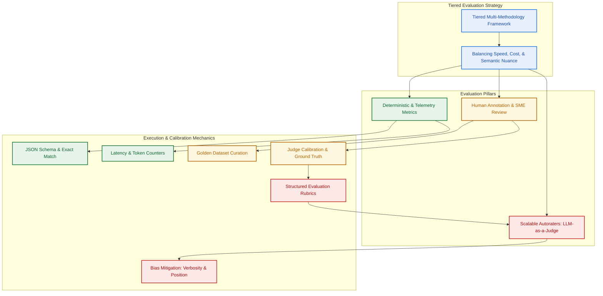

Page Visual Workflow: Module Roadmap & Multi-Tier Filter
Mermaid workflow representation reflecting the module progression and the evaluation desk graphic:

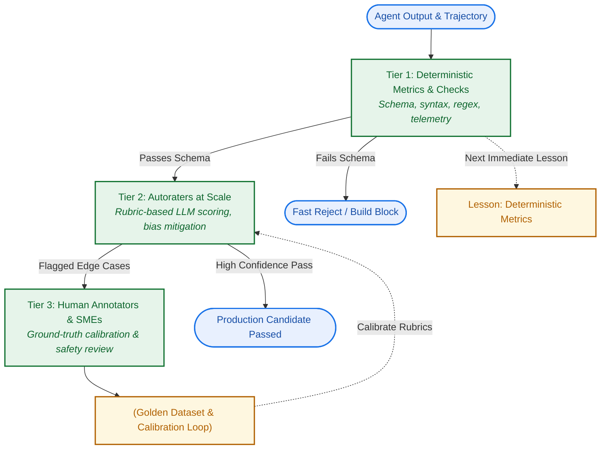

Ready to continue to the next lesson on Deterministic Metrics?

---

Complete Key Concepts Matrix: Deterministic Metrics

| Concept / Technique | Technical Scope & Definition | Enterprise / GCP Landing Metric | Real-World Production Example |
| --- | --- | --- | --- |
| Operational Telemetry | Automated runtime instrumentation measuring execution performance, latency, and resource consumption rather than semantic quality. | Platform SRE & Latency: TTFT (<800ms), TTLT (<3.0s), P99 Latency SLA (<5.0s). | Cloud Monitoring capturing streaming time-to-first-token across Vertex AI endpoint calls to alert on queue saturation. |
| Streaming Latency Breakdown (TTFT vs. TTLT) | Measuring responsiveness via Time to First Token (TTFT) alongside throughput/completion time via Time to Last Token (TTLT) across multi-turn agent execution. | User Experience & Responsiveness: TTFT P90 (<1.2s), Step-to-Step Overhead (<300ms). | Monitoring a real-time conversational agent where low TTFT prevents user abandonments while TTLT determines tool-call handover speed. |
| Multi-Modal & Dependency Cost Telemetry | Aggregate runtime financial accounting covering token pricing, modality rate cards (audio/vision/video), vector searches, and downstream database/API read-writes. | FinOps & Cost Efficiency: Cost per Resolved Session (<$0.08), Token Bloat Overhead (<10%). | Tracking BigQuery storage lookups, Vertex AI Search vector queries, and Gemini multi-modal input frames to budget automated billing agents. |
| Tool Integration Telemetry & Loop Detection | Quantitative tracking of external API interactions: invocation depth, error codes, retry spikes, and infinite loops. | Agent Health & Resilience: Tool Failure Rate (<0.5%), Mean Tool Invocations per Turn (<2.2), Infinite Loop Catch (100%). | OpenTelemetry instrumenting an IT Ops agent to terminate execution if tool calls exceed 5 calls without state progression. |
| Conventional Infrastructure Telemetry | Traditional host-level APM metrics (CPU, memory, thread pool exhaustion) tracking environments executing sandboxed LLM code. | Infrastructure Reliability: Host Sandbox CPU Spikes (<80%), Memory Leak Threshold (0 MB/hr). | Analyzing sandboxed Python execution clusters where host CPU exhaustion caused 98% of P90 latency spikes despite fast model inference. |
| User Interaction & Client Telemetry | Behavioral instrumentation tracking turn counts, inter-turn latency (cognitive friction indicator), modality mix, and network topologies. | Engagement & Friction: Inter-turn Latency (<15s), Session Abandonment Rate (<2%), Multi-Modal Adoption. | Flagging an e-commerce agent where high inter-turn latency (>45s) signaled confusing instructions requiring user re-reads. |
| Deterministic Correctness Checks | Non-probabilistic, binary programmatic validations applied to structured or closed-domain outputs without subjective ambiguity. | Defect Density & Correctness: Binary Check Pass Rate (100%), Schema Invariance (100%). | Automated CI/CD pre-commit assertion suite checking structured refund amounts and flight confirmation IDs. |
| Exact Match (EM) & Numeric Absolute Error | Validating discrete classification tokens (1 or 0) and calculating numeric deltas (∣generated−target∣) against fixed targets. | Data Integrity: Strict Categorization Accuracy (>99.5%), Mean Absolute Error (MAE =$0.00). | Auditing tax refund payouts against ledger databases where any non-zero absolute error blocks release. |
| Schema Compliance & Regex Validation | Verifying strict Pydantic/JSON typing (keys, types, non-null values) and regex pattern matching to prevent PII leakage and format drift. | Security & Formatting: Schema Validation Pass Rate (100%), PII Leakage Detection Rate (100%). | Running pre-flight filters enforcing JSON output structures for downstream database ingest while blocking credit card number patterns. |
| Execution & Functional Sandboxing | Running generated Python/SQL code inside an isolated container to confirm compilation, runtime stability, and unit test pass rates. | Software Correctness: Sandboxed Unit Test Pass Rate (100%), Container Timeout Rate (<0.1%). | Evaluating code-generation agents by executing candidate functions against test suites in isolated Cloud Run sandboxes. |
| Similarity Metrics (BLEU, ROUGE, METEOR, BERTScore) | Algorithmic n-gram overlap and contextual embedding comparison against human reference targets. | Legacy Text Overlap: ROUGE-L / BLEU-4 baseline correlation, BERTScore Cosine Cutoff (>0.85). | Measuring bilingual translation consistency on static parallel documentation corpora. |
| The Single Ground Truth Trap | The systematic failure mode where overlap metrics penalize valid semantic paraphrasing while rewarding nonsensical keyword stuffing. | Evaluation Validity: Paraphrase False-Negative Rate (0%), Keyword-Stuffing Penalty Drift. | Demonstrating where a grammatically flawless paraphrase scores lower on BLEU than an ungrammatical repetition of reference words. |

Deterministic Correctness Checks Taxonomy Matrix

| Check Type | Input Scope | Evaluation Logic | Failure Mode Addressed | Execution Overhead |
| --- | --- | --- | --- | --- |
| Exact Match (EM) | Normalized strings, intents | Binary equality (A==B) after strip & lower | Classification label drift | <1ms |
| Absolute / % Error | Financial / scalar numbers | ∣ |  |  |

y
^

| −y∣≤ϵ | Arithmetic fabrication, hallucinated pricing | <1ms |  |  |
| --- | --- | --- | --- | --- |
| Schema Compliance | JSON, YAML, tool arguments | OpenAPI / JSON Schema type & key assertion | Downstream system parser crashes | <5ms |
| Regex Pattern Validation | Free text, structured IDs | Regular expression search / match | PII data leakage, formatted ID omission | <2ms |
| Heuristic Language Check | Output strings | Fast text/n-gram language classifier | Model responding in incorrect language | <10ms |
| Execution Correctness | Generated code (Python/SQL) | Sandboxed test execution & exit code check | Syntactically valid but non-functional logic | 100ms−2s |

### Evaluation Techniques Magic Quadrant

| Dimension | Low Cost & Instant Execution (<10ms) | Higher Execution Overhead & Deep Reasoning |
| --- | --- | --- |
| Single Oracle / Structured Requirements |  |  |

### Quadrant I: Deterministic Rules & Schema Gates

• JSON Schema / Pydantic validation

• Exact match & regex assertions

• Token counters & latency timers

Fit: Tool parameter checks, CI/CD unit gates

### Quadrant II: Sandboxed Functional Execution

• Automated unit test execution in sandboxes

• SQL compilation & query plan verification

• Multi-step API integration verification

Fit: Code generation, algorithmic execution

| Open-Ended / High Semantic Ambiguity |  |
| --- | --- |

### Quadrant III: Overlap Similarity Metrics

• BLEU, ROUGE, METEOR, BERTScore

Trap: Single ground truth trap; rewards keyword stuffing, penalizes valid synonyms

### Quadrant IV: Calibrated Semantic Autoraters

• Reference-free rubrics (Groundedness, Helpfulness)

• LLM-as-a-Judge with human SME calibration

Fit: Open-ended conversation, subjective summarization

Concept Dependency Graph

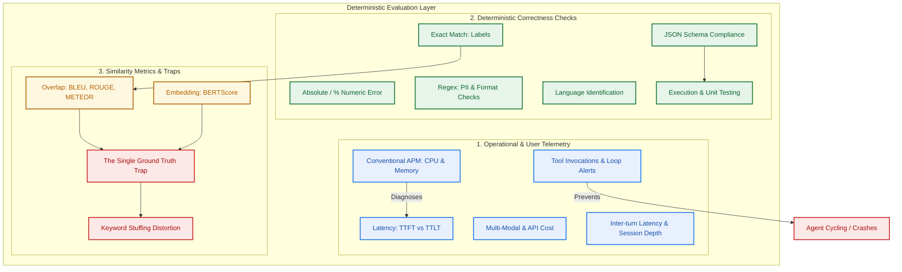

The Single Ground Truth Trap Breakdown
Mermaid architectural contrast between semantic paraphrasing and reference overlap failure modes:

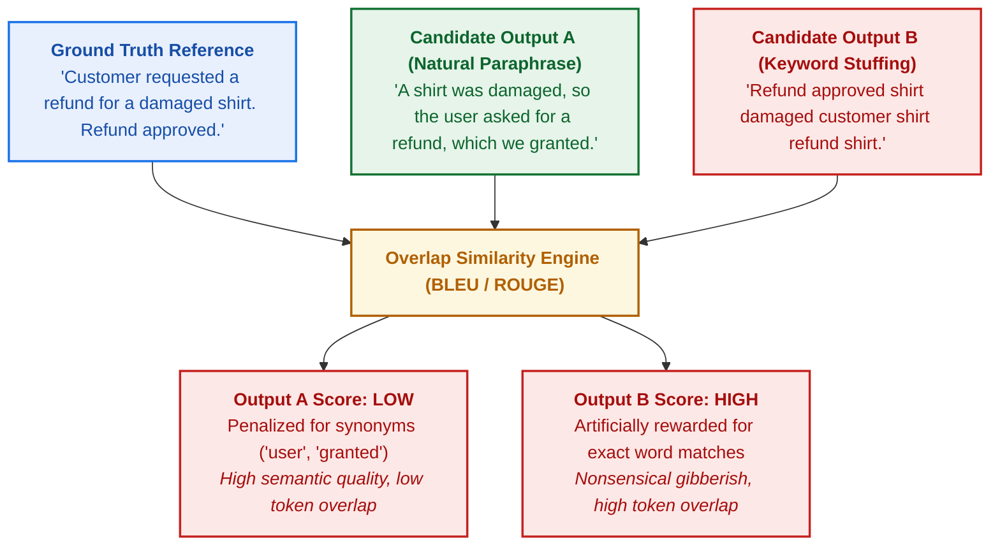

Deterministic & Operational Gating Pipeline

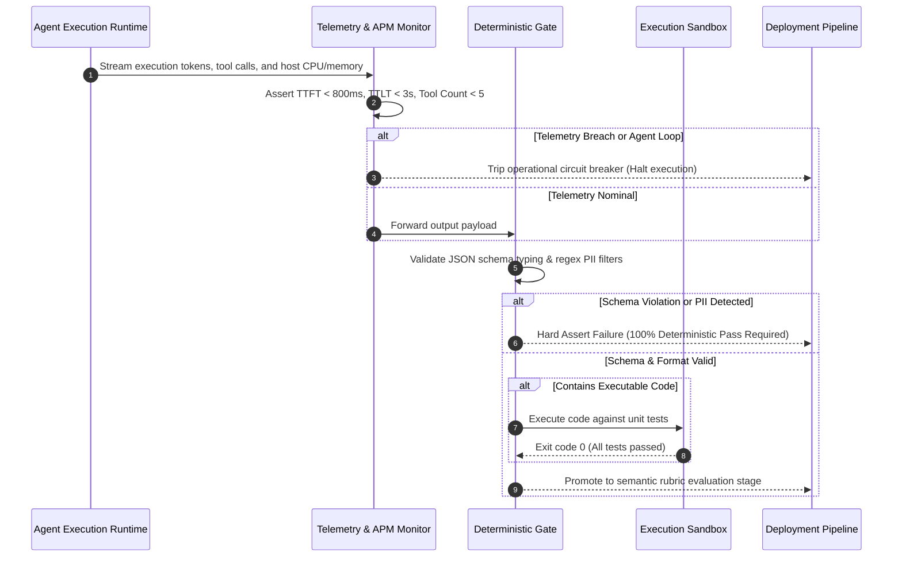

---

### Key Architectural Concepts Matrix: Human Computation

| Concept / Technique | Technical Scope & Definition | Enterprise / GCP Landing Metric | Real-World Production Example |
| --- | --- | --- | --- |
| Systematic Human Computation vs. Vibe Testing | Formalized, repeatable data collection and output rating using tested rubrics and statistical discipline, contrasting with informal, ad-hoc "vibe testing." | Operational Measurement Integrity: Annotation Coverage (100% target slice), Score Reproducibility, Protocol Adherence Rate. | Replacing ad-hoc engineer chat checks with formal weekly labeling cycles managed via Google Cloud Vertex AI Data Labeling / Human-in-the-Loop workflows. |
| Human Computation vs. Human-in-the-Loop (HITL) | Human computation is an evaluation and dataset curation practice (offline/asynchronous), whereas HITL is an active runtime architectural pattern where humans intervene in live production execution. | System Topology Boundary: Runtime Intervention Latency vs. Offline Dataset Curation SLA. | HITL: Customer service agent approving a refund payload before payment API execution. Human computation: 50 raters auditing past agent dialogue logs to score helpfulness. |
| Generation Tasks | Data creation workflow where humans replace the model to craft ideal reference prompts, intermediate tool arguments, complete trajectories, or final outputs. | Dataset Quality & Fidelity: Gold Dataset Coverage (>95% core edge cases), Trajectory Demonstration Accuracy (100%). | Medical experts manually writing gold-standard tool-call trajectories for complex diagnostic triage to train and benchmark agent planning engines. |
| Rating Tasks | Evaluation workflow where humans review, score, compare, or correct outputs already generated by the generative or agentic system. | Measurement Fidelity: Rater Concordance, Defect Discovery Rate, Review Turnaround SLA (<48 hrs). | Annotators evaluating 500 candidate agent summaries generated by Gemini 1.5 Pro against a groundedness rubric. |
| Gold Dataset Terminology Convergence | Pragmatic interchangeability in GenAI of classical ML terms: Gold(en) Dataset/Data, Gold Label, Validation/Test Set, and Ground Truth. | Benchmark Governance: Golden Benchmark Versioning, Ground Truth Contamination Index (0%). | A curated BigQuery repository of 1,200 production customer returns annotated with verified resolution states and tool invocation traces. |
| SME vs. General Annotators | Selecting between high-cost, specialized Subject Matter Experts (doctors, lawyers, senior engineers) for high-stakes risk, and cost-effective General Annotators for formatting, tone, and surface styling. | FinOps & Resource Allocation: Cost per Annotated Unit (<$2 general vs. $150+ SME), Annotation Error Defect Rate (<1%). | Deploying general crowdsourced annotators for tone politeness checks, while routing complex tax deduction queries to certified CPAs. |
| Duplicate Work & Peer Auditing | Distribution strategies to safeguard annotation quality: assigning multiple raters to identical items (duplicate work) or having senior raters review peer ratings (peer auditing). | Data Integrity: Inter-Annotator Agreement, Audit Defect Discovery Rate (<3%). | Assigning 3 independent raters to every regulatory compliance response; items with variance trigger an automatic senior SME peer audit. |
| Rating Task Formats | The five structural interaction modes: (1) Absolute Scoring (1–5 scale / binary), (2) Relative Comparison (SxS ranking), (3) Error Categorization & Span Highlighting, (4) Critique & Open-Ended Feedback, and (5) Correction & Post-Editing. | Measurement Expressiveness: Structured vs. Unstructured Ratio, Human Post-Edit Distance (Levenshtein / BLEU delta). | Deploying Side-by-Side (SxS) for rapid model ranking, while utilizing span highlighting and post-editing on high-value legal redlining outputs. |
| Absolute Ratings vs. Relative Comparisons |  |  |  |

Absolute Ratings: Stable, reusable, system-independent, but higher cognitive load and rater variance.

Relative Comparisons (SxS): Lower cognitive load, higher agreement, but cannot tell if both options are bad, and comparisons decay as systems evolve.

| Statistical Calibration: Elo Rating Convergence, Scale Anchor Calibration Drift (<5%). | Using relative SxS to hill-climb prompt variants A vs. B, then anchoring the winner with absolute 5-point rubric scoring for historical baselines. |  |  |
| --- | --- | --- | --- |
| Annotator Fatigue & Survey Design | Preventing cognitive decay by capping evaluation sessions at <1 hour, supplying tested rubrics, and adopting formal social science survey design methodologies. | Workforce Operations: Inattentive Labeling Defect Rate, Fatigue Velocity Threshold (<60 min continuous work). | Implementing micro-tasking platforms that restrict continuous annotator rating blocks to 45 minutes with mandatory inter-task calibration sanity checks. |
| Inter-Annotator Agreement (Chance-Corrected) | Statistical metrics correcting for random chance agreement: Cohen's Kappa (κ) for two raters and Krippendorff's Alpha (α) (gold standard) across multiple raters, missing data, and varied scales. | Measurement Reliability: Cohen's κ>0.75, Krippendorff's α>0.80, Chance-Adjusted Baseline. | Calculating Krippendorff's α across 5 raters evaluating agent safety violations to prove annotation consistency prior to autorater calibration. |
| Dual Role of Human Computation | The foundational enterprise mandate: serving as the critical validation gateway for production release and the primary ground-truth anchor to calibrate automated LLM autoraters. | Lifecycle Governance: Production Gate Clearance Rate (100%), Autorater Calibration Alignment (≥85%). | Calibrating Vertex AI Gen AI Evaluation Service autoraters against 2,000 human-annotated pairs to eliminate judge drift before CI/CD promotion. |

Human Rating Task Formats Matrix

| Task Format | Structure Type | Evaluator Action | Key Output Artifact | Primary Enterprise Use Case |
| --- | --- | --- | --- | --- |
| Absolute Scoring | Structured | Scores single item on numeric (1–5) or binary (thumbs up/down) scale | Discrete scalar score / label | Absolute quality gating, SLA compliance checks |
| Relative Comparison (SxS) | Structured | Evaluates 2+ outputs simultaneously to select preference or rank | Pairwise preference / Elo rank | A/B testing prompt versions, model selection |
| Error Categorization & Span Highlighting | Semi-structured | Highlights text spans and assigns error taxonomy tag | Labeled error spans & error frequencies | Pinpointing hallucination boundaries, policy breaches |
| Critique & Qualitative Feedback | Unstructured | Composes open-ended rationale describing failure | Natural language commentary | Diagnosing emergent nuances, refining system prompts |
| Correction & Post-Editing | Semi-structured | Edits and repairs flawed model generations directly | Corrected text & edit distance | Bootstrapping new golden datasets, measuring human effort |

Human Computation Strategy Magic Quadrant

| Dimension | Low Unit Cost & High Scalability | High Unit Cost & Deep Contextual Nuance |
| --- | --- | --- |
| High Specialization / High Risk |  |  |

### Quadrant I: SME Auditing via Exception Sampling

• Targeted SME spot checks on flagged items

• High-risk exception triage

Fit: Escalated regulatory or medical compliance

### Quadrant II: Full SME Computation & Calibration

• End-to-end trajectory authoring by experts

• Multi-SME consensus boards

• Krippendorff's α gold-standard calibration

Fit: Clinical diagnostics, financial ledger audits

| Low Specialization / General Nuance |  |
| --- | --- |

### Quadrant III: Crowdsourced General Annotators

• Large-scale SxS pairwise comparisons

• Binary safety and tone scoring

• Rapid duplicate-work sweeps

Fit: Conversational tone, style, basic formatting

### Quadrant IV: Dedicated In-House Rater Operations

• Trained rater pools with deep brand familiarity

• Span highlighting and continuous post-editing

• Social-science calibrated surveys

Fit: Brand voice consistency, enterprise UX refinement

Concept Dependency Graph

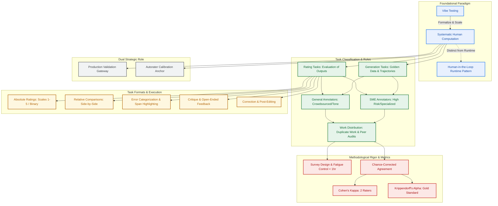

Flashcard & Task Comparison Workflow Diagram
Mermaid workflow illustrating Generation vs. Rating, Task Formats, and Annotator Routing:

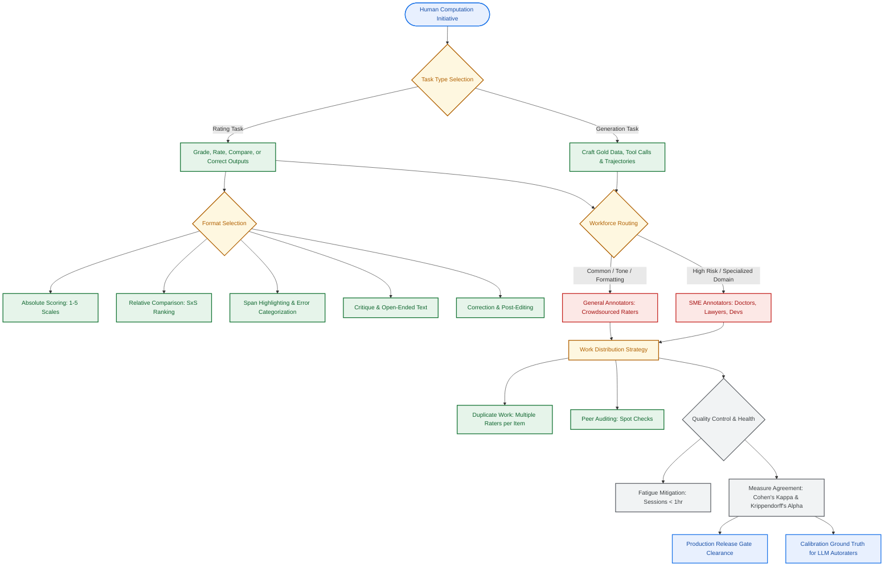

Ready to proceed to the next lesson on Autoraters and LLM-as-a-Judge?

---

Complete Key Concepts Matrix: Scaling with Autoraters (LLM-as-a-Judge)

| Concept / Technique | Technical Scope & Definition | Enterprise / GCP Landing Metric | Real-World Production Example |
| --- | --- | --- | --- |
| Autoraters (LLM-as-a-Judge) | Automated evaluation systems utilizing foundation models to score generated outputs against structured, objective rubrics at near-zero marginal cost. | FinOps & Scalability: Evaluation Unit Cost Reduction (≥95%), Evaluation Throughput (>1,000 samples/min), Cost per Eval (<$0.005). | Deploying Vertex AI Gen AI Evaluation Service with Gemini 1.5 Pro to audit 25,000 customer service chat logs overnight. |
| Prerequisites for Autorater Deployment | Two mandatory gates: (1) Clear, objective rubrics with discrete scoring anchors, and (2) Human consensus calibration proving the rater aligns with human agreement. | Governance & Reliability: Rubric Disambiguation Score, Pre-Calibration Human Agreement (Cohen's κ≥0.75). | Defining unambiguous 5-point grounding rubrics for an enterprise HR policy assistant before deploying automated judges. |
| The Temperature Paradox | The counterintuitive principle that setting temperature=0 makes autoraters less likely to match human judgment and breaks self-consistency auditing; models must run on default generation settings. | Calibration Fidelity: Default vs Zero-Temp Human Correlation Delta (Δr>+0.12), Rater Variance Preservation. | Configuring automated judge pipelines in Vertex AI to default temperature (0.7–1.0) rather than greedy decoding (0.0) to maintain nuanced human alignment. |
| Appropriate Autorater Use Scenarios | Deploying autoraters exclusively when deterministic checks are impossible: (1) Long-term production monitoring (drift detection complementing human audits), and (2) High-volume evaluation challenges (mass offline benchmark sweeps). | Operational Coverage: Production Drift Sensitivity, Batch Benchmark Coverage (100%). | Asynchronously sampling 5% of live production dialogue traces in BigQuery to continuously score tone and groundedness. |
| The Deterministic Anti-Pattern Trap | The architectural error of using LLM judges for simple tasks solvable by code (validating JSON schema, math calculations, regex pattern extraction). | Resource Hygiene & Latency: Deterministic Assertion Bypass Rate (0%), Wasted Judge Spend (0%). | Enforcing Pydantic schemas and Python unit tests for refund amounts rather than calling an expensive LLM judge to verify arithmetic. |
| Position Bias (Order Preference) | A systematic flaw where a judge model favors either the first (primacy) or second (recency) candidate response in pairwise comparisons regardless of quality. | Fairness & Consistency: Position Invariance Delta (∣WinRate |  |

A−B

 −WinRate 
B−A

| ∣<0.02). | Mitigated by Position Swapping: evaluating pairs as (A,B) and (B,A), discarding or penalizing split verdicts. |  |  |
| --- | --- | --- | --- |
| Verbosity Bias (Length Preference) | An inductive bias where judge models systematically award higher ratings to longer, more elaborate outputs, mistaking volume for depth and quality. | Alignment Integrity: Length-Score Correlation (r<0.15), Verbosity Inflation Rate. | Mitigated by Verbosity Penalties: embedding explicit length caps and conciseness criteria directly into the evaluation rubric. |
| Self-Preference Bias | The empirical tendency of a model family (e.g., Gemini, GPT, Claude) to score outputs generated by its own architecture higher than outputs from competitor models. | Cross-Model Neutrality: Intra-Family Score Delta (<3%), Self-Preference Skew Index. | Mitigated by cross-evaluating candidate systems using diverse judge models (e.g., Gemini judging Claude, Claude judging Gemini) or masked prompts. |
| Five-Phase Calibration Workflow | Sequential alignment protocol: (1) Select representative dataset, (2) Achieve human consensus on rubric, (3) Run autorater, (4) Measure alignment, (5) Adjust eval plan or hill-climb autorater. | Alignment Benchmark: Autorater-Human Concordance (≥85%), Human Consensus Agreement (κ≥0.80). | Staging a 300-case enterprise audit where human raters reach consensus before running Gemini 1.5 Pro to verify calibration across legal compliance metrics. |
| Self-Consistency Fallback Auditing | Running an autorater 5–10 times on the same dataset using the same rubric when human calibration is impractical, checking if internal rating variance is bounded. | Judge Reliability: Internal Variance (σ |  |

2

| <0.05), Rubric Instability Index. | Stress-testing a new custom rubric with 10 repeated passes; high variance flags ambiguous rubric language needing patching before deployment. |
| --- | --- |

### Evaluation Techniques Magic Quadrant

| Dimension | Low Cost & Instant Execution (<10ms) | High Contextual Nuance & Deep Reasoning |
| --- | --- | --- |
| Deterministic & Rule-Based |  |  |

### Quadrant I: Deterministic Rules & Schema Gates

• JSON Schema / Pydantic validation

• Regex-based pattern matching

• Code execution sandboxes & unit tests

Fit: Math, JSON parsing, API parameters (Never use autoraters here)

### Quadrant II: Calibrated Hybrid Autoraters

• LLM-as-a-judge with bias mitigations

• Reference-free grounding rubrics

• Multi-pass self-consistency validation

Fit: Long-term drift tracking, mass batch regression sweeps

| Subjective & Open-Ended |  |
| --- | --- |

### Quadrant III: Uncalibrated Zero-Shot Judges

• Default out-of-the-box LLM prompts

• Temperature = 0 greedy evaluations

Trap: Position, verbosity, and self-preference bias

### Quadrant IV: Expert SME Computation

• Human consensus panels (Cohen's κ>0.80)

• Ground-truth benchmark authoring

• High-stakes compliance audits

Fit: Authoring rubrics, validating autoraters, safety sign-offs

Concept Dependency Graph

```mermaid
graph TD
    classDef base fill:#E8F0FE,stroke:#1A73E8,stroke-width:2px,color:#174EA6;
    classDef rule fill:#FEF7E0,stroke:#B06000,stroke-width:2px,color:#B06000;
    classDef bias fill:#FCE8E6,stroke:#C5221F,stroke-width:2px,color:#A50E0E;
    classDef calib fill:#E6F4EA,stroke:#137333,stroke-width:2px,color:#0D652D;

    subgraph Foundations ["1. Autorater Architecture"]
        Auto["Autorater: LLM-as-a-Judge"]:::base
        Adv["Advantages: 95% Cost Cut, High Speed, Infinite Scale"]:::base
        Temp["Default Temperature > 0 Paradox"]:::base
    end

    subgraph Scenarios ["2. Deployment Scenarios & Anti-Patterns"]
        DetCheck[Exhaust Deterministic Checks First]:::rule
        Trap["Anti-Pattern: LLM Judge for JSON, Math, Regex"]:::bias
        UseCases["Valid Scenarios: Long-Term Telemetry & High-Volume Eval"]:::rule
    end

    subgraph Biases ["3. Systematic Biases & Mitigations"]
        PosBias[Position Bias]:::bias
        VerbBias[Verbosity Bias]:::bias
        SelfBias[Self-Preference Bias]:::bias
        PosSwap["Mitigation: Position Swapping"]:::calib
        VerbPen["Mitigation: Verbosity Penalties"]:::calib
    end

    subgraph Calibration ["4. Calibration & Quality Assurance"]
        Phase1[1. Select Representative Dataset]:::calib
        Phase2[2. Achieve Human Agreement on Rubric]:::calib
        Phase3[3. Run Autorater]:::calib
        Phase4[4. Measure Alignment]:::calib
        Phase5[5. Adjust Eval Plan / Hill Climb Autorater]:::calib
        SelfCons["Fallback: 5-10x Self-Consistency Test"]:::calib
    end

    Auto --> Adv
    Auto --> Temp
    Auto --> DetCheck
    DetCheck -->|Do Not Replace| Trap
    DetCheck -->|Unsolvable Programmatically| UseCases

    Auto --> PosBias
    Auto --> VerbBias
    Auto --> SelfBias

    PosBias --> PosSwap
    VerbBias --> VerbPen

    UseCases --> Phase1
    Phase1 --> Phase2
    Phase2 --> Phase3
    Phase3 --> Phase4
    Phase4 --> Phase5
    Phase2 -.->|When Impractical| SelfCons
```

Five-Phase Autorater Calibration Workflow
Mermaid workflow representation reflecting the interactive sequential calibration diagram from the course:

```mermaid
flowchart TD
    classDef start fill:#E8F0FE,stroke:#1A73E8,stroke-width:2px,color:#174EA6;
    classDef action fill:#E6F4EA,stroke:#137333,stroke-width:2px,color:#0D652D;
    classDef gate fill:#FCE8E6,stroke:#C5221F,stroke-width:2px,color:#A50E0E;
    classDef fallback fill:#FEF7E0,stroke:#B06000,stroke-width:2px,color:#B06000;

    S1["<b>Phase 1: Select Dataset</b><br>Compile representative inputs and outputs"]:::start --> S2["<b>Phase 2: Human Agreement on Rubric</b><br>Human annotators rate dataset using rubric"]:::action

    S2 --> CheckHuman{"High Human Agreement?<br>(Cohen's / Fleiss' κ ≥ 0.75)"}:::gate
    CheckHuman -- No --> RefineRubric["Refine rubric definitions & scoring anchors"]:::fallback
    RefineRubric --> S2

    CheckHuman -- Yes --> S3["<b>Phase 3: Run Autorater</b><br>Autorater evaluates dataset at default temperature"]:::action
    S3 --> S4["<b>Phase 4: Measure Alignment</b><br>Compare autorater ratings against human consensus"]:::action

    S4 --> CheckAlign{"Alignment Acceptable?<br>(Concordance ≥ 85%)"}:::gate
    CheckAlign -- No --> S5B["<b>Phase 5: Hill Climb Autorater</b><br>Few-shot prompt tuning, explicit chain-of-thought, or scope reduction"]:::fallback
    S5B --> S3

    CheckAlign -- Yes --> S5A["<b>Phase 5: Deploy to Evaluation Pipeline</b><br>Assign autorater to verified reliable dimensions"]:::action

    S2 -.->|When Human Annotation is Impractical| SC["<b>Self-Consistency Fallback Audit</b><br>Run autorater 5–10 times on representative dataset"]:::fallback
    SC --> CheckVar{"Consistent Across Runs?"}:::gate
    CheckVar -- Low Variance --> Usable["Safe for tentative comparative evaluation"]:::action
    CheckVar -- High Variance --> Unsafe["Unsafe to deploy: Patch ambiguous rubric criteria"]:::fallback
    Unsafe --> SC
```

Bias Mitigation Interaction Architecture

```mermaid
sequenceDiagram
    autonumber
    participant Harness as Evaluation Harness
    participant AgentA as Candidate Model A
    participant AgentB as Candidate Model B
    participant Judge as Autorater (LLM-as-a-Judge)
    participant Calc as Statistical Alignment Engine

    Harness->>Judge: Pass Pair (A, B) with Verbosity-Penalizing Rubric
    Judge-->>Harness: Rating Verdict 1 (Prefers A)

    rect rgb(254, 247, 224)
        Note over Harness,Judge: Position Swapping Protocol
        Harness->>Judge: Pass Swapped Pair (B, A) with Identical Rubric
        Judge-->>Harness: Rating Verdict 2
    end

    Harness->>Calc: Aggregate Verdict 1 and Verdict 2
    alt Verdicts Consistent (A wins both orientations)
        Calc-->>Harness: Confirm Model A preference (Position Invariant)
    else Verdicts Contradictory (Order-dependent winner)
        Calc-->>Harness: Flag Position Bias Fluke (Discard / Mark Tie)
    end
```

lets make sure the entire page is covered 
Complete Concepts Matrix: Scaling with Autoraters (LLM-as-a-Judge)

| Concept / Technique | Technical Scope & Definition | Enterprise / GCP Landing Metric | Real-World Production Example |
| --- | --- | --- | --- |
| Autorater Core Definition | An automated evaluation system utilizing a generative foundation model (LLM-as-a-judge / judge model) to score outputs against a structured rubric. | FinOps & Scalability: Unit Evaluation Cost (<$0.005/eval), Throughput (>1,000 samples/min), Automation Ratio (>95%). | Vertex AI Gen AI Evaluation Service orchestrating Gemini 1.5 Pro to evaluate 50,000 multi-turn retail customer conversations overnight. |
| Core Scaling Advantages |  |  |  |

Low Cost: ≥95% cost reduction vs human raters.

High Speed: Seconds vs minutes/days.

Infinite Scale: Absorbs bursty evaluation volumes without workforce scaling.

| Operational Velocity: Cycle Time Reduction (>90%), Eval SLA Compliance (<15 min for full regression test suites). | Replacing a 30-person outsourced labeling contract with an automated nightly autorater pipeline on Google Cloud Run. |
| --- | --- |
| Two Mandatory Prerequisites |  |

(1) Clear, Objective Rubrics: Unambiguous criteria and discrete anchors.

(2) Human Calibration: Empirically verified agreement with human consensus prior to deployment.

| Measurement Integrity: Rubric Disambiguation Score, Pre-Calibration Human Agreement (Cohen's κ≥0.75). | Writing explicit 5-point RAG faithfulness rubrics with discrete score descriptions before spinning up judge pipelines. |  |  |
| --- | --- | --- | --- |
| The Temperature Paradox | Counterintuitive principle: Setting temperature=0 makes autoraters less likely to match human judgment and breaks self-consistency auditing; models must run on default generation settings. | Calibration Fidelity: Human Correlation Delta (Δr>+0.12 over greedy decoding), Variance Preservation. | Configuring automated evaluation jobs in Vertex AI with default temperature (0.7–1.0) rather than greedy decoding (0.0). |
| Valid Deployment Scenarios | Deployed exclusively when deterministic checks cannot work: (1) Long-term production monitoring (drift detection complementing human audits), and (2) High-volume evaluation challenges (mass offline benchmark sweeps). | Production Observability: Long-Term Drift Detection Sensitivity, Offline Benchmark Coverage (100%). | Sampling 5% of live production dialogue traces in BigQuery asynchronously to continuously score tone and groundedness. |
| The Deterministic Anti-Pattern Trap | Wasting LLM compute on simple deterministic tasks solvable by code: JSON schema validation, math/interest-rate checks, regex/date extraction. | Resource Hygiene & Latency: Deterministic Assertion Bypass Rate (0%), Wasted Judge Spend (0%). | Enforcing Pydantic schemas and Python unit tests for refund amounts rather than calling an expensive LLM judge to verify arithmetic. |
| Position Bias & Swapping | Systematic flaw where models favor the first or second option in pairwise comparisons. Mitigated by Position Swapping: swapping input order, running multiple evaluations, and including position in the analysis. | Measurement Invariance: Position Invariance Delta (∣WinRate |  |

A−B

 −WinRate 
B−A

| ∣<0.02). | Evaluating candidate pairs as (A,B) and (B,A) in Vertex AI pipelines, flagging split verdicts as ties or invalid runs. |  |  |
| --- | --- | --- | --- |
| Verbosity Bias & Penalties | Systematic flaw where models mistake length for quality. Mitigated by Verbosity Penalties: embedding explicit conciseness criteria, word limits, and length penalties in rubrics. | Alignment Integrity: Length-Score Correlation (r<0.15), Output Bloat Penalty Factor. | Adding strict negative scoring rules in the system prompt for answers exceeding 150 words when answering simple factual queries. |
| Self-Preference Bias & Panels | The tendency of a model family to favor its own outputs over competitors. Mitigated by using diverse judge panels (e.g., cross-model evaluation) and blind evaluation prompts. | Cross-Model Neutrality: Intra-Family Score Bias (<3%), Multi-Model Panel Concordance. | Cross-evaluating Claude generations using Gemini judges and vice versa with model-name identifiers stripped. |
| Five-Phase Calibration Workflow | Systematic alignment sequence: (1) Select dataset, (2) Human agreement on rubric, (3) Run autorater, (4) Measure alignment, (5) Adjust eval plan or hill-climb autorater. | Calibration Accuracy: Autorater-Human Concordance (≥85%), Human Consensus Baseline (κ≥0.80). | Staging a 300-case enterprise audit where human raters reach consensus before running Gemini 1.5 Pro to verify calibration across legal compliance metrics. |
| Measuring Rubric Consistency (Self-Consistency Fallback) | Fallback when human calibration is impractical: run the autorater 5–10 times on the same dataset. Consistent ratings indicate safe tentative use; variable ratings indicate an ambiguous rubric needing patches. | Rubric Stability: Internal Run Variance (σ |  |

2

| <0.05), Rubric Ambiguity Patch Velocity. | Running 10 repeated passes of Gemini 1.5 Pro on 50 reference queries; high scoring variance flags ambiguous language in rubric tier definitions. |
| --- | --- |
| Core Trade-offs & Limitations |  |

Pros: Low latency, low cost at scale, tireless/repeatable execution.

Cons: Mandatory human calibration, systematic biases, performance drift over time, lack of true comprehension (pattern matching vs real reasoning).

| Operational Governance: Drift Detection Interval (Weekly), Human Calibration Audit Cycle, False Positive Rate. | Establishing a monthly human audit board to spot-check autorater scores against emergent customer conversation patterns. |
| --- | --- |

### Trade-Offs & Decision Matrix

| Dimension | Deterministic Checks | Calibrated Autoraters | Human Annotators |
| --- | --- | --- | --- |
| Target Scope | JSON syntax, regex, arithmetic, schema structure | Long-term drift monitoring, high-volume semantic evaluation | Rubric authoring, calibration ground truth, edge-case triage |
| Latency | Milliseconds (<50ms) | Seconds (1–5s) | Hours to days |
| Unit Cost | Near-zero compute cost | 95%+ reduction vs. humans (<$0.005) | High labor and coordination cost |
| Susceptibility to Bias | None (pure logic) | High (position, verbosity, self-preference) | Subject to fatigue, cognitive overload, personal bias |
| Comprehension Level | Syntax & schema rules | Semantic pattern matching & template following | True contextual, legal, and emotional comprehension |

### Evaluation Techniques Magic Quadrant

| Dimension | Low Cost & High Scalability | High Contextual Nuance & Deep Understanding |
| --- | --- | --- |
| Deterministic & Rule-Based |  |  |

### Quadrant I: Deterministic Rules & Schema Gates

• JSON Schema / Pydantic validation

• Regex-based pattern matching

• Code execution sandboxes & unit tests

Fit: Math, JSON parsing, API parameters (Never use autoraters here)

### Quadrant II: Calibrated Hybrid Autoraters

• LLM-as-a-judge with bias mitigations

• Reference-free grounding rubrics

• Multi-pass self-consistency validation

Fit: Long-term drift tracking, mass batch regression sweeps

| Subjective & Open-Ended |  |
| --- | --- |

### Quadrant III: Uncalibrated Zero-Shot Judges

• Default out-of-the-box LLM prompts

• Temperature = 0 greedy evaluations

Trap: Position, verbosity, and self-preference bias

### Quadrant IV: Expert SME Computation

• Human consensus panels (Cohen's κ>0.80)

• Ground-truth benchmark authoring

• High-stakes compliance audits

Fit: Authoring rubrics, validating autoraters, safety sign-offs

Concept Dependency Graph

```mermaid
graph TD
    classDef base fill:#E8F0FE,stroke:#1A73E8,stroke-width:2px,color:#174EA6;
    classDef rule fill:#FEF7E0,stroke:#B06000,stroke-width:2px,color:#B06000;
    classDef bias fill:#FCE8E6,stroke:#C5221F,stroke-width:2px,color:#A50E0E;
    classDef calib fill:#E6F4EA,stroke:#137333,stroke-width:2px,color:#0D652D;

    subgraph Foundations ["1. Autorater Foundations & Advantages"]
        Auto["Autorater: LLM-as-a-Judge"]:::base
        Adv["Advantages: 95% Cost Cut, High Speed, Infinite Scale"]:::base
        Prereq["Prerequisites: Objective Rubrics & Human Calibration"]:::base
        Temp[Default Temperature Setting Paradox]:::base
    end

    subgraph Scenarios ["2. Use Scenarios & Anti-Patterns"]
        DetCheck[Exhaust Deterministic Checks First]:::rule
        Trap["Anti-Pattern: LLM Judge for JSON, Math, Regex"]:::bias
        UseCases["Valid Use Cases: Long-Term Monitoring & High-Volume Eval"]:::rule
    end

    subgraph Biases ["3. Systematic Biases & Mitigations"]
        PosBias[Position Bias]:::bias
        VerbBias[Verbosity Bias]:::bias
        SelfBias[Self-Preference Bias]:::bias
        PosSwap["Mitigation: Position Swapping & Order Randomization"]:::calib
        VerbPen["Mitigation: Verbosity Penalties & Length Caps"]:::calib
        Panel["Mitigation: Multi-Model Panels & Blinding"]:::calib
    end

    subgraph Calibration ["4. Calibration & Consistency Protocols"]
        P1["Phase 1: Select Representative Dataset"]:::calib
        P2["Phase 2: Human Agreement on Rubric"]:::calib
        P3["Phase 3: Run Autorater at Default Temp"]:::calib
        P4["Phase 4: Measure Alignment"]:::calib
        P5["Phase 5: Adjust Plan & Hill Climb Autorater"]:::calib
        SelfCons["Fallback: 5-10x Self-Consistency Agreement Test"]:::calib
    end

    Auto --> Adv
    Auto --> Prereq
    Auto --> Temp

    Auto --> DetCheck
    DetCheck -->|Never Replace Code| Trap
    DetCheck -->|Unsolvable by Rules| UseCases

    Auto --> PosBias
    Auto --> VerbBias
    Auto --> SelfBias

    PosBias --> PosSwap
    VerbBias --> VerbPen
    SelfBias --> Panel

    UseCases --> P1
    P1 --> P2
    P2 --> P3
    P3 --> P4
    P4 --> P5
    P2 -.->|When Impractical| SelfCons
```

End-to-End Autorater Calibration & Execution Architecture

```mermaid
flowchart TD
    classDef start fill:#E8F0FE,stroke:#1A73E8,stroke-width:2px,color:#174EA6;
    classDef proc fill:#E6F4EA,stroke:#137333,stroke-width:2px,color:#0D652D;
    classDef gate fill:#FCE8E6,stroke:#C5221F,stroke-width:2px,color:#A50E0E;
    classDef warn fill:#FEF7E0,stroke:#B06000,stroke-width:2px,color:#B06000;

    Start([Evaluation Request]):::start --> DetCheck{Can output be verified deterministically?<br><i>JSON, Math, Regex, Schemas</i>}:::gate

    DetCheck -- Yes --> DetExec["Run Programmatic Assertions<br><i>Fast, zero-cost, 100% deterministic</i>"]:::proc

    DetCheck -- No --> CheckCalib{Human Calibration Feasible?}:::gate

    CheckCalib -- Yes --> P1["Phase 1: Select Representative Dataset"]:::proc
    P1 --> P2["Phase 2: Achieve Human Consensus on Rubric"]:::proc
    P2 --> HumanAgreement{Human Agreement High?<br>κ ≥ 0.75}:::gate
    HumanAgreement -- No --> PatchRubric["Refine rubric criteria & score anchors"]:::warn
    PatchRubric --> P2

    HumanAgreement -- Yes --> P3["Phase 3: Run Autorater at Default Temperature"]:::proc
    P3 --> P4["Phase 4: Measure Alignment vs Human Ratings"]:::proc
    P4 --> AlignmentGood{Alignment Acceptable?<br>Concordance ≥ 85%}:::gate
    AlignmentGood -- No --> HillClimb["Phase 5: Hill climb autorater / restrict task scope"]:::warn
    HillClimb --> P3
    AlignmentGood -- Yes --> ProductionDeploy["Phase 5: Deploy Autorater to Evaluation Pipeline"]:::proc

    CheckCalib -- No --> SelfConsTest["Run Self-Consistency Test<br><i>Execute autorater 5-10 times at default temp</i>"]:::warn
    SelfConsTest --> VarCheck{Ratings Consistent Across Runs?}:::gate
    VarCheck -- Low Variance --> TentativeDeploy[Deploy for tentative comparative eval]:::proc
    VarCheck -- High Variance --> RejectRubric["Unsafe to deploy: Patch ambiguous rubric language"]:::warn
    RejectRubric --> SelfConsTest

    ProductionDeploy --> MitigateBiases["Active Runtime Mitigations:<br>• Position Swapping<br>• Verbosity Penalties<br>• Multi-Model Panels"]:::proc
    MitigateBiases --> Monitoring["Long-Term Production Telemetry & Drift Audits"]:::proc
```

Ready to proceed to the next page in the module?

---

### Key Architectural Concepts Matrix: Designing and Calibrating Rubrics (Module Introduction)

| Concept | Definition & Architectural Scope | GCP Well-Architected & Enterprise Landing Metric | Enterprise Production Implementation Example |
| --- | --- | --- | --- |
| Shift from Subjective Vibes to Rigorous Metrics | Systematically replacing intuitive developer "vibe checks" with deterministic and multi-tier rubric criteria to evaluate open-ended model outputs. | Operational Excellence & Measurement Integrity: Evaluation Score Variance (σ |  |

2

| <0.05), Rubric Repeatability Index (>95%). | Replacing informal engineering reviews of LLM-drafted emails with formal groundedness, completeness, and tone rubrics in Vertex AI Gen AI Evaluation Service. |  |  |
| --- | --- | --- | --- |
| Rubrics for Subjective & Unstructured Dimensions | Formalized scoring instruments designed to assess qualitative attributes (tone, completeness, helpfulness, brand alignment) where exact string matching fails. | Quality & Alignment: Factual Completeness Recall (>90%), Persona Tone Adherence Rate (>98%), Helpfulness Rating (>4.2/5). | A 5-point helpfulness rubric defining distinct boundary criteria between "partially answering" vs. "providing complete, actionable guidance." |
| Adaptive Rubrics | Dynamic evaluation frameworks that adjust evaluation criteria, depth, and penalty thresholds conditioned on task context, user persona, domain risk, or conversation history. | Reliability & Context Sensitivity: Context-Aware False Positive Rate (<2%), Dynamic Criteria Match Precision (>95%). | An enterprise financial agent applying strict citation and disclaimer rubrics for portfolio advisory queries while shifting to a concise, operational rubric for balance lookups. |
| Rubric Calibration & Disambiguation | The empirical process of iteratively refining scoring criteria until both human raters and LLM-as-a-judge autoraters demonstrate statistically significant consensus. | Measurement Consistency: Inter-Rater Concordance (Cohen's κ≥0.75, Krippendorff's α≥0.80), Autorater Drift (<2%). | Harmonizing rating discrepancies between domain experts and Gemini 1.5 Pro by anchoring ambiguous rubric steps with few-shot concrete boundary examples. |

Rubric Evaluation Space Magic Quadrant

| Dimension | Low Contextual Variance / Static Criteria | High Contextual Variance / Dynamic Context |
| --- | --- | --- |
| High Determinism / Strict Rules |  |  |

### Quadrant I: Programmatic Schema & Syntax Rubrics

• JSON Schema / Pydantic assertions

• Regex-based PII boundaries

• Fixed format compliance

Fit: API tool calls, structured database ingestion

### Quadrant II: Contextual Rule Assertions

• Conditional syntax verification based on user role

• Dynamic parameter boundary assertions

Fit: Tiered authorization tool calls, RBAC validation

| High Subjectivity / Unstructured Text |  |
| --- | --- |

### Quadrant III: Static Multi-Point Rubrics

• Fixed 1–5 scoring rubrics for tone and helpfulness

• Universal brand safety rubrics

Fit: General conversational bots, initial baseline sweeps

### Quadrant IV: Calibrated Adaptive Rubrics

• Dynamic persona- and risk-aware evaluation criteria

• Calibrated multi-model autorater panels

Fit: Enterprise agentic workflows, high-risk advisory systems

Concept Dependency Graph

```mermaid
graph TD
    classDef foundation fill:#E8F0FE,stroke:#1A73E8,stroke-width:2px,color:#174EA6;
    classDef rubric fill:#E6F4EA,stroke:#137333,stroke-width:2px,color:#0D652D;
    classDef calib fill:#FEF7E0,stroke:#B06000,stroke-width:2px,color:#B06000;
    classDef target fill:#FCE8E6,stroke:#C5221F,stroke-width:2px,color:#A50E0E;

    subgraph ModuleFoundations ["1. Foundational Shift"]
        Vibes[Subjective Vibes]:::foundation
        RigorousMetrics[Rigorous Quantitative Metrics]:::foundation
        Vibes -->|Systematic Transition| RigorousMetrics
    end

    subgraph RubricDesign ["2. Rubric Engineering"]
        SubjectiveDims["Subjective Dimensions: Tone, Completeness, Helpfulness"]:::rubric
        RobustRubrics[Robust Evaluation Rubrics]:::rubric
        AdaptiveRubrics[Adaptive Rubrics]:::rubric

        RigorousMetrics --> RobustRubrics
        SubjectiveDims --> RobustRubrics
        RobustRubrics --> AdaptiveRubrics
    end

    subgraph CalibrationCycle ["3. Calibration & Governance"]
        HumanSME[Human SME Consensus]:::calib
        Autorater[LLM-as-a-Judge Calibration]:::calib
        TargetLesson["Next: The Art of Rubric Design"]:::target

        RobustRubrics --> HumanSME
        AdaptiveRubrics --> Autorater
        HumanSME --> Autorater
        RobustRubrics --> TargetLesson
    end
```

## Module Progression & Calibration Architecture

Mermaid workflow representation reflecting the module entry and target deliverables:

```mermaid
flowchart TD
    classDef input fill:#E8F0FE,stroke:#1A73E8,stroke-width:2px,color:#174EA6;
    classDef process fill:#E6F4EA,stroke:#137333,stroke-width:2px,color:#0D652D;
    classDef outcome fill:#FEF7E0,stroke:#B06000,stroke-width:2px,color:#B06000;
    classDef next fill:#FCE8E6,stroke:#C5221F,stroke-width:2px,color:#A50E0E;

    In([Unstructured Agentic / Generative Outputs]):::input --> Shift[Shift from Vibes to Rigorous Metrics]:::process

    Shift --> PathA["Core Competency 1: Build & Improve Robust Rubrics<br><i>Tone, Completeness, Helpfulness</i>"]:::process
    Shift --> PathB["Core Competency 2: Implement Adaptive Rubrics<br><i>Context & Risk-aware criteria</i>"]:::process

    PathA & PathB --> Calib["Autorater & Human SME Consensus Alignment"]:::outcome
    Calib --> NextLesson["Lesson 1: The Art of Rubric Design"]:::next
```

Ready to proceed to 'The art of rubric design'?

---

### Key Architectural Concepts Matrix: The Art of Rubric Design

| Concept / Technique | Technical Scope & Definition | Enterprise / GCP Landing Metric | Real-World Production Example |
| --- | --- | --- | --- |
| Rubrics as the Foundational Quality Contract | Objective guidelines defining acceptable output boundaries when multiple valid completions exist; serves as the common standard aligning human raters and LLM-as-a-judge autoraters. | Evaluation Reproducibility: Inter-Rater Concordance (>85%), Autorater Calibration Drift (<2%). | Authoring standardized groundedness guidelines deployed in Vertex AI Gen AI Evaluation Service to eliminate engineer-specific scoring variations. |
| Operational Definitions | Translating subjective attributes (e.g., "sounds professional") into unambiguous, measurable constraints (e.g., no apologies in sentence 1, active voice, explicit next action). | Operational Clarity: Score Variance (σ |  |

2

| <0.05), Rubric Disambiguation Index (100%). | Replacing "bot is polite" with concrete checks: "greets user by name, avoids passive phrasing, provides direct URL link." |  |  |
| --- | --- | --- | --- |
| Rubric Design Triad Balance | Balancing Length (cognitive load / prompt context budget), Exhaustiveness (handling edge cases / zero blind spots), and Specificity (clear boundaries without over-fitting). | Workforce & Inference Efficiency: Annotation Time per Unit (<45s), Token Budget Overhead (<400 tokens), Edge-Case Catch Rate. | Restricting an autorater prompt rubric to 3 core dimensions and 250 tokens to prevent LLM context dilution while maintaining grading precision. |
| Graduated Scales vs. Binary Checks | Moving beyond binary passes to multi-tiered scales (1–5 or 1–3–5) with discrete anchors representing distinct stages of quality and failure severity. | Measurement Granularity: Resolution Sensitivity Delta, Floor/Ceiling Effect Mitigation. | Upgrading a binary pass/fail factual check to a 1–3–5 rubric distinguishing complete hallucination (1), minor external info inclusion (3), and total groundedness (5). |
| Concrete Output Anchors | Providing representative input-output reference transcripts for each score level rather than relying on abstract qualitative descriptors (e.g., "Good", "Excellent"). | Rater Alignment: Anchor Concordance Rate (>90%), Rater Ambiguity Latency. | Including actual conversational transcripts demonstrating Level 1, 3, and 5 customer refund handling directly in the annotator interface. |
| Subject Matter Governance | Requirement that initial rubric authoring and iterative refinement must be led by developers, PMs, and domain SMEs—never delegated to generic crowdsourced pools. | Specification Fidelity: Rubric Flaw Discovery SLA, Domain Constraint Coverage (100%). | Legal counsel and billing operations leads co-authoring contract summarization rubrics before handoff to evaluation pipelines. |
| Naïve Annotator Agreement Validation | Validating rubric quality by having annotators who did not build the rubric score a test dataset; high consensus proves the rubric is self-contained and objective. | Benchmark Strength: Naïve Cohen's κ≥0.75, Krippendorff's α≥0.80. | Testing a freshly drafted technical support rubric against a cohort of newly onboarded raters to expose ambiguous phrasing. |
| Chance-Adjusted Agreement & Severity Penalization | Rejecting simple percentage agreement (which hides category bias and treats 1 vs 5 disagreements identical to 4 vs 5) in favor of weighted statistical formulations. | Statistical Integrity: Weighted Cohen's κ |  |

w

| , Krippendorff's α, Disagreement Severity Penalty. | Utilizing quadratic-weighted Kappa (κ |
| --- | --- |

w

 ) to heavily penalize an autorater grading a severe factual hallucination (1) as acceptable (4).
Poor vs. Improved Graduated Rubric Comparison Matrix

| Evaluated Dimension | Flawed Rubric (Poor Design) | Graduated Operational Rubric (Improved Design) | Lingering Ambiguities to Resolve |
| --- | --- | --- | --- |
| Factual Accuracy & Groundedness |  |  |  |

0: Errors or mistakes.

1: Seems basically correct and trustworthy.

1: Significant factual errors or hallucinations.

3: Mostly accurate; minor errors or outside info.

5: Entirely factually correct; fully grounded.

At Level 3, what constitutes "minor" vs. "significant"? Is outside retrieved knowledge permissible if factually true?

| Completeness | (Omitted or conflated into correctness) |  |
| --- | --- | --- |

1: Incomplete or misses the main point.

3: Accurate but could be more comprehensive.

5: Factually accurate and complete.

At Level 1 vs 3, how many secondary user questions can be omitted before the response "misses the main point"?

| Conciseness & Relevance |  |
| --- | --- |

0: Too short or too long.

1: Good length and flows nicely.

1: Overly verbose, irrelevant, or confusingly short.

3: Generally on-topic but could be more concise.

5: Succinct; provides exact information needed.

Lacks explicit token/word thresholds or sentence constraints defining "confusingly short" vs. "overly verbose".

| Tone, Empathy & Humanness |  |
| --- | --- |

0: Sounds like a robot.

1: Sounds like a real person wrote it.

1: Inappropriate, dismissive, or unhelpful.

3: Neutral and professional; lacks empathy.

5: Professional, polite; shows appropriate empathy.

What concrete linguistic markers define "appropriate empathy" without causing sycophancy or excessive apologies?
Rubric Design Trade-Off Magic Quadrant

| Dimension | Low Cognitive / Computational Load | High Contextual Nuance & Deep Fidelity |
| --- | --- | --- |
| Low Rubric Specificity (Subjective) |  |  |

### Quadrant I: Ad-hoc Vibe Checks

• Binary good/bad ratings

• Abstract labels ("Sounds natural")

Trap: Inter-rater disagreement, untrustworthy autorater scores

### Quadrant II: Abstract Multi-Point Scales

• 1–5 Likert scales lacking concrete anchors

• General definitions ("Rate helpfulness 1-5")

Trap: Severe rater variance, subjective drift

| High Rubric Specificity (Operationalized) |  |
| --- | --- |

### Quadrant III: Programmatic Binary Constraints

• Word count bounds, regex checks

• Deterministic schema requirements

Fit: Syntactic compliance, tool payload structure

### Quadrant IV: Calibrated Operational Rubrics

• Graduated tiers with concrete reference anchors

• Balanced length, exhaustiveness, and specificity

• Validated via naïve annotator agreement (κ≥0.75)

Fit: Enterprise GenAI launch gates, high-volume autoraters

Concept Dependency Graph

```mermaid
graph TD
    classDef foundation fill:#E8F0FE,stroke:#1A73E8,stroke-width:2px,color:#174EA6;
    classDef design fill:#E6F4EA,stroke:#137333,stroke-width:2px,color:#0D652D;
    classDef triad fill:#FEF7E0,stroke:#B06000,stroke-width:2px,color:#B06000;
    classDef val fill:#FCE8E6,stroke:#C5221F,stroke-width:2px,color:#A50E0E;

    subgraph FoundationLayer ["1. Foundation of Evaluation"]
        ObjectiveRubric[Objective Rubrics]:::foundation
        HumanAnnotators[Human Annotators Alignment]:::foundation
        Autoraters["Autorater Instruction & Reliability"]:::foundation
        Vibes["Vibe Checks: Inconsistent"]:::foundation
    end

    subgraph DesignMechanics ["2. Operational Design Mechanics"]
        OpDefs[Operational Definitions]:::design
        GradScales["Graduated Scales: 1-3-5 vs Binary"]:::design
        ConcreteAnchors[Concrete Output Sample Anchors]:::design
        SMEGov["Led by Core Team & SMEs"]:::design
    end

    subgraph BalancingTriad ["3. Rubric Triad Balance"]
        Length[Rubric Length / Token Budget]:::triad
        Exhaust[Exhaustiveness / Edge Cases]:::triad
        Specific[Specificity / Objective Precision]:::triad
    end

    subgraph ValidationMetrics ["4. Validation & Agreement"]
        NaiveAgreed[Naïve Annotator Agreement]:::val
        SevereDis[Disagreement Severity Weighting]:::val
        RaterBias[Individual Rater Bias Control]:::val
        RatingFreq[Rating Commonality / Base Rates]:::val
        ChanceCorrected["Chance-Corrected Metrics: Weighted κ & α"]:::val
    end

    Vibes -.->|Formalize Into| ObjectiveRubric
    ObjectiveRubric --> HumanAnnotators
    ObjectiveRubric --> Autoraters

    ObjectiveRubric --> OpDefs
    OpDefs --> GradScales
    OpDefs --> ConcreteAnchors
    SMEGov --> OpDefs

    OpDefs --> Length
    OpDefs --> Exhaust
    OpDefs --> Specific

    GradScales & ConcreteAnchors --> NaiveAgreed
    NaiveAgreed --> SevereDis
    NaiveAgreed --> RaterBias
    NaiveAgreed --> RatingFreq
    SevereDis & RaterBias & RatingFreq --> ChanceCorrected
```

The Iterative Rubric Improvement Feedback Loop
Mermaid workflow illustrating the continuous calibration loop:

```mermaid
flowchart TD
    classDef core fill:#E8F0FE,stroke:#1A73E8,stroke-width:2px,color:#174EA6;
    classDef action fill:#E6F4EA,stroke:#137333,stroke-width:2px,color:#0D652D;
    classDef check fill:#FEF7E0,stroke:#B06000,stroke-width:2px,color:#B06000;
    classDef alert fill:#FCE8E6,stroke:#C5221F,stroke-width:2px,color:#A50E0E;

    Draft["<b>Step 1: Draft Initial Operational Rubric</b><br>Core devs, PMs, and domain SMEs define criteria & anchors"]:::core --> TriadCheck{"<b>Step 2: Balance the Triad</b><br>Audit Length vs. Exhaustiveness vs. Specificity"}:::check

    TriadCheck -->|Excessive Cognitive Load| Trim["Condense criteria & remove redundant rules"]:::action
    TriadCheck -->|Unclear Boundaries| Refine["Add concrete reference anchors & score examples"]:::action
    Trim & Refine --> TriadCheck

    TriadCheck -->|Triad Balanced| NaiveTest["<b>Step 3: Conduct Naïve Annotator Test</b><br>External raters grade sample dataset without author guidance"]:::action

    NaiveTest --> MeasureStat["<b>Step 4: Compute Statistical Agreement</b><br>Calculate weighted Cohen's κ or Krippendorff's α<br><i>Penalize severe disagreements (1 vs 5)</i>"]:::core

    MeasureStat --> EvalAgreement{Acceptable Agreement?<br>κ ≥ 0.75}:::check

    EvalAgreement -- No (Low Agreement) --> RootCause{Diagnose Disagreement Source}:::alert
    RootCause -- Rating Scale Ambiguity --> RefineTiers[Clarify Tier 3 vs 5 thresholds]:::action
    RootCause -- Undefined Edge Case --> ExpandExhaust[Add explicit edge-case rule]:::action
    RootCause -- Annotator Biases --> CalibSession[Conduct rater calibration session]:::action
    RefineTiers & ExpandExhaust & CalibSession --> Draft

    EvalAgreement -- Yes (Consensus Validated) --> DeployRubric["<b>Step 5: Lock & Deploy Rubric</b><br>Feed into LLM-as-a-judge autoraters & production evaluation suites"]:::core
```

Ready to advance to the next page in the module?

---

Review your Chrome auto browse plan
Here's the plan based on your prompt & context
Click the Next button to navigate to the next page of the course.
Gemini chooses which sites to use to complete the task, and may share your personal info. You are responsible for Gemini's actions during tasks.

Start task
Clicking the Next button to navigate to the next page

### Key Architectural Concepts Matrix: Adaptive Rubrics

| Concept / Technique | Technical Scope & Definition | Enterprise / GCP Landing Metric | Real-World Production Example |
| --- | --- | --- | --- |
| Static vs. Adaptive Rubrics | Moving beyond fixed, one-size-fits-all scoring grids to dynamic evaluation schemas that alter criteria, thresholds, and penalty weights based on runtime query characteristics. | Evaluation Precision & Resolution: False Positive Rate (<1.5%), Context-Conditioned Recall (>95%). | Replacing a monolithic 5-point helpfulness prompt with a dynamic router that loads distinct rubrics for SQL code generation versus customer service policy disputes. |
| Task-Context Conditioning | Injecting metadata, conversation intent, risk profile, and retrieval mode into the evaluator to calibrate grading depth. | Context Alignment Score: Context-Criteria Match Precision (>99%), Evaluation Bias Invariance. | In Vertex AI Gen AI Evaluation Service, dynamically toggling strict grounding constraints on when retrieval context is present, and relaxing them for creative ideation prompts. |
| Dynamic Rubric Generation | Generating or tailoring rubric evaluation prompts on the fly using upstream planner/judge models conditioned on user intent and constraints. | Dynamic Coverage: Unhandled Intent Defect Rate (0%), Dynamic Rubric Generation Latency (<400ms). | An agentic system where an orchestrator inspects a complex multi-turn developer query, drafts custom unit assertion criteria, and passes them to the downstream autorater. |
| Tiered Constraint Weighting | Applying variable penalty multipliers according to operational risk (e.g., zero-tolerance for financial calculation errors vs. flexible tolerance for tone/verbosity). | Risk Blast Radius Control: Critical Defect Escape Rate (0%), Weighted Mean Penalty Score. | Enforcing a catastrophic failure override (0/5) if an agent discloses PII, while treating an overly formal sign-off as a minor deduction (−0.5). |
| Cross-Turn Drift & State Adaptation | Modifying rubric criteria dynamically across multi-turn trajectories to evaluate context carryover, state persistence, and instruction memory retention. | Multi-Turn Retention: Turn-N Constraint Retention (>98%), Trajectory Coherence Score. | Evaluating a 10-turn insurance dispute where the rubric dynamically checks whether user constraints declared in Turn 1 remain satisfied in Turn 8. |

### Evaluation Techniques Magic Quadrant

| Dimension | Low Contextual Variance / Static Workloads | High Contextual Variance / Dynamic Multi-Turn Workloads |
| --- | --- | --- |
| High Determinism / Strict Boundaries |  |  |

### Quadrant I: Static Schema & Syntax Rules

• JSON Schema / Pydantic validation

• Static regex checks

• Fixed unit test assertions

Fit: Standalone API payload parsing

### Quadrant II: Adaptive Rule Assertions

• Context-dependent schema constraints

• Dynamic argument range checks based on user tier

Fit: Enterprise RBAC tool-calling agents

| High Subjectivity / Generative Text |  |
| --- | --- |

### Quadrant III: Static Multi-Point Rubrics

• Fixed 1–5 scoring grids for tone and style

• Generic factual accuracy checks

Trap: Penalizes legitimate stylistic variation

### Quadrant IV: Calibrated Adaptive Rubrics

• Dynamic risk-tiered penalty weights

• Intent-conditioned autorater prompt injection

• Multi-turn state persistence scoring

Fit: Mission-critical enterprise agentic workflows

Concept Dependency Graph

```mermaid
graph TD
    classDef foundation fill:#E8F0FE,stroke:#1A73E8,stroke-width:2px,color:#174EA6;
    classDef adaptive fill:#E6F4EA,stroke:#137333,stroke-width:2px,color:#0D652D;
    classDef eval fill:#FEF7E0,stroke:#B06000,stroke-width:2px,color:#B06000;
    classDef gate fill:#FCE8E6,stroke:#C5221F,stroke-width:2px,color:#A50E0E;

    subgraph Architecture ["Adaptive Rubric Foundations"]
        Static[Static Universal Rubrics]:::foundation
        Limitation["Limitation: Rigid across diverse intents"]:::foundation
        Adaptive[Adaptive Rubrics Engine]:::adaptive
        Static -->|Overcome Limitations| Adaptive
    end

    subgraph Conditioning ["Runtime Adaptation Mechanics"]
        Context["Task-Context & Intent Conditioning"]:::adaptive
        RiskTier[Risk-Tiered Constraint Weighting]:::adaptive
        MultiTurn["Cross-Turn State & Drift Adaptation"]:::adaptive
        DynGen[Dynamic Rubric Generation]:::adaptive

        Adaptive --> Context
        Adaptive --> RiskTier
        Adaptive --> MultiTurn
        Adaptive --> DynGen
    end

    subgraph Scoring ["Evaluation & CI/CD Pipeline"]
        Judge[Calibrated LLM Judge / Autorater]:::eval
        WeightEng[Tiered Penalty Scoring Engine]:::eval
        PassGate{Dynamic Release Barrier}:::gate

        Context & RiskTier & MultiTurn --> Judge
        Judge --> WeightEng
        WeightEng --> PassGate
    end
```

Adaptive Rubric Runtime Evaluation Architecture

```mermaid
flowchart TD
    classDef input fill:#E8F0FE,stroke:#1A73E8,stroke-width:2px,color:#174EA6;
    classDef route fill:#FEF7E0,stroke:#B06000,stroke-width:2px,color:#B06000;
    classDef rubric fill:#E6F4EA,stroke:#137333,stroke-width:2px,color:#0D652D;
    classDef result fill:#FCE8E6,stroke:#C5221F,stroke-width:2px,color:#A50E0E;

    Query([User Query & Agent Interaction Trace]):::input --> Router{Task & Risk Intent Router}:::route

    Router -->|Financial / Regulatory Dispute| FinRubric["<b>High-Stakes Compliance Rubric</b><br>• Zero-tolerance math error (Fatal penalty)<br>• Mandatory citation to retrieved policy<br>• PII redaction pass/fail"]:::rubric

    Router -->|Code Generation / Query Synthesis| CodeRubric["<b>Functional Execution Rubric</b><br>• Sandboxed execution pass rate<br>• Syntax & schema adherence<br>• Computational complexity bounds"]:::rubric

    Router -->|Open Conversational Support| ConvRubric["<b>Conversational Rubric</b><br>• Balanced tone & empathy<br>• Conciseness & non-apologetic phrasing<br>• Actionable resolution steps"]:::rubric

    FinRubric & CodeRubric & ConvRubric --> Judge["Calibrated Autorater (LLM-as-a-Judge)"]:::route

    Judge --> DynamicScore[Weighted Aggregate Score Calculation]:::result
    DynamicScore --> GateCheck{Meets Quality Gate?}:::route
    GateCheck -- Yes --> Approved([Candidate Verified]):::input
    GateCheck -- No --> Reject([Build Regression Blocked]):::result
```

Ready to review the full details and move to the next page?

---

### Key Architectural Concepts Matrix: Adaptive Rubrics

| Concept / Technique | Technical Scope & Definition | Enterprise / GCP Landing Metric | Real-World Production Example |
| --- | --- | --- | --- |
| Adaptive Rubrics Definition | An evaluation framework where an upstream model dynamically generates a customized rubric for every input query rather than enforcing a static, fixed rubric. | Dynamic Coverage: Unhandled Query Resolution Rate (>99%), Evaluation Customization Latency (<500ms). | An agent handling creative marketing copywriting on one turn and Python optimization on the next; each turn receives an on-the-fly custom grading schema in Vertex AI Gen AI Evaluation Service. |
| System Internals & Malfunction Analysis | Using adaptive rubrics during hill climbing to analyze internal agent mechanisms (tools, planners, state handoffs) conditioned on the specific runtime context each component executes in. | Sub-Component Observability: Internal Tool Attribution Accuracy (>95%), Bottleneck Detection Time (MTTD). | Generating contextualized rubrics for every tool call across a 15-step agent trajectory to quickly isolate malfunctioning tool parameterizations. |
| Risk 1: Lack of Auditability | The inability of human auditors or enterprise governance boards to inspect and verify every rubric variant prior to runtime evaluation. | Governance & Compliance: Rubric Audit Sampling Ratio (>10%), Unverified Rubric Escape Rate. | Enterprise compliance teams being unable to guarantee pre-approved legal disclaimers because rubrics are synthesized dynamically at runtime. |
| Risk 2: Unpredictability and Inconsistency | Non-deterministic rubric generation where identical or semantically similar inputs produce disparate evaluation criteria, thresholds, and penalty scales. | Measurement Reliability: Inter-Rubric Stability Delta (<5%), Criteria Jitter Rate. | Two identical customer refund queries evaluated against inconsistent thresholds because one generated rubric demanded active voice while the other omitted it. |
| Risk 3: Misleading Aggregate Metrics | The mathematical distortion caused by collapsing diverse, custom rubric dimensions (e.g., poetic meter vs. legal compliance) under generic aggregate labels like "high quality output." | Metric Validity: Cross-Domain Metric Skew, Aggregate Distortion Factor (<0.05). | Reporting a misleading 94% overall agent quality score when poem evaluations scored 100% while contract reviews scored a failing 40% under the same "instruction following" bucket. |
| Fixed Meta-Rubrics (Auditing Strategy) | A static, non-adaptive governance rubric used by a meta-evaluator to grade the structural quality, objectivity, and safety of generated adaptive rubrics. | Measurement Integrity: Meta-Rubric Pass Rate (>98%), Generated Rubric Defect Rate (<2%). | Enforcing a fixed prompt checking whether the generated adaptive rubric includes clear graduated scales (1–5) and avoids circular scoring logic. |

Fixed vs. Adaptive Rubrics Comparison Matrix

| Rubric Dimension | Fixed Rubrics | Adaptive Rubrics |
| --- | --- | --- |
| Best Use Case | Systems with limited, bounded scope requiring very high output quality, consistency, and compliance. | Open-ended systems, creative generation, open-world agents, and internal malfunction analysis. |
| Primary Advantage | High auditability, consistent longitudinal metrics over time, stable autorater calibration, and clear regression barriers. | Infinite task flexibility, customized contextual criteria, and scalable analysis of internal components. |
| Core Risk | Rigid structure; cannot scale to an extremely wide variety of open-ended or arbitrary user inputs. | Lower quality rubrics, unpredictable criteria, poor reproducibility, and misleading aggregate rollup metrics. |
| Autorater Fit | Optimal (enables calibration with Cohen's κ and Krippendorff's α). | Variable (requires meta-rubric validation to prevent evaluation drift). |

Rubric Strategy Magic Quadrant

| Dimension | Low Contextual Variance / Bounded Workloads | High Contextual Variance / Open-Ended Workloads |
| --- | --- | --- |
| High Auditability & Deterministic Stability |  |  |

### Quadrant I: Calibrated Fixed Rubrics

• Static 1–5 graduated scales

• SME-verified reference anchors

• Hard CI/CD deployment gates

Fit: Financial compliance, medical triage, customer returns

### Quadrant II: Fixed Meta-Rubrics

• Static governance schemas evaluating dynamic rubrics

• Structural quality and objectivity gates

Fit: Auditing dynamically generated agent criteria

| Low Auditability & Dynamic Adaptability |  |
| --- | --- |

### Quadrant III: Static Over-General Rubrics

• Generic "rate helpfulness 1-5" applied to everything

Trap: Misses domain-specific failures; misleading signal

### Quadrant IV: Adaptive Rubrics

• On-the-fly rubric synthesis per query

• Granular per-tool malfunction analysis

Fit: Open-domain creative agents, internal tool hill climbing

Concept Dependency Graph

```mermaid
graph TD
    classDef foundation fill:#E8F0FE,stroke:#1A73E8,stroke-width:2px,color:#174EA6;
    classDef risk fill:#FCE8E6,stroke:#C5221F,stroke-width:2px,color:#A50E0E;
    classDef mit fill:#E6F4EA,stroke:#137333,stroke-width:2px,color:#0D652D;
    classDef app fill:#FEF7E0,stroke:#B06000,stroke-width:2px,color:#B06000;

    subgraph CoreEngine ["1. Rubric Architecture"]
        Input[Diverse / Open-Ended Query]:::foundation
        GenModel[Rubric Generation Model]:::foundation
        AdaptRubric[Adaptive Rubric]:::foundation
        FixedRubric[Fixed Rubric]:::foundation

        Input --> GenModel
        GenModel --> AdaptRubric
    end

    subgraph Applications ["2. Primary Applications"]
        OpenSys["Open-Ended Systems & Creative Generation"]:::app
        Internals["System Internals & Malfunction Analysis"]:::app
        ToolEval[Tool-by-Tool Hill Climbing]:::app

        AdaptRubric --> OpenSys
        AdaptRubric --> Internals
        Internals --> ToolEval
    end

    subgraph RiskTaxonomy ["3. Core Systematic Risks"]
        R1[Lack of Auditability]:::risk
        R2["Unpredictability & Inconsistency"]:::risk
        R3[Misleading Aggregate Metrics]:::risk
        RollupTrap[Collapsing Diverse Criteria into Generic Buckets]:::risk

        AdaptRubric --> R1
        AdaptRubric --> R2
        AdaptRubric --> R3
        R3 --> RollupTrap
    end

    subgraph Mitigation ["4. Governance & Auditing Strategy"]
        MetaRubric[Fixed Meta-Rubric]:::mit
        AuditEngine[Static Meta-Evaluator]:::mit
        ValidRubric[Validated Production Rubric]:::mit

        FixedRubric -.->|Inspires Structure| MetaRubric
        AdaptRubric --> AuditEngine
        MetaRubric --> AuditEngine
        AuditEngine --> ValidRubric
    end
```

Adaptive Rubric Generation & Meta-Auditing Architecture
Mermaid workflow illustrating how open-ended queries trigger dynamic rubric creation and pass through a fixed meta-rubric audit before evaluation:

```mermaid
flowchart TD
    classDef input fill:#E8F0FE,stroke:#1A73E8,stroke-width:2px,color:#174EA6;
    classDef proc fill:#FEF7E0,stroke:#B06000,stroke-width:2px,color:#B06000;
    classDef gate fill:#FCE8E6,stroke:#C5221F,stroke-width:2px,color:#A50E0E;
    classDef success fill:#E6F4EA,stroke:#137333,stroke-width:2px,color:#0D652D;

    UserQuery(["User Query / Trajectory Trace"]):::input --> RubricGen["LLM Rubric Generator"]:::proc

    subgraph DynamicPath ["Dynamic Synthesis"]
        RubricGen --> GenRubric["Generated Adaptive Rubric<br><i>Custom criteria tailored to query</i>"]:::proc
    end

    subgraph AuditFilter ["Auditing Layer"]
        GenRubric --> MetaJudge{"Meta-Evaluator Gate<br><i>Graded by Fixed Meta-Rubric</i>"}:::gate
        MetaRubric["Fixed Meta-Rubric<br><i>Static checks: clarity, 1-5 scale, objectivity</i>"]:::input --> MetaJudge
    end

    MetaJudge -- Fails Audit (Poor Quality / Hallucinated Criteria) --> Reject["Reject & Regenerate Rubric"]:::gate
    Reject --> RubricGen

    MetaJudge -- Passes Audit (Valid & Structured) --> Evaluator["Calibrated Autorater (Judge)"]:::success

    UserQuery --> Agent["Agent System Under Test"]:::proc
    Agent --> CandidateOutput["Candidate Output / Tool Execution"]:::proc

    CandidateOutput --> Evaluator
    GenRubric --> Evaluator

    Evaluator --> EvalScore["Granular Evaluation Score"]:::success
    EvalScore --> RollupWarning{"Metric Aggregation"}:::gate
    RollupWarning -- Direct Rollup --> Misleading["Warning: Misleading Aggregate Metric"]:::gate
    RollupWarning -- Segmented Reporting --> DomainDashboard["Domain-Specific Reporting Dashboard"]:::success
```

Want to navigate to the next page of the course?

---

### Key Architectural Concepts Matrix: Evaluating Agentic Systems & Execution Trajectories

| Concept / Technique | Technical Scope & Definition | Enterprise / GCP Landing Metric | Real-World Production Example |
| --- | --- | --- | --- |
| Output vs. Trajectory Evaluation | Evaluating the intermediate ReAct steps (Thought → Action → Observation → Plan Update) rather than treating the agent as a black box and grading only final textual responses. | Operational Observability: Trajectory Path Efficiency (>85%), Redundant Step Ratio (<5%). | Auditing an autonomous IT remediation agent in Google Cloud Trace to ensure it does not execute unnecessary infrastructure read queries before applying a firewall patch. |
| Tool Selection Precision & Schema Adherence | Programmatic and semantic verification that the agent selects the optimal tool from the catalog and structures invocation arguments without parameter drift or type mismatch. | Execution Determinism: Tool Selection Precision (>99%), Argument Schema Adherence (100%), False Tool Invocation Rate (<0.5%). | Deploying Vertex AI Agent Engine with Pydantic validation barriers to verify database query arguments before executing BigQuery lookups. |
| Step-to-Goal Efficiency Ratio | The ratio of the minimal theoretical path length (N |  |  |

min

 ) to actual execution steps taken (N 
actual

| ), identifying token waste, unnecessary loops, and meandering plans. | FinOps & Latency: Step Efficiency Index (≥0.80), Token Cost Overhead (<15%), Mean Steps per Goal. | Benchmarking an e-commerce order cancellation agent that takes 8 API steps when the canonical path requires only 3 operations. |  |
| --- | --- | --- | --- |
| Cyclical Planning & Infinite Loop Arrest | Detecting oscillating states where an agent repeatedly fails a tool call, retries with identical arguments, or cycles through identical planning nodes without progress. | System Resilience: Loop Defect Rate (0%), Circuit Breaker Activation SLA (<3 retries). | Implementing OpenTelemetry middleware that monitors state hash invariance and trips a circuit breaker after 3 redundant agent iterations. |
| Multi-Turn State & Context Carryover | Validating that the agent retains constraints, variables, and conversational history across extended multi-agent or multi-turn execution horizons. | Context Integrity: Turn-N Constraint Retention (>98%), State Corruption Incident Rate (0%). | A travel booking agent maintaining user-declared dietary restrictions and price caps across 12 turns of hotel and flight booking tool calls. |
| Failure Attribution & Sub-Component Isolation | Pinpointing the exact root cause of an agent failure: Planner breakdown, Tool catalog ambiguity, Environment API timeout, or Context truncation. | MTTD & Diagnostic Resolution: Root Cause Attribution Accuracy (>95%), Diagnostic Cycle Time (<5 min). | Analyzing failure traces to establish whether an order failure stemmed from bad tool arguments (10%) vs. an unhandled inventory API error (90%). |

Agent Trajectory Evaluation Taxonomy Matrix

| Evaluation Dimension | Focus Area | Primary Measurement Technique | Failure Mode Detected |
| --- | --- | --- | --- |
| Planning & Goal Decomposition | Initial task decomposition and milestone ordering | Calibrated LLM Judge / Graph Trajectory Check | Hallucinated prerequisites, disordered tasks |
| Tool Selection & Dispatch | Choosing correct tool ID from available catalog | Deterministic tool name matching vs. ground truth | Tool confusion, invoking deprecated endpoints |
| Argument Formulation | Structuring tool parameters and data types | JSON Schema validation & regex pattern assertions | Parameter type mismatch, missing required IDs |
| Execution Observation Handling | Interpreting output returned by environment/tool | Semantic groundedness check against tool observation | Fabricating tool response data, ignoring API errors |
| Termination & Stopping Rule | Deciding when the goal is achieved and stopping | State machine verification & maximum step gate | Runaway looping, premature exit before completion |

Agentic Evaluation Strategy Magic Quadrant

| Dimension | Low Compute Overhead & Immediate Execution | High Contextual Nuance & Deep Reasoning |
| --- | --- | --- |
| Deterministic & Rule-Based |  |  |

### Quadrant I: Programmatic Trace & Schema Gates

• OpenAPI / Pydantic tool argument checks

• Max step counter & loop detection guards

• Sandbox execution status code checks

Fit: Parameter validation, runtime loop arrest

### Quadrant II: Graph-Based State Machine Validation

• State transition graph invariants

• Canonical path Levenshtein edit distance

Fit: Deterministic workflow orchestration

| Probabilistic & Semantic |  |
| --- | --- |

### Quadrant III: Static Output-Only Judges

• Rating final answers without trace inspection

Trap: Hides expensive, redundant, or near-failure loops

### Quadrant IV: Calibrated Trajectory Judges

• ReAct reasoning fidelity rubrics

• Step-by-step plan adaptation evaluators

• Tool attribution and reflection scoring

Fit: Autonomous reasoning, unstructured multi-agent traces

Concept Dependency Graph

```mermaid
graph TD
    classDef base fill:#E8F0FE,stroke:#1A73E8,stroke-width:2px,color:#174EA6;
    classDef check fill:#E6F4EA,stroke:#137333,stroke-width:2px,color:#0D652D;
    classDef risk fill:#FCE8E6,stroke:#C5221F,stroke-width:2px,color:#A50E0E;
    classDef opt fill:#FEF7E0,stroke:#B06000,stroke-width:2px,color:#B06000;

    subgraph TrajectoryArchitecture ["1. Trajectory Architecture"]
        ReAct[ReAct Execution Loop]:::base
        Thought["Reasoning & Planning"]:::base
        Action["Tool Dispatch & Arguments"]:::base
        Obs[Environment Observation]:::base
        ReAct --> Thought --> Action --> Obs --> ReAct
    end

    subgraph FailureModes ["2. Trajectory Failure Modes"]
        Loop["Infinite Loops & Oscillations"]:::risk
        ArgDrift[Tool Argument Drift]:::risk
        Meander["Path Inefficiency & Meandering"]:::risk
        ContextLoss[Multi-Turn State Decay]:::risk
    end

    subgraph EvaluationTechniques ["3. Trajectory Evaluation Metrics"]
        StepRatio[Step-to-Goal Efficiency Ratio]:::check
        ToolPrecision[Tool Selection Precision]:::check
        SchemaGate[Deterministic Schema Gate]:::check
        StateGraph[State Graph Trajectory Audit]:::check
    end

    subgraph OptimizationLoop ["4. Continuous Improvement"]
        Attrib[Failure Attribution Analysis]:::opt
        HillClimb["Tool & Prompt Hill Climbing"]:::opt
    end

    Action --> ArgDrift
    Thought --> Loop
    Thought --> Meander
    Obs --> ContextLoss

    ArgDrift --> SchemaGate
    Meander --> StepRatio
    Loop --> StateGraph
    Action --> ToolPrecision

    SchemaGate & StepRatio & ToolPrecision --> Attrib
    Attrib --> HillClimb
```

End-to-End Agent Trajectory Evaluation Architecture

```mermaid
flowchart TD
    classDef input fill:#E8F0FE,stroke:#1A73E8,stroke-width:2px,color:#174EA6;
    classDef proc fill:#FEF7E0,stroke:#B06000,stroke-width:2px,color:#B06000;
    classDef gate fill:#FCE8E6,stroke:#C5221F,stroke-width:2px,color:#A50E0E;
    classDef ok fill:#E6F4EA,stroke:#137333,stroke-width:2px,color:#0D652D;

    Task(["User Goal / Prompt"]):::input --> Agent["Agent Planner"]:::proc

    subgraph RuntimeTrace ["Agent Execution Loop (Logged via OpenTelemetry)"]
        Agent --> Plan["Formulate Plan & Reasoning Step"]:::proc
        Plan --> ToolSelect{"Tool Selection"}:::proc
        ToolSelect --> ToolExec["Execute Tool Call via API"]:::proc
        ToolExec --> EnvObs["Receive Observation"]:::proc
        EnvObs --> LoopCheck{"Loop / Redundancy Check"}:::gate
        LoopCheck -- Invariant / Infinite Loop --> Breaker["Trip Circuit Breaker"]:::gate
        LoopCheck -- Progressing --> Plan
    end

    EnvObs --> FinalOutput["Final Output Produced"]:::ok

    subgraph TrajectoryEvalLayer ["Offline Trajectory Evaluation Harness"]
        TraceLogs["Complete Trace (Steps 1 to N)"]:::input --> StepMeter["1. Compute Step-to-Goal Ratio<br>(Actual vs. Minimal Path)"]:::proc
        TraceLogs --> SchemaMeter["2. Validate Argument Schemas<br>(Pydantic / Type Invariance)"]:::proc
        TraceLogs --> JudgeMeter["3. LLM Trajectory Judge<br>(Reasoning Quality & Reflection)"]:::proc
    end

    StepMeter & SchemaMeter & JudgeMeter --> Aggregate{"Evaluation Gate"}:::gate
    Aggregate -- Fails Threshold --> Attrib["Root-Cause Failure Attribution<br>(Planner vs. Tool vs. Env)"]:::gate
    Aggregate -- Passes Threshold --> Deploy(["Release Approved"]):::ok
```

Ready to proceed to the next page of the course?

Complete Concepts Matrix: Evaluation of Agent Internals — Introduction to Tool, Skill, and Subagent Evaluation

| Key Concept | Architectural Definition & Scope | GCP Well-Architected & Enterprise Landing Metric | Enterprise Production Implementation Example |
| --- | --- | --- | --- |
| System-Level vs. Component-Level Evaluation | System-level evaluation measures overall conversational outcomes (black-box), whereas component-level evaluation inspects internal building blocks (white-box) to diagnose why a failure occurred. | Operational Observability: Defect Localization Rate (>95%), Root Cause Analysis SLA (<10 min). | Running end-to-end dialog evaluation to detect an incorrect refund calculation, followed by isolating whether the error was in the retriever, tool call, or reasoning logic. |
| Component Diagnosis in Hill Climbing | The systematic inspection of internal building blocks during optimization to isolate bugs and drive targeted prompt, schema, or model adjustments without guessing. | Hill-Climbing Diagnostic Efficiency: Mean Time to Diagnosis (MTTD), Bug Isolation Precision (100%). | A support bot failing returns: inspecting intermediate traces reveals the database tool worked, but the agent subtracted restocking fees twice in reasoning. |
| Tool | A programmatic function with a rigid, deterministic input and output schema (e.g., REST API, database query, arithmetic calculator). | Deterministic Reliability: Schema Validation Compliance (100%), API Execution Error Rate (<0.1%). | A BigQuery SQL query API that takes a customer ID and returns active order IDs as a JSON array. |
| Skill | A functional capability that provides instructions and prompts for model reasoning, orchestrating one or more tools to accomplish a discrete task. | Reasoning Fidelity: Skill Goal Completion Rate (>92%), Tool Orchestration Precision (>98%). | Customer Order Retrieval: instructing Gemini to parse a user query, invoke the database query tool, verify order status, and synthesize a concise status summary. |
| Subagent | A specialized autonomous agent to which a top-level parent agent delegates control to execute an encapsulated subtask before returning state. | Multi-Agent Orchestration: Delegation Accuracy (>99%), Inter-Agent State Handoff Loss (0%). | In a customer service system, a parent routing agent delegating complex disputes to a specialized Fraud Assessment subagent. |
| Performance & Cost Impact Auditing | Quantifying the token consumption, latency, and financial overhead introduced by individual tools, skills, and subagents. | FinOps & Performance Efficiency: Latency Contribution per Step (P95 <500ms), Step Token Bloat (<15%), Tool Cost per Session. | Auditing intermediate tool executions in Cloud Trace to identify an unindexed SQL lookup adding 4s of latency to a customer query. |

Internal Building Blocks Comparison Matrix

| Dimension | Tool | Skill | Subagent |
| --- | --- | --- | --- |
| Execution Nature | Deterministic code / API | Semi-probabilistic reasoning + instructions | Autonomous reasoning loop (ReAct) |
| Schema Strictness | Rigid input/output specification (JSON/OpenAPI) | Structured prompt templates & output formatting | Dynamic task contracts & state machine transfers |
| Tool Usage | Is a tool itself (does not invoke tools) | Orchestrates zero, one, or multiple tools | Possesses its own catalog of tools & skills |
| Delegation Boundary | Callable function invoked by an LLM | Execution context loaded into an LLM | Independent agent execution context delegated by parent |
| Primary Failure Modes | Parameter type mismatch, API timeout, null returns | Flawed reasoning, incorrect tool parameterization | Premature handoff, circular delegation, context loss |

Component Diagnostics Magic Quadrant

| Dimension | Low Reasoning Complexity / Static Scope | High Reasoning Complexity / Dynamic Scope |
| --- | --- | --- |
| Deterministic Execution |  |  |

### Quadrant I: Programmatic Tools

• Database queries (e.g., BigQuery, Cloud SQL)

• Calculation APIs & JSON schema validators

Fit: Pure deterministic compute, deterministic assertions

### Quadrant II: Rule-Constrained Workflows

• Static deterministic state machines

• Hard-coded fallback escalation handlers

Fit: Structured transactional pipelines

| Probabilistic Reasoning |  |
| --- | --- |

### Quadrant III: Focused Skills

• Retrieval & summarization prompts

• Entity extraction & intent classification

Fit: Single-step orchestrated reasoning tasks

### Quadrant IV: Specialized Subagents

• Autonomous dispute resolution agents

• Multi-step fraud analysis subagents

Fit: Encapsulated sub-domain delegation loops

Concept Dependency Graph

```mermaid
graph TD
    classDef sys fill:#E8F0FE,stroke:#1A73E8,stroke-width:2px,color:#174EA6;
    classDef comp fill:#E6F4EA,stroke:#137333,stroke-width:2px,color:#0D652D;
    classDef hill fill:#FEF7E0,stroke:#B06000,stroke-width:2px,color:#B06000;
    classDef fail fill:#FCE8E6,stroke:#C5221F,stroke-width:2px,color:#A50E0E;

    subgraph EvaluationLevels ["1. Evaluation Scopes"]
        SysEval["Overall System Output Evaluation<br><i>Detects that system failed</i>"]:::sys
        CompEval["Component-Level Evaluation<br><i>Isolates why system failed</i>"]:::sys
        SysEval -->|Triggers Deep Inspection| CompEval
    end

    subgraph InternalBlocks ["2. Agent Internal Building Blocks"]
        Tool["Tool<br><i>Programmatic function with rigid schema</i>"]:::comp
        Skill["Skill<br><i>Model reasoning instructions + tool orchestration</i>"]:::comp
        Subagent["Subagent<br><i>Specialized agent delegated by parent</i>"]:::comp

        CompEval --> Tool
        CompEval --> Skill
        CompEval --> Subagent

        Skill -->|Invokes & Coordinates| Tool
        Subagent -->|Possesses & Orchestrates| Skill
        Subagent -->|Invokes Directly| Tool
    end

    subgraph OptimizationCycle ["3. Hill Climbing & Diagnostics"]
        HillClimbing["Hill Climbing Phase<br><i>Quality Optimization</i>"]:::hill
        RootCause[Root-Cause Failure Diagnosis]:::hill
        PerfCost["Performance & Cost Profiling"]:::hill

        Tool & Skill & Subagent --> RootCause
        Tool & Skill & Subagent --> PerfCost
        RootCause --> HillClimbing
        PerfCost --> HillClimbing
    end

    subgraph FailureExample ["4. Concrete Failure Isolation"]
        BadRefund[Incorrect Refund Output]:::fail
        ToolBug["Tool Error: Wrong DB Query"]:::fail
        SkillBug["Skill Error: Reasoning / Math Deduction"]:::fail
        SubagentBug["Subagent Error: Delegation Misroute"]:::fail

        BadRefund --> ToolBug
        BadRefund --> SkillBug
        BadRefund --> SubagentBug
    end
```

Component-Level Diagnostic Flow: Customer Support Refund Walkthrough
Mermaid diagram illustrating how component-level evaluation isolates root cause during the hill climbing phase:

```mermaid
sequenceDiagram
    autonumber
    participant User as End User
    participant Parent as Top-Level Routing Agent
    participant Sub as Refund Subagent
    participant Skill as Order Retrieval Skill
    participant Tool as Database Query Tool (API)
    participant Eval as Diagnostic Component Evaluator

    User->>Parent: "I need a refund for my order."
    Parent->>Sub: Delegate to specialized Refund Subagent
    Sub->>Skill: Trigger Order Retrieval Skill
    Skill->>Tool: Execute DB Query API (customer_id="C123")
    Tool-->>Skill: Return active order IDs & transaction totals
    Skill-->>Sub: Return synthesized order status summary
    Sub->>Sub: Calculate refund deductions (tax, shipping, restocking)
    Sub-->>Parent: Emit calculated refund total
    Parent-->>User: Present refund amount ($42.50 instead of $50.00)

    rect rgb(254, 247, 224)
        Note over Parent,Eval: Hill Climbing Phase: Diagnostic Inspection
        Eval->>Tool: Step 1: Check Tool I/O Schema & API return values -> VALID
        Eval->>Skill: Step 2: Check Skill reasoning instructions & summary -> VALID
        Eval->>Sub: Step 3: Check Subagent deduction logic -> DEFECT DETECTED
        Note over Eval,Sub: Subagent incorrectly applied restocking fee to exempt item category
    end
```

Ready to proceed to the next page of the course?

---

Complete Concepts Matrix: Evaluating Tools in Agentic Systems

| Key Concept / Component | Technical Scope & Definition | GCP Well-Architected & Enterprise Landing Metric | Enterprise Production Implementation Example |
| --- | --- | --- | --- |
| Tool Definition & Boundary | A deterministic, programmatic executable unit (REST API, Cloud Run microservice, database procedure, calculation sandbox) characterized by fixed input/output schemas and zero probabilistic reasoning. | Deterministic Reliability: Schema Adherence Rate (100%), API Execution Success SLA (>99.9%), Execution Overhead (<80ms). | In Vertex AI Agent Engine, registering an OpenAPI-compliant Cloud Function to fetch inventory records via BigQuery SQL queries. |
| Tool Selection Precision & Recall | Measuring whether the agent invokes the exact correct tool from its catalog (Precision) and whether it identifies when an available tool is needed rather than attempting internal generation (Recall). | Agent Decision Accuracy: Tool Selection Precision (≥98%), Tool Invocation Recall (≥95%), Hallucinated Tool Call Rate (0%). | Auditing an agent with a catalog of 20 customer support tools to verify it routes address updates to UpdateCustomerAddressAPI instead of hallucinating a general CRM write. |
| Argument Formulation Correctness | Ensuring model-generated tool parameters strictly match target types, required key constraints, date formats, and numerical bounds without fabrication or truncation. | Schema & Parameter Integrity: Parameter Validity Rate (>99.5%), Type Violation Drift (0%), Missing Required Field Rate (0%). | Enforcing Pydantic validation barriers on refund_amount: float and order_id: str before dispatching a payment reversal payload. |
| Tool Execution Correctness | Validating the end-to-end downstream execution of the external system, capturing timeouts, HTTP 4xx/5xx status codes, unhandled exceptions, and sandboxed runtimes. | Infrastructure Resilience: Tool Execution Error Rate (<0.1%), Downstream Timeout SLA (<2.0s), Transient Retry Recovery (>90%). | Handling transient Cloud SQL read timeouts by configuring automated exponential backoff retries with circuit-breaker protection in Cloud Run. |
| Observation Handling & Reflection | Assessing how accurately the agent parses, summarizes, and incorporates the raw data returned by the tool into its working memory and next reasoning step. | Factual Groundedness: Observation Reflection Precision (>99%), Observation Omission Defect Rate (<1%). | Verifying that when an inventory tool returns {"stock": 0}, the agent correctly informs the user of an out-of-stock condition rather than assuming items are available. |
| Catalog Ambiguity & Tool Bloat | Architectural vulnerability where overlapping tool descriptions, redundant endpoints, or excessively large tool sets (>30 tools) degrade model selection accuracy. | Catalog Hygiene: Tool Confusion Index (<0.02), Semantic Description Overlap (<10%), Token Consumption per Prompt. | Consolidating five discrete lookup tools (GetEmail, GetPhone, GetAddress, etc.) into a single parameterized GetCustomerProfile tool with clear docstrings. |

Tool Evaluation Metric Taxonomy Matrix

| Evaluation Dimension | Primary Evaluation Method | Key Failure Modes Prevented | Runtime Cost & Latency |
| --- | --- | --- | --- |
| 1. Tool Selection (Routing) | Deterministic string equality vs. golden trace tool identifier; autorater intent match | Tool confusion, hallucinated non-existent tools, unprompted tool bypass | Zero overhead (<1ms comparison) |
| 2. Argument Generation | JSON Schema / OpenAPI assertion, Pydantic type validator, regex pattern checks | Missing required fields, type mismatch (str vs int), malformed date strings | Minimal (<5ms programmatic validation) |
| 3. Execution & Integration | Sandboxed execution run, HTTP response code tracking, database query exit codes | Downstream API crashes, timeout cascading, invalid database query syntax | 50ms–2.5s (downstream API bound) |
| 4. Observation Reflection | Calibrated groundedness autorater (Vertex AI Gen AI Eval SDK) | Hallucinated facts contradicting tool output, ignoring API error responses | Low batch cost via Gemini 1.5 Flash judge |

Tool Evaluation & Optimization Magic Quadrant

| Dimension | Low Cost & Programmatic Execution | High Contextual Nuance & Deep Reasoning |
| --- | --- | --- |
| Offline Benchmark / CI/CD Gating |  |  |

### Quadrant I: Deterministic Schema & Exact Match Gates

• JSON Schema / Pydantic unit tests

• Golden trace tool name matching (100% pass required)

• Argument regex pattern verification

Fit: Pre-commit PR gates, automated build barriers

### Quadrant II: Calibrated Reflection Autoraters

• LLM-as-a-judge trajectory observation audits

• Few-shot tool parameterization benchmarks

Fit: Trajectory reasoning evaluations, prompt tuning

| Production Runtime & Observability |  |
| --- | --- |

### Quadrant III: Production APM & Telemetry

• HTTP status code monitoring (4xx/5xx rates)

• Tool execution latency tracking (P50/P95/P99)

• Circuit breaker loop arrest

Fit: Platform SRE, SLA alerts, FinOps token tracking

### Quadrant IV: Production Exception & Drift Auditing

• Asynchronous sampling of unhandled tool errors

• Human SME review of recurring tool failures

• Catalog description drift analysis

Fit: Catalog hygiene, monthly tool interface refactoring

Concept Dependency Graph

```mermaid
graph TD
    classDef foundation fill:#E8F0FE,stroke:#1A73E8,stroke-width:2px,color:#174EA6;
    classDef metric fill:#E6F4EA,stroke:#137333,stroke-width:2px,color:#0D652D;
    classDef risk fill:#FCE8E6,stroke:#C5221F,stroke-width:2px,color:#A50E0E;
    classDef opt fill:#FEF7E0,stroke:#B06000,stroke-width:2px,color:#B06000;

    subgraph ToolFoundations ["1. Architectural Foundations"]
        ToolDef[Deterministic Tool Definition]:::foundation
        Schema[OpenAPI / JSON Schema Contract]:::foundation
        Catalog["Tool Catalog & Descriptions"]:::foundation
        ToolDef --> Schema
        ToolDef --> Catalog
    end

    subgraph EvaluationPillars ["2. Four Pillars of Tool Evaluation"]
        SelectEval["1. Tool Selection Precision & Recall"]:::metric
        ArgEval[2. Argument Formulation Correctness]:::metric
        ExecEval["3. Execution & Downstream Latency"]:::metric
        ObsEval["4. Observation Reflection & Faithfulness"]:::metric
    end

    subgraph FailureModes ["3. Systemic Tool Failure Modes"]
        ToolConf[Tool Confusion / Selection Hallucination]:::risk
        ArgDrift["Type Incompatibility & Schema Drift"]:::risk
        Timeout[Downstream Timeout / 5xx Crash]:::risk
        IgnoreObs[Observation Fabrication / Hallucinated Data]:::risk
    end

    subgraph Optimization ["4. Catalog Hygiene & Hill Climbing"]
        Consolidate["Catalog Pruning & Docstring Tuning"]:::opt
        CIBarrier[CI/CD Deterministic Release Barrier]:::opt
    end

    Catalog --> SelectEval
    Schema --> ArgEval
    ToolDef --> ExecEval
    ToolDef --> ObsEval

    SelectEval -->|Prevents| ToolConf
    ArgEval -->|Prevents| ArgDrift
    ExecEval -->|Mitigates| Timeout
    ObsEval -->|Prevents| IgnoreObs

    ToolConf --> Consolidate
    ArgDrift --> CIBarrier
    Consolidate --> Catalog
```

End-to-End Tool Evaluation & Execution Pipeline

```mermaid
sequenceDiagram
    autonumber
    participant Agent as Agent Reasoning Engine
    participant Harness as Evaluation Harness / Gate
    participant Tool as Tool API (Cloud Function)
    participant Judge as Groundedness Autorater
    participant SRE as Telemetry & CI/CD Pipeline

    Agent->>Harness: Emit planned Tool Call: name="QueryOrderDB", args={"id": "O-987"}

    rect rgb(230, 244, 234)
        Note over Harness: Pillar 1 & 2: Deterministic Pre-Execution Checks
        Harness->>Harness: 1. Verify tool selection matches target intent catalog
        Harness->>Harness: 2. Validate arguments against JSON Schema (Pydantic)
    end

    alt Schema or Selection Check Fails
        Harness-->>Agent: Reject with validation error trace (Trigger re-planning)
    else Pre-Execution Valid
        Harness->>Tool: Dispatch HTTP POST execution
        Tool-->>Harness: 3. Return Observation: {"status": "shipped", "tracking": "TRK123"}
        Harness->>SRE: Record API latency & status code (Pillar 3: Execution Telemetry)
        Harness->>Agent: Inject Observation into context
    end

    Agent->>Harness: Emit Final Response: "Your order has shipped under tracking TRK123."

    rect rgb(254, 247, 224)
        Note over Harness,Judge: Pillar 4: Observation Reflection Audit
        Harness->>Judge: Pass Raw Observation + Final Model Response
        Judge->>Judge: Score Groundedness against Observation
        Judge-->>SRE: Record Reflection Score (Assert 100% Grounded)
    end
```

Ready to explore evaluating skills, subagents, or advance to the next page?

This is the trajectory page,  browse the page and now recreate the conceptual listing as per the original instruction.

### Key Architectural Concepts Matrix: Evaluation of Agent Internals — Trajectories

| Key Concept | Architectural Definition & Scope | GCP Well-Architected & Enterprise Landing Metric | Enterprise Production Implementation Example |
| --- | --- | --- | --- |
| Agent Trajectory | The complete recorded sequence of intermediate steps (thoughts, actions, tool invocations, observations, and state transitions) logged as an agent attempts a task. | Observability & Traceability: Trace Logging Completeness (100%), OpenTelemetry Span Coverage, Trajectory Auditability. | Capturing full multi-step execution traces in Google Cloud Trace to preserve intermediate reasoning chains when auditing financial transactions. |
| ReAct Loop (Reasoning and Acting) | A cyclical execution pattern alternating across three repeating phases: Thought (evaluating progress and planning), Action (invoking a tool/API), and Observation (integrating environment returns). | Execution Efficiency: ReAct Cycle Count per Task, Mean Reasoning Latency per Turn, Step Redundancy Ratio (<5%). | A sales analysis agent reading prompt instructions, planning a query (Thought), calling BigQuery SQL (Action), and digesting raw JSON records (Observation). |
| Thinking Token Interruption & Modern Loop Realities | Modern foundation model stacks interrupt thinking token generation mid-stream to insert context or tool data, before returning control to resume reasoning. | Runtime Interoperability: Context Injection Latency, Mid-Thought Resumption Fidelity, Thinking Stream Stability. | Intercepting a model's internal reasoning stream in Vertex AI to dynamically inject fresh inventory embeddings before final action synthesis. |
| Final Output Correctness vs. Trajectory Correctness | A system may achieve a correct final answer despite costly internal errors (e.g., failed tool retries, hallucinations corrected by brute-force search), masking high latency, ballooning token costs, and fragile recovery loops. | FinOps & Blast Radius: Latency Overhead from Inefficient Paths (<15%), Token Waste Ratio, Recovery Fragility Index. | An agent arriving at the correct flight reservation after 4 failed API calls with hallucinated arguments; output passes, but trajectory reveals severe cost/reliability risks. |
| Ground-Truth Trajectory Matching | Comparing candidate trajectory paths, action sequences, and tool parameters step-by-step against pre-validated, human-verified "golden" trajectories. | Trajectory Determinism: Canonical Path Alignment Score (>90%), Action Sequence Edit Distance, Parameter Drift Rate (0%). | Benchmarking customer refund executions against a curated golden dataset of 500 standard support resolutions in Vertex AI Model Evaluation. |
| General Trajectory Characteristics | Aggregate structural properties of the execution path, including total step count, loop depth, branching factor, and overall step-to-goal path efficiency. | Operational Efficiency: Mean Step-to-Goal Ratio (≥0.85), Max Execution Depth SLA (<8 steps), P95 Execution Time. | Profiling an enterprise agent to alert when simple knowledge retrieval queries trigger more than 3 ReAct turns. |
| Root-Cause Failure Categorization | Isolating and attributing intermediate trajectory breakdowns into discrete failure classes: reasoning errors, tool misuse (bad arguments/endpoints), or loop stagnation. | MTTD & Diagnostic Resolution: Defect Localization Precision (>95%), Failure Attribution Rate (100%). | Tagging failed billing trajectories to determine whether failures stem from bad database query syntax (15%) or flawed arithmetic reasoning (85%). |

Step-by-Step Trajectory Anatomy: Sales Analysis Agent Walkthrough
Detailed breakdown of the 7-step ReAct trajectory interactive walkthrough from the lesson:

| Step Number | Step Type | Execution Activity & Internal State | Evaluator Diagnostic Focus |
| --- | --- | --- | --- |
| Step 1 | Thought | Agent reviews user prompt: "What were yesterday's total sales?" Identifies missing data and determines need for sales database query. | Goal decomposition logic, prerequisite identification. |
| Step 2 | Action | Dispatches database query tool: query_sales_db(date="yesterday"). | Correct tool catalog selection, argument schema formatting. |
| Step 3 | Observation | Receives query result: {"date": "2026-10-12", "total_sales": "$142,500", "orders": 1240}. | Observation schema ingestion, handling valid data payload. |
| Step 4 | Thought | Analyzes observation: sales total is verified, but needs comparison context or currency normalization to answer completely. | Grounding reasoning against observation, preventing hallucination. |
| Step 5 | Action | Formulates and runs formatting/verification sub-task: format_currency(amount=142500). | Avoiding redundant tool calls; verifying necessity of action. |
| Step 6 | Observation | Confirms standardized monetary format: "$142,500.00 USD". | Payload parsing, state persistence. |
| Step 7 | Final Answer | Synthesizes response to user: "Yesterday's total sales were $142,500.00 across 1,240 completed orders." | Faithfulness to retrieved data, conciseness, instruction adherence. |

Trajectory Evaluation Techniques Magic Quadrant

| Dimension | Low Compute Overhead & Scalable Metrics | High Contextual Nuance & Deep Diagnostic Reasoning |
| --- | --- | --- |
| System Outcome Focus (Black-Box) |  |  |

### Quadrant I: Output Grounding & Unit Assertions

• Final answer exact match / regex checks

• JSON Schema output validation

Fit: Release regression gates, customer-facing SLAs

### Quadrant II: End-to-End Output Autoraters

• Final answer helpfulness & tone rubrics

• Reference-free factual accuracy judges

Fit: Broad user satisfaction measurement

| Trajectory Step Focus (White-Box) |  |
| --- | --- |

### Quadrant III: Structural Trajectory Metrics

• Step counts and step-to-goal ratio

• Tool call frequency counters

• Loop and cycle detection assertions

Fit: Latency optimization, runaway cost protection

### Quadrant IV: Deep Trajectory & Root-Cause Auditing

• Ground-truth trajectory sequence matching

• ReAct reasoning fidelity & thought auditing

• Categorized failure taxonomy analysis

Fit: Hill climbing, debugging fragile recovery loops

Concept Dependency Graph

```mermaid
graph TD
    classDef react fill:#E8F0FE,stroke:#1A73E8,stroke-width:2px,color:#174EA6;
    classDef traj fill:#E6F4EA,stroke:#137333,stroke-width:2px,color:#0D652D;
    classDef risk fill:#FCE8E6,stroke:#C5221F,stroke-width:2px,color:#A50E0E;
    classDef eval fill:#FEF7E0,stroke:#B06000,stroke-width:2px,color:#B06000;

    subgraph ReActParadigm ["1. ReAct Core Loop Mechanics"]
        Thought["Thought: Evaluate Progress & Plan"]:::react
        Action["Action: Execute Selected Tool"]:::react
        Obs["Observation: Receive Environmental Return"]:::react
        Interrupt["Thinking Token Interruption & Context Injection"]:::react

        Thought --> Action
        Action --> Obs
        Obs --> Thought
        Interrupt -.-> Thought
    end

    subgraph TrajectoryStructure ["2. Anatomy of a Trajectory"]
        LogTrace[Step-by-Step Trajectory Log]:::traj
        Sequence[Ordered Thought-Action-Observation Sequence]:::traj
        FinalOut[Final Answer Synthesis]:::traj

        Thought & Action & Obs --> Sequence
        Sequence --> LogTrace
        Sequence --> FinalOut
    end

    subgraph FailureRisks ["3. Diagnostic Failure Risks"]
        MaskedRisk[Final Output Correct / Trajectory Broken]:::risk
        HighCost[Costly Inefficient Path / Token Waste]:::risk
        FragileRecov[Fragile Recovery Loops]:::risk

        FinalOut --> MaskedRisk
        MaskedRisk --> HighCost
        MaskedRisk --> FragileRecov
    end

    subgraph TrajectoryEvaluation ["4. Trajectory Evaluation Techniques"]
        GTMatch[Ground-Truth Trajectory Sequence Matching]:::eval
        CharEval["General Trajectory Characteristics & Length"]:::eval
        RootCause[Root Cause Failure Categorization]:::eval

        LogTrace --> GTMatch
        LogTrace --> CharEval
        LogTrace --> RootCause

        RootCause -->|Guides| HillClimbing[Hill Climbing Optimization Priorities]:::traj
    end
```

ReAct Loop Cycle Architecture
Mermaid recreation of the ReAct cycle diagram featured on the page:

```mermaid
flowchart TD
    classDef step1 fill:#E8F0FE,stroke:#1A73E8,stroke-width:2px,color:#174EA6;
    classDef step2 fill:#FEF7E0,stroke:#B06000,stroke-width:2px,color:#B06000;
    classDef step3 fill:#E6F4EA,stroke:#137333,stroke-width:2px,color:#0D652D;
    classDef exit fill:#F1F3F4,stroke:#5F6368,stroke-width:2px,color:#3C4043;

    subgraph ReActLoop ["The ReAct (Reasoning and Acting) Cycle"]
        S1["<b>Stage 1: Thought</b><br>Evaluates current progress, assesses remaining gaps, and plans the immediate next action"]:::step1
        S2["<b>Stage 2: Action</b><br>Executes a concrete action, such as dispatching a tool call or querying an external database"]:::step2
        S3["<b>Stage 3: Observation</b><br>Gathers and processes output/feedback returned by the executed action to adjust reasoning"]:::step3
    end

    S1 --> S2
    S2 --> S3
    S3 --> S1

    S1 -- Information is sufficient --> FinalAns["<b>Final Answer</b><br>Delivers consolidated response to end-user"]:::exit
```

Trajectory Evaluation vs. Output Evaluation Decision Flow

```mermaid
sequenceDiagram
    autonumber
    participant Agent as Agent Execution Engine
    participant Trace as Trajectory Logger (Cloud Trace)
    participant OutEval as Final Output Evaluator
    participant TrajEval as Trajectory Inspector
    participant Dev as Engineering Team (Hill Climbing)

    Agent->>Trace: Log step 1 (Thought), step 2 (Action), step 3 (Obs)...
    Agent->>OutEval: Emit Final Answer
    OutEval->>OutEval: Evaluate semantic correctness against user goal

    alt Output Evaluator Passes (200 OK)
        Note over OutEval,TrajEval: Output appears correct to end user
        Trace->>TrajEval: Feed full execution trajectory
        TrajEval->>TrajEval: Check step count, tool efficiency, and loop stagnation
        alt Trajectory has hidden recovery loops (e.g., 4 redundant tool failures)
            TrajEval-->>Dev: Flag fragility alert: "High token cost and brittle recovery detected"
            Dev->>Dev: Refine tool descriptions & prompting during hill climbing
        else Trajectory matches optimal canonical path
            TrajEval-->>Dev: Trajectory validated for production promotion
        end
    else Output Evaluator Fails
        Trace->>TrajEval: Feed failed execution trajectory
        TrajEval->>Dev: Isolate root cause: Reasoning Error vs Tool Misuse vs Loop Stagnation
    end
```

Ready to proceed to the next page of the course?

---

### Key Architectural Concepts Matrix: Evaluating Skills and Subagents in Agentic Systems

| Key Concept / Component | Technical Scope & Architectural Definition | GCP Well-Architected & Enterprise Landing Metric | Enterprise Production Implementation Example |
| --- | --- | --- | --- |
| Skill vs. Subagent Architectural Boundary |  |  |  |

Skill: An orchestrated instruction package and reasoning prompt that guides an LLM to coordinate multiple tools without relinquishing primary context.

Subagent: An autonomous, encapsulated execution context delegated to handle bounded sub-goals independently before returning state.

| Architectural Hygiene: Context Bloat Reduction (>40%), State Serialization Overhead (<150ms), Delegation Ambiguity Rate (0%). | A customer service routing agent loading a ProductReturnSkill in-context vs. delegating a dispute to a specialized FraudAuditSubagent running in an isolated container. |  |  |
| --- | --- | --- | --- |
| Skill Activation & Trigger Fidelity | Evaluating whether the primary agent reliably recognizes when a task requires a specific skill and activates it without explicit user forcing. | Discovery & Routing: Unforced Skill Activation Rate (>90%), False Trigger Defect Rate (<1%). | Benchmarking an agent across 200 coding problems to verify it triggers the SQLOptimizationSkill only when query latency benchmarks are provided. |
| Skill Value Lift (With vs. Without Skill Trial) | Paired evaluation measuring the net quality, accuracy, and efficiency delta (Δ) of an agent executing tasks with access to a skill compared to a no-skill baseline. | Performance Delta & ROI: Skill Value Lift (ΔAccuracy>+20%), Model Downsizing Feasibility (Smaller Model + Skill ≈ Frontier Model). | Demonstrating that a smaller Gemini 1.5 Flash agent equipped with a TaxFilingSkill matches the accuracy of a zero-shot Gemini 1.5 Pro agent. |
| Criteria & Skill Instruction Leakage | An evaluation benchmark vulnerability where generated synthetic test tasks inadvertently leak rubric scoring criteria or internal skill instructions into the prompt, invalidating test sensitivity. | Benchmark Validity: Criteria Leakage Score (0%), Skill Instruction Contamination Index (<1%). | Auditing synthetic test datasets with automated adversarial filters to purge prompts that quote prompt-injection or rubric phrasing directly. |
| Subagent Delegation Precision & Routing | Measuring whether the parent orchestrator correctly routes the user intent to the specialized subagent domain without cross-domain misrouting. | Multi-Agent Coordination: Subagent Routing Precision (>99%), Delegation Latency Overhead (<250ms). | Verifying a fintech triage agent delegates portfolio rebalancing queries to the WealthAdvisorySubagent while routing card replacements to BankingOpsSubagent. |
| Subagent State Encapsulation & Handoff Integrity | The fidelity of context serialization when delegating from parent to subagent, and the clean return of structured resolution state without context loss or truncation. | State Persistence: Handoff State Serialization Loss (0%), Context Compression Integrity (>95%). | Passing JSON session context, transaction IDs, and authenticated user tokens between Vertex AI Agent Engine reasoning runtimes via Cloud Memorystore (Redis). |
| Circular Delegation & Escalation Loop Arrest | Pathological multi-agent failure mode where subagents pass execution back and forth (or in cyclical loops) without achieving task termination. | System Resilience: Inter-Agent Loop Detection Rate (100%), Max Delegation Depth SLA (<4 hops). | Enforcing a maximum delegation hop counter in OpenTelemetry middleware that automatically escalates to a human support queue if depth exceeds 3 handoffs. |

Internal Component Evaluation Taxonomy Matrix

| Internal Component | Primary Evaluation Focus | Evaluation Method | Key Failure Modes Prevented |
| --- | --- | --- | --- |
| Tool | Schema typing, deterministic execution, latency | Deterministic Pydantic assertions & API status monitoring | Argument mismatch, downstream API crashes, timeout spikes |
| Skill | Instruction following, tool sequencing, Skill Value Lift | Paired with/without-skill benchmarking & trajectory audits | Unforced activation failure, criteria leakage, reasoning drift |
| Subagent | Autonomous planning, state encapsulation, handoff SLAs | Multi-agent state trace inspection & cyclical loop tripwires | Circular handoffs, context loss across turns, runaway delegation |

Internal Building Blocks Magic Quadrant

| Dimension | Low Contextual Encapsulation / Single Runtime | High Contextual Encapsulation / Multi-Agent Separation |
| --- | --- | --- |
| Deterministic Rule Enforcement |  |  |

### Quadrant I: Programmatic Tools

• OpenAPI / JSON Schema endpoints

• BigQuery & SQL query runners

Fit: Pure deterministic computation

### Quadrant II: Static Multi-Agent Orchestrators

• Hard-coded state-machine routers

• Rule-based deterministic escalations

Fit: Strict compliance workflows, RBAC approval chains

| Probabilistic Reasoning & Prompting |  |
| --- | --- |

### Quadrant III: Agentic Skills

• In-context prompt & tool orchestration packages

• Unforced activation benchmarks

Fit: Specialized domain reasoning within a single agent

### Quadrant IV: Autonomous Subagents

• Autonomous ReAct reasoning in isolated contexts

• Asynchronous multi-agent consensus loops

Fit: Multi-domain enterprise automation, fraud & risk audits

Concept Dependency Graph

```mermaid
graph TD
    classDef comp fill:#E8F0FE,stroke:#1A73E8,stroke-width:2px,color:#174EA6;
    classDef skill fill:#E6F4EA,stroke:#137333,stroke-width:2px,color:#0D652D;
    classDef sub fill:#FEF7E0,stroke:#B06000,stroke-width:2px,color:#B06000;
    classDef risk fill:#FCE8E6,stroke:#C5221F,stroke-width:2px,color:#A50E0E;

    subgraph ArchitecturalHierarchy ["1. Component Hierarchy"]
        ParentAgent[Parent / Orchestrator Agent]:::comp
        Skill["Agentic Skill: In-Context Package"]:::skill
        Subagent["Autonomous Subagent: Isolated Context"]:::sub
        Tool[Deterministic Tool / API]:::comp

        ParentAgent -->|Loads & Applies| Skill
        ParentAgent -->|Delegates Task to| Subagent
        Skill -->|Orchestrates| Tool
        Subagent -->|Possesses Catalog of| Tool
    end

    subgraph SkillEvaluation ["2. Skill Evaluation Dynamics"]
        Activation[Unforced Skill Activation Rate]:::skill
        ValueLift["Skill Value Lift: Paired A/B Trial"]:::skill
        LeakFilter["Criteria & Instruction Leakage Filters"]:::skill

        Skill --> Activation
        Skill --> ValueLift
        ValueLift --> LeakFilter
    end

    subgraph SubagentEvaluation ["3. Subagent Evaluation Dynamics"]
        Delegation["Delegation Precision & Routing"]:::sub
        Handoff["Handoff State & Context Serialization"]:::sub
        LoopArrest[Circular Delegation Loop Detection]:::sub

        Subagent --> Delegation
        Subagent --> Handoff
        Subagent --> LoopArrest
    end

    subgraph FailureModes ["4. Multi-Agent Failure Modes"]
        Deadlock[Circular Delegation Deadlock]:::risk
        LossOfContext[Context Truncation Across Handoffs]:::risk
        SilentBypass["Skill Dormancy: Failure to Trigger"]:::risk

        LoopArrest -->|Prevents| Deadlock
        Handoff -->|Prevents| LossOfContext
        Activation -->|Prevents| SilentBypass
    end
```

Multi-Agent Delegation & Skill Execution Architecture
Mermaid sequence diagram illustrating parent routing, skill activation, tool coordination, and subagent handoff:

```mermaid
sequenceDiagram
    autonumber
    participant User as End User
    participant Parent as Parent Orchestration Agent
    participant Skill as Order Resolution Skill
    participant Tool as Inventory API (Tool)
    participant Sub as Dispute Mediation Subagent
    participant SRE as Multi-Agent Evaluation Harness

    User->>Parent: "Return this opened item and waive restocking fee."
    Parent->>SRE: Emit routing intent trace

    rect rgb(230, 244, 234)
        Note over Parent,Skill: Phase 1: Skill Triggering & Tool Execution
        Parent->>Parent: Verify Unforced Skill Activation
        Parent->>Skill: Load Order Resolution Skill instructions
        Skill->>Tool: Execute query_order(id="ORD-101")
        Tool-->>Skill: Return order status & delivery timestamp
        Skill-->>Parent: Determine refund requires manager discretion
    end

    rect rgb(254, 247, 224)
        Note over Parent,Sub: Phase 2: Subagent Delegation & State Handoff
        Parent->>Sub: Delegate: Context Handoff (ORD-101, open status, waived fee request)
        Sub->>Sub: Execute isolated ReAct planning loop
        Sub-->>Parent: Return resolution state: {"fee_waived": true, "refund_issued": true}
    end

    Parent-->>User: "Restocking fee has been waived, refund processed."

    rect rgb(241, 243, 244)
        Note over SRE: Phase 3: Offline Component-Level Evaluation
        SRE->>SRE: 1. Assert Skill Lift vs. baseline (Accuracy delta > 20%)
        SRE->>SRE: 2. Verify Subagent Delegation Precision (100% route accuracy)
        SRE->>SRE: 3. Confirm Zero Circular Delegation Loops (Hop count = 1)
    end
```

Ready to explore evaluating synthetic datasets or advance to the next page?

we are on Beyond Offline evaluation page

### Key Architectural Concepts Matrix: Beyond Offline Evaluation (Module Introduction)

| Concept / Capability | Technical Definition & Architectural Scope | GCP Well-Architected & Landing Metric | Enterprise Production Implementation Example |
| --- | --- | --- | --- |
| Beyond Offline Evaluation | Transitioning beyond static, pre-deployment regression sweeps to a continuous quality framework combining production observability and synthetic data generation. | Operational Maturity: Production Defect Escape Rate (<0.5%), Mean Time to Detect Drift (MTTD <1 hr). | Extending Cloud Build offline PR gates with asynchronous Vertex AI Gen AI Evaluation Service online evaluation runs. |
| Offline vs. Online Evaluation Divergence |  |  |  |

Offline: Static, deterministic, high-latency, reference-grounded sweeps.

Online: Asynchronous, non-intrusive, live-traffic telemetry, user implicit signals, and distribution drift audits.

| Measurement Boundary Fidelity: Offline Pass Rate vs. Online Deflection Correlation (r>0.85). | Running 500 fixed test cases pre-merge (offline) while streaming real user prompt-response pairs to BigQuery for sampled scoring (online). |  |  |
| --- | --- | --- | --- |
| Continuous Quality Flywheel | A closed feedback loop where live production edge cases, unhandled intents, and user escalations are sanitized and ingested back into offline golden benchmark datasets. | Continuous Improvement: Flywheel Ingestion Velocity (weekly dataset refresh), Recurrent Defect Catch Rate (100%). | Capturing unhandled customer return complaints via Cloud Logging and injecting them into the golden test repository to prevent recurring regressions. |
| Synthetic Evaluation Data Generation | Using generator foundation models to programmatically synthesize evaluation queries, edge cases, and ground-truth references at scale without manual human authoring. | Data Scalability & FinOps: Synthetic Generation Cost (<$0.002/case), Benchmark Diversity Index (>0.92). | Utilizing Gemini 1.5 Pro to synthesize 2,000 diverse tax refund edge cases across varied customer personas and sentiment profiles. |
| Single-Turn Simulated Prompt Generation | Prompt engineering strategies (persona conditioning, domain parameter variation, difficulty laddering) to generate varied, independent user queries. | Dataset Coverage: Scenario Coverage Ratio (>95%), Lexical Diversity (Type-Token Ratio >0.45). | Generating prompt variations for flight booking agents across 50 international origin-destination pairs and budget constraints. |
| Multi-Turn User Simulation | Configuring autonomous user-simulator agents with fixed goals, hidden constraints, and behavioral traits to stress-test agent state persistence across extended dialogues. | Conversational Robustness: Multi-Turn Trajectory Survival Rate (>90%), Constraint Retention (>98% through turn 15). | Deploying a synthetic user agent instructed to simulate an angry, changing-mind customer interacting with a claims agent across 10 turns. |

### Evaluation Techniques Magic Quadrant

| Dimension | Static / Pre-Deployment Scope | Dynamic / Live Production Scope |
| --- | --- | --- |
| Real Production Traffic |  |  |

### Quadrant I: Golden Benchmark Replay

• Historic sanitized production trace replay

• Pre-deployment regression test suites

Fit: Release blocking gates, PR validation

### Quadrant II: Live Online Evaluation & Telemetry

• Real-time token latency and error metrics

• User implicit signals (thumbs, copy, deflection)

• Sampled asynchronous LLM-as-a-judge scoring

Fit: SLA monitoring, drift detection, incident triage

| Synthetic Data & Simulations |  |
| --- | --- |

### Quadrant III: Single-Turn Synthetic Suites

• Persona-driven prompt generation

• Systematic edge-case perturbation

Fit: Bootstrapping cold-start evaluators

### Quadrant IV: Autonomous Multi-Turn Simulations

• User simulator vs. agent roleplay sandboxes

• Dynamic goal shifts and adversarial testing

Fit: Multi-agent resilience, state-drift stress tests

Concept Dependency Graph

```mermaid
graph TD
    classDef scope fill:#E8F0FE,stroke:#1A73E8,stroke-width:2px,color:#174EA6;
    classDef flywheel fill:#E6F4EA,stroke:#137333,stroke-width:2px,color:#0D652D;
    classDef synth fill:#FEF7E0,stroke:#B06000,stroke-width:2px,color:#B06000;
    classDef next fill:#FCE8E6,stroke:#C5221F,stroke-width:2px,color:#A50E0E;

    subgraph ModuleFoundations ["1. Foundational Shift"]
        Offline["Offline Evaluation: Pre-Deploy Suites"]:::scope
        Online["Online Evaluation: Live Telemetry"]:::scope
        Shift[Beyond Offline Evaluation]:::scope
        Offline & Online --> Shift
    end

    subgraph QualityLoop ["2. Production Quality Flywheel"]
        ProdFail[Capture Production Failures]:::flywheel
        DatasetEnrich[Update Offline Golden Datasets]:::flywheel
        Flywheel[Continuous Quality Flywheel]:::flywheel
        ProdFail --> DatasetEnrich
        DatasetEnrich --> Flywheel
    end

    subgraph SyntheticDataEngine ["3. Synthetic Data Synthesis"]
        SynthBenefit["Synthetic Benefits & Risks"]:::synth
        SingleTurn[Single-Turn Simulated Prompts]:::synth
        MultiTurn[Multi-Turn User Simulations]:::synth
        SynthBenefit --> SingleTurn
        SynthBenefit --> MultiTurn
    end

    Shift --> Flywheel
    Shift --> SyntheticDataEngine
    Flywheel --> Offline

    Shift --> TargetLesson["Next Lesson: Offline versus Online Evaluation"]:::next
```

The Complete Production Quality Flywheel Architecture
Mermaid workflow illustrating how offline evaluation, online telemetry, and synthetic simulations interact continuously:

```mermaid
flowchart TD
    classDef build fill:#E8F0FE,stroke:#1A73E8,stroke-width:2px,color:#174EA6;
    classDef prod fill:#E6F4EA,stroke:#137333,stroke-width:2px,color:#0D652D;
    classDef synth fill:#FEF7E0,stroke:#B06000,stroke-width:2px,color:#B06000;
    classDef gate fill:#FCE8E6,stroke:#C5221F,stroke-width:2px,color:#A50E0E;

    subgraph OfflineHarness ["Offline Evaluation & CI/CD"]
        GoldenDS["('Curated Golden Dataset')"]:::build
        PRGate{"CI/CD Release Barrier<br>(Deterministic + Autorater)"}:::gate
        AgentBuild["Candidate Agent System"]:::build

        GoldenDS --> PRGate
        AgentBuild --> PRGate
    end

    PRGate -- Passes Gate --> ProductionRuntime["Production Runtime Deployment"]:::prod

    subgraph OnlineTelemetry ["Live Production Telemetry"]
        ProductionRuntime --> LiveTraffic["Live User Interactions"]:::prod
        LiveTraffic --> SignalCapture["Telemetry: Latency, Deflection, User Signals"]:::prod
        LiveTraffic --> FailureCapture["Production Failure & Escalation Logs"]:::prod
    end

    subgraph SynthesisEngine ["Synthetic Data & Enrichment Engine"]
        FailureCapture --> FlywheelFilter["PII Redaction & Cluster Analysis"]:::synth
        FlywheelFilter --> MultiTurnSim["Multi-Turn Simulation Generator"]:::synth
        FlywheelFilter --> SingleTurnSim["Single-Turn Edge-Case Generator"]:::synth

        MultiTurnSim & SingleTurnSim --> SyntheticValid{"Synthetic Realism Gate"}:::gate
        SyntheticValid -- Verified Cases --> GoldenDS
    end

    PRGate -- Regressions Detected --> Blocked["Release Blocked & Reworked"]:::gate
```

Ready to proceed to the next lesson on Offline versus online evaluation?

---

### Key Architectural Concepts Matrix: Offline versus Online Evaluation

| Key Concept | Technical Definition & Architectural Scope | GCP Well-Architected & Enterprise Landing Metric | Enterprise Production Implementation Example |
| --- | --- | --- | --- |
| Offline Evaluation Paradigm | Batch execution of candidate prompts, models, or agent workflows against fixed, pre-compiled benchmark datasets prior to code merge or deployment. | Pre-Deployment Governance: Gate Regression Catch Rate (100%), Benchmark Run SLA (<20 min), Eval Cost per Commit (<$5). | Cloud Build CI/CD executing Vertex AI Model Evaluation pipelines across 500 locked customer support scenarios before updating production prompts. |
| Online Evaluation Paradigm | Continuous measurement of live model/agent behavior in production, evaluating interactions against streaming user feedback, telemetry, and business outcomes. | Production SRE & Business KPI: Live Deflection Rate (>70%), User Escalation Rate (<3%), P99 Streaming Latency (<2.5s). | BigQuery streaming ingestion capturing live user prompts and model responses, running asynchronous Gemini 1.5 Flash autoraters to monitor tone and groundedness. |
| Explicit User Feedback | Direct, intentional user ratings supplied at runtime (e.g., binary thumbs up/down, 1–5 star ratings, structured CSAT surveys, textual issue reporting). | User Experience & Satisfaction: Positive Feedback Ratio (>90%), Explicit Response Collection Rate (5–8%). | A retail support widget prompting users with thumbs up/down and capturing negative ratings to trigger immediate human escalation review. |
| Implicit Behavioral Telemetry | Unobtrusive behavioral signals inferring user satisfaction without manual ratings (e.g., text copy-to-clipboard, retry/re-prompt velocity, session abandonment, human agent escalation). | Operational Observability: Prompt Reformulation Velocity (<10%), Copy-to-Clipboard Rate (>35%), Human Takeover SLA. | Detecting prompt friction when a user submits 3 rapid variations of the same query within 60 seconds, signaling agent comprehension failure. |
| A/B Testing & Canary Rollouts | Partitioning live production traffic across candidate configurations (A: baseline vs. B: candidate) to measure comparative conversion, task resolution, and latency deltas. | Release Risk Mitigation: Canary Blast Radius (5–10%), Conversion Lift (ΔKPI>+5%), Statistical Significance (p<0.01). | Deploying a canary revision in Cloud Run routing 10% of live user traffic to Gemini 1.5 Flash while monitoring task completion before promoting to 100%. |
| Evaluation Drift & Distribution Shift | The divergence between static offline evaluation datasets and dynamic real-world user queries driven by seasonal trends, new product catalogs, or user prompt evolution. | Dataset Freshness & Alignment: Dataset-Traffic Divergence Index (<0.08), Offline-to-Online Correlation (r>0.85). | An e-commerce agent passing all offline holiday return tests but failing in production due to new post-holiday promotional voucher policies. |
| The Continuous Feedback Flywheel | Transforming production anomalies, implicit failure signals, and unhandled intents into sanitized, labeled test cases added to offline golden datasets. | Flywheel Velocity: Weekly Golden Set Ingestion Rate, Recurrent Defect Suppression (100%), Mean Time to Dataset Refresh (<7 days). | Extracting conversations where users clicked thumbs-down, stripping PII via Cloud DLP, and appending them to the offline CI/CD regression suite. |

Comparative Evaluation Space Matrix

| Evaluation Dimension | Offline Evaluation | Online Evaluation |
| --- | --- | --- |
| Execution Environment | Sandboxed staging, local runner, CI/CD pipeline | Live production runtime, user-facing endpoints |
| Data Characteristics | Fixed, sanitized, pre-compiled golden test sets | Dynamic, unbounded, noisy streaming user traffic |
| Primary Evaluators | Deterministic unit tests, calibrated LLM autoraters, SMEs | End users, operational telemetry, asynchronous sampled judges |
| Cost & Latency Constraints | Bounded batch cost; execution time tolerant (5–30 min) | Zero overhead on user path; asynchronous or sub-second telemetry |
| Core Capabilities | Catches regressions before release; reproducible baseline comparisons | Reveals real-world distribution drift, captures emergent failure modes |
| Core Vulnerabilities | Blind to unexpected user phrasing; synthetic data bias; static staleness | Noisy signals; cannot block defective builds before deployment |

### Evaluation Techniques Magic Quadrant

| Dimension | Offline Pre-Deployment Phase | Online Production Phase |
| --- | --- | --- |
| Deterministic & Telemetry Metrics |  |  |

### Quadrant I: Deterministic CI/CD Gates

• JSON Schema / Pydantic validators

• Regex-based PII suppression checks

• Sandbox code execution pass rates

Fit: Pre-merge release barriers

### Quadrant II: Real-Time Operational SRE

• Token latency (TTFT/TTLT) tracking

• HTTP status code & error-rate monitoring

• Token FinOps cost tracking

Fit: System availability & SLA management

| Semantic & Behavioral Feedback |  |
| --- | --- |

### Quadrant III: Benchmark sweeps & Autoraters

• Reference-based similarity (BERTScore, ROUGE)

• Multi-point graduated rubrics via LLM-as-a-judge

Fit: Hill-climbing prompt optimization

### Quadrant IV: Behavioral Telemetry & Canary Evals

• Explicit CSAT & implicit signals (copy, retries)

• Canary A/B testing & cohort conversion tracking

• Asynchronous sampled LLM-as-a-judge audits

Fit: Production drift detection, flywheel enrichment

Concept Dependency Graph

```mermaid
graph TD
    classDef offline fill:#E8F0FE,stroke:#1A73E8,stroke-width:2px,color:#174EA6;
    classDef online fill:#E6F4EA,stroke:#137333,stroke-width:2px,color:#0D652D;
    classDef signals fill:#FEF7E0,stroke:#B06000,stroke-width:2px,color:#B06000;
    classDef flywheel fill:#FCE8E6,stroke:#C5221F,stroke-width:2px,color:#A50E0E;

    subgraph OfflineDomain ["1. Offline Evaluation (Pre-Deployment)"]
        GoldenBench[Locked Golden Benchmark Suite]:::offline
        BatchAuto["Batch LLM Autoraters & Schema Gates"]:::offline
        CICDGate{CI/CD Deployment Barrier}:::offline

        GoldenBench --> BatchAuto
        BatchAuto --> CICDGate
    end

    subgraph OnlineDomain ["2. Online Evaluation (Production Telemetry)"]
        CanaryAB["A/B Testing & Canary Rollouts"]:::online
        ProdRuntime[Production Runtime Traffic]:::online
        DistShift["Distribution Shift & Quality Drift"]:::online

        CICDGate -->|Release Approved| CanaryAB
        CanaryAB --> ProdRuntime
        ProdRuntime --> DistShift
    end

    subgraph TelemetrySignals ["3. User Telemetry Signals"]
        Explicit["Explicit Signals: Thumbs Up/Down, CSAT"]:::signals
        Implicit["Implicit Signals: Retries, Copied Text, Escalation"]:::signals
        AsyncJudge[Asynchronous Sampled LLM Judges]:::signals

        ProdRuntime --> Explicit
        ProdRuntime --> Implicit
        ProdRuntime --> AsyncJudge
    end

    subgraph ClosedLoop ["4. The Continuous Quality Flywheel"]
        AnomalyDet["Failure Detection & Log Sanitization"]:::flywheel
        DatasetUpdate[Golden Dataset Ingestion]:::flywheel

        Explicit & Implicit & AsyncJudge --> AnomalyDet
        DistShift --> AnomalyDet
        AnomalyDet --> DatasetUpdate
        DatasetUpdate --> GoldenBench
    end
```

The Integrated Offline-Online Continuous Quality Flywheel Architecture

```mermaid
flowchart LR
    classDef offline fill:#E8F0FE,stroke:#1A73E8,stroke-width:2px,color:#174EA6;
    classDef online fill:#E6F4EA,stroke:#137333,stroke-width:2px,color:#0D652D;
    classDef gate fill:#FCE8E6,stroke:#C5221F,stroke-width:2px,color:#A50E0E;
    classDef storage fill:#FEF7E0,stroke:#B06000,stroke-width:2px,color:#B06000;

    subgraph OfflineStage ["Offline Pre-Release Stage"]
        DS["('Golden Benchmark Dataset')"]:::storage --> Runner["Batch Evaluation Runner<br>(Schema + Calibrated Judge)"]:::offline
        Runner --> Gate{"CI/CD Barrier<br>Pass Rate ≥ 98%"}:::gate
    end

    Gate -- Regression Detected --> Rework["Block Merge & Rework Prompts"]:::gate
    Gate -- Approved --> Canary["Canary Deployment (10% Traffic)"]:::online

    subgraph OnlineStage ["Online Production Stage"]
        Canary --> Traffic["Full Production Traffic"]:::online
        Traffic --> ExplicitLog["Explicit Feedback: CSAT, Thumbs Up/Down"]:::online
        Traffic --> ImplicitLog["Implicit Signals: Retries, Escalations, Copying"]:::online
        Traffic --> AsyncJudge["Asynchronous 5% Sampled Autorater"]:::online
    end

    subgraph FlywheelStage ["Continuous Feedback Loop"]
        ExplicitLog & ImplicitLog & AsyncJudge --> TriagedLogs["Triage & PII Redaction Pipeline"]:::storage
        TriagedLogs --> NovelEdgeCases["Curate Novel Edge Cases"]:::storage
        NovelEdgeCases --> DS
    end
```

Ready to proceed to the next page on Synthetic Evaluation Datasets?

---

### Key Architectural Concepts Matrix: Synthetic Evaluation Data and User Simulation

| Key Concept / Technique | Technical Scope & Definition | Enterprise / GCP Landing Metric | Enterprise Production Implementation Example |
| --- | --- | --- | --- |
| Shortcomings of Pure Online Evaluation Data | Critical gaps that prevent reliance on production data alone: Privacy and compliance barriers (PII/regulatory blocks), Cold-start scenarios (no pre-existing usage), Absent edge cases (statistically rare failures), and Safety/security risks (cannot test adversarial exploits in live systems). | Compliance & Safety Coverage: Zero PII Exposure Rate (0%), Cold-Start Coverage (100%), Red-Team Exploit Defense Rate. | Using synthetic data generation to evaluate healthcare agents before launch to avoid exposing HIPAA-protected clinical records. |
| Synthetic Evaluation via Simulation | Generating user inputs or complete interactions using foundation models to probe the target system during hill climbing to diagnose weaknesses, handle edge cases, and maintain regression suites. | Evaluation Scalability & FinOps: Unit Test Generation Cost (<$0.002/case), Regression Suite Coverage (>95%). | Employing Gemini 1.5 Pro via Vertex AI to synthesize 5,000 diverse billing edge cases for customer support benchmarking. |
| Risks of Synthetic Evaluation Data |  |  |  |

(1) Model errors: Generator hallucinations or flawed premise logic.

(2) Representational skew: Stereotypical, biased, or unnatural personas.

(3) Workload distribution errors: Synthetic traffic distributions diverging from actual production frequency.

| Data Integrity & Realism: Distribution Drift Divergence (<0.05), Synthetic-to-Production Realism Score (>0.88). | Auditing generated customer queries to ensure they match actual product return frequencies rather than over-indexing on rare edge-case items. |  |  |
| --- | --- | --- | --- |
| Single-Turn Simulated Prompt Generation | Prompting an LLM to generate large batches of isolated prompts (using prompt templates or open-ended instructions) dispatched one at a time with evaluation ending after one response. | Prompt Coverage: Template Variation Factor, Single-Turn Semantic Diversity Ratio (>0.90). | Seeding the prompt template "Can I return [product] because [reason]?" across 1,000 product SKUs with 5 dynamically synthesized reasons each. |
| Single-Turn Best Practices | Three essential guardrails: (1) Use prompt templates or detailed instructions, (2) Implement diverse seeding (e.g., product lists, scenarios), and (3) Audit generated outputs to eliminate junk data. | Data Quality: Synthetic Acceptance Rate (>95%), Manual Verification SLA. | Running automated schema filters and random sample SME audits on generated return prompts before adding them to regression suites. |
| Embedding-Based Topic Clustering | Mitigating homogeneous, repetitive prompts by computing text embeddings over generated pools, clustering them (e.g., k-means/DBSCAN), and pruning over-represented clusters. | Dataset Diversity: Topic Cluster Entropy (≥0.85), Over-Representation Pruning Ratio. | Using Vertex AI Embeddings to cluster 10,000 generated queries, dropping dense clusters with cosine similarity >0.92 to enforce diversity. |
| Persona-Based Generation | Seeding prompt generators with specific customer personas (e.g., "first-time buyer", "impatient customer", "disgruntled returner") to cover varied user tones and intents. | Persona Representation: Behavioral Persona Mix (100% target personas covered), Tone Variety Score. | Generating distinct prompt batches conditioned on 20 discrete customer archetypes to ensure robust agent responses to frustrated users. |
| Multi-Turn User Simulation | Deploying autonomous virtual user agents to interact with a target system across multiple dialogue turns where responses depend on conversational history. | Conversational Robustness: Multi-Turn Goal Completion Rate (>90%), Context Retention (>98% through turn 15). | Simulating an automated customer interacting with an e-commerce bot across 8 conversational turns within the Gemini Enterprise Agent Platform. |
| Simulated User Agent Configuration | Setting three core configuration parameters: (1) Define a persona (e.g., increasingly frustrated), (2) Set a conversational goal (e.g., return item), and (3) Introduce conversational shifts (mid-stream goal changes). | State Resilience: Conversational Pivot Recovery (>95%), Context Tracking Invariance. | Instructing a simulated agent to switch its return request mid-conversation from item A17 to item B12 to stress-test context handling. |

Synthetic Generation Modalities Comparison Matrix

| Evaluation Dimension | Single-Turn Simulated Data | Multi-Turn User Simulation |
| --- | --- | --- |
| Execution Depth | Exactly one interaction turn (Prompt → Response) | Arbitrary multi-turn dialogue horizon (Turn 1→N) |
| Configuration Complexity | Prompt templates, parameter slots, persona seeds | Goal state, persona, dynamic shifts, stopping conditions |
| Target Architecture | Single-turn Q&A, classifiers, extraction models, simple RAG | Multi-agent reasoning loops, conversational chatbots, complex ReAct agents |
| Primary Failure Modes Addressed | Missing edge cases, cold-start gaps, prompt phrasing variations | Context decay, goal abandonment, multi-turn instruction drift, tool re-planning failures |
| Output Risk Profile | Low (constrained by template/prompt parameters) | Moderate-to-high (free-form agent-to-agent conversational drift) |
| Diversity Optimization | Embedding topic clustering & persona seeding | Dynamic behavioral shifts & stochastic user decision policies |

Data Generation Strategy Magic Quadrant

| Dimension | Low Contextual Horizon / Single Turn | Extended Contextual Horizon / Multi-Turn |
| --- | --- | --- |
| Constrained & Deterministic |  |  |

### Quadrant I: Templated Slot Generation

• Slot-filling prompt templates ([product] + [reason])

• Seeding from fixed production catalogs

Fit: Cold-start coverage, basic intent regression testing

### Quadrant II: Rule-Based Goal Simulators

• Scripted state-machine user simulators

• Deterministic goal trees with rigid handoffs

Fit: Bounded conversational verification

| Open-Ended & Probabilistic |  |
| --- | --- |

### Quadrant III: Persona-Driven Single-Turn Batches

• Creative prompt synthesis via diverse personas

• Embedding-based topic pruning & clustering

Fit: Edge-case discovery, adversarial safety probing

### Quadrant IV: Autonomous Multi-Turn User Agents

• Dynamic persona agents with shifting goals

• Free-form user simulation roleplay

Fit: State-drift evaluation, multi-agent stress testing

Concept Dependency Graph

```mermaid
graph TD
    classDef gap fill:#FCE8E6,stroke:#C5221F,stroke-width:2px,color:#A50E0E;
    classDef synth fill:#E8F0FE,stroke:#1A73E8,stroke-width:2px,color:#174EA6;
    classDef single fill:#E6F4EA,stroke:#137333,stroke-width:2px,color:#0D652D;
    classDef multi fill:#FEF7E0,stroke:#B06000,stroke-width:2px,color:#B06000;
    classDef risk fill:#F1F3F4,stroke:#5F6368,stroke-width:2px,color:#3C4043;

    subgraph OnlineShortcomings ["1. Shortcomings of Online Data Alone"]
        Privacy["Privacy & Compliance Barriers"]:::gap
        ColdStart[Cold-Start Scenarios]:::gap
        RareEdge[Absent Edge Cases]:::gap
        SafetyTest["Safety, Security & Adversarial Gaps"]:::gap
    end

    subgraph CoreParadigm ["2. Synthetic Evaluation Engine"]
        SyntheticEngine[Synthetic Evaluation via Simulation]:::synth
        HillClimbing["Hill Climbing: Fix Deficiencies & Regressions"]:::synth
        Privacy & ColdStart & RareEdge & SafetyTest --> SyntheticEngine
        SyntheticEngine --> HillClimbing
    end

    subgraph SyntheticRisks ["3. Inherent Synthetic Risks"]
        ModErr["Model Errors & Fabrications"]:::risk
        RepSkew[Representational Group Skew]:::risk
        DistErr[Workload Distribution Errors]:::risk
        SyntheticEngine --> ModErr & RepSkew & DistErr
    end

    subgraph Modalities ["4. Data Simulation Modalities"]
        SingleTurn[Single-Turn Simulated Data]:::single
        MultiTurn[Multi-Turn User Simulation]:::multi
        SyntheticEngine --> SingleTurn
        SyntheticEngine --> MultiTurn
    end

    subgraph SingleTurnTech ["Single-Turn Best Practices & Diversity"]
        Templates["Prompt Templates & Diverse Seeding"]:::single
        AuditOut[Output Auditing]:::single
        Cluster[Embedding-Based Topic Clustering]:::single
        Persona[Persona-Based Generation]:::single
        SingleTurn --> Templates & AuditOut
        SingleTurn --> Cluster & Persona
    end

    subgraph MultiTurnConfig ["Multi-Turn Simulation Configuration"]
        UserAgent[Simulated User Agent]:::multi
        DefPersona["1. Define Persona: Frustrated Customer"]:::multi
        SetGoal["2. Set Conversational Goal: Return Item"]:::multi
        GoalShift["3. Introduce Conversational Shifts: Item A17 -> B12"]:::multi
        MultiTurn --> UserAgent
        UserAgent --> DefPersona & SetGoal & GoalShift
    end
```

User Simulation Architecture Diagram
Mermaid representation of the multi-turn user simulation interaction flow from the lesson:

```mermaid
sequenceDiagram
    autonumber
    participant SimUser as Simulated User Agent<br>(Configured with Persona & Goal)
    participant TargetBot as Target System Under Evaluation<br>(Agentic Customer Support Bot)
    participant Harness as Evaluation & Logging Harness

    Note over SimUser: Persona: Impatient Customer<br>Initial Goal: Return Item A17
    SimUser->>TargetBot: Turn 1: "I need to return item A17, it arrived broken."
    TargetBot->>TargetBot: Process return policy & retrieve order info
    TargetBot-->>SimUser: Turn 2: "I can process the return for A17. Do you have the packaging?"

    rect rgb(254, 247, 224)
        Note over SimUser: Conversational Shift Injected<br>New Goal: Switch return to Item B12
        SimUser->>TargetBot: Turn 3: "Actually, keep A17. I want to return item B12 instead."
    end

    TargetBot->>TargetBot: Evaluate Context Persistence & Update Intent
    TargetBot-->>SimUser: Turn 4: "Understood. Switching to item B12. Initiating return label."

    rect rgb(230, 244, 234)
        Note over TargetBot,Harness: Trajectory Analysis & Gating
        TargetBot->>Harness: Log full multi-turn conversational trace
        Harness->>Harness: Verify context tracking (Handled item shift without drop)
    end
```

Ready to proceed to the next page of the course?

next page we are on evaluation plan and the big picture

### Key Concepts Matrix: The Evaluation Plan and the Big Picture (Module Introduction)

| Key Concept / Learning Objective | Architectural Definition & Strategic Scope | GCP Well-Architected & Enterprise Landing Metric | Enterprise Production Implementation Example |
| --- | --- | --- | --- |
| The Evaluation Plan as a Strategic Bridge | The governance and operational framework connecting high-level organizational objectives with technical engineering metrics to prevent deploying models with zero business ROI. | Business Alignment & ROI: Objective Translation Fidelity (100%), Value Delivery Realization Rate, Wasted Compute Avoidance. | Mapping an enterprise banking objective ("Accelerate loan pre-approval turnaround") directly to technical agent eval criteria: OCR parsing precision, policy validation tool accuracy, and underwriting latency SLA. |
| KPI-to-System Goal Translation | Formally decomposing stakeholder business OKRs into explicit agent system requirements, functional capability tests, and quantifiable evaluation scores. | Landing Metric Precision: Target Deflection Rate (>70%), First-Contact Resolution Rate (>80%), Cost per Successful Session (<$0.10). | Translating a telecom churn-reduction KPI into measurable agent goals: tone empathy rubric scores (≥4.5/5) and plan discount recommendation accuracy (>98%). |
| Stakeholder Evaluation Communication | Frameworks for translating complex probabilistic evaluation data (e.g., Cohen's κ, Elo ratings, perplexity, trajectory steps) into business progress indicators for executive and non-technical stakeholders. | Executive Governance: Stakeholder Decision Velocity, Reporting Clarity Index, Metric Alignment Transparency. | Building Looker dashboards over BigQuery evaluation tables displaying task success rates, cost per deflection, and safety pass percentages rather than raw model loss. |
| Human-Agency Model Adaptation | Calibrating the evaluation rigor, metrics, and safety barriers according to the level of autonomy granted to the agent (Autonomous, Human-in-the-Loop, or Human-on-the-Loop). | Safety & Blast Radius: Autonomy Risk-Weighted Test Coverage, Escalation SLA (<2s), Human Oversight Defect Rate (0%). | Enforcing 100% deterministic guardrail pass rates and sandboxed tool-call verification for fully autonomous payment agents, versus conversational helpfulness rubrics for draft-only copilot systems. |
| 9-Step Evaluation Roadmap Execution | The end-to-end execution blueprint guiding an engineering team through the sequential implementation of an evaluation program from initial scope to continuous production operations. | Operational Excellence: Roadmap Milestone Velocity, CI/CD Gate Coverage (100%), Mean Time to Detect Regressions (MTTD). | Deploying Cloud Build CI/CD pipelines incorporating all 9 steps: schema testing, golden dataset execution, autorater sweeps, and production telemetry ingestion. |

### Evaluation Strategy Space: Autonomy vs. Measurement Rigor

| Human-Agency Model | Autonomy Level | Primary Evaluation Focus | Core Metrics & Gating Focus |
| --- | --- | --- | --- |
| Human-Guided (Copilot / Assistant) | Low (Human initiates, reviews, and executes all final actions) | Drafting speed, contextual relevance, user edit distance, helpfulness rubrics | Suggestion Acceptance Rate (>60%), Post-Edit Distance (Levenshtein), TTFT (<1.0s) |
| Human-in-the-Loop (HITL) | Medium (Agent reasons and stages actions; human explicitly approves before execution) | Tool parameter precision, escalation trigger accuracy, risk threshold adherence | Escalation Routing Precision (>99%), Handoff Latency (<1s), Schema Adherence (100%) |
| Fully Autonomous (Agentic Workflow) | High (Agent plans, selects tools, loops, and executes transactions independently) | End-to-end trajectory efficiency, loop arrest, strict deterministic compliance, safety | Trajectory Step-to-Goal Ratio (≥0.85), Tool Call Precision (>99.5%), Zero Blast-Radius Escapes |

### Evaluation Techniques Magic Quadrant

| Dimension | Low Latency & Operational Scalability | High Contextual Nuance & Deep Fidelity |
| --- | --- | --- |
| Strategic / Organizational Alignment |  |  |

### Quadrant I: KPI Translation Scorecards

• Business OKR to metric mapping grids

• Executive Looker reporting dashboards

• Cost-per-resolution tracking

Fit: Executive reporting, program ROI tracking

### Quadrant II: SME Agency Governance Boards

• Human-agency risk matrix audits

• Autonomy promotion sign-off committees

• Domain compliance and regulatory reviews

Fit: Moving agents from HITL to full autonomy

| Technical / Implementation Roadmap |  |
| --- | --- |

### Quadrant III: Automated 9-Step CI/CD Gates

• Deterministic schema pre-commit checks

• Automated regression benchmark sweeps

• Telemetry alert tripwires

Fit: Daily pull request validation, release gating

### Quadrant IV: Calibrated Trajectory & Agency Audits

• Full ReAct trajectory inspection

• Multi-agent escalation loop audits

• Asynchronous production sampled evaluations

Fit: Deep hill climbing, multi-agent orchestration

Concept Dependency Graph

```mermaid
graph TD
    classDef strat fill:#E8F0FE,stroke:#1A73E8,stroke-width:2px,color:#174EA6;
    classDef agency fill:#FEF7E0,stroke:#B06000,stroke-width:2px,color:#B06000;
    classDef road fill:#E6F4EA,stroke:#137333,stroke-width:2px,color:#0D652D;
    classDef next fill:#FCE8E6,stroke:#C5221F,stroke-width:2px,color:#A50E0E;

    subgraph Strategy ["1. Strategic Foundation & Alignment"]
        Plan[The Evaluation Plan]:::strat
        KPI["Organizational KPIs & Objectives"]:::strat
        Metrics["System Goals & Measurable Landing Metrics"]:::strat
        Comm["Stakeholder Communication & Reporting"]:::strat

        KPI --> Plan
        Plan --> Metrics
        Metrics --> Comm
    end

    subgraph Governance ["2. Autonomy & Human Agency"]
        Agency[Human-Agency Models]:::agency
        Copilot[Copilot / Assistant Evaluation]:::agency
        HITL[Human-in-the-Loop Evaluation]:::agency
        Auto[Fully Autonomous Trajectory Evaluation]:::agency

        Plan --> Agency
        Agency --> Copilot
        Agency --> HITL
        Agency --> Auto
    end

    subgraph Implementation ["3. Operational Execution"]
        Roadmap[9-Step Evaluation Roadmap]:::road
        Principles[Core Course Engineering Principles]:::road

        Metrics & Agency --> Roadmap
        Roadmap --> Principles
    end

    Roadmap --> NextLesson["Next Lesson: Creating an Evaluation Plan"]:::next
```

The Evaluation Plan Operational Blueprint

```mermaid
flowchart TD
    classDef org fill:#E8F0FE,stroke:#1A73E8,stroke-width:2px,color:#174EA6;
    classDef eng fill:#E6F4EA,stroke:#137333,stroke-width:2px,color:#0D652D;
    classDef gate fill:#FCE8E6,stroke:#C5221F,stroke-width:2px,color:#A50E0E;
    classDef mon fill:#FEF7E0,stroke:#B06000,stroke-width:2px,color:#B06000;

    OrgGoals(["Stakeholder Business Objectives & KPIs"]):::org --> Translate["1. Translate KPIs to Measurable Landing Metrics"]:::org

    Translate --> AgencyCheck{"2. Classify Human Agency Model"}:::org
    AgencyCheck -- Copilot / Assistant --> CopilotScope["Draft Quality & User Edit Distance"]:::eng
    AgencyCheck -- Human-in-the-Loop --> HITLScope["Escalation Precision & Tool Schema Typing"]:::eng
    AgencyCheck -- Fully Autonomous --> AutoScope["Trajectory Efficiency & Safety Barriers"]:::gate

    CopilotScope & HITLScope & AutoScope --> RoadmapRun["3. Execute 9-Step Evaluation Roadmap"]:::eng

    RoadmapRun --> GateCheck{"4. CI/CD Release Barrier Check"}:::gate
    GateCheck -- Failed Threshold --> Debug["Hill Climbing & Root-Cause Remediation"]:::gate
    Debug --> RoadmapRun

    GateCheck -- Passed Threshold --> ProdDeploy["5. Production Runtime & Live Telemetry"]:::mon
    ProdDeploy --> ExecReport["6. Stakeholder Progress & ROI Reporting"]:::org
    ProdDeploy --> FlywheelFeedback["7. Production Trace Ingestion (Flywheel)"]:::mon
    FlywheelFeedback --> RoadmapRun
```

Ready to explore the next lesson on Creating an evaluation plan?

---

### Key Architectural Concepts Matrix: Creating an Evaluation Plan

| Key Concept / Section | Technical Definition & Architectural Scope | GCP Well-Architected & Enterprise Landing Metric | Production Implementation Example |
| --- | --- | --- | --- |
| The Evaluation Plan as a Strategic Interface | A structured governance document mapping corporate KPIs into system capabilities, target metrics, and discrete evaluation tasks; acts as an engineering resource map rather than a rigid test implementation. | Operational & Business Alignment: Strategic Metric Mapping Coverage (100%), Resource Allocation Efficiency, Budget Variance (<5%). | Authoring an enterprise evaluation blueprint linking an e-commerce support OKR to quantitative model benchmarks and autorater suites in Vertex AI. |
| Five-Step Plan Structure | Structured artifact progression: (1) Targeted KPIs, (2) Agent Capabilities, (3) Measurable Metrics, (4) Evaluation Work, and (5) Deployment Plan. | Governance Maturity: Plan Artifact Completeness (5/5 sections approved), Gating Definition SLA. | Documenting a formal 5-step blueprint for a returns chatbot specifying KPI goals (30% resolved in 2h, CSAT>4.5/5) down to suggestion-mode rollout. |
| Three-Level Translation Hierarchy | Systematic translation hierarchy: Step 1: Identify organizational KPIs → Step 2: Define system goals → Step 3: Define evaluation metrics. | KPI Translation Fidelity: Goal-to-Metric Alignment Precision (100%), Ambiguity Defect Rate (0%). | Translating "Resolve 30% of return requests within 2 hours" → "Resolve high % of queries entirely by chatbot" → Return request precision/recall, MAE <$0.50 on refund amounts, and database lookup accuracy. |
| Communicating Evaluation Results to Decision Makers | Translating technical evaluation deltas into organizational progress by pairing metric lifts with business impact narratives instead of reporting raw numbers. | Executive Governance: Stakeholder Comprehension Velocity, Metric-to-Value Correlation (r>0.85). | Presenting a +5% accuracy lift to executives as "projected 12% reduction in support escalation costs and 450 human hours saved per week." |
| Six Stakeholder Communication Patterns | Aggregation frameworks: (1) Project-level updates, (2) Historical benchmarking, (3) KPI prediction, (4) Distributions and ranges, (5) Consistency metrics (pass |  |  |

k

| ), and (6) Operating cost projections. | Reporting Completeness: Reporting Dimension Index (6/6 covered), Consistency Threshold (pass |
| --- | --- |

5

| >95%), Cost Forecast Variance (<10%). | Tracking distribution percentiles (P50/P90/P99 latency), pass |
| --- | --- |

3
  tool-calling consistency, and token operating cost projections in Looker dashboards over BigQuery telemetry.

| Human-Agency Adaptation Models | Categorizing system interaction topologies to align evaluation rigor with operational autonomy: Automated, Human-in-the-Loop (HITL), and Human-on-the-Loop (HOTL). | Risk Blast-Radius Alignment: Agency Model Evaluation Coverage (100%), Incident Blast-Radius Containment (0 catastrophic escapes). | Differentiating safety testing between a fully autonomous returns issuer (pass |
| --- | --- | --- | --- |

k
  safety thresholds) and an agent providing drafts for customer support reps (focusing on time-to-decision).

| Automated System Evaluation Focus | Rigorous verification for fully independent agents operating without human supervision. | System Reliability & Safety: Guardrail Pass Rate (100%), Strict pass |
| --- | --- | --- |

k
  Thresholds (pass 
5

| >99%), Zero-Regression Barrier. | Stress-testing autonomous refund issuance systems against strict adversarial challenge datasets to prevent unauthorized payouts. |  |  |
| --- | --- | --- | --- |
| HITL System Evaluation Focus | Human-AI collaboration assessment where the system recommends and a human verifies/approves before execution. | Collaboration Efficiency: Time-to-Decision Reduction (>30%), Human User Correction Rate (<10%), Suggestion Acceptance Rate (>80%). | Measuring the time a human support agent spends reviewing or rewriting drafted refund amounts before approving them in the CRM. |
| HOTL System Evaluation Focus | Independent execution with human oversight, audit sampling, and escalation triggers. | Escalation Precision & Audit Coverage: Escalation Precision & Recall (>98%), Trigger Calibration Stability, Audit Sampling Coverage (5–10%). | Evaluating whether an autonomous agent accurately detects edge-case ambiguities to trigger human escalation while auditing a 5% random sample of completed sessions. |

Agency Model Evaluation Strategy Matrix

| Agency Dimension | Automated (Unsupervised) | Human-in-the-Loop (HITL) | Human-on-the-Loop (HOTL) |
| --- | --- | --- | --- |
| System Autonomy | Independent action execution without intervention | Recommends/drafts actions; human approves | Runs autonomously; humans monitor & intervene |
| Primary Evaluation Focus | Safety, security, and strict regression boundaries | Human-AI collaboration and UX efficiency | Escalation trigger fidelity and audit sampling |
| Key Technical Metrics | Strict pass |  |  |

k

| thresholds, guardrail pass rates (100%) | Time-to-decision, user correction/rewrite rates | Escalation precision/recall, sampling audit defect rate |  |
| --- | --- | --- | --- |
| Primary Risk Profile | Uncontrolled actions and runaway failures | Human fatigue, slow decision bottlenecks | Missed escalations, silent catastrophic failures |
| Production Implementation | Automated financial payouts, self-healing IT jobs | Support agent suggestion mode, medical diagnosis drafts | Content moderation with supervisor overrides, credit triage |

### Evaluation Communication Patterns Magic Quadrant

| Dimension | High Aggregate Abstraction (Executive) | Granular Statistical Nuance (Technical Stakeholder) |
| --- | --- | --- |
| Longitudinal & Predictive Focus |  |  |

### Quadrant I: Strategic Impact Projections

• KPI prediction (Metric delta → business OKR lift)

• Operating cost projections (Token FinOps vs. staffing savings)

Fit: Executive board reporting, C-level budget approvals

### Quadrant II: Historical & Longitudinal Tracking

• Historical benchmarking (Release-over-release trajectories)

• Multi-model version drift comparisons

Fit: Engineering roadmap planning, quarterly reviews

| Operational & Reliability Focus |  |
| --- | --- |

### Quadrant III: High-Level Health Updates

• Project-level milestone updates

• High-level launch readiness flags

Fit: Program management, product go/no-go syncs

### Quadrant IV: Rigorous Statistical Distributions

• Distributions and ranges (P50/P90/P99 latency & scores)

• Consistency metrics (pass 
k
  over stochastic runs)

Fit: CI/CD deployment gates, SRE reliability verification

Concept Dependency Graph

```mermaid
graph TD
    classDef strat fill:#E8F0FE,stroke:#1A73E8,stroke-width:2px,color:#174EA6;
    classDef steps fill:#E6F4EA,stroke:#137333,stroke-width:2px,color:#0D652D;
    classDef comm fill:#FEF7E0,stroke:#B06000,stroke-width:2px,color:#B06000;
    classDef agency fill:#FCE8E6,stroke:#C5221F,stroke-width:2px,color:#A50E0E;

    subgraph Blueprint ["1. Strategic Evaluation Plan"]
        EvalPlan["Evaluation Plan: Map & Interface"]:::strat
        KPIs["Step 1: Targeted KPIs"]:::steps
        Caps["Step 2: Agent Capabilities"]:::steps
        Metrics["Step 3: Measurable Metrics"]:::steps
        Work["Step 4: Evaluation Work"]:::steps
        Deploy["Step 5: Deployment Plan"]:::steps

        EvalPlan --> KPIs
        KPIs --> Caps
        Caps --> Metrics
        Metrics --> Work
        Work --> Deploy
    end

    subgraph TranslationHierarchy ["2. Translation Hierarchy"]
        OrgKPI["Organizational KPIs: Resolve 30% in 2h & CSAT > 4.5"]:::strat
        SysGoal["System Goals: Resolve via bot & polite support"]:::strat
        TechMetrics["Technical Metrics: Correctness, MAE < $0.50, Rubrics"]:::strat

        OrgKPI --> SysGoal
        SysGoal --> TechMetrics
        TechMetrics -.-> Metrics
    end

    subgraph Communication ["3. Stakeholder Communication Patterns"]
        ProjUp[Project-Level Updates]:::comm
        HistBench[Historical Benchmarking]:::comm
        KPIPred[KPI Prediction]:::comm
        DistRanges["Distributions & Ranges"]:::comm
        PassK["Consistency Metrics: pass^k"]:::comm
        CostProj[Operating Cost Projections]:::comm

        Work --> ProjUp & HistBench & KPIPred & DistRanges & PassK & CostProj
    end

    subgraph AgencyModels ["4. Human-Agency Models Adaptation"]
        AgencyModel{Agency Model Selection}:::agency
        Automated["Automated: Strict pass^k & Guardrails"]:::agency
        HITL["HITL: Time-to-Decision & Correction Rates"]:::agency
        HOTL["HOTL: Escalation Precision & Audit Sampling"]:::agency

        Deploy --> AgencyModel
        AgencyModel --> Automated
        AgencyModel --> HITL
        AgencyModel --> HOTL
    end
```

Goal-to-Metric Translation & Deployment Flow
Mermaid workflow illustrating the translation hierarchy and agency-conditioned deployment architecture:

```mermaid
flowchart TD
    classDef kpi fill:#E8F0FE,stroke:#1A73E8,stroke-width:2px,color:#174EA6;
    classDef goal fill:#FEF7E0,stroke:#B06000,stroke-width:2px,color:#B06000;
    classDef tech fill:#E6F4EA,stroke:#137333,stroke-width:2px,color:#0D652D;
    classDef agency fill:#FCE8E6,stroke:#C5221F,stroke-width:2px,color:#A50E0E;

    subgraph TranslationLayer ["Translation Hierarchy"]
        KPI1["KPI 1: Resolve 30% of returns within 2 hours"]:::kpi --> Goal1["Goal 1: High % resolved entirely by chatbot"]:::goal
        Goal1 --> Metric1["• Precision/recall of return requests<br>• MAE < $0.50 on refund calculations<br>• Order lookup tool correctness"]:::tech

        KPI2["KPI 2: Keep customer satisfaction > 4.5/5"]:::kpi --> Goal2["Goal 2: Polite, efficient support in key languages"]:::goal
        Goal2 --> Metric2["• Helpfulness & tone rubrics<br>• Low turn count to resolution"]:::tech
    end

    Metric1 & Metric2 --> AgencyRouting{"Agency Model Routing"}:::agency

    subgraph EvaluationPriorities ["Agency-Conditioned Evaluation Priorities"]
        AgencyRouting -->|Automated| EvalAuto["<b>Automated Priority</b><br>• Strict pass^k consistency<br>• Hard safety & security guardrails<br>• Zero-tolerance regression suites"]:::agency
        AgencyRouting -->|HITL| EvalHITL["<b>HITL Priority</b><br>• Time-to-decision efficiency<br>• Human rewrite & correction rate<br>• UI suggestion mode validation"]:::agency
        AgencyRouting -->|HOTL| EvalHOTL["<b>HOTL Priority</b><br>• Escalation trigger calibration<br>• Escalation precision & recall<br>• Random audit sampling of non-escalations"]:::agency
    end
```

Ready to proceed to the next page of the course?

make sure the entire page is exhaustively covered in the same format suggested by the original instruction.
Complete Exhaustive Concepts Matrix: Creating an Evaluation Plan

| Key Concept / Section | Technical Definition & Architectural Scope | GCP Well-Architected & Enterprise Landing Metric | Enterprise Production Implementation Example |
| --- | --- | --- | --- |
| The Evaluation Plan as a Strategic Interface | A structured document that details how a system will be evaluated against organizational goals, connecting stakeholders and engineers to prevent non-determinism, capability variability, and the oracle problem. Acts as an architectural resource map for scheduling, budgeting, and expectation setting. | Strategic Alignment & FinOps: Strategic Metric Mapping Coverage (100%), Resource Allocation Efficiency, Evaluation Budget Variance (<5%). | Authoring an enterprise blueprint connecting an e-commerce support OKR to quantitative model benchmarks and autorater suites in Vertex AI Gen AI Evaluation Service. |
| 5-Step Evaluation Plan Framework | A sequential planning framework spanning: (1) Targeted KPIs, (2) Agent capabilities, (3) Measurable metrics, (4) Evaluation work, and (5) Deployment plan. | Governance Maturity: Plan Artifact Completeness (5/5 approved steps), Evaluation Gating Definition SLA. | Documenting a formal 5-step blueprint for a customer support returns and refunds chatbot specifying KPI goals down to suggestion-mode agent rollouts. |
| Step 1: Targeted KPIs | High-level organizational priorities and business objectives that define project success (e.g., auto-resolving 30% of returns within 2 hours; keeping CSAT >4.5/5). | Business Value Alignment: Target Deflection Rate (30%), Resolution SLA (<2h), CSAT Score (>4.5/5). | Setting enterprise contact center OKRs to automate routine inquiries while tracking customer retention across major product categories. |
| Step 2: Agent Capabilities | Decomposing business goals into concrete technical competencies required by the system (e.g., classifying requests, calculating refunds without error, fast human escalation, pleasant tone). | Capability Precision: Request Classification Precision (>95%), Refund Calculation Error Rate (0%), Escalation Trigger Precision (>98%). | Engineering prompt instructions and tool interfaces in Vertex AI Agent Engine for classification, refund calculation, and support agent handoffs. |
| Step 3: Measurable Metrics | Specific technical and quantitative indicators tracked during optimization (e.g., helpfulness rubrics, precision/recall on simulated chats, MAE <$0.50 on refunds, escalation determination accuracy). | Measurement Granularity: Mean Absolute Error (MAE<$0.50), Precision/Recall on simulated logs, Tone/Helpfulness Rubric (>4.5/5). | Establishing automated statistical test suites asserting zero arithmetic hallucination and high precision across simulated historical transcripts. |
| Step 4: Evaluation Work | The operational activities executed by engineering to measure and hill-climb metrics (e.g., developing rubrics with human raters, scaling autoraters, simulating user sessions, validating against synthetic ground truth, establishing release gates). | Evaluation Operational Velocity: Human-Autorater Concordance (Cohen's κ≥0.80), Synthetic Realism Score, Guardrail Gate Pass Rate (100%). | Assembling 1,000 historical chats in BigQuery, simulating edge cases via Vertex AI Synthetic Data Generator, and running calibrated Gemini 1.5 Pro autoraters. |
| Step 5: Deployment Plan | Phased launch and validation strategy to de-risk production rollouts (e.g., human-in-the-loop suggestion mode for agent confirmation/rewrites, canary A/B testing on small user cohorts). | Release Safety & Containment: Suggestion Acceptance Rate (>80%), Canary Cohort Blast Radius (5–10%), A/B Test Lift (ΔCSAT>+0.2). | Deploying a CRM suggestion mode where human agents click-approve bot refund drafts before promoting to fully automated live interactions. |
| Three-Level Translation Hierarchy | The core bridge converting business objectives to engineering work: Step 1: Identify organizational KPIs → Step 2: Define system goals → Step 3: Define evaluation metrics. | KPI Translation Fidelity: Goal-to-Metric Alignment Precision (100%), Ambiguity Defect Rate (0%). | Translating "Resolve 30% of returns within 2 hours" → "Resolve queries entirely by chatbot without human involvement" → Return request precision/recall, MAE <$0.50, tool lookup correctness. |
| Communicating Evaluation Results to Decision Makers | Translating technical evaluation deltas into organizational progress by pairing metric lifts with business impact narratives instead of reporting raw numbers. | Executive Governance: Stakeholder Comprehension Velocity, Metric-to-Value Correlation (r>0.85). | Presenting a +5% accuracy lift to executives as "projected 12% reduction in support escalation costs and 450 human hours saved per week." |
| Six Stakeholder Communication Patterns | Aggregation frameworks: (1) Project-level updates, (2) Historical benchmarking, (3) KPI prediction, (4) Distributions and ranges, (5) Consistency metrics (pass |  |  |

k

| ), and (6) Operating cost projections. | Reporting Completeness: Reporting Dimension Index (6/6 covered), Consistency Threshold (pass |
| --- | --- |

5

| >95%), Cost Forecast Variance (<10%). | Tracking distribution percentiles (P50/P90/P99 latency), pass |
| --- | --- |

3
  tool-calling consistency, and token operating cost projections in Looker dashboards over BigQuery telemetry.

| Human-Agency Adaptation Models | Categorizing system interaction topologies to align evaluation rigor with operational autonomy: Automated, Human-in-the-Loop (HITL), and Human-on-the-Loop (HOTL). | Risk Blast-Radius Alignment: Agency Model Evaluation Coverage (100%), Incident Blast-Radius Containment (0 catastrophic escapes). | Differentiating safety testing between a fully autonomous returns issuer (pass |
| --- | --- | --- | --- |

k
  safety thresholds) and an agent providing drafts for customer support reps (focusing on time-to-decision).

| Evaluating Automated Systems | Verification priority for unsupervised agents: requiring robust safety and security guardrails, comprehensive regression suites, and strict pass^k consistency thresholds. | Operational Reliability & Safety: Guardrail Pass Rate (100%), Strict pass |
| --- | --- | --- |

k
  Thresholds (pass 
5

| >99%), Zero-Regression Barrier. | Stress-testing autonomous refund issuance systems against strict adversarial challenge datasets to prevent unauthorized payouts. |  |  |
| --- | --- | --- | --- |
| Evaluating HITL Systems | Verification priority for collaborative systems: measuring human-AI pairing efficiency, user time-to-decision, user rewrite/correction rates, and UI/UX ergonomics over raw standalone output. | Collaboration Efficiency: Time-to-Decision Reduction (>30%), Human User Correction Rate (<10%), Suggestion Acceptance Rate (>80%). | Measuring the time a human support agent spends reviewing or rewriting drafted refund amounts before approving them in the CRM. |
| Evaluating HOTL Systems | Verification priority for supervised systems: measuring escalation precision and recall, trigger calibration, and random sampling protocols to audit non-escalated outputs. | Escalation Precision & Audit Coverage: Escalation Precision & Recall (>98%), Trigger Calibration Stability, Audit Sampling Coverage (5–10%). | Evaluating whether an autonomous agent accurately detects edge-case ambiguities to trigger human escalation while auditing a 5% random sample of completed sessions. |

Full Goal Translation Table
Exhaustive representation of the goals translation table featured in the lesson:

| Organizational KPI | System Goal | Technical Metrics and Rubrics | Evaluation Dataset / Phase |
| --- | --- | --- | --- |
| Resolve 30% of return requests within 2 hours | Resolve high % of queries entirely by chatbot (removing human involvement) | • Correctness of return requests response<br>• Absolute error of refund amounts (MAE<$0.50)<br>• Order and refund lookup database tool use correctness |  |

Sampled historical transcripts, simulated edge-case data, and live A/B testing

| Keep customer satisfaction above 4.5/5 | Provide polite, efficient, helpful chatbot support localized in key languages | • Tone rubric (polite & pleasant)<br>• Helpfulness rubric<br>• Low turn count to resolution |
| --- | --- | --- |

Simulated multi-turn user sessions, historic correlation analyses, and live A/B testing
Agency Model Evaluation Strategy Matrix
Comparative breakdown of the three human-agency models and their distinct evaluation mandates:

| Agency Dimension | Automated (Unsupervised) | Human-in-the-Loop (HITL) | Human-on-the-Loop (HOTL) |
| --- | --- | --- | --- |
| Operational Definition | The system acts independently without human intervention. | The system generates recommendations, but a human must review and approve them before execution. | The system runs independently, but humans audit outputs and can intervene to override actions. |
| Primary Evaluation Focus | Safety guardrails, extensive regression testing, security defenses. | Human-AI collaboration efficiency, time-to-decision, and interface UX. | Escalation trigger fidelity, escalation precision/recall, and sampling audits. |
| Key Measurable Metrics | Strict pass |  |  |

k

| consistency thresholds, 100% guardrail pass rate. | Time-to-decision, user correction rate, suggestion acceptance rate. | Escalation precision and recall, trigger calibration, random sampling audit defect rate. |  |
| --- | --- | --- | --- |
| Primary System Risks | Runaway execution, unmonitored hallucinations, regulatory breach. | Human reviewer fatigue, decision bottlenecks, poor suggestion acceptance. | Silent non-escalated failures, miscalibrated escalation triggers, delayed overrides. |
| Course Example Context | Fully automated refund processing without human rep escalation. | Suggestion mode where support agents confirm or rewrite chatbot recommendations. | Autonomous customer support with user-initiated or confidence-triggered escalation to human rep. |

Communication Patterns Magic Quadrant

| Dimension | High Aggregate Abstraction (Executive Stakeholder) | Granular Statistical Nuance (Technical Stakeholder) |
| --- | --- | --- |
| Longitudinal & Predictive Focus |  |  |

### Quadrant I: Strategic Impact Projections

• KPI prediction: Forecasting organizational impact from metric deltas

• Operating cost projections: Estimating token and compute spend vs. labor savings

Fit: Executive board reporting, C-level budget approvals

### Quadrant II: Historical & Version Tracking

• Historical benchmarking: Tracking metric performance across releases and models

• Multi-version trajectory regressions

Fit: Engineering roadmap planning, release retrospectives

| Operational & Reliability Focus |  |
| --- | --- |

### Quadrant III: High-Level Health Updates

• Project-level updates: Milestone velocity and delivery readiness flags

• Executive traffic-light dashboards

Fit: Program management, product go/no-go reviews

### Quadrant IV: Rigorous Statistical Distributions

• Distributions and ranges: Percentile breakdowns (P50/P90/P99) of scores/latencies

• Consistency metrics (pass 
k
 ): Multi-run reliability over stochastic passes

Fit: CI/CD deployment gates, SRE reliability verification

Concept Dependency Graph

```mermaid
graph TD
    classDef strat fill:#E8F0FE,stroke:#1A73E8,stroke-width:2px,color:#174EA6;
    classDef plan fill:#E6F4EA,stroke:#137333,stroke-width:2px,color:#0D652D;
    classDef comm fill:#FEF7E0,stroke:#B06000,stroke-width:2px,color:#B06000;
    classDef agency fill:#FCE8E6,stroke:#C5221F,stroke-width:2px,color:#A50E0E;

    subgraph EvaluationPlanArchitecture ["1. Evaluation Plan Architecture"]
        EvalPlan["Evaluation Plan: Blueprint & Interface"]:::strat
        KPIs["Step 1: Targeted KPIs"]:::plan
        Caps["Step 2: Agent Capabilities"]:::plan
        Metrics["Step 3: Measurable Metrics"]:::plan
        Work["Step 4: Evaluation Work"]:::plan
        Deploy["Step 5: Deployment Plan"]:::plan

        EvalPlan --> KPIs
        KPIs --> Caps
        Caps --> Metrics
        Metrics --> Work
        Work --> Deploy
    end

    subgraph TranslationHierarchy ["2. Three-Level Translation Hierarchy"]
        Level1["Step 1: Identify Organizational KPIs"]:::strat
        Level2["Step 2: Define System Goals"]:::strat
        Level3["Step 3: Define Evaluation Metrics"]:::strat

        Level1 --> Level2
        Level2 --> Level3
        Level3 -.-> Metrics
    end

    subgraph StakeholderReporting ["3. Communicating Evaluation Results"]
        ProjUp[1. Project-Level Updates]:::comm
        HistBench[2. Historical Benchmarking]:::comm
        KPIPred[3. KPI Prediction]:::comm
        DistRanges[4. Distributions and Ranges]:::comm
        PassK["5. Consistency Metrics: pass^k"]:::comm
        CostProj[6. Operating Cost Projections]:::comm

        Work --> ProjUp & HistBench & KPIPred & DistRanges & PassK & CostProj
    end

    subgraph AgencyAdaptation ["4. Human-Agency Models & Priorities"]
        AgencyModels{Agency Model Framework}:::agency
        Automated[Automated Systems]:::agency
        HITL["Human-in-the-Loop: HITL"]:::agency
        HOTL["Human-on-the-Loop: HOTL"]:::agency

        Deploy --> AgencyModels
        AgencyModels --> Automated
        AgencyModels --> HITL
        AgencyModels --> HOTL

        Automated --> AutoPriorities["Priorities: Strict pass^k, Guardrails & Regressions"]:::agency
        HITL --> HITLPriorities["Priorities: Collaboration, Time-to-Decision & Correction Rates"]:::agency
        HOTL --> HOTLPriorities["Priorities: Escalation Precision/Recall, Triggers & Sampling Audits"]:::agency
    end
```

Interactive Walkthrough: Draft Plan and Agency Adaptation Flow
Mermaid workflow illustrating the 5-step draft evaluation plan and agency-model gating:

```mermaid
flowchart TD
    classDef kpi fill:#E8F0FE,stroke:#1A73E8,stroke-width:2px,color:#174EA6;
    classDef cap fill:#FEF7E0,stroke:#B06000,stroke-width:2px,color:#B06000;
    classDef metric fill:#E6F4EA,stroke:#137333,stroke-width:2px,color:#0D652D;
    classDef work fill:#F1F3F4,stroke:#5F6368,stroke-width:2px,color:#3C4043;
    classDef deploy fill:#FCE8E6,stroke:#C5221F,stroke-width:2px,color:#A50E0E;

    subgraph DraftPlan ["The 5-Step Evaluation Plan Structure"]
        S1["<b>Step 1: Targeted KPIs</b><br>• Auto-resolve 30% of returns in 2 hours<br>• Customer satisfaction > 4.5/5"]:::kpi
        S2["<b>Step 2: Agent Capabilities</b><br>• Request classification<br>• Accurate refund math<br>• Fast human escalation<br>• Pleasant interactions"]:::cap
        S3["<b>Step 3: Measurable Metrics</b><br>• Tone/helpfulness rubrics<br>• Precision & recall on simulated sessions<br>• MAE < $0.50 on refunds<br>• Escalation requirement accuracy"]:::metric
        S4["<b>Step 4: Evaluation Work</b><br>• Human & autorater rubric scaling<br>• Realism-validated user simulations<br>• Historical chat correlation study<br>• Synthetic ground-truth validation<br>• Safety release gates"]:::work
        S5["<b>Step 5: Deployment Plan</b><br>• Human suggestion mode<br>• Small-cohort live A/B test"]:::deploy

        S1 --> S2 --> S3 --> S4 --> S5
    end

    subgraph AgencyGate ["Human-Agency Evaluation Priorities"]
        S5 --> AgencySelect{Selected Agency Model}:::deploy
        AgencySelect -- Automated --> EvalAuto["• Strict pass^k consistency<br>• Comprehensive security guardrails<br>• Hard regression release gates"]:::deploy
        AgencySelect -- HITL --> EvalHITL["• Time-to-decision measurement<br>• User suggestion correction rate<br>• Human-AI collaboration UX"]:::deploy
        AgencySelect -- HOTL --> EvalHOTL["• Escalation precision & recall<br>• Trigger calibration stability<br>• Random audit sampling of non-escalations"]:::deploy
    end
```

Ready to advance to the next page of the course?

I am on the next page
Complete Exhaustive Concepts Matrix: The Big Picture

| Step / Concept | Architectural Definition & Operational Scope | GCP Well-Architected & Enterprise Landing Metric | Enterprise Production Implementation Example |
| --- | --- | --- | --- |
| Step 1: Translate KPIs | Decomposing top-level business objectives and corporate OKRs into system goals and measurable hill-climbing metrics. | Strategic Alignment: KPI Mapping Coverage (100%), Business Value Realization Rate. | Converting an executive KPI ("Reduce claims handling costs by 30%") into technical metrics: extraction precision, fraud tool invocation accuracy, and latency SLAs in Google Cloud Vertex AI. |
| Step 2: Vibe Out | Early prototyping, exploratory reviews, and informal qualitative sampling ("vibes") to observe initial model behaviors; drafting the living evaluation plan. | Prototyping Agility: Failure Mode Discovery Velocity, Draft Plan Completeness (1.0 version baseline). | Rapidly testing zero-shot prompt variations in Vertex AI Studio on 15 complex edge cases to identify arithmetic flaws and unprompted tool bypasses. |
| Step 3: Begin Human Annotation | Collecting structured human ratings and demonstrations to anchor initial performance, curate golden datasets, and draft scoring rubrics. | Measurement Validity: Inter-Annotator Agreement (Cohen's κ≥0.75), Golden Benchmark Integrity. | Engaging domain SMEs (e.g., senior claims adjusters) to label 300 representative customer transcripts with gold-standard reasoning and resolution tags. |
| Step 4: Establish Deterministic Metrics | Implementing fast, zero-cost, non-probabilistic programmatic assertions (regex, JSON Schema, token bounds, unit tests) as early CI/CD quality filters. | Reliability & Defect Density: Deterministic Gate Pass Rate (100%), Schema Compliance (100%), Sub-second Execution SLA (<50ms). | Running pre-merge Git hooks that enforce Pydantic schema validation, regex PII suppression, and token length caps before invoking model evaluators. |
| Step 5: Construct Structured Rubrics | Designing clear, graduated, objective scoring rubrics with concrete reference anchors, refined using human annotation discrepancies. | Scoring Consistency: Rubric Disambiguation Score, Scale Anchor Concordance (>90%). | Authoring 5-point groundedness and tone rubrics with discrete criteria differentiating minor omissions from critical hallucinations. |
| Step 6: Calibrate Autoraters | Comparing LLM-as-a-judge scoring against human consensus to measure alignment and eliminate systematic biases, completing the transition from vibes to formal hill climbing. | Autorater Alignment: Human-Autorater Concordance (≥85%), Position/Verbosity Invariance (<2% drift). | Calibrating Gemini 1.5 Pro against human rater datasets in Vertex AI Gen AI Evaluation Service, applying position swapping and length penalties. |
| Step 7: Analyze System Internals | Inspecting intermediate agent trajectories (ReAct thoughts, tool parameters, observations, subagent handoffs) to diagnose why a failure occurred. | Operational Observability: Defect Localization Precision (>95%), Mean Time to Diagnosis (MTTD <5 min). | Tracing multi-step agent executions in Google Cloud Trace to isolate whether an incorrect response stemmed from bad SQL syntax or flawed post-retrieval reasoning. |
| Step 8: Simulate Data | Synthesizing single-turn queries and multi-turn user simulation dialogues using generative models to bridge cold-start, privacy, and rare edge-case gaps. | Dataset Coverage: Edge-Case Scenario Coverage (>95%), Synthetic Realism Score (>0.88). | Generating 3,000 synthetic adversarial tax edge cases via Vertex AI Synthetic Data Generator to stress-test agent boundary policies prior to launch. |
| Step 9: Deploy and Monitor | Executing phased rollouts (canary/A/B testing) and streaming live production telemetry into the quality flywheel to continuously enrich golden datasets. | Continuous Improvement: Mean Time to Detect Drift (MTTD <1 hr), Flywheel Enrichment Cadence (weekly golden set ingestion). | Routing 10% of live user queries through a canary endpoint while capturing negative user interactions to automatically update offline regression suites. |
| System Constraints Balancing Act | Managing the multi-dimensional trade-off between output quality, streaming latency, and operational inference costs. | FinOps & Performance Efficiency: Cost per Resolved Session (<$0.08), P99 Streaming Latency (<2.5s), Token Budget Invariance. | Pruning multi-turn agent prompt contexts and caching vector embeddings to maintain sub-second response times without degrading factual grounding. |
| The Evaluation Hierarchy | The structural layered pyramid: (1) Deterministic metrics as cheap/fast early filters, (2) Human annotation as the gold standard anchor, and (3) Calibrated autoraters to scale that standard. | Evaluation Pipeline Efficiency: Multi-Tier Evaluation Cost Reduction (>90%), Test Suite Turnaround SLA (<15 min). | Structuring a 3-tier CI/CD evaluation pipeline that executes schema checks first, autoraters second, and routes only low-confidence outliers to human review. |
| Output Quality vs. Technical Hill Climbing | Separating evaluations assessing overall business deliverables from white-box diagnostic metrics designed to guide prompt, tool, and model adjustments. | Diagnostic Fidelity: Root-Cause Attribution Accuracy (100%), Iteration Quality Delta (ΔScore>+15%). | Tracking customer resolution CSAT for executive reporting while tracking tool-argument schema accuracy and step-to-goal efficiency for engineering hill climbing. |

The Evaluation Hierarchy & System Trade-Offs Matrix

| Evaluation Hierarchy Tier | Primary Architectural Role | Cost & Latency Profile | Primary Target Artifact | Key Failure Modes Prevented |
| --- | --- | --- | --- | --- |
| Tier 1: Deterministic Metrics | Early, non-negotiable quality filters | Zero/negligible cost; sub-second (<50ms) | JSON Schema, regex filters, unit test sandboxes | Syntax crashes, malformed API payloads, PII leaks |
| Tier 2: Human Annotation | The gold standard ground-truth anchor | High unit cost; hours to days latency | Golden datasets, rubric calibration benchmarks | Misaligned evaluation criteria, subjective tone ambiguity |
| Tier 3: Calibrated Autoraters | High-throughput, scalable evaluation | Low marginal cost (<$0.005); seconds (1–5s) | Multi-point rubrics, batch regression suites | High human review costs, evaluation bottlenecking |

### Evaluation Techniques Magic Quadrant

| Dimension | Low Latency & Operational Scalability | High Contextual Nuance & Deep Fidelity |
| --- | --- | --- |
| Offline Development & CI/CD |  |  |

### Quadrant I: Deterministic Gates & Unit Checks

• JSON Schema / Pydantic validation

• Regex-based pattern and PII matching

• Fast token length bounds

Fit: Pre-commit PR blocks, syntax validation

### Quadrant II: Calibrated Trajectory Autoraters

• Multi-point graduated rubrics via LLM-as-a-judge

• Intermediate ReAct trajectory auditing

• Synthetic scenario regression sweeps

Fit: Offline hill climbing, pre-release staging

| Online Production & Governance |  |
| --- | --- |

### Quadrant III: High-Throughput Telemetry

• P50/P90/P99 latency tracking (TTFT/TTLT)

• Token FinOps tracking & error rates

• Automated circuit breaker loop arrest

Fit: Production SLA alerts, platform reliability

### Quadrant IV: Human SME Governance & Flywheel

• Human annotation and rubric calibration panels

• Multi-agency risk audits (HITL / HOTL)

• Real-world edge-case ingestion into golden suites

Fit: Continuous quality flywheel, compliance sign-offs

Concept Dependency Graph

```mermaid
graph TD
    classDef step fill:#E8F0FE,stroke:#1A73E8,stroke-width:2px,color:#174EA6;
    classDef hier fill:#E6F4EA,stroke:#137333,stroke-width:2px,color:#0D652D;
    classDef trade fill:#FEF7E0,stroke:#B06000,stroke-width:2px,color:#B06000;
    classDef enterprise fill:#FCE8E6,stroke:#C5221F,stroke-width:2px,color:#A50E0E;

    subgraph Roadmap ["The 9-Step Evaluation Roadmap"]
        S1["Step 1: Translate KPIs"]:::step
        S2["Step 2: Vibe Out & Draft Plan"]:::step
        S3["Step 3: Begin Human Annotation"]:::step
        S4["Step 4: Establish Deterministic Metrics"]:::step
        S5["Step 5: Construct Structured Rubrics"]:::step
        S6["Step 6: Calibrate Autoraters"]:::step
        S7["Step 7: Analyze System Internals"]:::step
        S8["Step 8: Simulate Data"]:::step
        S9["Step 9: Deploy and Monitor"]:::step

        S1 --> S2 --> S3 --> S4 --> S5 --> S6 --> S7 --> S8 --> S9
    end

    subgraph Hierarchy ["The Evaluation Hierarchy"]
        DetTier["Tier 1: Deterministic Metrics - Cheap & Fast Filters"]:::hier
        HumanTier["Tier 2: Human Annotation - Gold Standard Anchor"]:::hier
        AutoTier["Tier 3: Calibrated Autoraters - Scale the Standard"]:::hier

        DetTier --> HumanTier --> AutoTier
    end

    subgraph Governance ["Core Engineering Principles"]
        Balancing["Balance Quality, Latency & Cost Constraints"]:::trade
        EvalTypes[Separate Output Quality vs. Hill-Climbing Internals]:::trade
        Flywheel[Production Telemetry Quality Flywheel]:::trade
        EnterpriseGrade["Enterprise-Grade Generative & Agentic Systems"]:::enterprise

        Balancing --> EnterpriseGrade
        EvalTypes --> EnterpriseGrade
        Flywheel --> EnterpriseGrade
    end

    S4 -.-> DetTier
    S3 -.-> HumanTier
    S6 -.-> AutoTier
    S7 -.-> EvalTypes
    S9 -.-> Flywheel
    AutoTier --> Balancing
```

The 9-Step Phased Implementation Roadmap Architecture
Mermaid workflow illustrating the transition from initial human exploration to scalable production operations:

```mermaid
flowchart TD
    classDef init fill:#E8F0FE,stroke:#1A73E8,stroke-width:2px,color:#174EA6;
    classDef dev fill:#FEF7E0,stroke:#B06000,stroke-width:2px,color:#B06000;
    classDef scale fill:#E6F4EA,stroke:#137333,stroke-width:2px,color:#0D652D;
    classDef prod fill:#FCE8E6,stroke:#C5221F,stroke-width:2px,color:#A50E0E;

    subgraph Phase1 ["Phase I: Foundation & Human Exploration"]
        Step1["<b>Step 1: Translate KPIs</b><br>Deconstruct business OKRs into measurable technical landing metrics"]:::init
        Step2["<b>Step 2: Vibe Out</b><br>Conduct exploratory qualitative checks; draft living evaluation plan"]:::init
        Step3["<b>Step 3: Begin Human Annotation</b><br>Gather SME ratings to establish gold standards & ground truth"]:::init
        Step1 --> Step2 --> Step3
    end

    subgraph Phase2 ["Phase II: Benchmark & Rubric Engineering"]
        Step4["<b>Step 4: Establish Deterministic Metrics</b><br>Deploy regex, token caps, and JSON Schema assertion filters"]:::dev
        Step5["<b>Step 5: Construct Structured Rubrics</b><br>Author graduated operational rubrics anchored by human consensus"]:::dev
        Step6["<b>Step 6: Calibrate Autoraters</b><br>Align LLM judges with humans; transition from vibes to formal hill climbing"]:::dev
        Step3 --> Step4 --> Step5 --> Step6
    end

    subgraph Phase3 ["Phase III: Agent Internals & Simulation"]
        Step7["<b>Step 7: Analyze System Internals</b><br>Audit intermediate ReAct thoughts, tool parameters, and trajectories"]:::scale
        Step8["<b>Step 8: Simulate Data</b><br>Fill dataset and edge-case gaps using single & multi-turn simulations"]:::scale
        Step6 --> Step7 --> Step8
    end

    subgraph Phase4 ["Phase IV: Production Gate & Continuous Flywheel"]
        Step9["<b>Step 9: Deploy and Monitor</b><br>Phased canary rollout; stream production telemetry into the golden flywheel"]:::prod
        Step8 --> Step9
        Step9 -.->|Quality Flywheel Feedback| Step8
        Step9 -.->|Refine Golden Datasets| Step3
    end
```

answer the following question based on this chat history: 1.

How does evaluating agent trajectories (the step-by-step internal logs) differ from evaluating final outcomes?
It is strictly for assessing the system's external cost.
It eliminates the need for human annotators entirely.
It is only useful for systems that do not use tools.
It allows for diagnosis of internal reasoning errors, tool misuse, or logical flow issues that final outcomes hide.
The correct answer is:

It allows for diagnosis of internal reasoning errors, tool misuse, or logical flow issues that final outcomes hide.

Key Rationale
Final outcomes hide latent failures: A system may arrive at a correct final answer purely by accident, brute-force retries, or faulty logic, concealing high latency, token bloat, and fragile reasoning loops.

White-box observability: Evaluating the intermediate ReAct steps (Thought 
→
→ Action 
→
→ Observation) enables pinpointing the exact root cause of an issue—distinguishing whether a breakdown originated from prompt reasoning, tool schema formulation, or environmental API errors.

Based on the current chat history answer the following question: 2.

Which operational telemetry metric specifically helps identify if an agent is stuck in an infinite loop?
Time to First Token (TTFT).
System CPU utilization.
Modality distribution.
Tool invocation count.
The correct answer is:

Tool invocation count.

Contextual Rationale
Tool invocation count tracks the raw frequency of actions executed by an agent. When an agent enters an infinite loop or oscillatory cycle (repeatedly attempting the same failing operation or oscillating between planning states), the tool invocation count spikes abnormally relative to expected task bounds. This operational telemetry is commonly used to trigger circuit breakers and arrest runaway execution.

TTFT (Time to First Token) measures initial inference response latency, not multi-step looping behavior.

System CPU utilization is a generic infrastructure health metric, not an agent-specific trajectory or loop metric.

Modality distribution measures data types (e.g., text vs. image), which does not diagnose execution cycles.

answer the following question based on chat history alone: What is the primary risk of using an autorater without human calibration?
It will always output the same score regardless of the input.
It may produce inconsistent or biased ratings that do not align with human judgment.
It will automatically reject all inputs as invalid.
It will consume too much memory on the host server.
The correct answer based directly on the course concepts is:

It may produce inconsistent or biased ratings that do not align with human judgment.

Core Rationale from the Course
Systematic Biases: Uncalibrated LLM judges routinely suffer from position bias, verbosity bias (favoring longer responses), and self-preference bias (favoring their own model family).

Calibration Requirement: Without validating alignment against human expert consensus (e.g., measuring inter-rater agreement via Cohen's 
κ
κ or Krippendorff's 
α
α), there is no empirical guarantee that the autorater's evaluations reflect actual quality standards or human expectations.

The Other Choices Are False:

It does not always output the same score (unless temperature is locked and prompts are identical, but even then outputs vary with inputs).

It does not automatically reject all inputs.

Memory consumption on the host server is an infrastructure concern, not an alignment risk of LLM judges.

Answer the following question: An evaluation plan for a churn prediction model (predicting if a customer will unsubscribe) is extremely technical, and very methodologically thorough at documenting churn prediction best practices. It includes high-resolution metrics such as Precsion, Recall, F1 score, AUC-ROC curves, along with a comprehensive data-drift monitoring strategy. Despite these technical strengths, the plan is considered flawed at the organizational level. What is the most likely reason for this critique?
The plan fails to define a link to organizational goals that quantifies how a specific increase in metrics directly impacts primary organizational KPIs like Net Revenue Retention or Customer Acquisition Cost.
The plan does not specify the exact deep learning architecture used to generate the predictions, making the results uninterpretable for stakeholders.
The evaluation plan lacks details about online evaluation.
The monitoring strategy focuses on data drift rather than model drift, leading to a potential mismatch in feature distribution updates.
The correct answer is:

The plan fails to define a link to organizational goals that quantifies how a specific increase in metrics directly impacts primary organizational KPIs like Net Revenue Retention or Customer Acquisition Cost.   

Key Rationale
The Evaluation Plan's Primary Role: As covered in Creating an Evaluation Plan, an evaluation plan acts as a strategic interface connecting organizational goals with engineering work. Technical metrics (like Precision, Recall, and AUC-ROC) are necessary for hill climbing, but they are considered flawed at the organizational level if they exist in a vacuum without explicit translation to business KPIs (e.g., Net Revenue Retention, Customer Acquisition Cost, or revenue saved).

The Other Distractors:

Specifying deep learning architectures is an implementation detail, not an organizational evaluation requirement.

The critique specifically addresses organizational alignment rather than an omission of online testing or drift taxonomy nuances.

answer the following question: You are building a consumer-facing chatbot that includes image generation capabilities. It is vitally important both for brand reputation and legal reasons that no obscene images are generated.
Your compliance team, AI safety team, and security team have collaborated on a plan to test the system for abuse. To test that the system will not generate obscene content, they have gathered a very large number of inputs that could result in obscene images being generated, and have also prototyped systems that can slightly vary these inputs to create an even wider variety of problematic inputs.
If the number one concern is to stop obscene images from being generated, what would be the best metric for this evaluation?
pass^k
Accuracy
False-postive rate.
Human agreement
The correct answer is:

pass^k

Contextual Rationale
Consistency under stochastic sampling (
p
a
s
s
k
pass 
k
 ): In generative models, an adversarial or taboo prompt might successfully be blocked 9 out of 10 times, but slip through on the 10th run due to temperature sampling. When an organization has zero tolerance for harmful or obscene outputs, standard single-pass accuracy is insufficient. Evaluating using 
p
a
s
s
k
pass 
k
  measures the probability that the safety guardrails pass consistently across all 
k
k generations/variations of a problematic prompt.

Why the other options are suboptimal:

Accuracy: Obscenity challenge sets evaluate refusal/safety boundaries rather than standard correct/incorrect classification.

False-positive rate: Tracks benign inputs mistakenly blocked by over-defensive filters; while relevant for usability, the primary stated priority is stopping obscene content from slipping through (which is a false negative/escape problem).

Human agreement: Measures annotation consistency across raters, not whether the system successfully blocks obscene output.

answer the following question: When evaluating open-ended generative tasks, why is relying on string similarity metrics (like BLEU or ROUGE) considered problematic?
They are too computationally expensive to run on modern hardware.
They cannot be used with English-language text.
They require the model to be trained on the test dataset.
They fall into the single ground truth trap, penalizing valid synonym usage and rewarding nonsense that matches vocabulary.
The correct answer is:

They fall into the single ground truth trap, penalizing valid synonym usage and rewarding nonsense that matches vocabulary.

Core Rationale
The Single Ground Truth Trap: Open-ended generative tasks inherently allow for a wide variety of valid, creative, or functionally identical completions. N-gram and surface-level string matching metrics (such as BLEU and ROUGE) measure exact lexical overlap against a reference text.

Failure Modes:

False negatives: They penalize high-quality, accurate generations simply because the model used synonyms, passive vs. active voice, or alternative sentence structures not present in the reference string.

False positives: They can award high scores to grammatically malformed or nonsensical outputs as long as the generated text happens to contain matching keywords or n-grams.

Why the other options are incorrect:

BLEU and ROUGE are extremely lightweight, fast, and computationally trivial to compute on modern hardware.

They are language-agnostic and work across virtually any tokenized text, including English.

They do not require model training on the evaluation set; they simply compare generated text against target references.

what is the answer for the following question based on our chat history alone: What is the function of a "meta-rubric" when working with adaptive rubrics?
It automatically aggregates the scores from all adaptive rubrics.
It replaces human annotators in the feedback loop.
It forces the model to use a fixed set of criteria for every query.
It is a fixed rubric used to evaluate the quality of the generated rubric itself.
The correct answer is:

It is a fixed rubric used to evaluate the quality of the generated rubric itself.

Key Rationale from the Course
Auditing Dynamic Criteria: Because adaptive rubrics are synthesized on-the-fly for diverse or open-ended inputs, they introduce risks of unpredictability, hallucinated criteria, and poor auditability.

The Role of Meta-Rubrics: To mitigate this, a fixed meta-rubric serves as an unchanging evaluation standard that grades the quality, structural consistency, and objectivity of each dynamically generated rubric before it is deployed to grade model outputs.

Why the other options are incorrect:

It does not automatically aggregate scores (that is standard metric aggregation/roll-up).

It does not replace human annotators in the loop.

It does not force the downstream model to use fixed criteria—rather, the criteria remain adaptive, while the meta-evaluator enforcing rubric quality standards remains fixed.

answer the following question: Why should organizations avoid relying exclusively on public model benchmarks for system evaluation?
The benchmarks require too much computing power to run.
Benchmarks often suffer from data leakage, and overemphasize tasks that don't represent real-world use cases.
Most public benchmarks are designed for image generation rather than text generation.
Public benchmarks are only available for closed-source models.
The correct answer is:

Benchmarks often suffer from data leakage, and overemphasize tasks that don't represent real-world use cases.

Core Rationale
Data Contamination & Leakage: Because public benchmarks (such as MMLU, GSM8K, or HumanEval) are freely available on the open web, evaluation test items frequently leak into foundation model pre-training corpora. This allows models to memorize answers rather than generalize reasoning.

Mismatched Workloads: Public benchmarks emphasize generic academic, synthetic, or trivia-style multiple-choice questions. They fail to reflect the specialized business constraints, custom API schemas, multi-turn conversational nuances, and edge cases seen in enterprise production environments.

Why the other choices are incorrect:

Public benchmark evaluation suites do not inherently require prohibitive compute to execute compared to production training or inference.

Most standard public foundation model benchmarks focus heavily on natural language understanding, reasoning, and coding rather than image generation.

Public benchmarks are universally available across both open-weight and proprietary closed-source models.

answer the following question: What is the primary reason traditional software testing fails when applied to generative and agentic systems?
The probabilistic nature of the models means they do not produce the same output for the same input.
The models are too large to be tested with standard software tools.
The models are too slow to run unit tests effectively.
The systems are always connected to live internet data.
The correct answer is:

The probabilistic nature of the models means they do not produce the same output for the same input.

Core Rationale
Non-Deterministic Outputs: Traditional software engineering asserts deterministic guarantees where a fixed input 
X
X always yields an exact expected output 
Y
Y (e.g., standard unit tests checking assert function(x) == y). Generative and agentic models are fundamentally probabilistic systems—due to sampling mechanics (such as temperature, top-p, and top-k), running identical inputs across turns can yield lexically diverse completions or alternate tool trajectory paths.

The "Oracle Problem": Because multiple distinct, valid responses can satisfy a single prompt, simple assertion checks fail, necessitating statistical evaluation frameworks, multi-run reliability metrics (like 
p
a
s
s
k
pass 
k
 ), and calibrated autorater rubrics.

Why the other options are incorrect:

Model size is handled via API inference and compute scaling, not a fundamental barrier preventing test execution.

Inference latency affects test suite duration, but it is not the conceptual reason why traditional deterministic assertions fail.

Generative models frequently run on static, locked parameters, local weights, or sandboxed environments without live internet access.

answer the following question: 10.

What is the main advantage of using absolute ratings (e.g., a 1-5 scale) over relative comparisons (e.g., Side-by-Side) in human evaluation?
Absolute ratings provide stable, reusable data that measures the inherent quality of a single output.
Absolute ratings eliminate all subjectivity in evaluation.
Absolute ratings are faster for annotators to perform.
Absolute ratings allow you to bypass the need for rubrics.
The correct answer is:

Absolute ratings provide stable, reusable data that measures the inherent quality of a single output.

Core Rationale
Stable, Longitudinal Evaluation: Absolute ratings assess an individual output against a standardized rubric or scale (such as a 1–5 Likert scale) independently of other candidates. This produces standalone ground-truth data that remains valid over time and can be reused to benchmark future models or prompt iterations without re-running pair comparisons.

Limitations of Relative (Side-by-Side) Comparisons: While Side-by-Side (SxS) comparisons are often easier for raters to evaluate fine-grained differences, they only indicate whether Output A was preferred over Output B. They do not capture the intrinsic quality level (e.g., both could be terrible, but one is slightly less flawed) and cannot be directly compared against a future Output C without new paired annotations.

Why the other options are incorrect:

Eliminate all subjectivity: Subjectivity and rater variance still exist; rubrics and calibration are required to minimize disagreement.

Faster for annotators: Annotators often take longer to apply multi-point rubric scales carefully than making a quick comparative A vs. B judgment.

Bypass rubrics: Absolute scoring strictly requires well-defined, anchor-grounded rubrics to maintain consistency across human raters.

Skip to the latest Gemini result
