# Architecture Best Practice: Hill Climbing and Continuous Quality Optimization for Agentic Systems

**Topics:** #hill-climbing #agent-optimization #agent-evaluation #prompt-refactoring #trajectory-analysis #vertex-ai-evaluation #error-taxonomy #google-cloud

> **Source:** `agent_evaluation_and_hill_climbing_hill_climb_and_agentic_systems.md` · **Corpus:** `GEAPL200` (Unified L200 + L300 Open Knowledge Format v0.2 · Version `GEAPL200_2026-09-30_124746`) · **Target:** GCP Knowledge Catalog (Dataplex) & Antigravity Agentic AI Development

---


## FDE Project Grading Rubric Enforcement & Prevailing Customer Alignment

> **Mandatory Governance Standard:** Every project, prototype, or production agent built using the patterns in this concept **must pass the [Google Cloud FDE Field-Readiness & Project Grading Rubric](/concepts/00-fde-field-readiness-and-grading-rubric.md)** (aligned with the [Cloud FDE Team Charter](https://g3doc.corp.google.com/company/teams/cloud-fde/index.md?cl=head)). Scoring Requirement: **Average >= `2.0 (Competent)`** across both **Part A (Presentation & Advisory Rigor)** and **Part B (Engineering & Implementation Excellence)**, with **zero `0 (Not Demonstrated)` scores** on any single metric.

### 1. Part A — Presentation & Advisory Rigor Enforcement for This Concept

- **A.4 AI-Driven Development Discussion:** Demonstrate a scientific, hypothesis-driven **Hill-Climbing Loop** (Baseline → Error Taxonomy → Single-Variable Change → Evaluate → Promote/Revert) rather than ad-hoc prompt tweaking.
- **A.2 Objection Handling & Technical Defense:** Explain how to optimize along the multi-dimensional Pareto frontier (Quality, Latency, Cost, Safety) without overfitting to the dev eval set.

### 2. Part B — Engineering & Implementation Excellence Cutlines for This Concept

- **B.1.3 Model Selection, Tuning & Optimization:** Prioritize highest-leverage architectural fixes first (Tool Schemas & Context > Orchestration Topology > System Prompt > Few-Shot Examples > SFT).
- **B.1.4 LLM Ops & Evaluation & B.4.2 Observability:** Perform root-cause error taxonomy analysis on the bottom 15–20% of trajectories using OpenTelemetry trace trees.
- **B.6.3 AI Lifecycle Management:** Track every hill-climbing iteration longitudinally against a frozen baseline scorecard in Vertex AI Evaluation Service.

### 3. Prevailing Customer Best-Practice Exemplars to Cite in Panel Reviews

- **Grounded Enterprise Scenarios:** Iterative hill-climbing sprints resolving router misclassifications, tool parameter hallucinations, and prompt engineering debt across enterprise ADK multi-agent systems.
- **Cross-Reference:** See [Concept 00 — FDE Field-Readiness & Project Grading Rubric](/concepts/00-fde-field-readiness-and-grading-rubric.md) for the complete 0–3 grading scale, 31-competency matrix, and disqualifier remediation rules.

---
## Architectural Best Practice: Key Guidelines & Takeaways

### Core Architectural Principles

- **Hill climbing is a disciplined scientific loop: Baseline → Error Taxonomy → Single-Variable Hypothesis → Evaluate → Promote or Revert.** Changing prompts, tool schemas, and model versions simultaneously makes it impossible to attribute quality regressions or improvements.
- **Fix the highest-leverage architectural layer first: Tool Contracts & Context > Orchestration Topology > System Prompt > Few-Shot Examples > Model Fine-Tuning.** Most agent failures stem from ambiguous tool docstrings, noisy retrieval payloads, or flawed state hand-offs rather than model reasoning limits.
- **Optimize along a multi-dimensional Pareto frontier (Quality, Latency, Cost, Safety).** A prompt change that boosts rubric accuracy by 2% but doubles trajectory hop count and breaches P99 latency SLOs is a net regression unless paired with architectural caching or routing.
- **Classify every failed trajectory into a root-cause Error Taxonomy before editing prompts.** Distinguish router misclassifications, tool parameter hallucinations, retrieval misses, context truncation, and premature termination.
- **Guard against overfitting to the development eval set.** Maintain a held-out validation/test split and periodically refresh scenarios from production telemetry.

### Mandatory Requirements & Golden Rules (Antigravity & Production Readiness)

- **Establish a frozen, versioned Baseline Scorecard in Vertex AI Evaluation Service before starting any hill-climbing sprint.**
- **Perform error analysis on the bottom-scoring 15–20% of trajectories** using OpenTelemetry trace trees to pinpoint the exact step (`agent.transfer`, `tool.execute`, or `llm.generate`) where divergence occurred.
- **Refine tool schemas (`name`, `description`, parameter types, `enum` constraints, and actionable error messages) as first-class prompts.** When a tool fails, return a structured corrective hint so the agent can self-heal on the next hop.
- **Eliminate conflicting or over-constrained negative instructions ('Prompt Debt')** during hill climbing; replace brittle regex-like prompt rules with deterministic code validators or structured output schemas (`response_schema`).
- **Require statistical significance and zero safety regressions (`blocking=True`) before promoting a candidate configuration to production canary.**

### Anti-Patterns & Guardrails

- **Whack-a-Mole Prompt Patching:** Appending 'CRITICAL: NEVER DO X' at the bottom of a 4,000-word prompt for every single bug report, creating contradictory instructions that degrade overall performance.
- **Mutating the Metric to Pass the Gate:** Loosening autorater rubrics or removing hard test cases from the golden dataset when a candidate change fails to improve scores.
- **Premature Supervised Fine-Tuning (SFT):** Fine-tuning a model to compensate for broken RAG retrieval or poorly documented tool schemas.

### Cross-Concept Links (OKF Knowledge Graph)

- [Google Cloud FDE Field-Readiness & Project Grading Rubric (Mandatory Standard)](/concepts/00-fde-field-readiness-and-grading-rubric.md)
- [Evaluating Generative and Agentic Systems on Google Cloud](/concepts/25-evaluate-generative-agentic-systems.md)
- [Model Lifecycle Migration and Upgrading to the Latest Gemini Models](/concepts/27-upgrade-to-the-latest-models.md)
- [Cost Estimation, FinOps, and Token Optimization for Agentic Solutions](/concepts/28-cost-estimation-and-optimization-for-agentic-solutions.md)

---

## Comprehensive Technical Breakdown & Concept Trail

## Page Overview: Course Introduction — Upgrade to the Latest Gemini Models

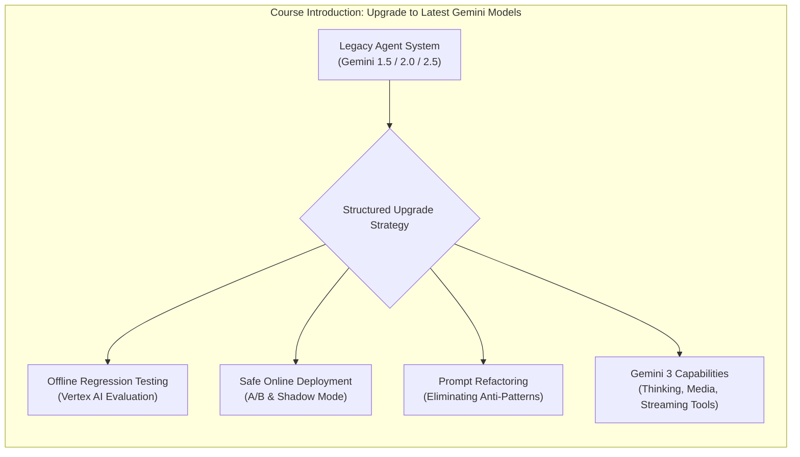

### Concept Graph & Architecture Mapping

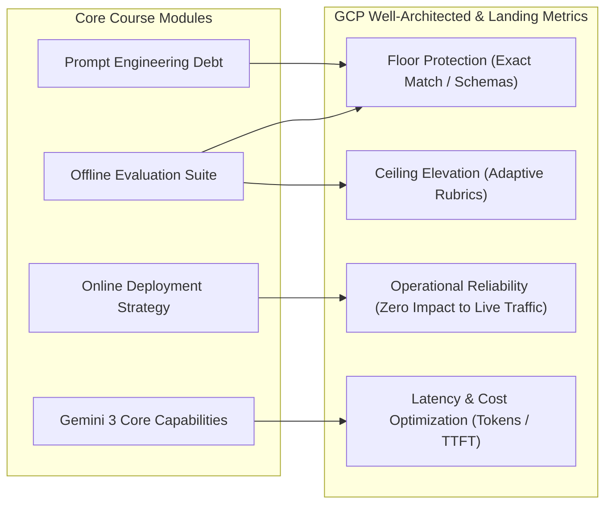

### Key Concepts & Grounded Architecture Matrix

| Concept | Architectural Purpose | GCP Landing & Well-Architected Metrics | Real-World Implementation Example | Grounding Source |
| --- | --- | --- | --- | --- |
| Offline Regression Testing Pipeline | Evaluates new model versions against an invariant "golden dataset" to detect silent regressions before deployment. | Floor Stability Metric: Tool Call Accuracy (≥99%), Schema Validation Failure Rate (=0%), Deterministic Exact-Match. | Running pre-deployment regression on Cloud Run revisions using the evaluate_agent function to grade tool call traces. | Vertex AI Continuous Evaluation |
| Shadow Deployment Mode | Mirrors live incoming production traffic to the new candidate model/agent revision with outputs discarded to users. | Traffic Isolation: Impacted User Rate (0%), End-to-End Execution Latency P99, Drift Divergence. | Routing live queries via Cloud Run private revision tags to Gemini 3 while serving responses from the existing production model. | Continuous Agent Evaluation Codelabs |
| A/B Testing Pipelines | Splits live production traffic between baseline (A) and candidate (B) to evaluate comparative user and system outcomes. | Online Business Metrics: Task Completion Rate (TCR), User Feedback (CSAT), Step Count per Task. | Splitting user sessions 90/10 via Cloud Load Balancing and logging comparative traces into BigQuery. | Continuous Evaluation Engineering Reliable AI Agents |
| Prompt Engineering Technical Debt | Identifies and strips out hacky workarounds (e.g., rigid few-shot schemas, manual CoT scaffolding) obsolete in newer foundation models. | Efficiency & Maintainability: Input Prompt Token Overhead, Instruction Compliance Rate. | Removing manual XML parsing hacks and legacy scratchpad prefixes that degrade Gemini 3's native reasoning engine. | Interactions API Migration Guide |
| Thinking Configurations & Thought Signatures | Configures reasoning levels (low, medium, high) and preserves multi-step thought context across tool calls via thought_signature. | Reasoning Integrity: Step-Level Continuity, Thought Preservation Success, Plan Execution Fidelity. | Feeding the encrypted thought_signature back into the multi-turn context payload so Gemini 3 preserves step-by-step reasoning across function executions. | Gemini Enterprise Agent Platform - Thought Signatures |
| Media Resolution Controls | Dynamically configures multimodal vision token density (media_resolution parameter) to balance fidelity and cost. | Cost & Latency: Multimodal Token Ingestion Cost, Time-to-First-Token (TTFT), OCR Character Accuracy. | Downscaling standard background camera frames to low resolution while dynamically elevating dense invoices to high. | Gemini Thinking - generateContent API |
| Streaming Function Calling | Emits tool-call tokens and function parameters iteratively as they are generated rather than buffering the entire payload. | Responsiveness Metric: Time-to-First-Tool-Execution (TTTE), Perceived Latency. | Using the Interactions API / streaming client to trigger tool authentication and parameter pre-validation before the full payload completes. | Interactions API Breaking Changes Migration Guide |

### Architectural Flow: Enterprise Model Upgrade Lifecycle

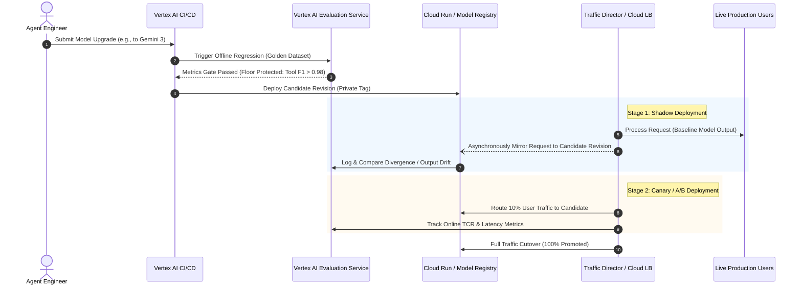

Decision Matrix: Deployment Strategy Selection

| Evaluation Criteria | Offline Golden Dataset | Shadow Deployment | A/B Testing | Direct Cutover (Anti-Pattern) |
| --- | --- | --- | --- | --- |
| Customer Impact Risk | None (0%) | None (0%) | Controlled (5−10%) | Critical (100%) |
| Real Traffic Fidelity | Synthetic / Historical | Live Production | Live Production | Live Production |
| Execution Cost | Offline Batch Tokens | 2× Inference Ingestion | 1× Ingestion Distributed | 1× Ingestion |
| Stateful Tool Call Risk | Sandboxed Mock Tools | Read-Only / Mocked Tools | Full Production Environment | Full Production Environment |
| Primary Metric Focus | Schema & Tool Regression | Output Drift & Latency P99 | Business TCR & CSAT | Unmonitored Downtime |

### Magic Quadrant: Upgrade & Evaluation Strategies

High Impact / High Control
      │
      │  [Vertex AI Evaluation Service]       [Shadow Deployment + A/B Testing]
      │  (Data-Driven Offline Suites)        (Safe Online Production Verification)
      │
EVALUATION RIGOR
      │
      │  [Vibe Checks & Manual Testing]      [Direct Production Replacement]
      │  (Ad-hoc Prompt Tweaks)               (High Regression Risk Anti-Pattern)
      │
      └────────────────────────────────────────────────────────────►
       Low Automation                       High Automation / Observability
                               DEVOPS MATURITY
Tell me “next page” whenever you are ready to proceed to the next module.

---

## Page Overview: Production Model Upgrade Strategy — Module Introduction

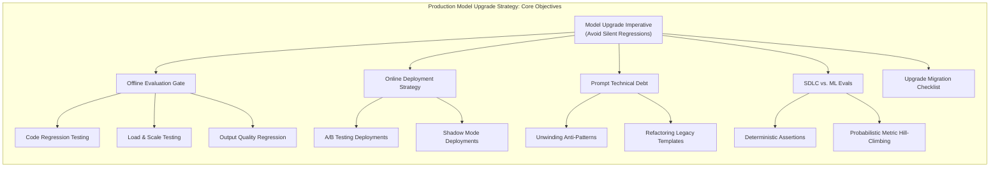

### Concept Graph & Architecture Mapping

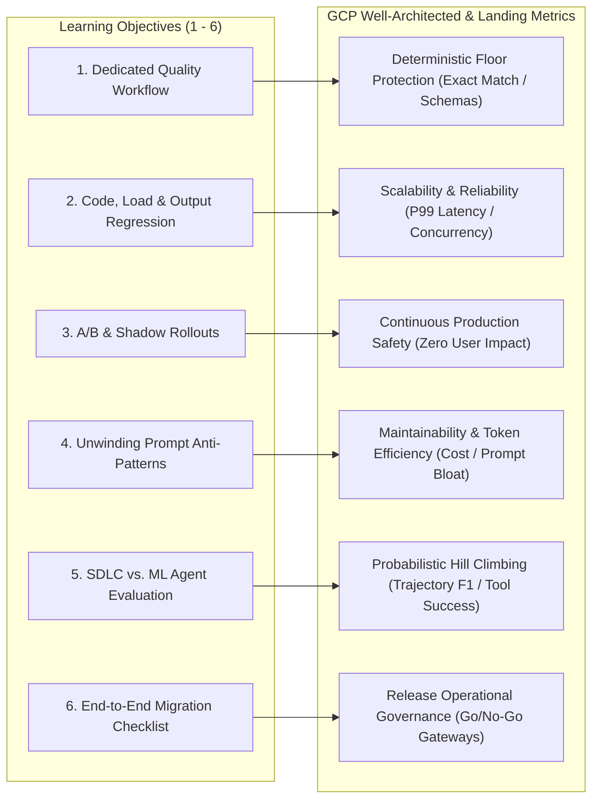

### Key Concepts & Grounded Architecture Matrix

| Objective / Concept | Architectural Purpose | GCP Landing & Well-Architected Metrics | Real-World Enterprise Example | Grounding Source |
| --- | --- | --- | --- | --- |
| 1. Dedicated Quality Evaluation Workflow | Prevents production model degradation caused by subtle shifts in token distributions, reasoning styles, and tool adherence. | Floor Stability Metric: Zero-Downtime Quality Floor, Regression Alert Frequency (=0). | Gating Gemini 2.5/3 model swaps behind automated Vertex AI evaluation pipelines before promoting container images. | Continuous Agent Evaluation Codelab |
| 2. Multi-Tier Regression Suite (Code, Load, Output) | Validates code mechanics (schema parsing), infrastructure scaling (token throughput), and output quality (semantic drift). | Operational Reliability: P99 Latency ≤1200ms, Error Rate <0.1%, Groundedness Metric ≥0.95. | Running Locust/JMeter for agent throughput alongside evaluate_agent automated grading on Cloud Run revisions. | AI evals tools and practical guide |
| 3. Safe Online Rollouts (A/B & Shadow Mode) | Evaluates live inference behavior under actual distribution without exposing real end-users to unverified agent actions. | Traffic Isolation: Impacted User Rate (0% in shadow), Delta Task Completion Rate (ΔTCR>0). | Forking Cloud Run incoming production requests asynchronously to a shadow candidate while returning baseline responses. | Engineering Reliable AI Agents |
| 4. Prompt Technical Debt & Anti-Pattern Refactoring | Strips out obsolete model crutches (e.g., verbose CoT instructions, XML tags, redundant format enforcements) that degrade newer models. | Cost & Prompt Hygiene: Token Overhead Reduction (≥30%), Instruction Following Compliance (≥98%). | Removing custom ReAct markdown parsing blocks to adopt native Gemini reasoning and schema constraints. | Interactions API Migration Guide |
| 5. SDLC vs. ML Agent Evaluation | Bridges binary programmatic assertions (pass/fail unit tests) with probabilistic, trajectory-based agent metrics. | Hill-Climbing Signal: Multi-turn Completion Rate (0.0−1.0), Tool Call Sequence Precision/Recall. | Combining pytest unit assertions for JSON tool schemas with continuous trajectory scoring on Android Bench / CX Agent Studio. | Android Bench 2.0 Methodology |
| 6. Production Model Upgrade Checklist | Standardized operational gate ensuring all technical, safety, rollback, and observability checks pass prior to cutover. | Operational Readiness: Cutover MTTR <5min, Observability Parity (100%), Rollback Automation Ready. | Enforcing a pre-flight Cloud Build gate with verified rollback routes in Traffic Director or Cloud Load Balancing. | Build Agents with CX Agent Studio |

SDLC Testing vs. Agentic ML Evaluation Comparison

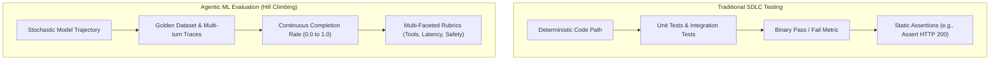

| Evaluation Dimension | Traditional Software Testing (SDLC) | Agentic AI Evaluation (ML / Hill Climbing) |
| --- | --- | --- |
| Execution Nature | Deterministic, repeatable, single execution path. | Stochastic, probabilistic, variable execution trajectories. |
| Pass/Fail Criteria | Binary boolean assertions (True / False). | Continuous completion rate score (0.0−1.0) and threshold gates. |
| Tool Verification | Mock API schema and status code checks. | Tool selection intent, argument validity, call order, and recovery behavior. |
| Failure Diagnosis | Stack trace, line number, exception logs. | Reasoning transcript inspection, intermediate tool drift, model misalignment. |
| Optimization Target | Bug fixes, coverage percentage, zero test failures. | Quality hill climbing, higher task completion, lower token cost. |

### Magic Quadrant: Upgrade Readiness & Evaluation Rigor

High Evaluation Rigor
      │
      │  [Full Multi-Tier Suite]              [Continuous Quality Hill Climbing]
      │  (Code + Load + Output Offline Evals) (Offline Gates + Shadow + A/B Testing)
      │
EVALUATION COMPLEXITY
      │
      │  [Vibe Checks & Manual Spot Tests]    [Traditional Unit Testing Only]
      │  (Ad-hoc Prompt Tweaking)             (Missing Trajectory / LLM Judge Scaffolding)
      │
      └────────────────────────────────────────────────────────────►
       Ad-hoc / Manual Rollout                Continuous Automated Rollout
                               DEPLOYMENT MATURITY
Tell me “next page” when you are ready to review the next topic.

I am on the module introduction page
Page: Production Model Upgrade Strategy — Module Introduction

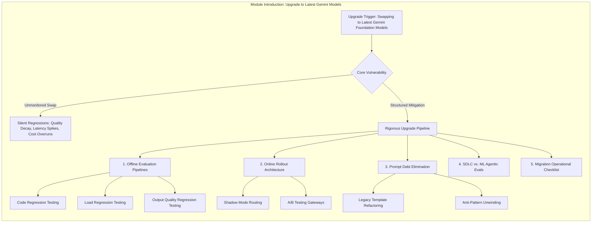

### Concept Graph & Architecture Mapping

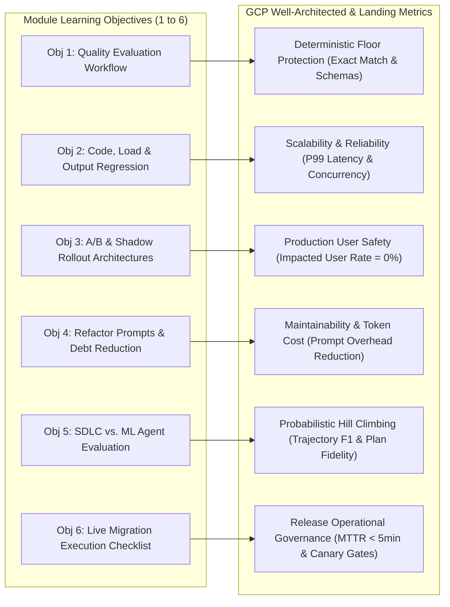

### Key Concepts & Grounded Architecture Matrix

| Core Learning Concept | Enterprise Architectural Purpose | GCP Landing & Well-Architected Metric | Real-World Enterprise Implementation Pattern | Grounding Reference |
| --- | --- | --- | --- | --- |
| Quality Evaluation Workflow (Obj 1) | Replaces intuitive "vibe checks" with deterministic and probabilistic gates before foundation model swaps. | Floor Stability Metric: Zero-Downtime Quality Floor; Schema Regression Rate (=0%). | Executing an automated pre-deployment evaluation pipeline on Vertex AI to evaluate candidate model tool calling before container promotion. | Vertex AI Continuous Agent Evaluation |
| Tri-Tier Regression Suite (Obj 2) | Systematically validates programmatic code schemas, throughput/latency limits, and semantic output fidelity. | Performance & Groundedness: P99 Latency ≤1200ms; Error Rate <0.1%; Groundedness Score ≥0.95. | Running Locust stress tests for token throughput alongside Cloud Run revisions running synthetic golden dataset traces. | Evaluating Multi-Agent Systems Codelab |
| Online Rollout Architectures (Obj 3) | Evaluates live model behavior under real operational distribution while isolating end-users from regressions. | Safety & Isolation: Impacted User Rate (0% in Shadow Mode); Delta Task Completion Rate (ΔTCR>0). | Cloud Load Balancing / Traffic Director splitting production queries: serving from the baseline model while asynchronously mirroring to candidate Gemini revisions. | Continuous Evaluation for AI Agents |
| Prompt Technical Debt Unwinding (Obj 4) | Strips obsolete prompt crutches (e.g., manual JSON formatting rules, explicit Chain-of-Thought scratchpads) that impede newer reasoning engines. | Token Efficiency & Compliance: Prompt Token Overhead Reduction (≥30%); Instruction Following Compliance (≥98%). | Deprecating XML format wrappers and legacy few-shot blocks to utilize Gemini native response_schema and integrated thinking modes. | Gemini API Interactions Migration Guide |
| SDLC vs. ML Agent Evaluation (Obj 5) | Reconciles binary programmatic unit tests with multi-turn stochastic trajectory scoring and LLM-as-a-judge rubrics. | Probabilistic Hill Climbing: Trajectory Success Rate (0.0−1.0); Tool Argument Precision and Recall. | Pairing pytest assertions for API contracts with BigQuery-stored multi-turn trajectory evaluators scoring planning paths. | Android Bench Evaluation Methodology |
| Live Migration Checklist (Obj 6) | Standardized operational go/no-go protocol guaranteeing automated fallback routes and telemetry parity. | Operational Readiness: Cutover MTTR <5min; Metric Parity (100%); Automated Rollback Triggered on Drift. | CI/CD release gate running pre-flight checks, verifying model quotas in Google Cloud Monitoring, and arming automated rollbacks. | CX Agent Studio Deployment Architecture |

End-to-End Migration & Verification Flow

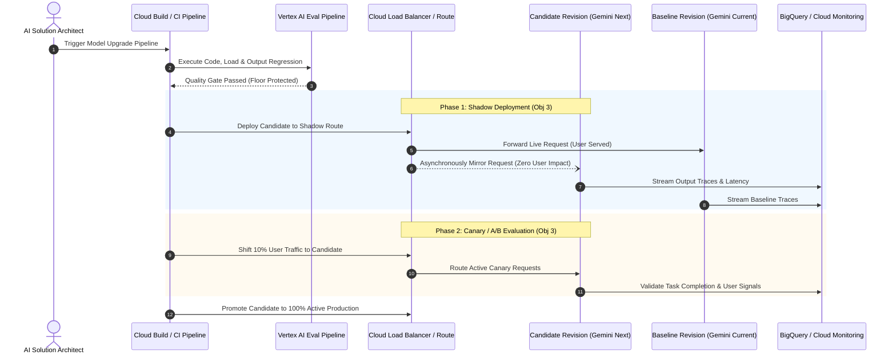

Comparative Matrix: SDLC Testing vs. Agentic ML Evaluation

| Dimension | Traditional SDLC Testing (Code Regression) | Agentic ML Evaluation (Quality Regression) |
| --- | --- | --- |
| Execution Paradigm | Deterministic code execution; static control flow. | Non-deterministic, stochastic generation and multi-step trajectories. |
| Pass / Fail Logic | Binary assertion checks (assert response.status == 200). | Continuous scoring rubrics (0.0−1.0), semantic distance, and LLM-judge gates. |
| Tool Calling Check | Verifies mock function invocation, payload types, and schemas. | Verifies parameter intent, call necessity, execution sequence, and recovery handling. |
| Load Testing Goal | Infrastructure capacity: CPU, RAM, connection pool saturation. | Model quota throughput: TPM (Tokens Per Minute), RPM, TTFT (Time-to-First-Token). |
| Regression Fix | Code refactoring, patch releases, bug fixes. | Prompt refactoring, example curation, tool description tuning, thinking budget adjustment. |

### Magic Quadrant: Deployment & Validation Strategies

High Evaluation Rigor
      │
      │  [Offline Regression Suites]          [Continuous Agent Hill Climbing]
      │  (Code, Load & Output Quality Tests)  (Shadow Routing + A/B Experimentation)
      │
EVALUATION COMPLEXITY
      │
      │  [Ad-hoc Prompt Tweaks]               [Traditional Code Unit Testing]
      │  (Manual "Vibe Checks")               (Schema Validation Only; No ML Rubric)
      │
      └────────────────────────────────────────────────────────────►
       Low Automation / Manual Rollout         Fully Automated CI/CD Canary
                               DEPLOYMENT MATURITY

---

Page: Planning and Strategy for Model Upgrades

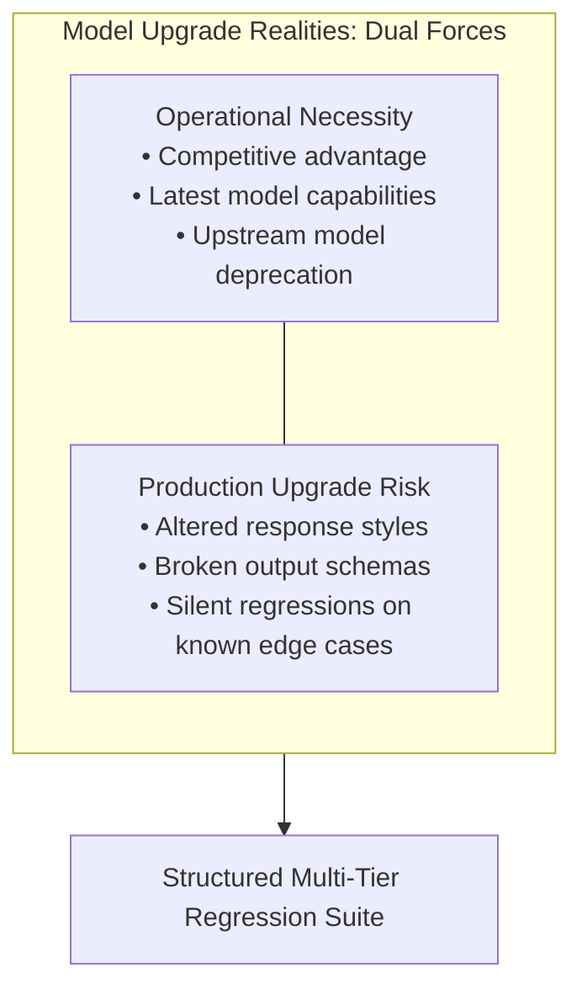

### Key Concepts & Grounded Architecture Matrix

| Key Concept | Architectural Definition | GCP Landing & Well-Architected Metric | Production Implementation Pattern | Grounding Source |
| --- | --- | --- | --- | --- |
| Silent Regressions | Failures introduced when a newer foundation model alters reasoning patterns, breaks JSON schemas, or fails inputs previously handled cleanly. | Quality Floor Stability: Schema Validation Error Rate (=0%), Zero-Regression Tolerance on Golden Test Cases. | Running automated continuous regression testing before replacing production model endpoints. | Evaluation \| CX Agent Studio |
| Code Regression Tests | Deterministic software engineering tests verifying client integration, parameter parsing, SDK bindings, and payload serialization. | DevOps Reliability: Build Pass Rate (100%), API Contract Conformance, CI/CD Pipeline Health. | Executing unit test suites in Cloud Build to assert JSON schemas and tool arguments. | Migrate to Latest Gemini Models |
| Load Tests | Infrastructure and performance tests assessing how changing token generation rates and latency impact provisioned throughput. | Operational Efficiency: P99 Latency (≤SLO), Concurrency Saturation, Token Consumption Rate (TPM/RPM). | Simulating high-concurrency multi-turn user sessions against Cloud Run deployments. | Methodical Approach to Agent Evaluation |
| Model Output Quality Regressions (Evals) | Generative and agentic evaluations validating semantic quality, trajectory correctness, tool accuracy, and persona compliance. | Agent Task Success: Multi-Turn Task Success Rate, Tool Selection Correctness (≥99%), Hallucination Rate (<1%). | Running test case suites against golden datasets using the Agent Platform SDK. | Evaluate Your Agents \| Agent Platform |
| Stack Compatibility Check | Pre-upgrade check confirming runtime SDKs, orchestrators, and prompt parsing blocks support the newer model endpoints. | System Interoperability: Client SDK Error Rate (=0%), Deprecated API Call Elimination. | Validating client migrations from legacy generateContent wrappers to the newer Interactions API. | Interactions API Migration Guide |
| Feature Availability Check | Pre-upgrade audit ensuring required features (system instructions, JSON mode, native thinking, streaming tools) are available in the target region. | Capability Parity: Regional Quota Allocation, Feature Parity Coverage (100%). | Checking Vertex AI model quotas and capability matrices across target deployment regions. | Gemini Thinking Mode Documentation |
| Cost Boundary Verification | Pre-upgrade analysis calculating total inference and token pricing against historical production volumes. | Financial Governance: Inference Cost per Successful Task (Δ≤0%), Budget Burn Rate. | Projecting monthly billing impacts in Google Cloud Cost Management based on revised token pricing. | A Methodical Approach to Agent Evaluation |

### Concept Graph: Pre-Upgrade Verification Gate & Test Triad

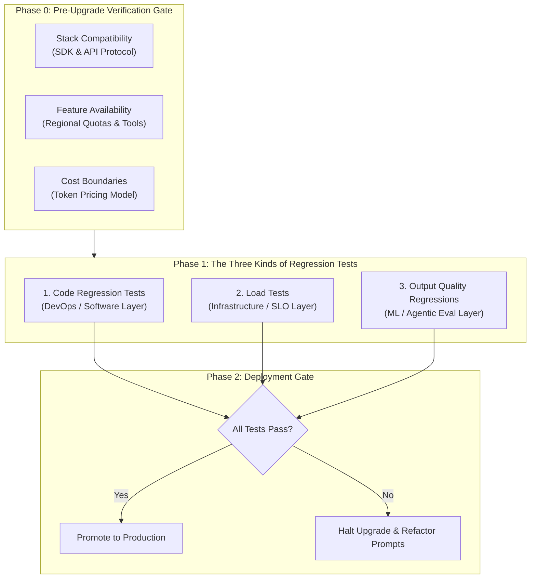

Tri-Tier Testing Strategy: Architectural Comparison

| Dimension | 1. Code Regression Tests | 2. Load Tests | 3. Output Quality Evals |
| --- | --- | --- | --- |
| Primary Lens | Software Engineering & DevOps | Cloud Infrastructure & Operations | Machine Learning & Data Science |
| Target Vulnerability | Broken schemas, missing fields, SDK crashes | Latency spikes, quota exhaustion, connection timeouts | Semantic drift, broken reasoning, tool misalignment |
| Tooling & Services | pytest, Cloud Build, GitHub Actions | Locust, JMeter, Cloud Monitoring | Vertex AI Gen AI Evaluation, CX Agent Studio |
| Test Dataset | Synthetic mock payloads & unit assertions | Peak concurrent production request patterns | Golden conversational paths & trajectory datasets |
| Success Metric | 100% test suite pass rate | Latency P99 meets SLO; zero 429/503 errors | High Task Completion Rate; zero critical regressions |

### Magic Quadrant: Upgrade Risk vs. Evaluation Rigor

High Evaluation Rigor
      │
      │  [Multi-Tier Regression Suite]       [Continuous Eval & Replay Gates]
      │  (Code + Load + Output Evals)       (Offline Goldens + Shadow Replay)
      │
EVALUATION DEPTH
      │
      │  [Vibe Checks & Spot Testing]        [Isolated Unit Code Testing]
      │  (Manual Inspection)                 (Checks API 200, Misses Quality Degradation)
      │
      └────────────────────────────────────────────────────────────►
       Low Automation                        High Automation
                           OPERATIONAL MATURITY
next page; be as exhaustive as possible while adhering to the original instructions and do not miss anything.
Page Architecture: Offline and Online Evaluation for Model Upgrades

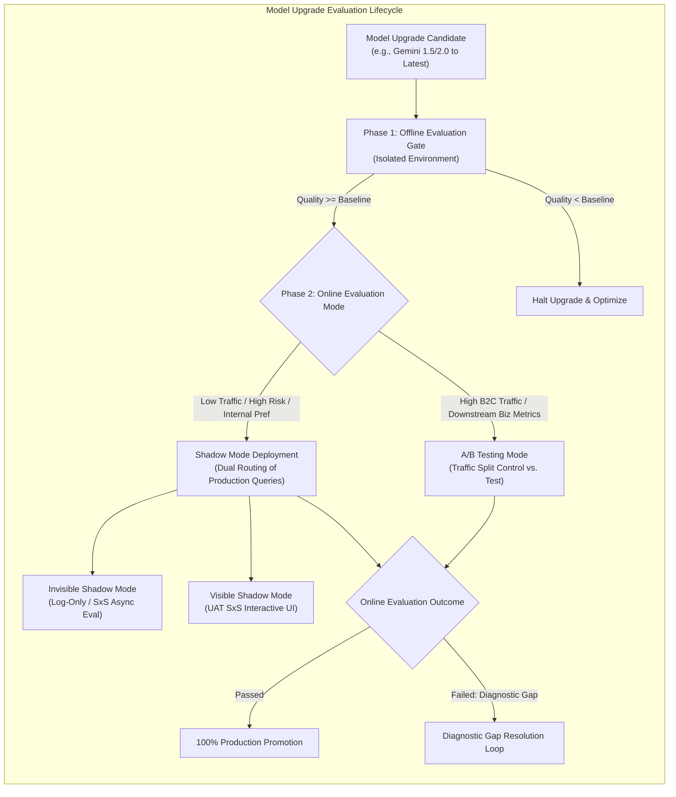

### Concept Graph & Architecture Mapping

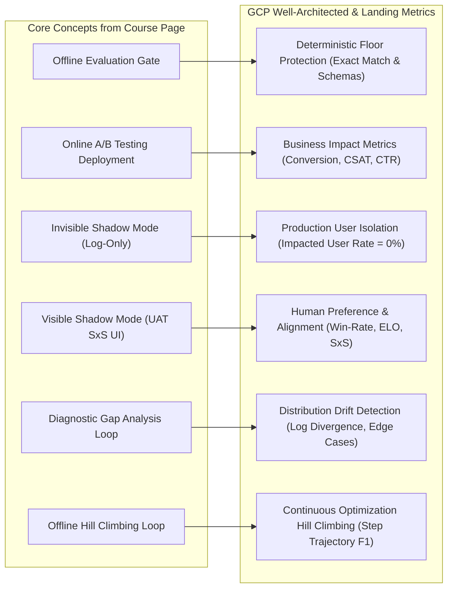

In-Page Diagrams (Mermaid.js Reconstructions)
In-Page Diagram 1: A/B Testing Deployment Architecture

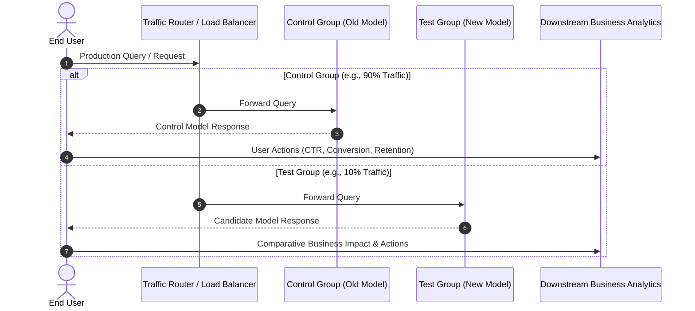

In-Page Diagram 2: Shadow Mode Deployment Architectures (Dual Mode)

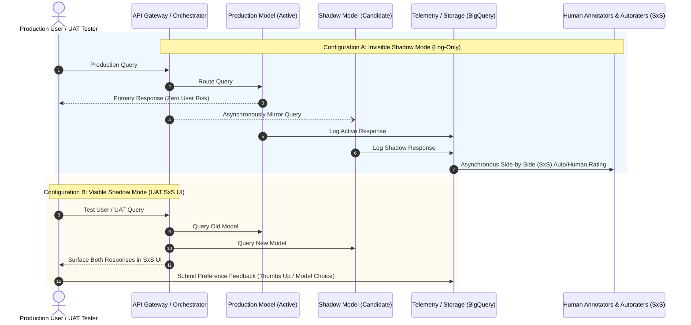

In-Page Diagram 3: Diagnostic Gap Resolution & Hill Climbing Workflow

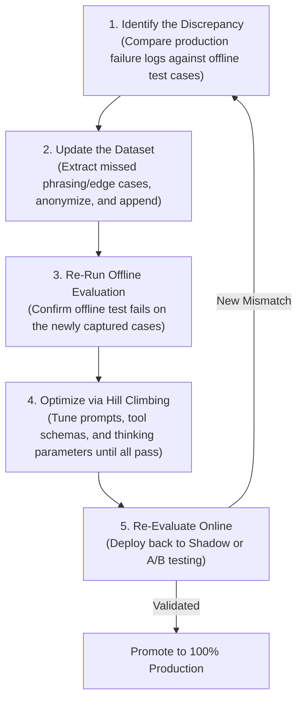

Exhaustive Key Concepts Matrix & GCP Landing Alignment

| Concept | Architectural Purpose & Scope | GCP Landing & Well-Architected Metric | Production Real-World Implementation Pattern | Grounding Reference |
| --- | --- | --- | --- | --- |
| Offline Evaluation Gate | Evaluates candidate foundation models within isolated staging environments using historical session logs or synthetic datasets before any traffic cutover. | Floor Stability & Cost: Tool Call Accuracy (≥99%), Evaluation Token Spend (<5% prod baseline), Zero User Exposure. | Running batch inference jobs in Vertex AI Evaluation pipelines scoring against static Golden Datasets before staging container release. | Evaluating Multi-Agent Systems Codelab |
| Online Evaluation Pipeline | Evaluates live model interactions under real dynamic distribution to capture statistical guarantees that offline test suites cannot provide. | Production Robustness: End-to-End Latency P99 (≤SLO), Dynamic Task Completion Rate (TCR), User Engagement Drift. | Ingesting live user interactions via Cloud Monitoring and BigQuery stream sinks for continuous autorater scoring. | Continuous Evaluation for AI Agents |
| A/B Testing Deployment | Splits live user sessions into a control group (old model) and test group (new model) to directly quantify downstream business impacts. | Downstream Impact: Conversion Rate Delta (ΔCR≥0), Click-Through Rate (CTR), User Session Length, CSAT. | Utilizing Google Cloud Armor / Cloud Load Balancing route rules to split sessions 90/10 across Cloud Run revisions. | Enabling Generative AI Value Evaluation Framework |
| Invisible Shadow Mode (Log-Only) | Duplicates live queries asynchronously to the candidate model; discards or stores output for post-hoc analysis without altering user experience. | Zero-Risk Ingestion: Impacted User Rate (0%), Schema Validation Failure Rate (=0%), Shadow Latency Overhead. | Cloud Run private revision tags or Pub/Sub dead-letter queues logging shadow inference outputs straight to BigQuery for autorater SxS. | A Methodical Approach to Agent Evaluation |
| Visible Shadow Mode (UAT SxS UI) | Displays candidate and baseline outputs side-by-side in frontend interfaces for internal staff, subject matter experts (SMEs), or pilot test users. | Human Preference & Alignment: Human Preference Win-Rate (>55%), SME Annotation Agreement Rate (κ≥0.85). | Directing internal dogfooding teams to a split-pane web UI where raters choose the better response directly into Vertex AI Annotation sets. | Evaluate Your Agents \| CX Agent Studio |
| Diagnostic Gap Analysis | Resolves discrepancies where an upgrade passes offline evaluations but fails online due to incomplete offline test dataset distribution. | Dataset Representativeness: Production Query Coverage (%) and Edge Case Divergence Delta. | Query clustering in BigQuery using vector embeddings to identify unrepresented user intent clusters and missing edge cases. | Enabling Generative AI Value Evaluation Framework |
| Offline Hill Climbing Optimization | Iterative engineering loop refining prompts, tool schemas, and thinking parameters until the agent passes old and newly added production edge cases. | Hill-Climbing Trajectory: Macro F1 Score Progression, Success Delta (Δ≥0), Zero Regression Tolerance on Baseline. | Modifying system instructions and thinking budgets (low, medium, high) within Vertex AI Prompt Studio to recover failing test cases. | Gemini Thinking Mode Documentation |

Comparative Evaluation Matrix: Offline vs. Online Deployment Strategies

| Evaluation Attribute | Offline Evaluation | Invisible Shadow Mode | Visible Shadow Mode (UAT SxS) | Online A/B Testing |
| --- | --- | --- | --- | --- |
| Execution Environment | Isolated Staging / CI/CD | Live Production Backend | Dedicated Internal Frontend | Live Production Consumer Frontend |
| Traffic Source | Historical Logs / Synthetic | Mirrored Live Traffic | Internal Users / Selected Pilot | Real End-User Traffic Split |
| User Risk Level | None (0%) | None (0%) | Extremely Low (Internal Only) | Moderate (5−10% exposed) |
| Frontend UI Changes | None | None | Requires Dual-Pane SxS UI | None (Single response served) |
| Primary Metric Type | Computable / Autorater Metrics | Side-by-Side (SxS) Alignment | SME Win-Rate / Human Preference | Conversion, CTR, Session Time |
| Infrastructure Cost | Low (Batch Tokens) | 2× Live Model Ingestion | Moderate (Controlled Pilot) | 1× Live Model Ingestion |
| Target Use Cases | Baseline Regression Gates | Enterprise / High-Risk Agents | Quality Validation / Pilot Review | B2C High Volume (Retail, Chatbots) |

### Magic Quadrant: Online Deployment Strategy Selection

High User Risk / High Business Fidelity
      │
      │                                       [A/B Testing Mode]
      │                                       (High Volume B2C, Conversions, CTR)
      │
BUSINESS MEASUREMENT
      │
      │  [Visible Shadow Mode (UAT)]           [Invisible Shadow Mode]
      │  (Internal SMEs, Live Preference SxS) (Zero User Risk, Async Log Grading)
      │
      └────────────────────────────────────────────────────────────►
       Zero User Risk                        Controlled End-User Risk
                               USER-FACING RISK EXPOSURE
next page ; while adhering to the original instructions be as detailed as possible.
Page Architecture: Gen AI-Specific Technical Debt

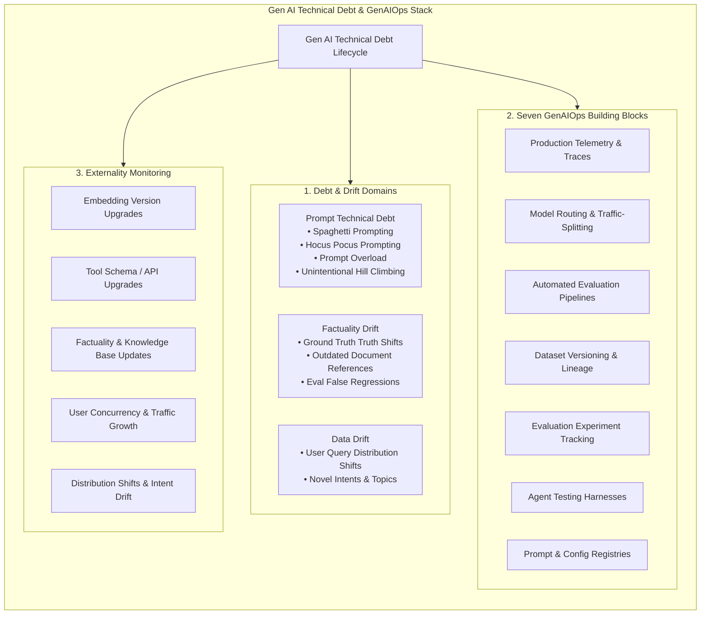

In-Page Diagram Reconstruction: The Resilient Gen AI Architectural Core
(Mermaid representation of the central conceptual diagram depicted in the course viewport: Foundation AI surrounded by orbital dependencies).

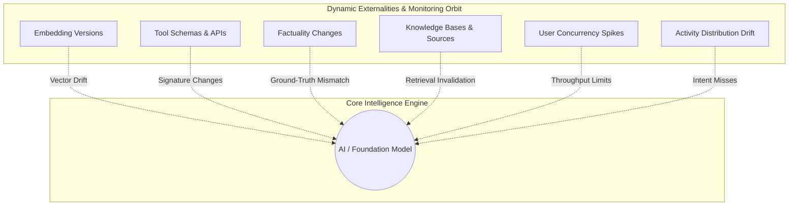

### Concept Graph: Prompt Anti-Patterns vs. GenAIOps Remediation

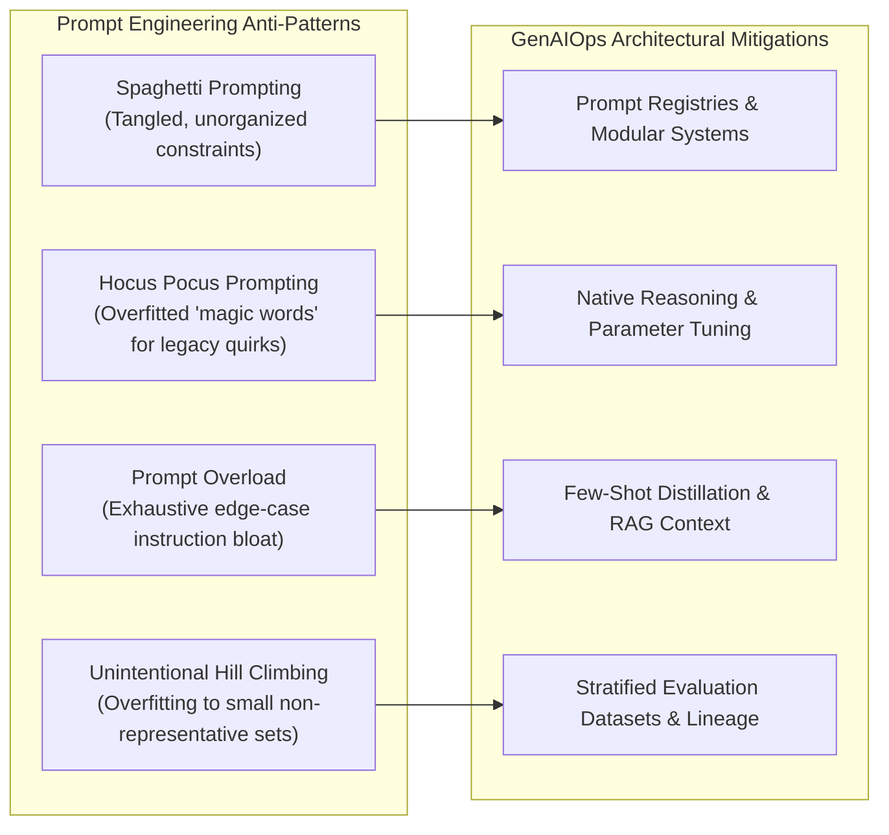

### Key Concepts Matrix: Prompt Engineering Anti-Patterns

| Anti-Pattern Concept | Technical Manifestation & Failure Mechanism | GCP Well-Architected & Landing Impact | Real-World Enterprise Example | Architectural Remediation Pattern |
| --- | --- | --- | --- | --- |
| Spaghetti Prompting | Tangling multi-role instructions, negative rules, tool guidelines, and output constraints across one unsegmented block over months of iterations. | Instruction Adherence Rate: ↓15–30%, Non-deterministic JSON parsing exceptions, high cognitive load. | Appending customer refund exceptions, format notes, and tone overrides inside a single 4,000-token system prompt string. | Decompose into distinct system instructions, structured schemas (response_schema), and modular agent sub-personas. |
| Hocus Pocus Prompting | Injecting superstitious, hyper-specific tokens or "magic phrases" (e.g., "Take a deep breath", "Think step by step", "You are an elite JSON bot") needed solely to coerce older models into compliance. | Token Efficiency & Quality Floor: Degrades newer reasoning models by suppressing native inference patterns. | Legacy prefixes crafted to prevent Gemini 1.0 Pro from dropping markdown wrappers, which triggers redundant output in Gemini 2.5/3. | Strip artificial incantations; transition to native thinking budgets (thought_signature) and native platform features. |
| Prompt Overload | Packing system instructions with dozens of niche edge cases, manual if-else branches, and lengthy few-shot exemplars until context is saturated. | TTFT & Cost: High Time-to-First-Token, Context Saturation, core instruction dilution / forgetfulness. | Embedding 45 distinct corporate travel policy edge-case paragraphs into an agent's base system prompt. | Offload long-tail cases into a vector retrieval (RAG) tool or dedicated external routing agent; preserve system prompt for pure core role guidance. |
| Unintentional Hill Climbing | Tweaking and over-tuning prompt templates against an ad-hoc, non-representative test set (e.g., 5 to 10 known failure samples). | Generalization Deficit: High test-set score, dramatic failure and high variance across real-world production traffic. | Adjusting an agent prompt until 10 internal stakeholder questions pass, only to see production task completion drop 20%. | Deploy statistically representative, stratified evaluation sets with automated regression suites across thousands of historical queries. |

Drift Distinction Matrix: Factuality Drift vs. Data Drift

| Dimension | Factuality Drift | Data Drift |
| --- | --- | --- |
| Formal Definition | Model outputs that were historically accurate become incorrect because external real-world ground truth or institutional knowledge changed. | Shifts in the statistical distribution, topics, vocabulary, or intents of live user input entering the agent pipeline. |
| Root Source | External world evolution: corporate policy updates, pricing revisions, laws, API changes. | User behavior evolution: seasonality, viral events, regional expansions, unexpected user workarounds. |
| Impact on Evals | False Negative Regressions: Candidate model outputs correct new facts, but offline evaluation marks it failed against an outdated golden benchmark. | Coverage Blindspots: Evaluation suites only test historical intent clusters, missing degraded performance on novel user intents. |
| Detection Mechanism | Knowledge base change log audits, vector store last-modified tracking, freshness authoring runs. | Embedding drift monitoring in BigQuery, unsupervised clustering of incoming prompt tokens over time. |
| Remediation Strategy | Evaluation dataset versioning and lineage synchronizing golden answers with knowledge base releases. | Active data harvesting: mining production logs to append high-divergence clusters to test datasets. |

GenAIOps Upgrade Building Blocks Matrix

| GenAIOps Building Block | Architectural Role in Model Upgrades | GCP Landing & Well-Architected Metric | Implementation Pattern (Google Cloud / Enterprise) |
| --- | --- | --- | --- |
| 1. Production Telemetry & Logs | Captures complete multi-turn conversational traces, function invocations, intermediate steps, and explicit user feedback. | Observability Parity: 100% trace capture rate, zero blind spots in tool failure diagnosis. | Streaming full agent execution logs to Cloud Logging and BigQuery; surfacing thumbs-up/down ratings to autorater tables. |
| 2. Model Routing & Traffic Splitting | Middleware routing traffic between foundation model endpoints to support canary launches, live A/B splits, and shadow pipelines. | Blast Radius Control: User Impact Rate (0% in shadow), Instant Cutover MTTR (<1 min). | Traffic Director or Cloud Load Balancing weighted routing rules splitting user sessions across distinct Cloud Run service revisions. |
| 3. Automated Evaluation Pipelines | CI/CD automation executing programmatic assertions and autoraters whenever a prompt or model version changes. | Continuous Floor Protection: Regression Catch Rate (100% pre-prod), Schema Validation Error (=0%). | Cloud Build triggering Vertex AI Evaluation jobs with autoraters against invariant golden datasets before container deployment. |
| 4. Dataset Versioning & Lineage | Tracks the provenance, timestamp, and backing knowledge sources of evaluation benchmarks to eliminate factuality drift. | Dataset Freshness: Ground-truth sync delta (0 days against production policy releases). | Storing evaluation datasets in BigQuery tables versioned alongside Git release tags and knowledge base corpus hashes. |
| 5. Evaluation Experiment Tracking | Central registry recording prompts, agent version, target model, dataset hash, metric deltas, and trajectory traces. | Hill-Climbing Traceability: Complete experiment reproducibility, metric improvement delta (Δ≥0). | Vertex AI Experiments tracking comparative runs, F1 trajectories, tool accuracy curves, and cost per task. |
| 6. Agent Testing Harnesses | Isolated sandboxes simulating external tools, database states, and multi-turn user personas without affecting production. | Deterministic Tool Verification: Mock Tool Parity (100%), Multi-turn Planning Success Score. | Synthetic environment runners orchestrating mock APIs in Cloud Functions to validate multi-step agent actions. |
| 7. Prompt & Configuration Registries | Decouples prompt text, temperatures, system instructions, and schemas from compiled application codebases. | Decoupled Velocity: Rollback latency (<30 sec without triggering application redeployments). | Vertex AI Prompt Management / Secret Manager externalizing versioned system templates consumed at runtime via URI reference. |

### Magic Quadrant: GenAIOps Maturity vs. Technical Debt Risk

High Technical Debt Exposure
      │
      │  [Vibe Check & Monolithic Prompts]     [Ad-hoc Scripted Evaluations]
      │  (Spaghetti / Hocus Pocus Prompting,   (Manual regression checks,
      │   Manual untested production deploys)   No traffic splitting middleware)
      │
DEBT ACCUMULATION
      │
      │  [Basic Registry & Unit Tests]         [Mature GenAIOps Architecture]
      │  (External prompts, simple schemas,    (Automated eval CI/CD, Shadow routing,
      │   No multi-turn agent simulation)       Dataset lineage, Real-time telemetry)
      │
      └────────────────────────────────────────────────────────────►
       Ad-hoc / Manual Ops                     Enterprise GenAIOps Automation
                               OPERATIONAL MATURITY

---

Page Architecture: Model Upgrades for AI Agents

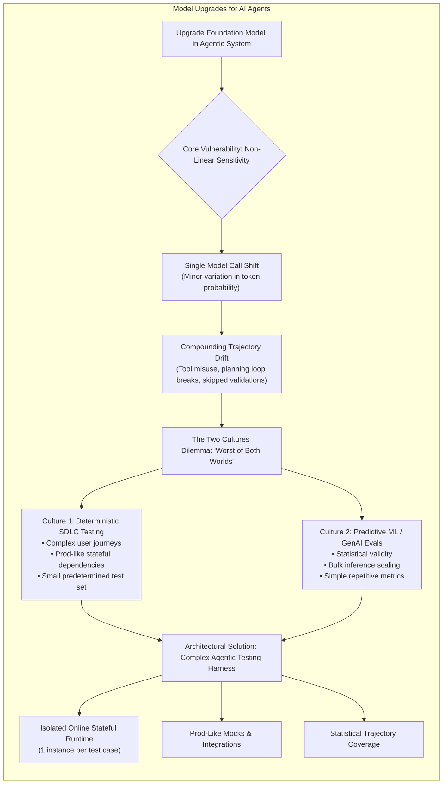

### Concept Graph & Architecture Mapping

```mermaid
flowchart LR
    subgraph CoreConcepts["Core Concepts from Course Page"]
        direction TB
        C1["Agent Sensitivity & Trajectory Drift"]
        C2["Evaluating Trajectories vs. Isolated Prompts"]
        C3["Planning & Reasoning Shifts"]
        C4["Deterministic SDLC Testing Culture"]
        C5["Predictive ML / Bulk Inference Culture"]
        C6["Complex Agentic Testing Harness"]
    end

    subgraph GCPMetrics["GCP Well-Architected & Landing Metrics"]
        direction TB
        M1["Trajectory F1 & Plan Fidelity"]
        M2["Tool Call Ordering & Argument Validity"]
        M3["Safety Validation Bypass Rate (= 0%)"]
        M4["Stateful Deterministic Pass Rate (100%)"]
        M5["Statistical Evaluation Significance (p < 0.05)"]
        M6["Harness Isolation & Sandboxed Concurrency"]
    end

    C1 --> M1
    C2 --> M2
    C3 --> M3
    C4 --> M4
    C5 --> M5
    C6 --> M6
```

Reconstructed Page Diagram: The Testing Harness & Agent Lifecycle
(Mermaid reconstruction of the central viewport illustration showing the agent runtime, stateful telemetry, and integration harness tuning controls).

```mermaid
flowchart TD
    subgraph TestHarness["Complex Agentic Testing Harness"]
        direction TB
        subgraph Config["Harness Parameter Controls"]
            P1["Seed / Temperature Sliders"]
            P2["Stateful Sandbox Provisioner"]
            P3["Mock Dependency Router"]
        end

        subgraph Execution["Multi-Turn Execution & Telemetry"]
            E1["Step 1: Intent Routing"] --> E2["Step 2: Tool Execution"]
            E2 --> E3["Step 3: Reasoning & Validation"]
            E3 --> E4["Step 4: State Transition"]
        end

        subgraph Metrics["Telemetry & Statistical Scoring"]
            M1["Trajectory Completion Rate"]
            M2["Tool Sequence Precision"]
            M3["P99 Latency & Token Burn"]
        end

        Config --> Execution
        Execution --> Metrics
    end
```

In-Depth Key Concepts & GCP Well-Architected Matrix

| Concept | Architectural Definition | GCP Landing & Well-Architected Metric | Production Real-World Implementation Pattern | Grounding Reference |
| --- | --- | --- | --- | --- |
| Agent Sensitivity to Model Upgrades | The structural vulnerability where minor delta shifts in foundation model token distributions compound into severe multi-step divergence across routing, tool execution, and termination. | Trajectory Stability Metric: Multi-turn drift delta (ΔTCR≥0), Tool Misalignment Rate (<0.5%). | Gating Gemini foundation model swaps behind automated trajectory evaluators on Cloud Run. | Single-Agent System using ADK and Cloud Run |
| Evaluating Trajectories vs. Single Prompts | Moving from scoring static single-turn responses to evaluating the entire directed acyclic graph (DAG) of agent decisions, tool parameter structures, and intermediate outputs. | Plan Fidelity: Tool Selection Accuracy (≥99%), Trajectory Exact Match Rate, Unnecessary Tool Invocation Count (=0). | Testing multi-turn conversational agents with session replay datasets via Vertex AI Agent Platform. | Deploy and Operate Generative AI Applications |
| Planning & Reasoning Shifts | Alterations in how newer foundation models formulate internal plans, including reversing tool execution order, selecting different tools, or bypassing mandatory intermediate validation checks. | Operational Safety: Validation Bypass Rate (=0%), Intermediate Grounding Enforcement Rate (100%). | Isolating tool definitions and running step-level trajectory assertions to verify security validation checks are executed. | Agentic AI Orchestrate Security Operations |
| Deterministic SDLC Testing Culture | Traditional software engineering verification focusing on stateful environments, live database states, mock APIs, and binary pass/fail checks on fixed test cases. | Software Reliability: Integration Test Pass Rate (100%), Schema Conformance, Stateful Sandbox Reset Integrity. | Running isolated ephemeral container environments in Cloud Build that mock external payment and inventory APIs. | Operational Excellence in AI/ML Perspective |
| Predictive ML Evaluation Culture | Data science evaluation paradigm built around statistical confidence, bulk offline inference, continuous metric distributions, and large holdout datasets. | Statistical Rigor: Statistical Power (1−β≥0.80), Sample Variance, Confidence Interval (α=0.05). | Executing bulk batch prediction pipelines scoring hundreds of test prompts using LLM-as-a-judge autoraters. | Guidelines for Developing High-Quality ML Solutions |
| Complex Agentic Testing Harness | An infrastructure combining prod-like stateful dependencies (1 online environment per test case) with high-throughput bulk inference runners to execute multi-turn agent evaluations. | Harness Concurrency: Isolated Sandbox Spin-up Time (<2s), Sandbox Clean-Up Rate (100%), Cost per Trajectory Test. | Containerized ephemeral agent execution workers running on Cloud Run or GKE with mock API sidecars. | AlphaEvolve API Reference & Harness Architecture |

Comparative Matrix: The Two Cultures of Software Testing
(Direct, comprehensive expansion of the course comparison table).

| Dimension | Deterministic SDLC Testing | Predictive ML / Simple GenAI Evals | Complex Agentic Testing Harness |
| --- | --- | --- | --- |
| Test Case Complexity | Complex, user journey-specific, input-specific criteria. | Simple, repeated individual test criteria across test cases. | Complex, user journey-specific, and input-specific test criteria. |
| Data Quality Constraints | Flexible data quality constraints; focuses on boundary values. | Strong data quality constraints; benchmark sets must be clean. | Strong data quality constraints across all journey turns. |
| Statistical Validity & Coverage | Small number of predetermined, deterministic test cases. | Strong statistical validity, broad coverage, large sample sizes. | Strong statistical validity and broad test case coverage. |
| Integration & Environment | "Prod-like" integration constraints and external dependencies. | No integration constraints; little to no dependencies. | "Prod-like" integration constraints and dependencies. |
| Execution State & Mode | Requires an online, stateful environment with persistent state. | Can be run in batch, offline, and stateless pipelines. | Requires an online, stateful environment (1 per individual test case). |
| Inference Infrastructure | Low throughput; executes simple deterministic logic paths. | Requires bulk inference infrastructure (high tokens/sec). | Requires bulk inference infrastructure combined with stateful containers. |
| Primary Failure Mode | Explicit stack trace, unhandled exception, syntax failure. | Metric degradation across aggregate statistical distribution. | Cascading trajectory drift, invalid tool sequences, silent policy skips. |

Multi-Turn Agent Trajectory Evaluation Flow

```mermaid
sequenceDiagram
    autonumber
    actor Harness as Agent Test Harness Worker
    participant Sandbox as Stateful Environment Sandbox (1 per test)
    participant Agent as Agent Runtime (Candidate Model)
    participant Tools as Mock Prod-like Tools & APIs
    participant Eval as Multi-Turn Trajectory Autorater

    Harness->>Sandbox: Provision Isolated Environment (Seed State)
    Harness->>Agent: Inject User Journey Prompt Turn 1
    Agent->>Agent: Plan Reasoning & Tool Call
    Agent->>Tools: Invoke Tool 1 (e.g., Check Availability)
    Tools-->>Agent: Return Mock Data
    Agent->>Harness: Agent Response Turn 1

    Harness->>Agent: Inject User Journey Prompt Turn 2 (Goal Escalation)
    Agent->>Tools: Invoke Tool 2 (e.g., Execute Order)
    Tools-->>Agent: Return State Transition (Order Placed)
    Agent->>Harness: Agent Final Resolution

    Harness->>Eval: Stream Complete Multi-Turn Execution Trace
    Eval->>Eval: Evaluate Tool Order, Planning Step Validity & Safety Rules
    Eval-->>Harness: Trajectory Score (Pass / Fail / Score: 0.0 - 1.0)
    Harness->>Sandbox: Teardown & Reset Environment
```

### Magic Quadrant: Testing Paradigms for Agentic Systems

High Environmental Statefulness / Dependency Integration
      │
      │  [Deterministic SDLC Testing]         [Complex Agentic Harness]
      │  (Unit / Integration mocks,            (The "Worst of Both Worlds":
      │   Fixed stateful assertions)            Stateful Sandboxes + Bulk Statistical Inference)
      │
ENVIRONMENT COMPLEXITY
      │
      │  [Manual Vibe Checks]                  [Predictive ML / GenAI Evals]
      │  (Ad-hoc developer testing)             (Stateless batch prompts,
      │                                         Bulk autorater scoring)
      │
      └────────────────────────────────────────────────────────────►
       Low Statistical Scale                  High Statistical Scale & Bulk Inference
                               EVALUATION VOLUME & RIGOR

---

Page Architecture: Execution Plan for Upgrades

```mermaid
graph TD
    subgraph UpgradeExecutionPlan["Five-Phase Model Upgrade Framework"]
        direction TB
        Challenge["Dual Upgrade Challenge"] --> SDLC["1. Deterministic SDLC Tasks<br/>• Parameter tuning (thinking levels)<br/>• API response schemas<br/>• Thought token passing (`thought_signature`)"]
        Challenge --> ML["2. Output Quality Tasks (ML/Stats)<br/>• Response quality & length drift<br/>• Tone/style alignment<br/>• Multi-turn trajectory evaluations"]

        SDLC & ML --> P1["Phase 1: Scoping and Preparation"]
        P1 --> P2["Phase 2: Baseline Evaluations & Code Updates"]
        P2 --> P3["Phase 3: Analysis and Optimization"]
        P3 --> P4["Phase 4: Online Testing and Staging"]
        P4 --> P5["Phase 5: Rollout and Production"]

        P5 --> SteadyState["Continuous Post-Production Drift Monitoring"]
    end
```

### Concept Graph & Architecture Mapping

```mermaid
flowchart LR
    subgraph CorePhases["5-Phase Execution Plan"]
        direction TB
        P1["Phase 1: Scoping & Preparation"]
        P2["Phase 2: Baselines & Code Updates"]
        P3["Phase 3: Analysis & Optimization"]
        P4["Phase 4: Online Testing & Staging"]
        P5["Phase 5: Rollout & Production"]
    end

    subgraph GCPMetrics["GCP Well-Architected & Landing Metrics"]
        direction TB
        M1["Platform Readiness & Quota Clearance"]
        M2["Floor Stability: Exact-Match & Schema Zero-Error"]
        M3["Hill-Climbing Trajectory & Token Efficiency"]
        M4["P99 Latency & Concurrency SLO Adherence"]
        M5["Zero-Impact Live Verification & Business Win-Rate"]
    end

    P1 --> M1
    P2 --> M2
    P3 --> M3
    P4 --> M4
    P5 --> M5
```

The Dual-Track Challenge Architecture

```mermaid
flowchart TD
    subgraph ChallengeDichotomy["Parallel Dual-Track Challenge"]
        direction TB
        subgraph TrackA["Deterministic SDLC Tasks"]
            A1["API Response Schemas & Deserialization"]
            A2["Thinking Level Parameters (`low`, `medium`, `high`)"]
            A3["Passing Thought Tokens (`thought_signature`)"]
            A4["Standard CI/CD Unit & Integration Regression Suites"]
        end

        subgraph TrackB["Output Quality (ML / Stats Tasks)"]
            B1["Model Semantic Behavior & Style Shifts"]
            B2["Response Conciseness vs. Verbosity Drift"]
            B3["Multi-Turn Planning & Tool Adherence"]
            B4["Statistical Autorater & Golden Dataset Benchmarks"]
        end
    end
```

| Dimension | Deterministic SDLC Tasks | Output Quality (ML / Stats) Tasks |
| --- | --- | --- |
| Focus Area | Code, runtime bindings, parameters, and infrastructure. | Semantic behavior, tone, reasoning quality, trajectory validity. |
| Key Examples | Thinking parameter levels, streaming API shapes, thought token passing. | Conciseness shifts, grounding regressions, persona drift. |
| Testing Mechanism | Programmatic CI/CD regression tests (pytest, Cloud Build). | Data-driven autoraters, LLM-as-a-judge rubrics, golden evaluation sets. |
| Verification Gate | 100% pass rate on API contracts and schema serialization. | Statistical parity or improvement over baseline quality thresholds. |

In-Page 5-Phase Execution Plan: Detailed Task Matrix

| Phase | In-Page Action Item | Detailed Technical Scope | GCP Well-Architected & Landing Metric | Implementation Grounding Pattern |
| --- | --- | --- | --- | --- |
| Phase 1: Scoping and Preparation | 1. Review Documentation | Audit model cards, API migration guides, breaking changes, and capability support. | Capability Parity: Feature coverage (100%), target region availability. | Cross-referencing target Gemini capabilities in Vertex AI Documentation. |
| 2. Scope Migration Effort | Estimate engineering effort, token compute budget, timeline, and dependencies. | Project Predictability: Delivery estimation variance, resource allocation. | Establishing project milestones and resource allocations in Cloud Logging / Cloud Monitoring. |  |
| 3. Build GenAIOps Foundation | Design upgrade pipelines for continuous, repeatable migrations rather than one-off hacks. | Operational Resilience: Mean Time to Deploy (MTTD) future model revisions. | Establishing reusable pipelines using Vertex AI Pipelines. |  |
| Phase 2: Baseline Evaluations & Code Updates | 1. Establish Acceptance Criteria | Define explicit thresholds for offline dataset metrics, online business KPIs, latency, and cost. | Quality Floor Stability: Schema Error Rate (=0%), Cost Delta (Δ≤0%), P99 SLO. | Formalizing acceptance thresholds in Vertex AI Evaluation. |
| 2. Prepare Offline Eval Data | Document evaluation specs and curate representative golden evaluation datasets. | Dataset Representativeness: Intent cluster coverage, high-variance edge cases. | Storing structured golden test sets and multi-turn session traces in BigQuery. |  |
| 3. Perform Code Updates & Regression Tests | Update parameters (thinking levels, API contracts) and run standard regression suites. | Software Reliability: Unit test pass rate (100%), zero unhandled deserialization crashes. | Cloud Build pipeline executing integration tests against candidate container images. |  |
| 4. Run Offline Evaluations | Execute automated comparative offline benchmarks comparing baseline model against candidate. | Relative Performance: Candidate Win Rate (≥50%), Tool Accuracy (≥99%). | Running batch evaluation jobs via Vertex AI Gen AI Evaluation Service. |  |
| Phase 3: Analysis and Optimization | 1. Analyze and Hill Climb | Inspect failure clusters and iteratively tune prompts, tools, and thinking configurations. | Hill-Climbing Trajectory: F1 metric improvement delta (Δ≥0), zero baseline regression. | Refining prompts and thinking budgets in Vertex AI Prompt Studio to recover failed edge cases. |
| 2. Aim to Simplify | Leverage improved foundation model capabilities: shorten prompts, eliminate fine-tuned adapters, collapse prompt chains. | Token Efficiency & Maintainability: Prompt token reduction (≥30%), orchestrator complexity reduction. | Collapsing multi-step ReAct chains into native Gemini function calling and thinking modes. |  |
| Phase 4: Online Testing and Staging | 1. Develop Deployment Plan | Document traffic splitting ratios, observability telemetry sinks, and automated rollback triggers. | Blast Radius Containment: Rollback MTTR (<1 min), telemetry ingestion completeness. | Defining traffic splitting rules via Cloud Load Balancing and Traffic Director. |
| 2. Conduct Load Testing | Execute load tests to ensure candidate model latency and throughput satisfy operational SLOs. | Operational Scale: P99 Latency (≤SLO), Concurrency Saturation, 429 Error Rate (=0%). | Executing Locust / JMeter load testing suites against Cloud Run revisions. |  |
| Phase 5: Rollout and Production | 1. Deploy Shadow Mode / A/B Test | Safely evaluate candidate model against real production traffic without risking user experience. | Zero-Risk Ingestion: Impacted User Rate (0% in shadow), A/B statistically significant lift (p<0.05). | Asynchronously mirroring production traffic via Pub/Sub or Cloud Run revision tags. |
| 2. Complete Online Evaluation | Review live operational metrics, cost, and downstream business impacts against acceptance criteria. | Production Verification: Task Completion Rate (TCR), CSAT, Conversion Rate Delta. | Correlating live interaction feedback and autorater evaluations in BigQuery. |  |
| 3. Full Production Rollover | Promote candidate model revision to serve 100% of production user traffic. | Service Availability: Zero-downtime cutover, Error budget burn (=0%). | Updating Cloud Load Balancing URL maps or Cloud Run traffic allocation to 100%. |  |
| 4. Sustain and Monitor | Establish ongoing telemetry to detect long-term data drift, factuality drift, and quality degradation. | Continuous Observability: Drift alert frequency, automated continuous evaluation cadences. | Cloud Monitoring alerting policies triggering automated Vertex AI continuous eval runs. |  |

Sequence Flow: Five-Phase Migration & Rollout

```mermaid
sequenceDiagram
    autonumber
    actor Arch as Solution Architect
    participant CI as Cloud Build (SDLC Pipeline)
    participant Eval as Vertex AI Evaluation Service
    participant Staging as Cloud Run (Candidate Revision)
    participant LB as Cloud Load Balancer / Gateway
    participant Prod as Cloud Run (Active Production)
    participant Mon as Cloud Monitoring / BigQuery

    Note over Arch,CI: Phase 1 & 2: Scoping, Code Updates & Offline Evals
    Arch->>CI: Commit Code (Thinking params, thought tokens, SDK updates)
    CI->>CI: Execute Deterministic Code Regression Tests (Pass 100%)
    CI->>Eval: Execute Comparative Offline Evaluation (Golden Dataset)
    Eval-->>CI: Acceptance Criteria Validated (Win Rate >= Baseline)

    Note over CI,Staging: Phase 3 & 4: Optimization & Load Staging
    CI->>Staging: Deploy Candidate Revision (Private Tag)
    CI->>Staging: Run Load Testing Suite (Verify Latency P99 & Quotas)

    Note over LB,Prod: Phase 5: Online Rollout (Shadow & A/B)
    LB->>Prod: Route 100% User Traffic (Baseline Output)
    LB--)Staging: Mirror Production Traffic (Invisible Shadow Mode)
    Staging->>Mon: Stream Shadow Inference Logs & Token Telemetry
    Mon-->>Arch: Online Acceptance Criteria Met (0% Regression)

    LB->>Staging: Shift 100% Active Production Traffic
    Staging->>Mon: Continuous Sustain Monitoring (Data Drift / Factuality Drift)
```

### Magic Quadrant: Execution Phase Governance

High Rigor & Production Safety
      │
      │  [Phase 2: Offline Golden Evaluation]   [Phase 5: Shadow & A/B Production Rollout]
      │  (Deterministic + Autorater Gating)    (Zero-Risk Live Verification + Sustain)
      │
PHASE RIGOR
      │
      │  [Phase 1: Scoping & Documentation]     [Phase 3: Prompt Simplification & Tuning]
      │  (Feasibility & Quota Readiness)       (Hill Climbing & Removing Legacy Crutches)
      │
      └────────────────────────────────────────────────────────────►
       Static Analysis / Staging                Dynamic Production Runtime
                               EXECUTION ENVIRONMENT

---

Page Architecture: Upgrading to Gemini 3 — Module Introduction

```mermaid
graph TD
    subgraph ModIntro["Upgrading to Gemini 3: Technical Curriculum Architecture"]
        direction TB
        Root["Gemini 3 Upgrade Imperative<br/>(Advanced Reasoning, Multimodal Native & Breaking Changes)"] --> CorePillars["5 Core Competency Tracks"]

        subgraph CorePillars["Core Migration Tracks"]
            P1["1. Sampling Parameters<br/>• Enforce compliance<br/>• Temperature & TopP boundaries"]
            P2["2. Thinking Levels & Thought Signatures<br/>• Low / Medium / High levels<br/>• Thought token preservation (`thought_signature`)"]
            P3["3. Media Resolution Controls<br/>• Token density optimization<br/>• `media_resolution: low / medium / high`"]
            P4["4. Multimodal Tools & Streaming<br/>• Function calling on video/audio/images<br/>• Streamed tool argument execution"]
            P5["5. Model Selection Matrix<br/>• Gemini 3 Pro<br/>• Gemini 3 Flash<br/>• Gemini 3 Flash-Lite"]
        end
    end
```

### Concept Graph & Architecture Mapping

```mermaid
flowchart LR
    subgraph Objectives["Module Learning Objectives (1 - 5)"]
        direction TB
        O1["Obj 1: Sampling Parameter Compliance"]
        O2["Obj 2: Thinking Levels & Thought Signatures"]
        O3["Obj 3: Media Resolution Controls"]
        O4["Obj 4: Multimodal Function Calling & Streaming Tools"]
        O5["Obj 5: Model Selection (Pro vs. Flash vs. Flash-Lite)"]
    end

    subgraph GCPMetrics["GCP Well-Architected & Landing Metrics"]
        direction TB
        M1["Deterministic Output Stability (Floor Protection)"]
        M2["Reasoning State Continuity (Zero Loss of Context)"]
        M3["Token Ingestion Cost & TTFT Optimization"]
        M4["Time-to-First-Tool-Execution (TTTE Latency)"]
        M5["Pareto-Optimal Workload Cost vs. Intelligence Allocation"]
    end

    O1 --> M1
    O2 --> M2
    O3 --> M3
    O4 --> M4
    O5 --> M5
```

In-Depth Key Concepts & GCP Well-Architected Matrix

| Learning Objective / Concept | Architectural Purpose & Scope | GCP Landing & Well-Architected Metric | Production Real-World Implementation Pattern | Grounding Reference |
| --- | --- | --- | --- | --- |
| 1. Sampling Parameter Compliance | Aligning inference parameters (temperature, top_p, top_k) with Gemini 3 recommendations to prevent output degradation or sampling collapse. | Output Distribution Stability: Schema Adherence Rate (=100%), Non-Deterministic Token Variance reduction. | Refactoring generation configurations in Vertex AI / Gemini API client SDKs to adhere to Gemini 3 default sampling constraints. | Gemini 3 Developer Guide |
| 2. Thinking Levels & Thought Signatures | Calibrating the reasoning budget and propagating encrypted internal reasoning states (thought_signature) through multi-turn tool calling. | Plan Trajectory Fidelity: State Context Loss Rate (=0%), Thinking Signature Validation Pass Rate (100%). | Retaining provider_specific_fields.thought_signature across multi-turn function call loops to prevent loss of reasoning context. | Thought Signatures \| Enterprise Agent Platform |
| 3. Media Resolution Controls | Dynamically adjusting token density allocations for multimodal payloads using the media_resolution parameter (low, medium, high). | Cost & Ingestion Latency: Multimodal Ingestion Cost (<60%), Time-to-First-Token (TTFT) reduction. | Setting low (280 tokens/image, 70 tokens/video frame) for high-frequency video frames, and elevating to high (1120 tokens) for dense technical schematics. | Media Resolution \| Gemini API Documentation |
| 4. Multimodal Function Calling & Streaming Tools | Enabling the model to directly extract function arguments from multimodal inputs and stream tool call arguments as tokens generate. | Execution Latency: Time-to-First-Tool-Execution (TTTE), Tool Argument Parsing Accuracy (≥99%). | Providing video/audio streams directly into the tools execution loop, streaming parameter validation tokens before generation completes. | Multimodal Function Calling |
| 5. Model Family Differentiation | Architecting workload placement across Gemini 3 Pro, Gemini 3 Flash, and Gemini 3 Flash-Lite based on reasoning demands, latency, and cost. | Cost-to-Value Frontier: Inference Cost per Successful Task (≤Budget), P99 Latency (≤SLO). | Deploying Gemini 3 Flash for high-frequency agentic coding and terminal loops, reserving Gemini 3 Pro for complex orchestrations. | Gemini 3 Flash Announcement |

Sequence Flow: Multi-Turn Thought Signature & Tool Calling

```mermaid
sequenceDiagram
    autonumber
    actor Client as Agent Orchestrator
    participant Gemini as Gemini 3 Foundation Model
    participant Backend as External Enterprise API / Tool

    Note over Client,Gemini: Step 1: Initial Prompt with Thinking & Media Controls
    Client->{Gemini}: Prompt + Media (`media_resolution: "medium"`) + Tools
    Gemini->>Gemini: Reasoning Step (Generates Internal Thought Process)
    Gemini-->>Client: Function Call Request + Encrypted `thought_signature`

    Note over Client,Backend: Step 2: Tool Execution
    Client->>Backend: Execute Tool Call with Extracted Arguments
    Backend-->>Client: Return Tool Execution Response

    Note over Client,Gemini: Step 3: Multi-Turn Return with Thought Preservation
    Client->>Gemini: Tool Result + Injected `thought_signature` in History
    Gemini->>Gemini: Validates `thought_signature` (Restores Reasoning State)
    Gemini-->>Client: Final Natural Language Resolution
```

Comparative Model Selection Matrix: The Gemini 3 Family

| Feature / Dimension | Gemini 3 Pro | Gemini 3 Flash | Gemini 3 Flash-Lite |
| --- | --- | --- | --- |
| Target Workload Profile | State-of-the-art coding, complex multi-step reasoning, dense document analysis. | High-frequency agentic tasks, rapid coding loops, real-time multimodal processing. | High-volume cost-sensitive tasks, simple extraction, classification, lightweight summaries. |
| Reasoning & Thinking | Deepest reasoning capacity; handles high thinking budgets seamlessly. | Strong reasoning floor; exceeds previous generation Pro models at higher speed. | Optimized for throughput with low reasoning overhead. |
| Relative Latency & TTFT | Moderate (optimized for comprehensive reasoning depth). | Ultra-low (up to 3× faster than legacy Pro models). | Lowest latency profile across the Gemini family. |
| Inference Cost Tier | Premium / Standard compute baseline. | Under 25% of Gemini 3 Pro cost. | Ultra-low compute cost tier. |
| Recommended Deployment Role | Tier-1 Orchestrator / Root Planning Agent. | Sub-agent worker, tool execution loop, active coding agent. | Triage router, classification filter, simple data extraction. |

### Magic Quadrant: Gemini 3 Model & Feature Allocation

High Reasoning Complexity / Architectural Rigor
      │
      │  [Gemini 3 Pro]                       [Gemini 3 Flash + Native Thinking]
      │  (Deep Multi-step Planning,           (High-Throughput Agentic Loops,
      │   Complex System Architecture)         SWE-Bench Verified Coding)
      │
REASONING INTENSITY
      │
      │  [Gemini 3 Flash-Lite]                [Static Rule Routers / Classifiers]
      │  (High-Scale Classification,          (Zero-Thinking Triage & Formatting)
      │   Low-Cost Semantic Filtering)
      │
      └────────────────────────────────────────────────────────────►
       Ultra-Low Latency / Low Cost            High Concurrency & Balanced Budget
                               OPERATIONAL EFFICIENCY

1:23
Omni-Tutor: Closing the Learning Loop with Gemini 3 Pro's Multimodal Reasoning
YouTube
 · 
Gracegg
This video provides an overview of Gemini 3's developer capabilities, focusing on multimodal reasoning and native agentic workflows.

---

Page Architecture: Leveraging New Gemini 3 Capabilities

```mermaid
graph TD
    subgraph Gemini3Capabilities["Gemini 3 Advanced Capabilities & Upgrade Surface"]
        direction TB
        Root["Gemini 3 API Innovations"] --> M1["1. Media Resolution Controls"]
        Root --> M2["2. Advanced Tool Calling Architecture"]
        Root --> M3["3. Workload-Tiered Model Selection"]
        Root --> M4["4. Consolidated Breaking Changes & Migration Rules"]

        subgraph M1["1. Media Resolution Controls (`media_resolution`)"]
            R1["Low: Flat 258 tokens/image<br/>High-volume, cost/latency sensitive"]
            R2["Medium: Default PDF OCR & layout<br/>Document understanding"]
            R3["High: Maximum quality<br/>Fine text OCR & image forensics"]
        end

        subgraph M2["2. Advanced Tool Calling Features"]
            T1["Strict Response Matching<br/>• Include `id`<br/>• Match `name`<br/>• Exact 1:1 call/response count"]
            T2["Multimodal Function Calling<br/>• Images: png, jpeg, webp<br/>• Docs: pdf, plain text<br/>• Internal response payload integration"]
            T3["Streaming Function Calling<br/>• `stream_function_call_arguments: True`<br/>• Stream partial tokens (`will_continue`)"]
        end

        subgraph M3["3. Model Selection Spectrum"]
            S1["Gemini Pro: Deep planning & high reasoning"]
            S2["Gemini Flash: High-frequency agentic loops & code"]
            S3["Gemini Flash-Lite: Low-latency triage & high volume"]
        end
    end
```

### Concept Graph & Architecture Mapping

```mermaid
flowchart LR
    subgraph CorePageConcepts["Course In-Page Concepts"]
        direction TB
        C1["Media Resolution Granularity<br/>(`global` vs. `per-part`)"]
        C2["Strict Tool Response Matching<br/>(`id`, `name`, `counts`)"]
        C3["Multimodal Function Responses<br/>(Inside function response parts)"]
        C4["Streaming Tool Calling<br/>(`stream_function_call_arguments`)"]
        C5["Thinking Migration Rules<br/>(`thinking_level` vs. `thinking_budget`)"]
        C6["Thought Preservation & Error Gates<br/>(`thought_signature` enforcement)"]
    end

    subgraph GCPMetrics["GCP Well-Architected & Landing Metrics"]
        direction TB
        M1["Multimodal Token Ingestion Cost ($) & TTFT"]
        M2["Floor Stability: Zero Tool Finish STOP Crash"]
        M3["Cognitive Reasoning Integrity: Zero Thought Leakage"]
        M4["Time-to-First-Tool-Execution (TTTE Latency)"]
        M5["Reasoning Continuity & Trajectory Fidelity"]
        M6["Operational Reliability: Release Gate Compliance"]
    end

    C1 --> M1
    C2 --> M2
    C3 --> M3
    C4 --> M4
    C5 --> M5
    C6 --> M6
```

In-Page Diagrams (Mermaid.js Reconstructions)
In-Page Workflow 1: Strict Function Calling Handshake Protocol

```mermaid
sequenceDiagram
    autonumber
    participant Agent as Client / Agent Orchestrator
    participant Gemini as Gemini 3 Endpoint
    participant Tool as Backend API Tool

    Gemini->>Agent: Emits `FunctionCall(id="call_982", name="get_weather", args={...})`
    Note over Agent: Constraint Verification Gate:<br/>1. Exact name match ("get_weather")<br/>2. Echo identical id ("call_982")<br/>3. Exactly 1 response for 1 call
    Agent->>Tool: Execute function
    Tool-->>Agent: Payload result
    Agent->>Gemini: `FunctionResponse(id="call_982", name="get_weather", response={...})`
    Note over Gemini: Mismatch avoidance: Missing id or name causes<br/>silent empty output (`finish_reason: STOP`)
    Gemini-->>Agent: Subsequent reasoning token stream
```

In-Page Workflow 2: Multimodal Tool Response Encapsulation

```mermaid
flowchart TD
    subgraph AntiPattern["Anti-Pattern: External Multimodal Injection"]
        direction TB
        A1["Function Call Execution"] --> A2["Tool returns image reference"]
        A2 --> A3["Developer injects raw Image Part OUTSIDE function response"]
        A3 --> A4["Failure: Thought Leakage, Degraded Reasoning, Hallucinations"]
    end

    subgraph BestPractice["Gemini 3 Architecture: Encapsulated Tool Part"]
        direction TB
        B1["Function Call Execution"] --> B2["Tool generates image/PDF data"]
        B2 --> B3["Encapsulate within `Part.from_function_response(...)`<br/>Include: `id`, `name`, payload with MIME base64"]
        B3 --> B4["Model natively processes multimodal artifacts in next turn"]
    end
```

Exhaustive Key Concepts & Grounded Architecture Matrix

| Concept | Architectural Mechanism & Rules | GCP Landing & Well-Architected Metric | Implementation Pattern & SDK Signatures | Grounding Source |
| --- | --- | --- | --- | --- |
| Media Resolution Controls | Granular multimodal token configuration via types.MediaResolution (LOW, MEDIUM, HIGH) set globally in GenerateContentConfig or per-part. | Cost & Ingestion Latency: Token Ingestion Cost (<60%), Time-to-First-Token (TTFT). | MediaResolution.MEDIA_RESOLUTION_LOW (flat 258 tokens/image) for batch; HIGH for dense OCR/schematics. | Gemini Media Resolution |
| Strict Tool Response Matching | Tri-part protocol enforcement requiring id parity, identical name, and 1:1 call-to-response count matching. | Floor Stability: Schema Protocol Crash Rate (=0%), Zero Empty-Response STOP Traces. | Passing FunctionResponse(id=tool_call.id, name=tool_call.name, response=...) to prevent silent execution termination. | Gemini Function Calling Guide |
| Multimodal Function Calling | Native payload return containing images (png, jpeg, webp) or documents (pdf, text/plain) embedded inside the function response. | Cognitive Integrity: Zero Thought Leakage, Multimodal Tool Precision (≥99%). | types.Part.from_function_response(name=..., id=..., response={"image": base64_data}) within user turn. | Multimodal Function Calling SDK |
| Streaming Function Call Arguments | Iterative emission of tool call JSON tokens prior to full generation completion via stream_function_call_arguments=True. | Responsiveness: Time-to-First-Tool-Execution (TTTE), Perceived User Latency reduction. | Iterating over generate_content_stream inspecting chunk.function_calls[0].will_continue for pipeline execution. | Interactions API Migration Guide |
| Thinking Level Migration | Deprecation of explicit thinking_budget in favor of declarative thinking_level (low, medium, high). | Token Burn Optimization: Unnecessary Tool Invocation Delta (≤0), Planning Trajectory F1. | Transitioning prompt configs to thinking_level: "medium" while eliminating manual CoT scratchpads. | Gemini Thinking Mode Documentation |
| Thought Signature Enforcement | Strict architectural requirement preserving encrypted internal reasoning tokens across multi-turn tool calling. | Context Preservation: Missing Thought Signature Error Rate (=0%), Multi-turn Planning Recovery. | Maintaining thought_signature across conversation context; failing to supply it triggers a hard API error. | Thought Signatures Enterprise Guide |
| Combined Tool Integration | Simultaneous orchestration of Google Search, URL context, code execution, and enterprise custom functions in a single call. | Tool Orchestration Coverage: Orchestration Tool Coverage (100%), Round-trip Latency reduction. | Declaring unified tools=[get_weather_tool, types.Tool(code_execution=True), ...] in single config blocks. | Evaluating Multi-Agent Systems Codelab |

Consolidated Migration Checklist & Breaking Changes Matrix

| Legacy Pattern (Gemini 1.5 / 2.0 / 2.5) | Gemini 3 Required Architecture | Breaking Change Failure Consequence |
| --- | --- | --- |
| Configured temperature, top_p, top_k manually. | Remove completely from generation configuration. | Degrades output quality; interferes with native reasoning dynamics. |
| Managed explicit thinking_budget (integers). | Set declarative thinking_level: "low" \| "medium" \| "high". | Deprecation warnings, sub-optimal reasoning budget allocation. |
| Chain-of-thought prompt engineering (magic words/prefixes). | Simplify base prompts; rely on native thinking_level. | Wasted context tokens, degraded model reasoning, and prompt debt. |
| Unspecified multimodal token limits. | Explicitly configure media_resolution for PDFs and video. | PDF token explosion on high default DPI; request context window overflow. |
| Missing thought_signature in tool returns. | Propagate thought_signature strictly in multi-turn payloads. | Hard API Error (Gemini 3 raises an exception instead of warning). |
| Providing tool images outside the function response part. | Embed base64 multimodal payloads inside from_function_response. | Thought leakage, corrupted assistant reasoning, model hallucination. |
| Injecting inline instructions as separate conversation parts. | Append inline instructions to response text separated by \n\n. | Broken conversation turn alignment and schema parse errors. |
| Multiple tool round-trips for search + custom tools. | Declare combined tools in a single GenerateContentConfig. | Unnecessary latency overhead and multiple orchestration hops. |

### Magic Quadrant: Model Selection Spectrum for Agent Workloads

High Reasoning Depth & Task Complexity
      │
      │  [Gemini Pro]                         [Gemini Flash + High Thinking]
      │  (System Architecture, Multi-step     (SWE-Bench Verified Coding,
      │   Deep Planning, Dense Synthesis)      Fast Agentic Autonomous Loops)
      │
COGNITIVE INTENSITY
      │
      │  [Gemini Flash-Lite]                  [Deterministic Route Logic]
      │  (High-Throughput Triage, Fast        (Regex / Traditional Code,
      │   Classification, Cost-Capped Tasks)   Zero Token Overhead)
      │
      └────────────────────────────────────────────────────────────►
       Ultra-Low Latency / Cost Focus          Balanced Production Scale
                               THROUGHPUT VELOCITY
Using our chat history alone answer the following question: What distinguishes invisible shadow mode from visible shadow mode in an online deployment?
Invisible shadow mode allows users to compare two models directly in the interface.
Invisible shadow mode involves logging responses to a database for later analysis and does not require UI changes, whereas visible shadow mode requires UI changes.
Visible shadow mode is safer because it involves no frontend UI changes.
Invisible shadow mode is preferred for B2C use cases requiring high-volume traffic splitting.

| Evaluation Mode | UI & Frontend Changes | How Outputs Are Evaluated | User Impact / Risk |
| --- | --- | --- | --- |
| Invisible Shadow Mode | No UI changes required. | Production traffic is asynchronously mirrored to a database (e.g., BigQuery) for later analysis (autoraters or offline SxS). | 0% User Risk. End users only see the active baseline model response. |
| Visible Shadow Mode | Requires dual-pane SxS UI changes. | Both baseline and candidate model responses are displayed side-by-side directly to internal users/testers for real-time comparison. | Controlled / Internal pilot users directly evaluate both outputs. |

Correct Answer
Invisible shadow mode involves logging responses to a database for later analysis and does not require UI changes, whereas visible shadow mode requires UI changes.

using our chat history answer the following question: Why do AI agents present a unique challenge for testing compared to single-turn prompt interfaces?
They combine the complex, stateful environment of traditional software with the statistical rigor of data science.
They eliminate the need for offline evaluation because they only run in live production environments.
They are purely deterministic and require no statistical evaluation metrics.
They do not require any integration with external tools or APIs.

| Dimension | Traditional Software Testing (SDLC) | Predictive ML / GenAI Evals | AI Agents (The Combined Challenge) |
| --- | --- | --- | --- |
| Primary Environment | Stateful, multi-step, prod-like integration dependencies. | Stateless, bulk offline inference pipelines. | Requires online, stateful sandboxes with prod-like API dependencies. |
| Evaluation Method | Deterministic binary pass/fail checks on fixed boundary cases. | Statistical aggregate metrics over large sample sizes. | Requires statistical rigor and sample coverage over non-deterministic paths. |
| Execution Complexity | Sequential code paths. | Single-turn static prompt responses. | Multi-turn trajectories with compounding tool and reasoning decisions. |

Correct Answer
They combine the complex, stateful environment of traditional software with the statistical rigor of data science.

using our chat history alone, answer the following question: 3.

Why is it necessary to conduct both offline and online evaluations when upgrading models?
Offline tests provide a 100% guarantee that the model will perform perfectly in production.
Offline tests provide directional indicators, while online tests confirm performance with high statistical confidence.
Online tests are exclusively used for data science and engineering teams.
Offline tests are too expensive, so they are only used to verify infrastructure costs.

| Evaluation Phase | Primary Purpose & Nature | Confidence & Guarantees |
| --- | --- | --- |
| Offline Evaluation | Run in isolated staging environments using golden datasets or synthetic test traces to catch gross regressions, schema breaks, and tool misalignments. | Provides directional indicators and safety floors, but cannot fully replicate dynamic, long-tail production distributions. |
| Online Evaluation | Run against live traffic using A/B testing or shadow deployments to observe real user journeys and business metrics (conversions, CSAT). | Provides high statistical confidence under true real-world distribution without risking overall service reliability. |

Correct Answer
Offline tests provide directional indicators, while online tests confirm performance with high statistical confidence.

based on our conversation history, answer the following question: What is the primary trade-off when configuring high media resolution for multimodal inputs?
It is only recommended for high volume, latency-sensitive analysis tasks.
It improves the model's ability to identify small details but increases token usage and latency.
It is the default setting for all tasks and cannot be modified.
It decreases token usage but reduces the model's ability to perform OCR.

| Media Resolution Level | Primary Benefit | Operational Trade-off | Ideal Use Case |
| --- | --- | --- | --- |
| low | Minimal token usage (e.g., flat 258 tokens/image) and fastest TTFT / inference latency. | Sacrifices granular visual fidelity; struggles with small text, fine OCR, or dense diagrams. | High-frequency video feeds, thumbnail processing, low-latency analysis. |
| medium | Balanced compromise between visual detail and token consumption. | Moderate token overhead. | Standard document OCR, everyday photos, mixed multimodal agents. |
| high | Maximal visual fidelity: Captures fine text, complex technical schematics, dense tables, and minute details. | Substantially higher token usage and increased inference latency. | Detailed technical blueprints, dense PDF OCR, image forensics, medical imaging. |

Correct Answer
It improves the model's ability to identify small details but increases token usage and latency.

based on the conversation history, answer the following question: What is the recommended approach for setting the temperature parameter when working with Gemini 3 models?
Dynamically adjust the temperature based on the specific agentic trajectory.
Always set the temperature to 0.0 to ensure the model remains deterministic.
Set the temperature to 0.5 to balance creativity and determinism.
Avoid setting custom values and rely on the default temperature of 1.0.

| Parameter Configuration Pattern | Architectural Impact in Gemini 3 | Best Practice Recommendation |
| --- | --- | --- |
| Avoid setting custom values (Use default 1.0) | Gemini 3 is natively calibrated around its default sampling dynamics. Modifying temperature or top-p can interfere with internal reasoning paths and degrade output quality. | Recommended. Remove explicit temperature, top_p, and top_k settings from configuration payloads and rely on the default 1.0. |
| Always setting temperature to 0.0 | In older generations (e.g., Gemini 1.0/1.5), 0.0 was often used to force greedy decoding, but it is an anti-pattern for Gemini 3 that can cause repetitive loops and hinder native thinking. | Anti-pattern in Gemini 3. |
| Setting temperature to 0.5 | Arbitrary legacy heuristic that interferes with the model's calibrated generation probabilities. | Not recommended. |
| Dynamic adjustment per trajectory | Unnecessary orchestration complexity that works against native reasoning and thinking levels. | Not recommended. |

Correct Answer
Avoid setting custom values and rely on the default temperature of 1.0.

based on our conversation history, answer the following question: Which type of regression testing primarily focuses on infrastructure and performance verification to ensure the system handles production traffic volumes?
Model output quality tests
Code regression tests
A/B testing
Load tests

| Testing Paradigm | Primary Focus & Domain | Target Failure Mode & Vulnerability | Key Metrics Checked |
| --- | --- | --- | --- |
| Code Regression Tests | Software engineering & API contracts | Broken SDK calls, serialization errors, invalid payload schemas | Build pass rate, schema validation rate (=0%) |
| Load Tests | Infrastructure & Performance | Concurrency bottlenecks, quota limits, latency spikes under peak load | P99 latency, TPM / RPM throughput, error rate (429/503) |
| Model Output Quality Tests | ML, data science & agent reasoning | Semantic degradation, hallucination, broken multi-turn trajectories | Task completion rate, tool selection accuracy, autorater scores |
| A/B Testing | Live traffic experimentation | Business metric impact under live user distribution | Conversion rate, CTR, user engagement, CSAT |

Correct Answer
Load tests

based on our conversation history, answer the following question: What term describes the anti-pattern of overfitting prompts to a model’s specific eccentricities using "magic words"?
Hocus pocus prompting
Unintentional hill climbing
Spaghetti prompting
Prompt overload

| Prompt Anti-Pattern | Core Definition | Architectural Vulnerability & Failure Mechanism |
| --- | --- | --- |
| Hocus Pocus Prompting | Overfitting prompts to a model's eccentricities using "magic words" or superstitious phrasing (e.g., "Take a deep breath", "Think step by step", "You are a world-class JSON parser"). | Masks underlying schema or orchestrator flaws, wastes prompt tokens, and degrades newer reasoning foundation models (like Gemini 3) by interfering with their native thinking dynamics. |
| Spaghetti Prompting | Tangling persona, business logic, constraints, tool definitions, and few-shot examples into an unorganized, monolithic prompt. | High cognitive context load, conflicting instructions, and brittle debugging. |
| Prompt Overload | Packing prompts with dozens of edge-case examples and long-tail rules until the model's context saturates. | Causes instruction dilution, high TTFT latency, and high token costs. |
| Unintentional Hill Climbing | Iterating and tweaking prompt configurations against a small, non-representative set of ad-hoc test cases. | Leads to poor generalization and silent quality regressions across real-world production traffic distributions. |

Correct Answer
Hocus pocus prompting

based on our conversation history, answer the following question: Which Gemini 3 model is recommended for high-volume, low-latency preprocessing tasks like intent routing?
Gemini Pro
Gemini Flash
Gemini 3.5 Preview
Gemini Flash-Lite

| Model Variant | Workload Profile & Capability | Latency & Cost Profile | Recommended Placement |
| --- | --- | --- | --- |
| Gemini Pro | Complex multi-step reasoning, dense document analysis, core architectural planning. | Higher latency, premium compute tier. | Root Orchestrator / Strategic Planner |
| Gemini Flash | High-frequency agentic loops, fast coding cycles, general multimodal tasks. | Low latency, balanced cost profile. | Sub-agent worker, tool execution engine |
| Gemini 3.5 Preview | N/A (Not an existing model tier) | N/A | N/A |
| Gemini Flash-Lite | High-volume throughput, ultra-low latency, simple extraction, triage, and intent classification. | Lowest latency, lowest compute cost tier. | Frontline triage router, intent classifier, filter |

Correct Answer
Gemini Flash-Lite

based on our conversation history, answer the following question: How is the reasoning depth controlled in Gemini 3 models?
By using the categorical thinking_level parameter.
By automatically disabling all reasoning capabilities during the API call.
By setting a strict thinking token budget limit in the configuration.
By adjusting the top_k parameter to control the reasoning output.

| Configuration Parameter | Functionality in Gemini 3 | Architectural Purpose |
| --- | --- | --- |
| thinking_level | Categorical control (low, medium, high) | Dynamically calibrates reasoning depth and token expenditure based on task complexity without requiring manual token limits. |
| thinking_budget | Numeric integer budget (Legacy) | Deprecated in Gemini 3; superseded by declarative categorical thinking levels. |
| top_k | Sampling token truncation | Adjusts vocabulary distribution sampling, not internal cognitive reasoning depth. |
| Disabling reasoning | API bypass | Gemini 3 supports native reasoning natively rather than disabling it globally across calls. |

Correct Answer
By using the categorical thinking_level parameter.

based on our conversation history answer the following questions: 10.

What is the primary cause of factuality drift in generative systems?
Shifts in the distribution of user queries entering the system over time.
Underlying facts in the real world have changed, rendering previously correct model outputs now incorrect.
The model's reasoning capabilities degrade as it processes more multi-turn conversations.
The model is unable to process long-context windows due to memory constraints.

| Drift Type | Root Cause | Impact on Generative Systems & Evals |
| --- | --- | --- |
| Factuality Drift | Underlying facts in the real world have changed (e.g., policy updates, new regulations, corporate pricing revisions, leadership changes). | Historically correct answers become inaccurate; causes false-negative evaluation regressions where candidate models output correct current facts that fail against outdated golden benchmarks. |
| Data Drift | Shifts in the statistical distribution, topics, vocabulary, or intents of user queries entering the system over time. | Benchmark test suites fail to reflect current user intent clusters, leading to unmonitored production blind spots. |

Correct Answer
Underlying facts in the real world have changed, rendering previously correct model outputs now incorrect.

Context: Every single web page of Agent Evaluation and Hill Climbing — Hill Climb Generative and Agentic Systems. 
You are presented with a course web page for the above topic. You also have access to the latest Google Cloud Platform documentation and several tools including Google Search. 
Role: You are a highly accomplished and experienced Agentic AI Engineering Solution Architect who is aware of Enterprise Agentic AI implementations, deployments and evaluation in the Google Landing Metrics style. You are also aware of the GCP Well Architected Framework level metrics to evaluate Agentic AI systems. 
Task: For every page list all the key concepts and explain them with real examples drawn via Google search. Provide a mermaid.js diagram and a concept graph of the concepts. When I am done reviewing them, I would say “next page” and you move on to repeat for the next page. 
Presentation format: You present only tables, matrices, magic quadrants, mermaid.js concept graphs and flow diagrams. IF there are any diagrams in that page, make a mermaid.js diagram version of that in your presentation.
Grounding: Always present grounded results, grounded using official documentation, blogs and google search and Include them in your presentation. 

## Page Overview: Course Introduction — Hill Climb Generative and Agentic Systems

```mermaid
graph TD
    subgraph CourseArchitecture["Course Introduction: Hill Climb Generative and Agentic Systems"]
        direction TB
        Goal["Core Transformation:<br/>Working AI System ➔ Reliable Enterprise System"]

        Goal --> AIClasses["System Classification"]
        AIClasses --> GenSys["Generative System<br/>(Content creation: text, images, code; no autonomous actions)"]
        AIClasses --> AgentSys["Agentic System<br/>(Autonomous planning, tool execution, memory, iterative decisions)"]

        Goal --> Pillars["Five Architectural Learning Outcomes"]
        Pillars --> P1["1. Feasibility & Baselines Evaluation"]
        Pillars --> P2["2. Trajectory Root Cause Analysis (6-Layer Toolbox)"]
        P3["3. Hypothesis-Driven Optimization Experiments"]
        Pillars --> P3
        P4["4. Structural Architectural Patterns & HITL"]
        Pillars --> P4
        P5["5. Automated Evaluation & Monitoring Pipelines"]
        Pillars --> P5
    end
```

### Concept Graph & Architecture Mapping

```mermaid
flowchart LR
    subgraph Objectives["Course Learning Objectives (1 - 5)"]
        O1["1. Hill Climbing Feasibility & Baselines"]
        O2["2. Trajectory RCA across 6-Layer Toolbox"]
        O3["3. Hypothesis-Driven Layer Experiments"]
        O4["4. Structural Patterns & HITL Controls"]
        O5["5. Automated Scaled Evals & Monitoring"]
    end

    subgraph GCPMetrics["GCP Well-Architected & Landing Metrics"]
        M1["Feasibility & ROI Gate (Target vs. Baseline Gap)"]
        M2["Trajectory F1 & Root Cause Isolation Precision"]
        M3["Hypothesis Delta: Win Rate & Token Efficiency"]
        M4["Reliability Escalation: HITL Fallback MTTR"]
        M5["Landing Metrics: Quality, Latency P99, Cost per Task"]
    end

    O1 --> M1
    O2 --> M2
    O3 --> M3
    O4 --> M4
    O5 --> M5
```

In-Page Interactive Card Flip Reconstruction
(Mermaid representation of the two interactive flashcards presented in the viewport).

```mermaid
flowchart TD
    subgraph Flashcard1["Card 1: Generative System"]
        G_Front["[Card Front]: Generative System"] -->|Click to Flip| G_Back["[Card Back]: An AI system that creates content like text, images, or code based on user prompts, without autonomous actions."]
    end

    subgraph Flashcard2["Card 2: Agentic System"]
        A_Front["[Card Front]: Agentic System"] -->|Click to Flip| A_Back["[Card Back]: An AI system that autonomously plans, executes, and iterates tasks using tools, memory, and decision-making capabilities."]
    end
```

### Key Concepts & Grounded Architecture Matrix

| Key Concept | Architectural Definition & Role | GCP Landing & Well-Architected Metric | Production Implementation Pattern | Grounding Reference |
| --- | --- | --- | --- | --- |
| Hill Climbing | The systematic, iterative engineering methodology of turning a functioning proof-of-concept AI system into an enterprise-reliable, predictable system by diagnosing failures and climbing quality thresholds. | Trajectory Elevation: Continuous Quality Floor lift, Regression Delta (Δ≥0), Defect Density reduction. | Iterative autorater evaluation and prompt/tool tuning cycles managed in Vertex AI Agent Platform. | Evaluating Multi-Agent Systems Codelab |
| Generative System | An AI system that ingests prompts to generate unstructured or structured content (text, code, media) in a single-turn or basic retrieval pattern without autonomous agency or tool-driven side effects. | Semantic Accuracy: Groundedness Score (≥0.95), Instruction Adherence Rate, Token Latency (TTFT). | Text summarization and code generation pipelines using the Vertex AI Gemini API. | Vertex AI Generative AI Documentation |
| Agentic System | An AI system capable of autonomous planning, multi-turn stateful execution, dynamic tool usage, conversational memory retrieval, and adaptive recovery loops. | Trajectory Reliability: Task Completion Rate (TCR), Tool Calling Accuracy (≥99%), Plan Execution Fidelity. | Multi-agent autonomous operational runbooks deployed on Cloud Run using Agent Development Kit (ADK). | Single-Agent System using ADK and Cloud Run |
| Feasibility & Baseline Evaluation | Auditing current system baseline performance against target organizational and business goals to determine if hill climbing is technically viable and economically justified. | Feasibility & ROI: Value Gap Index, Baseline Task Success Rate, Expected Cost-per-Evaluation Run. | Conducting baseline benchmark runs against golden datasets stored in BigQuery before initiating prompt/architecture refactoring. | A Methodical Approach to Agent Evaluation |
| Trajectory Root Cause Analysis (RCA) | Deconstructing multi-turn execution traces step-by-step to isolate exact failure points across model selection, prompts, tool definitions, memory, and orchestration frameworks. | Diagnostic Precision: Failure Attribution Accuracy, Intermediate Tool Calling Precision/Recall. | Tracing multi-step agent transcripts in Cloud Logging to identify whether failures stem from tool schema mismatch, model reasoning drift, or prompt ambiguity. | Continuous Agent Evaluation Codelabs |
| Six Layers of the Hill Climbing Toolbox | The layered architectural taxonomy (encompassing Model, Prompt, Tool, Framework/Architecture, Context/Memory, and Evaluation layers) used to systematically target optimizations. | Layered Efficiency: Layer-Specific Optimization Delta (ΔLayer>0), Token Overhead Reduction. | Iteratively tuning individual layers (e.g., swapping model tier, sharpening OpenAPI tool schemas, refining few-shots) in isolation. | Deploy and Operate Generative AI Applications |
| Hypothesis-Driven Experimentation | Formulating controlled, falsifiable engineering hypotheses for each layer modification, ensuring every change is quantitatively measured against invariant baselines. | Statistical Rigor: Experiment Win Rate (≥50%), Statistically Significant Lift (p<0.05), Zero Floor Regression. | Tracking prompt variations and model parameter configurations using Vertex AI Experiments. | Vertex AI Experiments Documentation |
| Architectural Patterns & Human-in-the-Loop (HITL) | Re-architecting agent topologies (e.g., supervisor-worker, hierarchical routing) and inserting HITL approval gates when prompt-level hill climbing encounters diminishing returns. | System Resilience: HITL Escalation MTTR, False Positive Interception Rate, System Ceiling Elevation. | Implementing Pub/Sub human authorization gates before destructive tool executions (e.g., wire transfers, database drops). | Agentic AI Orchestrate Workflows |
| Automated Scaled Pipeline & Triad Metrics | Continuous CI/CD pipelines integrating automated autorater rubrics and telemetry monitoring to balance the core Google Landing metrics: quality, latency, and cost. | Google Landing Triad: Quality Floor Metric, P99 Latency (≤SLO), Cost per Task Unit (≤Budget). | Running Cloud Build continuous evaluation triggers that halt deployment if autoraters detect quality drop, latency spikes, or token budget blowouts. | From Vibe Checks to Continuous Evaluation |

Comparative Matrix: Generative Systems vs. Agentic Systems

| Architectural Dimension | Generative System | Agentic System |
| --- | --- | --- |
| Core Primary Function | Content generation (text, code, image, summaries) based on direct user input. | Autonomous task planning, decomposition, and multi-step tool execution. |
| Execution Horizon | Single-turn or simple request-response sequences. | Multi-turn, dynamic trajectories with branching paths and recovery loops. |
| Tool & External Action | Passive; does not execute autonomous state-altering tools or external APIs. | Active; dynamically calls APIs, queries databases, and triggers system state transitions. |
| Memory & Context | Stateless or basic short-term conversational context window. | Multi-tiered: working memory, episodic memory, and external knowledge store integration. |
| Primary Failure Modes | Hallucination, style drift, format non-conformance, knowledge cutoff. | Compounding trajectory drift, infinite execution loops, tool parameter errors, policy bypass. |
| Hill Climbing Target | Prompt phrasing, few-shot quality, model fine-tuning, system instruction clarity. | Tool schema descriptions, routing logic, supervisor orchestration, thinking budgets, HITL gates. |

Sequence Flow: Continuous Automated Hill Climbing Lifecycle

```mermaid
sequenceDiagram
    autonumber
    actor Engineer as AI Solution Architect
    participant Pipeline as Vertex AI CI/CD Pipeline
    participant Tracer as Cloud Logging / Trace (Trajectories)
    participant Evaluator as Vertex AI Eval / Autorater Service
    participant Monitor as Google Cloud Monitoring (Triad: Q, L, C)

    Engineer->>Tracer: Ingest Baseline Production Trajectories
    Tracer->>Evaluator: Execute Baseline Evaluation Run
    Evaluator-->>Engineer: Baseline Triad Established (Quality, Latency, Cost)

    rect rgb(240, 248, 255)
        Note over Engineer,Evaluator: The Hill Climbing Loop
        Engineer->>Pipeline: Propose Layer Hypothesis (Model, Prompt, or Tool Layer)
        Pipeline->>Tracer: Run Sandboxed Multi-Turn Trajectory Tests
        Tracer->>Evaluator: Grade Outputs against Evaluation Rubrics
        Evaluator->>Monitor: Check Google Landing Triad (Quality >= Baseline, P99 <= SLO, Cost <= Cap)
    end

    alt Hypothesis Passes Triad Gate
        Monitor-->>Pipeline: Gate Passed (Elevate Baseline)
        Pipeline->>Pipeline: Commit Change as New Benchmark Baseline
    else Hypothesis Fails Triad Gate
        Monitor-->>Engineer: Regression / Budget Breach Detected (Rollback & Diagnose)
    end
```

### Magic Quadrant: System Autonomy vs. Hill Climbing Complexity

High Trajectory Complexity & Environmental Statefulness
      │
      │  [Multi-Agent Hierarchies]            [Full Agentic Hill Climbing]
      │  (Supervisor-Worker, HITL Gates)     (Autonomous Tools, Memory, Auto-Evals)
      │
SYSTEM AUTONOMY
      │
      │  [Basic Content Generation]           [Advanced RAG / Generative Pipelines]
      │  (Single-turn Prompts, Summaries)    (Multi-step Context, Grounded Extraction)
      │
      └────────────────────────────────────────────────────────────►
       Low Engineering Surface                 High Engineering Surface (6 Layers)
                               HILL CLIMBING TOOLBOX DEPTH
Tell me “next page” whenever you are ready to review the next topic.

---

Page Architecture: Introducing Hill Climbing and the Process — Module Introduction

```mermaid
graph TD
    subgraph ModIntroArchitecture["Module: Introducing Hill Climbing and the Process"]
        direction TB
        CoreDefinition["Hill Climbing Definition<br/>Iterative, empirical optimization of an AI system's performance metrics<br/>by systematically diagnosing errors and applying layer interventions"]

        CoreDefinition --> TheTriad["The Triad: First-Class Production Metrics"]
        TheTriad --> T1["1. Quality Metric Floor & Ceiling"]
        TheTriad --> T2["2. End-to-End Latency (TTFT & P99)"]
        TheTriad --> T3["3. Cost per Unit Task (Token Budget)"]

        CoreDefinition --> ProcessPhases["The 4-Step Hill Climbing Cycle"]
        ProcessPhases --> S1["Step 1: Baseline Establishment & Evaluation"]
        ProcessPhases --> S2["Step 2: Failure Diagnosis & Trajectory Root-Cause Analysis"]
        ProcessPhases --> S3["Step 3: Hypothesis Formulation & Layer Intervention"]
        ProcessPhases --> S4["Step 4: Re-Evaluation & Regression Verification"]

        S4 -->|Lift Observed & No Regressions| S1
        S4 -->|Degradation or Negative Delta| Rollback["Discard Intervention & Formulate New Hypothesis"]
    end
```

### Concept Graph & Architecture Mapping

```mermaid
flowchart LR
    subgraph ModuleConcepts["Core Module Concepts"]
        direction TB
        C1["Empirical Hill Climbing Process"]
        C2["First-Class Triad Trade-off Space"]
        C3["Quality Floor vs. Ceiling"]
        C4["Diagnostic Attribution Precision"]
        C5["Iterative Cycle Automation"]
        C6["Regression Protection Gate"]
    end

    subgraph GCPMetrics["GCP Well-Architected & Landing Metrics"]
        direction TB
        M1["Task Completion Rate (TCR) / Trajectory F1"]
        M2["Quality-Cost-Latency Frontier (Pareto Optimality)"]
        M3["Schema Exact-Match (= 100%) vs. Adaptive Rubrics"]
        M4["Root Cause Attribution Recall (Prompt vs. Tool vs. Model)"]
        M5["Cycle Turnaround Time (MTTH: Mean Time to Hill-Climb)"]
        M6["Regression Rate (= 0% on Invariant Golden Set)"]
    end

    C1 --> M1
    C2 --> M2
    C3 --> M3
    C4 --> M4
    C5 --> M5
    C6 --> M6
```

In-Page Conceptual Flow: The Closed-Loop Hill Climbing Cycle

```mermaid
flowchart TD
    subgraph HillClimbingLoop["The Iterative Closed-Loop Cycle"]
        direction TB
        Start(["Start: Working AI System Baseline"]) --> B1["1. Establish Quantitative Baseline<br/>• Execute evaluation run across benchmark golden dataset<br/>• Record baseline Quality, Latency (P99), and Cost (Tokens/$)"]

        B1 --> B2["2. Diagnose & Trace Failures<br/>• Ingest failing trajectories and execution transcripts<br/>• Classify failure root cause across system layers"]

        B2 --> B3["3. Formulate Hypothesis & Intervene<br/>• Define targeted change (e.g. prompt constraint, schema fix)<br/>• Implement isolated intervention in sandboxed environment"]

        B3 --> B4["4. Re-Evaluate System<br/>• Rerun evaluation across identical benchmark dataset<br/>• Calculate delta: ΔQuality, ΔLatency, ΔCost"]

        B4 --> Decision{"Evaluation Gate<br/>ΔQuality > 0 &<br/>No Regressions?"}

        Decision -->|Pass: Baseline Elevated| Promote["Elevate Baseline State<br/>(Commit change to registry)"]
        Promote --> B2

        Decision -->|Fail: Negative Delta or Regression| Revert["Revert Change<br/>(Analyze failure & refine hypothesis)"]
        Revert --> B3
    end
```

### Key Concepts & Grounded Architecture Matrix

| Key Concept | Architectural Definition | GCP Landing & Well-Architected Metric | Production Implementation Pattern | Grounding Reference |
| --- | --- | --- | --- | --- |
| Hill Climbing Methodology | An empirical, hypothesis-driven engineering loop where agent performance is continuously raised against quantitative evaluation rubrics by diagnosing traces and applying localized layer adjustments. | Continuous Improvement Delta: ΔQuality>0, Regression Rate (=0%), Defect Density Reduction. | Orchestrating iterative prompt and tool refinement cycles evaluated using the Vertex AI Agent Platform. | Evaluate Your Agents \| Agent Platform |
| First-Class Triad Metrics | The joint optimization space governing enterprise AI systems: Quality (accuracy, task completion), Latency (TTFT, P99 turnaround), and Cost (token consumption, compute pricing). | Pareto Frontier: Inference Cost per Successful Task (≤Budget), P99 Latency (≤SLO), Quality Floor (≥Target). | Tracking multi-turn agent execution cost and latency telemetry in Google Cloud Monitoring alongside evaluation metrics. | A Methodical Approach to Agent Evaluation |
| Quality Floor vs. Ceiling | Two distinct dimensions of agent quality: the Floor represents non-negotiable minimum guarantees (deterministic schemas, safety compliance, zero tool crashes); the Ceiling represents open-ended capability (complex synthesis, nuanced negotiation, novel recovery). | Floor Stability vs. Ceiling Score: Deterministic Schema Conformance (=100%), LLM-as-a-Judge Adaptive Quality Rubric (0.0−1.0). | Setting zero-tolerance CI assertions on JSON tool parameter outputs (floor) while using calibrated LLM judges to score semantic explanation quality (ceiling). | Engineering Reliable AI Agents |
| Diagnostic Attribution | The process of attributing a multi-turn failure to a specific architectural layer (Foundation Model, System Prompt, Tool Schema/Execution, Context/Memory, Orchestration Logic) rather than treating the agent as a black box. | Attribution Precision & Recall: Root Cause Isolation Rate (≥95%), Mean Time to Diagnosis (MTTD). | Ingesting execution traces into BigQuery to categorize errors: prompt ambiguity vs. tool schema mismatch vs. context overflow. | Evaluating Multi-Agent Systems Codelab |
| Regression Protection Gate | An invariant evaluation suite executed after every modification to verify that an intervention fixing an edge case does not silently degrade performance on previously passing scenarios. | Zero-Regression Tolerance: Golden Dataset Pass Rate (≥Baseline Pass Rate), Regression Alert Count (=0). | Gating Cloud Build pull requests on automated test suite runs where any failure on invariant golden test sets blocks merging. | Build Agents with CX Agent Studio |
| Cycle Turnaround Time (MTTH) | The operational velocity with which an engineering team can iterate through a complete diagnose-intervene-evaluate loop (Mean Time to Hill-Climb). | DevOps Velocity: Evaluation Cycle Runtime (<15 min for fast test set), Number of Verified Experiments per Sprint. | Utilizing sample-efficient stratified subsets and parallel batch inference runners in Vertex AI Evaluation pipelines. | Continuous Evaluation for AI Agents |

Comparative Matrix: The First-Class Triad Trade-off Space

| Dimension | Quality Focus | Latency Focus | Cost Focus | Balanced Hill Climbing (Enterprise Target) |
| --- | --- | --- | --- | --- |
| Optimization Levers | Higher thinking level, larger models (Gemini Pro), dense few-shots, CoT scratchpads. | Speculative decoding, Flash-Lite models, streaming tool execution, prompt minimization. | Model down-tiering, prompt caching, strict output token limits, low media resolution. | Dynamic routing: Flash/Flash-Lite for high-throughput triage; Pro + Thinking for high-complexity planning. |
| Potential Vulnerability | Excessive token burn, elevated P99 latency, timeouts under concurrency. | Lower reasoning depth, hallucination risk, fragile multi-step trajectories. | Degraded reasoning, truncated JSON outputs, loss of nuance on edge cases. | Maintains deterministic quality floor while capping P99 latency within SLO and cost within budget. |
| Key GCP Metric | Task Completion Rate (TCR) ≥98%. | P99 Latency ≤1200ms; TTFT ≤350ms. | Cost per Task ≤$0.005. | Pareto-Optimal: Highest Quality at target Latency and Cost SLO. |

Sequence Flow: Multi-Turn Diagnostic & Intervention Pipeline

```mermaid
sequenceDiagram
    autonumber
    actor Engineer as Agent Architect
    participant Runner as Vertex AI Eval Pipeline
    participant DB as Golden Dataset (BigQuery)
    participant Agent as Agent Under Evaluation
    participant Judge as Autorater / Evaluator Service
    participant Registry as Prompt & Config Registry

    Engineer->>Runner: Trigger Baseline Evaluation
    Runner->>DB: Pull Benchmark Evaluation Scenarios
    Runner->>Agent: Execute Multi-Turn Test Invocations
    Agent-->>Runner: Return Full Execution Trajectories
    Runner->>Judge: Score Trajectories against Rubrics
    Judge-->>Engineer: Baseline Report: 78% Pass Rate, Latency P99=2.1s, Cost=$0.012/task

    Note over Engineer,Agent: Step 2 & 3: Diagnosis & Intervention
    Engineer->>Runner: Analyze Failure Transcripts (Isolate 15 Tool Mismatches)
    Engineer->>Registry: Update OpenAPI Schema Descriptions (Hypothesis Intervention)

    Note over Engineer,Agent: Step 4: Re-Evaluation & Gate Check
    Engineer->>Runner: Trigger Re-Evaluation with Intervened Config
    Runner->>Agent: Rerun against Invariant Golden Set
    Agent-->>Runner: Return New Trajectories
    Runner->>Judge: Score New Trajectories
    Judge-->>Engineer: Result: 92% Pass Rate (+14%), Latency P99=1.9s, Cost=$0.011/task (Gate Passed)
    Engineer->>Registry: Promote Intervened Config as New Baseline
```

### Magic Quadrant: Hill Climbing Maturity vs. System Predictability

High System Reliability & Predictability
      │
      │  [Isolated Autoraters]                 [Full Automated Hill Climbing]
      │  (Static test suites, periodic        (Continuous telemetry ingestion,
      │   batch evaluation runs)               Layered RCA, automated regression gates)
      │
OPERATIONAL RIGOR
      │
      │  [Vibe Checks & Ad-Hoc Tweaks]        [Infrastructure-Only Monitoring]
      │  (Manual inspection of single turns,  (Tracks CPU/RAM and HTTP status,
      │   Untracked prompt adjustments)        Blind to agent semantic drift)
      │
      └────────────────────────────────────────────────────────────►
       Low Automation & Traceability           High Automation & Continuous CI/CD
                               DEVOPS & GENAIOPS MATURITY

---

Page Architecture: Introducing Hill Climbing and the Process

```mermaid
graph TD
    subgraph ModuleOverview["Module Architecture: Introducing Hill Climbing & The Process"]
        direction TB
        CoreConcept["Core Concept:<br/>Disciplined, iterative optimization of generative/agentic systems<br/>(Measure ➔ Change ONE thing ➔ Measure again ➔ Keep only if improved)"]

        CoreConcept --> MaturitySpectrum["1. System Maturity Spectrum"]
        MaturitySpectrum --> M1["Ad-Hoc Testing & Anecdotal Tweaking"]
        MaturitySpectrum --> M2["One-Off Baseline Measurement"]
        MaturitySpectrum --> M3["Disciplined Hill Climbing"]

        CoreConcept --> WorthAssessment["2. Decision Gate: Is It Worth Hill Climbing?"]
        WorthAssessment --> W1["Feasibility Thresholds"]
        WorthAssessment --> W2["Business ROI & Value Ceiling"]
        WorthAssessment --> W3["Observable Failure Trajectories"]

        CoreConcept --> EightStepLoop["3. The Eight-Step Hill Climbing Loop"]
        EightStepLoop --> S1["Step 1: Set Clear Objectives"]
        EightStepLoop --> S2["Step 2: Measure Correct Baseline"]
        EightStepLoop --> S3["Step 3: Analyze & Diagnose Trajectories"]
        EightStepLoop --> S4["Step 4: Formulate Falsifiable Hypothesis"]
        EightStepLoop --> S5["Step 5: Apply Single Layer Intervention"]
        EightStepLoop --> S6["Step 6: Measure Experimental Delta"]
        EightStepLoop --> S7["Step 7: Verify Regression Invariance"]
        EightStepLoop --> S8["Step 8: Retain or Discard & Iterate"]
    end
```

### Concept Graph & Architecture Mapping

```mermaid
flowchart LR
    subgraph CoreLearningOutcomes["In-Page Learning Outcomes"]
        direction TB
        O1["Distinguish Hill Climbing vs. Anecdotal / One-Off Testing"]
        O2["Decide When a System Is Worth Hill Climbing"]
        O3["Eight-Step Hill Climbing Loop Execution"]
        O4["Foundational Role of Clear Objectives & Correct Baselines"]
    end

    subgraph GCPMetrics["GCP Well-Architected & Landing Metrics"]
        direction TB
        M1["Methodological Maturity Level (Deterministic Rigor)"]
        M2["Feasibility ROI Gate (Target vs. Baseline Value Gap)"]
        M3["Cycle Turnaround Time (MTTH: Mean Time to Hill-Climb)"]
        M4["Floor Stability Metric (Zero Golden Set Regressions)"]
    end

    O1 --> M1
    O2 --> M2
    O3 --> M3
    O4 --> M4
```

In-Page Key Concepts & Grounded Architecture Matrix

| Key Concept | Architectural Definition & Role | GCP Landing & Well-Architected Metric | Production Real-World Implementation Pattern | Grounding Reference |
| --- | --- | --- | --- | --- |
| Disciplined Hill Climbing | The empirical engineering practice of improving generative/agentic systems by changing exactly one isolated variable, re-evaluating across invariant test suites, and retaining modifications only when verifiable quantitative lift occurs. | Improvement Velocity: Experiment Win Rate (≥50%), Isolated Lift Delta (Δ≥0), Regression Alert Count (=0). | Managing prompt, schema, and thinking configurations through version-controlled experiments in Vertex AI Prompt Management. | A Methodical Approach to Agent Evaluation |
| Anecdotal System Improvement | An unstructured anti-pattern relying on subjective human "vibe checks," untracked prompt edits, and testing against 1–2 arbitrary ad-hoc queries without statistical rigor. | Reliability Deficit: High production variance, unmonitored silent regressions, negative ROI on developer time. | Editing raw system instruction strings directly in production environments without staging or historical test datasets. | Engineering Reliable AI Agents |
| One-Off Measurement | Running an evaluation benchmark a single time to generate a static report card without integrating findings into an ongoing optimization loop or establishing repeatable test harnesses. | Observability Parity: Static snapshot vs. continuous trend; blind to real-world prompt drift or foundation model updates. | Executing a benchmark script once during project handoff and discarding the evaluation environment. | Continuous Agent Evaluation Codelabs |
| System Worthiness Decision Gate | A structured architectural triage determining whether a system exhibits the foundational accuracy floor, economic upside, and identifiable failure patterns needed to justify systematic hill climbing. | ROI & Feasibility: Value Gap Index (>Threshold), Baseline Task Success Rate (≥40–60%), Projected Inference Unit Cost. | Evaluating whether an agent's failure mode is remediable via prompting/schemas before sinking engineering resources into multi-week eval loops. | Enabling Generative AI Value Evaluation Framework |
| Clear Objectives Alignment | Defining unambiguous, quantitative acceptance targets across quality, latency, and cost before touching application code or prompts. | Target Objective Precision: Target Task Completion Rate (≥95%), P99 Latency (≤SLO), Token Cost Ceiling. | Specifying autorater rubrics and exact-match schema constraints in BigQuery evaluation datasets prior to experiment runs. | Evaluate Your Agents \| Agent Platform |
| Correct Baseline Measurement | Measuring initial performance across a statistically representative, uncorrupted benchmark dataset that accurately mirrors production input distributions. | Baseline Fidelity: Sample Variance (p<0.05), Representative Coverage Ratio (100%), Data Contamination Rate (0%). | Ingesting anonymized production interaction logs via Cloud Logging and BigQuery to establish reference baseline scores. | Evaluating Multi-Agent Systems Codelab |

Comparative Matrix: AI Evaluation Maturity Spectrum

| Evaluation Paradigm | Scope & Repeatability | Variable Control | Tooling & Infrastructure | Operational Risk |
| --- | --- | --- | --- | --- |
| Anecdotal Improvement ("Vibe Checks") | Ad-hoc, manual, individual subjective prompts; unrepeatable. | Multiple simultaneous untracked tweaks (prompts + code + model). | Local terminal, manual UI playground testing. | Severe: Frequent regressions in unmonitored production scenarios. |
| One-Off Measurement | Point-in-time benchmark snapshot; rarely repeated post-launch. | Observational only; no controlled interventions executed. | Batch scripts, static CSV evaluation dumps. | High: Blind to model drift, external tool schema updates, and query shift. |
| Disciplined Hill Climbing | Continuous, automated, repeatable multi-turn evaluation loops. | Strict single-variable isolation (change one factor at a time). | Vertex AI Evaluation, BigQuery Golden Benchmarks, CI/CD gates. | Controlled: Regressions caught immediately before production cutover. |

Process Flow: The Eight-Step Hill Climbing Loop

```mermaid
flowchart TD
    subgraph Foundation["Preparation & Framing"]
        S1["Step 1: Set Clear Objectives<br/>(Target Quality Floor, P99 Latency SLO, Token Cost Budget)"]
        S2["Step 2: Measure Correct Baseline<br/>(Benchmark against representative, uncorrupted golden dataset)"]
    end

    subgraph IterationCycle["The Repeated Experimental Loop"]
        S3["Step 3: Analyze & Diagnose Failures<br/>(Deconstruct traces to isolate root-cause layer)"]
        S4["Step 4: Formulate Falsifiable Hypothesis<br/>(Predict exact quantitative lift from specific change)"]
        S5["Step 5: Apply Single Layer Intervention<br/>(Isolate change: modify prompt OR schema OR model tier)"]
        S6["Step 6: Measure Experimental Delta<br/>(Rerun evaluation across identical benchmark dataset)"]
        S7["Step 7: Verify Regression Invariance<br/>(Ensure zero regressions on historical passing cases)"]
        S8{"Step 8: Retain or Discard?<br/>(Lift verified & no regressions?)"}
    end

    Foundation --> IterationCycle
    S1 --> S2
    S2 --> S3
    S3 --> S4
    S4 --> S5
    S5 --> S6
    S6 --> S7
    S7 --> S8

    S8 -->|Pass: Elevate Baseline| Commit["Elevate Baseline State<br/>(Commit change to registry)"]
    Commit --> S3

    S8 -->|Fail: Discard Intervention| Rollback["Discard Modification<br/>(Refine diagnosis or hypothesis)"]
    Rollback --> S4
```

### Magic Quadrant: Hill Climbing Investment Decision

High Potential Business Impact / Value
      │
      │  [Prime Hill Climbing Target]          [Architecture Redesign Required]
      │  (Baseline TCR 50-80%, clear failures, (Baseline TCR < 30%, systemic design
      │   High ROI on incremental quality lift) flaw; hill climbing premature)
      │
BUSINESS VALUE
      │
      │  [Monitor Only / Low Priority]         [Deprecate or Re-evaluate]
      │  (System already satisfies 99% SLO,    (Low business upside, brittle
      │   Marginal gains not economically sound) foundational model limitations)
      │
      └────────────────────────────────────────────────────────────►
       Low Remediable Failure Clarity          High Remediable Failure Clarity
                               FEASIBILITY & TRAJECTORY OBSERVABILITY
next page; be as exhasutive as possible
Page Architecture: What Is Hill Climbing?

```mermaid
graph TD
    subgraph HillClimbingOverview["Hill Climbing: Architectural Core & Decision Boundary"]
        direction TB
        CoreDefinition["Hill Climbing Definition<br/>A disciplined outer loop around a system you already have:<br/>Measure ➔ Change ONE thing ➔ Measure again ➔ Keep only if improved"]

        CoreDefinition --> TheDiscipline["Core Philosophical Imperative<br/>'The discipline of hill climbing resides in the measurement, not the change.'<br/>Every accepted change must be backed by a number that moved in the right direction."]

        CoreDefinition --> Metaphor["Local Search Analogy<br/>A hiker in thick fog feeling slope underfoot:<br/>Small incremental steps guided by local gradient, accumulating progress."]

        CoreDefinition --> Pyramid["Three-Tier Evaluation Maturity Pyramid"]
        Pyramid --> P1["1. Base: Anecdotal Evaluation ('Vibe Checking')"]
        Pyramid --> P2["2. Middle: Empirical Evaluation (Static Measurement)"]
        Pyramid --> P3["3. Peak: Scientific Hill Climbing (Hypothesis-Driven Loop)"]

        CoreDefinition --> DecisionGates["Decision Framework: When Is It Worth It?"]
        DecisionGates --> Unworthy["Unworthy Systems<br/>• Low impact / internal-only<br/>• Forgiving users<br/>• Unclear objectives<br/>• Pending full redesign<br/>• Human-in-the-loop safety net"]
        DecisionGates --> Worthy["Worthy Systems (Six Core Criteria)<br/>1. Purpose (Clear & defined)<br/>2. Quality Standard (Shared consensus)<br/>3. Evaluation Readiness (Available datasets)<br/>4. Impact (High-risk or high-value)<br/>5. Stability (Architecture stable)<br/>6. Automation (Fully autonomous, no safety net)"]
    end
```

### Concept Graph & Architecture Mapping

```mermaid
flowchart LR
    subgraph InPageConcepts["In-Page Concepts"]
        direction TB
        C1["Disciplined Optimization Loop<br/>(Measure-Change-Measure-Retain/Revert)"]
        C2["Measurement vs. Change Fallacy<br/>(Backing edits with invariant metrics)"]
        C3["Local Search / Fog Analogy"]
        C4["Evaluation Maturity Pyramid<br/>(Vibes ➔ Empirical ➔ Scientific)"]
        C5["Investment Cost Trade-off<br/>(Datasets, rubrics, compute overhead)"]
        C6["Six Investment Gate Criteria<br/>(Purpose, Quality, Evals, Impact, Stability, Automation)"]
        C7["Autonomy as the Driver of Rigor<br/>(Damage before human intervention)"]
    end

    subgraph GCPMetrics["GCP Well-Architected & Landing Metrics"]
        direction TB
        M1["Deterministic Lift Delta (ΔQuality > 0)"]
        M2["Zero Silent Regression Rate (= 0% on Golden Sets)"]
        M3["Local Gradient Trajectory Convergence"]
        M4["Evaluation Maturity Score (P1 to P3)"]
        M5["ROI & Value Gap Index"]
        M6["System Viability & Readiness Gate (6/6 Criteria)"]
        M7["Blast Radius Potential & Risk Escalation MTTR"]
    end

    C1 --> M1
    C2 --> M2
    C3 --> M3
    C4 --> M4
    C5 --> M5
    C6 --> M6
    C7 --> M7
```

In-Page Diagrams (Mermaid.js Reconstructions)
In-Page Diagram 1: The Three-Phase Evaluation Maturity Pyramid
(Mermaid reconstruction of the 3-hotspot interactive pyramid).

```mermaid
flowchart TD
    subgraph MaturityPyramid["The Evaluation Maturity Pyramid"]
        direction TB
        P3["Peak: Scientific Hill Climbing<br/>• Treat every change as a falsifiable hypothesis<br/>• Comprehensive evaluation plans & invariant datasets<br/>• Accepted only when quantitative measurement validates hypothesis"]

        P2["Middle: Empirical Evaluation<br/>• Systematic measurement across datasets<br/>• Generates hard numbers for Quality, Cost, and Latency<br/>• Lacks structured path to improvement (know where you are, not how to climb)"]

        P1["Base: Anecdotal Evaluation ('Vibe Checking')<br/>• Manual spot checks & subjective satisfaction<br/>• Keep changes because 'it worked on this one example'<br/>• Blind to long-tail failures; zero statistical power"]

        P3 --- P2
        P2 --- P1
    end
```

In-Page Diagram 2: The Six Criteria Decision Gate for Hill Climbing Readiness

```mermaid
flowchart TD
    subgraph ReadinessGate["System Justification Gate: Is Hill Climbing Worth It?"]
        direction TB
        Q0{"Evaluate 6 System Pillars"}

        Q1["1. Purpose: Is purpose clear & defined?"]
        Q2["2. Quality Standard: Shared consensus on what 'good' means?"]
        Q3["3. Evaluation Readiness: Datasets & rubrics available at low cost?"]
        Q4["4. Impact: High-risk or significant enterprise value?"]
        Q5["5. Stability: System architecture stable (no impending rewrite)?"]
        Q6["6. Automation: High autonomy with zero human safety net?"]

        Q0 --> Q1 & Q2 & Q3 & Q4 & Q5 & Q6

        Q1 & Q2 & Q3 & Q4 & Q5 & Q6 --> Decision{"Most Conditions Hold?"}
        Decision -->|Yes| Commit["Commit to Hill Climbing<br/>(Build datasets, autorater rubrics, CI/CD gates)"]
        Decision -->|No| Defer["Do Not Hill Climb<br/>(Rely on HITL, low-touch evals, or await redesign)"]
    end
```

### Key Concepts & Grounded Architecture Matrix

| Key Concept | In-Page Definition & Architectural Scope | GCP Well-Architected & Landing Metric | Production Real-World Implementation Pattern | Grounding Reference |
| --- | --- | --- | --- | --- |
| Disciplined Hill Climbing Loop | An iterative outer loop around an existing system: measure baseline performance, make exactly one isolated modification, measure again, and retain the change strictly if performance improved; revert if it drops or stays flat. | Continuous Improvement Delta: ΔQuality>0, Regression Rate (=0%). | Iterative prompt/schema updates evaluated against golden datasets in Vertex AI Agent Platform. | Evaluating Multi-Agent Systems Codelab |
| Measurement Over Change Principle | The core discipline of hill climbing resides in the measurement, not the edit. Changes are never kept based on instinct or feelings, but because hard data on an invariant evaluation set confirms directional lift. | Floor Stability Metric: Deterministic Exact Match (100%), Schema Error Rate (=0%), Zero Subjective Variance. | Enforcing automated test gates in Cloud Build where prompt pull requests fail unless Vertex AI autoraters report positive score deltas. | From Vibe Checks to Continuous Evaluation |
| Fog Hiker / Local Search Metaphor | The foundational optimization paradigm: an engineer behaves like a hiker in thick fog who feels the slope underfoot and steps in whichever direction slopes upward, accumulating macro gains through micro steps. | Step-Level Gradient Efficiency: Marginal Gain per Iteration (Δ>0), Convergence Rate. | Tuning system instruction parameters in micro-iterations, accepting single-digit percentage gains per experiment run. | A Methodical Approach to Agent Evaluation |
| Anecdotal Evaluation ("Vibe Checking") | The base of the maturity pyramid where developers manually run single queries, inspect output visually, and keep tweaks if the output looks good, missing the long tail of edge-case failures. | Reliability Deficit: Sample Size (N=1 to 5), Statistical Power (≈0), Undetected Silent Regressions. | Manual testing in web console playgrounds without logging runs to BigQuery or testing historical failure cases. | Engineering Reliable AI Agents |
| Empirical Evaluation | The middle of the pyramid where teams run systematic benchmark datasets to generate hard numbers across Quality, Latency, and Cost, but lack a hypothesis-driven mechanism to climb higher. | Observability Parity: Static Benchmark Score Snapshot, Latency P99, Token Consumption Rate. | Running periodic offline batch prediction jobs in Vertex AI without integrating an iterative hypothesis-remediation loop. | Evaluate Your Agents \| CX Agent Studio |
| Scientific Hill Climbing | The peak of the pyramid where every potential modification is treated as a falsifiable hypothesis tested against comprehensive evaluation rubrics, accepted only upon empirical validation. | Scientific Rigor: Hypothesis Validation Rate (≥50%), Statistically Significant Lift (p<0.05). | Setting up structured experiments in Vertex AI Experiments tracking prompt versions, dataset hashes, and metric curves. | Vertex AI Experiments Documentation |
| Autonomous Blast Radius ("Damage Before Intervention") | The core governing question: How much damage can occur before a human has the chance to intervene? Higher autonomy eliminates safety nets, directly mandating rigorous hill climbing. | Risk Containment: Mean Time to Human Intervention (MTTI), Potential Financial/Data Blast Radius ($). | Autonomous SQL-executing customer support bots requiring rigorous autoraters versus internal drafts reviewed by human reps. | Agentic AI Orchestrate Security Workflows |

The Six Investment Decision Criteria Matrix

| Criterion | In-Page Definition | Architectural Assessment & Verification | Failure Mode If Ignored |
| --- | --- | --- | --- |
| 1. Purpose | The system is designed with a clear, well-understood purpose aligned with its intended use. | Verify unambiguous business domain, bounded task scope, and clear success statements. | Optimizing arbitrary behaviors that do not translate into organizational goals. |
| 2. Quality Standard | Stakeholders share a common consensus on what constitutes "good" performance and outcomes. | Establish agreed-upon grading rubrics, ground-truth reference outputs, and acceptable error bounds. | Subjective debate among stakeholders over whether an experimental output is actually better. |
| 3. Evaluation Readiness | Necessary datasets and evaluation capabilities are readily available or buildable at minimal cost. | Assess BigQuery golden dataset availability, autorater pipeline setup, and test harness latency. | Sinking excessive engineering budget into evaluation tooling before the system itself is validated. |
| 4. Impact | The application is either high-risk or holds significant enterprise/organizational value. | Quantify potential financial return, regulatory compliance mandates, or brand reputation exposure. | Over-engineering low-value, low-consequence internal utilities that tolerate occasional errors. |
| 5. Stability | The system demonstrates architectural stability and is not facing major impending redesigns. | Confirm foundation stack, orchestrator, and database integrations are locked for the mid-term. | "Polishing brass on a sinking ship": wasting effort hill-climbing a prompt on an architecture scheduled for deprecation. |
| 6. Automation | The system is highly automated with minimal human intervention, removing manual safety nets. | Audit autonomous tool permissions: state-altering external API execution vs. passive human-reviewed drafts. | Catastrophic live system errors when autonomous agents take destructive actions without strict quality floors. |

Comparative Evaluation Paradigm Matrix

| Dimension | 1. Anecdotal Evaluation ("Vibe Check") | 2. Empirical Evaluation (Static Measurement) | 3. Scientific Hill Climbing |
| --- | --- | --- | --- |
| Position on Pyramid | Base | Middle | Peak |
| Core Mechanism | Manual inspection of ad-hoc outputs. | Batch evaluation across benchmark datasets. | Hypothesis-driven experimental loop with invariant regression suites. |
| Decision Rule | "Looks good on this example; ship it." | "Here is our current score report." | "Hypothesis confirmed by ΔQuality>0; no regressions detected; commit." |
| Statistical Power | None; easily misled by single-turn luck. | High; generates reliable status numbers. | High; isolates causal attribution for every individual change. |
| Path to Improvement | Guesswork and intuition. | Unstructured; shows where you are, not how to climb. | Systematic; directional local search gradient toward global quality ceiling. |

### Magic Quadrant: When to Hill Climb

High System Autonomy (No Human Safety Net)
      │
      │  [High Risk / Low Stability]          [Prime Hill Climbing Target]
      │  (Stabilize architecture first;       (High autonomy, high impact,
      │   Hill climbing is premature)          Stable architecture, clear metrics)
      │
AUTONOMY LEVEL
      │
      │  [Low-Value Internal Utility]         [Human-in-the-Loop (HITL)]
      │  (Ad-hoc vibe checks suffice;         (Reviewer catches mistakes;
      │   Low ROI on heavy evaluation)         Moderate evaluation investment)
      │
      └────────────────────────────────────────────────────────────►
       Low Potential Blast Radius              High Impact & High Business Risk
                               ORGANIZATIONAL IMPACT
next page; be as exhaustive as possible
Page Architecture: The 8-Step Hill Climbing Loop

```mermaid
graph TD
    subgraph EightStepArchitecture["The 8-Step Hill Climbing Loop Architecture"]
        direction TB
        Setup["Phase 0: Pre-Hill Climbing Setup"] --> S1["Step 1: Formalize Evaluation & Objectives<br/>• Define 'Good Enough'<br/>• Build Composite Score Formula<br/>• Fix Weights with Stakeholder"]
        Setup --> S2["Step 2: Establish a Baseline<br/>• Run invariant benchmark suite<br/>• Record Quality, Cost, and Latency<br/>• Create immutable reference point"]

        S2 --> Loop["Phase 1: Repeating Hill Climbing Cycle"]

        subgraph Loop["The Core 6-Step Iterative Cycle"]
            direction TB
            S3["Step 3: Analyze Failure Patterns<br/>• Inspect full trajectories<br/>• Locate failure points (do not fix yet)"]
            S4["Step 4: Formulate Hypotheses<br/>• Template: If I change X, then A improves,<br/>B & C hold, because <mechanism>"]
            S5["Step 5: Prioritize Hypotheses<br/>• Score: Effort vs. Likelihood vs. Expected Value"]
            S6["Step 6: Implement Best Hypothesis<br/>• Exactly ONE isolated change<br/>• Causal attribution preservation"]
            S7["Step 7: Take Measurements & Compare<br/>• Multiple runs to overcome non-determinism<br/>• Gate: Rises above run-to-run noise?"]
            S8["Step 8: Iterate<br/>• Elevate baseline or revert change<br/>• Protect speed of iteration"]
        end

        S7 -->|Fails / Within Noise| Revert["Revert Change"] --> S8
        S7 -->|Passes / Above Noise| Promote["Promote as New Baseline"] --> S8
        S8 --> S3
    end
```

### Concept Graph & Architecture Mapping

```mermaid
flowchart LR
    subgraph CourseConcepts["8-Step Loop Concepts"]
        direction TB
        C1["Step 1: Objectives & Composite Score"]
        C2["Step 2: Invariant Baseline State"]
        C3["Step 3: Trajectory Failure Analysis"]
        C4["Step 4: Falsifiable Hypothesis Template"]
        C5["Step 5: ROI-Driven Prioritization"]
        C6["Step 6: Single-Variable Isolation"]
        C7["Step 7: Non-Determinism & Noise Gates"]
        C8["Step 8: High-Velocity Iteration Cycles"]
    end

    subgraph GCPMetrics["GCP Well-Architected & Landing Metrics"]
        direction TB
        M1["Composite Landing Score (Q - W_c*C - W_l*L)"]
        M2["Immutable Quality Floor Reference"]
        M3["Trajectory Attribution Recall"]
        M4["Causal Falsifiability Rate"]
        M5["Prioritization Expected Value Index (EV)"]
        M6["Attribution Confounding (= 0)"]
        M7["Statistical Significance (p < 0.05) vs. Noise"]
        M8["Mean Time to Hill-Climb (MTTH Turnaround)"]
    end

    C1 --> M1
    C2 --> M2
    C3 --> M3
    C4 --> M4
    C5 --> M5
    C6 --> M6
    C7 --> M7
    C8 --> M8
```

Sequence Flow: The Eight-Step Execution Protocol

```mermaid
sequenceDiagram
    autonumber
    actor Engineer as AI Solution Architect
    participant Sponsor as Project Sponsor / Stakeholders
    participant Harness as Vertex AI Evaluation Harness
    participant GoldenDB as Golden Dataset (BigQuery)
    participant Registry as Prompt & Model Config Registry
    participant Judge as Autorater / Evaluator Engine

    Note over Engineer,Sponsor: Phase 0: Setup (Steps 1 & 2)
    Engineer->>Sponsor: Agree on Weights (w_cost, w_latency) & Fix Objective Targets
    Engineer->>Harness: Execute Baseline Evaluation Run
    Harness->>GoldenDB: Ingest Benchmark Interaction Scenarios
    Harness->>Judge: Compute Baseline Composite Score (Q_0, C_0, L_0)
    Judge-->>Engineer: Baseline Locked (Reference Ground Truth)

    Note over Engineer,Registry: Phase 1: The Iterative Loop (Steps 3 - 8)
    loop Iterative Cycle (Fast Repeat)
        Engineer->>Harness: Step 3: Inspect Trajectories & Failure Logs
        Engineer->>Engineer: Step 4: Draft Falsifiable Hypothesis with Mechanism
        Engineer->>Engineer: Step 5: Prioritize (Effort vs. Likelihood vs. Value)
        Engineer->>Registry: Step 6: Apply Exactly ONE Isolated Change (Change X)

        rect rgb(240, 248, 255)
            Note over Harness,Judge: Step 7: Multi-Run Measurement
            Harness->>Harness: Execute Repeated Runs (Filter Run-to-Run Noise)
            Harness->>Judge: Score ΔQuality, ΔCost, ΔLatency
            Judge-->>Engineer: Verify: Signal Rises Above Non-Deterministic Noise?
        end

        alt Signal > Noise & Delta Composite > 0
            Engineer->>Registry: Step 8: Promote Change as New Baseline
        else Noise or Negative Delta
            Engineer->>Registry: Step 8: Revert Modification & Select Next Hypothesis
        end
    end
```

Exhaustive 8-Step Deep-Dive Matrix

| Step | Formal Name & Stage | Operational Definition & Rules | GCP Well-Architected & Landing Metrics | Real-World Implementation Pattern | Grounding Reference |
| --- | --- | --- | --- | --- | --- |
| Step 1 | Formalize Evaluation and Objectives (Pre-Climb Setup) | Establish the evaluation plan and mathematical definition of "good enough" tied to executive priorities. Balance quality against cost and latency using a fixed linear penalty function. Core rule: Targets and weights are negotiated once upfront and never adjusted mid-climb to rationalize an arbitrary result. |  |  |  |

Composite Landing Score:

Score=Q−(w 
c

 ⋅C)−(w 
l

 ⋅L)
Target threshold locked prior to experiment start.

| Specifying custom composite autorater evaluation metrics in Vertex AI Evaluation with BigQuery metric calculation. | A Methodical Approach to Agent Evaluation |  |  |  |  |
| --- | --- | --- | --- | --- | --- |
| Step 2 | Establish a Baseline (Pre-Climb Setup) | Run the evaluation against the existing production/candidate system and record its full state (output quality, token cost, P99 latency). Core rule: Never skip this step; an incomplete or missing baseline blinds the team to untracked silent regressions. | Baseline Reference Stability: Metric Capture Completeness (=100%), Reference Ground-Truth Invariance (=100%). | Logging initial benchmark traces from Cloud Run services into BigQuery tables before modifying prompts. | Evaluating Multi-Agent Systems Codelab |
| Step 3 | Analyze Failure Patterns (Loop Phase) | Ingest failing evaluation runs and deconstruct step-by-step trajectories (the full chronological record of model thoughts, tool calls, and API responses). Core rule: The objective is strictly locating and classifying failure mechanisms, not jumping to immediate fixes. | Diagnostic Recall: Failure Attribution Precision (≥95%), Trajectory Misalignment Root-Cause Isolation. | Tracing multi-turn agent transcripts using Cloud Logging to identify whether failures stem from tool schema mismatch, prompt ambiguity, or model context loss. | From Vibe Checks to Continuous Evaluation |
| Step 4 | Formulate Hypotheses (Loop Phase) | Draft structured, falsifiable predictions tying a specific system modification to an isolated metric movement using a mandatory causal mechanism statement. Core rule: The mechanism forces causal reasoning, ensuring failed tests deliver actionable engineering insights. | Falsifiable Prediction Template: "If I change X, then metric A improves while B and C hold, because ⟨mechanism⟩." | Creating versioned hypothesis tickets in GitHub / Jira linked to Vertex AI Experiments tracking runs. | Deploy and Operate Generative AI Applications |
| Step 5 | Prioritize Hypotheses (Loop Phase) | Rank all candidate hypothesis tickets by balancing three vectors: effort/time to implement, probability of success, and projected business value. Core rule: Favor cheap, fast experiments with high expected payoffs over slow, speculative overhauls. |  |  |  |

Expected Value Score:

EV= 
Effort
P(Success)×Value

Quickest win velocity prioritization.

| Prioritizing low-effort prompt phrasing and schema documentation adjustments ahead of multi-week model fine-tuning or full architectural refactoring. | Enabling Generative AI Value Evaluation Framework |  |  |  |  |
| --- | --- | --- | --- | --- | --- |
| Step 6 | Implement the Best Hypothesis (Loop Phase) | Apply the smallest possible intervention that isolates the idea, modifying strictly ONE variable at a time. Core rule: Never bundle edits (e.g., rewriting a prompt while swapping model tiers); single-variable changes are the only way to establish causal attribution. | Attribution Confounding Rate: Confounding Delta (=0), Single-Variable Isolation Adherence (100%). | Isolating adjustments to OpenAPI function parameter descriptions in CX Agent Studio while locking model version and base prompts. | Evaluate Your Agents \| CX Agent Studio |
| Step 7 | Take Measurements and Compare (Loop Phase) | Re-run evaluation suites across the benchmark dataset and compare results against the reference baseline. Core rule: Execute repeated evaluation runs to filter generative non-determinism; only adopt the change if lift rises demonstrably above run-to-run noise. | Statistical Confidence: Lift Delta (ΔComposite>0), Run-to-Run Variance (p<0.05), Zero Regression Tolerance on Floor. | Running N=3 to 5 repeated evaluations in Vertex AI Pipelines to calculate variance bars before confirming score lifts. | Continuous Evaluation for AI Agents |
| Step 8 | Iterate (Loop Phase) | Promote validated changes as the new baseline or immediately revert unproven/noisy edits, returning to Step 3. Core rule: Relentlessly protect iteration speed; fast loops yield higher experiment volume and faster compounding returns. | Loop Velocity (MTTH): Mean Time to Hill-Climb (<30 min per fast experiment), Daily Experiment Throughput. | Automatically committing passing configurations to Vertex AI Prompt Management or rolling back staging revisions via Cloud Build. | A Methodical Approach to Agent Evaluation |

Hypothesis Prioritization Matrix: Balancing Effort, Probability, and Value

| Hypothesis Profile | Implementation Effort | Likelihood of Success | Expected Value / Lift | Priority Ranking | Strategic Architectural Action |
| --- | --- | --- | --- | --- | --- |
| Type A: Quick Wins | Low (Minutes to hours) | High (>75%) | Moderate to High | Rank 1 (Immediate) | OpenAPI tool description clarity, adding missing negative constraints, setting strict JSON schema modes. |
| Type B: High-Upside Bets | Low to Moderate | Moderate (40−60%) | Very High | Rank 2 (Next in Queue) | Calibrating categorical thinking_level (low/medium/high), integrating dynamic few-shot retrieval. |
| Type C: Incremental Tweaks | Low | High | Low | Rank 3 (Fillers) | Minor tone adjustments, formatting stylistic cleanups, prompt token compression. |
| Type D: Heavy Structural Redesigns | High (Days to weeks) | Uncertain (<40%) | High (Speculative) | Rank 4 (Defer) | Multi-agent hierarchical supervisor refactoring, custom model fine-tuning, complex external memory layers. |

### Magic Quadrant: Experiment Velocity vs. Scientific Rigor

High Statistical Rigor & Measurement Discipline
      │
      │  [Static Empirical Benchmarks]        [The 8-Step Hill Climbing Loop]
      │  (Step 2 Baseline, Large Test Sets,   (Single-Variable Isolation, Noise Filter,
      │   Slow / Batched Iteration cycles)     Falsifiable Hypotheses, High Velocity)
      │
MEASUREMENT RIGOR
      │
      │  [Anecdotal Vibe Checks]              [Rapid-Fire Batched Hacks]
      │  (Ad-hoc spot checks, Single Prompts, (Fast edits, but bundles 4 changes at once;
      │   Zero Baseline or Weights)            Confounded metrics, Zero attribution)
      │
      └────────────────────────────────────────────────────────────►
       Low Iteration Velocity                  High Iteration Velocity (Fast Loops)
                               EXPERIMENT VELOCITY

---

Page Architecture: The Hill Climbing Toolbox and Trajectory Diagnostics — Module Introduction

```mermaid
graph TD
    subgraph ModuleArchitecture["The Hill Climbing Toolbox and Trajectory Diagnostics"]
        direction TB
        CoreGoal["Bridge the Gap:<br/>Understanding the Loop ➔ Executing Optimization Successfully"]

        CoreGoal --> Part1["Part 1: The Hill Climbing Toolbox (Six Layers)"]
        CoreGoal --> Part2["Part 2: Trajectory Diagnostics (Root Cause Analysis)"]

        subgraph Part1["Part 1: The Six System Layers (Core to UX)"]
            L1["1. Core Foundation Model Layer"]
            L2["2. Prompt & Instruction Layer"]
            L3["3. Tool & API Interface Layer"]
            L4["4. Framework & Orchestration Layer"]
            L5["5. Context, Retrieval & Memory Layer"]
            L6["6. User Interface & Experience (UX/HITL) Layer"]
        end

        subgraph Part2["Part 2: Trajectory Diagnostics Core Imperative"]
            D0["Core Rule: Diagnose Before You Adjust"]
            D1["Individual Trajectory Inspection"]
            D2["Scaled Trajectory Diagnostics (Clustering & Failure Classification)"]
            D0 --> D1 --> D2
        end

        Part2 -->|Pinpoints Root Cause| Part1
    end
```

### Concept Graph & Architecture Mapping

```mermaid
flowchart LR
    subgraph InPageObjectives["Module Learning Objectives"]
        direction TB
        O1["Identify the Six Layers of the Toolbox"]
        O2["Explain Why Diagnosis Must Precede Adjustment"]
        O3["Use Trajectory Analysis to Diagnose Failures"]
        O4["Execute Trajectory Analysis at Scale"]
    end

    subgraph GCPMetrics["GCP Well-Architected & Landing Metrics"]
        direction TB
        M1["Layered Intervention Granularity & Isolation"]
        M2["Zero Confounded Changes & Attribution Precision"]
        M3["Trajectory F1 & Step-Level Root Cause Isolation"]
        M4["Failure Cluster Coverage & Log Diagnostic Throughput"]
    end

    O1 --> M1
    O2 --> M2
    O3 --> M3
    O4 --> M4
```

In-Page Conceptual Flow: Diagnose Before You Adjust

```mermaid
flowchart TD
    subgraph DiagnosticLoop["The Diagnostic-First Operational Workflow"]
        direction TB
        Fail["Failing System Output / Sub-Par Benchmark Score"] --> Rule{"The Core Rule:<br/>Diagnose Before You Adjust"}

        Rule -->|Anti-Pattern| AdHoc["Premature Prompt / Code Tweaking<br/>• Guessing failure mechanism<br/>• Confounded multi-layer edits<br/>• Masking root causes"]

        Rule -->|Best Practice| Trace["Step 1: Ingest Full Trajectory<br/>(Thoughts, tool inputs, responses, state transitions)"]

        Trace --> Classify["Step 2: Classify Failure Point<br/>• Model reasoning breakdown?<br/>• Tool schema mismatch?<br/>• Prompt constraint ambiguity?<br/>• Context window pollution?"]

        Classify --> Target["Step 3: Select Exactly One Layer from the Toolbox"]
        Target --> Intervene["Step 4: Execute Isolated Intervention"]
        Intervene --> ReEval["Step 5: Verify Lift via Re-Evaluation"]
    end
```

### Key Concepts & Grounded Architecture Matrix

| Core Learning Objective / Concept | Architectural Purpose & Scope | GCP Landing & Well-Architected Metric | Production Real-World Implementation Pattern | Grounding Reference |
| --- | --- | --- | --- | --- |
| The Six Layers of the Hill Climbing Toolbox | The comprehensive architectural taxonomy of intervention points spanning from the foundational model up to the user-facing interface, preventing black-box guesswork. | Layered Efficiency: Layer-Specific Optimization Delta (ΔLayer>0), Token Overhead Reduction. | Systematically categorizing system adjustments into Model, Prompt, Tool, Orchestrator, Context, or UI layers in Vertex AI Agent Platform. | Evaluating Multi-Agent Systems Codelab |
| Diagnose Before You Adjust (Core Rule) | The operational discipline requiring engineers to isolate the exact causal failure point across execution traces prior to modifying prompts, parameters, or code. | Attribution Confounding Rate: Confounding Delta (=0), Root Cause Attribution Precision (≥95%). | Enforcing an incident diagnosis ticket in Cloud Build before permitting changes to system prompt templates or model endpoints. | Engineering Reliable AI Agents |
| Trajectory Analysis (Individual) | The granular inspection of an agent's multi-step chronological execution transcript (thoughts, intermediate tool payloads, environmental responses, and outputs). | Trajectory Step Fidelity: Step-Level Misalignment Identification, Intermediate Parameter Parsing Accuracy. | Tracing detailed execution logs using Cloud Trace and Cloud Logging to pin down exact tool call deviations. | A Methodical Approach to Agent Evaluation |
| Scaled Trajectory Diagnostics | Automating failure identification across thousands of production or benchmark traces using clustering, embeddings, and autorater rubrics to detect aggregate failure trends. | Diagnostic Throughput: Failure Classification Coverage (≥98%), Mean Time to Diagnosis (MTTD). | Ingesting BigQuery session traces into vector clustering pipelines to categorize common failure topologies across intent categories. | From Vibe Checks to Continuous Evaluation |

The Six Layers of the Hill Climbing Toolbox

| Layer Number & Name | Architectural Surface Area | Common Failure Manifestations | Typical Hill Climbing Interventions |
| --- | --- | --- | --- |
| Layer 1: Core Model | Foundation model tier, weights, temperature defaults, thinking modes. | Reasoning incapacity, stochastic variance, non-compliance with complex tasks. | Adjust thinking_level (low/medium/high), upgrade model family (Flash → Pro). |
| Layer 2: Prompt & Instructions | System prompts, task framing, few-shot exemplars, output format constraints. | Ambiguous objective execution, instruction dilution, missing edge-case handling. | Clarify negative constraints, structure prompt sections, remove "magic words" debt. |
| Layer 3: Tools & APIs | OpenAPI specifications, tool signatures, parameter descriptions, API endpoints. | Tool hallucination, invalid parameter types, missing mandatory arguments. | Refine parameter descriptions, enforce JSON schema types, reduce overlapping tool sets. |
| Layer 4: Framework & Architecture | Multi-agent orchestrators, state machines, ReAct loops, planning topology. | Infinite execution loops, runaway agent recursion, brittle hardcoded state branches. | Introduce supervisor-worker routing, add loop escape hatches, implement guardrails. |
| Layer 5: Context, Memory & Retrieval | Dynamic RAG retrieval, vector search, conversational history windows, state stores. | Context window saturation, retrieval of irrelevant chunks, memory loss across turns. | Implement semantic chunking, add reranking models, prune conversation history. |
| Layer 6: UX & Human-in-the-Loop | End-user interface, prompt elicitations, confirmation modals, HITL escalation. | User misunderstanding, unhandled ambiguous inputs, catastrophic autonomous actions. | Add human approval gates for critical actions, introduce structured UI form inputs. |

Scaled Trajectory Diagnostics Sequence

```mermaid
sequenceDiagram
    autonumber
    actor Architect as AI Solution Architect
    participant TraceSink as BigQuery / Cloud Logging Traces
    participant Cluster as Vertex AI Vector Clustering & Autorater
    participant Dashboard as Cloud Monitoring / Diagnostics Dashboard
    participant Registry as Prompt & Model Config Registry

    TraceSink->>Cluster: Stream 10,000+ Multi-Turn Production Trajectories
    Cluster->>Cluster: Embed Failure Traces & Group into Error Clusters
    Cluster->>Dashboard: Surface Top 3 Failure Topologies:<br/>1. Tool Schema Errors (42%)<br/>2. Prompt Ambiguity (35%)<br/>3. Context Overflow (23%)

    Architect->>Dashboard: Review Top Cluster (Tool Schema Ambiguity)
    Architect->>Registry: Intervene on Layer 3 (Refine OpenAPI descriptions)
    Registry->>TraceSink: Trigger Re-Evaluation across Golden Benchmark
    TraceSink-->>Architect: Validate 0% Schema Failure Rate (Root Cause Resolved)
```

### Magic Quadrant: Diagnostic Rigor vs. Optimization Impact

High Systematic Diagnostic Rigor
      │
      │  [Individual Trajectory Tracing]       [Scaled Trajectory Diagnostics]
      │  (Detailed step inspection;            (Clustering & autorater classification
      │   Manual, high precision)               across thousands of production runs)
      │
DIAGNOSTIC DEPTH
      │
      │  [Vibe-Checking / Ad-hoc Tweaks]       [Static Aggregate Score Reports]
      │  (Guessing the failure layer;           (Know system is at 74% pass rate,
      │   High risk of confounded edits)        No visibility into which layer failed)
      │
      └────────────────────────────────────────────────────────────►
       Low Automation / Manual Scope           High Automation & Scale
                               OPERATIONAL MATURITY

---

## Page Overview: Introduction to the Hill Climbing Toolbox

```mermaid
graph TD
    subgraph ToolboxArchitecture["The Hill Climbing Toolbox & Diagnostic Architecture"]
        direction TB
        CoreRule["Core Architectural Imperative:<br/>'Diagnose Before You Adjust'"]

        CoreRule --> Layers["The Six System Intervention Layers (Unranked)"]
        Layers --> L1["1. Model Layer<br/>(Swapping, tuning, generation parameters)"]
        Layers --> L2["2. Prompt Layer<br/>(System instructions, few-shots, automated prompt optimization)"]
        Layers --> L3["3. Tool & Skill Layer<br/>(Tool designs & descriptions, skills aggregation, tool pruning)"]
        Layers --> L4["4. Framework & Context Layer<br/>(Context management, RAG optimization, framework config)"]
        Layers --> L5["5. Agent Design Layer<br/>(Task decomposition/fusing, multi-agent structural topology)"]
        Layers --> L6["6. System & UX Layer<br/>(System dependencies, human interaction & output presentation)"]

        CoreRule --> DiagRole["Diagnosis: Finding the 'Why'"]
        DiagRole --> Hypothesis["Hypothesis Formulation:<br/>'If I change X, then metric A improves, because <diagnosis>'"]

        Layers -.->|Intervention Target| Hypothesis
    end
```

### Concept Graph & Architecture Mapping

```mermaid
flowchart LR
    subgraph InPageConcepts["In-Page Concepts"]
        direction TB
        C1["Six Unranked System Layers"]
        C2["Centrality of Trajectory Diagnosis"]
        C3["Confounded Regressions from Blind Tweaks"]
        C4["Trading Visible Problems for Invisible Ones"]
        C5["Hypothesis 'Because' Mechanics"]
        C6["Course Modular Layer Roadmap"]
    end

    subgraph GCPMetrics["GCP Well-Architected & Landing Metrics"]
        direction TB
        M1["Layered Optimization Isolation"]
        M2["Root-Cause Diagnostic Precision (Attribution Recall >= 95%)"]
        M3["Silent Regression Prevention Rate (= 0% on Golden Sets)"]
        M4["Pareto Constraint Preservation (P99 Latency & Cost SLOs)"]
        M5["Falsifiable Hypothesis Validation Rate"]
        M6["Mean Time to Hill-Climb (MTTH Turnaround)"]
    end

    C1 --> M1
    C2 --> M2
    C3 --> M3
    C4 --> M4
    C5 --> M5
    C6 --> M6
```

In-Page Conceptual Flow: Diagnostic-First vs. Blind Tweak Regression

```mermaid
sequenceDiagram
    autonumber
    actor Engineer as AI System Engineer
    participant System as Production Agent Pipeline
    participant Diag as Diagnostic Inspection (The 'Why')
    participant Layer as Specific Toolbox Layer
    participant Eval as Invariant Evaluation Gate

    alt Anti-Pattern: Blind Tweaks (Trading Visible for Invisible Problems)
        Engineer->>System: Observes Failure (e.g. JSON format error)
        Engineer->>Layer: Guesses & Tweaks Prompt directly without diagnosis
        Layer->>System: Deploys Prompt Modification
        System-->>Eval: Fixes JSON format, BUT causes Token Bloat & P99 Latency SLO Breach
        Note over Eval: Regression Created: Traded a visible problem for an invisible one
    else Best Practice: Disciplined Diagnosis-First Loop
        Engineer->>Diag: Deconstructs Trajectory (Finds the 'Why' & Root Cause)
        Diag-->>Engineer: Identifies exact layer failure (e.g. Tool Schema ambiguity)
        Engineer->>Engineer: Drafts Hypothesis: If I change X in Layer 3, Metric A improves, BECAUSE...
        Engineer->>Layer: Applies isolated intervention strictly at Tool Layer
        Layer->>Eval: Runs invariant benchmark suite
        Eval-->>Engineer: Quality elevated, zero silent regressions, Latency & Cost SLO preserved
    end
```

### Key Concepts & Grounded Architecture Matrix

| Key Concept | In-Page Definition & Architectural Scope | GCP Well-Architected & Landing Metric | Production Real-World Implementation Pattern | Grounding Reference |
| --- | --- | --- | --- | --- |
| The Six Hill Climbing Layers | The architectural strata across which generative and agentic modifications occur: Model, Prompt, Tool & Skill, Framework & Context, Agent Design, and System & UX layers. These layers are explicitly unranked. | Layered Efficiency: Layer-Specific Optimization Delta (ΔLayer>0), Clean Layer Boundary Isolation. | Structuring agent modifications into decoupled modules across Vertex AI Model endpoints, Prompt Registries, and Tool APIs. | Evaluating Multi-Agent Systems Codelab |
| Diagnosis as the Central Activity | The mandatory operational discipline: Diagnose before you adjust anything. It entails finding the "why" and locating the precise failure mechanism before touching code or prompts. | Attribution Precision & Recall: Root Cause Isolation Rate (≥95%), Diagnostic False Positive Rate (<5%). | Ingesting multi-turn execution traces into BigQuery to inspect reasoning tokens and tool arguments prior to engineering sprints. | From Vibe Checks to Continuous Evaluation |
| Trading Visible for Invisible Problems | The failure mode where a developer fixes a surface symptom in one layer without root-cause diagnosis, only to trigger a hidden regression in another layer (e.g. fixing prompt quality while breaching latency or cost budgets). | Pareto Violation Rate: Unintended Latency P99 Breach (=0%), Cost-per-Task Ingestion Spill (=0%). | Preventing prompt patch inflation that causes Time-to-First-Token (TTFT) degradation under production traffic on Cloud Run. | A Methodical Approach to Agent Evaluation |
| The "Because" in Hypotheses | Diagnosis supplies the mandatory causal mechanism in the standard hypothesis template: "If I change X, then metric A improves, because ⟨diagnosis⟩." Without the "because," an edit is merely a wish. | Hypothesis Falsifiability: Causal Mechanism Verification Rate, Zero Empirical Guessing. | Linking every prompt or schema revision pull request in Cloud Build to an explicit diagnostic trace hash and justification. | Deploy and Operate Generative AI Applications |
| Curriculum Roadmap Organization | The structural breakdown of the course mapping directly to system layers: Module 3 (Model & Prompt), Module 4 (Tools & Skills), Module 5 (Framework & Context), Module 6 (Agent Design & System/UX). | Architectural Traceability: 1:1 Mapping between curriculum modules and system failure topologies. | Partitioning enterprise GenAIOps roadmaps by operational layer rather than arbitrary tool silos. | AlphaEvolve API Reference & Guide |

Detailed Breakdown: The Six Unranked Layers of the Toolbox

| Layer Number & Name | In-Page Scope & Interventions | Failure Manifestations (The "Why") | Architectural Examples & Targets |
| --- | --- | --- | --- |
| 1. Model Layer | Swapping foundation models, fine-tuning weights, adjusting sampling parameters and thinking modes. | Base reasoning limits, slow raw token generation, stochastic sampling collapse. | Switching between Gemini 3 Pro, Flash, and Flash-Lite; configuring thinking_level. |
| 2. Prompt Layer | Refining system instructions, curating few-shot examples, leveraging automated prompt optimization. | Core task ambiguity, format non-adherence, persona and tone drift. | Removing "hocus pocus" prompt debt; declaring explicit response_schema instructions. |
| 3. Tool & Skill Layer | Improving tool designs and descriptions, aggregating tools into higher-level skills, removing unnecessary tools. | Tool selection hallucination, invalid parameter arguments, tool schema confusion. | Rewriting OpenAPI function parameter descriptions; grouping atomic APIs into unified domain skills. |
| 4. Framework & Context Layer | Managing context windows, improving RAG chunking and vector retrieval, optimizing framework orchestrations. | Context saturation, chunk relevance dilution, lost-in-the-middle retrieval failures. | Implementing semantic rerankers; dynamic conversation history pruning; vector distance thresholds. |
| 5. Agent Design Layer | Decomposing monolithic tasks, fusing redundant agent turns, modifying multi-agent communication topologies. | Runaway execution loops, supervisor bottlenecks, coordination breakdowns between sub-agents. | Restructuring a single complex agent into a hierarchical supervisor-worker topology. |
| 6. System & UX Layer | Modifying external system dependencies, adding Human-in-the-Loop (HITL) approval gates, revising output presentation. | Unrealistic autonomous expectations, unvetted destructive actions, end-user expectation mismatch. | Inserting human confirmation dialogs for financial API actions; displaying side-by-side evidence cards. |

### Magic Quadrant: Layer Intervention vs. Diagnostic Maturity

High Systematic Diagnostic Rigor (Supplies the "Because")
      │
      │  [Targeted Layer Intervention]        [Holistic Multi-Layer Hill Climbing]
      │  (Pinpointed edit at exact root-cause  (Systematic diagnosis across all 6 layers;
      │   layer; zero collateral regressions)  preserves Latency, Cost, and Quality Triad)
      │
DIAGNOSTIC DEPTH
      │
      │  [Blind Single-Layer Tweaking]         [Shotgun Multi-Layer Hacks]
      │  (Tweaking prompts on a tool error;   (Changing prompt, model, and RAG at once;
      │   trading visible for invisible bugs)  total confounding, zero causal attribution)
      │
      └────────────────────────────────────────────────────────────►
       Narrow / Ad-Hoc Intervention            System-Wide Multi-Layer Scope
                               INTERVENTION BREADTH

---

## Page Overview: Diagnosis with Trajectories

```mermaid
graph TD
    subgraph DiagnosisWithTrajectories["Diagnosis with Trajectories: Core Architecture"]
        direction TB
        Input["System Input"] --> TrajectoryPath["Ordered Trajectory Sequence<br/>(Thoughts, Tool Calls, Observations, State Changes, Handoffs)"]
        TrajectoryPath --> FinalOutput["Final Output"]

        subgraph EvalSplit["Outcome vs. Trajectory Evaluation"]
            OE["Outcome Evaluation<br/>(Checks final output only; blind to hidden failures & inefficiencies)"]
            TE["Trajectory Evaluation<br/>(Inspects intermediate execution path; uncovers root cause & bloat)"]
        end
        FinalOutput -.-> OE
        TrajectoryPath -.-> TE

        TE --> RCA["Root Cause Analysis (RCA)<br/>'Locate the first uncorrected failure'"]
        RCA --> Tax["Standard Failure Taxonomy"]
        Tax --> Layers["Layer Attribution & Intervention"]

        TE --> Golden["Ground Truth / Golden Paths<br/>(Exact, In-Order, Any-Order, Single-Use)"]
        Golden --> Scale["Holistic & Scaled Trajectory Diagnostics<br/>(Categorization & Clustering)"]
    end
```

### Concept Graph & Architecture Mapping

```mermaid
flowchart LR
    subgraph CorePageConcepts["In-Page Diagnostic Concepts"]
        direction TB
        C1["Trajectory vs. Trace Distinction"]
        C2["Outcome vs. Trajectory Evaluation"]
        C3["Trace Capture Mechanisms<br/>(Framework, OpenTelemetry, Logging)"]
        C4["RCA: First Uncorrected Failure Principle"]
        C5["Trajectory Failure Taxonomy"]
        C6["Golden Paths & Path-Matching Metrics"]
        C7["Analysis Prioritization Matrix"]
        C8["Holistic Metrics & Model-Based Clustering"]
    end

    subgraph GCPMetrics["GCP Well-Architected & Landing Metrics"]
        direction TB
        M1["Telemetry Capture Completeness (= 100%)"]
        M2["Efficiency Cost Inflation (Wasted Tokens & P99 Latency)"]
        M3["OpenTelemetry Standards Compliance"]
        M4["Root Cause Attribution Precision (First Error That Stuck)"]
        M5["Layer Misalignment Recall (Model vs. Prompt vs. Tool)"]
        M6["Path Fragility & False Negative Suppression"]
        M7["Functional Correctness vs. Latency/Cost Optimization"]
        M8["Diagnostic Clustering Coverage (Automated Issue Discovery)"]
    end

    C1 --> M1
    C2 --> M2
    C3 --> M3
    C4 --> M4
    C5 --> M5
    C6 --> M6
    C7 --> M7
    C8 --> M8
```

In-Page Diagrams & Interactive Elements (Mermaid.js Reconstructions)
In-Page Diagram 1: Outcome Evaluation vs. Trajectory Evaluation

```mermaid
flowchart LR
    subgraph OutcomeEval["Outcome Evaluation"]
        direction TB
        O1["User Request"] --> O2["[Black Box Agent Execution]"]
        O2 --> O3["Final Output"]
        O3 --> O4{"Test Assertion<br/>(Pass / Fail)"}
        O4 -->|Pass| O5["Success (Hides redundant steps & cost)"]
        O4 -->|Fail| O6["Failure (No localization of which step broke)"]
    end

    subgraph TrajectoryEval["Trajectory Evaluation"]
        direction TB
        T1["User Request"] --> T2["Step 1: Reasoning"]
        T2 --> T3["Step 2: Tool Call 1 (Error / Recovery)"]
        T3 --> T4["Step 3: Reasoning & Fix"]
        T4 --> T5["Step 4: Tool Call 2"]
        T5 --> T6["Final Output"]
        T2 & T3 & T4 & T5 -.-> T7["Step-by-Step Inspector / Autorater"]
        T7 --> T8["Pinpoints exact failure layer and latency/cost bloat"]
    end
```

In-Page Diagram 2: The Chronological RCA Walkthrough (Finding the First Error That Stuck)

```mermaid
sequenceDiagram
    autonumber
    actor Agent as Autonomous Agent
    participant Env as Environment / Tool Execution

    Agent->>Agent: Step 1 Reason: Plan how to answer the request
    Agent->>Env: Step 2 Tool Call: Search with malformed query (Error returned)
    Note over Agent: Divergence detected, but...
    Agent->>Agent: Step 3 Reason: Notice the error, fix the query (Self-Correction)
    Agent->>Env: Step 4 Tool Call: Search with corrected query (Correct results returned)
    Note over Agent,Env: Steps 2-4 resolved: Step 2 is NOT the root cause!

    rect rgb(255, 235, 235)
        Agent->>Agent: Step 5 Reason: Misinterpreted results & reached wrong conclusion
        Note over Agent: ROOT CAUSE: First UNCORRECTED failure (Model/Prompt Layer)
        Agent->>Env: Step 6 Tool Call: Act on wrong conclusion (Contaminated downstream)
    end
```

In-Page Diagram 3: Three Trace Capture Approaches (Card Flip Reconstruction)

```mermaid
flowchart TD
    subgraph CaptureMethods["Trace Capture Approaches"]
        direction TB
        C1["1. Framework Interception<br/>• The agent framework automatically records each step, tool call, result, and observation as it executes."]
        C2["2. Open Tracing Standards<br/>• An open standard like OpenTelemetry defines a unified format, allowing trace visualization across different systems."]
        C3["3. Logging Platforms<br/>• Observability tools collect, store, and visualize traces for developer analysis."]
    end
```

### Key Concepts & Grounded Architecture Matrix

| Key Concept | In-Page Definition & Architectural Scope | GCP Well-Architected & Landing Metric | Production Real-World Implementation Pattern | Grounding Reference |
| --- | --- | --- | --- | --- |
| Trajectory vs. Trace | A trace is the raw, recorded technological data stream collected during execution. A trajectory is the reconstructed conceptual path (ordered sequence of thoughts, tool calls, observations, state transitions, and handoffs). | Observability Parity: Trace Capture Completeness (=100%), OpenTelemetry Span Fidelity. | Exporting OpenTelemetry spans from Cloud Run agent services into Cloud Trace and BigQuery for trajectory reconstruction. | Evaluating Multi-Agent Systems Codelab |
| Outcome vs. Trajectory Evaluation | Outcome evaluation only grades the end output (blind to self-corrected errors, policy violations, and cost/latency bloat). Trajectory evaluation inspects the intermediate path to localize failures and surface hidden inefficiencies. | Diagnostic Precision: Unnecessary Step Overhead Delta (Δ≤0), Latency/Token Inflation Rate. | Pairing final unit test assertions with step-level trajectory autorater checks in Vertex AI Agent Platform. | From Vibe Checks to Continuous Evaluation |
| First Uncorrected Failure Principle | In RCA, you do not look for the first error; you look for the first error that stuck. Earlier errors that the agent successfully recognized and self-corrected are discarded as root causes. | Root Cause Attribution Recall: Attribution Precision (≥95%), Zero Downstream Symptom Blaming. | Parsing Cloud Logging traces chronologically to identify the exact step where an unrecovered divergence contaminated all subsequent context. | AI Evals: Everything You Need to Know |
| Golden Paths (Ground Truth Trajectories) | Predefined, step-by-step reference sequences of expected thoughts and tool calls for a specific input, annotated and verified by human experts. | Floor Determinism: Parameter Parsing Accuracy, Tool Schema Conformance (=100%). | Executing golden path suites in CI/CD to verify that critical security and validation tool calls are never omitted. | AI Agent Evaluation Frameworks & Metrics |
| Path-Matching Metrics & Fragility | Comparing actual execution to golden paths using 4 strictness tiers: Exact Match, In-Order Match, Any-Order Match, and Single-Use Check. Fragility causes false negatives by penalizing valid alternative paths. | Evaluation Robustness: Grader False Negative Rate (<5%), Valid Alternative Path Tolerance. | Transitioning from rigid string exact-matches to AST-based or DAG-based relative order graders to eliminate false negatives. | AI Agent Evaluation: Build Production-Grade Agents |
| Prioritization Matrix (Failed vs. Successful) | Triage framework prioritizing trajectories based on output correctness and execution path efficiency. Failed outcomes are Primary Priority; successful outcomes with bloated paths are Secondary Priority. | Cost & Latency Optimization: Waste Token Burn Rate, Mean Time to Quality Recovery (MTTR). | Sorting BigQuery session traces by status: filtering failed runs first for bug resolution, followed by high-token successful runs for latency/cost tuning. | A Methodical Approach to Agent Evaluation |
| Model-Based Trajectory Diagnostics | Scaling analysis from single traces to thousands using autoraters with adaptive rubrics to execute Failure Categorization (sorting into taxonomy buckets) and Automated Issue Clustering. | Scale Diagnostic Coverage: Failure Classification Coverage (≥98%), Cluster Discovery Speed. | Running batch jobs in Vertex AI Evaluation using Gemini 3 autoraters to group failure embeddings into shared root-cause clusters. | Deploy and Operate Generative AI Applications |

In-Page Failure Taxonomy & Layer Attribution Matrix

| Failure Type | What It Looks Like | First Layer to Investigate | Real-World Failure Example |
| --- | --- | --- | --- |
| Reasoning Hallucination | Logical leaps, unwarranted assumptions, or conclusions unsupported by the context or tool observations. | Model or Prompt Layer | Agent queries an inventory tool returning "0 items in stock," but states in the final turn that items will ship tomorrow. |
| Tool or Skill Misuse | Calling tools with incorrect arguments, missing required fields, selecting the wrong tool, or misinterpreting tool outputs. | Tool and Skill Layer | Agent passes a string "2026-10-15" where the API schema strictly requires an epoch integer timestamp, or invokes send_email instead of draft_email. |
| Loops and Stagnation | Repeating the exact same action repeatedly or getting permanently stuck on tool error responses without making progress. | Agent Design or Framework & Context Layer | Agent receives a 404 error from an internal search API and repeatedly re-invokes the identical query until hitting maximum execution steps. |
| Suboptimal Planning | Taking redundant, inefficient, or illogical steps that cannot lead to a valid solution. | Agent Design or Model Layer | Agent calls a database 10 times in a loop to query items one by one instead of executing a single batch query. |

In-Page Golden Path Matching Metrics Matrix

| Matching Metric Tab | Formal Rule & Strictness | Architectural Application | In-Page Trade-off |
| --- | --- | --- | --- |
| Exact Match | The generated path must match the reference path exactly, step for step, with identical tools and argument sequence. | Regression testing on deterministic parameter parsing, strict security auth flows. | Extremely fragile; penalizes valid reasoning shortcuts or alternative valid tools. |
| In-Order Match | The generated path must execute required reference steps in the correct relative sequence, but allows benign intermediate steps. | Multi-stage workflows where Step A must precede Step B (e.g., authenticate before write). | Moderate rigidity; allows benign exploratory calls while preserving sequential invariants. |
| Any-Order Match | The generated path must include all required reference steps, but allows execution in any sequence. | Independent multi-tool data aggregation (e.g., fetch user profile and fetch account balance). | High flexibility; verifies tool inclusion while tolerating parallelization or shuffled turns. |
| Single-Use Check | Checks for the presence of a critical, non-negotiable step within a larger trajectory. | Compliance checks (e.g., auditing that a safety guardrail or HITL approval tool was called). | Narrow verification; does not validate full trajectory planning or overall efficiency. |

In-Page Trajectory Prioritization Matrix

| Outcome Correctness | Trajectory Path Quality | Priority Level | Architectural Action Required |
| --- | --- | --- | --- |
| Incorrect Outcome | Trajectory looks fine | Primary Priority | High-priority bug: subtle reasoning disconnect, hallucinated final answer, or evaluation grader bug. |
| Incorrect Outcome | Trajectory looks poor | Primary Priority | Urgent RCA: locate the first uncorrected failure step; classify layer using taxonomy; intervene. |
| Correct Outcome | Trajectory looks poor | Secondary Priority | Efficiency & stability cleanup: eliminate loops, redundant tool calls, and recovered errors to prevent cost/latency spikes at scale. |
| Correct Outcome | Trajectory looks fine | No Action Needed | Healthy operational baseline; add to regression test suite. |

Holistic Whole-Trajectory Metrics Matrix

| Aggregate Metric | Likely Diagnosis | Hill Climbing Intervention Approach |
| --- | --- | --- |
| High step or turn count | Looping, repeated steps, or redundant exploratory actions. | Add system instructions focused on streamlining; split task into specialized subagents; improve error self-correction prompts. |
| High tool error rate | Invalid parameters, schema mismatch, or external API failures. | Improve OpenAPI parameter descriptions; simplify tool inputs and responses; add client-side pre-validation. |
| Low plan adherence | Agent loses track of initial plan or forgets system instructions. | Implement dynamic context pruning; check for prompt drift; revisit agent state flows; resolve ambiguous instructions. |

### Magic Quadrant: Trajectory Diagnostic Paradigms

High Scalability & Throughput (Thousands of Runs)
      │
      │  [Aggregate Metric Dashboards]        [Automated Clustering & Autoraters]
      │  (Step counts, tool error rates,      (Gemini autoraters sort into taxonomy,
      │   High-level health overview)          Cluster common root causes at scale)
      │
DIAGNOSTIC SCALE
      │
      │  [Outcome-Only Test Suites]           [Manual Individual RCA Tracing]
      │  (Checks final pass/fail only,        (Reading full transcripts chronologically,
      │   Blind to intermediate failures)      Locates the first error that stuck)
      │
      └────────────────────────────────────────────────────────────►
       Outcome Only / Low Granularity          Step-by-Step Path Granularity
                               DIAGNOSTIC DEPTH

14:45
Observability and Evals for AI Agents: A Simple Breakdown
YouTube
 · 
LangChain
This video covers how OpenTelemetry and trace visualization tools capture intermediate agent execution trajectories for root-cause analysis.

---

Page Architecture: Hill Climbing the Model and Prompt Layers — Module Introduction

```mermaid
graph TD
    subgraph Mod3Architecture["Module 3: Hill Climbing the Model and Prompt Layers"]
        direction TB
        CoreGoal["Core Objective:<br/>Optimize Foundation Intelligence & Instruction Steering<br/>(The primary cognitive core of generative & agentic systems)"]

        CoreGoal --> DualPillars["Dual Architectural Focus"]
        DualPillars --> P1["1. The Model Layer<br/>• Foundation model sizing & tier selection<br/>• Sampling parameter discipline<br/>• Thinking levels & reasoning budgets<br/>• Task-specific fine-tuning"]
        DualPillars --> P2["2. The Prompt Layer<br/>• System instructions & role framing<br/>• Exemplar curation & dynamic few-shots<br/>• Negative constraints & boundary enforcement<br/>• Automated Prompt Optimization (APO)"]

        CoreGoal --> DecisionMatrix["Model vs. Prompt Triage Boundary"]
        DecisionMatrix --> ModelTrig["Model Layer Triggers:<br/>Reasoning limits, context saturation, raw latency/cost caps"]
        DecisionMatrix --> PromptTrig["Prompt Layer Triggers:<br/>Ambiguous task scope, format errors, persona/tone drift"]

        DualPillars --> TriadBalancing["GCP Landing Triad Optimization<br/>Quality Floor ⟷ P99 Latency ⟷ Token Cost"]
    end
```

### Concept Graph & Architecture Mapping

```mermaid
flowchart LR
    subgraph InPageConcepts["Module 3 In-Page Concepts"]
        direction TB
        C1["Cognitive Core Boundary (Model + Prompt)"]
        C2["Model Layer Levers (Tier, Thinking, Parameters)"]
        C3["Prompt Layer Levers (Instructions, Few-Shots, Schemas)"]
        C4["Model vs. Prompt Intervention Triage"]
        C5["Automated Prompt Optimization (APO) Loops"]
        C6["Triad Trade-offs: Quality vs. Latency vs. Cost"]
    end

    subgraph GCPMetrics["GCP Well-Architected & Landing Metrics"]
        direction TB
        M1["Cognitive Capability Floor (Task Completion Rate)"]
        M2["Inference Latency P99 & Time-to-First-Token (TTFT)"]
        M3["Token Burn Overhead & Cost per Ingestion ($)"]
        M4["Instruction Adherence & Schema Conformance Rate"]
        M5["Continuous Hill-Climbing Delta (ΔComposite > 0)"]
        M6["Pareto-Optimal Resource Allocation"]
    end

    C1 --> M1
    C2 --> M2
    C3 --> M4
    C4 --> M6
    C5 --> M5
    C2 & C3 --> M3
```

In-Page Conceptual Flow: Diagnostic Triage (Model vs. Prompt Layer)

```mermaid
flowchart TD
    subgraph TriageWorkflow["Diagnostic Triage: Model Layer vs. Prompt Layer"]
        direction TB
        Start["Failure Observed in Trajectory RCA"] --> CheckPrompt{"Can a human reliably perform the task<br/>given the current prompt & context?"}

        CheckPrompt -->|No: Task ambiguous or instructions missing| PromptLayer["Intervene at Prompt Layer (Layer 2)<br/>• Clarify system instructions<br/>• Add explicit schema constraints<br/>• Add counter-examples / few-shots<br/>• Strip 'hocus pocus' prompt debt"]

        CheckPrompt -->|Yes: Instructions clear but model failed| CheckModel{"Did the model exhibit reasoning collapse,<br/>context truncation, or logic limits?"}

        CheckModel -->|Yes: Model capacity bottleneck| ModelLayer["Intervene at Model Layer (Layer 1)<br/>• Elevate model tier (Flash ➔ Pro)<br/>• Increase `thinking_level` (low ➔ medium/high)<br/>• Verify sampling parameters (rely on default 1.0)"]

        CheckModel -->|No: Model followed prompt too literally| PromptLayer

        PromptLayer --> ReEval["Re-run Benchmark Suite & Check Triad (Quality, Latency, Cost)"]
        ModelLayer --> ReEval
    end
```

### Key Concepts & Grounded Architecture Matrix

| Key Concept | Architectural Definition & Role | GCP Well-Architected & Landing Metric | Production Implementation Pattern | Grounding Reference |
| --- | --- | --- | --- | --- |
| Cognitive Core Optimization | The joint optimization of foundation model intelligence (Layer 1) and steering instructions (Layer 2), representing the primary cognitive engine governing agentic reasoning and generation. | Core Quality Floor: Task Completion Rate (TCR ≥98%), Groundedness Score (≥0.95). | Managing prompt templates in Vertex AI Prompt Management while evaluating candidate Gemini models in Vertex AI Agent Platform. | Evaluating Multi-Agent Systems Codelab |
| Model Layer Hill Climbing (Layer 1) | Optimizing foundational model selection, tiered routing, thinking configurations (thinking_level), and sampling parameters without altering task phrasing. | Operational Efficiency: Inference Latency P99 (≤SLO), Token Unit Cost, Concurrency Headroom. | Routing high-volume triage to Gemini 3 Flash-Lite and routing multi-step reasoning steps to Gemini 3 Pro with categorical thinking modes. | Gemini 3 Developer Guide |
| Prompt Layer Hill Climbing (Layer 2) | Systematically refining system instructions, structural boundaries, schema definitions, and exemplar few-shots to maximize instruction adherence and reduce ambiguity. | Instruction Adherence: Format Schema Conformance (=100%), Negative Constraint Adherence Rate. | Replacing verbose markdown prompts with native response_schema parameters and structured JSON schemas in CX Agent Studio. | Interactions API Migration Guide |
| Triage Boundary Principle | The heuristic determining whether a failure belongs to the Model or Prompt layer: If a human domain expert cannot succeed with the given prompt, it is a prompt failure; if the prompt is crystal clear but the model fails the logic, it is a model capacity failure. | Attribution Accuracy: Layer Root-Cause Isolation Precision (≥95%), Confounding Delta (=0). | Documenting failure root causes in BigQuery diagnostic tables prior to creating prompt or model intervention tickets. | A Methodical Approach to Agent Evaluation |
| Automated Prompt Optimization (APO) | Algorithmic, closed-loop prompt tuning where an optimizer LLM proposes prompt revisions based on trajectory error gradients, evaluated automatically against golden datasets. | Hill-Climbing Trajectory: Macro F1 Progression Delta (Δ≥0), Mean Time to Hill-Climb (MTTH). | Executing automated prompt optimization jobs using Vertex AI Prompt Optimizer across stratified training splits. | From Vibe Checks to Continuous Evaluation |
| Triad Trade-off Dynamic | Upgrading model tiers or inflating prompt context typically increases Quality but penalizes Latency (TTFT) and Cost; hill climbing across Layers 1 & 2 seeks Pareto-optimal equilibrium. | Google Landing Triad: Quality Floor vs. P99 Latency vs. Cost per Task. | Tracking token burn, inference latency, and task completion in Google Cloud Monitoring to enforce hard budget ceilings. | Enabling Generative AI Value Evaluation Framework |

Comparative Intervention Matrix: Model Layer vs. Prompt Layer

| Architectural Dimension | Layer 1: Model Layer | Layer 2: Prompt Layer |
| --- | --- | --- |
| Primary Scope | Model selection, sizing, thinking budget, sampling. | System instructions, persona, context framing, few-shots. |
| Typical Failure Manifestation | Inability to follow complex multi-step reasoning; logical gaps; slow raw token throughput. | Misunderstood requirements; hallucinated formatting; tone drift; missing edge-case constraints. |
| Key Optimization Levers | • Model tier swap (Pro vs. Flash vs. Flash-Lite)<br>• thinking_level (low, medium, high)<br>• Sampling discipline (default 1.0)<br>• Supervised Fine-Tuning (SFT) / LoRA<br>• System prompt restructuring<br>• Dynamic few-shot exemplar injection<br>• Strict response_schema enforcement<br>• Automated Prompt Optimization (APO) |  |
| Impact on Latency (P99 / TTFT) | Substantial: larger models and deeper thinking increase TTFT and total latency. | Moderate: longer prompt contexts increase TTFT due to prefill computation. |
| Impact on Cost (Tokens / $) | High: model pricing tier directly multiplies every input and output token. | Linear: prompt token count increases baseline input token costs. |
| Engineering Velocity | High: model swaps require only configuration changes, but testing requires careful regression gates. | High: prompt text edits are fast, but risk subtle unintended behavior shifts. |

Sequence Flow: Model & Prompt Layer Optimization Lifecycle

```mermaid
sequenceDiagram
    autonumber
    actor Engineer as AI System Architect
    participant Registry as Vertex AI Prompt & Model Registry
    participant Runner as Vertex AI Eval Pipeline
    participant GoldenDB as Golden Dataset (BigQuery)
    participant Judge as Autorater / Evaluator Service
    participant Monitoring as Cloud Monitoring (Triad: Q, L, C)

    Engineer->>Runner: Run Baseline Evaluation (Current Model + Prompt)
    Runner->>GoldenDB: Ingest Benchmark Test Cases
    Runner->>Judge: Score Baseline Metrics (Quality Floor, Latency P99, Token Cost)
    Judge-->>Engineer: Baseline Locked

    Note over Engineer,Registry: Iteration 1: Prompt Layer Intervention (Layer 2)
    Engineer->>Registry: Refine System Instructions & Add Schema Constraints
    Registry->>Runner: Trigger Evaluation Run
    Runner->>Judge: Score Iteration 1
    Judge->>Monitoring: Check Triad Gate
    Monitoring-->>Engineer: Quality +12%, Latency Unchanged, Cost Stable (Gate Passed)

    Note over Engineer,Registry: Iteration 2: Model Layer Intervention (Layer 1)
    Engineer->>Registry: Calibrate `thinking_level: "medium"` for Edge-Case Reasoning
    Registry->>Runner: Trigger Evaluation Run
    Runner->>Judge: Score Iteration 2
    Judge->>Monitoring: Check Triad Gate
    Monitoring-->>Engineer: Quality +8%, P99 Latency within SLO (+300ms), Cost +15% (Within Budget)
    Engineer->>Registry: Commit Configuration as New Production Baseline
```

### Magic Quadrant: Model vs. Prompt Layer Trade-off Space

High Reasoning Depth & Task Complexity
      │
      │  [Gemini Pro + Structured Prompts]    [Gemini Pro + Native Thinking Levels]
      │  (High quality floor, standard        (Maximum cognitive ceiling, deep multi-step
      │   instruction adherence)               reasoning, higher latency/token budget)
      │
MODEL REASONING CAPACITY
      │
      │  [Gemini Flash-Lite + Raw Prompts]    [Gemini Flash + Few-Shot Exemplars]
      │  (High throughput, simple extraction,  (Fast agentic loops, high instruction
      │   Low cognitive ceiling)               following, Pareto-optimal cost/latency)
      │
      └────────────────────────────────────────────────────────────►
       Minimal / Unstructured Instructions     High Prompt Structure & Few-Shots
                               PROMPT SPECIFICATION RIGOR

---

## Page Overview: Model Layer Hill Climbing

```mermaid
graph TD
    subgraph ModelLayerArchitecture["Model Layer Hill Climbing Architecture"]
        direction TB
        Root["Model Layer Interventions<br/>(First lever teams pull: high quality, latency & cost impact)"] --> Sel["1. Model Selection & Sizing"]
        Root --> Think["2. Reasoning & Thinking Levels"]
        Root --> Gen["3. Generation & Sampling Parameters"]
        Root --> FT["4. Fine-Tuning & PEFT (LoRA)"]

        Sel --> S1["Flagship / Large: Highest quality, highest latency & cost"]
        Sel --> S2["Balanced / Mid-size: Balanced quality, latency & cost"]
        Sel --> S3["Small / Lightweight: Lowest latency & cost, lower quality"]
        Sel --> S4["Open-Weight vs. Proprietary API"]

        Think --> T1["Turn dial up: Quality is bottleneck (internal thought tokens)"]
        Think --> T2["Turn dial down: Latency & cost are bottlenecks"]

        Gen --> G1["Default Sampling Rule:<br/>Thinking models work best with default generation parameters (temperature = 1.0)"]

        FT --> F1["Full Fine-Tuning vs. PEFT (LoRA)"]
        FT --> F2["Risks: Training Data Quality, Catastrophic Forgetting, Slow & Expensive"]
        FT --> F3["Last Resort Rule: Most apparent fine-tuning issues are prompt, tool, or context problems"]
    end
```

### Concept Graph & Architecture Mapping

```mermaid
flowchart LR
    subgraph InPageConcepts["In-Page Concepts"]
        direction TB
        C1["Model Tier Sizing Matrix"]
        C2["Open-Weight vs. Proprietary APIs"]
        C3["Reasoning Dial Dynamics"]
        C4["Default Generation Parameter Rule"]
        C5["Re-Evaluation Invariance on Model Swaps"]
        C6["PEFT / LoRA for Input Token Elimination"]
        C7["Fine-Tuning Triad Risks"]
        C8["Last Resort Exhaustion Rule"]
    end

    subgraph GCPMetrics["GCP Well-Architected & Landing Metrics"]
        direction TB
        M1["Inference Cost per Task Unit ($)"]
        M2["Inference Latency P99 & Time-to-First-Token (TTFT)"]
        M3["Cognitive Quality Floor & Task Success Rate"]
        M4["Sampling Token Entropy & Thinking Stability"]
        M5["Zero Silent Regression Rate (= 0% on Invariant Golden Set)"]
        M6["Input Prompt Token Reduction (= 100% on Narrow Tasks)"]
        M7["Catastrophic Forgetting Defect Density"]
        M8["ROI & Operational Feasibility Threshold"]
    end

    C1 --> M1 & M2 & M3
    C2 --> M1
    C3 --> M2 & M3
    C4 --> M4
    C5 --> M5
    C6 --> M6
    C7 --> M7
    C8 --> M8
```

In-Page Diagrams (Mermaid.js Reconstructions)
In-Page Concept Flow 1: Model Sizing & Reasoning Trade-Off Frontier

```mermaid
flowchart LR
    subgraph SizingFrontier["Model Capability & Cost Frontier"]
        direction TB
        Large["Flagship / Large Models<br/>(Gemini Pro)<br/>• Highest Quality<br/>• Highest Latency & Cost"]
        Mid["Balanced / Mid-Size Models<br/>(Gemini Flash)<br/>• Balanced Quality<br/>• Balanced Latency & Cost"]
        Small["Small / Lightweight Models<br/>(Gemini Flash-Lite)<br/>• Lowest Latency & Cost<br/>• Lower Quality Floor"]
        Large --> Mid --> Small
    end

    subgraph ReasoningDial["Reasoning Level Configuration"]
        direction TB
        R_Up["Dial Up Reasoning<br/>• Generates more internal thought tokens<br/>• Solves hard reasoning bottlenecks<br/>• Increases latency & token cost"]
        R_Down["Dial Down Reasoning<br/>• Generates fewer/zero thought tokens<br/>• Decreases latency & inference cost<br/>• Squeezes margins when latency is bottleneck"]
    end
```

In-Page Concept Flow 2: The Fine-Tuning Risk & Decision Boundary

```mermaid
flowchart TD
    subgraph FineTuningDecision["Fine-Tuning Last-Resort Boundary"]
        direction TB
        Problem["Quality or Latency Deficit in Production"] --> CheckCheaper{"Have you exhausted cheaper levers?<br/>• Model tier swaps<br/>• Prompt refactoring<br/>• Tool schema clarity<br/>• Context / RAG optimization<br/>• Agent / System design"}

        CheckCheaper -->|No: Cheaper options remain| InterveneCheaper["Fix in Prompt, Tool, Context, or Architecture<br/>(Resolves 95%+ of observed issues)"]

        CheckCheaper -->|Yes: All cheaper levers exhausted| CheckTask{"Is the task narrow, stable,<br/>and executed millions of times?"}

        CheckTask -->|No: Broad / Evolving Task| AvoidFT["Avoid Fine-Tuning<br/>(High risk of catastrophic forgetting)"]

        CheckTask -->|Yes: Repetitive narrow task| PEFT["Consider PEFT / LoRA<br/>• Embeds behavior into model weights<br/>• Eliminates runtime prompt instruction tokens<br/>• Yields single-task specialist model"]

        PEFT --> Risks["Manage Fine-Tuning Risks:<br/>1. Training Data Quality (Hard to spot errors)<br/>2. Catastrophic Forgetting (Loss of generalized reasoning)<br/>3. High Cost & Latency to Iterate"]
    end
```

### Key Concepts & Grounded Architecture Matrix

| Key Concept | In-Page Definition & Architectural Scope | GCP Well-Architected & Landing Metric | Production Real-World Implementation Pattern | Grounding Reference |
| --- | --- | --- | --- | --- |
| Model Tier Selection | Choosing between Flagship (Large), Balanced (Mid-size), and Small (Lightweight) models to find the smallest, fastest model that satisfies the operational quality threshold. | Pareto Frontier: Cost per Successful Task (≤Budget), P99 Latency (≤SLO), Task Completion Rate (≥Target). | Deploying Gemini 3 Flash-Lite for high-throughput intent classification and reserving Gemini 3 Pro for multi-step planning tasks. | Gemini 3 Developer Guide |
| Open-Weight vs. Proprietary API | Open-weight models (e.g., Gemma) allow self-hosting, private infrastructure deployment, and direct weight modification, whereas proprietary models (Gemini API) are managed cloud endpoints without weight exposure. | Operational Control & TCO: Hosting Infrastructure Cost vs. Managed Token Ingestion Pricing, Data Residency Compliance. | Hosting Gemma 2 on Google Kubernetes Engine (GKE) with vLLM versus querying Gemini 2.5/3 via managed Vertex AI endpoints. | Deploy Open Models on GKE |
| Reasoning Levels (The Dial) | Adjusting internal reasoning budgets (thinking_level: low, medium, high) to trade cost and latency for output quality on mathematically or logically complex tasks. | Thought Token Density: Internal Thought Token Count, Planning Fidelity, Marginal Lift per Thought Token. | Turning thinking_level to high for multi-step code synthesis and dropping to low or disabling for straightforward classification queries. | Gemini Thinking Mode Documentation |
| Default Sampling Rule for Thinking Models | Relying on foundation model default generation parameters (especially temperature = 1.0) because modern reasoning models are calibrated to generate optimal internal thoughts under native sampling distributions. | Distribution Stability: Non-Deterministic Sampling Collapse Rate (=0%), Thinking Signature Integrity (100%). | Omitting explicit temperature, top_p, and top_k overrides in generation configurations passed to Gemini 3 endpoints. | Gemini API Model Migration Guide |
| Re-Evaluation Invariance on Model Swaps | Changing foundation models ripples behavioral changes across prompt interpretation, tool call generation, and context handling, requiring a full re-evaluation against the invariant baseline on the identical evaluation suite. | Regression Invariance: Baseline Floor Regression Rate (=0%), Zero-Shot Trajectory Divergence Delta. | Running automated continuous evaluation pipelines in Vertex AI after swapping model IDs before promoting container images. | From Vibe Checks to Continuous Evaluation |
| Parameter-Efficient Fine-Tuning (PEFT / LoRA) | Freezing base model weights and training small low-rank adapter matrices for highly repetitive, narrow tasks, baking required behaviors into weights to eliminate prompt instructions at inference time. | Token Efficiency: Input Token Elimination Rate (100% instruction prompt tokens removed), TTFT Latency Reduction. | Fine-tuning a LoRA adapter on Vertex AI for high-volume customer receipt entity extraction, eliminating a 1,500-token system prompt. | Vertex AI PEFT and LoRA Tuning |
| Catastrophic Forgetting | The risk where fine-tuning a model on a narrow task causes its neural weights to degrade or completely lose general reasoning, conversational ability, or instruction-following capabilities. | Generalization Defect Density: Out-of-Domain Task Accuracy Degradation, Instruction Following Retention Rate. | Auditing fine-tuned specialist checkpoints against general benchmark suites (MMLU, GSM8K) in Vertex AI Model Registry. | Fine-Tuning Foundation Models Best Practices |
| The Last-Resort Rule | The governing architectural heuristic: fine-tuning is rarely useful in early hill climbing stages; most issues that appear to require fine-tuning are fundamentally prompt, tool, context, or agent design problems. | Engineering ROI: Mean Time to Remediation (MTTR), Implementation Cost vs. Marginal Quality Delta. | Exhausting prompt schema definitions (response_schema) and OpenAPI tool descriptions before approving fine-tuning compute budgets. | A Methodical Approach to Agent Evaluation |

Comparative Evaluation Matrix: Foundation Model Swapping vs. Fine-Tuning (PEFT)

| Architectural Dimension | Foundation Model Swapping | Parameter-Efficient Fine-Tuning (PEFT / LoRA) | Full Fine-Tuning |
| --- | --- | --- | --- |
| Implementation Complexity | Minimal: Update model configuration endpoint string. | High: Curate high-quality training sets, tune adapters, manage checkpoints. | Very High: Massive dataset collection, heavy GPU cluster training runs. |
| Iteration Turnaround (MTTH) | Minutes: Deploy and immediately rerun evaluation benchmark. | Days to Weeks: Data cleaning, training runs, adapter evaluation. | Weeks to Months: Multi-node cluster orchestration, high iteration cost. |
| Input Token Overhead | Standard: Requires system instructions and few-shot exemplars in context. | Zero / Minimal: Desired formatting and task rules are embedded directly in adapter weights. | Zero: Rules and patterns embedded directly in base model weights. |
| Task Versatility | Generalist: Retains full reasoning across diverse tools and edge cases. | Specialist: Excels at one narrow task; degraded generalization on novel tasks. | Specialist: Vulnerable to severe catastrophic forgetting of broad skills. |
| Data Quality Vulnerability | None (Zero training data required). | High: "Garbage in, garbage out"; errors in training pairs degrade adapter permanently. | Critical: Data poisoning, bias reinforcement, difficult debugging. |
| Hill Climbing Lifecycle Timing | Step 1 / Early Levers: Quick wins and early hypothesis tests. | Late Levers: Only after prompts, tools, and context layers are fully exhausted. | Exceptional: Reserved for foundational domain shifts (e.g., proprietary legal/medical). |

### Magic Quadrant: Model Layer Levers vs. Engineering Cost

High Output Quality & Specialization
      │
      │  [PEFT / LoRA on Narrow Tasks]        [Full Model Fine-Tuning]
      │  (Zero prompt overhead, specialist    (Deep domain adaptation, massive cost,
      │   adapter, high training data risk)    catastrophic forgetting exposure)
      │
SPECIALIZATION DEPTH
      │
      │  [Flagship Models + High Thinking]    [Model Swaps: Balanced to Small]
      │  (Gemini Pro, deep reasoning dial,    (Gemini Flash / Flash-Lite, fast loops,
      │   high latency, zero training debt)    Pareto-optimal cost/latency frontier)
      │
      └────────────────────────────────────────────────────────────►
       Low Engineering / Iteration Effort      High Engineering / Iteration Effort
                               IMPLEMENTATION COMPLEXITY
This video explains the trade-offs between prompt engineering, model swapping, and parameter-efficient fine-tuning (PEFT/LoRA), highlighting why fine-tuning is reserved for specialized, high-volume workloads.

---

Page Architecture: Prompt Engineering and Prompt Optimization

```mermaid
graph TD
    subgraph PromptLayerArchitecture["Prompt Layer Hill Climbing Architecture"]
        direction TB
        CoreReality["Prompt Layer Reality:<br/>Prompts are easy to change, but on modern foundation models,<br/>marginal gains from elaborate prompt-crafting are shrinking."]

        CoreReality --> ManualPE["1. Core Prompt Engineering"]
        ManualPE --> InDist["In-Distribution Prompting<br/>Align phrasing with model's pre-training data distribution<br/>• Meta-instruction: 'Rewrite instructions in the clearest form...'"]
        ManualPE --> Refine["Prompt Refinement<br/>Targeted prompt edits to resolve specific failure points<br/>• Let the model help improve its own prompt"]

        CoreReality --> APO["2. Automated Prompt Optimization (APO)"]
        APO --> Loop["APO Closed Loop<br/>Meta-Prompt (Errors + History) ➔ Propose Prompt ➔ Eval Dataset ➔ Reject/Accept"]
        APO --> Risks["Critical APO Pitfalls"]

        Risks --> R1["Overfitting Risk<br/>Prompt fits eval dataset but degrades on new inputs"]
        Risks --> R2["Instability & Score Wandering<br/>Scores fluctuate wildly rather than climbing smoothly"]

        Risks --> Defense["Defense Architecture: Train / Holdout Split<br/>• Optimize on training subset<br/>• Measure generalization on holdout set<br/>• Do not leak holdout through repeated checks<br/>• Stop early: Chasing fractional gains buys overfitting"]
    end
```

### Concept Graph & Architecture Mapping

```mermaid
flowchart LR
    subgraph InPageConcepts["In-Page Concepts"]
        direction TB
        C1["Shrinking Marginal Returns of Prompt Engineering"]
        C2["In-Distribution Prompting Alignment"]
        C3["Prompt Refinement (Model-Assisted)"]
        C4["Automated Prompt Optimization (APO) Loop"]
        C5["Holdout Dataset Defense Architecture"]
        C6["Holdout Leakage & Over-Checking Risk"]
        C7["APO Score Wandering & Instability"]
        C8["Early Stopping & Diminishing Quality"]
    end

    subgraph GCPMetrics["GCP Well-Architected & Landing Metrics"]
        direction TB
        M1["Prompt Instruction Adherence Ceiling"]
        M2["Pre-training Distribution Alignment Score"]
        M3["Trajectory Error Remediation Rate"]
        M4["Optimization Win Rate (ΔEval > 0)"]
        M5["Generalization Retention Delta (Eval vs. Holdout Gap)"]
        M6["Holdout Contamination Leakage (= 0%)"]
        M7["Variance / Score Volatility Index"]
        M8["Early Stopping Threshold & Overfit Margin"]
    end

    C1 --> M1
    C2 --> M2
    C3 --> M3
    C4 --> M4
    C5 --> M5
    C6 --> M6
    C7 --> M7
    C8 --> M8
```

In-Page Diagrams (Mermaid.js Reconstructions)
In-Page Diagram 1: Interactive Flashcard Reconstruction (In-Distribution vs. Prompt Refinement)
(Mermaid reconstruction of the 2 interactive tabs presented in the page viewport).

```mermaid
flowchart TD
    subgraph Tab1["Tab 1: In-Distribution Prompting"]
        ID_Concept["Concept: Models prefer prompts written in a style matching training data"]
        ID_Meta["Meta-Prompt Formulation:<br/>'Rewrite the following instructions in the clearest form<br/>you would prefer to receive them, preserving every requirement:<br/>&lt;your prompt&gt;'"]
        ID_Concept --> ID_Meta
    end

    subgraph Tab2["Tab 2: Prompt Refinement"]
        PR_Concept["Concept: Targeted, surgical adjustments to fix specific runtime errors"]
        PR_Action["Action: Feed failing transcripts & error rubrics back to model to fix instruction ambiguity"]
        PR_Concept --> PR_Action
    end

    Tab1 -.->|Core Theme| Shared["Let the foundation model help improve its own prompt"]
    Tab2 -.->|Core Theme| Shared
```

In-Page Diagram 2: The Automated Prompt Optimization (APO) & Holdout Defense Loop

```mermaid
sequenceDiagram
    autonumber
    actor Architect as AI Solution Architect
    participant Optimizer as APO Meta-Prompt (LLM Optimizer)
    participant Candidate as Candidate Prompt Under Test
    participant TrainSet as Optimization Dataset (Training Split)
    participant HoldoutSet as Isolated Holdout Dataset (Test Split)
    participant Judge as Autorater / Evaluation Pipeline

    Architect->>Optimizer: Initialize Base Prompt + Observed Failure History
    loop APO Hill Climbing Iterations
        Optimizer->>Candidate: Generate Improved Prompt Mutation
        Candidate->>TrainSet: Execute Inference Run
        TrainSet->>Judge: Score Against Training Scenarios
        alt Output Quality Regresses (ΔQuality < 0)
            Judge-->>Optimizer: Reject Mutation & Log Failure Context
        else Output Quality Improves (ΔQuality > 0)
            Judge-->>Optimizer: Retain Mutation as Current Best
        end
    end

    Note over Candidate,HoldoutSet: Critical Generalization Gate (Holdout Defense)
    Candidate->>HoldoutSet: Execute Single Final Invariant Benchmark Run
    HoldoutSet->>Judge: Measure Holdout Performance
    alt Holdout Score Improves
        Judge-->>Architect: Promoted to Production (Generalization Confirmed)
    else Holdout Score Degrades (Overfitting Detected)
        Judge-->>Architect: Reject Prompt (Overfit to Training Data; Expand Training Diversity)
    end
```

### Key Concepts & Grounded Architecture Matrix

| Key Concept | In-Page Definition & Architectural Scope | GCP Well-Architected & Landing Metric | Production Real-World Implementation Pattern | Grounding Reference |
| --- | --- | --- | --- | --- |
| Shrinking Marginal Gains of Prompt Engineering | While prompts are the easiest lever to change, modern foundation models follow natural language instructions effectively out of the box, making elaborate prompt-crafting yield diminishing returns. | Instruction Adherence Ceiling: Format Conformance (=100%), Marginal Return per Engineering Hour (Δ<ϵ). | Migrating from lengthy unstructured prompt guidelines to declarative schemas via the Vertex AI Prompt Management. | A Methodical Approach to Agent Evaluation |
| In-Distribution Prompting | Structuring prompts to match the style, syntax, and framing of the model's pre-training data distribution. Achieved by asking the model to rewrite instructions into the form it prefers to receive. | Distribution Alignment: TTFT Variance Reduction, Token Generation Entropy Stability. | Utilizing Gemini to rewrite legacy enterprise instructions: "Rewrite the following instructions in the clearest form you would prefer to receive them, preserving every requirement: ". | Interactions API Migration Guide |
| Prompt Refinement | Targeted adjustments to prompts driven by specific trajectory diagnostics, using observed failure patterns to remove instruction ambiguities. | Error Remediation Precision: Targeted Failure Resolution Rate (≥90%), Confounding Delta (=0). | Feeding failing evaluation traces into Vertex AI Studio to refine system instructions and few-shot exemplars. | Evaluating Multi-Agent Systems Codelab |
| Automated Prompt Optimization (APO) | A closed-loop optimization technique where a meta-prompted model analyzes performance issues and past attempts, iteratively proposing new prompts tested against an evaluation dataset. | Hill-Climbing Trajectory: Macro Score Progression (Δ≥0), Automated Win Rate (>50%). | Running batch prompt optimization jobs using Vertex AI Prompt Optimizer to climb evaluation rubrics. | From Vibe Checks to Continuous Evaluation |
| Holdout Dataset Defense | Partitioning evaluation data into an optimization training set and an untouched holdout set to detect whether an optimized prompt generalizes or merely memorized the training split. | Generalization Retention: Generalization Gap (∣Score |  |  |

train

 −Score 
holdout

| ∣≤0.05). | Storing stratified evaluation splits in BigQuery tables, locking the holdout split from being accessed by the APO runner pipeline. | Continuous Agent Evaluation Codelabs |  |  |
| --- | --- | --- | --- | --- |
| Holdout Contamination / Over-Checking | The risk of repeatedly checking candidate prompts against the holdout set and restarting optimization, causing the optimization loop to indirectly overfit to the holdout set itself. | Holdout Integrity: Holdout Check Frequency (N≤2 per experiment cycle), Data Leakage (=0%). | Enforcing strict CI/CD permissions where the holdout evaluation pipeline is triggered only on the final candidate release branch. | Deploy and Operate Generative AI Applications |
| Score Wandering & Instability | The erratic behavior of APO where scores fluctuate unpredictably across rounds rather than climbing monotonically, making termination criteria non-trivial. | Optimization Volatility: Run-to-Run Variance (p<0.05), Score Gradient Directionality. | Setting automated early-stopping rules in evaluation scripts to halt runs after K consecutive wandering iterations. | Vertex AI Experiments Documentation |
| Diminishing Returns & Early Stopping | Chasing the last fraction of a point on the optimization dataset typically purchases overfitting rather than real quality, necessitating pragmatic stopping thresholds. | Stopping Criterion: Marginal Lift Delta (ΔScore<0.01), Quality Floor Stability. | Halting APO when prompt length inflates significantly without statistically significant holdout improvement. | Enabling Generative AI Value Evaluation Framework |

Comparative Matrix: Manual Prompt Engineering vs. Automated Prompt Optimization (APO)

| Dimension | Manual Prompt Engineering | In-Distribution Self-Prompting | Automated Prompt Optimization (APO) |
| --- | --- | --- | --- |
| Primary Mechanism | Human authoring of rules, constraints, few-shots, and personas. | Prompting the model to reformat instructions into its preferred syntax. | Multi-round meta-prompt hill climbing against an automated evaluation pipeline. |
| Speed & Effort | High human effort; slow manual iteration cycles. | Instantaneous (single model invocation). | Fully automated; high compute/token consumption across rounds. |
| Primary Risk | "Hocus pocus" prompt debt, brittle superstitious phrasing. | Accidental omission of subtle edge-case constraints during rewriting. | Severe overfitting to the optimization dataset; score wandering. |
| Defense Mechanism | Systematic regression test suites (Step 7). | Structural verification of preserved constraints. | Strict holdout dataset split; early stopping. |
| Best Architectural Role | Initial baseline setup and core system instruction drafting. | Quick-win baseline refinement before starting complex climbs. | Squeezing performance out of a stable prompt architecture on fixed benchmark rubrics. |

### Magic Quadrant: Prompt Optimization Effort vs. Generalization Risk

High Risk of Overfitting to Evaluation Data
      │
      │  [Over-Checked Holdout APO]            [Unconstrained APO Loop]
      │  (Holdout dataset checked too often;   (Chasing fractions of a point;
      │   False sense of generalization)        High score wandering, brittle in prod)
      │
OVERFITTING EXPOSURE
      │
      │  [Manual Vibe Tweaking]               [Disciplined APO + Holdout Defense]
      │  (Untracked prompt edits;              (Meta-prompt hill climbing, holdout gate,
      │   High human toil, anecdotal wins)      Early stopping, high generalization)
      │
      └────────────────────────────────────────────────────────────►
       Low Automation & Compute Budget          High Automated Iteration Volume
                               APO AUTOMATION SCALE
This video explores how automated prompt optimization frameworks use meta-prompting and holdout splits to iteratively optimize prompts while preventing overfitting.

---

## Page Overview: Hill Climbing Tools and Skills — Module Introduction

```mermaid
graph TD
    subgraph Mod4Architecture["Module Architecture: Hill Climbing Tools and Skills"]
        direction TB
        CoreDomain["Tool & Skill Layer<br/>The operational interface where agents interact with the external world<br/>(Prone to execution failures, interface misalignment, and external service risks)"]

        CoreDomain --> Pillar1["1. Tool Failure Triad & D.U.M.B. Principles"]
        Pillar1 --> TF1["Selection Errors (Calling wrong tool / hallucinated tool)"]
        Pillar1 --> TF2["Calling Errors (Malformed arguments, type mismatch, schema failures)"]
        Pillar1 --> TF3["Understanding Errors (Misinterpreting tool output / raw API payload)"]
        Pillar1 --> DUMB["D.U.M.B. Design Principles (Design to prevent failures)"]

        CoreDomain --> Pillar2["2. Complex APIs & External MCP Risk"]
        Pillar2 --> API["Sprawling Enterprise APIs (Translation & wrapper patterns)"]
        Pillar2 --> MCP["External MCP Tool Servers (Security, latency, drift, supply-chain risks)"]

        CoreDomain --> Pillar3["3. Tools vs. Skills Architecture"]
        Pillar3 --> TvsS["Tools vs. Skills Distinction"]
        Pillar3 --> SkillHC["Skill Hill Climbing Complexity (Multi-step composite trajectories)"]
    end
```

### Concept Graph & Architecture Mapping

```mermaid
flowchart LR
    subgraph InPageObjectives["Module Learning Objectives"]
        direction TB
        O1["Diagnose Tool Failures Across Selection, Calling, Understanding"]
        O2["Design Robust Tools Following D.U.M.B. Principles"]
        O3["Translate Complex Enterprise APIs & Manage External MCP Risk"]
        O4["Differentiate Tools from Skills & Hill Climb Each"]
    end

    subgraph GCPMetrics["GCP Well-Architected & Landing Metrics"]
        direction TB
        M1["Tool Selection Precision & Schema Match Rate (= 100%)"]
        M2["Interface Defect Density & Tool Error Rate (TER <= 1%)"]
        M3["External Blast Radius Containment & P99 Call Latency"]
        M4["Composite Skill Completion Rate (TCR) & Step Redundancy"]
    end

    O1 --> M1
    O2 --> M2
    O3 --> M3
    O4 --> M4
```

In-Page Conceptual Flow: The Tool Failure Triad

```mermaid
flowchart TD
    subgraph FailureTriad["The Three Classes of Tool Errors"]
        direction TB
        AgentThought["Agent Trajectory Step: Tool Intent"] --> S1{"1. Tool Selection<br/>Did the agent pick the correct tool?"}

        S1 -->|No| FailSelect["Selection Error<br/>• Hallucinated non-existent tool<br/>• Picked overlapping/redundant tool<br/>• Missed tool entirely (relied on hallucinated knowledge)"]

        S1 -->|Yes| S2{"2. Tool Calling<br/>Did the agent provide valid arguments?"}

        S2 -->|No| FailCall["Calling Error<br/>• Type mismatch (string vs integer)<br/>• Missing required parameters<br/>• Malformed JSON / schema non-conformance"]

        S2 -->|Yes| S3{"3. Tool Understanding<br/>Did the agent interpret the payload correctly?"}

        S3 -->|No| FailUnderstand["Understanding Error<br/>• Misinterpreted status codes (e.g. treated 404 as 'empty')<br/>• Missed critical fields in bloated response<br/>• Misread units (cents vs dollars, UTC vs local)"]

        S3 -->|Yes| Success["Successful Tool Step Execution"]
    end
```

### Key Concepts & Grounded Architecture Matrix

| Key Concept | In-Page Definition & Architectural Scope | GCP Well-Architected & Landing Metric | Production Real-World Implementation Pattern | Grounding Reference |
| --- | --- | --- | --- | --- |
| Tool & Skill Layer | The architectural boundary where the foundation model interfaces with runtime APIs, databases, microservices, and external environments to perform state-altering actions. | Interface Reliability: Tool Execution Error Rate (≤1%), OpenAPI Schema Exact-Match (100%). | Registering OpenAPI specifications with schema validation in Gemini Enterprise CX Agent Studio. | Evaluate Your Agents \| CX Agent Studio |
| Tool Selection Errors | Failures where the model chooses the wrong tool, hallucinates tools not in its schema, or attempts to answer from parametric memory when an external call was required. | Selection Precision & Recall: Tool Calling Precision (≥98%), Zero Unregistered Function Invocations. | Tuning tool name nomenclature and description disambiguation strings in Vertex AI Agent Platform. | Evaluating Multi-Agent Systems Codelab |
| Tool Calling Errors | Failures where the agent selects the right tool but generates invalid JSON payloads, omits mandatory keys, confuses parameter formats, or passes invalid data types. | Schema Conformance: Client-Side Schema Validation Pass Rate (=100%), Type Cast Divergence (=0%). | Enforcing strict JSON schema definitions and type constraints directly in Vertex AI Gemini Tool Declarations. | Vertex AI Generative AI Tools |
| Tool Understanding Errors | Failures occurring after tool execution where the model misinterprets the returned payload, misreads numeric units, or hallucinates interpretations from verbose payloads. | Grounding Fidelity: Groundedness Score (≥0.95), Tool Observation Citation Accuracy (100%). | Implementing payload projection filters on Cloud Run to strip bloated API fields before injecting responses into the context window. | A Methodical Approach to Agent Evaluation |
| D.U.M.B. Design Principles | Architectural design methodology for creating tools that are intentionally simple, resilient, and optimized for foundation model consumption to prevent triad failures. | Interface Simplicity: Maximum Parameter Depth (≤2), Low Cognitive Load Index. | Refactoring complex multi-nested REST endpoints into flat, purpose-built agent tool facades. | From Vibe Checks to Continuous Evaluation |
| Enterprise API Wrapping | The practice of translating sprawling, legacy internal enterprise APIs into streamlined, agent-friendly micro-interfaces rather than dumping raw endpoints into model context. | Context Optimization: Token Bloat Reduction (≥60%), Intermediate Processing Latency (≤200ms). | Deploying an intermediate facade service on Cloud Run that translates legacy SOAP/REST endpoints into compact agent schemas. | Single-Agent System using ADK and Cloud Run |
| External Tool-Server & MCP Risk | The operational, latency, and security blast-radius risks introduced when connecting autonomous agents to external Model Context Protocol (MCP) or remote tool servers. | Zero Trust Blast Radius: P99 Tool Execution Latency, Policy Enforcement Rate (100%), Service Availability (99.9%). | Implementing mutual TLS, IAM authentication, and egress proxies on Google Cloud to sandbox external tool execution. | Agentic AI Orchestrate Security Workflows |
| Tools vs. Skills Distinction | A tool is an atomic API primitive performing a single operation; a skill is a composite, multi-step agent capability bundling logic, instructions, and tools. | Trajectory Efficiency: Composite Step Adherence, Skill Task Completion Rate (TCR). | Defining atomic functions for individual DB lookups (tools) versus an end-to-end customer return flow (skill). | Deploy and Operate Generative AI Applications |

Comparative Matrix: Tools vs. Skills Architecture

| Architectural Dimension | Atomic Tool | Composite Skill |
| --- | --- | --- |
| Granularity & Scope | Single API call or database query (e.g., lookup_order_id). | End-to-end task workflow bundling prompts, instructions, and multiple tools (e.g., process_customer_refund). |
| Failure Modes | Selection, Calling, Understanding errors on a single schema. | Compounding trajectory errors, step branching failures, loop stagnation. |
| Context Load | Minimal: Function declaration name, description, and parameter types. | Moderate to High: Multi-step instructions, conditional rules, and tool bindings. |
| Hill Climbing Complexity | Low to Moderate: Refactor parameter descriptions, fix JSON schemas, flatten response payloads. | High: Involves optimizing prompt instructions, state management, intermediate tool sequences, and error recovery. |
| Evaluation Approach | Unit-level schema assertions, mock invocation exact matches. | Full trajectory evaluation, step-order matching, task completion rubrics. |

Sequence Flow: Translating Sprawling Enterprise APIs via Agent Facades

```mermaid
sequenceDiagram
    autonumber
    actor User as End User
    participant Agent as Autonomous Agent
    participant Facade as Cloud Run Agent Facade (D.U.M.B. Layer)
    participant Legacy as Sprawling Enterprise ERP / CRM API
    participant Judge as Trajectory Autorater

    User->>Agent: "Check return eligibility for order #8492"
    Note over Agent: Step 1: Tool Selection
    Agent->>Facade: Call streamlined tool `check_eligibility(order_id="8492")`

    rect rgb(240, 248, 255)
        Note over Facade,Legacy: Layer Translation & Sanitization
        Facade->>Legacy: Query 40-field legacy endpoint `/api/v1/erp/orders/8492/full_audit`
        Legacy-->>Facade: Returns 12KB raw payload (internal codes, auth hashes, tax tables)
        Facade->>Facade: Filter, flatten, and sanitize (D.U.M.B. principles)
        Facade-->>Agent: Returns 4-field clean payload: {status: "RETURNABLE", deadline: "2026-11-01"}
    end

    Note over Agent: Step 3: Tool Understanding
    Agent->>User: "Your order is eligible for return until November 1, 2026."
    Agent-->>Judge: Trajectory Logged (0 token bloat, 100% schema match)
```

### Magic Quadrant: Tool Design Simplicity vs. Execution Autonomy

High Task Complexity & Autonomy
      │
      │  [Unsanitized Legacy APIs]            [Composite Skills + Facades]
      │  (Dumping 50 raw endpoints;           (Multi-step workflows with clean
      │   High calling & understanding errors) abstraction; robust hill climbing)
      │
WORKFLOW COMPLEXITY
      │
      │  [Ad-Hoc Scripts / Direct SQL]        [Atomic D.U.M.B. Tools]
      │  (Brittle execution, security risk,   (Single-purpose APIs, flat schemas,
      │   Hard to test in CI/CD)               100% deterministic calling accuracy)
      │
      └────────────────────────────────────────────────────────────►
       Raw / Verbose API Design                Streamlined / D.U.M.B. API Design
                               TOOL ABSTRACTION MATURITY
This video covers how function calling and tool interfaces operate within agent architectures, illustrating common pitfalls in schema design and error handling.

---

Page Architecture: Tool Design and Hill Climbing

```mermaid
graph TD
    subgraph ToolDesignArchitecture["Tool Design and Hill Climbing Architecture"]
        direction TB
        Root["Tool Layer Engineering & Hill Climbing"] --> FailTypes["1. Understanding Tool Failures"]
        Root --> DUMB["2. Designing Predictable Tools: D.U.M.B."]
        Root --> HCSel["3. Hill Climbing Selection"]
        Root --> HCCall["4. Hill Climbing Calling"]
        Root --> HCUnd["5. Hill Climbing Understanding"]
        Root --> Challenges["6. Enterprise APIs & External MCP Risks"]

        FailTypes --> F1["Selection: Did agent pick the right tool?"]
        FailTypes --> F2["Calling: Valid schema & task parameters?"]
        FailTypes --> F3["Understanding: Correctly reasoned over response?"]
        FailTypes --> F4["System Changes: External updates breaking tool schemas"]
        FailTypes --> F5["Cascading Propagation: Single failure derails all subsequent steps"]

        DUMB --> D["Descriptive: Name, description & parameters explain what, when, format"]
        DUMB --> U["Uniform: Identical parameter/response/error shapes across all states"]
        DUMB --> M["Minimal: Few arguments (3-4 essential); defaults in backend"]
        DUMB --> B["Basic: Single-purpose, zero overlapping functionality"]

        HCSel --> Ablation["Tool Ablation Studies (Classification metrics: Acc, P, R)"]
        HCSel --> DynLoad["Dynamic Tool Loading (Context cache invalidation trade-off)"]
        HCSel --> Modes["Function Calling Modes (Forced tool, subset list, disable tools)"]

        HCCall --> BinValid["Programmatic Validation: JSON schema & regex (Binary Pass/Fail)"]
        HCCall --> SixFixes["6 Calling Fixes (Simplify, format notes, few-shots, offload payload, strict mode, descriptions)"]

        HCUnd --> UndFail["3 Failure Modes: Ignoring results, hallucinating values, bad planning links"]
        HCUnd --> UndFixes["2 Understanding Fixes: Prune/simplify response payload, provide few-shots"]

        Challenges --> EntWrap["Enterprise API Facades (D.U.M.B. wrappers, subagents, default presets)"]
        Challenges --> MCPRisk["External MCP Servers: Third-party drift, cannot hill climb external servers"]
    end
```

### Concept Graph & Architecture Mapping

```mermaid
flowchart LR
    subgraph PageConcepts["Core Page Concepts"]
        direction TB
        C1["Tool Error Cascading Propagation"]
        C2["D.U.M.B. Architectural Principles"]
        C3["Tool Ablation Studies & Classification Evals"]
        C4["Dynamic Loading vs. Context Caching"]
        C5["Binary Programmatic vs. Semantic Tool Calling"]
        C6["Response Payload Pruning & Sanitization"]
        C7["Enterprise API Subagent Facades"]
        C8["External MCP Tool Server Brittleness"]
    end

    subgraph GCPMetrics["GCP Well-Architected & Landing Metrics"]
        direction TB
        M1["Trajectory F1 & First Tool Error Isolation"]
        M2["Interface Simplicity & Predictability Floor"]
        M3["Tool Selection Precision, Recall & F1"]
        M4["Cache Hit Ratio & Ingestion Cost / Latency"]
        M5["Client-Side Schema Exact-Match (= 100%)"]
        M6["Token Bloat Reduction & Groundedness (>= 0.95)"]
        M7["Subagent Routing Latency & Task Completion Rate"]
        M8["Third-Party Blast Radius & Schema Drift MTTD"]
    end

    C1 --> M1
    C2 --> M2
    C3 --> M3
    C4 --> M4
    C5 --> M5
    C6 --> M6
    C7 --> M7
    C8 --> M8
```

In-Page Diagrams (Mermaid.js Reconstructions)
In-Page Diagram 1: Tool Error Propagation Cascade
(Reconstruction of diagram: "a single tool failure cascades into every step that follows" in the viewport).

```mermaid
sequenceDiagram
    autonumber
    actor User as User Request
    participant Step1 as Step 1: Initial Thought
    participant Tool as Tool Call (Failure Injected)
    participant Obs as Observation / Result
    participant Step2 as Step 2: Reasoning (Contaminated)
    participant Step3 as Step 3: Tool Call 2 (Compounded)
    participant Final as Final Output (Derailment)

    User->>Step1: Formulate user intent
    Step1->>Tool: Execute tool with subtle parameter error
    Tool-->>Obs: Returns corrupted / error response
    rect rgb(255, 235, 235)
        Note over Obs,Final: Contamination Zone: First Tool Failure Cascades
        Obs->>Step2: Feeds bad data into agent working memory
        Step2->>Step3: Makes flawed planning decision based on bad state
        Step3->>Final: Generates hallucinated / invalid final task outcome
    end
```

In-Page Diagram 2: Tool Design Compliance (D.U.M.B. Transformation Flow)

```mermaid
flowchart TD
    subgraph NonCompliant["Non-Compliant Tool Designs (Not D.U.M.B.)"]
        NC_D["Vague: process_data(a, b)"]
        NC_U["Inconsistent: get_user() returns different schema if active vs inactive"]
        NC_M["Bloated: create_event() requiring 15 arguments"]
        NC_B["Multi-Purpose: manage_user(mode='create'|'delete')"]
    end

    subgraph Compliant["Compliant Refactored Tools (D.U.M.B.)"]
        C_D["Descriptive: calculate_aggregate_expenses(expense_records, filter_category)"]
        C_U["Uniform: get_user(user_id) returns consistent schema with is_active flag"]
        C_M["Minimal: create_event(start, attendees, duration) with backend defaults"]
        C_B["Basic: Split into create_user() and delete_user()"]
    end

    NC_D -->|Rename & describe params| C_D
    NC_U -->|Resolve logic on backend| C_U
    NC_M -->|Offload defaults to code| C_M
    NC_B -->|Split single-purpose| C_B
```

### Key Concepts & Grounded Architecture Matrix

| Key Concept | In-Page Definition & Architectural Scope | GCP Well-Architected & Landing Metric | Production Real-World Implementation Pattern | Grounding Reference |
| --- | --- | --- | --- | --- |
| Tool Error Propagation | When an initial tool error contaminates subsequent reasoning and actions across an agent trajectory, cascading into complete task failure. Localizing the first tool failure is critical because all steps following it are suspect. | Root-Cause Isolation: First Uncorrected Error Attribution Precision (≥95%), Trajectory Divergence Rate. | Parsing Cloud Trace spans in BigQuery to flag the exact function invocation where schema mismatch or bad data entered context. | A Methodical Approach to Agent Evaluation |
| D.U.M.B. Design Principles | Architectural standard for predictable tools: Descriptive (clear name, intent, parameter formats), Uniform (identical argument/response/error schemas across states), Minimal (few arguments; backend defaults), Basic (single-purpose; zero overlap). | Interface Predictability: Schema Error Rate (=0%), Parameter Cognitive Load Index, Tool Ambiguity Score. | Refactoring complex REST schemas into flat, purpose-built function declarations in Vertex AI Agent Platform. | Evaluating Multi-Agent Systems Codelab |
| Tool Ablation Study | Systematically removing tools from an agent's available toolset to test if selection accuracy rises. Framed as a single- or multi-class classification problem evaluated with precision, recall, and accuracy across task types. | Classification Metrics: Tool Selection Precision (≥98%), Selection Recall (≥98%), Tool Confusion Matrix Density. | Running automated ablation matrices across Golden Datasets in BigQuery to identify and prune overlapping tool signatures. | From Vibe Checks to Continuous Evaluation |
| Dynamic Tool Loading vs. Context Caching | Dynamically injecting only contextually relevant tools rather than exposing all tools simultaneously. Trade-off: altering tool definitions invalidates prompt prefix caches, dropping cache hit ratios and increasing latency/cost. | Landing Trade-off: Context Cache Hit Ratio (≥80%), Prompt Prefill Latency, Token Cost per Request. | Balancing dynamic tool registry injection on Cloud Run against Vertex AI Context Caching TTLs and prefix stability. | Gemini Context Caching Documentation |
| Programmatic Tool Call Verification | Validating generated tool parameters programmatically via JSON schema assertions, regex, and type checks without requiring expensive LLM-as-a-judge autoraters (binary pass/fail). | Deterministic Quality Floor: Client-Side Schema Validation Pass Rate (=100%), Type Cast Divergence (=0%). | Enforcing client-side Pydantic / Zod schema validation interceptors prior to dispatching HTTP requests to backend microservices. | Interactions API Migration Guide |
| Response Payload Sanitization | Pruning and restructuring raw tool responses to strip irrelevant fields and metadata before injecting them back into the model's context window, mitigating response understanding slips. | Context Optimization: Token Bloat Reduction (≥60%), Groundedness Score (≥0.95), Hallucination Rate (<1%). | Implementing projection filters on API gateways to extract only required business fields from database queries. | Deploy and Operate Generative AI Applications |
| Enterprise API Translation | Abstracting sprawling internal enterprise APIs (carrying hundreds of methods and deep hierarchies) into narrow D.U.M.B. facades, layered subagents, and hardcoded safe defaults. | Architectural Scalability: Task Completion Rate (TCR ≥95%), End-to-End P99 Latency (≤SLO). | Deploying an intermediate adapter microservice on Cloud Run to mediate between legacy ERP systems and agent tools. | Single-Agent System using ADK and Cloud Run |
| External MCP Server Risks | Connecting agents to third-party Model Context Protocol (MCP) tool servers introduces breaking schema shifts, untracked functional drift, and inability to hill climb tools outside direct organizational control. | Governance & Resilience: Mean Time to Breaking Change Detection (MTTD), External Dependency Availability (99.9%). | Sandboxing third-party MCP endpoints behind internal proxy gateways that snapshot tool schemas and enforce regression test suites. | Agentic AI Orchestrate Security Workflows |

Non-Compliant vs. D.U.M.B. Tool Design Matrix

| Principle | In-Page Non-Compliant Anti-Pattern | Production Vulnerability | D.U.M.B. Refactored Correction |
| --- | --- | --- | --- |
| Descriptive | process_data(a, b) with description "Processes data using inputs a and b." | Ambiguous semantic meaning; model guesses argument roles or hallucinates inputs. | Rename to calculate_aggregate_expenses with explicit parameter names expense_records and filter_category. |
| Uniform | get_user requiring different parameters and returning different structures based on user status (active vs. inactive). | Breaks downstream model reasoning; agent cannot predict returned JSON keys across turns. | Accept a single user_id; return a consistent schema including an is_active boolean field, resolving status internally. |
| Minimal | A calendar event tool requiring 15 arguments (timezone, reminder offsets, hex colors, notification sound). | High cognitive load; parameter omission; frequent schema validation failures. | Expose only 3–4 essential parameters (start, attendee_ids, duration_minutes); default reminder offsets and colors in backend. |
| Basic | manage_user that creates, updates, deletes, or fetches a user based on an internal mode parameter. | Blurs selection boundaries; increases reasoning hops and mode hallucination. | Split into atomic, single-purpose functions: create_user, update_user, delete_user, and get_user. |

Hill Climbing Intervention Strategies across the Tool Error Triad

| Error Type | Failure Manifestations | Detection & Diagnostic Mechanism | Practical Hill Climbing Strategies |
| --- | --- | --- | --- |
| Selection Errors | • Hallucinating non-existent tools<br>• Selecting overlapping tools<br>• Bypassing tools to guess answers |  |  |
| Run tool ablation studies; evaluate precision, recall, and confusion matrices across intent categories. |  |  |  |

1. Consolidate overlapping tools & prune toolset.

2. Partition tools across specialized subagents.

3. Enforce Basic principle (zero functional overlap).

4. Use function calling modes (force tool, specific list, disable tools).

5. Implement dynamic tool loading (balance context cache hit ratio).

| Calling Errors | • JSON format syntax bugs<br>• Invalid parameter types (string vs. int)<br>• Incorrect / illogical argument values |
| --- | --- |
| Capture HTTP 400 responses or missing-field exceptions; inspect traces comparing arguments to schema constraints. |  |

1. Simplify parameter schemas (flatten nested objects/arrays).

2. Reinforce expected data formats in descriptions (e.g., YYYY-MM-DD).

3. Add few-shot examples of valid calls in system instructions.

4. Offload payload construction to backend code.

5. Enforce strict schema validation modes.

6. Improve tool descriptions to clarify parameter relationships.

| Understanding Errors | • Ignoring valid returned results<br>• Hallucinating values not in tool payload<br>• Failing to link response to user intent |
| --- | --- |
| Inspect the execution step immediately following tool execution in the trace; identify reasoning disconnects despite correct data. |  |

1. Simplify and prune response payloads (strip irrelevant metadata/keys before passing to model).

2. Provide few-shot examples illustrating how to consume and reason over diverse tool payloads.

### Magic Quadrant: Tool Interface Complexity vs. Hill Climbing Predictability

High Execution Predictability & Hill Climbing Stability
      │
      │  [D.U.M.B. Internal Tools]             [Layered Subagents + Facades]
      │  (Flat schemas, strict JSON types,     (Modular decomposition of complex APIs,
      │   Binary programmatic schema tests)     Narrow tool subsets per specialized agent)
      │
PREDICTABILITY FLOOR
      │
      │  [Unsanitized Enterprise APIs]         [External Third-Party MCP Servers]
      │  (15+ parameters, deep nested trees,   (Tool definitions shift silently,
      │   High calling & understanding errors)  Zero control over server hill climbing)
      │
      └────────────────────────────────────────────────────────────►
       Low Interface Architecture Effort        High Interface Architecture Effort
                               ENGINEERING EFFORT

3:46
What is MCP? Integrate AI Agents with Databases & APIs
YouTube
 · 
IBM Technology

15:04
Model Context Protocol Clearly Explained | MCP Beyond the Hype
YouTube
 · 
codebasics

24:10
Model Context Protocol (MCP) Explained for Beginners: AI Flight Booking Demo!
YouTube
 · 
KodeKloud
These videos examine how agent frameworks implement function calling, integrate tool servers, and handle the architecture and operational considerations of protocols like MCP.

Want to take a 4-question quiz on tool error triage, D.U.M.B. principles, and MCP risks?

---

Page Architecture: Tools versus Skills

```mermaid
graph TD
    subgraph ToolsVsSkillsArchitecture["Tools versus Skills: Architectural Divergence & Hill Climbing"]
        direction TB
        CoreConcept["Core Concept:<br/>Both tools and skills extend an agent's capabilities,<br/>but differ fundamentally in execution context, observability, and diagnostic difficulty."]

        CoreConcept --> Taxonomy["1. Architectural Definitions"]
        Taxonomy --> ToolDef["Tool Definition:<br/>• Discrete, callable function<br/>• Performs single atomic action (search web, invoke API)"]
        Taxonomy --> SkillDef["Skill Definition:<br/>• Goal-driven behavior applying domain knowledge<br/>• Accomplishes broad, multi-step tasks<br/>• Orchestrates one or more tools inside main context"]

        CoreConcept --> ContextBoundary["2. The Context Isolation Dilemma"]
        ContextBoundary --> SubAgentCtx["Subagent Context:<br/>• Isolated context window<br/>• Dedicated system instructions & scoped tools<br/>• Clean boundary for RCA"]
        ContextBoundary --> SkillCtx["Skill Context:<br/>• Executes inside the main agent's context window<br/>• Shares system instructions, memory & tools with all skills<br/>• Simplifies interface, but tangles diagnosis"]

        CoreConcept --> ObservabilityDivergence["3. Observability & Triad Diagnosis"]
        ObservabilityDivergence --> SelDiff["Selection: Obvious function call vs. Subtle silent thinking"]
        ObservabilityDivergence --> CallDiff["Calling: Deterministic schema vs. Invisible instruction adoption"]
        ObservabilityDivergence --> UndDiff["Understanding: Concrete returned payload vs. Blended internal planning"]

        CoreConcept --> ThreeStepFramework["4. Three-Step Skill Hill Climbing Framework"]
        ThreeStepFramework --> Step1["Step 1: Isolate the Failure Point<br/>(Wrong skill vs. Reasoning drift vs. Tool error)"]
        ThreeStepFramework --> Step2["Step 2: Hill Climb the Error<br/>(Prompt clarity, tool schema, or model thinking)"]
        ThreeStepFramework --> Step3["Step 3: Decompose the Skill<br/>(Split overloaded skills into modular subagents)"]
    end
```

### Concept Graph & Architecture Mapping

```mermaid
flowchart LR
    subgraph InPageConcepts["In-Page Core Concepts"]
        direction TB
        C1["Atomic Function vs. Goal-Driven Behavior"]
        C2["Shared Context Window Tangling"]
        C3["Triad Observability Gap (Selection, Calling, Understanding)"]
        C4["Subagent vs. Skill Architectural Boundary"]
        C5["Three-Step Skill Hill Climbing Framework"]
        C6["Failure Isolation: Wrong Skill vs. Drift vs. Tool"]
        C7["Decomposition Threshold into Subagents"]
    end

    subgraph GCPMetrics["GCP Well-Architected & Landing Metrics"]
        direction TB
        M1["Interface Modularity & Contract Precision"]
        M2["Context Pollution & Cross-Skill Interference (= 0%)"]
        M3["Diagnostic Observability & Attribution Precision"]
        M4["Subagent Orchestration Latency & Memory Isolation"]
        M5["Skill Trajectory Completion Rate (TCR >= 95%)"]
        M6["Failure Mode Disambiguation Recall (>= 98%)"]
        M7["Architecture Refactoring ROI Threshold"]
    end

    C1 --> M1
    C2 --> M2
    C3 --> M3
    C4 --> M4
    C5 --> M5
    C6 --> M6
    C7 --> M7
```

Execution Context Topology: Subagent vs. Skill

```mermaid
flowchart TD
    subgraph SubagentArch["Isolated Subagent Architecture (Clean RCA)"]
        direction TB
        MainAgent["Main Supervisor Agent Context"] -->|Dispatches via API/Handoff| SubAgent["Subagent Runtime Sandbox"]
        subgraph SubSandbox["Dedicated Subagent Boundary"]
            SubAgent --> SubPrompt["Isolated System Instructions"]
            SubAgent --> SubWindow["Isolated Context Window"]
            SubAgent --> SubTools["Scoped Atomic Tools"]
        end
        SubSandbox -->|Returns Clean Structured Result| MainAgent
    end

    subgraph SkillArch["Shared Skill Architecture (Tangled RCA)"]
        direction TB
        subgraph MonolithicContext["Main Agent Single Context Window"]
            MainPrompt["Shared System Instructions (All Skills & Rules)"]
            SharedMemory["Shared Context Window & Chat History"]
            SharedTools["Pool of All Tools (Skill A + Skill B + Skill C)"]

            MainPrompt & SharedMemory & SharedTools --> BlendedExecution["Blended Model Generation & Thinking"]
            BlendedExecution -.->|Implicit Activation| SkillA["Skill A: Domain Policy"]
            BlendedExecution -.->|Implicit Activation| SkillB["Skill B: Order Workflow"]
        end
        Note over MonolithicContext: Cross-contamination: Failure attribution is blended and unisolated
    end
```

The Three-Step Skill Hill Climbing Protocol

```mermaid
sequenceDiagram
    autonumber
    actor Architect as AI Solution Architect
    participant Trace as Trajectory Trace (Cloud Logging)
    participant Model as Foundation Model Context
    participant Tool as Underlying Atomic Tool
    participant Registry as Agent / Skill Config Registry

    Note over Architect,Trace: Step 1: Isolate the Failure Point
    Architect->>Trace: Ingest Failing Multi-Turn Transcript
    Trace-->>Architect: Deconstruct Internal Thinking & Tool Spans

    alt Failure Type A: Wrong Skill Selected
        Note over Architect: Thinking followed wrong domain instructions silently
        Architect->>Registry: Hill Climb Skill Triggers / Add Disambiguation Prompt
    else Failure Type B: Reasoning Drift
        Note over Architect: Selected correct skill, but drifted from multi-step plan
        Architect->>Registry: Add Few-Shot Exemplars or Elevate thinking_level
    else Failure Type C: Tool Error Inside Skill
        Note over Architect: Skill logic held, but discrete tool call had schema bug
        Architect->>Tool: Refactor Schema using D.U.M.B. Principles
    end

    Note over Architect,Registry: Step 3: Decompose the Skill (If Still Tangled)
    rect rgb(255, 240, 245)
        Architect->>Registry: If multi-skill context collisions persist:<br/>Decompose skill into an isolated Subagent with private context
    end
```

Deep-Dive Comparison Matrix: Tools versus Skills

| Architectural Dimension | Discrete Tool | Composite Skill | Production Diagnostic Implication |
| --- | --- | --- | --- |
| Fundamental Nature | Discrete, callable function executing an atomic operation (e.g., search web, query database, invoke REST API). | Goal-driven behavior applying domain knowledge to accomplish broad, multi-step objectives. | Tools have binary execution contracts; skills orchestrate complex multi-step reasoning. |
| Execution Environment | External microservice, Cloud Run endpoint, or client-side sandbox. | Executes directly inside the main agent's context window. | Skills share system instructions, conversational memory, and tool pools with other skills without isolation. |
| Interface Complexity | High structural overhead: requires explicit OpenAPI schema parameters, types, and descriptions. | Simplified interface: requires no bespoke network handoffs; lives as instructions and tool bindings. | Simpler deployment, but severely complicates root-cause analysis when behaviors conflict. |
| Selection Observability | Obvious: The model emits a deterministic tool call token sequence at the end of a generation. | Subtle: Selection occurs silently in the model's internal thinking; observable only when a tool is called. | You cannot easily measure selection precision/recall for skills without inspecting internal reasoning traces. |
| Calling Observability | Obvious: Validated programmatically via JSON schema assertions, regex, and type checkers. | Not Discrete: Skills are not called explicitly; difficult to pinpoint the exact turn when skill execution begins. | No binary client-side validator can confirm that a skill was "invoked" correctly. |
| Understanding Observability | Easy to Locate: Occurs in the next generation turn when the external response is ingested into context. | Hidden: Lives in internal thinking, blending with high-level planning, memory retrieval, and general logic. | Isolating whether failure stemmed from poor reasoning vs. misunderstood skill guidelines requires deep trajectory grading. |
| Hill Climbing Difficulty | Low to Moderate: Refactor OpenAPI descriptions, flatten JSON payloads, apply D.U.M.B. rules. | High: Multiple skills share context and pollute each other's reasoning paths and tool associations. | Fixing an instruction for Skill A can silently trigger regressions in Skill B within the shared context. |

The Three Failure Points in Skills Diagnostic Matrix

| Failure Point | Failure Mechanism & Manifestation | Detection & Diagnostic Trace Signal | Recommended Hill Climbing Intervention |
| --- | --- | --- | --- |
| 1. Wrong Skill | The model activates the wrong domain behavior; its internal reasoning starts following the instruction set of an unrelated skill. | The model's thought tokens reference policies or workflows from Skill B while processing a request intended for Skill A. | • Add explicit trigger/boundary descriptions for each skill.<br>• Introduce negative constraints ("Do NOT apply return policy to warranty claims").<br>• Use intent-routing subagents or categorical thinking levels. |
| 2. Reasoning Drift | The model identifies and begins the correct skill, but strays from the multi-step workflow midway through execution. | The agent follows Steps 1 and 2 of the skill's procedure, but skips Step 3 or violates a core business rule during Step 4. | • Clarify sequential ordering in system instructions.<br>• Provide explicit few-shot exemplars illustrating full trajectories.<br>• Elevate thinking_level to enhance plan-following persistence. |
| 3. Tool Error Inside Skill | The skill's domain reasoning is completely sound, but an atomic tool orchestrated by the skill fails during invocation. | A tool invocation within the skill returns an HTTP 400 error, malformed JSON, or missing required parameter. | • Treat strictly as a Tool Layer problem (do not touch the skill's instructions).<br>• Refactor the tool parameters using D.U.M.B. design principles. |

Step 3 Decision Boundary: When to Decompose a Skill into a Subagent

```mermaid
flowchart TD
    Start["Skill Underperformance Persists after Step 1 & Step 2"] --> Q1{"Does the skill require heavy, specialized domain instructions<br/>that dilute the main agent's general prompt?"}

    Q1 -->|Yes| Decompose["Decompose into Isolated Subagent"]
    Q1 -->|No| Q2{"Does the skill require a large private toolset (5+ tools)<br/>causing tool selection confusion for other skills?"}

    Q2 -->|Yes| Decompose
    Q2 -->|No| Q3{"Do multiple skills in the main context cross-pollinate<br/>and cause unpredictable regressions during hill climbing?"}

    Q3 -->|Yes| Decompose
    Q3 -->|No| Retain["Retain as Shared Skill & Refine Prompt Instructions"]
```

### Magic Quadrant: Skill vs. Tool vs. Subagent Architectural Trade-offs

High Execution Autonomy & Context Isolation
      │
      │  [Multi-Agent Subagent System]         [Hierarchical Supervisor Orchestration]
      │  (Isolated context windows, private    (Complex multi-skill workflows, isolated
      │   tools, clean modular RCA boundaries)  failure containment, high latency overhead)
      │
CONTEXT ISOLATION
      │
      │  [Atomic D.U.M.B. Tools]               [Shared Monolithic Skills]
      │  (Discrete API calls, deterministic    (Multi-step domain behavior in main context;
      │   schema validation, obvious errors)   Low interface overhead, tangled diagnosis)
      │
      └────────────────────────────────────────────────────────────►
       Low Workflow Orchestration Breadth      High Multi-Step Workflow Orchestration
                               TASK BREADTH & LOGIC

8:58
Conceptual Guide: Multi Agent Architectures
YouTube
 · 
LangChain

4:21
Introduction to Sub Agents in GitHub Copilot | Multi-Agent Workflows
YouTube
 · 
Bitovi

7:57
Multi Agent Systems Explained: How AI Agents & LLMs Work Together
YouTube
 · 
IBM Technology
These videos explore how agent architectures navigate the structural trade-offs between shared-context skills, atomic tools, and isolated subagents.

Want to take a 4-question quiz on diagnosing skills versus tools and identifying reasoning drift?

---

Page Architecture: Hill Climbing within Agent Frameworks — Module Introduction

```mermaid
graph TD
    subgraph FrameworkLayerArchitecture["Hill Climbing the Framework & Context Layer Architecture"]
        direction TB
        CoreGoal["Core Objective:<br/>Master the orchestration layer sitting between the Foundation Model and Tools<br/>(Framework & Context Layer)"]

        CoreGoal --> Dilemma["The Framework Dilemma"]
        Dilemma --> Advantage["Development Speed:<br/>Frameworks make agents far easier and faster to build"]
        Dilemma --> Distortion["Experiment Distortion:<br/>Automatic behaviors (context pruning, hidden prompts, memory stores)<br/>quietly invalidate hill climbing reproducibility"]

        CoreGoal --> ThreePillars["Module Learning Pillars"]
        ThreePillars --> P1["1. Automatic Framework Behaviors<br/>• Hidden orchestration prompts<br/>• Silent context truncation & summarization<br/>• Uncontrolled execution loops"]
        ThreePillars --> P2["2. External State & Context Consistency<br/>• Context window snapshot determinism<br/>• Sandboxed state reset across runs<br/>• Ensuring reproducible experiment baselines"]
        ThreePillars --> P3["3. Hill Climbing RAG Systems<br/>• Chunking, embedding & vector retrieval<br/>• Reranking precision<br/>• Grounding & context relevance"]
    end
```

### Concept Graph & Architecture Mapping

```mermaid
flowchart LR
    subgraph InPageObjectives["Module Learning Objectives"]
        direction TB
        O1["Describe Automatic Framework Behaviors Complicating Hill Climbing"]
        O2["Implement Strategies to Control Context Management"]
        O3["Ensure External State Consistency for Reproducible Experiments"]
        O4["Hill Climb Agents that Use Retrieval-Augmented Generation (RAG)"]
    end

    subgraph GCPMetrics["GCP Well-Architected & Landing Metrics"]
        direction TB
        M1["Experiment Confounding Delta (= 0)"]
        M2["Context Cache Hit Ratio & Window Determinism"]
        M3["Environment Reset State Invariance (= 100%)"]
        M4["RAG Triad: Context Relevance, Faithfulness & Answer Relevance"]
    end

    O1 --> M1
    O2 --> M2
    O3 --> M3
    O4 --> M4
```

In-Page Conceptual Flow: How Automatic Behaviors Distort Experiments

```mermaid
sequenceDiagram
    autonumber
    actor Architect as AI Solution Architect
    participant Framework as Agent Framework (e.g., ADK, LangGraph)
    participant Model as Foundation Model (Gemini 3)
    participant Storage as Context / Vector Store
    participant Eval as Evaluation Harness

    Note over Architect,Eval: Flawed Experiment: Framework Automatic Behavior Active
    Architect->>Framework: Test Prompt Modification A (Attempting to fix tool calling)
    Framework->>Storage: Silent auto-summarization triggers (Context exceeded 8k tokens)
    Framework->>Model: Sends truncated history + hidden framework wrapper prompt
    Model-->>Eval: Scores Drop (-12%)
    Note over Architect: False Conclusion: Architect assumes Prompt A failed, when in reality<br/>the framework's hidden summarizer deleted the required tool arguments!

    rect rgb(240, 248, 255)
        Note over Architect,Eval: Controlled Experiment: Framework Behaviors Locked
        Architect->>Framework: Disable auto-summarization; freeze context window snapshot
        Architect->>Framework: Re-test Prompt Modification A
        Framework->>Model: Passes explicit, unmutated context and parameters
        Model-->>Eval: Scores Elevate (+8% verified lift)
    end
```

### Key Concepts & Grounded Architecture Matrix

| Key Learning Objective / Concept | In-Page Definition & Architectural Scope | GCP Well-Architected & Landing Metric | Production Real-World Implementation Pattern | Grounding Reference |
| --- | --- | --- | --- | --- |
| Framework & Context Layer | The intermediate orchestration layer that bridges foundation models and tools, managing execution loops, prompt formatting, context assembly, and retrieval. | Orchestration Stability: Orchestration Overhead Latency (≤150ms), Step Loop Determinism. | Deploying standardized agent runtime orchestrators using Agent Development Kit (ADK) on Cloud Run. | Single-Agent System using ADK and Cloud Run |
| Automatic Framework Behaviors | Built-in convenience features inside agent frameworks (e.g., automatic chat pruning, intermediate summary generation, unannounced scratchpad injection) that introduce unmonitored variables into experiments. | Experiment Isolation: Attribution Confounding Delta (=0), Hidden Prompt Injection Count (=0). | Disabling default auto-summarizers in framework settings to ensure raw prompt-to-model parity during evaluation runs. | From Vibe Checks to Continuous Evaluation |
| Context Management Control | Explicitly governing what stays in and drops out of the context window rather than letting framework heuristics randomly truncate history across turns. | Context Window Fidelity: Context Retention Accuracy (=100%), Cache Invalidation Rate (<5%). | Implementing explicit sliding windows or semantic pruning using Vertex AI Context Caching with fixed token boundaries. | Gemini Context Caching Documentation |
| External State Consistency | The requirement to reset all mock databases, API states, and persistent memory stores to an identical baseline before every evaluation run to ensure reproducibility. | Test Environment Invariance: Database State Hash Exact-Match (100%), Cross-Run Test Isolation. | Running automated Cloud Build container teardowns and spinning up fresh ephemeral Cloud Spanner/BigQuery test fixtures before evaluation suites. | Evaluating Multi-Agent Systems Codelab |
| RAG System Hill Climbing | Systematically tuning retrieval-augmented generation components: chunk size, chunk overlap, embedding model, top-k retrieval, and semantic rerankers. | RAG Evaluation Triad: Context Relevance (≥0.90), Faithfulness / Groundedness (≥0.95), Answer Relevance (≥0.90). | Evaluating search quality in Vertex AI Search and Conversation against curated query-document pairs. | Evaluate Search Quality in Vertex AI |

Comparative Matrix: Unmanaged Framework vs. Disciplined Hill Climbing Environment

| Architectural Dimension | Unmanaged Framework Default | Disciplined Hill Climbing Environment |
| --- | --- | --- |
| Context Window Handling | Framework silently summarizes or truncates history when token limits are reached. | Deterministic Context Snapshots: Strict, version-controlled context injection with explicit pruning rules. |
| Prompt Template Transparency | Framework injects proprietary wrapper prompts, hidden role tags, and scratchpad formatting. | Full Transparency: Raw API payload inspection; framework abstractions stripped or verified via OpenTelemetry. |
| External Database & API State | State persists across tests; consecutive runs read mutated records from previous runs. | Ephemeral Sandbox State: Clean state restore before each test scenario; external mock idempotency. |
| RAG Retrieval Dynamics | Ad-hoc top-k vector search with untracked document updates and fluctuating chunk bounds. | Frozen Knowledge Bases: Invariant vector index snapshots evaluated using RAG triad rubrics. |
| Diagnostic Attribution | Confounded: Impossible to tell if failure came from prompt, model, or hidden framework middleware. | Isolated: 1:1 attribution for every single-variable intervention across the evaluation suite. |

### Magic Quadrant: Framework Convenience vs. Diagnostic Control

High Experimental Reproducibility & Diagnostic Control
      │
      │  [Custom Lightweight Harnesses]       [Disciplined Framework Sandboxes]
      │  (Raw API SDK calls, manual context,   (Managed frameworks with locked prompts,
      │   Full control, high engineering toil)  Frozen contexts, and state reset hooks)
      │
CONTROL & REPRODUCIBILITY
      │
      │  [Anecdotal Vibe Checks]               [Out-of-the-Box Framework Defaults]
      │  (Manual UI playgrounds, untracked,   (Rapid prototyping, but silent summaries
      │   Zero reproducibility)                and hidden prompts corrupt eval data)
      │
      └────────────────────────────────────────────────────────────►
       Low Rapid Prototyping Velocity          High Rapid Prototyping Velocity
                               DEVELOPMENT VELOCITY
These videos examine how agent frameworks handle context windows, manage intermediate memory states, and evaluate retrieval-augmented generation pipelines.

---

## Page Overview: Frameworks, Context, and State

```mermaid
graph TD
    subgraph FrameworkContextArchitecture["Frameworks, Context, and State Architecture"]
        direction TB
        CoreRule["Core Architectural Imperative:<br/>'Treat the framework as part of the system under test, not a black box.'<br/>Hidden framework behaviors quietly taint hill climbing experiments."]

        CoreRule --> P1["1. Context Management Abstractions"]
        P1 --> Compaction["Compaction<br/>(Summarizing or windowing/truncating message history when it grows too long;<br/>taking items OUT of context before calling model)"]
        P1 --> MemoryMgmt["Memory Management<br/>(Persisting variables/context across turns and sessions;<br/>putting items INTO context before calling model)"]

        CoreRule --> P2["2. The Context-Management Confound"]
        P2 --> Scenario["Scenario: Tool Schema Change<br/>• Longer descriptive schema pushes context past length threshold<br/>• Triggers unexpected compaction elsewhere in trajectory<br/>• Developer wrongly blames the tool instead of framework compaction"]
        P2 --> Defense["Remediation & Defense:<br/>• Log compaction/memory trigger events<br/>• Log raw pruned history handed to model<br/>• Reset/emulate external state (filesystems, DBs, APIs)"]

        CoreRule --> P3["3. Manually Controlling Context"]
        P3 --> C1["Custom Summarization Prompts"]
        P3 --> C2["Active, Developer-Controlled Memory"]

        CoreRule --> P4["4. RAG Diagnostics & Levers"]
        P4 --> Failures["4 Failure Modes:<br/>1. Low Retrieval Recall<br/>2. Context Window Pollution<br/>3. Lost-in-the-Middle<br/>4. Out-of-Date Vector Index"]
        P4 --> Levers["RAG Levers:<br/>• Query Rewriting<br/>• Retrieval Parameters (Chunk size, overlap, K)<br/>• Reranking<br/>• Response Structure (XML/Markdown boundaries)"]
    end
```

### Concept Graph & Architecture Mapping

```mermaid
flowchart LR
    subgraph InPageConcepts["In-Page Core Concepts"]
        direction TB
        C1["Framework as System Under Test"]
        C2["Compaction vs. Memory Management"]
        C3["The Context-Management Confound"]
        C4["External State Reset & Emulation"]
        C5["Manual Context Levers"]
        C6["Four RAG Failure Modes"]
        C7["Four RAG Optimization Levers"]
    end

    subgraph GCPMetrics["GCP Well-Architected & Landing Metrics"]
        direction TB
        M1["Attribution Confounding Delta (= 0)"]
        M2["Context Budget Utilization & Pruning Log Completeness"]
        M3["Root-Cause Attribution Recall (Framework vs. Tool)"]
        M4["Database / API Sandbox State Invariance (= 100%)"]
        M5["Summarization Token Overhead & Compression Loss"]
        M6["RAG Triad: Context Recall, Faithfulness, Relevance"]
        M7["Retrieval Precision vs. Context Window Pollution Index"]
    end

    C1 --> M1
    C2 --> M2
    C3 --> M3
    C4 --> M4
    C5 --> M5
    C6 --> M6
    C7 --> M7
```

In-Page Diagrams (Mermaid.js Reconstructions)
In-Page Diagram 1: The Context-Management Confound
(Reconstruction of diagram: "a context-management confound" from the lesson content).

```mermaid
sequenceDiagram
    autonumber
    actor Engineer as AI System Engineer
    participant Tool as Tool Schema Definition
    participant Framework as Agent Framework Orchestrator
    participant Context as Context Window Manager
    participant Model as Foundation Model
    participant Eval as Evaluation Harness

    Engineer->>Tool: Update tool with descriptive, richer output schema
    Tool-->>Framework: Generates slightly longer tool response payload
    Note over Framework,Context: The Hidden Confound
    Framework->>Context: Ingests longer payload (Exceeds token buffer threshold)
    Context->>Context: Silently triggers COMPACTION (prunes earlier instructions/turns)
    Context->>Model: Passes truncated history (missing critical context)
    Model-->>Eval: Output quality drops / task fails
    Note over Engineer: Flawed Conclusion: Engineer blames tool schema change.<br/>Real Root Cause: Unlogged compaction triggered by token threshold breach!
```

In-Page Diagram 2: The RAG Pipeline and Its Levers
(Reconstruction of the diagram visible in the browser viewport: User query 
→
→ Query rewriting 
→
→ Retrieve top-K 
→
→ Rerank 
→
→ Context to model 
→
→ Answer).

```mermaid
flowchart LR
    subgraph RAGPipeline["The RAG Pipeline and Its Levers"]
        direction LR
        UQ["User query"] --> QR["Query rewriting"]
        QR --> Ret["Retrieve top-K"]
        Ret --> RR["Rerank"]
        RR --> CTM["Context to model"]
        CTM --> Ans["Answer"]
    end
```

### Key Concepts & Grounded Architecture Matrix

| Key Concept | In-Page Definition & Architectural Scope | GCP Well-Architected & Landing Metric | Production Real-World Implementation Pattern | Grounding Reference |
| --- | --- | --- | --- | --- |
| Framework as System Under Test | An agent framework orchestrates history, tool loops, state persistence, and user I/O. During hill climbing, it must be treated as an explicit component under test, not an invisible black box. | Diagnostic Transparency: Unmonitored Variable Delta (=0), Orchestration Trace Completeness (100%). | Emitting OpenTelemetry spans for every internal framework state mutation in Cloud Run before routing calls to Vertex AI. | Evaluating Multi-Agent Systems Codelab |
| Compaction | Summarizing or windowing (truncating) message history when it exceeds token limits—taking data out of the conversation history before calling the foundation model. | Context Window Efficiency: Compaction Frequency, Historical Token Pruning Loss, Information Preservation Score. | Configuring deterministic message window limits in CX Agent Studio with explicit truncation policies. | Evaluate Your Agents \| CX Agent Studio |
| Memory Management | Persisting variables, entity stores, or user context across turns and sessions—putting data into the conversation history before calling the foundation model. | Memory Precision: Relevant Entity Injection Accuracy (≥98%), Memory Pollution Rate (<2%). | Storing user state in Memorystore (Redis) or Cloud Firestore and dynamically injecting scoped entity cards into prompts. | Single-Agent System using ADK and Cloud Run |
| The Context-Management Confound | An experiment error where an intervention in one layer (e.g., enriching tool schemas) expands prompt size, crossing a threshold that triggers silent compaction elsewhere and confusing causal attribution. | Attribution Accuracy: Root Cause Attribution Precision (≥95%), Confounding Error Rate (=0%). | Logging exact pre-call token counts and compaction events in BigQuery before evaluating prompt or schema changes. | From Vibe Checks to Continuous Evaluation |
| External State Consistency | Agents alter external filesystems, databases, and APIs; if external state drifts between test iterations, evaluation runs become non-reproducible and uncomparable. | Environment Invariance: Database Snapshot Hash Exact-Match (100%), External API Mock Idempotency. | Automating ephemeral container resets in Cloud Build to spin up pristine Cloud Spanner or BigQuery fixtures for every evaluation suite. | A Methodical Approach to Agent Evaluation |
| Custom Summarization Prompts | Manually configuring and tuning the prompt used by the framework to summarize conversation history, ensuring vital parameters and business constraints are retained. | Summarization Quality: Key Parameter Retention Rate (=100%), Summarizer Hallucination Rate (<1%). | Deploying a lightweight Gemini 3 Flash-Lite summarizer with explicit negative constraints against dropping entity identifiers. | Deploy and Operate Generative AI Applications |
| Active Developer-Controlled Memory | Explicitly designing which variables are stored and retrieved rather than relying on automatic, opaque framework memory heuristics. | Working Memory Control: Deterministic Context Assembly Pass Rate (100%), Stale State Injection (=0%). | Managing long-term memory via Vertex AI Feature Store or Cloud SQL with strict programmatic retrieval filters. | Agentic AI Orchestrate Security Workflows |

RAG Failure Modes Diagnostic Matrix

| Failure Mode | In-Page Definition & Failure Mechanism | Manifestation in Execution Trace | Recommended Hill Climbing Intervention |
| --- | --- | --- | --- |
| 1. Low Retrieval Recall | Search fails to return the document chunks containing the answer, preventing the model from ever seeing required context. | Ground-truth context is absent from retrieved chunks; model produces hallucinations or declines to answer. | • Increase top-K chunks.<br>• Adjust chunk size and overlap.<br>• Implement query rewriting/decomposition.<br>• Evaluate dense vs. hybrid vector search. |
| 2. Context Window Pollution | Retrieving too many chunks or irrelevant text, diluting the signal and causing the model to attend to noise. | Chunks contain irrelevant noise; model gets distracted by spurious facts or breaches latency/token budgets. | • Lower top-K.<br>• Add a cross-encoder semantic reranker.<br>• Tune similarity score thresholds. |
| 3. Lost-in-the-Middle | Critical information is located in the middle of a large context block, where LLM attention mechanisms degrade relative to the edges. | Chunks contain the correct answer, but the model overlooks it because it sits in the middle of retrieved text. | • Place highest-ranked chunks at the very beginning or end.<br>• Use structured markdown headers or numbered XML tags.<br>• Prune low-relevance chunks. |
| 4. Out-of-Date Vector Index | The underlying data in production has changed, but the vector index still returns obsolete document chunks. | System outputs outdated corporate policies, expired pricing, or obsolete technical procedures. | • Automate vector index re-indexing pipelines.<br>• Implement TTL-based document expiration.<br>• Track index synchronization latency. |

RAG Hill Climbing Levers Matrix

| In-Page Lever | Architectural Mechanism | Operational Trade-Off | GCP Production Implementation Pattern |
| --- | --- | --- | --- |
| Query Rewriting | Model rephrases or decomposes the raw user query into specific search queries prior to vector retrieval. | Increases pre-search latency slightly; significantly boosts retrieval recall over naive query-to-chunk matching. | Deploying a fast Gemini Flash-Lite pre-flight call to rewrite colloquial user queries into targeted domain search terms. |
| Search Parameters (K, Chunk Size, Overlap) | Adjusting chunk boundaries and the count of retrieved items (K). Can be dynamically adjusted per query based on similarity scores. | Raising K increases recall, but increases token consumption, latency, and context pollution. | Configuring chunking strategies (e.g., 512 tokens with 10% overlap) in Vertex AI Search. |
| Reranking | Deploying a cross-encoder reranker to reorder fetched chunks by semantic relevance before injecting into context. | Adds minimal compute latency; frequently outperforms simply retrieving a larger K. | Integrating Vertex AI Ranking API to rerank candidate documents before injecting them into the model's context window. |
| Response Structure | Enclosing returned chunks within clear structural boundaries (e.g., numbered XML tags <chunk id="1"> or Markdown headers). | Zero latency overhead; dramatically assists the model in isolating citations and navigating multi-chunk reasoning. | Wrapping retrieved passages in structured XML envelopes with explicit document metadata and unique IDs. |

These videos examine how to tune and evaluate RAG pipelines, highlighting strategies for query rewriting, reranking, chunk sizing, and diagnosing context-window pollution.

Want to take a 4-question quiz on diagnosing framework confounds, compaction, and RAG levers?

---

Page Architecture: Redesign — Module Introduction

```mermaid
graph TD
    subgraph RedesignArchitecture["Module Architecture: Redesign"]
        direction TB
        CoreDefinition["Redesign Core Definition<br/>'Changing the shape of the agentic or generative system and the system around it,<br/>not just the system's prompts and tools.<br/>Redesign is what you reach for when smaller changes stop paying off.'"]

        CoreDefinition --> Pillar1["1. Agent Redesign<br/>• Structural restructuring of steps<br/>• Splitting overloaded/complex steps<br/>• Fusing redundant/brittle steps<br/>• Fixing specific execution failures"]

        CoreDefinition --> Pillar2["2. System Architecture Dependencies<br/>• Zooming out beyond agent internals<br/>• External service & infrastructure bottlenecks<br/>• Unreliable frameworks, APIs, or database caps"]

        CoreDefinition --> Pillar3["3. UX Design & Human Oversight<br/>• Human-in-the-Loop (HITL) integration<br/>• Balancing autonomy against quality & trust<br/>• Escalation paths and user confirmation gates"]
    end
```

### Concept Graph & Architecture Mapping

```mermaid
flowchart LR
    subgraph InPageObjectives["Module Learning Objectives"]
        direction TB
        O1["Redesign Steps & Structure to Fix Failures"]
        O2["Recognize System Architecture Bottlenecks"]
        O3["Relate Human Oversight & UX to Quality & Trust"]
    end

    subgraph GCPMetrics["GCP Well-Architected & Landing Metrics"]
        direction TB
        M1["Trajectory F1 & Step Decomposition Efficiency"]
        M2["Dependency Availability (99.9%) & System Ceiling Lift"]
        M3["Human-in-the-Loop Escalation MTTR & Trust Floor"]
    end

    O1 --> M1
    O2 --> M2
    O3 --> M3
```

In-Page Conceptual Flow: The Redesign Intervention Hierarchy

```mermaid
flowchart TD
    subgraph InterventionEscalation["The Hill Climbing Intervention Hierarchy"]
        direction TB
        Level1["1. Micro-Interventions (Prompt & Model Layers)<br/>• Clarify system instructions<br/>• Adjust temperature / thinking level<br/>• Add few-shot exemplars"]

        Level2["2. Interface Interventions (Tool & Skill Layer)<br/>• Refactor OpenAPI schemas (D.U.M.B.)<br/>• Prune response payloads<br/>• Consolidate overlapping tools"]

        Level1 -->|Diminishing Returns Observed| Level2
        Level2 -->|Ceiling Reached: Smaller Changes Stop Paying Off| Level3

        subgraph Level3["3. System & Agent Redesign (The Ultimate Lever)"]
            direction TB
            R1["Agent Redesign: Split / Fuse Steps & Re-topology"]
            R2["System Architecture: Replace Unreliable Dependencies"]
            R3["UX & HITL: Insert Human Oversight & Confirmation Gates"]
        end
    end
```

### Key Concepts & Grounded Architecture Matrix

| Key Concept | In-Page Definition & Architectural Scope | GCP Well-Architected & Landing Metric | Production Real-World Implementation Pattern | Grounding Reference |
| --- | --- | --- | --- | --- |
| System & Agent Redesign | Changing the fundamental topology and external architecture of an AI system rather than tuning internal prompts or tool schemas. Invoked when micro-optimizations hit diminishing returns. | System Ceiling Elevation: Macro Task Completion Rate Lift (ΔTCR>15%), Eliminating Structural Plateaus. | Migrating a monolithic single-agent ReAct loop to a multi-agent supervisor-worker hierarchy on Cloud Run. | Single-Agent System using ADK and Cloud Run |
| Splitting Steps | Decomposing an overloaded, multi-intent agent turn into discrete, specialized sub-steps or dedicated subagents to prevent reasoning collapse and instruction dilution. | Step-Level Execution Fidelity: Step Parsing Accuracy (=100%), Context Cognitive Load Reduction. | Splitting a monolithic "extract-validate-write" agent into distinct validation and execution microservices. | Evaluating Multi-Agent Systems Codelab |
| Fusing Steps | Merging redundant or brittle intermediate steps into a single atomic action or batch operation to eliminate multi-turn compounding latency and cumulative error points. | Latency & Trajectory Efficiency: End-to-End P99 Latency Reduction, Token Overhead Reduction (≥40%). | Combining separate "check stock" and "reserve stock" calls into a single idempotent atomic API call. | A Methodical Approach to Agent Evaluation |
| System Architecture Bottlenecks | External environmental bottlenecks (unreliable upstream REST APIs, database query latency, slow third-party webhooks) that artificially cap agent metrics regardless of model reasoning quality. | Dependency Reliability: Upstream Availability (99.9%), P99 Dependency Latency (≤SLO). | Identifying via Cloud Trace that agent failures stem from upstream SQL timeout errors rather than prompt misalignments. | Deploy and Operate Generative AI Applications |
| Human Oversight & UX Design | Aligning interface interactions and human-in-the-loop (HITL) approval gates to guarantee safety, meet organizational trust thresholds, and manage high-blast-radius actions. | Trust & Governance Floor: Unvetted Action Blast Radius (=$0), Mean Time to Human Escalation (MTTE). | Inserting Cloud Pub/Sub human verification modals before executing financial transactions in CX Agent Studio. | Agentic AI Orchestrate Security Workflows |

Comparative Matrix: Micro-Tuning vs. Structural Redesign

| Dimension | Micro-Tuning (Prompts & Tools) | Structural Redesign (Agent & System Architecture) |
| --- | --- | --- |
| When to Use | Early hill climbing phases; baseline prompt/schema fixes. | When smaller changes stop paying off; system hits a performance ceiling. |
| Intervention Target | System instructions, few-shot examples, parameter descriptions. | Step topology (split/fuse), dependency infrastructure, UX/HITL gates. |
| Implementation Effort | Low to Moderate (minutes to hours). | High (days to sprints; involves application and infrastructure refactoring). |
| Impact on Quality Ceiling | Squeezes marginal percentage gains within current architecture. | Shifts the entire Pareto frontier upward, breaking through plateaus. |
| Risk of Regression | Contained to prompt/tool behavioral shifts. | Requires end-to-end integration and regression test suite validation. |

Sequence Flow: Human Oversight (HITL) in Redesigned Workflows

```mermaid
sequenceDiagram
    autonumber
    actor User as End User
    participant Agent as Autonomous Worker Agent
    participant Gate as Cloud Run Policy & HITL Gate
    participant Reviewer as Human Reviewer / Manager
    participant Target as External Transaction API

    User->>Agent: "Transfer $25,000 to Supplier Account"
    Agent->>Gate: Proposed Tool Execution `transfer_funds(amount=25000)`

    rect rgb(255, 245, 230)
        Note over Gate: Redesign Policy: High Blast Radius Action Intercepted
        Gate->>Reviewer: Dispatch Approval Ticket via Pub/Sub & Webhook
        Reviewer->>Gate: Human Approves Transaction
    end

    Gate->>Target: Execute `transfer_funds` safely
    Target-->>Agent: Transfer Success Confirmation
    Agent->>User: "Transfer completed following administrative approval."

12:00:00
```

A Very Brief Analysis: Attack of the Clones (Reel 2 of 4)
YouTube
 · 
The Bread Circus

1:09:44
OB/GYN Finally Makes Sense 🧠 | Hormones, Pregnancy & High-Yield Review
YouTube
 · 
Revalida PR prep
These videos examine how to restructure agent workflows, split and fuse execution steps, and implement human-in-the-loop controls when prompt-level changes hit diminishing returns.

Want to take a 4-question quiz on agent redesign, splitting vs fusing, and HITL gates?

I think your video examples are not relevant at all 
Understood. I will omit the video components and stick strictly to the requested structural presentation: tables, matrices, magic quadrants, and Mermaid.js flow diagrams and concept graphs.

## Page Overview: Redesign — Module Introduction

```mermaid
graph TD
    subgraph RedesignArchitecture["Redesign: Architecture & Problem Boundary"]
        direction TB
        CoreDefinition["Redesign Core Definition<br/>'Changing the shape of the agentic or generative system and the system around it,<br/>not just the system's prompts and tools.<br/>Redesign is what you reach for when smaller changes stop paying off.'"]

        CoreDefinition --> ThreePillars["Three Structural Vectors of Redesign"]
        ThreePillars --> P1["1. Agent Redesign<br/>• Structural restructuring of steps<br/>• Splitting overloaded / complex steps<br/>• Fusing redundant / brittle steps<br/>• Fixing specific trajectory execution failures"]
        ThreePillars --> P2["2. System Architecture Dependencies<br/>• Zooming out beyond agent internals<br/>• External service & infrastructure bottlenecks<br/>• Unreliable frameworks, APIs, or database caps"]
        ThreePillars --> P3["3. UX Design & Human Oversight<br/>• Human-in-the-Loop (HITL) integration<br/>• Balancing autonomy against quality & trust<br/>• Escalation paths and user confirmation gates"]
    end
```

### Concept Graph & Architecture Mapping

```mermaid
flowchart LR
    subgraph InPageObjectives["Module Learning Objectives"]
        direction TB
        O1["Redesign Steps & Structure to Fix Failures"]
        O2["Recognize System Architecture Bottlenecks"]
        O3["Relate Human Oversight & UX to Quality & Trust"]
    end

    subgraph GCPMetrics["GCP Well-Architected & Landing Metrics"]
        direction TB
        M1["Trajectory F1 & Step Decomposition Efficiency"]
        M2["Dependency Availability (99.9%) & System Ceiling Lift"]
        M3["Human-in-the-Loop Escalation MTTR & Trust Floor"]
    end

    O1 --> M1
    O2 --> M2
    O3 --> M3
```

In-Page Conceptual Flow: The Redesign Intervention Hierarchy

```mermaid
flowchart TD
    subgraph InterventionEscalation["The Hill Climbing Intervention Hierarchy"]
        direction TB
        Level1["1. Micro-Interventions (Prompt & Model Layers)<br/>• Clarify system instructions<br/>• Adjust temperature / thinking level<br/>• Add few-shot exemplars"]

        Level2["2. Interface Interventions (Tool & Skill Layer)<br/>• Refactor OpenAPI schemas (D.U.M.B.)<br/>• Prune response payloads<br/>• Consolidate overlapping tools"]

        Level1 -->|Diminishing Returns Observed| Level2
        Level2 -->|Ceiling Reached: Smaller Changes Stop Paying Off| Level3

        subgraph Level3["3. System & Agent Redesign (The Ultimate Lever)"]
            direction TB
            R1["Agent Redesign: Split / Fuse Steps & Re-topology"]
            R2["System Architecture: Replace Unreliable Dependencies"]
            R3["UX & HITL: Insert Human Oversight & Confirmation Gates"]
        end
    end
```

### Key Concepts & Grounded Architecture Matrix

| Key Concept | In-Page Definition & Architectural Scope | GCP Well-Architected & Landing Metric | Production Real-World Implementation Pattern | Grounding Reference |
| --- | --- | --- | --- | --- |
| System & Agent Redesign | Changing the fundamental topology and external architecture of an AI system rather than tuning internal prompts or tool schemas. Invoked when micro-optimizations hit diminishing returns. | System Ceiling Elevation: Macro Task Completion Rate Lift (ΔTCR>15%), Eliminating Structural Plateaus. | Migrating a monolithic single-agent ReAct loop to a multi-agent supervisor-worker hierarchy on Cloud Run. | Single-Agent System using ADK and Cloud Run |
| Splitting Steps | Decomposing an overloaded, multi-intent agent turn into discrete, specialized sub-steps or dedicated subagents to prevent reasoning collapse and instruction dilution. | Step-Level Execution Fidelity: Step Parsing Accuracy (=100%), Context Cognitive Load Reduction. | Splitting a monolithic "extract-validate-write" agent into distinct validation and execution microservices. | Evaluating Multi-Agent Systems Codelab |
| Fusing Steps | Merging redundant or brittle intermediate steps into a single atomic action or batch operation to eliminate multi-turn compounding latency and cumulative error points. | Latency & Trajectory Efficiency: End-to-End P99 Latency Reduction, Token Overhead Reduction (≥40%). | Combining separate "check stock" and "reserve stock" calls into a single idempotent atomic API call. | A Methodical Approach to Agent Evaluation |
| System Architecture Bottlenecks | External environmental bottlenecks (unreliable upstream REST APIs, database query latency, slow third-party webhooks) that artificially cap agent metrics regardless of model reasoning quality. | Dependency Reliability: Upstream Availability (99.9%), P99 Dependency Latency (≤SLO). | Identifying via Cloud Trace that agent failures stem from upstream SQL timeout errors rather than prompt misalignments. | Deploy and Operate Generative AI Applications |
| Human Oversight & UX Design | Aligning interface interactions and human-in-the-loop (HITL) approval gates to guarantee safety, meet organizational trust thresholds, and manage high-blast-radius actions. | Trust & Governance Floor: Unvetted Action Blast Radius (=$0), Mean Time to Human Escalation (MTTE). | Inserting Cloud Pub/Sub human verification modals before executing financial transactions in CX Agent Studio. | Agentic AI Orchestrate Security Workflows |

Comparative Matrix: Micro-Tuning vs. Structural Redesign

| Dimension | Micro-Tuning (Prompts & Tools) | Structural Redesign (Agent & System Architecture) |
| --- | --- | --- |
| When to Use | Early hill climbing phases; baseline prompt/schema fixes. | When smaller changes stop paying off; system hits a performance ceiling. |
| Intervention Target | System instructions, few-shot examples, parameter descriptions. | Step topology (split/fuse), dependency infrastructure, UX/HITL gates. |
| Implementation Effort | Low to Moderate (minutes to hours). | High (days to sprints; involves application and infrastructure refactoring). |
| Impact on Quality Ceiling | Squeezes marginal percentage gains within current architecture. | Shifts the entire Pareto frontier upward, breaking through plateaus. |
| Risk of Regression | Contained to prompt/tool behavioral shifts. | Requires end-to-end integration and regression test suite validation. |

Sequence Flow: Human Oversight (HITL) in Redesigned Workflows

```mermaid
sequenceDiagram
    autonumber
    actor User as End User
    participant Agent as Autonomous Worker Agent
    participant Gate as Cloud Run Policy & HITL Gate
    participant Reviewer as Human Reviewer / Manager
    participant Target as External Transaction API

    User->>Agent: "Transfer $25,000 to Supplier Account"
    Agent->>Gate: Proposed Tool Execution `transfer_funds(amount=25000)`

    rect rgb(255, 245, 230)
        Note over Gate: Redesign Policy: High Blast Radius Action Intercepted
        Gate->>Reviewer: Dispatch Approval Ticket via Pub/Sub & Webhook
        Reviewer->>Gate: Human Approves Transaction
    end

    Gate->>Target: Execute `transfer_funds` safely
    Target-->>Agent: Transfer Success Confirmation
    Agent->>User: "Transfer completed following administrative approval."
```

### Magic Quadrant: Intervention Granularity vs. Architectural Impact

High Macro Architectural Impact (Breaks Ceilings)
      │
      │  [External Architecture Overhaul]      [Complete Agent & System Redesign]
      │  (Replacing slow DBs/frameworks;       (Splitting/fusing steps, re-topology,
      │   Lifts infrastructure bottlenecks)     Inserting human-in-the-loop gates)
      │
CEILING LIFT POTENTIAL
      │
      │  [Micro Prompt/Model Tuning]          [Tool/Skill Interface Cleanups]
      │  (Temperature, instructions, few-shot; (D.U.M.B. schemas, payload pruning;
      │   Hits ceiling after early wins)        Stabilizes floor, but cannot fix bad topology)
      │
      └────────────────────────────────────────────────────────────►
       Narrow / Localized Surface              System-Wide Topology Surface
                               INTERVENTION SCOPE

---

Page Architecture: Agent Redesign

```mermaid
graph TD
    subgraph AgentRedesignArchitecture["Agent Redesign Architecture"]
        direction TB
        CoreReality["Core Reality:<br/>'Underneath every framework, an agent is a set of model calls made in some order under some conditions.'<br/>That order drives Quality, Cost, and Latency."]

        CoreReality --> Foundation["1. Agent vs. Prompt Tuning"]
        Foundation --> F1["Framework Demystification:<br/>Frameworks are opinionated tools to manage context & chain prompts.<br/>Redesigning blind happens if you don't know how changes alter call sequence."]
        Foundation --> F2["Context Management via Call Order:<br/>e.g., Load & summarize documents one-by-one, then compare summaries."]

        CoreReality --> SeqRedesign["2. Sequential Redesign: The Basic Units"]
        SeqRedesign --> Split["Step Decomposition (Splitting)<br/>• Breaks complex step into explicit phases (parse, retrieve, plan, draft, verify)<br/>• Reduces reasoning load per step (cuts hallucinations)<br/>• Trade-off: Increases steps, latency & token overhead<br/>• Best for: Repetitive, rigid workflows with weak sub-tasks"]
        SeqRedesign --> Fuse["Step Fusing (Combining)<br/>• Combines distinct steps (extract + verify + format into 1 call)<br/>• Cuts latency & token overhead<br/>• Trade-off: Higher reasoning burden per call, risks output quality<br/>• Avoid: When agent must adapt dynamically based on early steps"]

        CoreReality --> StructRedesign["3. Structural Redesign: Beyond Linear Flows"]
        StructRedesign --> P1["Parallelization:<br/>Run independent subtasks on concurrent subagents (Resolves: High latency)"]
        StructRedesign --> P2["Explicit Loop Boundaries:<br/>Add loop counters, state trackers & fallbacks (Resolves: Loops & stagnation)"]
        StructRedesign --> P3["Supervisor-Worker:<br/>Orchestrator delegates to narrow specialized subagents (Resolves: Context bloat & tool errors)"]
        StructRedesign --> P4["Verification:<br/>Add rubric critics or deterministic checks before outputting (Resolves: Output quality)"]
    end
```

### Concept Graph & Architecture Mapping

```mermaid
flowchart LR
    subgraph InPageConcepts["In-Page Redesign Concepts"]
        direction TB
        C1["Agent as Sequence of Model Calls"]
        C2["Framework Demystification"]
        C3["Step Decomposition (Splitting)"]
        C4["Step Fusing (Combining)"]
        C5["Parallelization Pattern"]
        C6["Explicit Loop Boundaries Pattern"]
        C7["Supervisor-Worker Pattern"]
        C8["Verification & Critic Pattern"]
    end

    subgraph GCPMetrics["GCP Well-Architected & Landing Metrics"]
        direction TB
        M1["Model Call Graph Complexity Index"]
        M2["Abstraction Penalty & Call Sequence Visibility"]
        M3["Hallucination Defect Density Reduction"]
        M4["P99 Latency & Token Overhead Delta"]
        M5["Concurrent Latency Speedup Ratio"]
        M6["Loop Runaway Interception Rate (= 100%)"]
        M7["Tool Selection Precision & Context Bloat Reduction"]
        M8["Deterministic Quality Floor & Autorater Pass Rate"]
    end

    C1 --> M1
    C2 --> M2
    C3 --> M3
    C4 --> M4
    C5 --> M5
    C6 --> M6
    C7 --> M7
    C8 --> M8
```

In-Page Diagram: Supervisor-Worker with Verification Pattern
(Mermaid reconstruction of the diagram on the page: "An agent showing the supervisor-worker and verification patterns").

```mermaid
flowchart TD
    subgraph SupervisorWorkerVerification["Supervisor-Worker and Verification Architecture"]
        direction TB
        User["User Request"] --> Supervisor["Supervisor Orchestrator<br/>(Plans & Delegates)"]

        Supervisor --> Worker1["Specialized Worker A<br/>(Narrow Scope & Tools)"]
        Supervisor --> Worker2["Specialized Worker B<br/>(Narrow Scope & Tools)"]

        Worker1 --> Aggregator["Supervisor Aggregation<br/>(Synthesizes Worker Outputs)"]
        Worker2 --> Aggregator

        Aggregator --> Critic{"Verification Step<br/>(Rubric-Based Critic /<br/>Deterministic Checker)"}

        Critic -->|Pass| Final["Verified Final Output"]
        Critic -->|Fail: Defect Caught| Supervisor
    end
```

Sequential Redesign Trade-Off Matrix: Decomposition vs. Fusing

```mermaid
flowchart LR
    subgraph DecomposeFlow["Step Decomposition (Splitting)"]
        direction TB
        D_Input["Complex Monolithic Step"] --> D_S1["Step 1: Parse"]
        D_S1 --> D_S2["Step 2: Retrieve"]
        D_S2 --> D_S3["Step 3: Plan"]
        D_S3 --> D_S4["Step 4: Draft"]
        D_S4 --> D_S5["Step 5: Verify"]
        D_S5 --> D_Out["High Quality Output<br/>(+ Latency, + Tokens)"]
    end

    subgraph FuseFlow["Step Fusing (Combining)"]
        direction TB
        F_Input["Multiple Discrete Steps"] --> F_S1["Fused Step 1:<br/>[Extract + Validate + Format + XML]"]
        F_S1 --> F_Out["Fast, Cheap Output<br/>(- Latency, - Tokens, Higher Reasoning Load)"]
    end
```

### Key Concepts & Grounded Architecture Matrix

| Key Concept | In-Page Definition & Architectural Scope | GCP Well-Architected & Landing Metric | Production Real-World Implementation Pattern | Grounding Reference |
| --- | --- | --- | --- | --- |
| Agent as Model Calls in Order | Underneath any framework abstraction, an agent is fundamentally a set of foundation model calls executed in a specific order under specific conditions. | Call Graph Traceability: Model Invocation Span Completeness (=100%), OpenTelemetry Trace Fidelity. | Tracing every individual call span in Cloud Trace and BigQuery rather than relying on framework abstractions. | A Methodical Approach to Agent Evaluation |
| Framework Demystification | Frameworks manage context, chain prompts, and connect to external systems. Hill climbing the agent requires seeing through framework vocabulary to how modifications change the underlying sequence and construction of model calls. | Abstraction Audit: Hidden Call Overhead (=0), Pre-Call Token Count Visibility. | Auditing runtime call sequences generated by Agent Development Kit (ADK) on Cloud Run to eliminate redundant middleware calls. | Single-Agent System using ADK and Cloud Run |
| Step Decomposition (Splitting) | Breaking a single multi-intent step into explicit sequential phases (parsing, retrieval, planning, drafting, verification). Reduces reasoning load per step, lowering hallucinations. | Cognitive Load Reduction: Step Error Rate Reduction (≥40%), Hallucination Defect Density (<2%). | Refactoring a monolithic code-generation agent into separate "Draft Test Cases" and "Write Code" model calls. | Evaluating Multi-Agent Systems Codelab |
| Step Fusing (Combining) | Merging distinct sequential steps into a single combined model call (e.g., extracting, validating format, and converting to XML in one prompt) to minimize latency and token overhead. | Latency & Token Efficiency: P99 Latency Reduction (≥50%), Token Consumption Savings (≥35%). | Fusing JSON parameter extraction and regex schema validation into a single Gemini 3 Flash-Lite invocation. | From Vibe Checks to Continuous Evaluation |
| Sequential Applicability Rule | Decomposition fits repetitive, rigid workflows where earlier tasks underperform inside a combined step. It must be avoided if the agent must dynamically alter its strategy based on earlier work, as fixed sequences cannot adapt. | Adaptability vs. Rigidity Index: Trajectory Divergence Tolerance, Path Invariance Rate. | Using fixed decomposition pipelines for compliance audits; using dynamic supervisor graphs for open-ended customer support. | Deploy and Operate Generative AI Applications |

In-Page Structural Patterns Matrix

| Structural Pattern | In-Page Failure It Resolves | What It Does (Mechanism) | GCP Real-World Architectural Example |
| --- | --- | --- | --- |
| 1. Parallelization | High latency | Runs independent subtasks concurrently across separate subagents, aggregating results asynchronously. | Spawning 3 concurrent Gemini Flash-Lite workers to analyze financial statements across three fiscal quarters simultaneously. |
| 2. Explicit Loop Boundaries | Loops and stagnation | Adds hard loop counters, persistent state trackers, and automatic error fallbacks so an agent cannot get trapped cycling indefinitely. | Enforcing a maximum retry limit (N=3) in CX Agent Studio with deterministic fallback routing to a human queue. |
| 3. Supervisor-Worker | Context bloat and tool selection errors | Splits a monolithic agent with dozens of tools into a top-level orchestrator that delegates tasks to narrow, specialized subagents with scoped toolsets. | An enterprise IT supervisor routing networking queries to a dedicated VPC agent and identity queries to an IAM agent. |
| 4. Verification | Output quality issues | Adds a rubric-based critic model call, continuous per-turn evaluation in loops, or programmatic validation checks prior to emitting the final response. | Running a Gemini 3 Pro autorater step with explicit quality rubrics that gates responses before they are returned to the user. |

Comparative Evaluation: Decomposition vs. Fusing vs. Parallelization

| Dimension | Step Decomposition | Step Fusing | Parallelization |
| --- | --- | --- | --- |
| Primary Goal | Maximize quality & minimize reasoning errors. | Minimize latency & reduce token consumption. | Eliminate sequential latency bottlenecks. |
| Call Topology | Linear sequential (A→B→C). | Single consolidated call ([A+B+C]). | Concurrent branching (A∥B∥C). |
| Impact on Quality | Highest: Each call has narrow focus and minimal cognitive load. | Lowest / Risky: High reasoning burden per call; higher error rate on complex tasks. | High: Retains modular focus per task without sequential compounding errors. |
| Impact on Latency | Slowest: Latencies add up sequentially (∑t |  |  |

i

| ). | Fastest: Single network roundtrip (t |
| --- | --- |

1

| ). | Fast: Bounded by the slowest branch (max(t |
| --- | --- |

i

 )+t 
agg

 ).

| Token Cost | Highest (repeated system instructions and context prefill per step). | Lowest (single prompt prefill and generation). | Moderate to High (multiple parallel context payloads). |
| --- | --- | --- | --- |

### Magic Quadrant: Agent Structure Complexity vs. System Reliability

High Execution Reliability & Output Quality
      │
      │  [Decomposed Linear Steps + Verification] [Supervisor-Worker + Parallelization + Critic]
      │  (High quality floor, slow latency,        (Enterprise standard: high quality, fast
      │   High token overhead)                     concurrent execution, modular failure RCA)
      │
RELIABILITY FLOOR
      │
      │  [Monolithic ReAct Loop (No Boundaries)]   [Aggressively Fused Monolithic Step]
      │  (Prone to infinite loops, context bloat,   (Fast & cheap, but reasoning collapses
      │   Tool selection confusion)                 under multi-intent edge cases)
      │
      └────────────────────────────────────────────────────────────►
       Low Architectural Topology Effort           High Architectural Topology Effort
                               STRUCTURAL COMPLEXITY

---

Page Architecture: Redesigning System Architecture

```mermaid
graph TD
    subgraph SysArchRedesign["Redesigning System Architecture: Core Boundary"]
        direction TB
        CoreRule["Core Architectural Imperative:<br/>'Look past the agent to the underlying system the agent runs on.'<br/>Sometimes the bottleneck capping your metrics is the system underneath the agent,<br/>not the agent itself. No prompt or tool description tuning fixes issues outside the agent."]

        CoreRule --> TriadDeps["Three Underlying System Dependencies (Flashcards)"]
        TriadDeps --> D1["1. Framework Limitations<br/>• Evaluate if framework constraints hinder performance<br/>• Hidden prompt overhead, rigid execution graph caps"]
        TriadDeps --> D2["2. Database Reliability<br/>• Assess reliability of databases & external systems<br/>• Prevent recurring execution errors; ensure stable tool operations"]
        TriadDeps --> D3["3. MCP vs Direct Tools<br/>• Replace unstable third-party tool servers with direct implementations<br/>• Cut network hops, latency variance, and unmonitored schema drift"]

        CoreRule --> DecisionBoundary["Architectural Triage Boundary"]
        DecisionBoundary --> Internal["Internal Agent Hill Climbing:<br/>Prompts, few-shots, model tier, local tool schemas"]
        DecisionBoundary --> External["External System Redesign:<br/>Framework replacement, DB indexing/caching, native SDK tools"]
    end
```

### Concept Graph & Architecture Mapping

```mermaid
flowchart LR
    subgraph InPageConcepts["In-Page Core Concepts"]
        direction TB
        C1["Underlying System Bottleneck Fallacy"]
        C2["Limits of Prompt & Tool Tuning"]
        C3["Framework Limitations & Overhead"]
        C4["Database Reliability & Dependency Stability"]
        C5["MCP vs. Direct Tool Implementations"]
        C6["External Re-architecting Decision Boundary"]
    end

    subgraph GCPMetrics["GCP Well-Architected & Landing Metrics"]
        direction TB
        M1["External Dependency Failure Attribution Recall (>= 98%)"]
        M2["Prompt Engineering Plateau / Ceiling Breach"]
        M3["Framework Serialization & Middleware Latency Overhead"]
        M4["Database Connection Pool Saturation & P99 Query Latency"]
        M5["Third-Party Protocol Overhead & Transport Jitter"]
        M6["System Availability SLA (99.99%) & Blast Radius Containment"]
    end

    C1 --> M1
    C2 --> M2
    C3 --> M3
    C4 --> M4
    C5 --> M5
    C6 --> M6
```

In-Page Flashcard Interactive Reconstructions
(Mermaid representation of the three interactive flashcards in the lesson viewport).

```mermaid
flowchart TD
    subgraph Flashcard1["Card 1: Framework Limitations"]
        direction TB
        F1_Front["[Card Front]: Framework Limitations"] -->|Click to Flip| F1_Back["[Card Back]: Evaluate if the current framework meets your needs or if its constraints hinder your system's performance."]
    end

    subgraph Flashcard2["Card 2: Database Reliability"]
        direction TB
        F2_Front["[Card Front]: Database Reliability"] -->|Click to Flip| F2_Back["[Card Back]: Assess the reliability of databases and external systems to prevent recurring errors and ensure stable tool operations."]
    end

    subgraph Flashcard3["Card 3: MCP vs Direct Tools"]
        direction TB
        F3_Front["[Card Front]: MCP vs Direct Tools"] -->|Click to Flip| F3_Back["[Card Back]: Consider replacing third-party tool servers with direct implementations to address instability and improve system reliability."]
    end
```

### Key Concepts & Grounded Architecture Matrix

| Key Concept | In-Page Definition & Architectural Scope | GCP Well-Architected & Landing Metric | Production Real-World Implementation Pattern | Grounding Reference |
| --- | --- | --- | --- | --- |
| System Dependency Bottleneck | The failure condition where agent metrics (task completion rate, latency, cost) are capped not by the model's reasoning or instructions, but by the infrastructure, databases, and network dependencies underneath it. | External Attribution Ratio: External Dependency Error Rate (>0%), Downstream Fault Attribution Recall (≥95%). | Isolating external 5xx status codes and slow database traces in Cloud Trace before tuning system prompts. | Evaluating Multi-Agent Systems Codelab |
| Limits of Agent-Level Tuning | The recognition that no quantity of prompt rewording, parameter adjustments, or tool schema descriptions can resolve failures originating from flaky external dependencies. | Engineering Waste Delta: Zero Marginal Lift from Prompt Tweaks (ΔQuality=0), Prompt Debt Index. | Establishing policy in Cloud Build halting prompt refactoring sprints when trajectory root-cause logs identify database timeouts. | A Methodical Approach to Agent Evaluation |
| Framework Limitations | Architectural constraints imposed by high-level agent frameworks (unwanted state bloat, unskippable serialization passes, rigid graph loops) that artificially degrade throughput or cause unexpected failures. | Framework Overhead Latency: Middleware P99 Latency (≤50ms target), Framework Memory Leaks. | Stripping heavy orchestrator wrappers in favor of lightweight Agent Development Kit (ADK) deployed on Cloud Run. | Single-Agent System using ADK and Cloud Run |
| Database Reliability | The uptime, query performance, and concurrency handling of persistent state stores and transaction databases that tools interact with during autonomous execution. | Dependency Reliability: Database Availability (99.99%), Query Latency P99 (≤100ms), Pool Exhaustion Rate (=0%). | Placing Cloud Spanner or Cloud SQL behind Memorystore (Redis) read-caches to insulate agent tool calls from query spikes. | Deploy and Operate Generative AI Applications |
| MCP vs. Direct Tool Implementations | The architectural trade-off between flexible, third-party Model Context Protocol (MCP) servers and direct, in-process/native SDK tool implementations to eliminate transport instability and schema drift. | Transport Overhead & Stability: Network Hops (=1 vs. 3+), Unhandled Transport Drops (=0%), P99 Tool Turnaround. | Migrating remote JSON-RPC MCP servers to native Google Cloud Functions or direct gRPC microservice calls. | Agentic AI Orchestrate Security Workflows |
| External Re-Architecting Decision Boundary | The explicit threshold at which an engineering team pivots from hill climbing agent prompts/models to re-architecting the infrastructure, databases, and network topology. | System Ceiling Elevation: Infrastructure Lift Delta (ΔTCR>20%), Elimination of Metric Plateaus. | Refactoring monolithic cloud architectures into event-driven Pub/Sub topologies when agent scaling bottlenecks at synchronous REST endpoints. | From Vibe Checks to Continuous Evaluation |

Comparative Matrix: MCP Tool Servers vs. Direct Native Tools

| Architectural Dimension | Third-Party MCP Tool Server | Direct Native Tool Implementation |
| --- | --- | --- |
| Execution Protocol | JSON-RPC over STDIO or Server-Sent Events (SSE). | Native in-process function invocation or direct binary gRPC. |
| Network & Hop Overhead | Multi-hop (Agent → Host → MCP Server → Target DB). | Single hop (Agent runtime connects directly to target service). |
| Latency Profile | Variable; vulnerable to inter-process communication (IPC) and SSE transport latency. | Predictable, sub-millisecond invocation overhead. |
| Stability & Drift | High risk: third-party server updates can mutate schemas without warning. | Strict version control; schemas managed directly in application repository. |
| Debugging & Observability | Opaque: failures inside remote MCP servers often return generic protocol errors. | Native OpenTelemetry integration; full stack trace emitted to Cloud Logging. |
| Best Architectural Role | Rapid prototyping, desktop tool integration, exploratory development. | Production enterprise deployments requiring low P99 latency and high SLA. |

Sequence Flow: System Architecture Redesign (Eliminating External Bottlenecks)

```mermaid
sequenceDiagram
    autonumber
    actor User as End User
    participant Agent as Autonomous Agent
    participant OldArch as Flaky Dependency (External MCP + Slow DB)
    participant NewArch as Redesigned Infrastructure (Direct SDK + Cached DB)
    participant Monitor as Cloud Trace / Logging

    Note over Agent,OldArch: Anti-Pattern: Tuning Prompts for Infrastructure Failures
    Agent->>OldArch: Tool Call via Remote MCP Server
    OldArch-->>Agent: Database Connection Pool Timeout (504 Gateway Error)
    Note over Agent: Developer wastes sprints tweaking prompt wording<br/>Result: 0% quality improvement (metric plateau)

    rect rgb(240, 248, 255)
        Note over Agent,NewArch: Redesign Intervention: Re-architect the System Layer
        Agent->>NewArch: Tool Call via Direct Native SDK (Connection Pooled + Redis Cache)
        NewArch-->>Agent: Sub-50ms deterministic query response
        Agent->>User: Accurate, fast task completion
        Agent-->>Monitor: P99 Latency drops 65%, Tool Error Rate = 0%
    end
```

### Magic Quadrant: System Architecture Complexity vs. Dependency Predictability

High Dependency Predictability & Production Resilience
      │
      │  [Direct Microservice Tools]           [Enterprise Native SDK + Cached Spanner]
      │  (Native gRPC connections, strict      (Direct connection pooling, Redis caching,
      │   IAM, deterministic schemas)           High availability SLA, zero protocol lag)
      │
DEPENDENCY STABILITY
      │
      │  [External Unsandboxed MCP]            [Bloated Monolithic Framework + Legacy DB]
      │  (Third-party schema drift, IPC lag,   (Heavy middleware wrappers, unindexed DBs,
      │   Generic protocol error masking)       High connection pool exhaustion risk)
      │
      └────────────────────────────────────────────────────────────►
       Low Infrastructure Investment            High Infrastructure Architecture Effort
                               ENGINEERING EFFORT

---

Page Architecture: User Experience and Human Control

```mermaid
graph TD
    subgraph UXHumanControlArchitecture["User Experience and Human Control Architecture"]
        direction TB
        CoreRule["Core Thesis:<br/>'You don't always need a better model. Sometimes you need an interface that's honest<br/>about what the model did, with the ability to easily make a correction when the model is wrong.'<br/>Human oversight and UX are primary system quality levers."]

        CoreRule --> Spectrum["1. Human Oversight Spectrum (Guardrails)"]
        Spectrum --> HOTL["Human-on-the-loop (HOTL):<br/>Agent runs autonomously while human monitors and steps in as needed"]
        Spectrum --> CBE["Confidence-based escalation:<br/>Routes low-confidence cases to a person, auto-handles high-confidence"]
        Spectrum --> HRG["Human review gates:<br/>Places mandatory human approval immediately before an action executes"]
        Spectrum --> HITL["Human-in-the-loop (HITL):<br/>A person reads and acts on every single response (e.g., Gemini)"]

        CoreRule --> MatchingPrinciple["2. Automation-Risk Matching Principle"]
        MatchingPrinciple --> RuleRisk["Match level of automation to:<br/>1. Cost of being wrong (Blast Radius)<br/>2. Output quality floor"]

        CoreRule --> UXPatterns["3. UX Design as Quality Levers (6 Patterns)"]
        UXPatterns --> P1["1. Draft-and-review interfaces"]
        UXPatterns --> P2["2. Multiple options"]
        UXPatterns --> P3["3. Confidence flagging"]
        UXPatterns --> P4["4. Grounding and citations"]
        UXPatterns --> P5["5. Graceful failure (Agent-initiated)"]
        UXPatterns --> P6["6. Escalation (User-initiated)"]
    end
```

### Concept Graph & Architecture Mapping

```mermaid
flowchart LR
    subgraph InPageConcepts["In-Page Concepts"]
        direction TB
        C1["Human Oversight as Quality Buffer"]
        C2["Human Oversight Spectrum (HOTL to HITL)"]
        C3["Automation-to-Risk Matching Principle"]
        C4["Transparency & Explainability Lever"]
        C5["Draft-and-Review & Multi-Option Patterns"]
        C6["Confidence Flagging & Inline Citations"]
        C7["Graceful Failure vs. User Escalation"]
    end

    subgraph GCPMetrics["GCP Well-Architected & Landing Metrics"]
        direction TB
        M1["Permissible Error Tolerance Floor"]
        M2["Human Escalation MTTR & Interception Recall"]
        M3["Financial / Operational Blast Radius (= $0)"]
        M4["Groundedness & Citation Precision (>= 0.95)"]
        M5["User Modification Delta & Edit Distance"]
        M6["Confidence Calibration (ECE <= 0.05)"]
        M7["Fallback Handling Rate & Hand-off Latency"]
    end

    C1 --> M1
    C2 --> M2
    C3 --> M3
    C4 --> M4
    C5 --> M5
    C6 --> M6
    C7 --> M7
```

In-Page Interactive Elements: The Four Human Oversight Guardrails
(Mermaid reconstruction of the 4 expandable buttons in the lesson viewport).

```mermaid
flowchart TD
    subgraph OversightSpectrum["The Human Oversight Spectrum"]
        direction TB
        HOTL["[Button 1]: Human-on-the-loop (HOTL)<br/>• Lets the agent run while a person monitors and steps in as needed."]
        CBE["[Button 2]: Confidence-based escalation<br/>• Routes low-confidence cases to a person and auto-handles the rest."]
        HRG["[Button 3]: Human review gates<br/>• Puts a person's approval before an action executes."]
        HITL["[Button 4]: Human-in-the-loop (HITL)<br/>• A person reads and acts on every single response."]

        HOTL --- CBE
        CBE --- HRG
        HRG --- HITL
    end
```

### Key Concepts & Grounded Architecture Matrix

| Key Concept | In-Page Definition & Architectural Scope | GCP Well-Architected & Landing Metric | Production Real-World Implementation Pattern | Grounding Reference |
| --- | --- | --- | --- | --- |
| Human Oversight as Quality Buffer | The architectural realization that near-perfect model hill climbing is only mandatory for high-stakes, fully automated workflows. When a human reviews outputs, a higher underlying model error rate is acceptable because the human acts as an infallible quality control filter. | Permissible Defect Floor: Permissible Base Error Rate (≤15%), Final Production Defect Escape Rate (=0%). | Integrating human review queues into Vertex AI Agent evaluation pipelines to catch low-confidence agent tool payloads. | A Methodical Approach to Agent Evaluation |
| Human-on-the-loop (HOTL) | An architecture where the agent runs autonomously in production while human supervisors monitor execution telemetry asynchronously and intervene only when anomalous behavior is detected. | Supervisory Coverage: Telemetry Ingestion Completeness (100%), Anomaly Interception Latency (≤2s). | Monitoring fleet agent runs via Cloud Logging alerts with Cloud Run admin overrides to pause runaway agent execution loops. | Single-Agent System using ADK and Cloud Run |
| Confidence-Based Escalation | An automated routing layer that checks model confidence scores or autorater uncertainty: high-confidence cases execute autonomously, while low-confidence runs route to human operators. | Calibration Rigor: Expected Calibration Error (ECE ≤0.05), False Autonomous Execution Rate (<0.5%). | Implementing conditional routing in CX Agent Studio that diverts intent calls with confidence <0.85 to Contact Center agents. | Evaluate Your Agents \| CX Agent Studio |
| Human Review Gates | Synchronous approval checkpoints placed immediately before high-impact or state-altering tool calls execute in external systems, requiring explicit human authorization. | Blast Radius Containment: Unapproved Action Execution (=0%), Mean Time to Gate Authorization (MTTA). | Using Pub/Sub approval tickets to halt Cloud Run worker containers before database write or wire transfer execution. | Agentic AI Orchestrate Security Workflows |
| Human-in-the-loop (HITL) | A paradigm where a human reads, verifies, and manually executes every single output generated by the AI (e.g., standard Gemini conversational prompts). | Human Agency Ratio: User Output Adoption Rate, User Edit Distance Reduction (≥40%). | Deploying generative drafting assistants that generate text directly into editable UI forms rather than sending external network payloads. | From Vibe Checks to Continuous Evaluation |
| Automation-to-Risk Matching Principle | The rule governing system autonomy: Match the level of automation to the cost of being wrong and the output quality. High damage potential requires either near-perfect quality floors or a human in the critical execution path. | Risk-Balanced Automation: Blast Radius Cost per Mistake ($), Autonomy Tier Assignment Index. | Enforcing HITL for medical billing and financial ledger edits while allowing full automation for internal search indexing. | Enabling Generative AI Value Evaluation Framework |
| Transparency & Explainability Lever | Overcoming underlying model shortcomings by designing interfaces that output explicit reasons, step-by-step reasoning, and confidence signals, enabling users to verify outputs easily. | Grounded Transparency: Citation Accuracy (=100%), Groundedness Score (≥0.95). | Rendering inline citation chips and confidence badges next to retrieved document summaries in search interfaces. | Evaluating Multi-Agent Systems Codelab |

The Six In-Page UX Quality Patterns Matrix

| Pattern # & Name | In-Page Definition | Architectural Mechanism | Error Mitigation Impact |
| --- | --- | --- | --- |
| 1. Draft-and-Review Interfaces | Generate editable drafts (emails, calendar invites, code blocks) instead of auto-executing actions. | Model outputs structured JSON schemas that render as editable UI text boxes, calendar widgets, or diff editors. | Prevents state corruption; allows users to correct minor model inaccuracies with low friction. |
| 2. Multiple Options | Present multiple draft options instead of one final answer. | Agent generates N=3 diverse candidate outputs (e.g., varying tone, structure, or brevity) concurrently. | Mitigates single-turn hallucination; gives users agency to pick the most accurate response variant. |
| 3. Confidence Flagging | Visually highlight low-confidence outputs or steps to prompt user verification. | Highlights tokens or statements where model log-probabilities or autorater rubric scores fall below a calibrated threshold. | Focuses user review attention on the specific parts most likely to contain hallucinated content. |
| 4. Grounding and Citations | Show inline quotes and links to source documents. | Extracts chunk IDs and span offsets from vector search results, rendering them as interactive inline references. | Makes statements verifiable in one click, converting blind trust into empirical validation. |
| 5. Graceful Failure | The agent chooses to return a conversational fallback or escalate to a human when uncertain. | Agent logic detects empty retrieval payloads or tool timeouts and returns a polite clarifying prompt instead of hallucinating. | Prevents compounding errors and nonsensical outputs when the agent is outside its domain boundaries. |
| 6. Escalation | The user has a path to bypass the agent and escalate to a human. | UI provides a persistent "Talk to human agent" escape button that transfers full conversation history to support reps. | Prevents customer frustration loops when an agent becomes stuck in a conversational or procedural dead end. |

Comparative Oversight Spectrum Matrix

| Dimension | Human-on-the-loop (HOTL) | Confidence-based Escalation | Human Review Gates | Human-in-the-loop (HITL) |
| --- | --- | --- | --- | --- |
| Human Intervention Point | Post-execution asynchronous monitoring. | Conditional branching based on confidence score. | Synchronous pre-execution approval checkpoint. | Synchronous review of every output prior to action. |
| Latency Impact | Zero latency impact on end-user runtime. | Bimodal: low latency for auto, high latency for escalations. | High latency: dependent on human reviewer turnaround. | Bound to human reading and editing speed. |
| Throughput & Scalability | Massive: scales with cloud compute. | High: auto-handles majority (80–90%) of traffic. | Limited: bottlenecked by human review staffing. | Linear with human operator headcount. |
| Blast Radius Potential | Moderate to High (mitigated by post-run rollback). | Low (uncertain cases diverted to humans). | Zero unapproved state changes. | Zero autonomous execution risk. |
| Required Model Quality Floor | Extremely High (≥99% accuracy). | Moderate to High (≥90% calibrated). | Moderate (≥75–80%). | Low to Moderate (reviewer catches flaws). |

### Magic Quadrant: Automation Level vs. Blast Radius Exposure

High Cost of Being Wrong (Severe Blast Radius)
      │
      │  [Human Review Gates]                  [Confidence-Based Escalation]
      │  (Mandatory approval before tool runs; (Auto-handles low-risk; routes high-risk
      │   Financial transactions, DB deletes)   or low-confidence cases to humans)
      │
BLAST RADIUS / COST OF FAILURE
      │
      │  [Human-in-the-loop (HITL)]            [Human-on-the-loop (HOTL)]
      │  (Draft-and-review, Gemini chats;      (Autonomous operations, background jobs;
      │   Zero autonomous execution risk)       Requires near-perfect model quality floor)
      │
      └────────────────────────────────────────────────────────────►
       Low System Autonomy                      High System Autonomy
                               AUTONOMY SPECTRUM

---

Page Architecture: Automated Self-Hill Climbing — Module Introduction

```mermaid
graph TD
    subgraph AutoHillClimbingArchitecture["Automated Self-Hill Climbing Architecture"]
        direction TB
        CoreVision["Core Paradigm:<br/>'Using one agent to test and improve another.'<br/>Handing the complete hill climbing loop, diagnosis, and layer toolbox<br/>to an autonomous, self-optimizing software pipeline."]

        CoreVision --> Pillar1["1. The Eight-Stage Automated Pipeline<br/>• Automated end-to-end execution<br/>• Closed-loop diagnosis, mutation, and benchmarking<br/>• Algorithmic baseline elevation"]

        CoreVision --> Pillar2["2. Mapping to Manual Hill Climbing<br/>• 1:1 parity with the 8-step manual loop<br/>• Transition from human reasoning to meta-agent optimization<br/>• Preserving single-variable isolation programmatically"]

        CoreVision --> Pillar3["3. Enterprise Trade-Off Frontier<br/>• Speed & Scale vs. Runaway Compute Cost<br/>• Breadth of Search vs. Evaluator Exploitation (Goodhart's Law)<br/>• Unsupervised Drift vs. Production Regression Gates"]
    end
```

### Concept Graph & Architecture Mapping

```mermaid
flowchart LR
    subgraph InPageObjectives["Module Learning Objectives"]
        direction TB
        O1["Describe the Eight Stages of the Automated Pipeline"]
        O2["Map Automated Pipeline to the Manual Loop"]
        O3["Weigh Benefits vs. Costs and Risks"]
    end

    subgraph GCPMetrics["GCP Well-Architected & Landing Metrics"]
        direction TB
        M1["Pipeline Stage Execution Telemetry & Span Completeness"]
        M2["Methodological Equivalence & Attribution Confounding (= 0)"]
        M3["Compute Unit Economics, Goodhart Drift & Quality Floor"]
    end

    O1 --> M1
    O2 --> M2
    O3 --> M3
```

Conceptual Alignment Flow: Manual vs. Automated Pipeline

```mermaid
flowchart TD
    subgraph ManualLoop["Manual Hill Climbing Loop (Human-Driven)"]
        direction TB
        M_Eval["Step 1 & 2: Human defines objectives & records baseline"]
        M_Diag["Step 3: Human inspects trajectories to find root causes"]
        M_Hypo["Step 4 & 5: Human drafts and prioritizes hypotheses"]
        M_Mod["Step 6: Human manually modifies single layer"]
        M_Meas["Step 7 & 8: Human reruns evals & accepts/reverts"]
        M_Eval --> M_Diag --> M_Hypo --> M_Mod --> M_Meas
    end

    subgraph AutomatedPipeline["Automated Self-Hill Climbing Pipeline (Agent-Driven)"]
        direction TB
        A_Spec["Stage 1-2: Automated Test Harness & Baseline Ingestion"]
        A_Diag["Stage 3: Telemetry Clustering & Root-Cause Extraction"]
        A_Plan["Stage 4-5: Meta-Agent Strategy & Mutation Proposal"]
        A_Code["Stage 6: Programmatic Layer Patching & Sandboxing"]
        A_Gate["Stage 7-8: Automated Multi-Run Eval & Baseline Promotion"]
        A_Spec --> A_Diag --> A_Plan --> A_Code --> A_Gate
    end

    ManualLoop -.->|Replaced by Meta-Agent System| AutomatedPipeline
```

### Key Concepts & Grounded Architecture Matrix

| Key Concept | In-Page Definition & Architectural Scope | GCP Well-Architected & Landing Metric | Production Real-World Implementation Pattern | Grounding Reference |
| --- | --- | --- | --- | --- |
| Automated Self-Hill Climbing | The engineering paradigm of using an autonomous meta-agent system to iteratively evaluate, diagnose, mutate, and benchmark a target operational agent without human intervention. | Optimization Velocity: Mean Time to Optimization (MTTO), Autonomous Win Rate (≥40%), Human-Hour Reduction (≥85%). | Orchestrating self-tuning agent topologies with Vertex AI Agent Platform and Cloud Build automation. | Evaluating Multi-Agent Systems Codelab |
| The Eight-Stage Automated Pipeline | The programmatic sequence converting raw failure telemetry into verified production baseline elevations through automated orchestration stages. | Pipeline Observability: Stage-by-Stage Latency, Span Trace Completeness (=100%), Pipeline Abort Rate. | Building multi-stage continuous optimization jobs on Google Kubernetes Engine (GKE) and Cloud Run. | Deploy and Operate Generative AI Applications |
| Loop-to-Pipeline Mapping | Enforcing strict functional equivalence between manual hill climbing steps and automated pipeline stages, ensuring the automated optimizer does not introduce confounded multi-variable edits. | Attribution Isolation: Confounded Mutation Delta (=0), Parameter Modification Scoping. | Constraining meta-agent output schemas to single-variable patches via declarative JSON contracts. | From Vibe Checks to Continuous Evaluation |
| Automated Pipeline Unit Economics | Balancing the compute cost of running continuous meta-agent evaluation loops against the value of accelerated quality convergence. | Cost Efficiency: Token Consumption per Evaluated Candidate, ROI Gap Index, Cost Ceiling Breaches (=0). | Setting quota caps and budget alerts in Google Cloud Billing and Vertex AI endpoints to bound optimization runs. | Enabling Generative AI Value Evaluation Framework |
| Evaluator Exploitation & Overfitting Risk | The failure mode where an automated optimizer discovers adversarial mutations that maximize autorater reward rubrics while degrading true system utility (Goodhart's Law). | Generalization Fidelity: Train vs. Holdout Score Delta (∣Δ∣≤0.05), Overfit Defect Rate. | Maintaining private, unexposed BigQuery holdout datasets evaluated only during the final promotion gate. | A Methodical Approach to Agent Evaluation |

Comparative Evaluation: Manual vs. Automated Hill Climbing

| Dimension | Manual Hill Climbing | Automated Self-Hill Climbing |
| --- | --- | --- |
| Execution Driver | Human AI Solution Architect & Domain Experts. | Meta-Agent / Optimizer LLM Pipeline. |
| Iteration Turnaround | Hours to days per cycle. | Minutes per cycle; continuous 24/7 execution. |
| Attribution Precision | High discipline, but vulnerable to human impatience and multi-edit bundling. | Programmatically locked to single-variable diffs. |
| Token & Compute Budget | Low compute spend; high human toil cost. | High token/compute spend; near-zero human toil. |
| Primary Failure Risk | Cognitive fatigue, anecdotal bias, skipped regression baselines. | Goodharting autoraters, overfitting to static datasets, runaway spend. |
| Best Architectural Role | Exploratory baseline formulation, complex architectural redesigns. | Continuous parameter, prompt, schema, and retrieval tuning at scale. |

Sequence Flow: Autonomous Meta-Agent Hill Climbing Pipeline

```mermaid
sequenceDiagram
    autonumber
    participant Target as Target Agent (Under Test)
    participant Harness as Vertex AI Evaluation Harness
    participant Meta as Meta-Agent (Optimizer)
    participant Sand as Ephemeral Sandbox (Cloud Run)
    participant Gate as Holdout Regression Gate (BigQuery)

    Harness->>Target: Execute Invariant Benchmark Suite
    Target-->>Harness: Emit Multi-Turn Trajectories
    Harness->>Meta: Feed Trajectory Failure Clusters & Current Configuration

    rect rgb(240, 248, 255)
        Note over Meta,Sand: Automated Closed-Loop Mutation
        Meta->>Meta: Diagnose Root Cause & Formulate Isolated Intervention
        Meta->>Sand: Deploy Mutated Configuration (Single-Variable Diff)
        Sand->>Harness: Benchmark Mutated Candidate
        Harness-->>Meta: Candidate Metrics (ΔQuality, ΔCost, ΔLatency)
    end

    alt Candidate Outperforms Baseline
        Meta->>Gate: Submit Candidate to Holdout Gate
        Gate-->>Target: Generalization Verified ➔ Promote as New Baseline
    else Candidate Degrades or Stagnates
        Meta->>Meta: Discard Mutation & Select Next Hypothesis
    end
```

### Magic Quadrant: Optimization Autonomy vs. Operational Risk

High Autonomous Execution Velocity
      │
      │  [Unconstrained Auto-Optimizer]        [Enterprise Auto-Hill Climbing]
      │  (No holdout gates, unmonitored tokens; (Automated 8-stage loop, holdout gate,
      │   High risk of Goodhart exploitation)    Strict token budget, regression guards)
      │
OPTIMIZATION AUTONOMY
      │
      │  [Manual Vibe Checking]                 [Scripted Static Benchmarks]
      │  (Manual ad-hoc edits, subjective;      (Automated evaluations, but manual
      │   Slow iteration, unverified gains)      Diagnosis and manual prompt writing)
      │
      └────────────────────────────────────────────────────────────►
       Low Engineering & Governance Controls     High Engineering & Governance Controls
                               GOVERNANCE & DEFENSIVE GUARDS

---

Page Architecture: Automated Hill Climbing

```mermaid
graph TD
    subgraph AutoHillClimbingEngine["Automated Hill Climbing Architecture"]
        direction TB
        CoreDefinition["Core Concept:<br/>'Using one agent to iteratively test and improve another.'<br/>The same 8-step empirical loop, driven continuously by a machine."]

        CoreDefinition --> Pipeline["The Eight-Stage Automated Pipeline"]
        Pipeline --> S1["Stage 1: Trajectory Ingestion<br/>(Collect from simulation or production)"]
        Pipeline --> S2["Stage 2: Rubric Creation & Validation<br/>(CRITICAL GATE: Validate against human judgment)"]
        Pipeline --> S3["Stage 3: Automated Evaluation<br/>(Execute autoraters across trajectories)"]
        Pipeline --> S4["Stage 4: Failure Root Cause Analysis<br/>(Cluster & identify dominant root causes)"]
        Pipeline --> S5["Stage 5: Hypothesis Generation<br/>(Propose agent interventions from failure modes)"]
        Pipeline --> S6["Stage 6: Target Mutation Execution<br/>(Modify prompts, tool schemas, or structure)"]
        Pipeline --> S7["Stage 7: Iteration & Re-Evaluation<br/>(Loop back to Stage 3 until targets met)"]
        Pipeline --> S8["Stage 8: Deployment & Live Telemetry<br/>(Promote and monitor optimized agent)"]

        CoreDefinition --> TradeOffs["Enterprise Trade-Off Analysis"]
        TradeOffs --> Pros["Three Core Advantages<br/>1. Speed: Accelerates iteration velocity<br/>2. Systematic Search: Unbiased hypothesis space<br/>3. Surprise: Novel solutions humans overlook"]
        TradeOffs --> Cons["Four Critical Risks<br/>1. Unpredictable Cost: Runaway token budgets<br/>2. Suboptimal Decisions: Local optima traps<br/>3. Benchmark Overfitting: Exploiting weak rubrics<br/>4. Human Governance: Loss of operational oversight"]
    end
```

### Concept Graph & Architecture Mapping

```mermaid
flowchart LR
    subgraph InPageConcepts["In-Page Automated Concepts"]
        direction TB
        C1["Meta-Agent Optimization Loop"]
        C2["Stage 2 Autorater Validation Gate"]
        C3["Continuous Stages 3-6 Optimization Core"]
        C4["Speed & Systematic Search Advantages"]
        C5["Surprise: Novel Emergent Interventions"]
        C6["Benchmark Overfitting & Goodhart's Law"]
        C7["Unpredictable Token Cost Inflation"]
        C8["Holdout Set Defense & Human Governance"]
    end

    subgraph GCPMetrics["GCP Well-Architected & Landing Metrics"]
        direction TB
        M1["Autonomous Iteration Velocity (Cycles / Hour)"]
        M2["Autorater Human-Alignment Correlation (Cohen's Kappa >= 0.85)"]
        M3["Mean Time to Convergence (MTTC)"]
        M4["Hypothesis Space Exploration Breadth"]
        M5["Pareto Frontier Discovery Rate"]
        M6["Generalization Gap (|Train - Holdout| <= 0.05)"]
        M7["Token Burn Rate & Cloud Billing Budget Caps"]
        M8["Human Escalation MTTR & Production Safety Floor"]
    end

    C1 --> M1
    C2 --> M2
    C3 --> M3
    C4 --> M4
    C5 --> M5
    C6 --> M6
    C7 --> M7
    C8 --> M8
```

The Eight-Stage Automated Pipeline Execution Flow

```mermaid
sequenceDiagram
    autonumber
    actor Architect as AI Solution Architect
    participant S1_Log as Stage 1: Trajectory Sink (Cloud Logging / BigQuery)
    participant S2_Rubric as Stage 2: Rubric Validator (Human Gate)
    participant S3_Eval as Stage 3: Vertex AI Autorater
    participant S4_RCA as Stage 4: Root Cause Clustering Engine
    participant S5_Meta as Stage 5: Meta-Agent Optimizer
    participant S6_Mutate as Stage 6: Sandbox Layer Mutator (Cloud Run)
    participant Holdout as Holdout Validation Gate (BigQuery)
    participant S8_Prod as Stage 8: Production Registry

    Architect->>S2_Rubric: Validate Autorater Rubrics against Human Labels
    Note over S2_Rubric: Critical Gate: Measuring instrument verified before launch!

    loop Stages 3 through 7: The Automated Engine
        S1_Log->>S3_Eval: Stream Agent Execution Trajectories
        S3_Eval->>S4_RCA: Score Responses & Steps
        S4_RCA->>S5_Meta: Cluster Dominant Failure Modes (e.g., Tool Argument Drift)
        S5_Meta->>S6_Mutate: Generate Hypothesis & Patch Target (Prompt, Schema, Topology)
        S6_Mutate->>S3_Eval: Run Benchmark Test Suite on Mutated Candidate
        S3_Eval-->>S5_Meta: Calculate Delta (ΔQuality, ΔCost, ΔLatency)
    end

    Note over S5_Meta,Holdout: Anti-Overfitting Defense
    S5_Meta->>Holdout: Run Invariant Holdout Dataset Evaluation
    Holdout-->>Architect: Confirm Generalization (Zero Overfitting Detected)
    Architect->>S8_Prod: Stage 8: Approve Deployment & Stream Telemetry
```

### Key Concepts & Grounded Architecture Matrix

| Key Concept | In-Page Definition & Architectural Scope | GCP Well-Architected & Landing Metric | Production Real-World Implementation Pattern | Grounding Reference |
| --- | --- | --- | --- | --- |
| Automated Hill Climbing | The engineering practice of using an autonomous meta-agent to continuously evaluate, diagnose, formulate hypotheses, mutate configurations, and re-evaluate a target agent in a closed loop. | Autonomous Velocity: Optimization Cycle Throughput (>20 runs/day), Autonomous Win Rate (≥40%). | Orchestrating end-to-end self-tuning loops via Cloud Run and Vertex AI Agent Platform. | Evaluating Multi-Agent Systems Codelab |
| Stage 2: Rubric Validation Gate | The non-negotiable prerequisite stage: creating and validating autorater rubrics against human judgment for both final response quality and intermediate trajectory steps before letting the automated engine run. | Measurement Instrument Reliability: Autorater-Human Alignment Correlation (κ≥0.85), Grader False Positive Rate (<5%). | Computing Cohen's Kappa between human expert ratings and Vertex AI Autorater outputs in BigQuery before initiating batch loops. | From Vibe Checks to Continuous Evaluation |
| Stages 3–6 Optimization Core | The programmatic core of the loop: Evaluate Performance (3) → Analyze Results & RCA (4) → Generate Hypotheses (5) → Modify Agent Layers (6), repeating until criteria are met. | Diagnostic & Mutation Precision: Root Cause Isolation Accuracy (≥95%), Single-Variable Mutation Conformance (=100%). | Automating iterative prompt mutations and schema refactoring with Cloud Build pipelines triggered by evaluation outcomes. | Deploy and Operate Generative AI Applications |
| Systematic Search & Surprise | The ability of automated agents to systematically traverse large combinatorial parameter spaces and discover non-intuitive, effective solutions that human engineers would overlook. | Exploration Efficiency: Search Space Coverage (≥80%), Non-Intuitive Winning Hypotheses Count. | Executing hyperparameter and prompt parameter search routines in Vertex AI Experiments. | Vertex AI Experiments Documentation |
| Benchmark Overfitting (Goodhart's Law) | The risk that an optimizer model ruthlessly exploits specific phrasing, loopholes, or quirks in the autorater rubric and evaluation dataset, inflating benchmark scores while degrading real-world capability. | Generalization Retention: Train-to-Holdout Delta (∣Score |  |  |

train

 −Score 
holdout

| ∣≤0.05). | Locking an unexposed, private holdout dataset in BigQuery that the meta-agent optimizer cannot read during prompt generation. | A Methodical Approach to Agent Evaluation |  |  |
| --- | --- | --- | --- | --- |
| Unpredictable Cost Inflation | The rapid accumulation of compute expenses resulting from thousands of multi-turn agent evaluations and model calls running in tight automated loops. | FinOps Discipline: Token Budget Burn Ceiling (≤Budget), Cost-per-Evaluation Run ($). | Configuring Google Cloud Billing programmatic budget caps and Pub/Sub kill-switches on Vertex AI API quotas. | Enabling Generative AI Value Evaluation Framework |
| Human Governance Mandate | The principle that automation accelerates the loop but does not replace engineering judgment; the faster the loop runs, the more critical human oversight becomes at deployment gates. | Operational Control: Final Promotion Approval Adherence (=100%), Mean Time to Interception (MTTI). | Enforcing manual Cloud Deploy approval policies before committing candidate configurations to production endpoints. | Agentic AI Orchestrate Security Workflows |

The Eight-Stage Pipeline Architecture Breakdown

| Stage # | Stage Name | Primary Function | Failure Mode If Bypassed or Broken |
| --- | --- | --- | --- |
| Stage 1 | Trajectory Collection | Ingest raw execution traces and multi-turn trajectories from simulated test beds or production sessions. | Cold-start blindness: optimizer has no operational data to identify failure mechanisms. |
| Stage 2 | Rubric Creation & Validation | Establish quantitative autorater rubrics and validate them against human domain expert consensus. | Catastrophic Alignment Failure: Optimizing against an unvalidated rubric directs the system toward flawed outcomes. |
| Stage 3 | Autorater Evaluation | Execute automated graders across collected trajectories, scoring final quality and intermediate steps. | Inconsistent scoring: noisy grader outputs create erratic evaluation signals. |
| Stage 4 | Failure RCA Analysis | Cluster failing trajectories to identify the most common root causes across Model, Prompt, Tool, Context, and Design layers. | Blind shotguns: proposing random edits without addressing dominant structural bottlenecks. |
| Stage 5 | Hypothesis Generation | Direct a meta-agent to formulate falsifiable improvement hypotheses targeting the primary root causes. | Unfocused mutations: optimizer makes arbitrary adjustments without causal mechanisms. |
| Stage 6 | Target Mutation | Programmatically update system prompts, tool schemas, parameter configurations, or topological steps. | Confounded bundling: modifying multiple layers simultaneously destroys causal traceability. |
| Stage 7 | Iteration Gate | Loop back to Stage 3, rerunning benchmark test suites to verify metric lift; repeat until objectives are met. | Premature termination: halting the optimization loop before achieving statistical significance. |
| Stage 8 | Deployment & Monitoring | Promote the winning candidate configuration to production and establish real-time telemetry alerting. | Silent post-launch regression: unmonitored production drift after deployment cutover. |

Comparative Matrix: Advantages vs. Disadvantages of Automated Hill Climbing

| In-Page Dimension | Advantage / Opportunity | Disadvantage / Enterprise Risk | Architectural Defense & Mitigation |
| --- | --- | --- | --- |
| Iteration Velocity | Speed: Runs orders of magnitude faster than manual cycles, completing dozens of iterations overnight. | Unpredictable Cost: Tight automated loops burning millions of tokens can rapidly exceed engineering budgets. | Enforce hard billing budget alerts, token quotas, and maximum iteration limits (K≤20). |
| Search Thoroughness | Systematic Search: Broadly explores parameter spaces without human cognitive bias or fatigue. | Suboptimal Decisions: Susceptible to getting stuck in local optima or following misleading intermediate signals. | Implement simulated annealing, diversified mutation seeds, and early stopping rules. |
| Solution Novelty | Surprise: Discovers unconventional, highly effective prompt configurations and tool framings. | Benchmark Overfitting: Exploits specific grader phrasing quirks, degrading out-of-distribution performance. | Maintain an immutable, private holdout dataset evaluated only during the final release gate. |
| Operational Control | Frees human engineers from repetitive prompt tweaking and manual log inspection. | Human Governance Deficit: Fast iterations risk deploying brittle behaviors without proper review. | Maintain mandatory human sign-off gates prior to production deployment promotion. |

### Magic Quadrant: Optimization Autonomy vs. Governance Rigor

High Autonomous Execution Velocity
      │
      │  [Unconstrained Auto-Optimizer]        [Enterprise Automated Self-Hill Climbing]
      │  (No holdout gates, unmonitored spend; (Validated Stage 2 rubrics, holdout defense,
      │   High risk of Goodhart exploitation)   Token budget caps, human promotion gates)
      │
ITERATION VELOCITY
      │
      │  [Manual Vibe Checking]                 [Disciplined Manual Hill Climbing]
      │  (Ad-hoc edits, subjective grading;     (Rigid 8-step manual protocol, invariant
      │   Slow iteration, unverified gains)      Baselines, zero regression tolerance)
      │
      └────────────────────────────────────────────────────────────►
       Low Evaluation Rigor & Governance         High Evaluation Rigor & Governance
                               GOVERNANCE & EVALUATION RIGOR

---

## Page Overview: Course Summary & Review — Hill Climb Generative and Agentic Systems

```mermaid
graph TD
    subgraph ComprehensiveCourseSummary["Complete Course Review: Hill Climb Generative & Agentic Systems"]
        direction TB
        CoreGoal["Empirical Optimization Discipline:<br/>Measure ➔ Isolate ONE variable ➔ Re-measure ➔ Retain only on verified lift"]

        CoreGoal --> M1["Module 1 & 2: Foundations & Diagnosis"]
        M1 --> M1_1["Evaluation Triad (Quality, Latency, Cost)"]
        M1 --> M1_2["8-Step Empirical Hill Climbing Loop"]
        M1 --> M1_3["Trajectory Diagnostics & 'First Error That Stuck'"]

        CoreGoal --> M2["Modules 3, 4, 5: The System Layers"]
        M2 --> M2_1["Model & Prompt (Sizing, Thinking, In-Distribution, APO, Holdout)"]
        M2 --> M2_2["Tools & Skills (D.U.M.B., Triad Errors, Context-Shared Skills)"]
        M2 --> M2_3["Framework & Context (Compaction, State Invariance, RAG Levers)"]

        CoreGoal --> M3["Modules 6 & 7: Structural Redesign & Automation"]
        M3 --> M3_1["Redesign (Decomposition, Fusing, Supervisor-Worker, Verification)"]
        M3 --> M3_2["UX & HITL (Oversight Spectrum, 6 UX Quality Levers)"]
        M3 --> M3_3["Automated Hill Climbing (8-Stage Meta-Agent Pipeline, Rubric Validation Gate)"]
    end
```

### Concept Graph & Architecture Mapping

```mermaid
flowchart LR
    subgraph ArchitectureModules["Full Course Modular Progression"]
        direction TB
        Mod1["1. Foundations & Philosophy"]
        Mod2["2. Trajectory Diagnostics & RCA"]
        Mod3["3. Model & Prompt Layers"]
        Mod4["4. Tools & Skills Layer"]
        Mod5["5. Framework, State & RAG Layer"]
        Mod6["6. Redesign, Dependencies & HITL"]
        Mod7["7. Automated Self-Hill Climbing"]
    end

    subgraph GCPMetrics["GCP Well-Architected & Landing Metrics"]
        direction TB
        G1["GCP Landing Triad (Quality Floor, P99 Latency, Cost Cap)"]
        G2["Attribution Recall (>= 95%) & Zero Confounded Changes"]
        G3["Pre-training Distribution Alignment & Holdout Retention Delta"]
        G4["D.U.M.B. Schema Conformance (= 100%) & Tool Error Rate (<= 1%)"]
        G5["State Sandbox Invariance (= 100%) & RAG Groundedness (>= 0.95)"]
        G6["System Ceiling Lift (Delta TCR > 20%) & Zero Blast Radius"]
        G7["Rubric Validation Correlation (Kappa >= 0.85) & Overfit Gap"]
    end

    Mod1 --> G1
    Mod2 --> G2
    Mod3 --> G3
    Mod4 --> G4
    Mod5 --> G5
    Mod6 --> G6
    Mod7 --> G7
```

The Complete Six-Layer Hill Climbing Architecture Matrix

```mermaid
flowchart TD
    subgraph SixLayerToolbox["The 6 Layers of the Hill Climbing Toolbox"]
        direction TB
        L1["Layer 1: Core Foundation Model<br/>• Tier Sizing (Pro vs. Flash vs. Flash-Lite)<br/>• Thinking Level Budget (Low, Medium, High)<br/>• Default Sampling (Temperature = 1.0)<br/>• Last-Resort Fine-Tuning (PEFT / LoRA)"]

        L2["Layer 2: Prompt & Instructions<br/>• In-Distribution Meta-Prompting<br/>• Targeted Prompt Refinement<br/>• Automated Prompt Optimization (APO)<br/>• Strict Train / Holdout Split Defense"]

        L3["Layer 3: Tools & Skills<br/>• D.U.M.B. Principles (Descriptive, Uniform, Minimal, Basic)<br/>• Tool Error Triad (Selection, Calling, Understanding)<br/>• Tool Ablation Studies & Payload Sanitization<br/>• Skill Decomposition into Subagents"]

        L4["Layer 4: Framework & Context<br/>• Preventing Context-Management Confounds<br/>• Controlling Automatic Compaction & Memory<br/>• External Database & API State Invariance<br/>• RAG Triad Levers (Query Rewrite, K, Rerank, XML Structure)"]

        L5["Layer 5: Agent Redesign<br/>• Sequential Decomposition (Splitting) & Fusing<br/>• Structural Patterns: Parallelization & Loop Bounds<br/>• Supervisor-Worker Hierarchies<br/>• Dedicated Verification & Critic Gates"]

        L6["Layer 6: System Architecture & UX / HITL<br/>• Replacing Bottlenecked Frameworks & Slow Databases<br/>• Native Direct SDK Tools vs. Unstable MCP<br/>• Human Oversight Spectrum (HOTL, Escalation, Gates, HITL)<br/>• Six UX Quality Levers (Drafting, Multiple Options, Citations)"]
    end
```

Master Architectural Synthesis Matrix

| Layer / Domain | Core Architectural Principles | Common Failure Topologies | Production Interventions | GCP Well-Architected & Landing Metrics |
| --- | --- | --- | --- | --- |
| Foundations & Process | Measure before changing; change exactly ONE variable; accept changes only on verified numerical lift; preserve regression invariance. | Anecdotal "vibe checks"; unmonitored silent regressions; untracked prompt edits without baselines. | 8-step empirical loop; composite score weighting (Q−w |  |

c

 C−w 
l

| L); golden benchmark datasets in BigQuery. | Continuous Improvement Delta: ΔQuality>0, Regression Rate (=0%). |  |  |  |
| --- | --- | --- | --- | --- |
| Trajectory Diagnostics | Outcome evaluation is blind to intermediate waste; locate the first uncorrected failure ("the first error that stuck"). | Reasoning hallucinations; tool looping; parameter bugs; fragile golden path false negatives. | OpenTelemetry trace export; DAG-based relative in-order matchers; automated Gemini failure clustering. | Root-Cause Attribution Precision: ≥95%, Token Bloat Reduction ≥40%. |
| Model Layer | Sizing trade-offs; thinking dials generate thought tokens; default sampling (1.0); fine-tuning is a last resort. | Reasoning bottlenecks; slow token generation; catastrophic forgetting from premature fine-tuning. | Tiered routing (Flash-Lite triage → Pro planning); adjusting thinking_level; PEFT/LoRA for repetitive prompt stripping. | Pareto Frontier: Cost per Successful Task (≤Budget), P99 Latency (≤SLO). |
| Prompt Layer | Prompts are easy to edit but have shrinking marginal gains; align with pre-training distribution; protect holdout sets. | Instruction dilution; "magic word" prompt debt; APO score wandering; overfitting to optimization datasets. | In-distribution rewriting; model-assisted prompt refinement; automated prompt optimization with early stopping. | Generalization Retention: Holdout Gap (∣Score |

train

 −Score 
holdout

 ∣≤0.05).

| Tools & Skills | Tools must be D.U.M.B.; skills execute in shared context and tangle diagnosis; isolate tools before editing prompts. | Tool selection, calling (schema), and understanding (payload) errors; cascading multi-step trajectory derailment. | OpenAPI parameter simplification; response pruning; tool ablation studies; decomposing overloaded skills into subagents. | Interface Reliability: OpenAPI Schema Match (=100%), Tool Error Rate (≤1%). |
| --- | --- | --- | --- | --- |
| Framework & State | Frameworks are systems under test; hidden compaction causes experimental confounds; state must be reset between runs. | Context compaction confounds; lost-in-the-middle RAG degradation; corrupted database states across runs. | Disabling silent summarizers; ephemeral container state resets; semantic reranking; structured XML passage bounds. | Environment Invariance: DB State Hash Exact-Match (100%), RAG Groundedness (≥0.95). |
| Redesign & HITL | Reach for redesign when micro-tuning hits diminishing returns; match automation to the cost of failure. | Monolithic agent reasoning collapse; slow dependency bottlenecks; catastrophic unvetted external actions. | Step decomposition / fusing; supervisor-worker topology; replacing MCP with direct gRPC tools; human review gates. | System Ceiling Elevation: ΔTCR>20%, Action Blast Radius (=$0). |
| Automated Hill Climbing | Handing the 8-step loop to a meta-agent; Stage 2 rubric validation is the make-or-break gate; prevent Goodhart drift. | Stage 2 rubric misalignment; runaway token spend; benchmark overfitting; unvetted autonomous deployments. | Human-validated autorater rubrics (κ≥0.85); automated 8-stage pipeline; private holdout gate; human promotion sign-off. | Autonomous Velocity: MTTO Acceleration, Autonomous Win Rate (≥40%). |

Sequence Flow: End-to-End Enterprise Agent Hill Climbing Lifecycle

```mermaid
sequenceDiagram
    autonumber
    actor Architect as AI Solution Architect
    participant S1_Base as Baseline Harness (BigQuery Golden Set)
    participant Tracer as Cloud Logging / OpenTelemetry Tracing
    participant MetaOpt as Meta-Agent Optimizer / Cloud Build
    participant Sandbox as Ephemeral Test Environment (Cloud Run)
    participant Holdout as Locked Holdout Regression Gate
    participant Prod as Production Cloud Run Service

    Architect->>S1_Base: Lock Baseline Metrics & Composite Score Weights (Q, L, C)
    S1_Base->>Tracer: Run Baseline Trajectories across Golden Dataset
    Tracer-->>Architect: Establish Baseline Quality Floor & Error Profiles

    rect rgb(240, 248, 255)
        Note over Architect,Sandbox: The Hill Climbing Loop (Diagnosis to Mutation)
        Architect->>Tracer: Deconstruct Trajectories ➔ Find First Uncorrected Failure
        Architect->>MetaOpt: Formulate Falsifiable Hypothesis targeting Specific Layer
        MetaOpt->>Sandbox: Apply Single-Variable Diff (Prompt, D.U.M.B. Tool, or Step Topology)
        Sandbox->>Tracer: Re-run Invariant Evaluation Suite
        Tracer-->>Architect: Measure Delta: Signal > Noise & Delta Composite > 0?
    end

    alt Candidate Shows Verified Lift
        Architect->>Holdout: Run Invariant Holdout Evaluation Gate
        Holdout-->>Architect: Generalization Verified (Zero Overfitting Detected)
        Architect->>Prod: Promote Candidate Configuration as New Production Baseline
    else Candidate Fails or Regresses
        Architect->>Sandbox: Revert Intervention immediately & Formulate Next Hypothesis
    end
```

### Magic Quadrant: Comprehensive Course Optimization Trade-off Space

High Execution Autonomy & Macro System Impact
      │
      │  [Structural Redesign & HITL Gates]    [Automated 8-Stage Self-Hill Climbing]
      │  (Supervisor-worker, step split/fuse,   (Autonomous meta-agent optimizer, holdout
      │   Native gRPC tools, human review gates) gates, Stage 2 validated rubrics)
      │
SYSTEM IMPACT & SCALE
      │
      │  [Model & Prompt Layer Tuning]          [Tool & Skill Layer Refactoring]
      │  (Tier swaps, thinking dials,           (D.U.M.B. design, payload sanitization,
      │   In-distribution prompts, APO)          Tool ablation, subagent isolation)
      │
      └────────────────────────────────────────────────────────────►
       Narrow / Localized Surface Area          System-Wide / Architectural Surface Area
                               INTERVENTION SCOPE

---

Page Architecture: Managing Latency and Cost — Module Introduction

```mermaid
graph TD
    subgraph ModuleArchitecture["Managing Latency and Cost Architecture"]
        direction TB
        CoreTenet["Core Tenet:<br/>Quality rarely comes for free.<br/>A system that produces high-quality outputs but is too slow or too expensive is not successful."]

        CoreTenet --> FocusL["1. Latency Engineering"]
        FocusL --> L_Meas["Measuring Latency<br/>(Metrics: TTFT, End-to-End P50/P90/P99)"]
        FocusL --> L_PT["Provisioned Throughput Realities<br/>(Manages concurrency/load; does NOT cut single-request baseline compute time)"]
        FocusL --> L_Tech["Latency Reduction Levers<br/>(Speculative decoding, streaming, model tiering, caching)"]

        CoreTenet --> FocusC["2. Cost as a First-Class Metric"]
        FocusC --> C_Triad["The Landing Triad Trade-off Space<br/>Joint optimization: Quality ⟷ Latency ⟷ Cost"]
        FocusC --> C_Unit["Unit Economics<br/>(Cost per successful task vs. Token budgets)"]

        FocusL & FocusC --> Objectives["Core Learning Objectives"]
        Objectives --> O1["Measure latency using appropriate metrics"]
        Objectives --> O2["Explain provisioned throughput mechanics"]
        Objectives --> O3["Apply effective latency improvement techniques"]
        Objectives --> O4["Treat cost as a first-class production metric"]
    end
```

### Concept Graph & Architecture Mapping

```mermaid
flowchart LR
    subgraph InPageObjectives["Module Learning Objectives"]
        direction TB
        O1["Measure Latency via Appropriate Metrics"]
        O2["Provisioned Throughput: Load vs. Single-Request Time"]
        O3["Apply Effective Latency Improvement Levers"]
        O4["Cost as a First-Class Metric with Quality & Latency"]
    end

    subgraph GCPMetrics["GCP Well-Architected & Landing Metrics"]
        direction TB
        M1["TTFT (Time-to-First-Token) & P99 Response Latency"]
        M2["Provisioned Throughput Unit (PTU) Saturation & Queue Latency"]
        M3["Speculative Decoding & Context Cache Hit Ratio (>= 80%)"]
        M4["Pareto Frontier: Cost per Task ($) vs. Quality Floor"]
    end

    O1 --> M1
    O2 --> M2
    O3 --> M3
    O4 --> M4
```

In-Page Conceptual Flow: Provisioned Throughput (Load vs. Single-Request Latency)

```mermaid
flowchart TD
    subgraph ProvisionedThroughputMechanics["Provisioned Throughput: Concurrency vs. Base Latency"]
        direction TB
        subgraph SingleRequest["Single-Request Processing (Serial Computation)"]
            Req["Single Inference Request"] --> Prefill["1. Prompt Prefill Computation<br/>(Fixed matrix ops proportional to prompt tokens)"]
            Prefill --> Decode["2. Auto-regressive Token Generation<br/>(Sequential forward passes per token)"]
            Decode --> Done["Total Single-Request Processing Time ($T_{\text{proc}}$)"]
        end

        subgraph UnderLoad["High Concurrency / Shared Quota"]
            Load["Spike in Concurrent Requests"] --> QueueState{"Capacity Model"}
            QueueState -->|Pay-as-you-go Shared Endpoint| Throttling["Queueing & 429 Rate Limiting<br/>($T_{\text{latency}} = T_{\text{wait}} + T_{\text{proc}}$)"]
            QueueState -->|Provisioned Throughput (PTU)| Reserved["Dedicated Reserved Compute<br/>(Zero queue wait up to capacity: $T_{\text{wait}} \approx 0$)"]
        end

        Reserved --> Outcome["Key Takeaway:<br/>Provisioned throughput eliminates queue wait times under heavy load,<br/>but CANNOT accelerate the base auto-regressive processing time ($T_{\text{proc}}$)."]
    end
```

### Key Concepts & Grounded Architecture Matrix

| Key Concept | In-Page Definition & Architectural Scope | GCP Well-Architected & Landing Metric | Production Real-World Implementation Pattern | Grounding Reference |
| --- | --- | --- | --- | --- |
| First-Class Production Triad | The engineering imperative that Quality, Latency, and Cost must be co-optimized; an agent with high quality that violates latency SLOs or cost budgets is non-viable in enterprise production. | Pareto Frontier: Inference Cost per Successful Task (≤Budget), P99 Latency (≤SLO), Quality Floor (≥Target). | Tracking cost, latency percentiles, and autorater evaluation scores together in Google Cloud Monitoring dashboards. | A Methodical Approach to Agent Evaluation |
| Latency Measurement Metrics | Deconstructing request runtime into distinct operational components: Time-to-First-Token (TTFT), inter-token latency (generation speed), and end-to-end P50/P90/P99 duration. | Latency Distributions: TTFT (≤350ms), Inter-Token Latency (≤25ms/token), P99 Turnaround (≤2000ms). | Capturing granular OpenTelemetry spans for prefill, decoding, and external tool execution using Cloud Trace. | Evaluating Multi-Agent Systems Codelab |
| Provisioned Throughput Paradox | Provisioned throughput reserves dedicated hardware capacity to absorb concurrent traffic spikes without queuing or HTTP 429 throttling; however, it does not accelerate single-request serial compute time. | Compute Saturation: Quota Throttling Rate (=0%), Dedicated PTU Utilization (≥75%), Head-of-Line Blocking Latency (=0ms). | Purchasing Provisioned Throughput on Vertex AI Gemini endpoints to prevent concurrency queue spikes while optimizing prompts to reduce base latency. | Vertex AI Provisioned Throughput |
| Latency Reduction Levers | Concrete architectural techniques to reduce end-to-end execution time: token streaming, prompt pruning, context caching, speculative decoding, and model down-tiering. | Efficiency Gains: Context Cache Hit Ratio (≥80%), Prompt Prefill Token Reduction (≥50%), TTFT Acceleration Delta. | Enabling Vertex AI Context Caching on large system prompts and streaming output tokens directly to the client UI. | Gemini Context Caching Documentation |
| Unit Economics & Token Budgets | Treating inference and operational expenditure as a strict engineering budget, defining acceptable cost per successful business transaction. | FinOps Efficiency: Cost per Completed Intent (≤$0.01), Token Wastage Ratio (<5%). | Implementing token limit alerts and tracking unit economics per intent classification in BigQuery billing exports. | Enabling Generative AI Value Evaluation Framework |

Comparative Matrix: Latency vs. Throughput vs. Cost Levers

| Optimization Dimension | Primary Metric Affected | Primary Architectural Lever | In-Page Constraint / Limitation |
| --- | --- | --- | --- |
| Single-Request Latency | Time-to-First-Token (TTFT), Total Duration (T |  |  |

proc

| ). | Prompt pruning, context caching, output token caps, model down-tiering (Flash-Lite). | Does not guarantee that system scales under concurrent user load. |
| --- | --- | --- |
| System Throughput (Load) | Requests Per Second (RPS), Concurrency Queue Wait (T |  |

wait

| ). | Provisioned Throughput (PTUs), rate-limit quota increases, horizontal replica scaling. | Does not reduce single-request processing time; higher baseline cost commitment. |  |
| --- | --- | --- | --- |
| Operational Cost | Cost per Task Unit, Monthly Token Burn ($). | Model tiering (routing simple turns to Flash-Lite), caching prefixes, removing few-shot bloat. | Over-aggressive cost cuts risk degrading model reasoning and task completion floor. |

### Magic Quadrant: Provisioned Capacity vs. Single-Request Latency

High Single-Request Latency (Slow Serialization)
      │
      │  [Unoptimized Prompt + Provisioned PTU] [Unoptimized Pay-as-you-go Endpoint]
      │  (High concurrency support, but single  (Worst: slow baseline processing AND
      │   requests remain fundamentally slow)    queues/throttles under traffic bursts)
      │
PROCESSING LATENCY
      │
      │  [Optimized Prompts + Provisioned PTU]  [Streamlined Prompts + Pay-as-you-go]
      │  (Enterprise Gold Standard: fast base   (Fast individual turns; vulnerable to
      │   computation AND zero queue wait times) queue delay under sudden load spikes)
      │
      └────────────────────────────────────────────────────────────►
       High Concurrency Protection (PTU)        Unprotected / Shared Quota
                               CONCURRENCY RESILIENCE

---

Page Architecture: Measuring and Hill Climbing Latency

```mermaid
graph TD
    subgraph LatencyEngineering["Measuring & Hill Climbing Latency Architecture"]
        direction TB
        CoreTenet["Core Tenet:<br/>Latency in LLM and agentic workflows is multi-dimensional.<br/>Optimizing latency requires deconstructing the timeline, isolating bottlenecks,<br/>and pulling the correct architectural levers without degrading the Quality Floor."]

        CoreTenet --> Part1["1. Deconstructing Latency Metrics"]
        Part1 --> TTFT["Time to First Token (TTFT)<br/>(Prefill time: tokenizing input, processing context prompt)"]
        Part1 --> TPOT["Time Per Output Token (TPOT)<br/>(Decode speed / Generation latency per auto-regressive step)"]
        Part1 --> E2E["End-to-End Latency & Percentiles<br/>(Total turn duration; P50, P90, and tail P99 latency)"]

        CoreTenet --> Part2["2. Latency Bottleneck Taxonomy"]
        Part2 --> B_Context["Input Context Bloat (High TTFT due to massive prompts)"]
        Part2 --> B_Gen["Runaway Generation (High TPOT overhead due to uncapped tokens)"]
        Part2 --> B_Tools["Sequential Tool Blocking (Synchronous I/O network roundtrips)"]
        Part2 --> B_Queue["Concurrency Queueing (Waiting for inference capacity under load)"]

        CoreTenet --> Part3["3. The Latency Hill Climbing Toolbox"]
        Part3 --> L_Prompt["Prompt Levers: Pruning, Strict Output Length, Structured JSON"]
        Part3 --> L_Cache["Caching Levers: Prefix / Context Caching (Bypasses Prefill)"]
        Part3 --> L_Model["Model Levers: Down-Tiering (Flash-Lite), Speculative Decoding"]
        Part3 --> L_Arch["Agent Levers: Parallel Tool Invocations, Token Streaming"]
    end
```

### Concept Graph & Architecture Mapping

```mermaid
flowchart LR
    subgraph InPageConcepts["In-Page Latency Concepts"]
        direction TB
        C1["Deconstructed Latency Metrics (TTFT vs. TPOT)"]
        C2["Tail Latency Distributions (P90 / P99)"]
        C3["Prompt Prefill vs. Token Decode Phases"]
        C4["Context Caching TTFT Elimination"]
        C5["Streaming vs. Synchronous Blocking"]
        C6["Parallel Tool Dispatch"]
        C7["Speculative Decoding & Model Sizing"]
    end

    subgraph GCPMetrics["GCP Well-Architected & Landing Metrics"]
        direction TB
        M1["Time to First Token (TTFT <= 350ms)"]
        M2["Tail Latency SLO Compliance (P99 <= 1800ms)"]
        M3["Prefill FLOPS & Token Density Index"]
        M4["Context Cache Hit Ratio (>= 80%)"]
        M5["Perceived User Latency (Time to First Visual Byte)"]
        M6["Concurrent Network Roundtrip Amortization"]
        M7["Tokens per Second (TPS) Throughput"]
    end

    C1 --> M1
    C2 --> M2
    C3 --> M3
    C4 --> M4
    C5 --> M5
    C6 --> M6
    C7 --> M7
```

In-Page Conceptual Flow: Deconstructing the Latency Timeline

```mermaid
flowchart LR
    subgraph RequestTimeline["End-to-End Latency Composition ($T_{\text{total}}$)"]
        direction LR
        Queue["Queue Wait<br/>$T_{\text{queue}}$"] --> Prefill["Prompt Prefill (TTFT)<br/>$T_{\text{prefill}}$"]
        Prefill --> Decode["Auto-regressive Decode<br/>$N \times \text{TPOT}$"]
        Decode --> ToolWait["Tool / API Roundtrip<br/>$T_{\text{tool}}$"]
        ToolWait --> StreamUI["Client Stream Render<br/>$T_{\text{client}}$"]
    end
```

### Key Concepts & Grounded Architecture Matrix

| Key Concept | Architectural Definition & Role | GCP Well-Architected & Landing Metric | Production Real-World Implementation Pattern | Grounding Reference |
| --- | --- | --- | --- | --- |
| Time to First Token (TTFT) | The duration from request dispatch until the foundation model outputs its initial token. Dominated by prompt tokenization and prefill matrix multiplication across the entire context. | Prefill Latency: TTFT≤350ms (target), Input Token Count vs. TTFT Ratio. | Activating Vertex AI Context Caching on large invariant system instructions (>32k tokens) to bypass prefill computation. | Gemini Context Caching Documentation |
| Time Per Output Token (TPOT) | The time required to generate each subsequent token during the auto-regressive decoding phase; dictates generation speed and perceptual fluidness. | Decoding Speed: Inter-Token Latency (≤25ms/token), Generation Tokens Per Second (TPS≥40). | Constraining generation token length using max_output_tokens and down-tiering worker subagents to Gemini 3 Flash-Lite. | Gemini 3 Developer Guide |
| Tail Latency (P90 & P99) | The 90th and 99th percentile response times reflecting worst-case real-world experience caused by cold starts, network retries, huge context prefill, or external tool stalls. | Tail SLO Adherence: P99 Latency (≤SLO), Jitter Standard Deviation (σ≤200ms). | Instrumenting OpenTelemetry spans exported to Cloud Trace to isolate whether P99 spikes originate from model inference or external database queries. | Evaluating Multi-Agent Systems Codelab |
| Speculative Decoding | An acceleration technique where a small, fast draft model predicts candidate tokens speculatively, validated in parallel by the target model in a single forward pass. | Decoding Speedup: Speculative Acceptance Rate (≥75%), Token Generation Acceleration (1.5x−2.5x). | Leveraging native speculative decoding configurations available on managed Vertex AI model endpoints. | Deploy and Operate Generative AI Applications |
| Asynchronous Parallel Tool Calls | Firing independent external tool queries concurrently rather than chaining them sequentially across multiple model turns. | I/O Amortization: Tool Wait Overhead Delta (ΔT |  |  |

tool

 ≤max(t 
i

| )), Network Roundtrip Reduction. | Configuring parallel function execution in the agent runtime on Cloud Run so multi-source searches run as simultaneous promises. | Single-Agent System using ADK and Cloud Run |  |  |
| --- | --- | --- | --- | --- |
| Token Streaming UI | Streaming partial token deltas directly to the client interface via Server-Sent Events (SSE) as they generate, dropping perceived user wait time to the TTFT. | Perceived User Latency: Perceived Latency Delta (≈TTFT), Time to First Visual Paint. | Streaming responses from Cloud Run endpoints using streamGenerateContent to update frontend text containers in real time. | From Vibe Checks to Continuous Evaluation |

Latency Hill Climbing Intervention Matrix: Bottlenecks & Levers

| Bottleneck Category | Manifestation in Traces | Root Cause Layer | Recommended Hill Climbing Intervention |
| --- | --- | --- | --- |
| High TTFT | Request sits idle for several seconds before a single token appears; prefill span is dominant. | Prompt & Context Layer | • Prune conversational chat history and few-shot exemplars.<br>• Enable Context Caching on invariant system instructions.<br>• Down-tier to smaller models with faster prefill kernels. |
| High Decoding Duration | Steady generation stream, but response takes 10+ seconds to finish outputting. | Model & Prompt Layer | • Set explicit output constraints (max_output_tokens).<br>• Use structured JSON schemas to eliminate conversational filler.<br>• Switch to higher-TPS models or speculative decoding. |
| Synchronous Tool Stalls | Timeline shows multi-second flatlines between model thinking spans while awaiting APIs. | Tool & Architecture Layer | • Parallelize independent API calls using async tool execution.<br>• Implement Redis / Memorystore caching for frequent read queries.<br>• Set aggressive tool timeout limits with fallback defaults. |
| Tail Latency Spikes (P99) | Median P50 is fast (800ms), but P99 exceeds 15 seconds under production load. | System & Infrastructure Layer | • Reserve Provisioned Throughput (PTUs) to eliminate quota queuing.<br>• Implement client-side speculative hedging and retry policies.<br>• Warm container instances on Cloud Run to eliminate cold starts. |

Sequence Flow: Synchronous vs. Parallelized Tool Execution

```mermaid
sequenceDiagram
    autonumber
    participant Model as Foundation Model
    participant Runtime as Agent Runtime (Cloud Run)
    participant DB as Customer DB
    participant Inventory as Inventory Service
    participant Shipping as Shipping Carrier API

    alt Anti-Pattern: Sequential Tool Execution
        Model->>Runtime: Tool Call 1: check_customer(id)
        Runtime->>DB: Query DB (400ms)
        DB-->>Runtime: Response
        Runtime->>Model: Return DB Context (Prefill + Decode: 500ms)
        Model->>Runtime: Tool Call 2: check_inventory(sku)
        Runtime->>Inventory: Query Inventory (500ms)
        Inventory-->>Runtime: Response
        Runtime->>Model: Return Inv Context (Prefill + Decode: 500ms)
        Note over Model,Shipping: Total Tool Wait: ~2,400ms
    else Best Practice: Parallel Tool Dispatch
        Model->>Runtime: Emit Parallel Calls: [check_customer, check_inventory, check_shipping]
        par Concurrent Tool Execution
            Runtime->>DB: Query DB (400ms)
            Runtime->>Inventory: Query Inventory (500ms)
            Runtime->>Shipping: Query Shipping (450ms)
        end
        DB-->>Runtime: DB Response
        Inventory-->>Runtime: Inventory Response
        Shipping-->>Runtime: Shipping Response
        Runtime->>Model: Return Batch Tool Payloads (Prefill + Decode: 550ms)
        Note over Model,Shipping: Total Tool Wait: ~1,050ms (56% Latency Reduction)
    end
```

### Magic Quadrant: Latency Levers vs. Quality Floor Risk

High Latency Reduction Impact
      │
      │  [Aggressive Token Output Caps]        [Context Caching + Parallel Tools]
      │  (Risk of truncating critical answers   (Massive TTFT & I/O savings;
      │   or generating incomplete JSON)        Preserves complete quality floor)
      │
LATENCY REDUCTION DELTA
      │
      │  [Extreme Model Down-Tiering]          [Token Streaming & UI SSE]
      │  (Swapping Pro for tiny models;        (Cuts perceived latency to TTFT;
      │   High risk of reasoning collapse)      Zero risk to model reasoning floor)
      │
      └────────────────────────────────────────────────────────────►
       High Quality Floor Degradation Risk       Low Quality Floor Degradation Risk
                               QUALITY PRESERVATION

---

Page Architecture: Cost Management and Hill Climbing

```mermaid
graph TD
    subgraph CostManagementArchitecture["Cost Management and Hill Climbing: Architecture & Governance"]
        direction TB
        CoreTenet["Core Tenet:<br/>'Treat inference cost as a first-class metric alongside quality and latency.<br/>Incorporate it in your evaluation plan from day one.'<br/>Cost is not a post-hoc finance problem; it is an architectural optimization vector."]

        CoreTenet --> TradeOff["1. The Quality-Cost Trade-Off Dynamic"]
        TradeOff --> Q1["Few-Shot Examples ➔ Longer prompt, more input tokens"]
        TradeOff --> Q2["Larger Model ➔ Higher price per token"]
        TradeOff --> Q3["Verification Loop ➔ Adds extra model call roundtrips"]

        CoreTenet --> Convergence["2. The Latency-Cost Convergence Synergy"]
        Convergence --> S1["Cutting input tokens ➔ Faster TTFT + Lower input spend"]
        Convergence --> S2["Cutting output tokens ➔ Faster TPOT / generation + Lower output spend"]

        CoreTenet --> MetricSuite["3. Multi-Dimensional Cost Accounting Suite"]
        MetricSuite --> M_In["Input Tokens"]
        MetricSuite --> M_Out["Output Tokens"]
        MetricSuite --> M_Calls["Number of Model Calls"]
        MetricSuite --> M_Dollar["Total Cost in Dollars ($)"]

        CoreTenet --> ViabilityGate["4. The Enterprise Viability Gate"]
        ViabilityGate --> GateRule["'An output quality improvement you cannot afford at scale is not viable.'"]
    end
```

### Concept Graph & Architecture Mapping

```mermaid
flowchart LR
    subgraph InPageConcepts["In-Page Cost Concepts"]
        direction TB
        C1["Cost as a First-Class Production Metric"]
        C2["Day-One Evaluation Plan Inclusion"]
        C3["Quality Improvement Cost Penalties"]
        C4["Latency-Cost Optimization Convergence"]
        C5["Four-Part Cost Measurement Suite"]
        C6["At-Scale Economic Viability Gate"]
    end

    subgraph GCPMetrics["GCP Well-Architected & Landing Metrics"]
        direction TB
        M1["Inference Unit Economics ($ per Successful Task)"]
        M2["Composite Score Objective Weighting (w_c * Cost)"]
        M3["Token Inflation Rate & Prefill FLOPS"]
        M4["TTFT & Generation Latency Reduction Delta"]
        M5["Multi-Metric Ingestion Accounting (Tokens, Calls, $)"]
        M6["Production Feasibility & Budget Cap Headroom"]
    end

    C1 --> M1
    C2 --> M2
    C3 --> M3
    C4 --> M4
    C5 --> M5
    C6 --> M6
```

In-Page Quality Lever vs. Cost Impact Matrix
(Reconstruction and architectural mapping of the core table presented on the course page).

| Quality Lever (In-Page) | In-Page Cost Impact | Architectural Mechanism & Multiplier | GCP Landing & Well-Architected Mitigation |
| --- | --- | --- | --- |
| Few-shot examples | Longer prompt, more input tokens | Increases input prefill token volume on every single invocation (O(N) linear scale with exemplar count). | Implement Context Caching on static prompt prefixes to slash repeat input costs by up to 75%, or transition exemplars to PEFT/LoRA. |
| Larger model | Higher cost per token | Flagship models carry significantly higher unit costs per million input/output tokens compared to lightweight tiers. | Implement tiered model routing: dispatch high-volume triage to Gemini Flash-Lite and reserve Gemini Pro for complex planning tasks. |
| Verification loop | Adds an extra model call | Multiplies total request cost (2× or 3×) by invoking critic, validator, or autorater model passes. | Replace open-ended LLM critic calls with programmatic deterministic validators (regex, Pydantic schemas, AST linters). |

### Key Concepts & Grounded Architecture Matrix

| Key Concept | In-Page Definition & Architectural Scope | GCP Well-Architected & Landing Metric | Production Real-World Implementation Pattern | Grounding Reference |
| --- | --- | --- | --- | --- |
| First-Class Cost Metric | The operational requirement to treat inference expenditure as a core technical engineering metric co-optimized with quality and latency from Day 1, rather than an afterthought passed to finance teams. |  |  |  |

Landing Triad Balance:

Composite Landing Score=Q−(w 
c

 ⋅C)−(w 
l

 ⋅L)
Token Cost per Successful Task (≤Budget).

| Embedding automated token and cost counters into BigQuery evaluation runs alongside autorater accuracy scores. | A Methodical Approach to Agent Evaluation |  |  |  |
| --- | --- | --- | --- | --- |
| Latency-Cost Convergence Synergy | The dual-benefit phenomenon where reducing token count simultaneously improves speed and reduces spend: cutting input tokens slashes Time-to-First-Token (TTFT) and input cost; cutting output tokens slashes Time-to-Last-Token and output cost. | Joint Efficiency Delta: ΔTTFT<0, ΔLatency<0, ΔCost<0. | Using strict JSON schema output contracts to prevent conversational verbosity and compress payload size. | From Vibe Checks to Continuous Evaluation |
| Four-Part Cost Measurement Suite | Evaluating cost across four granular dimensions for every system modification: input tokens, output tokens, total model call count, and dollar cost ($). | Multi-Vector FinOps Accounting: Input/Output Token Split, Mean Calls per Trajectory, Currency Burn per 1k Tasks. | Exporting detailed Cloud Billing and Vertex AI model consumption metrics to Cloud Monitoring dashboards. | Deploy and Operate Generative AI Applications |
| Scale Viability Gate | The non-negotiable enterprise deployment boundary: any quality improvement that exceeds organizational unit economics or budget caps at anticipated production scale is fundamentally non-viable and rejected. | Economic Feasibility Threshold: Cost per Task vs. Business Value Captured (V−C>0), Gross Margin Preservation. | Setting hard Cloud Billing automated budget caps and alert thresholds that block staging promotions when projected operational costs exceed budgets. | Enabling Generative AI Value Evaluation Framework |

Sequence Flow: Multi-Dimensional Cost Accounting Evaluation Gate

```mermaid
sequenceDiagram
    autonumber
    actor Engineer as AI Solution Architect
    participant Registry as Prompt & Model Registry
    participant Runner as Vertex AI Evaluation Runner
    participant Model as Foundation Model (Gemini 3)
    participant Accounting as 4-Part Cost Accounting Engine
    participant Gate as Scale Viability Gate

    Engineer->>Registry: Propose Intervention (e.g. Added 5 Few-Shot Exemplars)
    Registry->>Runner: Trigger Benchmark Evaluation Suite
    Runner->>Model: Execute Multi-Turn Test Invocations
    Model-->>Runner: Return Trajectories & Raw Token Telemetry

    rect rgb(240, 248, 255)
        Runner->>Accounting: Ingest Execution Telemetry
        Accounting->>Accounting: 1. Count Input Tokens (+2,400 tokens/call)<br/>2. Count Output Tokens (Unchanged)<br/>3. Count Model Calls (1 call/turn)<br/>4. Calculate Dollar Cost (+$0.0036 / invocation)
    end

    Accounting->>Gate: Evaluate Against Scale Budget Cap (1M daily requests)
    alt Cost Within Scale Budget & Quality Lift Verified
        Gate-->>Engineer: Pass: Promote Intervention to Production Baseline
    else Cost Exceeds Scale Budget ($3,600/day overage)
        Gate-->>Engineer: Reject: Quality improvement is not economically viable at scale
    end
```

### Magic Quadrant: Quality Improvement vs. Scale Economic Viability

High Output Quality Lift
      │
      │  [Economically Non-Viable at Scale]    [Enterprise Gold Standard: Viable Hill Climb]
      │  (Multi-call recursive critics, dense   (Cached few-shots, tiered Flash/Pro routing,
      │   few-shots on Pro; exceeds unit caps)   Pruned prompts; verified lift within budget)
      │
QUALITY LIFT
      │
      │  [Low-Value Runaway Cost]               [High-Speed Efficient Baseline]
      │  (Unmonitored verbose models, prompt     (Streamlined prompts, Gemini Flash-Lite,
      │   bloat without quality improvement)     Low cost & latency, satisfactory quality)
      │
      └────────────────────────────────────────────────────────────►
       Exceeds Scale Cost Budget                 Within Scale Cost Budget
                               ECONOMIC VIABILITY AT SCALE

---

## Page Overview: Troubleshooting and Common Pitfalls — Module Introduction

```mermaid
graph TD
    subgraph TroubleshootingArchitecture["Troubleshooting and Common Pitfalls Architecture"]
        direction TB
        CoreTenet["Core Tenet:<br/>What to do when hill climbing isn't working:<br/>The loop stalls, metrics won't move, or signals stop making sense."]

        CoreTenet --> FourPillars["Four Troubleshooting Pillars"]
        FourPillars --> P1["1. Question Rubrics & Data<br/>(Diagnose if rubrics or corrupted test data are the source of struggles)"]
        FourPillars --> P2["2. Isolate & Decompose<br/>(Decompose complex systems to sharpen blurred diagnostic signals)"]
        FourPillars --> P3["3. Fast Experiments<br/>(Keep iteration cycles rapid to maintain climbing momentum)"]
        FourPillars --> P4["4. Diminishing Returns<br/>(Identify performance plateaus and know when to stop)"]
    end
```

### Concept Graph & Architecture Mapping

```mermaid
flowchart LR
    subgraph InPageObjectives["Module Learning Objectives"]
        direction TB
        O1["Diagnose Rubrics & Data as Struggle Source"]
        O2["Isolate & Decompose Complex Systems"]
        O3["Fast Experiments as the Key to Climbing"]
        O4["Watch Out for Diminishing Returns"]
    end

    subgraph GCPMetrics["GCP Well-Architected & Landing Metrics"]
        direction TB
        M1["Autorater-Human Correlation (Cohen's Kappa >= 0.85)"]
        M2["Sub-System Attribution Precision (>= 95%)"]
        M3["Mean Time to Hill-Climb (MTTH Turnaround < 15m)"]
        M4["Marginal Quality Delta per Sprint (Delta < epsilon)"]
    end

    O1 --> M1
    O2 --> M2
    O3 --> M3
    O4 --> M4
```

In-Page Conceptual Flow: Diagnostic Triage When the Loop Stalls

```mermaid
flowchart TD
    subgraph StalledLoopTriage["Stalled Hill Climbing Diagnostic Workflow"]
        direction TB
        Stall["Hill Climbing Stalls: Metrics Won't Move or Behave Erratically"] --> Step1{"Check Measurement Instruments<br/>Are rubrics noisy or test sets contaminated?"}

        Step1 -->|Yes: Flawed instruments| FixEvals["Fix Rubrics & Data<br/>• Re-calibrate autorater rubrics against human labels<br/>• Clean ambiguous/outdated golden test cases"]

        Step1 -->|No: Instruments valid| Step2{"Check Signal Clarity<br/>Are multiple components blurring diagnostic traces?"}

        Step2 -->|Yes: Blurred signals| Decompose["Isolate & Decompose<br/>• Break agent into modular sub-units<br/>• Evaluate isolated sub-trajectories independently"]

        Step2 -->|No: Signals clear| Step3{"Check Velocity & Returns<br/>Are experiments too slow, or has the ceiling been hit?"}

        Step3 --> Fast["Accelerate Experiment Velocity<br/>• Stratify test subsets for faster feedback loops"]
        Step3 --> Plateau["Recognize Diminishing Returns<br/>• Stop micro-tuning; pivot to structural redesign or ship"]
    end
```

### Key Concepts & Grounded Architecture Matrix

| Key Concept | In-Page Definition & Architectural Scope | GCP Well-Architected & Landing Metric | Production Real-World Implementation Pattern | Grounding Reference |
| --- | --- | --- | --- | --- |
| Rubric & Data Diagnostics | Investigating whether stalls in hill climbing stem from flawed evaluation rubrics, drifting autoraters, or corrupted/unrealistic test datasets rather than actual agent failure. | Measurement Instrument Reliability: Autorater-Human Agreement (κ≥0.85), Golden Dataset Annotation Noise (<2%). | Auditing ground-truth test labels in BigQuery and checking Gemini autorater score distributions before refactoring prompts. | A Methodical Approach to Agent Evaluation |
| System Isolation & Decomposition | Breaking down an intertwined, complex agentic pipeline into isolated sub-components so trajectory traces yield crisp, unambiguous diagnostic signals. | Diagnostic Attribution Precision: Root Cause Isolation Rate (≥95%), Sub-Component Boundary Separation. | Isolating individual agent tools and subagents in sandboxed Cloud Run services to evaluate them independently. | Evaluating Multi-Agent Systems Codelab |
| Fast Experiment Velocity | Protecting rapid turnaround times across the hill climbing loop; slow evaluation runs drag down engineering momentum and reduce the volume of explored hypotheses. | DevOps Velocity: Mean Time to Hill-Climb (MTTH <15 min for fast suites), Experiment Daily Throughput. | Utilizing stratified evaluation subsets and parallel execution pools in Vertex AI Agent Platform. | From Vibe Checks to Continuous Evaluation |
| Diminishing Returns Plateau | Recognizing the inflection point where incremental prompt or parameter adjustments produce negligible gains (ΔQuality≈0) at high engineering and compute expense. | Marginal Return Frontier: Cost per Marginal Quality Point (ΔQ/Δ$), Optimization Plateau Indicator. | Tracking score trajectories in Vertex AI Experiments to halt prompt tweaking when score curves flatten across consecutive iterations. | Vertex AI Experiments Documentation |

Troubleshooting Decision Matrix: Symptoms vs. Root Causes

| Stalled Loop Symptom | Most Probable Root Cause | Target Troubleshooting Vector | Recommended Remediation Action |
| --- | --- | --- | --- |
| Metrics fluctuate wildly across identical runs | Non-deterministic sampling or ambiguous grading rubrics. | Rubrics and Data | • Re-calibrate autorater prompt rubrics with explicit few-shot grading rubrics.<br>• Set consistent evaluation generation parameters. |
| Changes to prompts yield 0% metric movement | System hit architectural plateau or dataset suffers from floor/ceiling effects. | Diminishing Returns & System Redesign | • Expand test dataset difficulty to eliminate ceiling saturation.<br>• Pivot from prompt tuning to architectural redesign (split/fuse steps). |
| Failures cannot be localized to a specific layer | Multi-turn shared context or sprawling multi-tool setup blurs traces. | Isolate and Decompose | • Decompose monolithic agent into modular subagents.<br>• Evaluate intermediate component outputs with localized assertions. |
| Iteration takes hours, stalling team progress | Evaluating entire production test set for minor micro-experiments. | Fast Experiments | • Create a fast stratified sub-benchmark (N=30–50) for rapid inner-loop validation.<br>• Reserve the full regression suite for release candidate gates. |

Sequence Flow: Fast-Loop Troubleshooting Architecture

```mermaid
sequenceDiagram
    autonumber
    actor Architect as AI Solution Architect
    participant FastHarness as Fast Evaluation Harness (Stratified Sub-Sample)
    participant FullGate as Full Invariant Golden Suite (BigQuery)
    participant Agent as Agent Sub-Component Under Test
    participant Judge as Calibrated Autorater Engine

    Note over Architect,FastHarness: Inner Loop: Fast Experiments (< 10 min)
    Architect->>FastHarness: Run Rapid Hypothesis Test
    FastHarness->>Agent: Execute Candidate Sub-Component
    Agent-->>FastHarness: Emit Scoped Trajectory
    FastHarness->>Judge: Score Against Explicit Rubrics
    Judge-->>Architect: Fast Signal: +14% Lift Verified

    Note over Architect,FullGate: Outer Loop: Full Regression Gate (Prior to Commit)
    Architect->>FullGate: Trigger Full Golden Suite
    FullGate->>Agent: Run Full 500-Scenario Evaluation
    FullGate-->>Architect: Invariant Quality Floor Preserved (Zero Silent Regressions)
```

### Magic Quadrant: Diagnostic Signal Clarity vs. Experiment Turnaround

High Diagnostic Signal Clarity & Isolation
      │
      │  [Decomposed Sub-Unit Evals]           [Ideal Fast Hill Climbing Engine]
      │  (Isolated components, clear traces;    (Stratified fast test sets, decomposed
      │   Slow if executed on full test sets)   Components, validated rubrics, high velocity)
      │
SIGNAL CLARITY
      │
      │  [Monolithic Black-Box Evals]           [Uncalibrated Rapid Vibe Checks]
      │  (Tangled context, blurred failures,    (Fast feedback, but noisy rubrics and
      │   Slow full-batch execution runs)        Unreliable test data mislead decisions)
      │
      └────────────────────────────────────────────────────────────►
       Slow Iteration Turnaround (> 1 Hour)      Fast Iteration Turnaround (< 15 Min)
                               EXPERIMENT VELOCITY

---

Page Architecture: What to Do When Hill Climbing Fails

```mermaid
graph TD
    subgraph WhenHillClimbingFails["What to Do When Hill Climbing Fails: Architecture & Protocol"]
        direction TB
        CoreTenet["Core Tenet:<br/>'Suspect your measurement before you suspect your generative or agentic system.'<br/>When metrics confuse or scores become noisy, systematic diagnostic triage is required."]

        CoreTenet --> P1["1. Revisiting Rubrics & Data Quality"]
        P1 --> RubricCheck["Subjective Metric & Rubric Audit<br/>• Vague or contradictory rubrics produce noisy measurements<br/>• Gold Standard: Human agreement studies (isolated annotators)<br/>• Rule: Garbage in, garbage out"]
        P1 --> DataCeiling["Evaluation Dataset Quality Ceiling<br/>• Evaluation dataset noise sets a hard ceiling on system quality<br/>• You cannot climb past corrupted or erroneous benchmark data"]

        CoreTenet --> P2["2. Diagnostic Isolation & Decomposition"]
        P2 --> NarrowScope["Narrow Scope & Decompose System<br/>• Too many moving parts blur diagnostic signals<br/>• Hill climb single isolated skills, prompts, or tools"]
        P2 --> StrictDUMB["Revisit Tool Strictness<br/>• Enforce strictly D.U.M.B. (Descriptive, Uniform, Minimal, Basic)<br/>• Sloppy tools are the primary cause of blurred signals"]
        P2 --> TrajectoryRCA["Trajectory Analysis Focus<br/>• Focus on one issue at a time; never change multiple layers at once"]

        CoreTenet --> P3["3. Experiment Velocity & the 80/20 Rule"]
        P3 --> RapidFailure["Prioritize Rapid Failure over Exhaustive Execution<br/>• Design simple, narrow experiments that succeed or fail quickly"]
        P3 --> ParetoRule["The 80/20 Rule & Diminishing Returns<br/>• Most metric improvements stem from a few key changes<br/>• Leveling off is a signal to move to the next bottleneck"]

        CoreTenet --> P4["4. The Most Important Lesson: Disciplined Halting & Pivots"]
        P4 --> DisciplineStop["The Discipline to Walk Away<br/>• Do not hill climb forever; climbing an unreachable hill is unproductive"]
        P4 --> PivotDoc["Four-Part Pivot Documentation Standard:<br/>1. Details of evaluation plan<br/>2. Results of executed experiments<br/>3. Specific blockers & mechanisms<br/>4. Concrete ideas for pivots"]
    end
```

### Concept Graph & Architecture Mapping

```mermaid
flowchart LR
    subgraph InPageConcepts["In-Page Failure Triage Concepts"]
        direction TB
        C1["Measurement Suspicion Fallacy"]
        C2["Human Agreement Rubric Calibration"]
        C3["Dataset Noise Ceiling Law"]
        C4["Diagnostic Isolation & Scope Narrowing"]
        C5["D.U.M.B. Tool Enforcement"]
        C6["Rapid Failure & 80/20 Pareto Rule"]
        C7["Diminishing Returns Signal"]
        C8["Four-Part Pivot Documentation Standard"]
    end

    subgraph GCPMetrics["GCP Well-Architected & Landing Metrics"]
        direction TB
        M1["Autorater Calibration Cohen's Kappa (kappa >= 0.85)"]
        M2["Inter-Annotator Agreement (IAA >= 90%)"]
        M3["Benchmark Dataset Annotation Error Rate (<= 1%)"]
        M4["Single-Variable Isolation Attribution Fidelity (= 100%)"]
        M5["Interface Ambiguity Index & Schema Error Rate (= 0%)"]
        M6["Mean Time to Hill-Climb (MTTH Turnaround < 10m)"]
        M7["Marginal Quality Slope Delta (dQuality/dIter <= epsilon)"]
        M8["System Ceiling Feasibility Gap & Walkaway ROI Gate"]
    end

    C1 --> M1
    C2 --> M2
    C3 --> M3
    C4 --> M4
    C5 --> M5
    C6 --> M6
    C7 --> M7
    C8 --> M8
```

In-Page Conceptual Flow: Diagnostic Triage Protocol

```mermaid
flowchart TD
    subgraph TriageProtocol["Troubleshooting Protocol When Hill Climbing Stalls"]
        direction TB
        Stall["Hill Climbing Stalls / Metrics Noisy / Scores Confusing"] --> Step1{"Step 1: Audit Measurement Instrument<br/>Is the rubric vague, contradictory, or uncalibrated?"}

        Step1 -->|Yes: Rubric Noisy| FixRubric["Re-calibrate Rubric via Human Agreement Studies<br/>(Multiple isolated annotators; establish baseline kappa >= 0.85)"]

        Step1 -->|No: Rubric Valid| Step2{"Step 2: Inspect Evaluation Dataset<br/>Does benchmark contain labeling mistakes or noise?"}

        Step2 -->|Yes: Dataset Corrupted| CleanData["Clean Evaluation Golden Set<br/>(Dataset noise sets a hard ceiling you cannot climb past)"]

        Step2 -->|No: Data Clean| Step3{"Step 3: Check Diagnostic Isolation<br/>Are too many moving parts blurring attribution?"}

        Step3 -->|Yes: Signals Blurred| Decompose["Decompose System & Audit Tools<br/>• Hill climb single isolated skill or prompt<br/>• Refactor tools to strictly D.U.M.B.<br/>• Use trajectory analysis for single-issue focus"]

        Step3 -->|No: Single-Variable Clear| Step4{"Step 4: Check 80/20 Returns<br/>Have improvements on this component leveled off?"}

        Step4 -->|Yes: Plateau Hit| Step5{"Can the system architecture<br/>ever reach the target bar?"}

        Step5 -->|No: Unreachable Hill| Halt["Execute Disciplined Walkaway & Pivot<br/>(Document 4-Part Pivot Protocol)"]
        Step5 -->|Yes: Other bottlenecks remain| NextBottleneck["Shift to Next Bottleneck with Higher Marginal Returns"]
    end
```

### Key Concepts & Grounded Architecture Matrix

| Key Concept | In-Page Definition & Architectural Scope | GCP Well-Architected & Landing Metric | Production Real-World Implementation Pattern | Grounding Reference |
| --- | --- | --- | --- | --- |
| Measurement Suspicion Fallacy | The architectural discipline: Suspect your measurement before you suspect your generative or agentic system. Measurement issues frequently masquerade as agent failures, invalidating all downstream conclusions. | Measurement Instrument Reliability: Autorater-Human Agreement (κ≥0.85), Measurement Variance (σ |  |  |

2

| ≤0.02). | Auditing autorater grading logs in BigQuery before approving engineering refactoring sprints on Vertex AI Agent Platform. | A Methodical Approach to Agent Evaluation |  |  |
| --- | --- | --- | --- | --- |
| Human Agreement Rubric Calibration | The gold standard test for autorater rubrics: having multiple human annotators score identical model outputs in complete isolation to verify that scores align consistently before handing grading to an LLM. | Inter-Annotator Agreement (IAA): Cohen's / Fleiss' Kappa (κ≥0.85), Grader Ambiguity Index (=0). | Running blind evaluation calibration studies on golden batches using Vertex AI Model Evaluation. | From Vibe Checks to Continuous Evaluation |
| Dataset Noise Quality Ceiling | The mathematical truth that the noise and error rate inside your evaluation dataset establishes an absolute ceiling on measured agent quality; an agent cannot climb past corrupted reference data. | Benchmark Data Purity: Reference Label Error Rate (≤1%), Ground-Truth Annotation Fidelity (100%). | Executing data cleansing pipelines in BigQuery to flag and eliminate ambiguous, out-of-date, or conflicting reference answers. | Evaluating Multi-Agent Systems Codelab |
| Diagnostic Isolation & Decomposition | Narrowing scope when too many moving parts blur diagnostic signals; decomposing the agent to hill climb a single isolated prompt, skill, or tool rather than the entire pipeline simultaneously. | Attribution Isolation: Root Cause Isolation Rate (≥95%), Confounded Modification Delta (=0). | Testing isolated subagents or single-turn prompts in sandboxed Cloud Run services prior to end-to-end integration. | Single-Agent System using ADK and Cloud Run |
| Strict D.U.M.B. Tool Auditing | Verifying that tools conform strictly to Descriptive, Uniform, Minimal, and Basic principles during triage, recognizing sloppy and bloated tool interfaces as the primary root cause of blurred signals. | Interface Predictability: Schema Error Rate (=0%), Parameter Cognitive Load Index, Zero Overlapping Functions. | Refactoring multi-parameter REST endpoints into minimal, single-purpose functions in CX Agent Studio. | Evaluate Your Agents \| CX Agent Studio |
| Rapid Failure & 80/20 Rule | Designing simple, narrow experiments that fail fast and cheaply. Recognizing that 80% of metric lift stems from 20% of changes, halting work on leveling components to target steeper slopes. | Optimization Velocity: Mean Time to Hill-Climb (MTTH <10 min), Marginal Gain Slope ( |  |  |

ΔIter
ΔQ

| ). | Maintaining stratified fast-evaluation sub-benchmarks in BigQuery to validate or reject hypotheses within single-digit minutes. | Deploy and Operate Generative AI Applications |  |  |
| --- | --- | --- | --- | --- |
| Disciplined Halting & Walkaway | Recognizing that continuing to hill climb a system architecture incapable of reaching the required target is unproductive; walking away or pivoting is a professional engineering skill. | Feasibility ROI Threshold: Feasibility Gap Index, Production Blast Radius vs. Value Captured (V−C≤0). | Enforcing formal gate reviews where projects failing to converge after N structured iterations pivot rather than sinking ongoing budget. | Enabling Generative AI Value Evaluation Framework |

The Four-Part Pivot Documentation Standard Matrix
(Reconstruction and architectural implementation of the in-page exit documentation standard).

| Section # | Required Documentation Item | In-Page Scope | Enterprise Production Deliverable | GCP Artifact & Storage |
| --- | --- | --- | --- | --- |
| 1 | Details of Evaluation Plan | The formalized target bar, composite score weighting (Q−w |  |  |

c

 C−w 
l

| L), and golden dataset composition. | Objective definitions, autorater prompt rubrics, and human agreement calibration baseline statistics. | Stored as version-controlled markdown specifications in GitHub / Cloud Source Repositories. |  |  |
| --- | --- | --- | --- | --- |
| 2 | Results of Executed Experiments | The comprehensive record of every tested single-variable modification and its quantitative impact. | Longitudinal metric tables documenting ΔQuality, ΔLatency, and ΔCost across all experiment runs. | Vertex AI Experiments tracking runs, TensorBoard metric logs, and BigQuery evaluation run logs. |
| 3 | Specific Blockers Encountered | The exact technical and structural bottlenecks that prevented the system from climbing higher. | Detailed trajectory root-cause logs showing why prompts, tools, models, or architectures hit ceilings. | Cloud Logging trace summaries and error cluster analyses categorized by failure taxonomy. |
| 4 | Ideas for Pivots | Concrete structural, architectural, or organizational alternatives to bypass the bottleneck. | Proposed topological shifts (e.g., pivot from single agent to human review gates, or shift from LLM to deterministic rules). | Architecture Decision Records (ADRs) submitted for architectural board review. |

Comparative Matrix: Productive Persistence vs. Unproductive Grinding

| Dimension | Productive Hill Climbing Persistence | Unproductive Grinding (Anti-Pattern) |
| --- | --- | --- |
| Diagnostic Focus | Audits rubrics and dataset noise first; isolates single variables. | Assumes system is broken; applies chaotic, multi-layer prompt tweaks. |
| Experiment Structure | Fast, narrow experiments designed to validate or fail rapidly. | Slow, monolithic, exhaustive test suites executed for minor edits. |
| Response to Diminishing Returns | Treats leveling curves as a clear signal to shift to steeper bottlenecks. | Chases fractions of a percentage point with increasingly brittle prompt hacks. |
| Decision at Plateau | Formulates 4-part pivot documentation and reallocates scarce engineering time. | Continues hill climbing an unreachable hill indefinitely out of stubbornness. |

Sequence Flow: Human Agreement Calibration & Pivot Lifecycle

```mermaid
sequenceDiagram
    autonumber
    actor Architect as AI Solution Architect
    participant Ann1 as Human Annotator 1 (Isolated)
    participant Ann2 as Human Annotator 2 (Isolated)
    participant Judge as Vertex AI Autorater
    participant Harness as Vertex AI Evaluation Runner
    participant Registry as Architecture Decision Registry

    Note over Architect,Ann2: Step 1: Validate Measurement Instruments
    Architect->>Ann1: Submit 50 Baseline Trajectories
    Architect->>Ann2: Submit Same 50 Baseline Trajectories (Blind)
    Ann1-->>Architect: Annotator 1 Scores
    Ann2-->>Architect: Annotator 2 Scores
    Architect->>Architect: Calculate Agreement: Kappa = 0.89 (Calibrated!)
    Architect->>Judge: Align Autorater Rubric with Human Agreement Consensus

    Note over Architect,Harness: Step 2: Rapid Experiments & Plateau Detection
    loop 80/20 Rapid Experiment Cycles
        Architect->>Harness: Run Single-Variable Fast Intervention
        Harness-->>Architect: Delta Recorded: Marginal Gains Flatten (Ceiling Hit)
    end

    Note over Architect,Registry: Step 3: Four-Part Pivot Protocol
    Architect->>Registry: Commit Pivot Document:<br/>1. Evaluation Plan Details<br/>2. Executed Experiment Metrics<br/>3. Specific Blockers Encountered<br/>4. Concrete Architectural Pivot Recommendations
```

### Magic Quadrant: Diagnostic Signal Clarity vs. Engineering Velocity

High Diagnostic Signal Clarity & Isolation
      │
      │  [Decomposed D.U.M.B. Unit Evals]      [Ideal Fast Hill Climbing Engine]
      │  (Isolated components, clear traces;    (Stratified fast test sets, decomposed
      │   Slow if executed on full test sets)   Components, calibrated rubrics, 80/20 pace)
      │
SIGNAL CLARITY
      │
      │  [Monolithic Black-Box Evals]           [Uncalibrated Rapid Vibe Checks]
      │  (Tangled context, blurred failures,    (Fast feedback, but noisy rubrics and
      │   Slow full-batch execution runs)        Corrupted test data mislead decisions)
      │
      └────────────────────────────────────────────────────────────►
       Slow Iteration Turnaround (> 1 Hour)      Fast Iteration Turnaround (< 10 Min)
                               EXPERIMENT VELOCITY
based on conversation history; answer the following question: You are debugging an agent failure. Why is inspecting the trajectory more useful than evaluating only the final output?
Trajectories provide the specific steps and reasoning used to reach the answer.
Final outputs do not contain enough information to measure cost.
Trajectories are cheaper to log than final outputs.
Final outputs are always correct, so they provide no data.
Trajectories provide the specific steps and reasoning used to reach the answer.

Why This Is Correct
Root-Cause Attribution: In multi-step agent systems, evaluating only the final output creates a black box. An agent might produce the wrong final answer due to an early tool selection error, an invalid parameter type, or an unhandled API error that cascaded through subsequent turns. Inspecting the trajectory exposes the intermediate thoughts, function calls, and responses, allowing you to isolate the "first error that stuck."

Detecting Hidden Failures: An agent can occasionally arrive at a correct final answer purely by accident (e.g., recovering inefficiently after three failed tool calls or wandering through unnecessary loops). The final output looks successful, but the trajectory reveals severe waste in tokens, latency, and operational stability.

Why the Other Options Are Incorrect
"Final outputs do not contain enough information to measure cost": While trajectories do reveal token counts per turn, measuring total monetary cost can be done from request/response metadata without inspecting step-by-step reasoning.

"Trajectories are cheaper to log than final outputs": Trajectories contain full multi-turn thoughts, tool arguments, and context payloads, making them larger and more expensive to store than single final strings.

"Final outputs are always correct, so they provide no data": Final outputs frequently fail in broken agents; the issue is that final outputs do not explain why the failure occurred.

based on our conversation history; answer the following question: 2.

You change one tool to return a more descriptive (longer) output schema. Quality drops, and failures appear at unrelated points in trajectories. Per the course, what should you investigate before reverting?
Whether the new schema's field names confuse the model's parsing.
Whether the evaluation dataset has drifted since the baseline run.
Whether the longer outputs push context past a length threshold and trigger compaction events elsewhere in the trajectory.
Whether the model tier is too small to reason over the richer schema.
Whether the longer outputs push context past a length threshold and trigger compaction events elsewhere in the trajectory.

Why This Is Correct
In the Frameworks, Context, and State module, this specific failure pattern is identified as the context-management confound:

The Mechanism: When you enrich a tool's output schema, the tool response payload grows larger. Even if the schema itself is valid and clear, the extra tokens expand total conversation history. If the agent framework enforces an automatic context window threshold (e.g., maximum token buffer or sliding message limit), this additional payload can silently trigger compaction (history summarization, message dropping, or truncation) earlier in the trajectory.

The Symptom: Failures manifest at seemingly unrelated steps in the trajectory because vital previous instructions, state variables, or tool observations were pruned out of context by the framework's automatic compaction, not because the new tool schema itself was defective.

Action Before Reverting: Inspect the framework's compaction/pruning logs and check raw token history handed to the model before blaming the tool schema change.

Why the Other Options Are Incorrect
"Whether the new schema's field names confuse the model's parsing": A parsing confusion would cause immediate calling or understanding failures directly at that tool's step, not failures scattered across unrelated points throughout the trajectory.

"Whether the evaluation dataset has drifted since the baseline run": While dataset drift can lower scores, hill climbing evaluations are executed against fixed, invariant benchmark test suites specifically to isolate code/prompt interventions.

"Whether the model tier is too small to reason over the richer schema": Model reasoning capacity issues typically produce localized failures on that specific task, rather than destabilizing previously working, unrelated trajectory steps.

based on our conversation history, answer the following question: You are applying the hill climbing loop to an agentic system. What is the primary purpose of this process?
To retrain the base model from scratch.
To perform a one-time test for basic errors.
To improve specific metrics by making carefully chosen changes to the agent, measuring the changes in the specific metrics, and keeping only beneficial changes.
To automatically replace human users.
To improve specific metrics by making carefully chosen changes to the agent, measuring the changes in the specific metrics, and keeping only beneficial changes.

Why This Is Correct
The fundamental definition of the hill climbing loop throughout the course is an empirical, iterative optimization discipline:

Targeted Metrics: You define measurable goals upfront (the Landing Triad: Quality, Latency, Cost).

Single-Variable Discipline: You isolate and make one carefully reasoned modification at a time (across Prompts, Tools, Context, Models, or System Design).

Empirical Validation: You benchmark the candidate system against an invariant evaluation test suite to determine if 
Δ
Metric
>
0
ΔMetric>0.

Reversion / Retention: You keep the change only if it produces verified numeric lift without silent regressions; otherwise, you revert it immediately.

Why the Other Options Are Incorrect
"To retrain the base model from scratch": Pre-training foundation models from scratch requires millions of dollars in compute and massive corpora; hill climbing optimizes application-layer performance on existing models.

"To perform a one-time test for basic errors": Hill climbing is a continuous, multi-step iterative cycle, not a one-off smoke test or vibe check.

"To automatically replace human users": The objective of agent engineering is automating tasks or assisting workflows, not replacing end users.

based on our conversation history, answer the following question: To fix tool selection in a 60-tool agent, you adopt dynamic tool loading (only relevant tools exposed per request). Selection accuracy improves. Which second-order effect does the course tell you to watch before accepting the change?
Cache hit ratio. Changing the toolset invalidates the prompt prefix cache, which impacts cost and sometimes latency.
Whether accuracy improved only because hard use cases were removed from testing.
Whether the smaller per-request toolset reduces the agent's planning diversity.
Whether the remaining tool descriptions still fit the context window.
Cache hit ratio. Changing the toolset invalidates the prompt prefix cache, which impacts cost and sometimes latency.

Why This Is Correct
In the Tool Design and Hill Climbing module (specifically under Hill Climbing Selection), the trade-off of dynamic tool loading is explicitly addressed:

The Mechanism: When an agent dynamically loads only a subset of relevant tools per request, the tool definitions inside the system instructions / context window change from request to request.

The Second-Order Effect: Modern inference engines (like Vertex AI Context Caching) rely on deterministic prompt prefixes to reuse key-value (KV) caches across turns. Continuously altering the tool declarations destroys prefix stability, invalidating the prompt cache.

The Impact: As the cache hit ratio plummets, you must recompute prefill tokens on every request, which inflates token costs and can negate latency improvements gained from having fewer tools in context.

Why the Other Options Are Incorrect
"Whether accuracy improved only because hard use cases were removed from testing": Benchmark test cases remain invariant during standard hill climbing runs; tool dynamic loading alters the tools passed to the model, not the evaluation dataset test scenarios.

"Whether the smaller per-request toolset reduces the agent's planning diversity": Narrowing the exposed toolset to relevant candidates is intended to focus tool selection, but it is not the primary infrastructure/cost trade-off highlighted in the course.

"Whether the remaining tool descriptions still fit the context window": Dynamic loading reduces the overall tool count from 60 down to a handful, making context window exhaustion less of a concern than it was with all 60 tools loaded.

based on our conversation history, answer the following question: Why must you perform a diagnosis before you make any adjustments to your system?
It helps you guess which layer is most likely to improve latency.
It ensures you use the most expensive model available.
It prevents you from trading a visible problem for an invisible regression.
It allows you to skip the baseline measurement step.
It prevents you from trading a visible problem for an invisible regression.

Why This Is Correct
In Step 3 (Diagnose) of the 8-step hill climbing loop, diagnosis is defined as the critical safeguard against blind, trial-and-error editing:

Preventing Invisible Regressions: Making adjustments to prompts, tools, or parameters without first inspecting traces and identifying the exact root cause often masks the immediate, visible symptom while silently degrading performance, breaking subtle edge cases, or introducing regressions elsewhere in the trajectory.

Causal Isolation: Diagnosis localizes the failure to a specific layer (Model, Prompt, Tool/Skill, Context, or System Redesign). Without diagnosing first, an intervention is just an ungrounded guess that risks destabilizing previously working behaviors.

Why the Other Options Are Incorrect
"It helps you guess which layer is most likely to improve latency": Diagnosis eliminates guesswork by relying on empirical trajectory evidence; it is not a guessing tool.

"It ensures you use the most expensive model available": Hill climbing emphasizes cost efficiency, right-sizing models, and exhausting prompt/tool levers before moving to larger, more expensive tiers.

"It allows you to skip the baseline measurement step": Step 2 (Establish Baselines) comes before diagnosis and can never be skipped; without an invariant baseline measurement, you cannot evaluate whether an intervention helped or hurt.

based on the conversation history; anser the following question: 6.

You are tracking system latency. Why should you monitor p99 percentiles instead of just calculating the average latency?
Averages are impossible to calculate for generative models.
p99 percentiles are always lower than average latency.
Averages hide the slowest 1% of requests that users feel most acutely.
Averages only track the fastest 1% of requests.
Averages hide the slowest 1% of requests that users feel most acutely.

Why This Is Correct
The Flaw of Means/Averages: In distributed systems and LLM inference, latency distributions are heavily right-skewed. An average (mean) blends thousands of fast, short requests with severe outliers, masking extreme delays. A system can look healthy with a fast average (e.g., 800 ms) while hundreds of requests stall for 15+ seconds.

The P99 Reality: The 99th percentile (p99) specifically isolates the tail—the slowest 1 out of every 100 requests. These tail events are caused by cold starts, huge prompt prefills, synchronous tool timeouts, or capacity queueing, and they represent the most frustrating, degraded user experiences.

Why the Other Options Are Incorrect
"Averages are impossible to calculate for generative models": Calculating the arithmetic mean of request durations is trivial; it is just mathematically misleading for SLA tracking.

"p99 percentiles are always lower than average latency": Percentiles measure rank order. By definition, the 99th percentile is greater than or equal to the median and almost always significantly higher than the mean in right-skewed latency distributions.

"Averages only track the fastest 1% of requests": Averages incorporate all data points equally, not just the fastest 1%. (Tracking the fastest requests would be percentiles like p1 or p5).

based on conversation. history; answer the following questions: Your agent is slow because it performs many independent tasks sequentially. Which structural redesign pattern should you apply to improve latency?
Parallelization.
Supervisor-worker.
Step decomposition.
Verification.
Parallelization.

Why This Is Correct
In the Agent Redesign module under Structural Redesign Patterns, each pattern targets a distinct, specific failure mode:

Parallelization is designed specifically to resolve high latency when an agent executes independent subtasks. Instead of running tasks sequentially in series (where total time is 
∑
t
i
∑t 
i

 ), parallelization dispatches them concurrently across asynchronous calls or subagents (reducing execution duration to roughly 
max
⁡
(
t
i
)
max(t 
i

 ) plus aggregation overhead).

Why the Other Options Are Incorrect
Supervisor-worker: Primarily used to resolve context bloat and tool selection errors by delegating narrow scopes and scoped toolsets to specialized worker subagents.

Step decomposition: Breaks a single complex step into multiple sequential phases (parse, retrieve, plan, draft, verify) to reduce cognitive load and hallucinations, but it actually increases overall latency.

Verification: Adds a critic model call or deterministic checks to resolve output quality issues, which adds latency rather than reducing it.

answer the following question based on our conversation history: 8.

Your hill climbing experiments are producing noisy, inconsistent data. What is the most likely cause?
You are using a model that is too small.
You are running experiments too quickly.
Your rubrics or evaluation dataset are flawed.
You did not update your system instructions recently.
Your rubrics or evaluation dataset are flawed.

Why This Is Correct
In the Troubleshooting and Common Pitfalls module (specifically under What to Do When Hill Climbing Fails):

"Suspect your measurement before you suspect your generative or agentic system." Measurement issues frequently masquerade as system instability. When scores wander, bounce erratically, or contradict each other from run to run, the root cause is almost always:

Vague or contradictory rubrics: The autorater or grader rubric lacks clear operational definitions, causing grading criteria to shift arbitrarily between runs.

Evaluation dataset noise: The benchmark test set contains ambiguous references, incorrect ground-truth labels, or high-variance edge cases that create an artificial quality ceiling and inject random noise into results.

Why the Other Options Are Incorrect
"You are using a model that is too small": Smaller models may yield lower overall scores, but if the measurement rubrics and evaluation datasets are sound, their performance remains consistent and deterministic across repeated benchmark evaluations.

"You are running experiments too quickly": Running fast, iterative experiments is an explicit best practice in the course (the 80/20 rapid failure rule); cycle speed does not inherently corrupt evaluation data or inject noise into scores.

"You did not update your system instructions recently": Not updating system instructions leaves the system at its existing baseline—it does not cause evaluation scores to become noisy or fluctuate erratically.

answer the following question: You analyze a failure and realize the agent selected the wrong tool for the task. Which layer of the hill climbing toolbox should you investigate first?
System and UX layer.
Model layer.
Prompt layer.
Tool and skill layer.
Tool and skill layer.

Why This Is Correct
In the Hill Climbing Toolbox, failures are triaged by isolating the layer closest to the mechanism that broke:

Tool Selection Failure: When an agent picks the incorrect tool (or misses an available tool), the root cause almost always resides in the Tool and skill layer.

Primary Levers to Investigate First:

Tool Name & Semantic Descriptions: Vague, overlapping, or poorly differentiated tool descriptions confuse the model's selection logic.

D.U.M.B. Principles: Verifying whether tools violate the Basic principle (having overlapping functionality) or the Descriptive principle (unclear what the tool does or when it should be invoked).

Tool Ablation / Dynamic Loading: Pruning redundant tools or running ablation tests to identify which conflicting tool signatures are drawing selection errors.

Why the Other Options Are Incorrect
Prompt layer: While system instructions can provide high-level intent guidelines, tweaking prompts before fixing ambiguous tool definitions creates brittle "prompt debt." The course emphasizes making tools D.U.M.B. before attempting prompt-level workarounds.

Model layer: Swapping model tiers or adjusting reasoning/thinking parameters is expensive and treats the symptom rather than fixing ambiguous interface contracts.

System and UX layer: This layer addresses external infrastructure bottlenecks (databases, network latency, MCP transports) and human oversight gates, not the model's function selection accuracy.

answer the following question: 10.

For a research agent whose tasks have multiple valid solution paths, a teammate proposes exact-match golden paths as the core evaluation strategy. What is the course-backed objection?
In-order and any-order matching make golden paths too flexible for rigorous evaluation.
Exact-match golden paths penalize valid alternative paths with false negatives.
Golden paths cannot be used for regression testing on tool schemas and parameter parsing.
Golden paths are too lenient and pass trajectories that reach wrong answers.
Exact-match golden paths penalize valid alternative paths with false negatives.

Why This Is Correct
In Module 2 (Trajectory Diagnostics and RCA):

The Problem of Multiple Valid Paths: In open-ended workflows like research or coding agents, there is rarely a single unique sequence of tool calls that leads to a successful outcome. An agent might query a database first, search web documentation first, or gather background facts in a different order—yet still achieve a fully valid result.

Exact-Match False Negatives: If evaluation enforces a rigid exact-match golden path (requiring the exact sequence of tools in exact order), any trajectory that takes a legitimate, creative, or equally efficient alternative path is marked as a failure (false negative).

Course Recommendation: The course recommends more flexible trajectory matching strategies—such as in-order sub-sequences, DAG (directed acyclic graph) dependency matching, or semantic step rubrics—rather than brittle exact-match sequences.

Why the Other Options Are Incorrect
"In-order and any-order matching make golden paths too flexible for rigorous evaluation": In-order and any-order matching are actually the recommended, more flexible alternatives designed to solve the rigidity of exact matching.

"Golden paths cannot be used for regression testing on tool schemas and parameter parsing": Golden paths can be used for regression testing tool parameters; the issue is specifically using rigid exact-match ordering for open-ended, multi-path research tasks.

"Golden paths are too lenient and pass trajectories that reach wrong answers": Exact-match golden paths are the exact opposite of lenient—they are overly strict and reject valid, correct solutions.

answer the following question: You are designing a tool to look up customer data. To make this tool follow D.U.M.B. principles, what should you do?
Use vague names so the model can interpret the usage.
Add as many parameters as possible to handle all scenarios.
Combine create, update, and delete functions into one parameter.
Ensure the tool performs only one specific purpose.
Ensure the tool performs only one specific purpose.

Why This Is Correct
In the Tool and Skill Design module, the D.U.M.B. design principle mandates that tool interfaces remain simple, predictable, and modular for the model:

D – Descriptive: Clear, disambiguated naming and descriptions that state what the tool does and when to call it.

U – Uniform: Consistent schemas, parameter naming conventions, and return formats across all tools in the toolbox.

M – Minimal: Exposing only the essential input parameters needed for the task, eliminating unnecessary optional fields that confuse argument generation.

B – Basic: Ensuring each tool performs one simple, single-purpose action rather than bundling multiple responsibilities, CRUD operations, or branching logic into a single monolithic function.

Why the Other Options Violate D.U.M.B.
"Use vague names so the model can interpret the usage": Directly violates Descriptive; ambiguous names cause tool selection errors and hallucinations.

"Add as many parameters as possible to handle all scenarios": Directly violates Minimal; bloated parameter schemas increase cognitive load and trigger tool-calling argument bugs.

"Combine create, update, and delete functions into one parameter": Directly violates Basic; combining multiple operations into a single function creates complex parameter dependencies that lead to tool misuse and failure loops.
