# Architecture Best Practice: Model Lifecycle Migration and Upgrading to the Latest Gemini Models

**Topics:** #model-migration #gemini-models #prompt-debt #thinking-models #shadow-deployment #canary-rollout #agent-evaluation #google-cloud

> **Source:** `agent_evaluation_hill_climbing_upgrade_to_the_latest_models.md` · **Corpus:** `GEAPL200` (Unified L200 + L300 Open Knowledge Format v0.2 · Version `GEAPL200_2026-09-30_124746`) · **Target:** GCP Knowledge Catalog (Dataplex) & Antigravity Agentic AI Development

---


## FDE Project Grading Rubric Enforcement & Prevailing Customer Alignment

> **Mandatory Governance Standard:** Every project, prototype, or production agent built using the patterns in this concept **must pass the [Google Cloud FDE Field-Readiness & Project Grading Rubric](/concepts/00-fde-field-readiness-and-grading-rubric.md)** (aligned with the [Cloud FDE Team Charter](https://g3doc.corp.google.com/company/teams/cloud-fde/index.md?cl=head)). Scoring Requirement: **Average >= `2.0 (Competent)`** across both **Part A (Presentation & Advisory Rigor)** and **Part B (Engineering & Implementation Excellence)**, with **zero `0 (Not Demonstrated)` scores** on any single metric.

### 1. Part A — Presentation & Advisory Rigor Enforcement for This Concept

- **A.5 Futures / Roadmap & A.1 Strategic Delivery:** Articulate a low-risk model lifecycle migration strategy (e.g., upgrading from Gemini 1.5/2.0/2.5 to Gemini 3) that captures new capabilities (Thinking budgets, native multimodal/streaming tools) while reducing TCO.
- **A.2 Objection Handling & Technical Defense:** Defend the staged rollout plan (Offline SxS Eval → Dark Shadow Mode → Canary Rings → GA) and explain why retiring legacy 'Prompt Debt' is essential.

### 2. Part B — Engineering & Implementation Excellence Cutlines for This Concept

- **B.1.3 Model Selection, Tuning & Optimization:** Strip legacy Chain-of-Thought scaffolding and conflicting negative constraints; calibrate per-node `thinking_config` budgets.
- **B.6.1 CI/CD & Deployment & B.6.3 AI Lifecycle Management:** Execute Side-by-Side (SxS) offline regression in Vertex AI Evaluation Service followed by shadow traffic and canary ring deployments with automated rollback.
- **B.7.1 Modularity & B.7.2 Configuration Management:** Pin explicit model version strings in externalized config layers rather than hardcoding floating `-latest` aliases.

### 3. Prevailing Customer Best-Practice Exemplars to Cite in Panel Reviews

- **Grounded Enterprise Scenarios:** Migrating production enterprise agents to Gemini 3 by stripping legacy prompt hacks, tuning thinking budgets per sub-agent role, and validating parity in Shadow Mode.
- **Cross-Reference:** See [Concept 00 — FDE Field-Readiness & Project Grading Rubric](/concepts/00-fde-field-readiness-and-grading-rubric.md) for the complete 0–3 grading scale, 31-competency matrix, and disqualifier remediation rules.

---
## Architectural Best Practice: Key Guidelines & Takeaways

### Core Architectural Principles

- **Model upgrades are architectural migrations, not drop-in string replacements.** Newer Gemini generations exhibit sharper instruction-following, built-in reasoning ('thinking'), and different verbosity/formatting defaults that can break legacy workarounds.
- **Retire 'Prompt Engineering Debt' accumulated for older models.** Heavy-handed CoT scaffolding ('Think step by step...'), repetitive caps-lock constraints, and hacky few-shot formatting shims designed for older models often over-constrain modern reasoning models and waste tokens.
- **Calibrate Thinking Budgets (`thinking_config` / `thinking_level`) per agent node.** Deep reasoning budgets benefit complex planning and root routing nodes, while low/disabled thinking budgets preserve sub-second latency for simple classification or formatting nodes.
- **Combine Offline Side-by-Side Regression with Online Shadow & Canary Traffic Splitting.** Never flip 100% of production traffic to a new model endpoint without validating latency, token economics, tool-call syntax compliance, and behavioral parity under live load.

### Mandatory Requirements & Golden Rules (Antigravity & Production Readiness)

- **Maintain a Model-Agnostic Configuration Layer** (environment variables or model registry config) so model version strings and generation parameters (`temperature`, `thinking_config`, `max_output_tokens`) are decoupled from application logic.
- **Run an automated Side-by-Side (SxS) Offline Evaluation comparing the incumbent model and target Gemini model** across your Golden Dataset before modifying any prompts, establishing a clean zero-shot migration baseline.
- **Audit and strip legacy prompt scaffolding** (manual ReAct scratchpads, redundant JSON formatting instructions when `response_schema` is used, and conflicting negative constraints) during the migration sprint.
- **Execute a phased production rollout:** Shadow Mode (dark traffic logging with zero user impact) → 5% Canary → 25% → 100%, monitored via automated rollback triggers on tool-error rate, P99 latency, and safety guardrail blocks.
- **Track model deprecation calendars and pin explicit stable model version IDs** (e.g., `gemini-2.5-pro-002` rather than floating `latest` aliases) in production workloads.

### Anti-Patterns & Guardrails

- **Pinning Floating `-latest` Aliases in Production:** Allowing unannounced upstream model updates to alter production agent behavior without passing through your CI/CD evaluation gate.
- **Carrying Forward Legacy Prompt Hacks:** Keeping 2,000 tokens of manual Chain-of-Thought instructions on a native Thinking model, paying double for reasoning tokens and increasing latency.
- **Big-Bang Cutover Without Quota Verification:** Switching production traffic to a new model family without verifying regional Provisioned Throughput (PT) or dynamic shared quota capacity.

### Cross-Concept Links (OKF Knowledge Graph)

- [Google Cloud FDE Field-Readiness & Project Grading Rubric (Mandatory Standard)](/concepts/00-fde-field-readiness-and-grading-rubric.md)
- [Evaluating Generative and Agentic Systems on Google Cloud](/concepts/25-evaluate-generative-agentic-systems.md)
- [Hill Climbing and Continuous Quality Optimization for Agentic Systems](/concepts/26-hill-climbing-agentic-systems.md)
- [Lifecycle Change Management and Rollout Governance for Gemini Enterprise Agents](/concepts/32-plan-change-management-for-gemini-enterprise-agents.md)

---

## Comprehensive Technical Breakdown & Concept Trail

## Page Overview: Course Introduction — Upgrade to the Latest Gemini Models

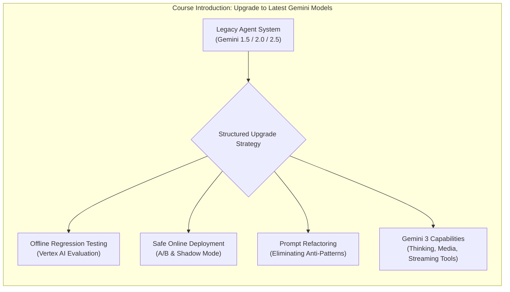

### Concept Graph & Architecture Mapping

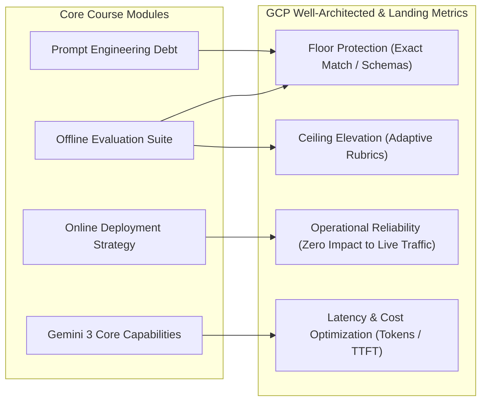

### Key Concepts & Grounded Architecture Matrix

| Concept | Architectural Purpose | GCP Landing & Well-Architected Metrics | Real-World Implementation Example | Grounding Source |
| --- | --- | --- | --- | --- |
| Offline Regression Testing Pipeline | Evaluates new model versions against an invariant "golden dataset" to detect silent regressions before deployment. | Floor Stability Metric: Tool Call Accuracy (≥99%), Schema Validation Failure Rate (=0%), Deterministic Exact-Match. | Running pre-deployment regression on Cloud Run revisions using the evaluate_agent function to grade tool call traces. | Vertex AI Continuous Evaluation |
| Shadow Deployment Mode | Mirrors live incoming production traffic to the new candidate model/agent revision with outputs discarded to users. | Traffic Isolation: Impacted User Rate (0%), End-to-End Execution Latency P99, Drift Divergence. | Routing live queries via Cloud Run private revision tags to Gemini 3 while serving responses from the existing production model. | Continuous Agent Evaluation Codelabs |
| A/B Testing Pipelines | Splits live production traffic between baseline (A) and candidate (B) to evaluate comparative user and system outcomes. | Online Business Metrics: Task Completion Rate (TCR), User Feedback (CSAT), Step Count per Task. | Splitting user sessions 90/10 via Cloud Load Balancing and logging comparative traces into BigQuery. | Continuous Evaluation Engineering Reliable AI Agents |
| Prompt Engineering Technical Debt | Identifies and strips out hacky workarounds (e.g., rigid few-shot schemas, manual CoT scaffolding) obsolete in newer foundation models. | Efficiency & Maintainability: Input Prompt Token Overhead, Instruction Compliance Rate. | Removing manual XML parsing hacks and legacy scratchpad prefixes that degrade Gemini 3's native reasoning engine. | Interactions API Migration Guide |
| Thinking Configurations & Thought Signatures | Configures reasoning levels (low, medium, high) and preserves multi-step thought context across tool calls via thought_signature. | Reasoning Integrity: Step-Level Continuity, Thought Preservation Success, Plan Execution Fidelity. | Feeding the encrypted thought_signature back into the multi-turn context payload so Gemini 3 preserves step-by-step reasoning across function executions. | Gemini Enterprise Agent Platform - Thought Signatures |
| Media Resolution Controls | Dynamically configures multimodal vision token density (media_resolution parameter) to balance fidelity and cost. | Cost & Latency: Multimodal Token Ingestion Cost, Time-to-First-Token (TTFT), OCR Character Accuracy. | Downscaling standard background camera frames to low resolution while dynamically elevating dense invoices to high. | Gemini Thinking - generateContent API |
| Streaming Function Calling | Emits tool-call tokens and function parameters iteratively as they are generated rather than buffering the entire payload. | Responsiveness Metric: Time-to-First-Tool-Execution (TTTE), Perceived Latency. | Using the Interactions API / streaming client to trigger tool authentication and parameter pre-validation before the full payload completes. | Interactions API Breaking Changes Migration Guide |

### Architectural Flow: Enterprise Model Upgrade Lifecycle

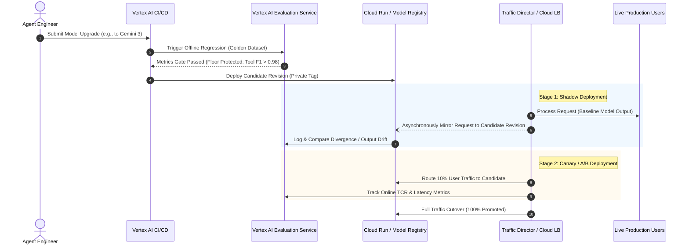

Decision Matrix: Deployment Strategy Selection

| Evaluation Criteria | Offline Golden Dataset | Shadow Deployment | A/B Testing | Direct Cutover (Anti-Pattern) |
| --- | --- | --- | --- | --- |
| Customer Impact Risk | None (0%) | None (0%) | Controlled (5−10%) | Critical (100%) |
| Real Traffic Fidelity | Synthetic / Historical | Live Production | Live Production | Live Production |
| Execution Cost | Offline Batch Tokens | 2× Inference Ingestion | 1× Ingestion Distributed | 1× Ingestion |
| Stateful Tool Call Risk | Sandboxed Mock Tools | Read-Only / Mocked Tools | Full Production Environment | Full Production Environment |
| Primary Metric Focus | Schema & Tool Regression | Output Drift & Latency P99 | Business TCR & CSAT | Unmonitored Downtime |

### Magic Quadrant: Upgrade & Evaluation Strategies

High Impact / High Control
      │
      │  [Vertex AI Evaluation Service]       [Shadow Deployment + A/B Testing]
      │  (Data-Driven Offline Suites)        (Safe Online Production Verification)
      │
EVALUATION RIGOR
      │
      │  [Vibe Checks & Manual Testing]      [Direct Production Replacement]
      │  (Ad-hoc Prompt Tweaks)               (High Regression Risk Anti-Pattern)
      │
      └────────────────────────────────────────────────────────────►
       Low Automation                       High Automation / Observability
                               DEVOPS MATURITY
Tell me “next page” whenever you are ready to proceed to the next module.

---

## Page Overview: Production Model Upgrade Strategy — Module Introduction

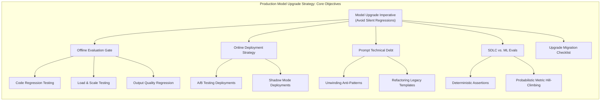

### Concept Graph & Architecture Mapping

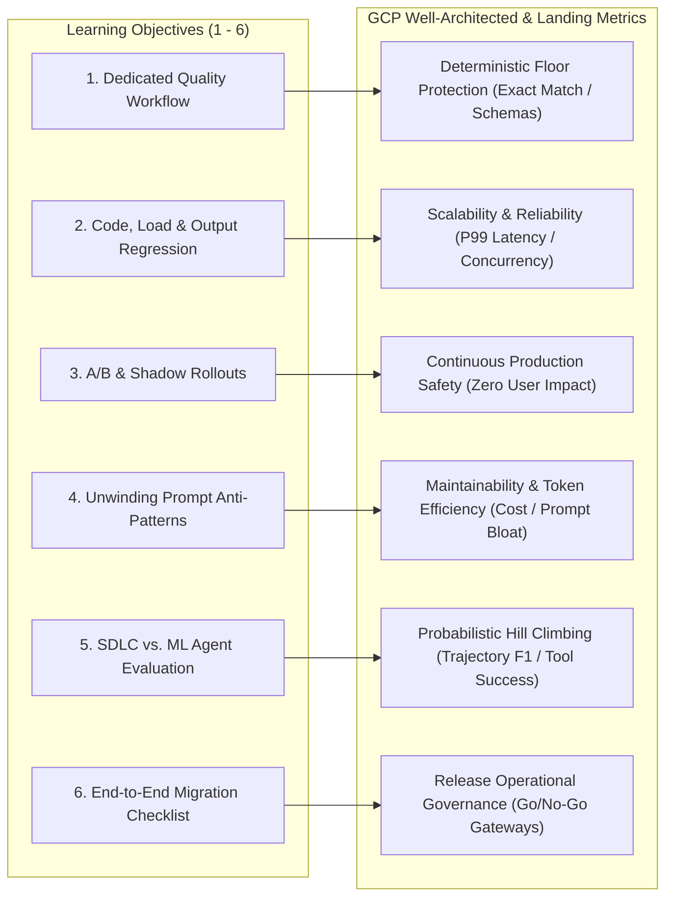

### Key Concepts & Grounded Architecture Matrix

| Objective / Concept | Architectural Purpose | GCP Landing & Well-Architected Metrics | Real-World Enterprise Example | Grounding Source |
| --- | --- | --- | --- | --- |
| 1. Dedicated Quality Evaluation Workflow | Prevents production model degradation caused by subtle shifts in token distributions, reasoning styles, and tool adherence. | Floor Stability Metric: Zero-Downtime Quality Floor, Regression Alert Frequency (=0). | Gating Gemini 2.5/3 model swaps behind automated Vertex AI evaluation pipelines before promoting container images. | Continuous Agent Evaluation Codelab |
| 2. Multi-Tier Regression Suite (Code, Load, Output) | Validates code mechanics (schema parsing), infrastructure scaling (token throughput), and output quality (semantic drift). | Operational Reliability: P99 Latency ≤1200ms, Error Rate <0.1%, Groundedness Metric ≥0.95. | Running Locust/JMeter for agent throughput alongside evaluate_agent automated grading on Cloud Run revisions. | AI evals tools and practical guide |
| 3. Safe Online Rollouts (A/B & Shadow Mode) | Evaluates live inference behavior under actual distribution without exposing real end-users to unverified agent actions. | Traffic Isolation: Impacted User Rate (0% in shadow), Delta Task Completion Rate (ΔTCR>0). | Forking Cloud Run incoming production requests asynchronously to a shadow candidate while returning baseline responses. | Engineering Reliable AI Agents |
| 4. Prompt Technical Debt & Anti-Pattern Refactoring | Strips out obsolete model crutches (e.g., verbose CoT instructions, XML tags, redundant format enforcements) that degrade newer models. | Cost & Prompt Hygiene: Token Overhead Reduction (≥30%), Instruction Following Compliance (≥98%). | Removing custom ReAct markdown parsing blocks to adopt native Gemini reasoning and schema constraints. | Interactions API Migration Guide |
| 5. SDLC vs. ML Agent Evaluation | Bridges binary programmatic assertions (pass/fail unit tests) with probabilistic, trajectory-based agent metrics. | Hill-Climbing Signal: Multi-turn Completion Rate (0.0−1.0), Tool Call Sequence Precision/Recall. | Combining pytest unit assertions for JSON tool schemas with continuous trajectory scoring on Android Bench / CX Agent Studio. | Android Bench 2.0 Methodology |
| 6. Production Model Upgrade Checklist | Standardized operational gate ensuring all technical, safety, rollback, and observability checks pass prior to cutover. | Operational Readiness: Cutover MTTR <5min, Observability Parity (100%), Rollback Automation Ready. | Enforcing a pre-flight Cloud Build gate with verified rollback routes in Traffic Director or Cloud Load Balancing. | Build Agents with CX Agent Studio |

SDLC Testing vs. Agentic ML Evaluation Comparison

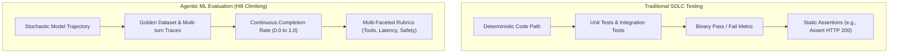

| Evaluation Dimension | Traditional Software Testing (SDLC) | Agentic AI Evaluation (ML / Hill Climbing) |
| --- | --- | --- |
| Execution Nature | Deterministic, repeatable, single execution path. | Stochastic, probabilistic, variable execution trajectories. |
| Pass/Fail Criteria | Binary boolean assertions (True / False). | Continuous completion rate score (0.0−1.0) and threshold gates. |
| Tool Verification | Mock API schema and status code checks. | Tool selection intent, argument validity, call order, and recovery behavior. |
| Failure Diagnosis | Stack trace, line number, exception logs. | Reasoning transcript inspection, intermediate tool drift, model misalignment. |
| Optimization Target | Bug fixes, coverage percentage, zero test failures. | Quality hill climbing, higher task completion, lower token cost. |

### Magic Quadrant: Upgrade Readiness & Evaluation Rigor

High Evaluation Rigor
      │
      │  [Full Multi-Tier Suite]              [Continuous Quality Hill Climbing]
      │  (Code + Load + Output Offline Evals) (Offline Gates + Shadow + A/B Testing)
      │
EVALUATION COMPLEXITY
      │
      │  [Vibe Checks & Manual Spot Tests]    [Traditional Unit Testing Only]
      │  (Ad-hoc Prompt Tweaking)             (Missing Trajectory / LLM Judge Scaffolding)
      │
      └────────────────────────────────────────────────────────────►
       Ad-hoc / Manual Rollout                Continuous Automated Rollout
                               DEPLOYMENT MATURITY
Tell me “next page” when you are ready to review the next topic.

I am on the module introduction page
Page: Production Model Upgrade Strategy — Module Introduction

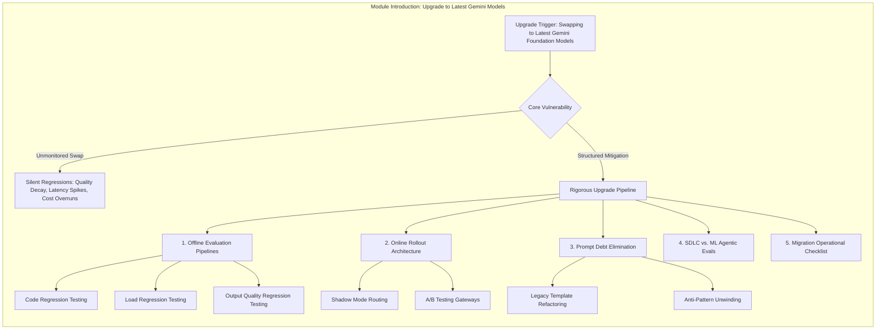

### Concept Graph & Architecture Mapping

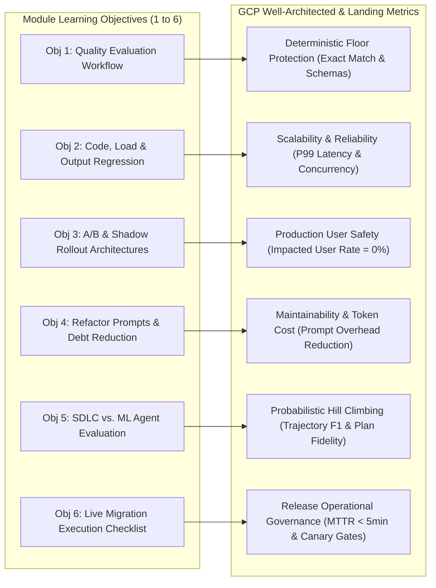

### Key Concepts & Grounded Architecture Matrix

| Core Learning Concept | Enterprise Architectural Purpose | GCP Landing & Well-Architected Metric | Real-World Enterprise Implementation Pattern | Grounding Reference |
| --- | --- | --- | --- | --- |
| Quality Evaluation Workflow (Obj 1) | Replaces intuitive "vibe checks" with deterministic and probabilistic gates before foundation model swaps. | Floor Stability Metric: Zero-Downtime Quality Floor; Schema Regression Rate (=0%). | Executing an automated pre-deployment evaluation pipeline on Vertex AI to evaluate candidate model tool calling before container promotion. | Vertex AI Continuous Agent Evaluation |
| Tri-Tier Regression Suite (Obj 2) | Systematically validates programmatic code schemas, throughput/latency limits, and semantic output fidelity. | Performance & Groundedness: P99 Latency ≤1200ms; Error Rate <0.1%; Groundedness Score ≥0.95. | Running Locust stress tests for token throughput alongside Cloud Run revisions running synthetic golden dataset traces. | Evaluating Multi-Agent Systems Codelab |
| Online Rollout Architectures (Obj 3) | Evaluates live model behavior under real operational distribution while isolating end-users from regressions. | Safety & Isolation: Impacted User Rate (0% in Shadow Mode); Delta Task Completion Rate (ΔTCR>0). | Cloud Load Balancing / Traffic Director splitting production queries: serving from the baseline model while asynchronously mirroring to candidate Gemini revisions. | Continuous Evaluation for AI Agents |
| Prompt Technical Debt Unwinding (Obj 4) | Strips obsolete prompt crutches (e.g., manual JSON formatting rules, explicit Chain-of-Thought scratchpads) that impede newer reasoning engines. | Token Efficiency & Compliance: Prompt Token Overhead Reduction (≥30%); Instruction Following Compliance (≥98%). | Deprecating XML format wrappers and legacy few-shot blocks to utilize Gemini native response_schema and integrated thinking modes. | Gemini API Interactions Migration Guide |
| SDLC vs. ML Agent Evaluation (Obj 5) | Reconciles binary programmatic unit tests with multi-turn stochastic trajectory scoring and LLM-as-a-judge rubrics. | Probabilistic Hill Climbing: Trajectory Success Rate (0.0−1.0); Tool Argument Precision and Recall. | Pairing pytest assertions for API contracts with BigQuery-stored multi-turn trajectory evaluators scoring planning paths. | Android Bench Evaluation Methodology |
| Live Migration Checklist (Obj 6) | Standardized operational go/no-go protocol guaranteeing automated fallback routes and telemetry parity. | Operational Readiness: Cutover MTTR <5min; Metric Parity (100%); Automated Rollback Triggered on Drift. | CI/CD release gate running pre-flight checks, verifying model quotas in Google Cloud Monitoring, and arming automated rollbacks. | CX Agent Studio Deployment Architecture |

End-to-End Migration & Verification Flow

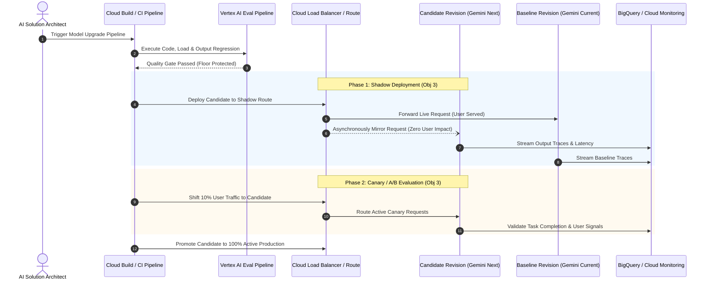

Comparative Matrix: SDLC Testing vs. Agentic ML Evaluation

| Dimension | Traditional SDLC Testing (Code Regression) | Agentic ML Evaluation (Quality Regression) |
| --- | --- | --- |
| Execution Paradigm | Deterministic code execution; static control flow. | Non-deterministic, stochastic generation and multi-step trajectories. |
| Pass / Fail Logic | Binary assertion checks (assert response.status == 200). | Continuous scoring rubrics (0.0−1.0), semantic distance, and LLM-judge gates. |
| Tool Calling Check | Verifies mock function invocation, payload types, and schemas. | Verifies parameter intent, call necessity, execution sequence, and recovery handling. |
| Load Testing Goal | Infrastructure capacity: CPU, RAM, connection pool saturation. | Model quota throughput: TPM (Tokens Per Minute), RPM, TTFT (Time-to-First-Token). |
| Regression Fix | Code refactoring, patch releases, bug fixes. | Prompt refactoring, example curation, tool description tuning, thinking budget adjustment. |

### Magic Quadrant: Deployment & Validation Strategies

High Evaluation Rigor
      │
      │  [Offline Regression Suites]          [Continuous Agent Hill Climbing]
      │  (Code, Load & Output Quality Tests)  (Shadow Routing + A/B Experimentation)
      │
EVALUATION COMPLEXITY
      │
      │  [Ad-hoc Prompt Tweaks]               [Traditional Code Unit Testing]
      │  (Manual "Vibe Checks")               (Schema Validation Only; No ML Rubric)
      │
      └────────────────────────────────────────────────────────────►
       Low Automation / Manual Rollout         Fully Automated CI/CD Canary
                               DEPLOYMENT MATURITY

---

Page: Planning and Strategy for Model Upgrades

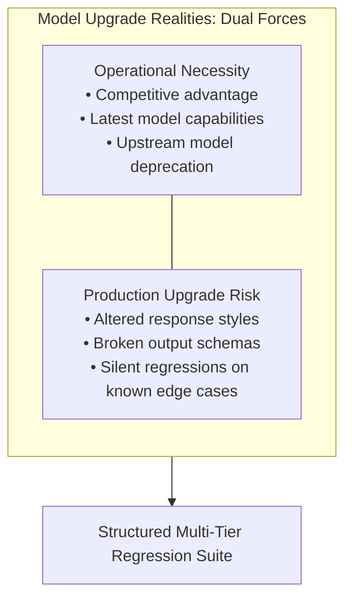

### Key Concepts & Grounded Architecture Matrix

| Key Concept | Architectural Definition | GCP Landing & Well-Architected Metric | Production Implementation Pattern | Grounding Source |
| --- | --- | --- | --- | --- |
| Silent Regressions | Failures introduced when a newer foundation model alters reasoning patterns, breaks JSON schemas, or fails inputs previously handled cleanly. | Quality Floor Stability: Schema Validation Error Rate (=0%), Zero-Regression Tolerance on Golden Test Cases. | Running automated continuous regression testing before replacing production model endpoints. | Evaluation \| CX Agent Studio |
| Code Regression Tests | Deterministic software engineering tests verifying client integration, parameter parsing, SDK bindings, and payload serialization. | DevOps Reliability: Build Pass Rate (100%), API Contract Conformance, CI/CD Pipeline Health. | Executing unit test suites in Cloud Build to assert JSON schemas and tool arguments. | Migrate to Latest Gemini Models |
| Load Tests | Infrastructure and performance tests assessing how changing token generation rates and latency impact provisioned throughput. | Operational Efficiency: P99 Latency (≤SLO), Concurrency Saturation, Token Consumption Rate (TPM/RPM). | Simulating high-concurrency multi-turn user sessions against Cloud Run deployments. | Methodical Approach to Agent Evaluation |
| Model Output Quality Regressions (Evals) | Generative and agentic evaluations validating semantic quality, trajectory correctness, tool accuracy, and persona compliance. | Agent Task Success: Multi-Turn Task Success Rate, Tool Selection Correctness (≥99%), Hallucination Rate (<1%). | Running test case suites against golden datasets using the Agent Platform SDK. | Evaluate Your Agents \| Agent Platform |
| Stack Compatibility Check | Pre-upgrade check confirming runtime SDKs, orchestrators, and prompt parsing blocks support the newer model endpoints. | System Interoperability: Client SDK Error Rate (=0%), Deprecated API Call Elimination. | Validating client migrations from legacy generateContent wrappers to the newer Interactions API. | Interactions API Migration Guide |
| Feature Availability Check | Pre-upgrade audit ensuring required features (system instructions, JSON mode, native thinking, streaming tools) are available in the target region. | Capability Parity: Regional Quota Allocation, Feature Parity Coverage (100%). | Checking Vertex AI model quotas and capability matrices across target deployment regions. | Gemini Thinking Mode Documentation |
| Cost Boundary Verification | Pre-upgrade analysis calculating total inference and token pricing against historical production volumes. | Financial Governance: Inference Cost per Successful Task (Δ≤0%), Budget Burn Rate. | Projecting monthly billing impacts in Google Cloud Cost Management based on revised token pricing. | A Methodical Approach to Agent Evaluation |

### Concept Graph: Pre-Upgrade Verification Gate & Test Triad

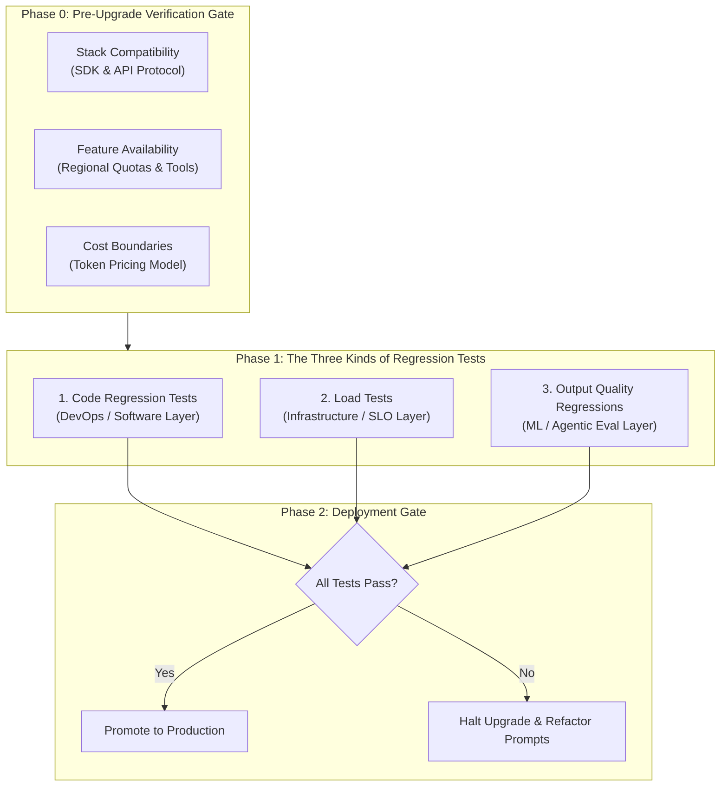

Tri-Tier Testing Strategy: Architectural Comparison

| Dimension | 1. Code Regression Tests | 2. Load Tests | 3. Output Quality Evals |
| --- | --- | --- | --- |
| Primary Lens | Software Engineering & DevOps | Cloud Infrastructure & Operations | Machine Learning & Data Science |
| Target Vulnerability | Broken schemas, missing fields, SDK crashes | Latency spikes, quota exhaustion, connection timeouts | Semantic drift, broken reasoning, tool misalignment |
| Tooling & Services | pytest, Cloud Build, GitHub Actions | Locust, JMeter, Cloud Monitoring | Vertex AI Gen AI Evaluation, CX Agent Studio |
| Test Dataset | Synthetic mock payloads & unit assertions | Peak concurrent production request patterns | Golden conversational paths & trajectory datasets |
| Success Metric | 100% test suite pass rate | Latency P99 meets SLO; zero 429/503 errors | High Task Completion Rate; zero critical regressions |

### Magic Quadrant: Upgrade Risk vs. Evaluation Rigor

High Evaluation Rigor
      │
      │  [Multi-Tier Regression Suite]       [Continuous Eval & Replay Gates]
      │  (Code + Load + Output Evals)       (Offline Goldens + Shadow Replay)
      │
EVALUATION DEPTH
      │
      │  [Vibe Checks & Spot Testing]        [Isolated Unit Code Testing]
      │  (Manual Inspection)                 (Checks API 200, Misses Quality Degradation)
      │
      └────────────────────────────────────────────────────────────►
       Low Automation                        High Automation
                           OPERATIONAL MATURITY
next page; be as exhaustive as possible while adhering to the original instructions and do not miss anything.
Page Architecture: Offline and Online Evaluation for Model Upgrades

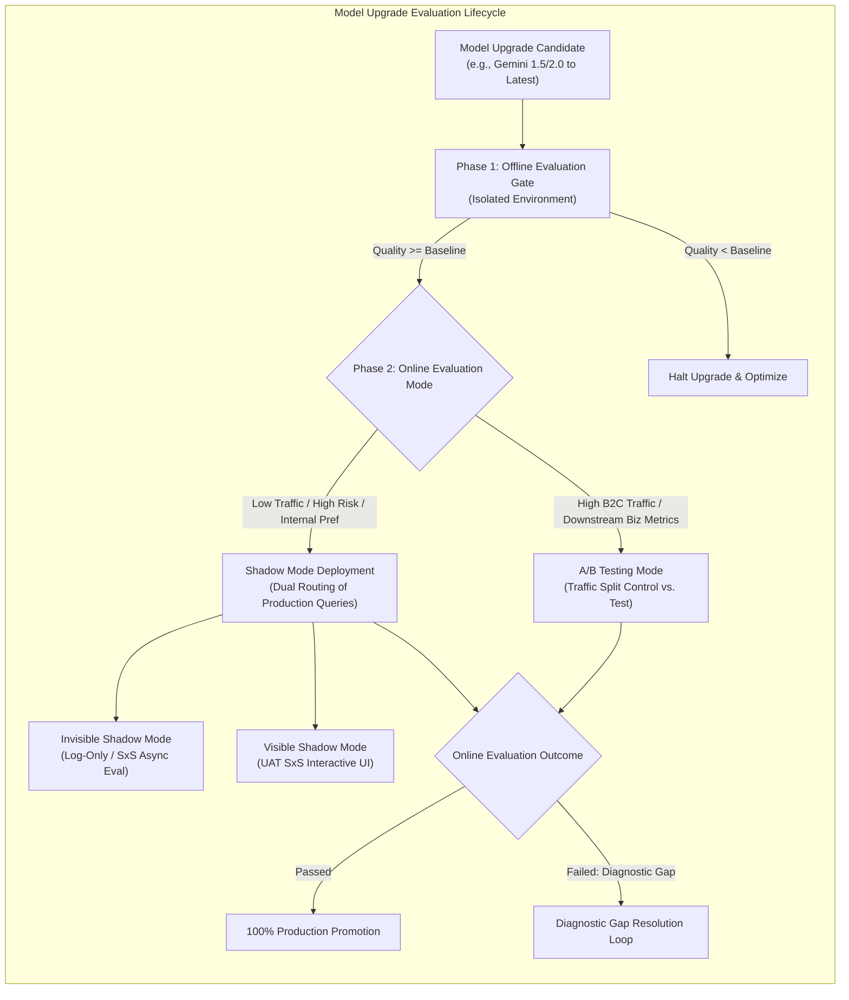

### Concept Graph & Architecture Mapping

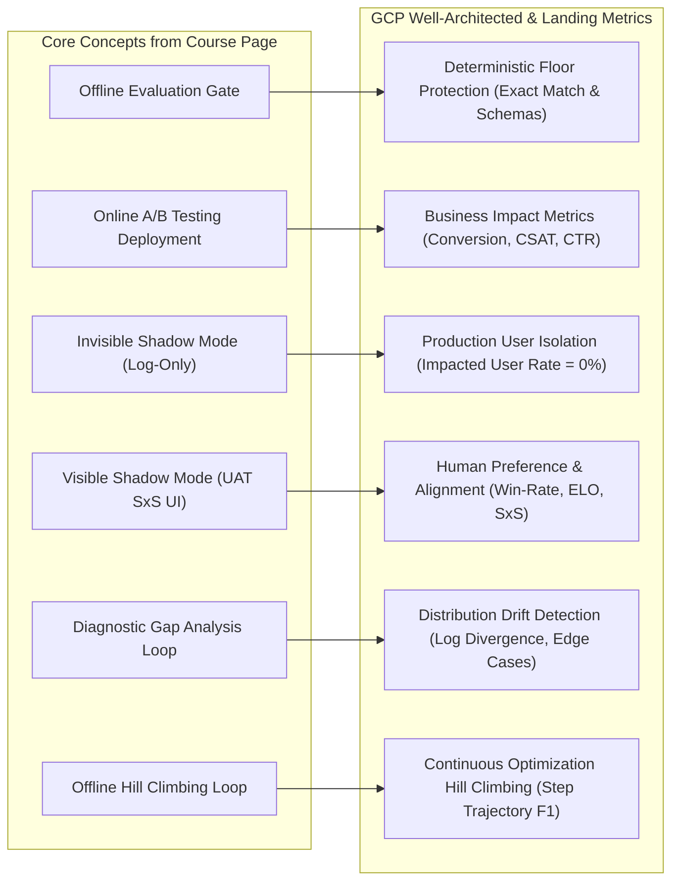

In-Page Diagrams (Mermaid.js Reconstructions)
In-Page Diagram 1: A/B Testing Deployment Architecture

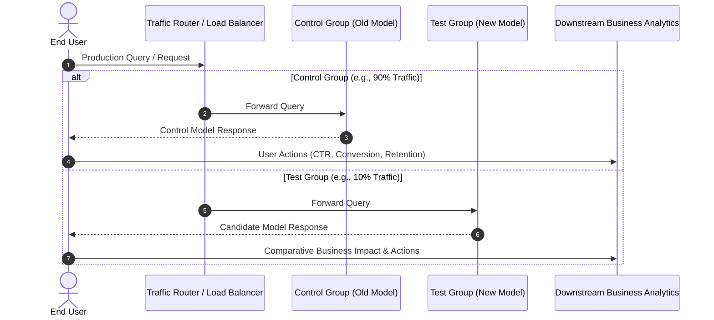

In-Page Diagram 2: Shadow Mode Deployment Architectures (Dual Mode)

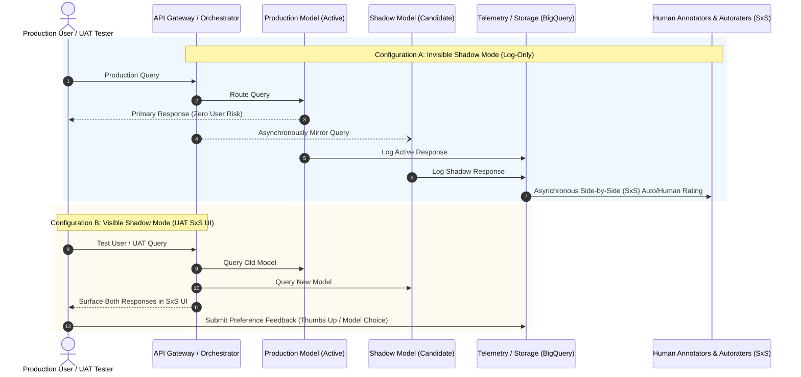

In-Page Diagram 3: Diagnostic Gap Resolution & Hill Climbing Workflow

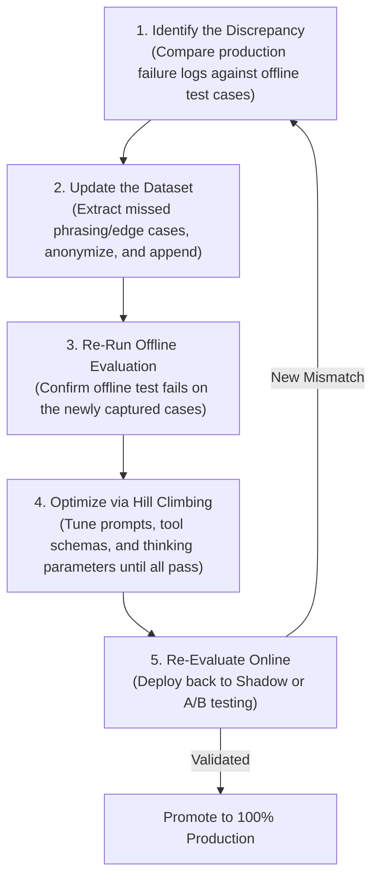

Exhaustive Key Concepts Matrix & GCP Landing Alignment

| Concept | Architectural Purpose & Scope | GCP Landing & Well-Architected Metric | Production Real-World Implementation Pattern | Grounding Reference |
| --- | --- | --- | --- | --- |
| Offline Evaluation Gate | Evaluates candidate foundation models within isolated staging environments using historical session logs or synthetic datasets before any traffic cutover. | Floor Stability & Cost: Tool Call Accuracy (≥99%), Evaluation Token Spend (<5% prod baseline), Zero User Exposure. | Running batch inference jobs in Vertex AI Evaluation pipelines scoring against static Golden Datasets before staging container release. | Evaluating Multi-Agent Systems Codelab |
| Online Evaluation Pipeline | Evaluates live model interactions under real dynamic distribution to capture statistical guarantees that offline test suites cannot provide. | Production Robustness: End-to-End Latency P99 (≤SLO), Dynamic Task Completion Rate (TCR), User Engagement Drift. | Ingesting live user interactions via Cloud Monitoring and BigQuery stream sinks for continuous autorater scoring. | Continuous Evaluation for AI Agents |
| A/B Testing Deployment | Splits live user sessions into a control group (old model) and test group (new model) to directly quantify downstream business impacts. | Downstream Impact: Conversion Rate Delta (ΔCR≥0), Click-Through Rate (CTR), User Session Length, CSAT. | Utilizing Google Cloud Armor / Cloud Load Balancing route rules to split sessions 90/10 across Cloud Run revisions. | Enabling Generative AI Value Evaluation Framework |
| Invisible Shadow Mode (Log-Only) | Duplicates live queries asynchronously to the candidate model; discards or stores output for post-hoc analysis without altering user experience. | Zero-Risk Ingestion: Impacted User Rate (0%), Schema Validation Failure Rate (=0%), Shadow Latency Overhead. | Cloud Run private revision tags or Pub/Sub dead-letter queues logging shadow inference outputs straight to BigQuery for autorater SxS. | A Methodical Approach to Agent Evaluation |
| Visible Shadow Mode (UAT SxS UI) | Displays candidate and baseline outputs side-by-side in frontend interfaces for internal staff, subject matter experts (SMEs), or pilot test users. | Human Preference & Alignment: Human Preference Win-Rate (>55%), SME Annotation Agreement Rate (κ≥0.85). | Directing internal dogfooding teams to a split-pane web UI where raters choose the better response directly into Vertex AI Annotation sets. | Evaluate Your Agents \| CX Agent Studio |
| Diagnostic Gap Analysis | Resolves discrepancies where an upgrade passes offline evaluations but fails online due to incomplete offline test dataset distribution. | Dataset Representativeness: Production Query Coverage (%) and Edge Case Divergence Delta. | Query clustering in BigQuery using vector embeddings to identify unrepresented user intent clusters and missing edge cases. | Enabling Generative AI Value Evaluation Framework |
| Offline Hill Climbing Optimization | Iterative engineering loop refining prompts, tool schemas, and thinking parameters until the agent passes old and newly added production edge cases. | Hill-Climbing Trajectory: Macro F1 Score Progression, Success Delta (Δ≥0), Zero Regression Tolerance on Baseline. | Modifying system instructions and thinking budgets (low, medium, high) within Vertex AI Prompt Studio to recover failing test cases. | Gemini Thinking Mode Documentation |

Comparative Evaluation Matrix: Offline vs. Online Deployment Strategies

| Evaluation Attribute | Offline Evaluation | Invisible Shadow Mode | Visible Shadow Mode (UAT SxS) | Online A/B Testing |
| --- | --- | --- | --- | --- |
| Execution Environment | Isolated Staging / CI/CD | Live Production Backend | Dedicated Internal Frontend | Live Production Consumer Frontend |
| Traffic Source | Historical Logs / Synthetic | Mirrored Live Traffic | Internal Users / Selected Pilot | Real End-User Traffic Split |
| User Risk Level | None (0%) | None (0%) | Extremely Low (Internal Only) | Moderate (5−10% exposed) |
| Frontend UI Changes | None | None | Requires Dual-Pane SxS UI | None (Single response served) |
| Primary Metric Type | Computable / Autorater Metrics | Side-by-Side (SxS) Alignment | SME Win-Rate / Human Preference | Conversion, CTR, Session Time |
| Infrastructure Cost | Low (Batch Tokens) | 2× Live Model Ingestion | Moderate (Controlled Pilot) | 1× Live Model Ingestion |
| Target Use Cases | Baseline Regression Gates | Enterprise / High-Risk Agents | Quality Validation / Pilot Review | B2C High Volume (Retail, Chatbots) |

### Magic Quadrant: Online Deployment Strategy Selection

High User Risk / High Business Fidelity
      │
      │                                       [A/B Testing Mode]
      │                                       (High Volume B2C, Conversions, CTR)
      │
BUSINESS MEASUREMENT
      │
      │  [Visible Shadow Mode (UAT)]           [Invisible Shadow Mode]
      │  (Internal SMEs, Live Preference SxS) (Zero User Risk, Async Log Grading)
      │
      └────────────────────────────────────────────────────────────►
       Zero User Risk                        Controlled End-User Risk
                               USER-FACING RISK EXPOSURE
next page ; while adhering to the original instructions be as detailed as possible.
Page Architecture: Gen AI-Specific Technical Debt

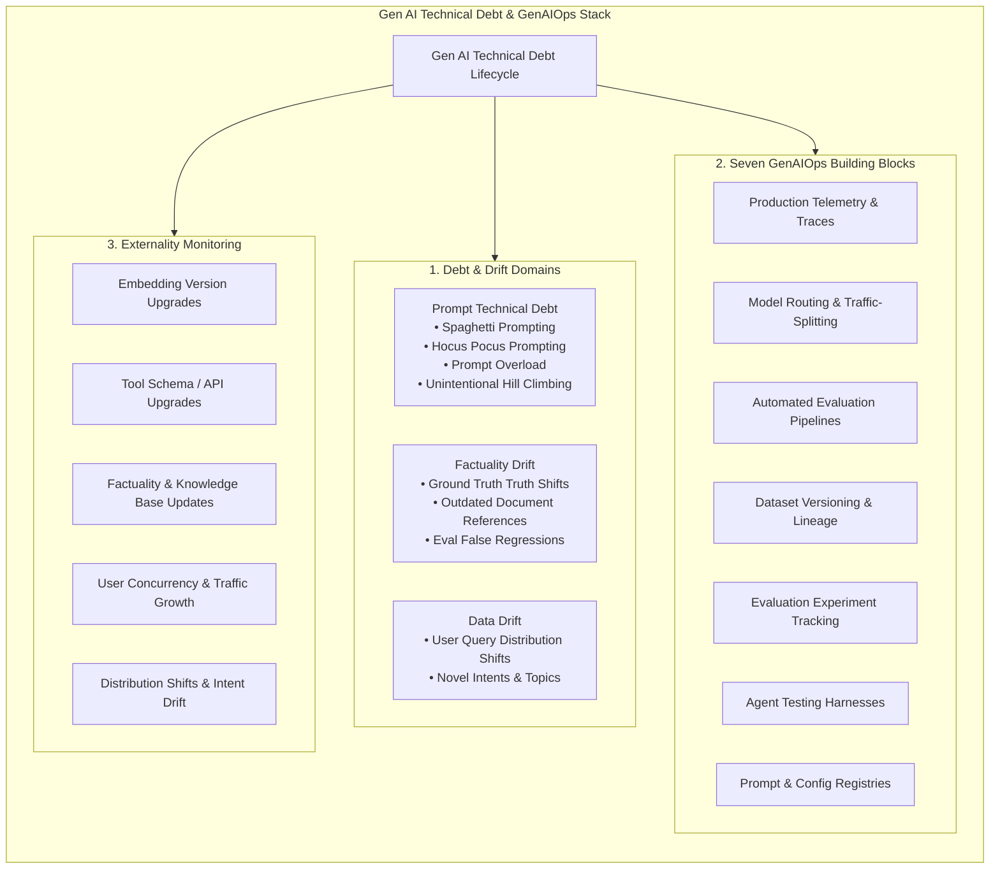

In-Page Diagram Reconstruction: The Resilient Gen AI Architectural Core
(Mermaid representation of the central conceptual diagram depicted in the course viewport: Foundation AI surrounded by orbital dependencies).

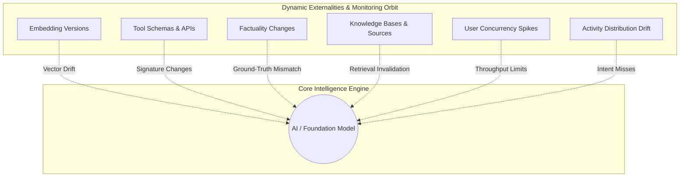

### Concept Graph: Prompt Anti-Patterns vs. GenAIOps Remediation

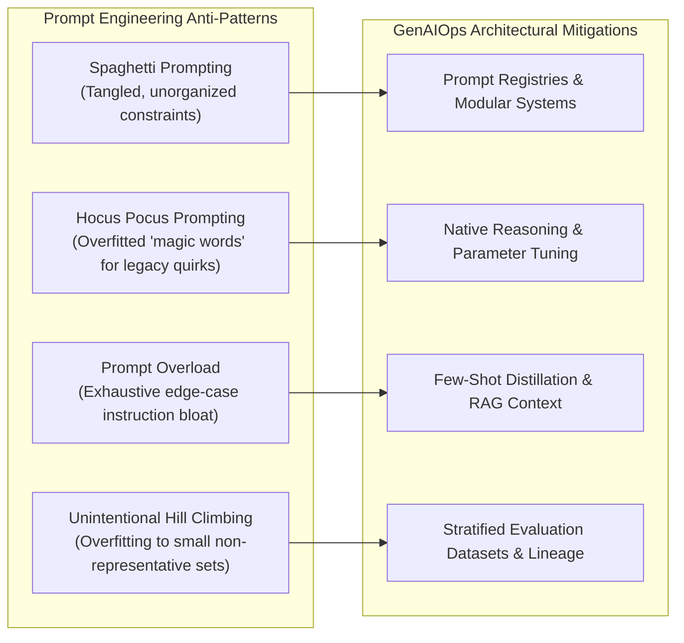

### Key Concepts Matrix: Prompt Engineering Anti-Patterns

| Anti-Pattern Concept | Technical Manifestation & Failure Mechanism | GCP Well-Architected & Landing Impact | Real-World Enterprise Example | Architectural Remediation Pattern |
| --- | --- | --- | --- | --- |
| Spaghetti Prompting | Tangling multi-role instructions, negative rules, tool guidelines, and output constraints across one unsegmented block over months of iterations. | Instruction Adherence Rate: ↓15–30%, Non-deterministic JSON parsing exceptions, high cognitive load. | Appending customer refund exceptions, format notes, and tone overrides inside a single 4,000-token system prompt string. | Decompose into distinct system instructions, structured schemas (response_schema), and modular agent sub-personas. |
| Hocus Pocus Prompting | Injecting superstitious, hyper-specific tokens or "magic phrases" (e.g., "Take a deep breath", "Think step by step", "You are an elite JSON bot") needed solely to coerce older models into compliance. | Token Efficiency & Quality Floor: Degrades newer reasoning models by suppressing native inference patterns. | Legacy prefixes crafted to prevent Gemini 1.0 Pro from dropping markdown wrappers, which triggers redundant output in Gemini 2.5/3. | Strip artificial incantations; transition to native thinking budgets (thought_signature) and native platform features. |
| Prompt Overload | Packing system instructions with dozens of niche edge cases, manual if-else branches, and lengthy few-shot exemplars until context is saturated. | TTFT & Cost: High Time-to-First-Token, Context Saturation, core instruction dilution / forgetfulness. | Embedding 45 distinct corporate travel policy edge-case paragraphs into an agent's base system prompt. | Offload long-tail cases into a vector retrieval (RAG) tool or dedicated external routing agent; preserve system prompt for pure core role guidance. |
| Unintentional Hill Climbing | Tweaking and over-tuning prompt templates against an ad-hoc, non-representative test set (e.g., 5 to 10 known failure samples). | Generalization Deficit: High test-set score, dramatic failure and high variance across real-world production traffic. | Adjusting an agent prompt until 10 internal stakeholder questions pass, only to see production task completion drop 20%. | Deploy statistically representative, stratified evaluation sets with automated regression suites across thousands of historical queries. |

Drift Distinction Matrix: Factuality Drift vs. Data Drift

| Dimension | Factuality Drift | Data Drift |
| --- | --- | --- |
| Formal Definition | Model outputs that were historically accurate become incorrect because external real-world ground truth or institutional knowledge changed. | Shifts in the statistical distribution, topics, vocabulary, or intents of live user input entering the agent pipeline. |
| Root Source | External world evolution: corporate policy updates, pricing revisions, laws, API changes. | User behavior evolution: seasonality, viral events, regional expansions, unexpected user workarounds. |
| Impact on Evals | False Negative Regressions: Candidate model outputs correct new facts, but offline evaluation marks it failed against an outdated golden benchmark. | Coverage Blindspots: Evaluation suites only test historical intent clusters, missing degraded performance on novel user intents. |
| Detection Mechanism | Knowledge base change log audits, vector store last-modified tracking, freshness authoring runs. | Embedding drift monitoring in BigQuery, unsupervised clustering of incoming prompt tokens over time. |
| Remediation Strategy | Evaluation dataset versioning and lineage synchronizing golden answers with knowledge base releases. | Active data harvesting: mining production logs to append high-divergence clusters to test datasets. |

GenAIOps Upgrade Building Blocks Matrix

| GenAIOps Building Block | Architectural Role in Model Upgrades | GCP Landing & Well-Architected Metric | Implementation Pattern (Google Cloud / Enterprise) |
| --- | --- | --- | --- |
| 1. Production Telemetry & Logs | Captures complete multi-turn conversational traces, function invocations, intermediate steps, and explicit user feedback. | Observability Parity: 100% trace capture rate, zero blind spots in tool failure diagnosis. | Streaming full agent execution logs to Cloud Logging and BigQuery; surfacing thumbs-up/down ratings to autorater tables. |
| 2. Model Routing & Traffic Splitting | Middleware routing traffic between foundation model endpoints to support canary launches, live A/B splits, and shadow pipelines. | Blast Radius Control: User Impact Rate (0% in shadow), Instant Cutover MTTR (<1 min). | Traffic Director or Cloud Load Balancing weighted routing rules splitting user sessions across distinct Cloud Run service revisions. |
| 3. Automated Evaluation Pipelines | CI/CD automation executing programmatic assertions and autoraters whenever a prompt or model version changes. | Continuous Floor Protection: Regression Catch Rate (100% pre-prod), Schema Validation Error (=0%). | Cloud Build triggering Vertex AI Evaluation jobs with autoraters against invariant golden datasets before container deployment. |
| 4. Dataset Versioning & Lineage | Tracks the provenance, timestamp, and backing knowledge sources of evaluation benchmarks to eliminate factuality drift. | Dataset Freshness: Ground-truth sync delta (0 days against production policy releases). | Storing evaluation datasets in BigQuery tables versioned alongside Git release tags and knowledge base corpus hashes. |
| 5. Evaluation Experiment Tracking | Central registry recording prompts, agent version, target model, dataset hash, metric deltas, and trajectory traces. | Hill-Climbing Traceability: Complete experiment reproducibility, metric improvement delta (Δ≥0). | Vertex AI Experiments tracking comparative runs, F1 trajectories, tool accuracy curves, and cost per task. |
| 6. Agent Testing Harnesses | Isolated sandboxes simulating external tools, database states, and multi-turn user personas without affecting production. | Deterministic Tool Verification: Mock Tool Parity (100%), Multi-turn Planning Success Score. | Synthetic environment runners orchestrating mock APIs in Cloud Functions to validate multi-step agent actions. |
| 7. Prompt & Configuration Registries | Decouples prompt text, temperatures, system instructions, and schemas from compiled application codebases. | Decoupled Velocity: Rollback latency (<30 sec without triggering application redeployments). | Vertex AI Prompt Management / Secret Manager externalizing versioned system templates consumed at runtime via URI reference. |

### Magic Quadrant: GenAIOps Maturity vs. Technical Debt Risk

High Technical Debt Exposure
      │
      │  [Vibe Check & Monolithic Prompts]     [Ad-hoc Scripted Evaluations]
      │  (Spaghetti / Hocus Pocus Prompting,   (Manual regression checks,
      │   Manual untested production deploys)   No traffic splitting middleware)
      │
DEBT ACCUMULATION
      │
      │  [Basic Registry & Unit Tests]         [Mature GenAIOps Architecture]
      │  (External prompts, simple schemas,    (Automated eval CI/CD, Shadow routing,
      │   No multi-turn agent simulation)       Dataset lineage, Real-time telemetry)
      │
      └────────────────────────────────────────────────────────────►
       Ad-hoc / Manual Ops                     Enterprise GenAIOps Automation
                               OPERATIONAL MATURITY

---

Page Architecture: Model Upgrades for AI Agents

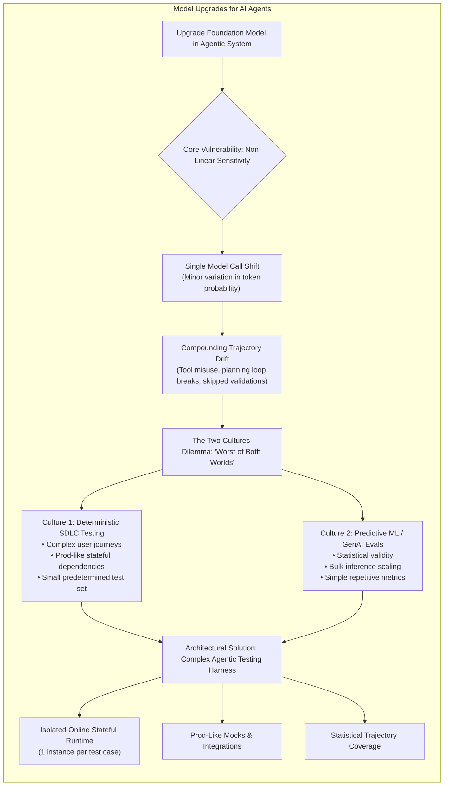

### Concept Graph & Architecture Mapping

```mermaid
flowchart LR
    subgraph CoreConcepts["Core Concepts from Course Page"]
        direction TB
        C1["Agent Sensitivity & Trajectory Drift"]
        C2["Evaluating Trajectories vs. Isolated Prompts"]
        C3["Planning & Reasoning Shifts"]
        C4["Deterministic SDLC Testing Culture"]
        C5["Predictive ML / Bulk Inference Culture"]
        C6["Complex Agentic Testing Harness"]
    end

    subgraph GCPMetrics["GCP Well-Architected & Landing Metrics"]
        direction TB
        M1["Trajectory F1 & Plan Fidelity"]
        M2["Tool Call Ordering & Argument Validity"]
        M3["Safety Validation Bypass Rate (= 0%)"]
        M4["Stateful Deterministic Pass Rate (100%)"]
        M5["Statistical Evaluation Significance (p < 0.05)"]
        M6["Harness Isolation & Sandboxed Concurrency"]
    end

    C1 --> M1
    C2 --> M2
    C3 --> M3
    C4 --> M4
    C5 --> M5
    C6 --> M6
```

Reconstructed Page Diagram: The Testing Harness & Agent Lifecycle
(Mermaid reconstruction of the central viewport illustration showing the agent runtime, stateful telemetry, and integration harness tuning controls).

```mermaid
flowchart TD
    subgraph TestHarness["Complex Agentic Testing Harness"]
        direction TB
        subgraph Config["Harness Parameter Controls"]
            P1["Seed / Temperature Sliders"]
            P2["Stateful Sandbox Provisioner"]
            P3["Mock Dependency Router"]
        end

        subgraph Execution["Multi-Turn Execution & Telemetry"]
            E1["Step 1: Intent Routing"] --> E2["Step 2: Tool Execution"]
            E2 --> E3["Step 3: Reasoning & Validation"]
            E3 --> E4["Step 4: State Transition"]
        end

        subgraph Metrics["Telemetry & Statistical Scoring"]
            M1["Trajectory Completion Rate"]
            M2["Tool Sequence Precision"]
            M3["P99 Latency & Token Burn"]
        end

        Config --> Execution
        Execution --> Metrics
    end
```

In-Depth Key Concepts & GCP Well-Architected Matrix

| Concept | Architectural Definition | GCP Landing & Well-Architected Metric | Production Real-World Implementation Pattern | Grounding Reference |
| --- | --- | --- | --- | --- |
| Agent Sensitivity to Model Upgrades | The structural vulnerability where minor delta shifts in foundation model token distributions compound into severe multi-step divergence across routing, tool execution, and termination. | Trajectory Stability Metric: Multi-turn drift delta (ΔTCR≥0), Tool Misalignment Rate (<0.5%). | Gating Gemini foundation model swaps behind automated trajectory evaluators on Cloud Run. | Single-Agent System using ADK and Cloud Run |
| Evaluating Trajectories vs. Single Prompts | Moving from scoring static single-turn responses to evaluating the entire directed acyclic graph (DAG) of agent decisions, tool parameter structures, and intermediate outputs. | Plan Fidelity: Tool Selection Accuracy (≥99%), Trajectory Exact Match Rate, Unnecessary Tool Invocation Count (=0). | Testing multi-turn conversational agents with session replay datasets via Vertex AI Agent Platform. | Deploy and Operate Generative AI Applications |
| Planning & Reasoning Shifts | Alterations in how newer foundation models formulate internal plans, including reversing tool execution order, selecting different tools, or bypassing mandatory intermediate validation checks. | Operational Safety: Validation Bypass Rate (=0%), Intermediate Grounding Enforcement Rate (100%). | Isolating tool definitions and running step-level trajectory assertions to verify security validation checks are executed. | Agentic AI Orchestrate Security Operations |
| Deterministic SDLC Testing Culture | Traditional software engineering verification focusing on stateful environments, live database states, mock APIs, and binary pass/fail checks on fixed test cases. | Software Reliability: Integration Test Pass Rate (100%), Schema Conformance, Stateful Sandbox Reset Integrity. | Running isolated ephemeral container environments in Cloud Build that mock external payment and inventory APIs. | Operational Excellence in AI/ML Perspective |
| Predictive ML Evaluation Culture | Data science evaluation paradigm built around statistical confidence, bulk offline inference, continuous metric distributions, and large holdout datasets. | Statistical Rigor: Statistical Power (1−β≥0.80), Sample Variance, Confidence Interval (α=0.05). | Executing bulk batch prediction pipelines scoring hundreds of test prompts using LLM-as-a-judge autoraters. | Guidelines for Developing High-Quality ML Solutions |
| Complex Agentic Testing Harness | An infrastructure combining prod-like stateful dependencies (1 online environment per test case) with high-throughput bulk inference runners to execute multi-turn agent evaluations. | Harness Concurrency: Isolated Sandbox Spin-up Time (<2s), Sandbox Clean-Up Rate (100%), Cost per Trajectory Test. | Containerized ephemeral agent execution workers running on Cloud Run or GKE with mock API sidecars. | AlphaEvolve API Reference & Harness Architecture |

Comparative Matrix: The Two Cultures of Software Testing
(Direct, comprehensive expansion of the course comparison table).

| Dimension | Deterministic SDLC Testing | Predictive ML / Simple GenAI Evals | Complex Agentic Testing Harness |
| --- | --- | --- | --- |
| Test Case Complexity | Complex, user journey-specific, input-specific criteria. | Simple, repeated individual test criteria across test cases. | Complex, user journey-specific, and input-specific test criteria. |
| Data Quality Constraints | Flexible data quality constraints; focuses on boundary values. | Strong data quality constraints; benchmark sets must be clean. | Strong data quality constraints across all journey turns. |
| Statistical Validity & Coverage | Small number of predetermined, deterministic test cases. | Strong statistical validity, broad coverage, large sample sizes. | Strong statistical validity and broad test case coverage. |
| Integration & Environment | "Prod-like" integration constraints and external dependencies. | No integration constraints; little to no dependencies. | "Prod-like" integration constraints and dependencies. |
| Execution State & Mode | Requires an online, stateful environment with persistent state. | Can be run in batch, offline, and stateless pipelines. | Requires an online, stateful environment (1 per individual test case). |
| Inference Infrastructure | Low throughput; executes simple deterministic logic paths. | Requires bulk inference infrastructure (high tokens/sec). | Requires bulk inference infrastructure combined with stateful containers. |
| Primary Failure Mode | Explicit stack trace, unhandled exception, syntax failure. | Metric degradation across aggregate statistical distribution. | Cascading trajectory drift, invalid tool sequences, silent policy skips. |

Multi-Turn Agent Trajectory Evaluation Flow

```mermaid
sequenceDiagram
    autonumber
    actor Harness as Agent Test Harness Worker
    participant Sandbox as Stateful Environment Sandbox (1 per test)
    participant Agent as Agent Runtime (Candidate Model)
    participant Tools as Mock Prod-like Tools & APIs
    participant Eval as Multi-Turn Trajectory Autorater

    Harness->>Sandbox: Provision Isolated Environment (Seed State)
    Harness->>Agent: Inject User Journey Prompt Turn 1
    Agent->>Agent: Plan Reasoning & Tool Call
    Agent->>Tools: Invoke Tool 1 (e.g., Check Availability)
    Tools-->>Agent: Return Mock Data
    Agent->>Harness: Agent Response Turn 1

    Harness->>Agent: Inject User Journey Prompt Turn 2 (Goal Escalation)
    Agent->>Tools: Invoke Tool 2 (e.g., Execute Order)
    Tools-->>Agent: Return State Transition (Order Placed)
    Agent->>Harness: Agent Final Resolution

    Harness->>Eval: Stream Complete Multi-Turn Execution Trace
    Eval->>Eval: Evaluate Tool Order, Planning Step Validity & Safety Rules
    Eval-->>Harness: Trajectory Score (Pass / Fail / Score: 0.0 - 1.0)
    Harness->>Sandbox: Teardown & Reset Environment
```

### Magic Quadrant: Testing Paradigms for Agentic Systems

High Environmental Statefulness / Dependency Integration
      │
      │  [Deterministic SDLC Testing]         [Complex Agentic Harness]
      │  (Unit / Integration mocks,            (The "Worst of Both Worlds":
      │   Fixed stateful assertions)            Stateful Sandboxes + Bulk Statistical Inference)
      │
ENVIRONMENT COMPLEXITY
      │
      │  [Manual Vibe Checks]                  [Predictive ML / GenAI Evals]
      │  (Ad-hoc developer testing)             (Stateless batch prompts,
      │                                         Bulk autorater scoring)
      │
      └────────────────────────────────────────────────────────────►
       Low Statistical Scale                  High Statistical Scale & Bulk Inference
                               EVALUATION VOLUME & RIGOR

---

Page Architecture: Execution Plan for Upgrades

```mermaid
graph TD
    subgraph UpgradeExecutionPlan["Five-Phase Model Upgrade Framework"]
        direction TB
        Challenge["Dual Upgrade Challenge"] --> SDLC["1. Deterministic SDLC Tasks<br/>• Parameter tuning (thinking levels)<br/>• API response schemas<br/>• Thought token passing (`thought_signature`)"]
        Challenge --> ML["2. Output Quality Tasks (ML/Stats)<br/>• Response quality & length drift<br/>• Tone/style alignment<br/>• Multi-turn trajectory evaluations"]

        SDLC & ML --> P1["Phase 1: Scoping and Preparation"]
        P1 --> P2["Phase 2: Baseline Evaluations & Code Updates"]
        P2 --> P3["Phase 3: Analysis and Optimization"]
        P3 --> P4["Phase 4: Online Testing and Staging"]
        P4 --> P5["Phase 5: Rollout and Production"]

        P5 --> SteadyState["Continuous Post-Production Drift Monitoring"]
    end
```

### Concept Graph & Architecture Mapping

```mermaid
flowchart LR
    subgraph CorePhases["5-Phase Execution Plan"]
        direction TB
        P1["Phase 1: Scoping & Preparation"]
        P2["Phase 2: Baselines & Code Updates"]
        P3["Phase 3: Analysis & Optimization"]
        P4["Phase 4: Online Testing & Staging"]
        P5["Phase 5: Rollout & Production"]
    end

    subgraph GCPMetrics["GCP Well-Architected & Landing Metrics"]
        direction TB
        M1["Platform Readiness & Quota Clearance"]
        M2["Floor Stability: Exact-Match & Schema Zero-Error"]
        M3["Hill-Climbing Trajectory & Token Efficiency"]
        M4["P99 Latency & Concurrency SLO Adherence"]
        M5["Zero-Impact Live Verification & Business Win-Rate"]
    end

    P1 --> M1
    P2 --> M2
    P3 --> M3
    P4 --> M4
    P5 --> M5
```

The Dual-Track Challenge Architecture

```mermaid
flowchart TD
    subgraph ChallengeDichotomy["Parallel Dual-Track Challenge"]
        direction TB
        subgraph TrackA["Deterministic SDLC Tasks"]
            A1["API Response Schemas & Deserialization"]
            A2["Thinking Level Parameters (`low`, `medium`, `high`)"]
            A3["Passing Thought Tokens (`thought_signature`)"]
            A4["Standard CI/CD Unit & Integration Regression Suites"]
        end

        subgraph TrackB["Output Quality (ML / Stats Tasks)"]
            B1["Model Semantic Behavior & Style Shifts"]
            B2["Response Conciseness vs. Verbosity Drift"]
            B3["Multi-Turn Planning & Tool Adherence"]
            B4["Statistical Autorater & Golden Dataset Benchmarks"]
        end
    end
```

| Dimension | Deterministic SDLC Tasks | Output Quality (ML / Stats) Tasks |
| --- | --- | --- |
| Focus Area | Code, runtime bindings, parameters, and infrastructure. | Semantic behavior, tone, reasoning quality, trajectory validity. |
| Key Examples | Thinking parameter levels, streaming API shapes, thought token passing. | Conciseness shifts, grounding regressions, persona drift. |
| Testing Mechanism | Programmatic CI/CD regression tests (pytest, Cloud Build). | Data-driven autoraters, LLM-as-a-judge rubrics, golden evaluation sets. |
| Verification Gate | 100% pass rate on API contracts and schema serialization. | Statistical parity or improvement over baseline quality thresholds. |

In-Page 5-Phase Execution Plan: Detailed Task Matrix

| Phase | In-Page Action Item | Detailed Technical Scope | GCP Well-Architected & Landing Metric | Implementation Grounding Pattern |
| --- | --- | --- | --- | --- |
| Phase 1: Scoping and Preparation | 1. Review Documentation | Audit model cards, API migration guides, breaking changes, and capability support. | Capability Parity: Feature coverage (100%), target region availability. | Cross-referencing target Gemini capabilities in Vertex AI Documentation. |
| 2. Scope Migration Effort | Estimate engineering effort, token compute budget, timeline, and dependencies. | Project Predictability: Delivery estimation variance, resource allocation. | Establishing project milestones and resource allocations in Cloud Logging / Cloud Monitoring. |  |
| 3. Build GenAIOps Foundation | Design upgrade pipelines for continuous, repeatable migrations rather than one-off hacks. | Operational Resilience: Mean Time to Deploy (MTTD) future model revisions. | Establishing reusable pipelines using Vertex AI Pipelines. |  |
| Phase 2: Baseline Evaluations & Code Updates | 1. Establish Acceptance Criteria | Define explicit thresholds for offline dataset metrics, online business KPIs, latency, and cost. | Quality Floor Stability: Schema Error Rate (=0%), Cost Delta (Δ≤0%), P99 SLO. | Formalizing acceptance thresholds in Vertex AI Evaluation. |
| 2. Prepare Offline Eval Data | Document evaluation specs and curate representative golden evaluation datasets. | Dataset Representativeness: Intent cluster coverage, high-variance edge cases. | Storing structured golden test sets and multi-turn session traces in BigQuery. |  |
| 3. Perform Code Updates & Regression Tests | Update parameters (thinking levels, API contracts) and run standard regression suites. | Software Reliability: Unit test pass rate (100%), zero unhandled deserialization crashes. | Cloud Build pipeline executing integration tests against candidate container images. |  |
| 4. Run Offline Evaluations | Execute automated comparative offline benchmarks comparing baseline model against candidate. | Relative Performance: Candidate Win Rate (≥50%), Tool Accuracy (≥99%). | Running batch evaluation jobs via Vertex AI Gen AI Evaluation Service. |  |
| Phase 3: Analysis and Optimization | 1. Analyze and Hill Climb | Inspect failure clusters and iteratively tune prompts, tools, and thinking configurations. | Hill-Climbing Trajectory: F1 metric improvement delta (Δ≥0), zero baseline regression. | Refining prompts and thinking budgets in Vertex AI Prompt Studio to recover failed edge cases. |
| 2. Aim to Simplify | Leverage improved foundation model capabilities: shorten prompts, eliminate fine-tuned adapters, collapse prompt chains. | Token Efficiency & Maintainability: Prompt token reduction (≥30%), orchestrator complexity reduction. | Collapsing multi-step ReAct chains into native Gemini function calling and thinking modes. |  |
| Phase 4: Online Testing and Staging | 1. Develop Deployment Plan | Document traffic splitting ratios, observability telemetry sinks, and automated rollback triggers. | Blast Radius Containment: Rollback MTTR (<1 min), telemetry ingestion completeness. | Defining traffic splitting rules via Cloud Load Balancing and Traffic Director. |
| 2. Conduct Load Testing | Execute load tests to ensure candidate model latency and throughput satisfy operational SLOs. | Operational Scale: P99 Latency (≤SLO), Concurrency Saturation, 429 Error Rate (=0%). | Executing Locust / JMeter load testing suites against Cloud Run revisions. |  |
| Phase 5: Rollout and Production | 1. Deploy Shadow Mode / A/B Test | Safely evaluate candidate model against real production traffic without risking user experience. | Zero-Risk Ingestion: Impacted User Rate (0% in shadow), A/B statistically significant lift (p<0.05). | Asynchronously mirroring production traffic via Pub/Sub or Cloud Run revision tags. |
| 2. Complete Online Evaluation | Review live operational metrics, cost, and downstream business impacts against acceptance criteria. | Production Verification: Task Completion Rate (TCR), CSAT, Conversion Rate Delta. | Correlating live interaction feedback and autorater evaluations in BigQuery. |  |
| 3. Full Production Rollover | Promote candidate model revision to serve 100% of production user traffic. | Service Availability: Zero-downtime cutover, Error budget burn (=0%). | Updating Cloud Load Balancing URL maps or Cloud Run traffic allocation to 100%. |  |
| 4. Sustain and Monitor | Establish ongoing telemetry to detect long-term data drift, factuality drift, and quality degradation. | Continuous Observability: Drift alert frequency, automated continuous evaluation cadences. | Cloud Monitoring alerting policies triggering automated Vertex AI continuous eval runs. |  |

Sequence Flow: Five-Phase Migration & Rollout

```mermaid
sequenceDiagram
    autonumber
    actor Arch as Solution Architect
    participant CI as Cloud Build (SDLC Pipeline)
    participant Eval as Vertex AI Evaluation Service
    participant Staging as Cloud Run (Candidate Revision)
    participant LB as Cloud Load Balancer / Gateway
    participant Prod as Cloud Run (Active Production)
    participant Mon as Cloud Monitoring / BigQuery

    Note over Arch,CI: Phase 1 & 2: Scoping, Code Updates & Offline Evals
    Arch->>CI: Commit Code (Thinking params, thought tokens, SDK updates)
    CI->>CI: Execute Deterministic Code Regression Tests (Pass 100%)
    CI->>Eval: Execute Comparative Offline Evaluation (Golden Dataset)
    Eval-->>CI: Acceptance Criteria Validated (Win Rate >= Baseline)

    Note over CI,Staging: Phase 3 & 4: Optimization & Load Staging
    CI->>Staging: Deploy Candidate Revision (Private Tag)
    CI->>Staging: Run Load Testing Suite (Verify Latency P99 & Quotas)

    Note over LB,Prod: Phase 5: Online Rollout (Shadow & A/B)
    LB->>Prod: Route 100% User Traffic (Baseline Output)
    LB--)Staging: Mirror Production Traffic (Invisible Shadow Mode)
    Staging->>Mon: Stream Shadow Inference Logs & Token Telemetry
    Mon-->>Arch: Online Acceptance Criteria Met (0% Regression)

    LB->>Staging: Shift 100% Active Production Traffic
    Staging->>Mon: Continuous Sustain Monitoring (Data Drift / Factuality Drift)
```

### Magic Quadrant: Execution Phase Governance

High Rigor & Production Safety
      │
      │  [Phase 2: Offline Golden Evaluation]   [Phase 5: Shadow & A/B Production Rollout]
      │  (Deterministic + Autorater Gating)    (Zero-Risk Live Verification + Sustain)
      │
PHASE RIGOR
      │
      │  [Phase 1: Scoping & Documentation]     [Phase 3: Prompt Simplification & Tuning]
      │  (Feasibility & Quota Readiness)       (Hill Climbing & Removing Legacy Crutches)
      │
      └────────────────────────────────────────────────────────────►
       Static Analysis / Staging                Dynamic Production Runtime
                               EXECUTION ENVIRONMENT

---

Page Architecture: Upgrading to Gemini 3 — Module Introduction

```mermaid
graph TD
    subgraph ModIntro["Upgrading to Gemini 3: Technical Curriculum Architecture"]
        direction TB
        Root["Gemini 3 Upgrade Imperative<br/>(Advanced Reasoning, Multimodal Native & Breaking Changes)"] --> CorePillars["5 Core Competency Tracks"]

        subgraph CorePillars["Core Migration Tracks"]
            P1["1. Sampling Parameters<br/>• Enforce compliance<br/>• Temperature & TopP boundaries"]
            P2["2. Thinking Levels & Thought Signatures<br/>• Low / Medium / High levels<br/>• Thought token preservation (`thought_signature`)"]
            P3["3. Media Resolution Controls<br/>• Token density optimization<br/>• `media_resolution: low / medium / high`"]
            P4["4. Multimodal Tools & Streaming<br/>• Function calling on video/audio/images<br/>• Streamed tool argument execution"]
            P5["5. Model Selection Matrix<br/>• Gemini 3 Pro<br/>• Gemini 3 Flash<br/>• Gemini 3 Flash-Lite"]
        end
    end
```

### Concept Graph & Architecture Mapping

```mermaid
flowchart LR
    subgraph Objectives["Module Learning Objectives (1 - 5)"]
        direction TB
        O1["Obj 1: Sampling Parameter Compliance"]
        O2["Obj 2: Thinking Levels & Thought Signatures"]
        O3["Obj 3: Media Resolution Controls"]
        O4["Obj 4: Multimodal Function Calling & Streaming Tools"]
        O5["Obj 5: Model Selection (Pro vs. Flash vs. Flash-Lite)"]
    end

    subgraph GCPMetrics["GCP Well-Architected & Landing Metrics"]
        direction TB
        M1["Deterministic Output Stability (Floor Protection)"]
        M2["Reasoning State Continuity (Zero Loss of Context)"]
        M3["Token Ingestion Cost & TTFT Optimization"]
        M4["Time-to-First-Tool-Execution (TTTE Latency)"]
        M5["Pareto-Optimal Workload Cost vs. Intelligence Allocation"]
    end

    O1 --> M1
    O2 --> M2
    O3 --> M3
    O4 --> M4
    O5 --> M5
```

In-Depth Key Concepts & GCP Well-Architected Matrix

| Learning Objective / Concept | Architectural Purpose & Scope | GCP Landing & Well-Architected Metric | Production Real-World Implementation Pattern | Grounding Reference |
| --- | --- | --- | --- | --- |
| 1. Sampling Parameter Compliance | Aligning inference parameters (temperature, top_p, top_k) with Gemini 3 recommendations to prevent output degradation or sampling collapse. | Output Distribution Stability: Schema Adherence Rate (=100%), Non-Deterministic Token Variance reduction. | Refactoring generation configurations in Vertex AI / Gemini API client SDKs to adhere to Gemini 3 default sampling constraints. | Gemini 3 Developer Guide |
| 2. Thinking Levels & Thought Signatures | Calibrating the reasoning budget and propagating encrypted internal reasoning states (thought_signature) through multi-turn tool calling. | Plan Trajectory Fidelity: State Context Loss Rate (=0%), Thinking Signature Validation Pass Rate (100%). | Retaining provider_specific_fields.thought_signature across multi-turn function call loops to prevent loss of reasoning context. | Thought Signatures \| Enterprise Agent Platform |
| 3. Media Resolution Controls | Dynamically adjusting token density allocations for multimodal payloads using the media_resolution parameter (low, medium, high). | Cost & Ingestion Latency: Multimodal Ingestion Cost (<60%), Time-to-First-Token (TTFT) reduction. | Setting low (280 tokens/image, 70 tokens/video frame) for high-frequency video frames, and elevating to high (1120 tokens) for dense technical schematics. | Media Resolution \| Gemini API Documentation |
| 4. Multimodal Function Calling & Streaming Tools | Enabling the model to directly extract function arguments from multimodal inputs and stream tool call arguments as tokens generate. | Execution Latency: Time-to-First-Tool-Execution (TTTE), Tool Argument Parsing Accuracy (≥99%). | Providing video/audio streams directly into the tools execution loop, streaming parameter validation tokens before generation completes. | Multimodal Function Calling |
| 5. Model Family Differentiation | Architecting workload placement across Gemini 3 Pro, Gemini 3 Flash, and Gemini 3 Flash-Lite based on reasoning demands, latency, and cost. | Cost-to-Value Frontier: Inference Cost per Successful Task (≤Budget), P99 Latency (≤SLO). | Deploying Gemini 3 Flash for high-frequency agentic coding and terminal loops, reserving Gemini 3 Pro for complex orchestrations. | Gemini 3 Flash Announcement |

Sequence Flow: Multi-Turn Thought Signature & Tool Calling

```mermaid
sequenceDiagram
    autonumber
    actor Client as Agent Orchestrator
    participant Gemini as Gemini 3 Foundation Model
    participant Backend as External Enterprise API / Tool

    Note over Client,Gemini: Step 1: Initial Prompt with Thinking & Media Controls
    Client->{Gemini}: Prompt + Media (`media_resolution: "medium"`) + Tools
    Gemini->>Gemini: Reasoning Step (Generates Internal Thought Process)
    Gemini-->>Client: Function Call Request + Encrypted `thought_signature`

    Note over Client,Backend: Step 2: Tool Execution
    Client->>Backend: Execute Tool Call with Extracted Arguments
    Backend-->>Client: Return Tool Execution Response

    Note over Client,Gemini: Step 3: Multi-Turn Return with Thought Preservation
    Client->>Gemini: Tool Result + Injected `thought_signature` in History
    Gemini->>Gemini: Validates `thought_signature` (Restores Reasoning State)
    Gemini-->>Client: Final Natural Language Resolution
```

Comparative Model Selection Matrix: The Gemini 3 Family

| Feature / Dimension | Gemini 3 Pro | Gemini 3 Flash | Gemini 3 Flash-Lite |
| --- | --- | --- | --- |
| Target Workload Profile | State-of-the-art coding, complex multi-step reasoning, dense document analysis. | High-frequency agentic tasks, rapid coding loops, real-time multimodal processing. | High-volume cost-sensitive tasks, simple extraction, classification, lightweight summaries. |
| Reasoning & Thinking | Deepest reasoning capacity; handles high thinking budgets seamlessly. | Strong reasoning floor; exceeds previous generation Pro models at higher speed. | Optimized for throughput with low reasoning overhead. |
| Relative Latency & TTFT | Moderate (optimized for comprehensive reasoning depth). | Ultra-low (up to 3× faster than legacy Pro models). | Lowest latency profile across the Gemini family. |
| Inference Cost Tier | Premium / Standard compute baseline. | Under 25% of Gemini 3 Pro cost. | Ultra-low compute cost tier. |
| Recommended Deployment Role | Tier-1 Orchestrator / Root Planning Agent. | Sub-agent worker, tool execution loop, active coding agent. | Triage router, classification filter, simple data extraction. |

### Magic Quadrant: Gemini 3 Model & Feature Allocation

High Reasoning Complexity / Architectural Rigor
      │
      │  [Gemini 3 Pro]                       [Gemini 3 Flash + Native Thinking]
      │  (Deep Multi-step Planning,           (High-Throughput Agentic Loops,
      │   Complex System Architecture)         SWE-Bench Verified Coding)
      │
REASONING INTENSITY
      │
      │  [Gemini 3 Flash-Lite]                [Static Rule Routers / Classifiers]
      │  (High-Scale Classification,          (Zero-Thinking Triage & Formatting)
      │   Low-Cost Semantic Filtering)
      │
      └────────────────────────────────────────────────────────────►
       Ultra-Low Latency / Low Cost            High Concurrency & Balanced Budget
                               OPERATIONAL EFFICIENCY

1:23
Omni-Tutor: Closing the Learning Loop with Gemini 3 Pro's Multimodal Reasoning
YouTube
 · 
Gracegg
This video provides an overview of Gemini 3's developer capabilities, focusing on multimodal reasoning and native agentic workflows.

---

Page Architecture: Leveraging New Gemini 3 Capabilities

```mermaid
graph TD
    subgraph Gemini3Capabilities["Gemini 3 Advanced Capabilities & Upgrade Surface"]
        direction TB
        Root["Gemini 3 API Innovations"] --> M1["1. Media Resolution Controls"]
        Root --> M2["2. Advanced Tool Calling Architecture"]
        Root --> M3["3. Workload-Tiered Model Selection"]
        Root --> M4["4. Consolidated Breaking Changes & Migration Rules"]

        subgraph M1["1. Media Resolution Controls (`media_resolution`)"]
            R1["Low: Flat 258 tokens/image<br/>High-volume, cost/latency sensitive"]
            R2["Medium: Default PDF OCR & layout<br/>Document understanding"]
            R3["High: Maximum quality<br/>Fine text OCR & image forensics"]
        end

        subgraph M2["2. Advanced Tool Calling Features"]
            T1["Strict Response Matching<br/>• Include `id`<br/>• Match `name`<br/>• Exact 1:1 call/response count"]
            T2["Multimodal Function Calling<br/>• Images: png, jpeg, webp<br/>• Docs: pdf, plain text<br/>• Internal response payload integration"]
            T3["Streaming Function Calling<br/>• `stream_function_call_arguments: True`<br/>• Stream partial tokens (`will_continue`)"]
        end

        subgraph M3["3. Model Selection Spectrum"]
            S1["Gemini Pro: Deep planning & high reasoning"]
            S2["Gemini Flash: High-frequency agentic loops & code"]
            S3["Gemini Flash-Lite: Low-latency triage & high volume"]
        end
    end
```

### Concept Graph & Architecture Mapping

```mermaid
flowchart LR
    subgraph CorePageConcepts["Course In-Page Concepts"]
        direction TB
        C1["Media Resolution Granularity<br/>(`global` vs. `per-part`)"]
        C2["Strict Tool Response Matching<br/>(`id`, `name`, `counts`)"]
        C3["Multimodal Function Responses<br/>(Inside function response parts)"]
        C4["Streaming Tool Calling<br/>(`stream_function_call_arguments`)"]
        C5["Thinking Migration Rules<br/>(`thinking_level` vs. `thinking_budget`)"]
        C6["Thought Preservation & Error Gates<br/>(`thought_signature` enforcement)"]
    end

    subgraph GCPMetrics["GCP Well-Architected & Landing Metrics"]
        direction TB
        M1["Multimodal Token Ingestion Cost ($) & TTFT"]
        M2["Floor Stability: Zero Tool Finish STOP Crash"]
        M3["Cognitive Reasoning Integrity: Zero Thought Leakage"]
        M4["Time-to-First-Tool-Execution (TTTE Latency)"]
        M5["Reasoning Continuity & Trajectory Fidelity"]
        M6["Operational Reliability: Release Gate Compliance"]
    end

    C1 --> M1
    C2 --> M2
    C3 --> M3
    C4 --> M4
    C5 --> M5
    C6 --> M6
```

In-Page Diagrams (Mermaid.js Reconstructions)
In-Page Workflow 1: Strict Function Calling Handshake Protocol

```mermaid
sequenceDiagram
    autonumber
    participant Agent as Client / Agent Orchestrator
    participant Gemini as Gemini 3 Endpoint
    participant Tool as Backend API Tool

    Gemini->>Agent: Emits `FunctionCall(id="call_982", name="get_weather", args={...})`
    Note over Agent: Constraint Verification Gate:<br/>1. Exact name match ("get_weather")<br/>2. Echo identical id ("call_982")<br/>3. Exactly 1 response for 1 call
    Agent->>Tool: Execute function
    Tool-->>Agent: Payload result
    Agent->>Gemini: `FunctionResponse(id="call_982", name="get_weather", response={...})`
    Note over Gemini: Mismatch avoidance: Missing id or name causes<br/>silent empty output (`finish_reason: STOP`)
    Gemini-->>Agent: Subsequent reasoning token stream
```

In-Page Workflow 2: Multimodal Tool Response Encapsulation

```mermaid
flowchart TD
    subgraph AntiPattern["Anti-Pattern: External Multimodal Injection"]
        direction TB
        A1["Function Call Execution"] --> A2["Tool returns image reference"]
        A2 --> A3["Developer injects raw Image Part OUTSIDE function response"]
        A3 --> A4["Failure: Thought Leakage, Degraded Reasoning, Hallucinations"]
    end

    subgraph BestPractice["Gemini 3 Architecture: Encapsulated Tool Part"]
        direction TB
        B1["Function Call Execution"] --> B2["Tool generates image/PDF data"]
        B2 --> B3["Encapsulate within `Part.from_function_response(...)`<br/>Include: `id`, `name`, payload with MIME base64"]
        B3 --> B4["Model natively processes multimodal artifacts in next turn"]
    end
```

Exhaustive Key Concepts & Grounded Architecture Matrix

| Concept | Architectural Mechanism & Rules | GCP Landing & Well-Architected Metric | Implementation Pattern & SDK Signatures | Grounding Source |
| --- | --- | --- | --- | --- |
| Media Resolution Controls | Granular multimodal token configuration via types.MediaResolution (LOW, MEDIUM, HIGH) set globally in GenerateContentConfig or per-part. | Cost & Ingestion Latency: Token Ingestion Cost (<60%), Time-to-First-Token (TTFT). | MediaResolution.MEDIA_RESOLUTION_LOW (flat 258 tokens/image) for batch; HIGH for dense OCR/schematics. | Gemini Media Resolution |
| Strict Tool Response Matching | Tri-part protocol enforcement requiring id parity, identical name, and 1:1 call-to-response count matching. | Floor Stability: Schema Protocol Crash Rate (=0%), Zero Empty-Response STOP Traces. | Passing FunctionResponse(id=tool_call.id, name=tool_call.name, response=...) to prevent silent execution termination. | Gemini Function Calling Guide |
| Multimodal Function Calling | Native payload return containing images (png, jpeg, webp) or documents (pdf, text/plain) embedded inside the function response. | Cognitive Integrity: Zero Thought Leakage, Multimodal Tool Precision (≥99%). | types.Part.from_function_response(name=..., id=..., response={"image": base64_data}) within user turn. | Multimodal Function Calling SDK |
| Streaming Function Call Arguments | Iterative emission of tool call JSON tokens prior to full generation completion via stream_function_call_arguments=True. | Responsiveness: Time-to-First-Tool-Execution (TTTE), Perceived User Latency reduction. | Iterating over generate_content_stream inspecting chunk.function_calls[0].will_continue for pipeline execution. | Interactions API Migration Guide |
| Thinking Level Migration | Deprecation of explicit thinking_budget in favor of declarative thinking_level (low, medium, high). | Token Burn Optimization: Unnecessary Tool Invocation Delta (≤0), Planning Trajectory F1. | Transitioning prompt configs to thinking_level: "medium" while eliminating manual CoT scratchpads. | Gemini Thinking Mode Documentation |
| Thought Signature Enforcement | Strict architectural requirement preserving encrypted internal reasoning tokens across multi-turn tool calling. | Context Preservation: Missing Thought Signature Error Rate (=0%), Multi-turn Planning Recovery. | Maintaining thought_signature across conversation context; failing to supply it triggers a hard API error. | Thought Signatures Enterprise Guide |
| Combined Tool Integration | Simultaneous orchestration of Google Search, URL context, code execution, and enterprise custom functions in a single call. | Tool Orchestration Coverage: Orchestration Tool Coverage (100%), Round-trip Latency reduction. | Declaring unified tools=[get_weather_tool, types.Tool(code_execution=True), ...] in single config blocks. | Evaluating Multi-Agent Systems Codelab |

Consolidated Migration Checklist & Breaking Changes Matrix

| Legacy Pattern (Gemini 1.5 / 2.0 / 2.5) | Gemini 3 Required Architecture | Breaking Change Failure Consequence |
| --- | --- | --- |
| Configured temperature, top_p, top_k manually. | Remove completely from generation configuration. | Degrades output quality; interferes with native reasoning dynamics. |
| Managed explicit thinking_budget (integers). | Set declarative thinking_level: "low" \| "medium" \| "high". | Deprecation warnings, sub-optimal reasoning budget allocation. |
| Chain-of-thought prompt engineering (magic words/prefixes). | Simplify base prompts; rely on native thinking_level. | Wasted context tokens, degraded model reasoning, and prompt debt. |
| Unspecified multimodal token limits. | Explicitly configure media_resolution for PDFs and video. | PDF token explosion on high default DPI; request context window overflow. |
| Missing thought_signature in tool returns. | Propagate thought_signature strictly in multi-turn payloads. | Hard API Error (Gemini 3 raises an exception instead of warning). |
| Providing tool images outside the function response part. | Embed base64 multimodal payloads inside from_function_response. | Thought leakage, corrupted assistant reasoning, model hallucination. |
| Injecting inline instructions as separate conversation parts. | Append inline instructions to response text separated by \n\n. | Broken conversation turn alignment and schema parse errors. |
| Multiple tool round-trips for search + custom tools. | Declare combined tools in a single GenerateContentConfig. | Unnecessary latency overhead and multiple orchestration hops. |

### Magic Quadrant: Model Selection Spectrum for Agent Workloads

High Reasoning Depth & Task Complexity
      │
      │  [Gemini Pro]                         [Gemini Flash + High Thinking]
      │  (System Architecture, Multi-step     (SWE-Bench Verified Coding,
      │   Deep Planning, Dense Synthesis)      Fast Agentic Autonomous Loops)
      │
COGNITIVE INTENSITY
      │
      │  [Gemini Flash-Lite]                  [Deterministic Route Logic]
      │  (High-Throughput Triage, Fast        (Regex / Traditional Code,
      │   Classification, Cost-Capped Tasks)   Zero Token Overhead)
      │
      └────────────────────────────────────────────────────────────►
       Ultra-Low Latency / Cost Focus          Balanced Production Scale
                               THROUGHPUT VELOCITY
Using our chat history alone answer the following question: What distinguishes invisible shadow mode from visible shadow mode in an online deployment?
Invisible shadow mode allows users to compare two models directly in the interface.
Invisible shadow mode involves logging responses to a database for later analysis and does not require UI changes, whereas visible shadow mode requires UI changes.
Visible shadow mode is safer because it involves no frontend UI changes.
Invisible shadow mode is preferred for B2C use cases requiring high-volume traffic splitting.

| Evaluation Mode | UI & Frontend Changes | How Outputs Are Evaluated | User Impact / Risk |
| --- | --- | --- | --- |
| Invisible Shadow Mode | No UI changes required. | Production traffic is asynchronously mirrored to a database (e.g., BigQuery) for later analysis (autoraters or offline SxS). | 0% User Risk. End users only see the active baseline model response. |
| Visible Shadow Mode | Requires dual-pane SxS UI changes. | Both baseline and candidate model responses are displayed side-by-side directly to internal users/testers for real-time comparison. | Controlled / Internal pilot users directly evaluate both outputs. |

Correct Answer
Invisible shadow mode involves logging responses to a database for later analysis and does not require UI changes, whereas visible shadow mode requires UI changes.

using our chat history answer the following question: Why do AI agents present a unique challenge for testing compared to single-turn prompt interfaces?
They combine the complex, stateful environment of traditional software with the statistical rigor of data science.
They eliminate the need for offline evaluation because they only run in live production environments.
They are purely deterministic and require no statistical evaluation metrics.
They do not require any integration with external tools or APIs.

| Dimension | Traditional Software Testing (SDLC) | Predictive ML / GenAI Evals | AI Agents (The Combined Challenge) |
| --- | --- | --- | --- |
| Primary Environment | Stateful, multi-step, prod-like integration dependencies. | Stateless, bulk offline inference pipelines. | Requires online, stateful sandboxes with prod-like API dependencies. |
| Evaluation Method | Deterministic binary pass/fail checks on fixed boundary cases. | Statistical aggregate metrics over large sample sizes. | Requires statistical rigor and sample coverage over non-deterministic paths. |
| Execution Complexity | Sequential code paths. | Single-turn static prompt responses. | Multi-turn trajectories with compounding tool and reasoning decisions. |

Correct Answer
They combine the complex, stateful environment of traditional software with the statistical rigor of data science.

using our chat history alone, answer the following question: 3.

Why is it necessary to conduct both offline and online evaluations when upgrading models?
Offline tests provide a 100% guarantee that the model will perform perfectly in production.
Offline tests provide directional indicators, while online tests confirm performance with high statistical confidence.
Online tests are exclusively used for data science and engineering teams.
Offline tests are too expensive, so they are only used to verify infrastructure costs.

| Evaluation Phase | Primary Purpose & Nature | Confidence & Guarantees |
| --- | --- | --- |
| Offline Evaluation | Run in isolated staging environments using golden datasets or synthetic test traces to catch gross regressions, schema breaks, and tool misalignments. | Provides directional indicators and safety floors, but cannot fully replicate dynamic, long-tail production distributions. |
| Online Evaluation | Run against live traffic using A/B testing or shadow deployments to observe real user journeys and business metrics (conversions, CSAT). | Provides high statistical confidence under true real-world distribution without risking overall service reliability. |

Correct Answer
Offline tests provide directional indicators, while online tests confirm performance with high statistical confidence.

based on our conversation history, answer the following question: What is the primary trade-off when configuring high media resolution for multimodal inputs?
It is only recommended for high volume, latency-sensitive analysis tasks.
It improves the model's ability to identify small details but increases token usage and latency.
It is the default setting for all tasks and cannot be modified.
It decreases token usage but reduces the model's ability to perform OCR.

| Media Resolution Level | Primary Benefit | Operational Trade-off | Ideal Use Case |
| --- | --- | --- | --- |
| low | Minimal token usage (e.g., flat 258 tokens/image) and fastest TTFT / inference latency. | Sacrifices granular visual fidelity; struggles with small text, fine OCR, or dense diagrams. | High-frequency video feeds, thumbnail processing, low-latency analysis. |
| medium | Balanced compromise between visual detail and token consumption. | Moderate token overhead. | Standard document OCR, everyday photos, mixed multimodal agents. |
| high | Maximal visual fidelity: Captures fine text, complex technical schematics, dense tables, and minute details. | Substantially higher token usage and increased inference latency. | Detailed technical blueprints, dense PDF OCR, image forensics, medical imaging. |

Correct Answer
It improves the model's ability to identify small details but increases token usage and latency.

based on the conversation history, answer the following question: What is the recommended approach for setting the temperature parameter when working with Gemini 3 models?
Dynamically adjust the temperature based on the specific agentic trajectory.
Always set the temperature to 0.0 to ensure the model remains deterministic.
Set the temperature to 0.5 to balance creativity and determinism.
Avoid setting custom values and rely on the default temperature of 1.0.

| Parameter Configuration Pattern | Architectural Impact in Gemini 3 | Best Practice Recommendation |
| --- | --- | --- |
| Avoid setting custom values (Use default 1.0) | Gemini 3 is natively calibrated around its default sampling dynamics. Modifying temperature or top-p can interfere with internal reasoning paths and degrade output quality. | Recommended. Remove explicit temperature, top_p, and top_k settings from configuration payloads and rely on the default 1.0. |
| Always setting temperature to 0.0 | In older generations (e.g., Gemini 1.0/1.5), 0.0 was often used to force greedy decoding, but it is an anti-pattern for Gemini 3 that can cause repetitive loops and hinder native thinking. | Anti-pattern in Gemini 3. |
| Setting temperature to 0.5 | Arbitrary legacy heuristic that interferes with the model's calibrated generation probabilities. | Not recommended. |
| Dynamic adjustment per trajectory | Unnecessary orchestration complexity that works against native reasoning and thinking levels. | Not recommended. |

Correct Answer
Avoid setting custom values and rely on the default temperature of 1.0.

based on our conversation history, answer the following question: Which type of regression testing primarily focuses on infrastructure and performance verification to ensure the system handles production traffic volumes?
Model output quality tests
Code regression tests
A/B testing
Load tests

| Testing Paradigm | Primary Focus & Domain | Target Failure Mode & Vulnerability | Key Metrics Checked |
| --- | --- | --- | --- |
| Code Regression Tests | Software engineering & API contracts | Broken SDK calls, serialization errors, invalid payload schemas | Build pass rate, schema validation rate (=0%) |
| Load Tests | Infrastructure & Performance | Concurrency bottlenecks, quota limits, latency spikes under peak load | P99 latency, TPM / RPM throughput, error rate (429/503) |
| Model Output Quality Tests | ML, data science & agent reasoning | Semantic degradation, hallucination, broken multi-turn trajectories | Task completion rate, tool selection accuracy, autorater scores |
| A/B Testing | Live traffic experimentation | Business metric impact under live user distribution | Conversion rate, CTR, user engagement, CSAT |

Correct Answer
Load tests

based on our conversation history, answer the following question: What term describes the anti-pattern of overfitting prompts to a model’s specific eccentricities using "magic words"?
Hocus pocus prompting
Unintentional hill climbing
Spaghetti prompting
Prompt overload

| Prompt Anti-Pattern | Core Definition | Architectural Vulnerability & Failure Mechanism |
| --- | --- | --- |
| Hocus Pocus Prompting | Overfitting prompts to a model's eccentricities using "magic words" or superstitious phrasing (e.g., "Take a deep breath", "Think step by step", "You are a world-class JSON parser"). | Masks underlying schema or orchestrator flaws, wastes prompt tokens, and degrades newer reasoning foundation models (like Gemini 3) by interfering with their native thinking dynamics. |
| Spaghetti Prompting | Tangling persona, business logic, constraints, tool definitions, and few-shot examples into an unorganized, monolithic prompt. | High cognitive context load, conflicting instructions, and brittle debugging. |
| Prompt Overload | Packing prompts with dozens of edge-case examples and long-tail rules until the model's context saturates. | Causes instruction dilution, high TTFT latency, and high token costs. |
| Unintentional Hill Climbing | Iterating and tweaking prompt configurations against a small, non-representative set of ad-hoc test cases. | Leads to poor generalization and silent quality regressions across real-world production traffic distributions. |

Correct Answer
Hocus pocus prompting

based on our conversation history, answer the following question: Which Gemini 3 model is recommended for high-volume, low-latency preprocessing tasks like intent routing?
Gemini Pro
Gemini Flash
Gemini 3.5 Preview
Gemini Flash-Lite

| Model Variant | Workload Profile & Capability | Latency & Cost Profile | Recommended Placement |
| --- | --- | --- | --- |
| Gemini Pro | Complex multi-step reasoning, dense document analysis, core architectural planning. | Higher latency, premium compute tier. | Root Orchestrator / Strategic Planner |
| Gemini Flash | High-frequency agentic loops, fast coding cycles, general multimodal tasks. | Low latency, balanced cost profile. | Sub-agent worker, tool execution engine |
| Gemini 3.5 Preview | N/A (Not an existing model tier) | N/A | N/A |
| Gemini Flash-Lite | High-volume throughput, ultra-low latency, simple extraction, triage, and intent classification. | Lowest latency, lowest compute cost tier. | Frontline triage router, intent classifier, filter |

Correct Answer
Gemini Flash-Lite

based on our conversation history, answer the following question: How is the reasoning depth controlled in Gemini 3 models?
By using the categorical thinking_level parameter.
By automatically disabling all reasoning capabilities during the API call.
By setting a strict thinking token budget limit in the configuration.
By adjusting the top_k parameter to control the reasoning output.

| Configuration Parameter | Functionality in Gemini 3 | Architectural Purpose |
| --- | --- | --- |
| thinking_level | Categorical control (low, medium, high) | Dynamically calibrates reasoning depth and token expenditure based on task complexity without requiring manual token limits. |
| thinking_budget | Numeric integer budget (Legacy) | Deprecated in Gemini 3; superseded by declarative categorical thinking levels. |
| top_k | Sampling token truncation | Adjusts vocabulary distribution sampling, not internal cognitive reasoning depth. |
| Disabling reasoning | API bypass | Gemini 3 supports native reasoning natively rather than disabling it globally across calls. |

Correct Answer
By using the categorical thinking_level parameter.

based on our conversation history answer the following questions: 10.

What is the primary cause of factuality drift in generative systems?
Shifts in the distribution of user queries entering the system over time.
Underlying facts in the real world have changed, rendering previously correct model outputs now incorrect.
The model's reasoning capabilities degrade as it processes more multi-turn conversations.
The model is unable to process long-context windows due to memory constraints.

| Drift Type | Root Cause | Impact on Generative Systems & Evals |
| --- | --- | --- |
| Factuality Drift | Underlying facts in the real world have changed (e.g., policy updates, new regulations, corporate pricing revisions, leadership changes). | Historically correct answers become inaccurate; causes false-negative evaluation regressions where candidate models output correct current facts that fail against outdated golden benchmarks. |
| Data Drift | Shifts in the statistical distribution, topics, vocabulary, or intents of user queries entering the system over time. | Benchmark test suites fail to reflect current user intent clusters, leading to unmonitored production blind spots. |

Correct Answer
Underlying facts in the real world have changed, rendering previously correct model outputs now incorrect.
