# Architecture Best Practice: Cost Estimation, FinOps, and Token Optimization for Agentic Solutions

**Topics:** #cost-optimization #finops #token-economics #context-caching #provisioned-throughput #model-routing #landing-metrics #google-cloud

> **Source:** `agent_evaluation_and_hill_climbing_cost_estimationm_and_optimization_for_agentic_solutions.md` · **Corpus:** `GEAPL200` (Unified L200 + L300 Open Knowledge Format v0.2 · Version `GEAPL200_2026-09-30_124746`) · **Target:** GCP Knowledge Catalog (Dataplex) & Antigravity Agentic AI Development

---


## FDE Project Grading Rubric Enforcement & Prevailing Customer Alignment

> **Mandatory Governance Standard:** Every project, prototype, or production agent built using the patterns in this concept **must pass the [Google Cloud FDE Field-Readiness & Project Grading Rubric](/concepts/00-fde-field-readiness-and-grading-rubric.md)** (aligned with the [Cloud FDE Team Charter](https://g3doc.corp.google.com/company/teams/cloud-fde/index.md?cl=head)). Scoring Requirement: **Average >= `2.0 (Competent)`** across both **Part A (Presentation & Advisory Rigor)** and **Part B (Engineering & Implementation Excellence)**, with **zero `0 (Not Demonstrated)` scores** on any single metric.

### 1. Part A — Presentation & Advisory Rigor Enforcement for This Concept

- **A.1 Strategic Delivery & Value Articulation:** Present a rigorous, board-ready **Total Cost of Ownership (TCO)** and FinOps unit-economics model (`$ / Resolved Task`) decomposing all four concurrent billing meters.
- **A.2 Objection Handling & Technical Defense:** Defend capacity planning trade-offs across **Pay-As-You-Go (PAYG)**, **Batch Inference (50% discount)**, and **Provisioned Throughput (PT / GSUs)** using token asymmetry (4–8× output vs. input) and trajectory depth math.

### 2. Part B — Engineering & Implementation Excellence Cutlines for This Concept

- **B.5.3 AI Cost Management:** Decompose and optimize the 4 billing meters: (1) Token Inference (Input, Output, Thinking, Cached), (2) Agent Runtime Compute/Memory (vCPU-hr/GiB-hr), (3) Memory Bank storage/ops, and (4) Grounding/Enterprise Search queries ($/1k queries).
- **B.5.2 Resource Efficiency:** Size Provisioned Throughput GSUs for steady-state baseline traffic and burst peak spikes to PAYG; exploit Context Caching (75–90% savings) and tiered Flash/Pro model routing.
- **B.4.2 Observability:** Attach Cloud Billing labels (`agent_name`, `cuj_id`, `department`) and enforce hard per-turn step/token caps (`max_steps <= 6`).

### 3. Prevailing Customer Best-Practice Exemplars to Cite in Panel Reviews

- **Grounded Enterprise Scenarios:** Cymbal Support Agent multi-meter bill decomposition, 150-page PDF repair manual Context Caching break-even analysis, and hybrid GSU Provisioned Throughput + PAYG burst sizing.
- **Cross-Reference:** See [Concept 00 — FDE Field-Readiness & Project Grading Rubric](/concepts/00-fde-field-readiness-and-grading-rubric.md) for the complete 0–3 grading scale, 31-competency matrix, and disqualifier remediation rules.

---
## Architectural Best Practice: Key Guidelines & Takeaways

### Core Architectural Principles

- **Agentic unit economics are governed by Trajectory Depth ($N$ hops), not single-call prompt size.** Because each reasoning hop re-sends system instructions, tool declarations, and growing session history, total input tokens scale quadratically ($O(N^2)$) with step count.
- **Decompose the Multi-Meter Agent Bill across four concurrent consumption layers:** (1) Model Token Inference (Input, Output, Thinking, and Cached tokens), (2) Agent Runtime Compute & Memory (vCPU-hr / GiB-hr), (3) Persistent State & Memory Bank operations, and (4) Grounding & Enterprise Search queries ($/1,000 queries).
- **Account for Output-to-Input Token Price Asymmetry (typically 4× to 8×).** Verbose intermediate sub-agent outputs and unconstrained thinking tokens disproportionately drive per-turn cost.
- **Exploit Context Caching for invariant prefix payloads.** Caching large system prompts, static tool catalogs, and reference documents reduces recurrent input token billing by up to 75–90% when request frequency exceeds the cache TTL break-even threshold.
- **Right-size consumption modes across Pay-As-You-Go (PAYG), Batch Inference (50% discount), and Provisioned Throughput (PT / GSUs).** Use PT for predictable baseline production traffic requiring deterministic latency SLOs, and burst overflow or spiky workloads onto PAYG.

### Mandatory Requirements & Golden Rules (Antigravity & Production Readiness)

- **Track `Unit Cost per Successful Task ($/Resolved Task)` as your primary FinOps Landing Metric** rather than raw cost per 1M tokens — a cheap turn that fails and triggers 5 retries or human escalation is more expensive than a single accurate turn.
- **Implement Tiered Model Routing:** route high-volume intent classification, simple extraction, and routine tool calls to Gemini Flash / Flash-Lite, escalating to Gemini Pro only for complex multi-step synthesis or ambiguity resolution.
- **Prune tool catalogs dynamically via progressive skill/tool disclosure** so only the 5–10 relevant tool schemas are serialized into the prompt on any given turn.
- **Enforce hard per-session and per-turn token/step budgets (`max_steps <= 6`, `max_tokens_per_task`)** in the orchestrator to prevent runaway retry loops ('Denial of Wallet').
- **Attach granular Cloud Billing labels (`agent_name`, `cuj_id`, `environment`, `department`)** to all Vertex AI, Agent Runtime, and storage resources for chargeback visibility.

### Anti-Patterns & Guardrails

- **Flat Single-Call Cost Estimation:** Estimating monthly agent spend by multiplying user queries by a single 1,000-token prompt, ignoring the 4–8× multiplier from multi-hop tool loops, system instructions, and MCP schemas.
- **Unbounded Grounding Calls:** Triggering paid Google Search or Enterprise Search grounding on every intermediate reasoning hop instead of gating search invocation behind a dedicated retrieval tool.
- **Over-Provisioning Fixed GSUs for Spiky Workloads:** Purchasing 24/7 Provisioned Throughput for peak traffic levels instead of sizing PT for the P60–P75 steady-state baseline and bursting to PAYG.

### Cross-Concept Links (OKF Knowledge Graph)

- [Google Cloud FDE Field-Readiness & Project Grading Rubric (Mandatory Standard)](/concepts/00-fde-field-readiness-and-grading-rubric.md)
- [Agent Context Persistence, Sessions, and Memory Engineering](/concepts/23-agent-context-persistence-and-memories.md)
- [Evaluating Generative and Agentic Systems on Google Cloud](/concepts/25-evaluate-generative-agentic-systems.md)
- [Hill Climbing and Continuous Quality Optimization for Agentic Systems](/concepts/26-hill-climbing-agentic-systems.md)

---

## Comprehensive Technical Breakdown & Concept Trail

### Key Concepts Breakdown

| Concept | Architectural Definition | GCP Well-Architected / Landing Metric | Enterprise Real-World Example & Grounding |
| --- | --- | --- | --- |
| Multi-Meter Bill Decomposition | Agentic workflows deviate from flat VM billing by stacking multiple concurrent consumption meters (Tokens, Compute, Storage, Operations) on a single agent turn. | Cost Allocation & Attribution: Unit Cost per Successful Turn ($/Turn), Tagging via Cloud Billing labels. | Cymbal Support Agent answering a billing inquiry touches Model Inference (Gemini 2.5 Flash), Vector Search / Enterprise Search, Session memory storage in Memory Bank, and Agent Runtime vCPU/GiB-hour compute. Grounded via Vertex AI Agent Architecture & Pricing. |
| Token Asymmetry & Multi-Modal Tiering | Generative model token pricing is fundamentally asymmetric (Output tokens cost 4× to 8× more than input tokens; multimodal tokens meter per image tile or audio duration). | Efficiency & Cost Optimization: Input-to-Output Token Ratio (T<br>in |  |

 :T 
out

| ), Context Window Utilization. | An agent ingesting a 150-page repair PDF costs primarily at standard input rates (~258 tokens per page tile). In contrast, generating verbose customer dispute explanations drives higher per-token output pricing tiers ($0.30/1M input vs $2.50/1M output on Flash). Grounded via Vertex AI Model Token Economics. |  |  |
| --- | --- | --- | --- |
| Context Caching Economics | Caching recurrent system instructions, multi-shot demonstrations, or reference corpus in model context saves up to 90% of recurring input token costs at the expense of an hourly cache storage fee. | TCO & Latency Optimization: Cache Hit Rate (%), Time-To-Live (TTL) Amortization Threshold, Time-to-First-Token (TTFT). | An enterprise agent injecting 64k tokens of Cymbal product schemas and system prompts sets a 1-hour TTL cache. Incoming user queries reuse the cached prompt prefix, cutting per-request input cost to 10% of standard rates, while improving TTFT latency. Grounded via Google Cloud Context Caching. |
| Consumption Modes: PAYG vs Provisioned Throughput (PT) | Pay-as-You-Go charges per token/operation with dynamic shared autoscaling; Provisioned Throughput reserves Generative Service Units (GSUs) for predictable high concurrency and guaranteed latency. | Operational Excellence & Reliability: Provisioned GSU Utilization Rate (%), Quota Headroom, P99 Latency SLA, Break-Even Query Volume. | Cymbal Support switches to 20 GSUs on an annual commitment for base peak customer hours (9 AM–5 PM) ensuring zero 429 quota exceptions, falling back to Pay-as-You-Go for variable nocturnal traffic bursts. Grounded via Vertex AI Provisioned Throughput. |

### Google Cloud GenAI Metering Matrix

| Metering Category | Billed Metric / SKU | Target Platform Service | Cost Driver & Scaling Behavior |
| --- | --- | --- | --- |
| 1. Token Ingestion & Generation | Per 1M Input Tokens, Per 1M Output Tokens, Per 1M Cached Tokens | Vertex AI Gemini APIs (Flash / Pro) | Scaled by prompt complexity, turn context accumulation, and output verbosity. Output is 4–8× more expensive than input. |
| 2. Agent Runtime Compute & Memory | Per vCPU-hour, Per GiB-hour | Agent Engine / Vertex Agent Runtime | Scaled by execution duration of orchestrator logic, tool-call routing, Python sandboxes, and workflow loops. |
| 3. Persistent State & Memory Bank | Per GiB-month, Per Read/Write Request operations | Vertex AI Session Memory Bank | Scaled by long-term user profile size, episodic memory retrieval frequency, and conversation history retention. |
| 4. Grounding & Search Retrieval | Per 1,000 queries (Standard vs Enterprise) | Agent Search, Grounding with Google Search | Scaled by RAG invocation frequency, indexing scope, and external grounding verification calls. |

Consumption Mode Strategic Trade-Off Matrix

| Metric Dimension | Pay-as-You-Go (PAYG) Standard | Pay-as-You-Go (Batch Inference) | Provisioned Throughput (PT / GSUs) |
| --- | --- | --- | --- |
| Primary Pricing Unit | Per million tokens / API requests | 50% discount per million tokens | Fixed per-GSU reservation ($/week, month, year) |
| Concurrency & Latency SLA | Shared infrastructure; variable latency under regional peak | Asynchronous; 24-hour SLA turnaround | Dedicated model instances; predictable low P99 TTFT |
| Commitment Obligation | None; zero idle cost | None | 1-week, 1-month, 1-year, or 3-year term commitments |
| Optimal Enterprise Workload | Low-to-medium variable traffic, development, edge spikes | Nightly summarization, offline evaluation, dataset labeling | Mission-critical conversational agents, high sustained QPS |

### Magic Quadrant: Agentic AI Model & Capacity Routing

High Latency Sensitivity / High Traffic
             |
             |   [Operational Scale]            [Enterprise Core]
             |   Gemini Flash                   Gemini Pro
             |   (Provisioned Throughput - GSU) (Provisioned Throughput - GSU)
             |
Cost Focus ------------------------------------------------ Performance Focus
             |
             |   [Budget Variable]              [Complex Analytical]
             |   Gemini Flash-Lite              Gemini Pro
             |   (Pay-As-You-Go / Cache Enabled)(Pay-As-You-Go / Batch API)
             |
Low Latency Sensitivity / Low Traffic

### Architectural Flow: Cymbal Support Multi-Meter Turn Execution

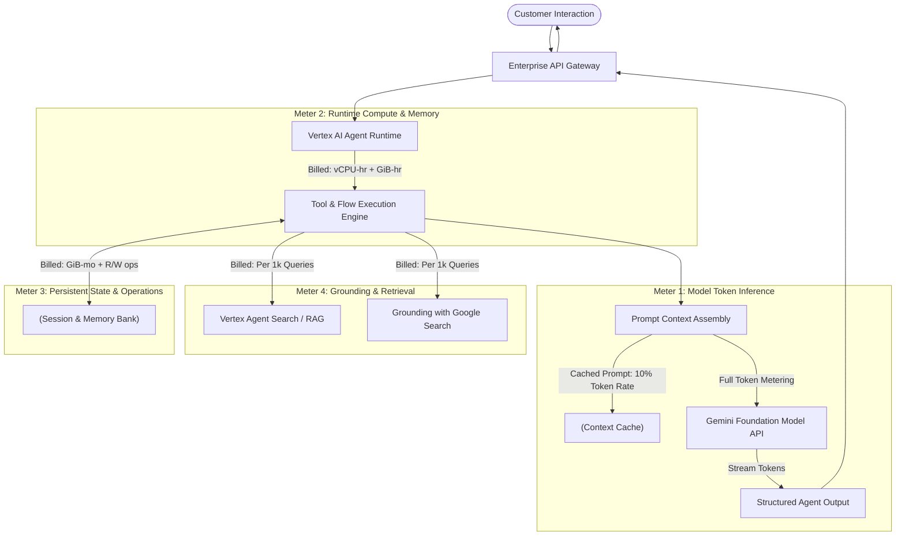

### Concept Graph: Foundations of GenAI Unit Economics

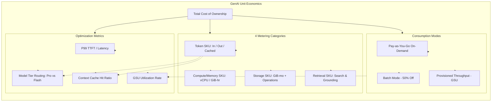

---

### Key Concepts: The Four Categories of AI Metering

| Concept | Architectural Definition | GCP Well-Architected & Landing Metrics | Grounding & Enterprise Real-World Example |
| --- | --- | --- | --- |
| Durable Metering Taxonomies | Pricing rates change frequently, but underlying metering dimensions (what is billed and the billable unit) remain stable over architectural lifecycles. | Financial Governance & FinOps: Unit economics stability, durable cost attribution per successful transaction. | Budgeting Gemini models by tracking token volume and GSU capacity rather than static dollar amounts. |
| Token-Based Metering | Metered strictly per volume of data ingested or generated (per 1M tokens, audio seconds, image frames, or search chunks). | Operational Efficiency: Input-to-Output token ratio (T<br>in |  |

 :T 
out

| ), Context cache hit percentage. | Gemini 2.5 Flash / Pro model inferences; tool call descriptions and function call payload returns. |  |  |
| --- | --- | --- | --- |
| Resource-Based Metering (Compute & Memory) | Metered by the continuous infrastructure footprint (vCPU-hours, GiB-hours, node-hours) regardless of invocation count. | Resource Optimization: Node saturation rate, idle baseline compute overhead. | Serving nodes for Vertex AI Vector Search running 24/7; Agent Runtime vCPU/RAM active processing time. |
| Provisioned Resource Metering | Dedicated capacity reservations (e.g., Generative Service Units) guaranteeing throughput and low latency. | Reliability & SLA Delivery: GSU utilization rate (%), P99 Latency SLA conformance, zero 429 quota exceptions. | Cymbal Support reserving 20 GSUs on an annual commitment to guarantee Daytime peak throughput. |
| Seat-Based Metering | Flat per-user recurring license fees for workforce seats and agent management tooling. | Workforce ROI: Agent supervision resolution rate, cost per human supervisor seat. | Gemini Enterprise licenses assigned to Cymbal customer support supervisors and human escalation operators. |

Metering Classification Matrix: Cymbal Support Solution

| Component | Metering Classification | Primary SKUs / Billable Units | Cost Nature |
| --- | --- | --- | --- |
| Gemini Foundation Models | Token-Based Metering | Per 1M Input Tokens / Per 1M Output Tokens | Variable (Request volume & length driven) |
| Vector Search Index | Resource-Based Metering | Node-hours (vCPU, RAM, Index Storage) | Fixed / Baseline (Continuous serving) |
| Agent Runtime | Resource-Based Metering | Active vCPU-hours, GiB-hours | Semi-variable (Active agent task execution) |
| Google Search Grounding | Token / Query-Based | Per 1,000 Search Grounding queries | Variable (Search grounding calls) |
| Support Supervisors | Seat-Based Metering | Per user / month (Gemini Enterprise) | Fixed recurring operational expense |
| Peak Traffic Capacity | Provisioned Metering | Reserved GSUs (Generative Service Units) | Fixed commitment (1-month or 1-year terms) |

### Magic Quadrant: AI Metering Categories

High Dynamic Concurrency & Throughput
             |
             |   [Provisioned Capacity]         [Token-Based Metering]
             |   Provisioned Throughput (GSUs)  Gemini PayGo API (Flash/Pro)
             |   - Deterministic Latency        - Highly Elastic
             |   - Fixed Term Commitments       - Variable Cost per Request
Variable ----+------------------------------------------------------------- Static
Load Pattern |
             |   [Resource-Based Metering]      [Seat-Based Metering]
             |   Vector Search Serving Nodes    Gemini Enterprise Licenses
             |   Agent Runtime Compute/RAM      Customer Service Portals
             |   - Baseline Infrastructure      - Per-User Flat Rate
             |
Low Dynamic Concurrency & Throughput
Flow Diagram: Cymbal Support Multi-Meter Execution Flow (Figure 1 Equivalent)

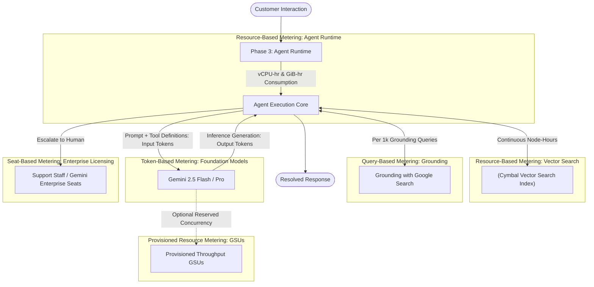

### Concept Graph: Multi-Meter Solution Architecture

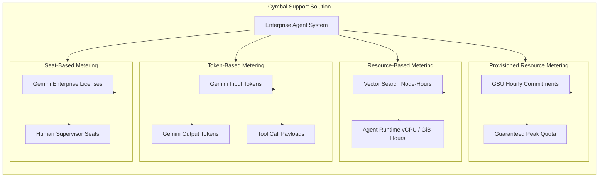

be as fine grained as possible
Granular Structural Driver Decomposition: GenAI vs. Predictive ML

| Structural Dimension | Classical Predictive ML & Deterministic APIs | Frontier GenAI Agents (Gemini & Vertex AI) | Architectural & Financial Consequence |
| --- | --- | --- | --- |
| Model Footprint & Scale | Megabytes to few Gigabytes; dynamic auto-scaling from zero replicas up to peak within seconds. | Hundreds of billions / trillions of parameters; massive accelerator footprints (TPU pods / GPU clusters). | Providers must reserve fixed underlying infrastructure up front; strict quota ceilings apply; latency and SLO variance increase significantly. |
| Inference Variance & Output Length | Single forward-pass execution (O(1) inference count); fully deterministic output shape and execution cost. | Autoregressive decoding where each generated token is an independent inference pass (N output tokens = N sequential passes). | Cost cannot be metered per API request; billed per million tokens; output tokens are priced at a substantial premium (4× to 8× over input). |
| Execution Path & Trajectories | Fixed Directed Acyclic Graph (DAG) pipelines; bounded compute and static execution steps. | Dynamic autonomous planning, variable conversation turns, multi-step sub-agent delegation, and conditional tool-call loops. | Execution bounds cannot be calculated deterministically upfront; costs compound exponentially across agent reasoning loops. |

Deep Taxonomy: The Four Metering Categories & Consumption Mechanics

| Category | Primary Pricing Metric & Billable SKUs | Underlying Infrastructure & Consumption Behavior | FinOps Optimization Levers & Engineering Trade-offs |
| --- | --- | --- | --- |
| Token-Based Metering | • Per 1M Input Tokens<br>• Per 1M Output Tokens<br>• Per unit multimodal ingest (image tiles, audio seconds, video duration) |  |  |
| Standard Pay-as-You-Go (PAYG) on Gemini APIs. Output decoding incurs 4–8× the compute cost of input prefill due to memory bandwidth constraints in autoregressive generation. | • Small-to-large model routing (Flash vs. Pro)<br>• Aggressive prompt compression & schema trimming<br>• Input/output token budgeting per reasoning step<br>• Selection of latency tier (Standard vs. Batch 50% discount) |  |  |
| Resource-Based Metering | • Node-hours (vCPU / GiB RAM)<br>• Agent Runtime active compute (vCPU-hours, GiB-hours)<br>• Index storage (GiB-months) |  |  |
| Dedicated cluster instances running continuously (e.g., Vertex AI Vector Search endpoints) or ephemeral container runtimes executing agent logic. | • Scale-to-zero vs. always-on serving trade-offs<br>• Right-sizing vector index shard topologies & quantization<br>• Minimizing active wall-clock execution time per agent turn |  |  |
| Provisioned Resource Metering | • Generative Service Units (GSUs)<br>• Committed capacity per hourly / monthly / annual term |  |  |
| Dedicated accelerator capacity partitioned exclusively for a tenant, bypassing public multi-tenant queuing and noisy-neighbor throttling. | • Capacity reservation sizing matched to baseline daytime load<br>• Balancing fixed reservation commitments against PAYG burst overflow<br>• Target sustained GSU utilization >80% |  |  |
| Seat-Based Metering | • Named User Licenses (per user / month)<br>• Platform seat tiers (Gemini Enterprise) |  |  |
| User identity-bound software entitlement, independent of the volume of requests or tokens consumed through the portal. | • Identity lifecycle governance and license pruning<br>• Service account vs. interactive user mapping compliance<br>• Workload shift between human supervision and autonomous agent turns |  |  |

Meter Stacking Matrix: Multi-Meter Product Behaviors

| Multi-Meter Interaction | Architectural Driver | Meter 1 (SKU Type) | Meter 2 (SKU Type) | Bill Line-Item Manifestation |
| --- | --- | --- | --- | --- |
| Context Caching | Caching long system prompts, few-shot schemas, or reference corpus in model context memory. | Token-Based: Discounted input tokens on cache hit (~10% of standard rate). | Resource/Storage-Based: Hourly storage cost per 1M tokens stored in memory cache per hour. | Appears as two separate line items: Cache Storage (Per Hour) and Cached Input Token Ingestion. |
| Grounding with Search | Augmenting model generation with live Google Web Search indexing. | Token-Based: Gemini input prompt tokens + model output generation tokens. | Request/Data-Chunk Based: Search Grounding fee metered per 1,000 grounding queries. | Appears as Gemini Model Tokens and Vertex AI Search Grounding Queries. |
| Tool Calling / Function Calling | Agent invoking external APIs (Order lookup, Shipping DB, CRM). | Token-Based (Direct): Tool definition schema included in prompt input + JSON payload returned in context. | None (Zero API fee): Google does not charge for tool execution itself; cost is 100% token inflation. | Incurred purely as expanded Input Tokens across consecutive model turns. |

### Magic Quadrant: Workload Allocation Across AI Metering Types

High Dynamic Concurrency / Low Tolerable Latency
             |
             |   [Provisioned Capacity]         [Token-Based Elasticity]
             |   Provisioned Throughput (GSUs)  Gemini PayGo API (Flash/Pro)
             |   - Strict P99 Latency SLA       - Highly Elastic Burst Scaling
             |   - Committed Fixed Opex         - Linear Cost per Volume
Predictable -+------------------------------------------------------------- Volatile
Capacity     |
Demand       |   [Resource-Based Baseline]      [Seat-Based Operational]
             |   Vector Search Serving Nodes    Gemini Enterprise Licenses
             |   Agent Runtime Compute / RAM    Human Escalation Desks
             |   - Continuous Steady State      - Flat Governance Cost
             |
Low Dynamic Concurrency / High Tolerable Latency
Detailed End-to-End Execution Flow: Cymbal Support Multi-Meter Trace

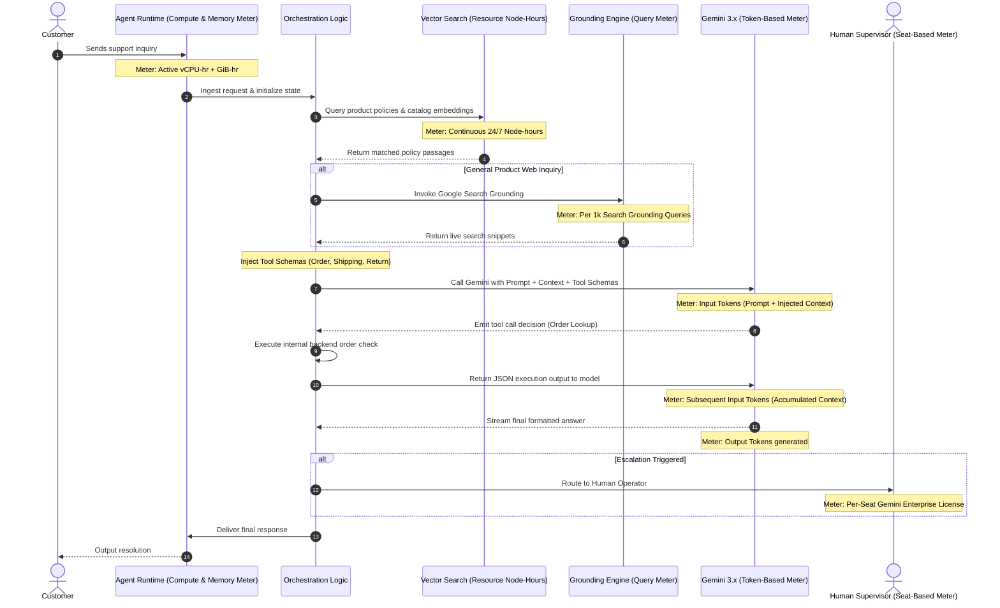

Comprehensive Concept Graph: Enterprise Agent Metering Taxonomy

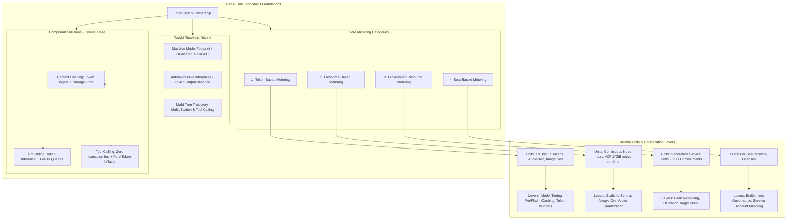

---

### Key Concepts Breakdown: The Token Economy

| Concept | Architectural & Metering Definition | GCP Well-Architected / Landing Metric | Enterprise Real-World Example & Grounding |
| --- | --- | --- | --- |
| Token Ingestion Decomposition | An LLM call is billed in three fundamental quantities: Input, Cached Input, and Output tokens (priced per 1M tokens). | Unit Cost per Turn ($/Turn): Ingestion ratio (T<br>in |  |

 :T 
out

| ), Context Payload Overhead. | In Cymbal Support, a customer asking "Where's my order?" passes system instructions, order schema, conversation history, and 5 tool definitions (~4,200 input tokens) while generating an output response of ~85 tokens. Grounded via Gemini Pricing. |
| --- | --- |
| Implicit vs. Explicit Context Caching |  |

Implicit: Zero storage fee, automatic cache hits on common matching prefixes in Gemini 3.x, non-deterministic.

Explicit: Developer-declared context TTL, deterministic, full rate to write + storage fee per token-hour, yielding ~90% input discount on reads.

| Cache Hit Rate (%) & Break-Even Amortization: Cache Read vs. Write-Storage breakeven query frequency. | Explicitly caching Cymbal's product catalog (120k tokens) with a 2-hour TTL pays off after 2 subsequent requests against the cache; implicit caching transparently deduplicates frequent agent prompt headers. Grounded via Vertex AI Context Caching. |  |
| --- | --- | --- |
| Dual-Category Output Metering | Output tokens include both Response Output Tokens (visible to client/connectors) and Thought Output Tokens (internal reasoning scratchpad for thinking/reasoning models). | Thinking Token Overhead: T |

thought

 :T 
response

| ratio, Quality vs. Inference Latency Tradeoff. | A complex refund dispute agent uses thinking mode: it spends 850 thought tokens evaluating refund policy rules before delivering a 60-token response to the user. All 910 output tokens are metered at output rates. Grounded via Gemini Thinking Mode Docs. |  |  |
| --- | --- | --- | --- |
| Five Dimensions of Token Pricing | Per-token rates vary across: Model Tier (Flash-Lite vs. Flash vs. Pro), Context Threshold (≤128k vs. >128k tokens), Modality (Text vs. Audio vs. Video), Service Tier (Standard vs. Batch 50% discount), and Endpoint (PAYG vs. Provisioned Throughput). | SKU Arbitrage & Tier Allocation: Workload routing alignment, Batch adoption rate (%). | Nightly transcript summarization runs on Batch API (50% token cost reduction); low-latency customer chat uses Flash; heavy analytical root-cause queries route to Pro. |
| Durable Structural Ratios | Architectural heuristics that persist despite vendor pricing fluctuations: Output is 3×–6× input; Pro is 2×–4× Flash; Cached input is ~10% of standard input (~90% discount); Batch is ~50% of standard; Audio input costs a multiple of text input. | Durable Unit Economic Ratios: Budget sensitivity analysis invariant to absolute price drops. | Trimming 1 output token saves equivalent budget of trimming 3 to 6 input tokens; switching text-to-speech pre-transcription vs. native audio input shifts cost dynamics. |

Token Economy Cost & Dynamics Matrix

| Token Meter Type | Unit Cost | Predictability & Volume Driver | Optimization Architectural Lever |
| --- | --- | --- | --- |
| (Regular) Input Tokens | Low / Baseline | Highly variable; scales with system instructions, context window, RAG chunks, and tool schemas. | Prompt compression, tool schema trimming, semantic filtering of RAG chunks. |
| Implicit Cached Tokens | Lowest (No storage fee) | Variable; depends on runtime traffic prefix sharing (Gemini 3.x default). | Standardize prefix ordering across system prompts and tool declarations. |
| Explicit Cached Tokens | ~10% of standard (incurs storage fee) | Predictable; requires explicit developer cache instantiation and active TTL management. | Amortize large reference manuals, static policies, or extensive few-shot exemplars over frequent turns. |
| Response Output Tokens | High (3×–6× input) | Variable; depends on generation instructions, response length caps, and JSON complexity. | Strict output schemas, stop sequences, and concise response instructions. |
| Thought Output Tokens | High (identical to response rate) | Non-deterministic; determined by reasoning intensity and task difficulty. | Set explicit thinking budgets (e.g., capping thinking tokens on simple queries). |

### Matrix: Five Dimensions Affecting Per-Token Rates

| Dimension | Tier / Setting | Pricing Impact Dynamic | Architectural Application |
| --- | --- | --- | --- |
| 1. Model Tier | Flash-Lite → Flash → Pro | Pro is 2×–4× the price of Flash; Flash-Lite is lowest cost. | Model routing: Flash-Lite for intent classification, Pro for complex policy arbitration. |
| 2. Context-Length Threshold | ≤128k tokens vs. >128k tokens | Ingestion and output rates double when request payload crosses 128k tokens. | Enforce sliding context windows to keep active agent context ≤128k tokens whenever possible. |
| 3. Input Modality | Text vs. Image vs. Audio vs. Video | Native audio/video input incurs higher per-unit rates than pure text. | Pre-transcribe audio calls via Speech-to-Text if text reasoning suffices; use native audio only for tone/prosody. |
| 4. Service Tier | Standard On-Demand vs. Batch API | Batch tier provides a 50% discount for asynchronous execution. | Route asynchronous evaluation, synthetic test generation, and nightly audits to Batch. |
| 5. Endpoint / Billing Mode | Pay-as-You-Go vs. Provisioned Throughput (GSUs) | PAYG scales linearly per token; Provisioned Throughput decouples token metering into fixed reserved capacity. | Use GSU reservations for sustained high-traffic production workloads; PAYG for development and traffic bursts. |

### Magic Quadrant: Token Ingestion & Generation Routing

High Output Token Premium / Reasoning Depth
             |
             |   [Complex Arbitration]          [Enterprise Deep Reasoning]
             |   Gemini Pro                     Gemini Pro (Thinking Mode)
             |   - Strict output token caps     - Budget-bounded thought tokens
             |   - Schema-constrained JSON      - Offline audit / Escalations
Input Token -+------------------------------------------------------------- Output Token
Dominant     |                                                              Dominant
             |   [Cached Static Baseline]       [High-Volume Conversational]
             |   Gemini Flash                   Gemini Flash-Lite / Flash
             |   - Explicit context caching     - Concise direct responses
             |   - Standardized system prompt   - Minimal thought tokens
             |
Low Output Token Premium / High Context Ingest
Flow Diagram: Agent Call Token Ingestion & Generation Mechanics

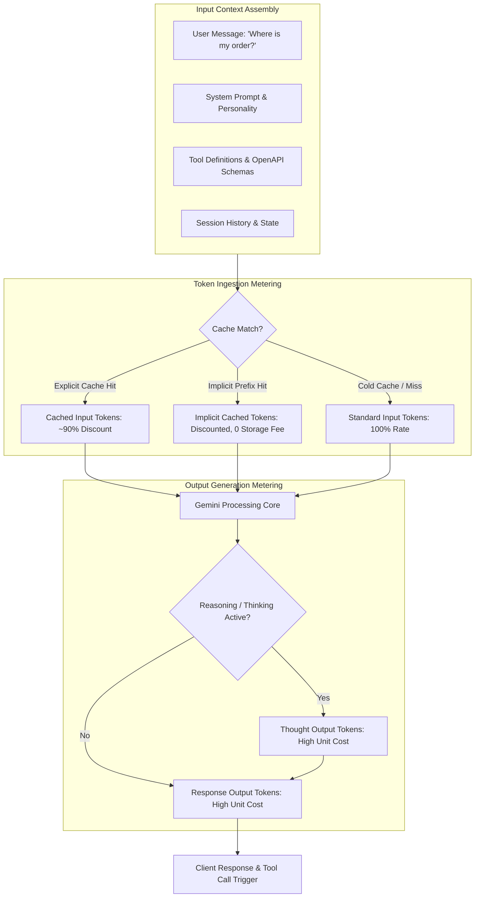

### Concept Graph: The Token Economy Architecture

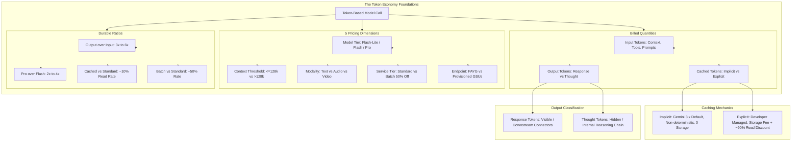

Ready for the next lesson in this module?

---

### Key Concepts Breakdown: Consumption Options (PayGo vs. Provisioned Throughput)

| Concept | Architectural & FinOps Definition | GCP Landing / Well-Architected Metric | Enterprise Real-World Example & Grounding |
| --- | --- | --- | --- |
| Five Workload Consumption Profiles | Traffic patterns determine model serving strategy: Steady & Critical, Bursty & Important, Tolerant & High Volume, and Flexible & Cost-Sensitive. | Workload Alignment & Cost Attribution: SLA compliance rate (%), Cost per Transaction across traffic tiers. | Cymbal live chat demands sub-second P95 latency (Steady & Critical), while weekly product catalog re-indexing runs asynchronously with multi-hour tolerance (Tolerant & High Volume). |
| PayGo Latency & Price Tiers | PayGo prices per token without upfront commitments across tiers (Standard ×1.0 reference, Priority, Flex PayGo, and Batch Inference ~0.5× reference) trading unit cost for latency guarantees. | Tier Arbitrage Efficiency: Batch Adoption Ratio (%), PayGo Tier Savings Index. | Running nightly ticket summarization on Batch Inference yields a 50% discount per token over Standard PayGo. |
| Provisioned Throughput (GSUs) | Capacity reservation measuring throughput in Generative AI Scale Units (GSUs); decoupled from per-token billing to eliminate concurrency throttling and token-rate variance. | GSU Capacity Efficiency: GSU Reservation Utilization Rate (%), Cost Breakeven Volume (V |  |

BE

| ). | Sizing 20 GSUs on an annual commitment for steady base traffic to guarantee dedicated TPU/GPU cluster allocation without public multi-tenant queuing. |
| --- | --- |
| GSU Sizing Heuristic | Capacity sizing calculation: GSUs≈ |

Throughput per GSU
(T 
in

 +T 
out

 )×QPS

| . | Capacity Planning Accuracy: Over-provisioning waste percentage, Peak-to-Average Ratio. | A 10 QPS workload averaging 1,500 input + 500 output tokens requires 20,000 tokens/sec capacity, sized against model-specific GSU throughput benchmarks in Cloud Console. |  |
| --- | --- | --- | --- |
| Term Commitments & Spillover Policy | Commitments range from 1 week (no auto-renew) to 1 year; overages route either to Standard PayGo spillover (protects availability) or return HTTP 429 via the dedicated request header (firm budget ceiling). | Availability vs. Budget Risk: HTTP 429 Error Rate (%), Spillover PayGo Burst Cost ($). | Cymbal defaults to Standard PayGo spillover during sudden marketing spikes to avoid dropping customer chats, while setting dedicated headers on non-critical dev/test projects. |

Traffic Pattern vs. Serving Strategy Matrix

| Traffic Pattern | Core Characteristics | Target Serving Tier | SLA & FinOps Strategy |
| --- | --- | --- | --- |
| Steady & Critical | High sustained QPS, low latency SLA, high availability | Provisioned Throughput (GSUs) | Size for baseline; eliminate multi-tenant queuing and 429 quota exceptions. |
| Bursty & Important | Variable peaks, moderate latency tolerance | Standard / Priority PayGo (or PT + Spillover) | Base capacity on PT, absorb spikes through Standard PayGo spillover. |
| Tolerant & High Volume | Large corpus, hours-long turnaround acceptable, cost-driven | Batch Inference PayGo | Route to asynchronous batch execution for ~50% token cost reduction. |
| Flexible & Cost-Sensitive | Internal analysis, delay-tolerant, lowest cost priority | Flex PayGo / Batch Inference | Utilize lower-priority scheduling tiers to minimize unit cost. |

Pay-as-You-Go vs. Provisioned Throughput Trade-Off Matrix

| Metric Dimension | Pay-as-You-Go (PayGo) | Provisioned Throughput (PT) |
| --- | --- | --- |
| Pricing Basis | Per token consumed (Input, Output, Cached) | Fixed reservation rate per GSU-hour / month / year |
| Commitment Terms | Zero commitment; scales dynamically | Fixed non-cancellable terms (1 week to 1 year) |
| Overage Handling | Throttled by quota limits (HTTP 429) | Configurable: PayGo spillover vs. dedicated hard stop (429) |
| Idle Infrastructure Cost | $0.00 (Zero idle cost) | Sunk cost; unutilized GSUs represent pure waste |
| Latency & Concurrency | Shared infrastructure; variable peak latency | Dedicated infrastructure; predictable P99 latency |

### Magic Quadrant: Gemini Consumption Strategy

High Sustained QPS / Low Latency Tolerance
             |
             |   [Hybrid Peak Architecture]     [Provisioned Throughput (PT)]
             |   Baseline GSUs + PayGo Spillover Reserved GSUs (1-Year Term)
             |   - High availability guaranteed - Maximum predictability
             |   - Spikes billed at token rate  - Dedicated TPU/GPU pods
Dynamic -----+-------------------------------------------------------------- Predictable
Demand       |
Pattern      |   [Elastic General Purpose]      [Batch & Offline Tier]
             |   Standard / Priority PayGo      Batch Inference API
             |   - Dynamic variable workloads   - ~50% Token cost discount
             |   - Zero idle capacity risk      - Turnaround SLA: O(hours)
             |
Low Sustained QPS / Flexible Latency Tolerance
Flow Diagram: Provisioned Throughput Capacity & Spillover Routing

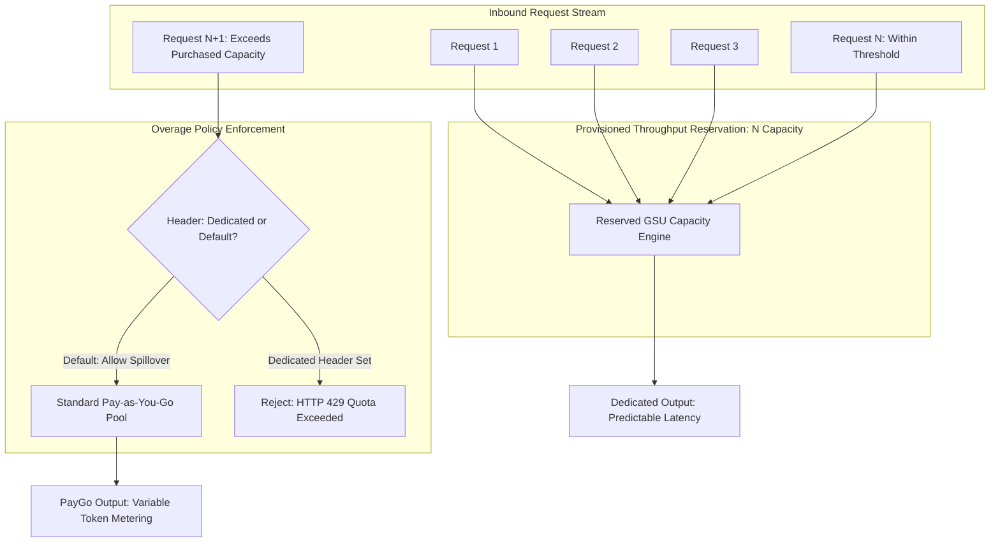

### Concept Graph: Consumption Options Architecture

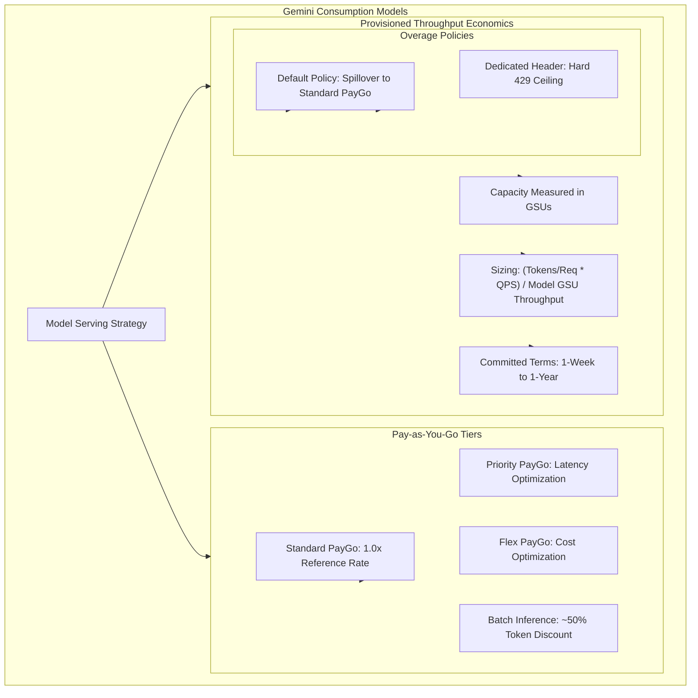

Ready to analyze the next page in this course?

---

### Key Concepts Breakdown: Module Overview — Building Blocks of Cost Estimation

| Concept | Architectural & FinOps Definition | GCP Landing / Well-Architected Metric | Enterprise Real-World Example & Grounding |
| --- | --- | --- | --- |
| Defensible Cost Estimation | Assembling a bottoms-up, auditable total cost projection for agentic systems across decoupled infrastructure components rather than static model inference guesstimates. | Financial Accountability & Governance: Estimate Confidence Variance (%), Unit Cost per Successful Session ($/Session). | Sizing Cymbal Support by itemizing foundation model tokens, vector database node-hours, agent orchestration runtime, and grounding queries before submitting budgets for enterprise procurement. |
| Live Rate Sourcing vs. Static Memorization | Relying on persistent metering categories (billable units) and pulling live rates programmatically or via the Google Cloud Pricing Calculator instead of hardcoding volatile per-token prices. | FinOps Operational Agility: Unit Economic Formula Stability, Bill of Materials (BOM) Maintainability. | Designing an agent cost calculator where the billable units (T<br>in |

 , T 
out

 , node-hours) remain constant across model generational updates (e.g., transitioning between Gemini model releases).

| Context Caching Bill Reshaping | Replacing repetitive multi-turn prompt prefix ingestion with an hourly context cache storage fee, converting high-volume input token costs into a flat temporal storage expense. | TCO & Amortization Efficiency: Context Cache Hit Ratio (%), Cache Breakeven Turnover Rate (Q |
| --- | --- | --- |

breakeven

| ). | Cymbal Support caching 150k tokens of return policies, FAQs, and API definitions; incoming user queries run against the cached prefix at an ~90% input token discount. |  |
| --- | --- | --- |
| Agentic Platform Periphery Metering | Enterprise agents incur costs beyond model inference via surrounding services: Vector Search indexes, session memory storage, enterprise search grounding, and agent runtime orchestration. | Landing Metrics / Full-Stack TCO: Non-Inference Platform Overhead Ratio ( |

Model Cost
Periphery Cost

| ). | The Cymbal Support agent executing an inquiry incurs 0.002 in model tokens, 0.005 in enterprise search retrieval, and fractional vCPU-hour agent runtime execution overhead. |  |  |
| --- | --- | --- | --- |
| PayGo vs. Provisioned Throughput Trade-Off | Selecting between elastic, on-demand Pay-as-You-Go pricing and fixed committed capacity reservations (Generative Service Units / GSUs) based on baseline traffic volume and latency SLAs. | Reliability & Capacity Optimization: GSU Capacity Saturation Rate (%), P99 Latency SLA Conformance, 429 Error Count. | Reserving 20 GSUs on an annual term for predictable 9 AM–5 PM peak traffic, while allowing after-hours traffic bursts to spill over into PayGo. |

End-to-End Estimation Framework Matrix

| Architectural Phase | Core Technical Driver | Primary Billable Unit | Tooling / Estimation Mechanism |
| --- | --- | --- | --- |
| 1. Model Tier & Modality Selection | Model parameter size, reasoning depth, and input modality (Text, Audio, Vision). | Per 1M Input / Output Tokens, Per Audio Min, Per Image Tile | Google Cloud Pricing Calculator / Vertex AI APIs |
| 2. Context Caching Integration | Prefix deduplication across recurring system instructions and dynamic sessions. | Storage per 1M Cached Tokens/Hour + Discounted Cached Read Tokens | Vertex AI Context Caching Pricing Matrix |
| 3. Agent Platform Periphery | Tool calling orchestrator, conversational memory banks, and retrieval grounding. | Continuous Node-hours (Vector Search), Active vCPU/GiB-hr (Agent Engine), Per 1k Search Queries | Vertex AI Agent Builder & Cloud Run SKUs |
| 4. Capacity & Serving Sizing | Workload concurrency distribution, burst factors, and latency SLAs. | Elastic PayGo per Token vs. Reserved GSUs (Weekly, Monthly, Annual Commitments) | Provisioned Throughput Sizing Calculator |

## Module Learning Trajectory: Capability vs. Complexity Quadrant

High Architectural Complexity / Multi-Service Stacking
             |
             |   [End-to-End Solution Synthesis] [Capacity & Serving Strategy]
             |   Building Cymbal Support Estimate PayGo vs. Provisioned Throughput (GSUs)
             |   - Multi-meter BOM integration   - Breakeven utilization analysis
             |   - Cloud Pricing Calculator      - Quota vs. SLA optimization
Foundational -+------------------------------------------------------------- Production-Ready
Prerequisite |
             |   [Model & Modality Baseline]     [Context Caching & Periphery]
             |   Tiering: Flash-Lite, Flash, Pro  Caching Economics & Memory
             |   - Modality cost multipliers     - Vector Search & Grounding meters
             |   - Ingestion vs. output ratios   - Runtime compute & GiB-hours
             |
Low Architectural Complexity / Single-Service Focus
Flow Diagram: Module Learning Progression & Estimation Assembly

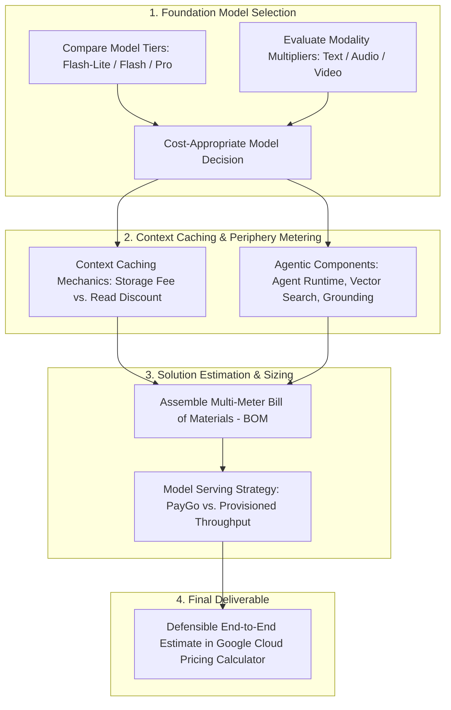

### Concept Graph: Module Architecture — Building Blocks of Cost Estimation

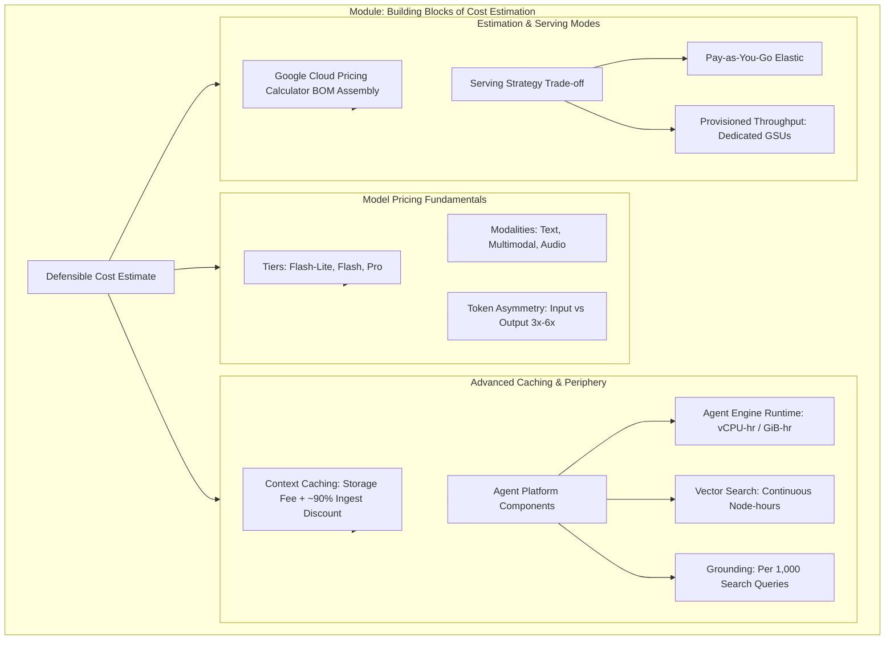

Ready to dive into the next page of this module?

---

Review your Chrome auto browse plan
Here's the plan based on your prompt & context
Click the 'Next' button at the bottom right to navigate to the next page of the course.
Gemini chooses which sites to use to complete the task, and may share your personal info. You are responsible for Gemini's actions during tasks.

Start task
Navigating to the next page of the course

### Key Concepts Breakdown: Model Pricing by Tier and Capability

| Concept | Architectural & FinOps Definition | GCP Well-Architected & Landing Metrics | Grounding & Enterprise Real-World Example |
| --- | --- | --- | --- |
| Model Tier Hierarchy (Flash-Lite vs. Flash vs. Pro) | Stratified foundation model tiers optimized across latency, reasoning depth, and unit token cost. Pro handles complex planning; Flash manages high-frequency turns; Flash-Lite serves lightweight tasks. | Cost Allocation & Task-Model Alignment: Cost per Resolved Intent ($/Intent), Latency SLA Adherence. | Cymbal routing sentiment scoring to Flash-Lite, order status extraction to Flash, and warranty dispute arbitration to Pro. Grounded via Vertex AI Pricing. |
| Capability-Cost Multipliers | As models increase in parameter count and capability (multimodal reasoning, multi-step tool calling, structured extraction), inference resource consumption scales non-linearly. | Inference Efficiency Ratio: Normalized Task Quality vs. Model Unit Cost (Q/$). | Ingesting a 50-page complex service diagram for OCR and spatial reasoning on Gemini Pro costs significantly more than parsing plain-text customer messages on Flash. |

Token Asymmetry Ratio (T 
in

 :T 
out

| ) | Output tokens cost 3× to 6× more than input tokens across all tiers due to the autoregressive decoding memory bandwidth bottleneck on TPU/GPU accelerators. | Prompt-to-Completion Ratio: Token Asymmetry Multiplier, Generation Efficiency Index. | Generating 1,000 output tokens on Gemini Flash incurs roughly equivalent cost to processing ~4,000 to ~5,000 input tokens. Grounded via Gemini Model Economics. |
| --- | --- | --- | --- |
| Dynamic Tier Routing | Decoupling agent architecture from a single foundation model by using an intent router to dispatch tasks dynamically to the most cost-effective tier meeting the quality bar. | Landing Metric - Routing Efficiency: Sub-Agent Route Distribution (%), Blended Cost per Turn ($/Turn). | An agent architecture where a lightweight Flash-Lite classifier evaluates incoming inquiries and delegates to Pro only when policy ambiguity or math calculations exceed confidence thresholds. |

Model Tier Capability & Cost Trade-Off Matrix

| Dimension | Gemini Flash-Lite | Gemini Flash | Gemini Pro |
| --- | --- | --- | --- |
| Primary Architectural Role | High-throughput classification, routing, lightweight extraction | General agent turn execution, standard tool orchestration, retrieval synthesis | Complex multi-step reasoning, mathematical verification, policy arbitration |
| Cost Profile | Lowest relative cost tier ($) | Mid baseline tier ($$) \vert{} High premium tier ($$$$, ~2× to 4× Flash) |  |
| P95 Latency & TTFT | Ultra-low TTFT; optimized for edge & real-time chat | Balanced sub-second TTFT | Higher TTFT; compute-heavy autoregressive generation |
| Context Window Ceiling | Standard large context support | Up to 1M+ tokens | Up to 2M+ tokens with advanced reasoning |
| Thinking Mode Overhead | Minimal / None | Configurable thought budgets | Full deep thinking / scratchpad reasoning |

### Magic Quadrant: Model Tier vs. Task Complexity

High Reasoning Complexity / Policy Ambiguity
             |
             |   [Over-Provisioned Cost Risk]   [Target: Enterprise Core]
             |   Simple queries routed to Pro   Gemini Pro / Pro Thinking Mode
             |   - Unnecessary token inflation  - Complex policy arbitration
High Latency -+------------------------------------------------------------- Low Latency
Tolerance    |                                                              Tolerance
             |   [Target: High Volume Utility]  [Target: Real-Time Edge]
             |   Gemini Flash                   Gemini Flash-Lite
             |   - Standard tool orchestration  - Fast intent triage & routing
             |   - Knowledge retrieval synthesis- Lightweight entity parsing
             |
Low Reasoning Complexity / Structured Tasks
Flow Diagram: Dynamic Model Tier Routing Architecture

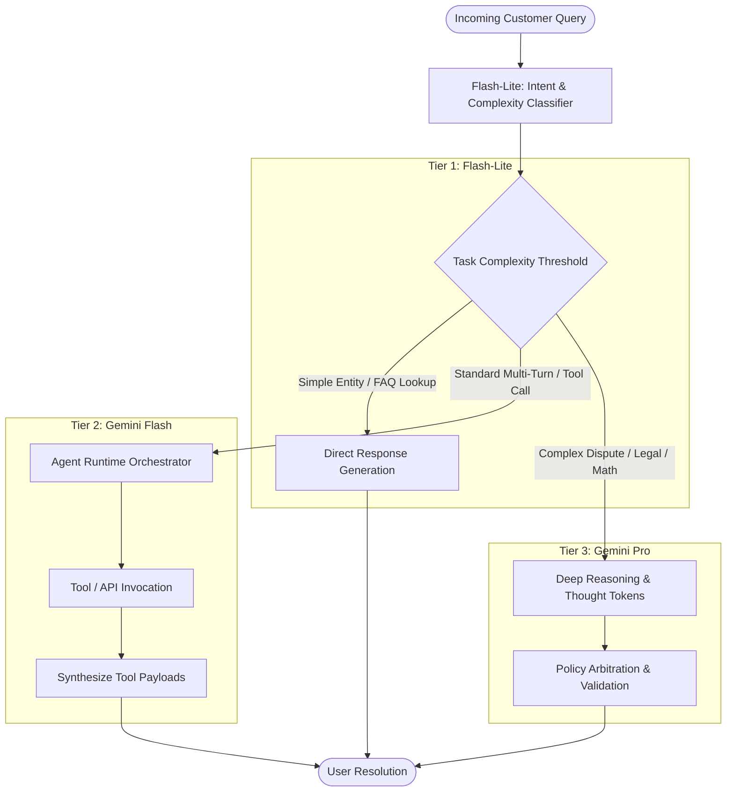

### Concept Graph: Model Tier & Capability Economics

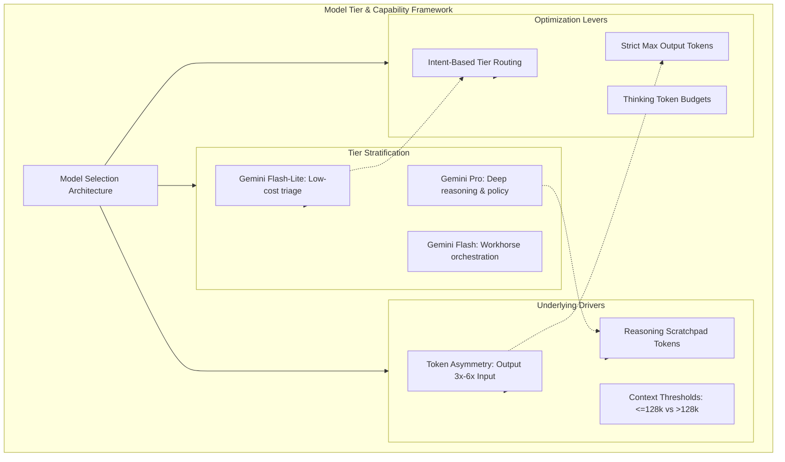

Ready to review the next page in this course?

---

### Key Concepts: Model Pricing by Tier and Capability

| Concept | Architectural & Metering Definition | GCP Well-Architected & Landing Metrics | Grounding & Enterprise Real-World Example |
| --- | --- | --- | --- |
| Tier Selection & Data-Driven Evaluation | Selecting foundation models within the Gemini 3.x family (Flash-Lite, Flash, Pro) based on empirical task complexity thresholds verified via automated evaluation rather than over-provisioning to Pro. | Cost Allocation & Task-Model Alignment: Intent Resolution Unit Cost ($/Intent), Routing Quality SLA Adherence. | In Cymbal Support, high-volume "Where's my order?" inquiries run on Flash-Lite/Flash, while complex multi-step warranty dispute arbitrations are selectively routed to Gemini Pro. Grounded via Model Garden. |
| Modality-Specific Billing Units | Switching input or output data types fundamentally alters the metered dimension from tokens to alternative physical units. | Modality Cost Multiplier: Multimodal Ingestion Efficiency, Output Unit Premium. | Customer damage photos ingest as input tokens (audio on Flash carries a token surcharge; Pro unifies input rates); generating assets shifts units to per-image or per-second with Veo. |
| Service Tier Multipliers & Endpoint Scope | Consumption service tier applies systemic multipliers to base rates: Standard (1.0×), Priority (+80% / ~1.8×), Flex / Batch (-50% / ~0.5×). Global endpoints can bill slightly lower than regional endpoints. | Consumption Tier Arbitrage: Batch Adoption Ratio (%), Data Residency Cost Differential. | Cymbal Support configures Standard PayGo on global endpoints for interactive customer chats while routing asynchronous transcript summarization to Batch API. Grounded via Vertex AI Service Tiers and Global Endpoints. |
| The 200K Context-Length Threshold | Crossing ~200K input tokens on Gemini Pro 3.x shifts the entire call (both input and output) into a higher pricing tier (~2× base rate). | FinOps Risk Metric: Threshold Crossing Frequency (%), History Accumulation Ratio. | A long-running Cymbal troubleshooting session accumulating PDF manuals, multi-turn history, and OpenAPI schemas crosses 200K tokens, doubling the unit cost of subsequent turns. Grounded via Gemini Enterprise Agent Platform. |

Metering Dimensions & Unit Dynamics Matrix

| Dimension | Option / Scope | Primary Unit / Multiplier | FinOps Trade-off & Strategic Rule |
| --- | --- | --- | --- |
| Model Tier | Flash-Lite vs. Flash vs. Pro | Per 1M Tokens (Pro is ~2×–4× Flash) | Choose the lowest tier that passes quality benchmarks; evaluate empirically. |
| Output Token Asymmetry | Response vs. Input Tokens | Output is multiple of Input (~3×–6×) | Trimming output tokens yields the highest cost-reduction leverage per call. |
| Modality: Images / Audio In | Customer photo / voice upload | Tokens (Audio has surcharge on Flash) | Normalize image resolutions and pre-transcribe high-volume audio where possible. |
| Modality: Image / Video Out | Visual response / Video explainer | Per Image (resolution-tiered) / Per Sec (Veo) | Restrict generative video/image features to high-value user interactions. |
| Service Tier | Priority / Standard / Batch | 1.8× / 1.0× / 0.5× | Offload non-interactive evaluation and summarization to Batch (0.5×). |
| Endpoint Location | Global vs. Regional | Slight discount for Global | Use global endpoints unless restricted by strict data sovereignty policies. |
| Context Threshold | ≤200K vs. >200K (Pro) | 1.0× Base vs. ~2.0× Elevated Rate | Proactively prune history and retrieve targeted RAG chunks to avoid the 200K boundary. |

### Magic Quadrant: Workload Routing Across Model Tiers & Service Options

High Latency Sensitivity / Low Turnaround Tolerance
             |
             |   [Interactive Critical]         [Deep Reasoning Live]
             |   Gemini Flash                   Gemini Pro
             |   (Standard / Priority PayGo)    (Standard PayGo, <200K Context)
             |   - Order status & triage        - Warranty arbitration & legal
Service Tier +--------------------------------------------------------------
Arbitrage    |
             |   [High-Volume Utility]          [Batch Analytical Engine]
             |   Gemini Flash-Lite              Gemini Pro
             |   (Global Endpoint PayGo)        (Batch Service Tier - 0.5x)
             |   - Intent classification        - Nightly transcripts & eval
             |
Low Latency Sensitivity / Asynchronous Tolerance
Flow Diagram: Cymbal Support Model & Modality Routing Flow

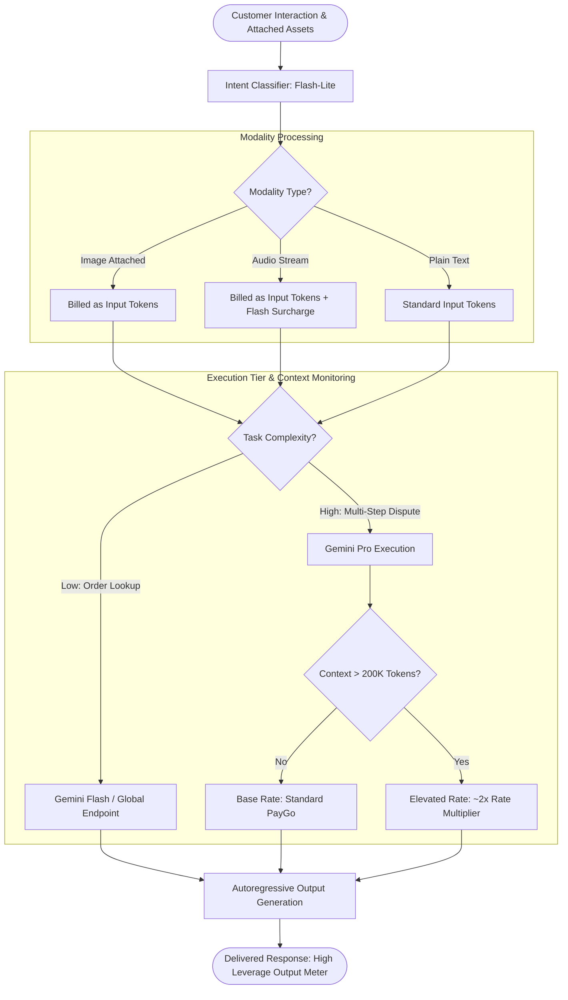

### Concept Graph: Pricing Mechanics & Architectural Decisions

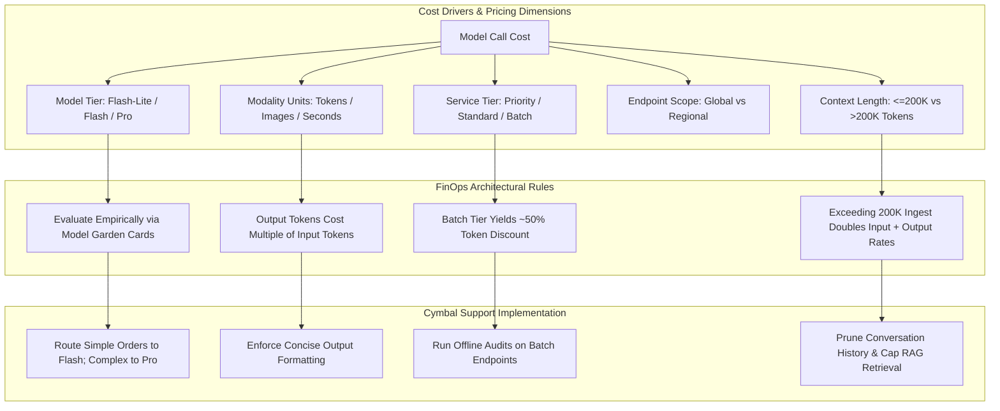

Ready to review the next page in this course?

---

Review your Chrome auto browse plan
Here's the plan based on your prompt & context
Click the 'Next' button at the bottom right to navigate to the next page of the course.
Gemini chooses which sites to use to complete the task, and may share your personal info. You are responsible for Gemini's actions during tasks.

Start task
Clicking the Next button

### Key Concepts Breakdown: Context Caching Economics

| Concept | Architectural & FinOps Definition | GCP Landing / Well-Architected Metric | Enterprise Real-World Example & Grounding |
| --- | --- | --- | --- |
| Context Caching Write vs. Read Mechanics | Creating a cache requires an initial ingestion write at standard input rates plus an active temporal storage fee ($/1M tokens/hour); subsequent read requests against the cache receive up to a ~90% input discount. | Cache Breakeven Query Volume (Q |  |

BE

| ): Minimum query frequency required to offset storage fees, Cache Hit Ratio (%). | In Cymbal Support, caching a 150k-token catalog and policy document with a 2-hour TTL pays off within 2 to 3 subsequent requests, cutting repeat turn input costs by ~90%. Grounded via Vertex AI Context Caching. |  |  |
| --- | --- | --- | --- |
| Minimum Cache Thresholds | Models enforce minimum token floors before an explicit cache can be created (typically ~32,768 tokens on Gemini Pro/Flash); sub-threshold payloads cannot leverage explicit caching. | Context Optimization & Padding Efficiency: Cache Eligibility Ratio (%), Prefix Padding Overhead. | Single small system prompts (~500 tokens) cannot be explicitly cached; developers must aggregate static tools, system prompts, and reference documents to clear the minimum token threshold. Grounded via Gemini Context Caching Documentation. |
| Time-to-Live (TTL) & Amortization Economics | Cache leases are defined by an explicit TTL. The cache remains cost-effective only if incoming query volume amortizes the hourly storage fee across the lifespan of the cache. | Storage Amortization Efficiency: Hourly Cache Storage SKU ($/Hour), Request Inter-Arrival Time (t |  |

iat

| ). | Setting an aggressive 1-hour TTL with auto-refresh on touch for steady daytime traffic (9 AM–5 PM), while allowing the cache to expire during nocturnal idle periods. |  |  |
| --- | --- | --- | --- |
| Latency Amortization (TTFT Reduction) | Beyond monetary savings, context caching bypasses repetitive attention key-value (KV) computation during the prefill phase, reducing Time-To-First-Token (TTFT) by up to 50–80%. | P99 Time-To-First-Token (TTFT): Prefill Speedup Ratio, P95 Response Latency SLA Conformance. | Customer chat turns experience near-instantaneous first-token generation on long-context policy inquiries because the 100k+ token KV cache is already resident in accelerator memory. |

Context Caching Financial Trade-Off Matrix

| Dimension | Standard Uncached Ingestion | Explicit Context Caching |
| --- | --- | --- |
| Initial Turn Cost | Standard Input Token Rate (1.0×) | Standard Input Rate + Hourly Storage Fee ($/1M tokens/hour) |
| Subsequent Reads (N turns) | N×Standard Input Rate | N×(∼0.10×Standard Input Rate)+Storage Fee |
| Break-Even Condition | Cost-effective for low, sporadic traffic (< 2 calls/hr) | Cost-effective when Q>Q |

BE

  within the configured TTL window

| Accelerator Overhead | Autoregressive prefill computed on every call | Pre-computed KV pairs loaded directly; significant TTFT reduction |
| --- | --- | --- |
| Minimum Payload Constraint | None (valid down to 1 token) | Enforces minimum size threshold (typically ≥32k tokens) |

### Magic Quadrant: Caching Strategy vs. Traffic Volume

High Query Frequency / Tight Latency SLAs
             |
             |   [Target: Explicit Caching]     [Provisioned Cache Pipeline]
             |   High Hit Rate / Low TTL        Long TTL / High Sustained QPS
             |   - Rapid break-even (<5 mins)   - Dedicated TPU memory retention
             |   - Massive input cost savings   - Ultra-low P99 TTFT
Payload Size +-------------------------------------------------------------
Above 32k    |
             |   [Cache Ineligible / Avoid]     [Implicit Prefix Matching]
             |   Small Prompts (<32k tokens)    Dynamic Prefix Sharing
             |   - Standard PayGo ingestion     - Non-deterministic caching
             |   - Low idle storage waste       - Zero storage line-item
             |
Low Query Frequency / Flexible Turnaround
Flow Diagram: Context Caching Decision & Execution Flow

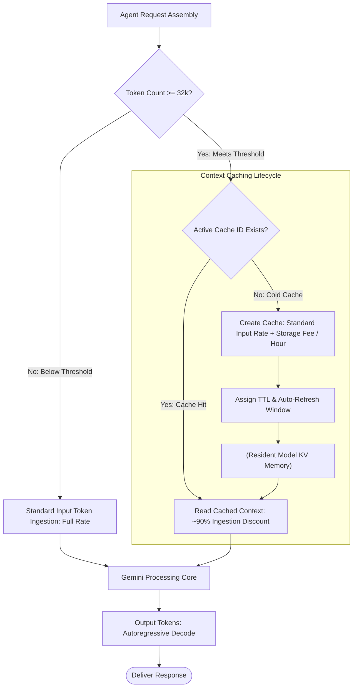

### Concept Graph: Context Caching Economics

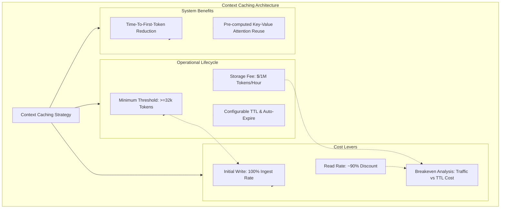

Ready to analyze the next page in this course?

---

### Key Concepts Breakdown: Pricing Agentic Solution Components on GEAP

| Concept | Architectural & Metering Definition | GCP Well-Architected & Landing Metrics | Grounding & Enterprise Real-World Example |
| --- | --- | --- | --- |
| Agent Runtime Compute & Code Sandbox | Managed execution environment hosting agent orchestrator logic and code interpreter sandboxes; billed on active resource wall-clock consumption (measured to the second per vCPU-hour and GiB-hour). | Compute Efficiency & Idle Leakage: Active Wall-Clock Execution Time (T |  |

exec

| ), vCPU/RAM Provisioning Saturation, Monthly Free Tier Burn Rate. | Cymbal Support invoking a Python code sandbox to compute prorated return fees. Runtime compute and memory are billed per active execution second ($0.085/vCPU-hr, $0.009/GiB-hr) after consuming the monthly free tier (50 vCPU-hrs, 100 GiB-hrs). Grounded via Gemini Enterprise Agent Platform Review. |
| --- | --- |
| Platform Sessions vs. Memory Bank |  |

Sessions: Ephemeral multi-turn interaction history (metered per 1,000 content events stored).

Memory Bank: Dynamic long-term episodic user profile generation (metered per 1,000 memories stored and returned, or per GiB-month + read/write operations).

| State Retention TCO: Event Ingestion Velocity, Memory Retrieval Hit Ratio, State Retention Overhead ($/Session). | Storing multi-turn user/agent chat turns, tool schemas, and JSON outputs incurs Sessions content-event fees, while extracting customer preferences ("prefers ground shipping") into the Memory Bank incurs storage and retrieval SKUs. |  |  |
| --- | --- | --- | --- |
| Platform Seat-Based Licensing | Fixed monthly subscription fee per licensed enterprise user (Gemini Enterprise) independent of underlying token or compute usage. | Workforce ROI & Escalation Ratio: Human Escalation Percentage (%), Blended Cost per Escalated Case ($/Escalation). | Assigning Gemini Enterprise seats to human support staff and escalation supervisors monitoring Cymbal Support workflows and handling human-in-the-loop takeovers. |
| RAG Embeddings & Vector Search | Retrieval stack metering: Text/Multimodal Embeddings billed per 1,000 characters or per 1M tokens; Vector Search billed per continuous serving node-hour plus storage/index rebuilds. | Search Cost per Query: Retrieval Recall@K vs. Index Node Cost, Embedding Ingestion Velocity ($/MB). | Re-indexing Cymbal's product catalog requires generating text embeddings with standard embedding models; real-time similarity matching queries an always-on Vertex Vector Search index endpoint. Grounded via Vertex AI Pricing. |
| Grounding Requests vs. "Quiet" Function Calling | Grounding with Google Search incurs a dedicated request charge (~$14 per 1,000 search queries) over model tokens. Function calling has zero execution fee, but incurs a quiet token tax by expanding prompt input and output contexts with tool schemas and JSON payloads. | Tool Token Inflation Ratio: Context Inflation Multiplier ( |  |

Raw Prompt Tokens
Tokens with Tools

| ), Search Grounding Frequency. | Cymbal agent checking order tracking calls an external fulfillment API: tool definition schemas add 2,500 input tokens per turn, and the JSON payload adds 400 tokens, inflating model token costs even though tool invocation itself carries no API surcharge. |
| --- | --- |

Metering Taxonomies: GEAP Full-Stack Agent Components

| Platform Component | Metering Classification | Primary SKUs / Billable Units | Free Tier Allowances | FinOps Architectural Rule |
| --- | --- | --- | --- | --- |
| Runtime Compute | Resource-Based | $0.085 per vCPU-hour (per second) | 50 vCPU-hours / month | Terminate idle execution promptly; minimize run loop blocking. |
| Runtime Memory | Resource-Based | $0.009 per GiB-hour (per second) | 100 GiB-hours / month | Size container memory footprints tightly to prevent over-allocation. |
| Code Execution Sandbox | Resource-Based | Per vCPU-hour and GiB-hour | Bundled with Agent Runtime | Restrict code sandbox execution to isolated, stateless algorithmic tasks. |
| Platform Sessions | Event / Storage-Based | Per 1,000 content events stored (or GiB-mo + ops) | 1 GiB-month / month | Truncate or summarize older session turns to prevent event proliferation. |
| Memory Bank | Event / Storage-Based | Per 1,000 memories stored & returned | Free retrieval tier | Filter transient chit-chat; commit only durable user facts to long-term memory. |
| Gemini Enterprise | Seat-Based | Fixed monthly subscription / user | None (Enterprise license) | Audit human supervisor seat entitlements; decouple automated service accounts. |
| Text Embeddings | Token / Character | Per 1k characters or per 1M tokens | Monthly quota allocations | Batch re-indexing jobs; update indexes incrementally rather than full rebuilds. |
| Vector Search | Resource-Based | Continuous Node-hours (serving) + Index update GiB | Tier-dependent | Choose performance vs. cost-optimized capacity units; enable quantization. |
| Google Search Grounding | Request-Based | ~$14 per 1,000 search requests | 5,000 free queries / month | Apply conditional gates; only trigger web search when parametric confidence is low. |
| Function Calling Tools | Token-Based (Indirect) | Standard Input & Output Tokens | Model token tier rules | Prune OpenAPI schemas; omit unnecessary tool descriptions and enum fields. |

### Magic Quadrant: GEAP Component Cost Characteristics

High Dynamic Concurrency / Event Frequency
             |
             |   [Request & Event Meters]       [Quiet Token Inflation]
             |   Grounding with Google Search   Function Calling Tool Schemas
             |   Platform Sessions & Memories   - Zero direct execution fee
             |   - Billed per 1k requests/events- Compounds input token volume
Operational -+------------------------------------------------------------- Pure Compute
Overhead     |
             |   [Fixed Platform Licenses]      [Resource Wall-Clock Runtime]
             |   Gemini Enterprise Platform     Agent Runtime Compute / RAM
             |   - Per-seat monthly fee         Vector Search Serving Nodes
             |   - Human supervision desks      - Continuous or active execution
             |
Low Dynamic Concurrency / Fixed Baseline
Flow Diagram: Full-Stack GEAP Request Turn Execution Flow

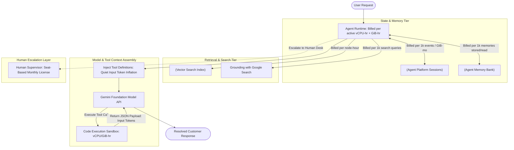

### Concept Graph: GEAP Agentic Components Architecture

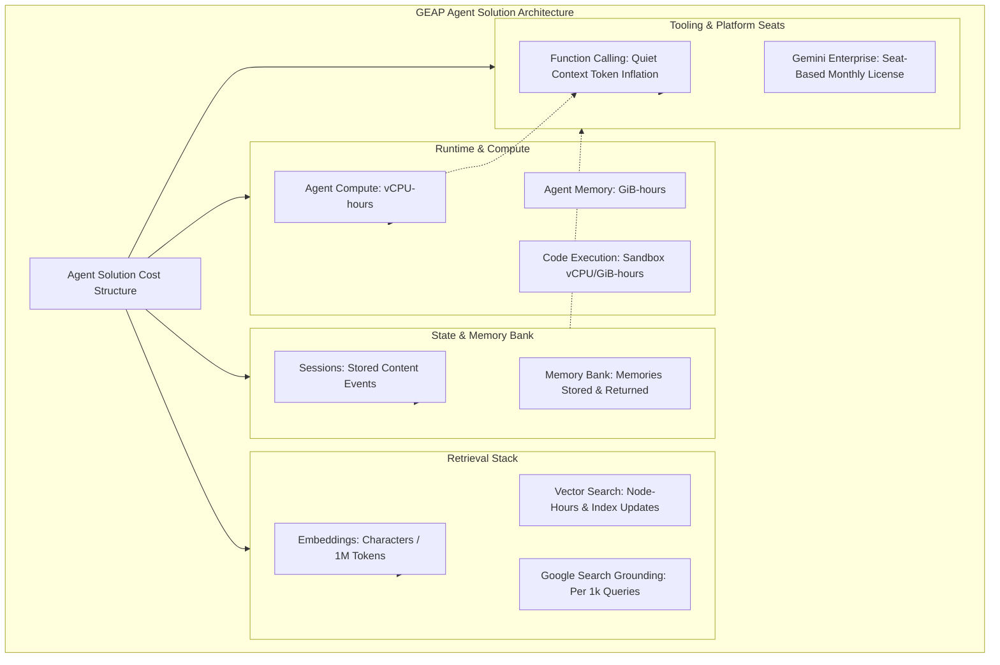

Ready to review the next page in this course?

---

### Key Concepts Breakdown: Estimating Cymbal Support End-to-End

| Concept | Architectural & FinOps Definition | GCP Landing / Well-Architected Metric | Enterprise Real-World Example & Grounding |
| --- | --- | --- | --- |
| Fixed vs. Per-Query Cost Decomposition | Splitting total cost of ownership (TCO) into volume-independent baselines (seats, Vector Search nodes, explicit cache storage) versus usage-coupled variable meters (tokens, retrieval queries, runtime seconds). | Cost per Successful Task ($/Task): Blended cost per conversation ($0.148 all-in vs. $0.087 platform-only). | Cymbal Support paying $6,000/mo flat for 200 Gemini Enterprise seats regardless of whether 1 or 1,000,000 chats occur, while model inference scales strictly with chat volume ($7,388/mo for 100k conversations). |
| The Explicit Caching Leverage ("Quiet Hero") | Caching 30,000 prompt tokens per agent turn across 500,000 calls saves over $20,000/mo in fresh ingestion fees, offset by a nominal $22/mo storage and creation cost. | Cache ROI & Net Savings: Cache Savings Multiple (>900× ROI), Cache Hit Ratio (93.75% of input tokens). | Ingesting 15B cached tokens at $0.15/1M ($2,250) instead of fresh input at $1.50/1M ($22,500) prevents the largest single point of budget failure. |
| Thinking Token Cost Dominance | Autoregressive reasoning/thought tokens (500 per call) combine with response tokens (300 per call) to form 400M total output tokens, becoming the largest variable line item ($3,600/mo). | Thought Token Efficiency: Thinking-to-Response Ratio (1.67:1), Generation Cost Share (48.7% of model spend). | Trimming thinking budgets from 500 to 200 tokens per call cuts the output line from $3,600 to $2,250, saving $1,350/mo with a single hyperparameter adjustment. |
| The Long Tail of Platform Periphery | Non-token components (sessions, memories, grounding, runtime compute, vector search, embeddings, evaluation) aggregate into significant operational overhead (~$1,432/mo). | Periphery Overhead Ratio: Platform Periphery Cost vs. Core Model Spend (~19.4%). | 1.5M session content events ($375) and 25,000 billable Google Search grounding queries ($350) exceed the entire fresh input token bill ($1,500). |
| Commitment Sizing & Payment Tiering | Live chat stays on Standard PayGo due to high tier quota headroom (Tier 3, 10M TPM Flash baseline); Provisioned Throughput (17 GSUs = $34,000/mo) is deferred until steady baseline load warrants reservation. | Breakeven Capacity Utilization: GSU Cost Breakeven Ratio (>2.3× higher than current total bill). | Cymbal starts on PayGo to avoid paying $34,000/mo for idle voice pilot GSUs, routing non-critical evaluation to Batch API for 50% discounts. |

Cymbal Support End-to-End Bill of Materials (BOM) Matrix

| Component / SKU Line Item | Rate Basis & Math | Monthly Cost | Cost Category | % of Total Spend |
| --- | --- | --- | --- | --- |
| Gemini 3.5 Flash Cached Input | 500,000×30,000=15B tokens×$0.15/1M | $2,250 | Variable (Per-Query) | 15.18% |
| Gemini 3.5 Flash Fresh Input | 500,000×2,000=1B tokens×$1.50/1M | $1,500 | Variable (Per-Query) | 10.12% |
| Gemini 3.5 Flash Output + Thinking | 500,000×800=400M tokens×$9.00/1M | $3,600 | Variable (Per-Query) | 24.29% |
| Gemini 3.1 Flash-Lite Triage | 50M in×$0.25/1M+2M out×$1.50/1M | $16 | Variable (Per-Query) | 0.11% |
| Explicit Cache Storage & Rebuilds | 0.03M tokens×$1.00/1M/hr×720 hrs+rebuilds | $22 | Fixed (Baseline) | 0.15% |
| Agent Runtime (vCPU & GiB) | 2,880 vCPU-hrs×$0.0864+5,760 GiB-hrs×$0.009 | $301 | Semi-Fixed (Concurrency) | 2.03% |
| Code Execution Sandboxes | 56 vCPU-hrs+56 GiB-hrs active execution | $5 | Variable (Per-Query) | 0.03% |
| Platform Sessions | 1.5M content events×$0.25/1,000 | $375 | Variable (Per-Query) | 2.53% |
| Memories Stored | 200,000 memories×$0.25/1,000 | $50 | Variable (Per-Query) | 0.34% |
| Memories Retrieved | 400,000 memories×$0.50/1,000 | $200 | Variable (Per-Query) | 1.35% |
| Memory Generation Tokens | 100M in+10M out on Gemini Flash-Lite | $40 | Variable (Per-Query) | 0.27% |
| Google Search Grounding | 30,000 queries−5,000 free=25,000×$14/1,000 | $350 | Variable (Per-Query) | 2.36% |
| Vector Search Nodes | Minimal serving index configuration | $100 | Fixed (Baseline) | 0.67% |
| Catalog Re-embeddings | 20M tokens re-embedded×$0.15/1M | $3 | Variable (Periodic) | 0.02% |
| LLM-as-a-Judge Evaluation | 15M in+1.5M out on Gemini 2.5 Flash (5% sample) | $8 | Variable (Offline) | 0.05% |
| Gemini Enterprise Seats | 200 escalation specialists ×$30/seat | $6,000 | Fixed (Workforce) | 40.49% |
| Total All-In Monthly Cost | 100,000 Completed Customer Conversations | $14,820 | $0.148 / Conversation | 100.00% |

### Magic Quadrant: Spend Impact vs. Optimization Sensitivity

High Monthly Spend ($) / High Impact
             |
             |   [Fixed Floor Dominance]        [Prime Hill-Climbing Lever]
             |   Gemini Enterprise Seats        Flash 3.5 Output & Thinking
             |   ($6,000/mo - 40.5% of bill)    ($3,600/mo - 24.3% of bill)
             |   - Adoption dependent           - Cap thinking tokens (save $1,350)
Low Tuning --+------------------------------------------------------------- High Tuning
Sensitivity  |                                                              Sensitivity
             |   [Long Tail Baseline]           [Critical Architectural Shield]
             |   Vector Search, Embeddings,     Explicit Context Caching
             |   Eval Tokens, Code Sandboxes    ($22/mo protects >$20,000/mo)
             |   - Low tuning yield             - Losing cache breaks viability
             |
Low Monthly Spend ($) / Low Impact
Monthly Spend Distribution Diagram

```mermaid
pie title Cymbal Support Monthly Cost by Layer (USD - Total: $14,820)
    "Model Inference and Caching" : 7388
    "Gemini Enterprise Seats" : 6000
    "Agent State (Sessions + Memories)" : 665
    "Google Search Grounding" : 350
    "Runtime and Code Execution" : 306
    "Retrieval (Vector Nodes + Embeddings)" : 103
    "Evaluation (LLM-as-a-Judge)" : 8
```

Flow Diagram: Cymbal Support Turn Cost Accumulation Trace

```mermaid
flowchart TD
    UserChat([Customer Inbound: 100k Conversations/mo]) --> Triage["Flash-Lite Triage: 1 Call / Conv<br>$16/mo"]

    Triage --> AgentTurnLoop["Gemini 3.5 Flash Agent Loop: 5 Calls / Conv"]

    subgraph TokenDecomposition["Model Turn Execution: 500k Calls"]
        AgentTurnLoop --> CacheRead["Cached Input: 30k tokens @ $0.15/1M<br>$2,250/mo"]
        AgentTurnLoop --> FreshRead["Fresh Input: 2k tokens @ $1.50/1M<br>$1,500/mo"]
        AgentTurnLoop --> GenOutput["Visible 300 + Thinking 500 tokens @ $9.00/1M<br>$3,600/mo"]
    end

    subgraph PlatformStatePeriphery["Periphery Meters"]
        AgentTurnLoop --> SessEvents["15 Session Events @ $0.25/1k<br>$375/mo"]
        AgentTurnLoop --> MemOps["2 Stored + 4 Retrieved Memories<br>$290/mo incl. Flash-Lite"]
        AgentTurnLoop --> Grounding["15% Conversations Grounded @ $14/1k<br>$350/mo"]
        AgentTurnLoop --> Sandbox["20k Code Executions @ 10s<br>$5/mo"]
    end

    subgraph ContinuousFixedFloor["Fixed Baseline & Workforce Overhead"]
        RuntimeInstances["Agent Runtime: 2 Instances 24/7<br>$301/mo"]
        CacheMaintain["Cache Storage: 30k tokens x 720 hrs<br>$22/mo"]
        VectorNodes["Vector Search Serving Endpoint<br>$100/mo"]
        Seats["200 Gemini Enterprise Seats<br>$6,000/mo"]
    end

    TokenDecomposition --> TotalConsolidation
    PlatformStatePeriphery --> TotalConsolidation
    ContinuousFixedFloor --> TotalConsolidation

    TotalConsolidation([Total Monthly Spend: $14,820<br>Unit Cost: $0.148 / Conversation])
```

### Concept Graph: Cymbal Support Cost Estimation Taxonomy

```mermaid
graph TD
    subgraph EstimationArchitecture["Cymbal Support Cost Architecture"]
        Root["Total Cost: $14,820/mo"] --> Fixed["Fixed Baseline Costs: $6,122"]
        Root --> Variable["Variable Per-Query Costs: $8,397"]
        Root --> Concurrency["Concurrency / Runtime: $301"]
    end

    subgraph Fixed["Fixed / Allocation Bucket"]
        Fixed --> F1["200 Enterprise Seats: $6,000"]
        Fixed --> F2["Vector Search Serving Node: $100"]
        Fixed --> F3["Explicit Cache Storage: $22"]
    end

    subgraph Variable["Per-Query Variable Bucket"]
        Variable --> V1["Output & Thinking Tokens: $3,600"]
        Variable --> V2["Cached Input Tokens: $2,250"]
        Variable --> V3["Fresh Input Tokens: $1,500"]
        Variable --> V4["State & Memories: $665"]
        Variable --> V5["Search Grounding: $350"]
        Variable --> V6["Triage + Eval + Embeddings: $27"]
    end

    subgraph Concurrency["Runtime Compute Bucket"]
        Concurrency --> C1["24/7 Agent Runtime: $301"]
        Concurrency --> C2["Code Sandbox Execution: $5"]
    end

    subgraph FinOpsRules["Stress-Test & Decision Rules"]
        V1 -.->|Hill Climbing| R1["Drop thinking 500 to 200 tokens saves $1,350/mo"]
        V2 -.->|Shield| R2["Removing cache increases bill by >$20,000/mo"]
        Fixed -.->|Serving Decision| R3["Defer 17 GSUs PT: $34,000/mo exceeds entire bill"]
    end
```

Ready to explore the next page in this course?

---

Review your Chrome auto browse plan
Here's the plan based on your prompt & context
Click the 'Next' button at the bottom right to navigate to the next page of the course.
Gemini chooses which sites to use to complete the task, and may share your personal info. You are responsible for Gemini's actions during tasks.

Start task
Clicking the 'Next' button to navigate to the next page

### Key Concepts Breakdown: Module Overview — Cost Optimization Strategies

| Concept | Architectural & FinOps Definition | GCP Landing / Well-Architected Metric | Enterprise Real-World Example & Grounding |
| --- | --- | --- | --- |
| Hill Climbing Optimization Framing | Iterative, empirical optimization of agent systems where cost reduction levers are systematically applied and tested against quality baselines without regressing task resolution. | Optimization Velocity & Quality Floor: Unit Cost Reduction Rate (% Δ/iteration), Task Completion Quality SLA (Q |  |

floor

| ). | In Cymbal Support, testing successive iterations of prompt pruning and thinking-token caps against an automated LLM-as-a-judge evaluation suite to ensure customer satisfaction scores remain >95%. Grounded via Vertex AI Model Evaluation. |  |  |
| --- | --- | --- | --- |
| System-Level vs. Model-Level Levers | Stratifying cost reduction into model-level levers (temperature, token ceilings, thinking budgets, system prompt schemas) and system-level levers (semantic caching, model cascades, RAG chunk filtering, conditional tool gates). | TCO Attribution Ratio: Architectural vs. Parametric Cost Variance, Infrastructure Decoupling Index. | Cutting thinking tokens from 500 to 200 per call is a model-level lever; routing non-dispute intents to Flash-Lite before touching Gemini Flash is an architectural system-level lever. |
| Semantic & Context Caching Hierarchy | Multi-tiered caching architecture combining exact prefix context caching at the model layer with vector similarity / semantic response caching at the gateway layer. | Composite Cache Hit Ratio: Semantic Cache Hit Rate (%), Model Ingestion Bypass Rate (%), Cache Invalidation Turnover. | Bypassing foundation model calls entirely when an incoming user query matches a recent high-confidence response in Redis/Memorystore semantic cache at >0.92 cosine similarity. |
| Adaptive Model Cascading & Routing | Directing requests across tiered model topologies (Flash-Lite → Flash → Pro) conditioned on real-time task complexity scores and dynamic confidence evaluation. | Routing Efficiency & Cascade Fallback Rate: Tier 1 Resolution Percentage (>70%), Escalation Surcharge Rate, Blended Cost per Turn ($/Turn). | Deploying a lightweight classifier to handle 80% of standard order lookups on Flash-Lite, escalating only policy ambiguity to Gemini Pro. |
| Quiet Tax Pruning (Schemas & Tools) | Systematically pruning OpenAPI schemas, verbose parameter docstrings, and redundant tool descriptions from agent context windows to stop compounding input token inflation. | Tool Schema Inflation Factor: Context Inflation Multiplier ( |  |

Raw Prompt Tokens
Tokens with Tools

| ), Function Selection Accuracy (%). | Converting verbose nested JSON tool definitions into compact, flat schemas, saving 1,800 prompt tokens on every agent reasoning loop. |
| --- | --- |

Cost Optimization Strategy Classification Matrix

| Optimization Level | Architectural Strategy | Primary SKUs / Dimensions Impacted | Expected Cost Impact | Implementation Risk |
| --- | --- | --- | --- | --- |
| Model-Level | Thinking Token Budget Capping | Gemini Output / Thought Tokens | 30%–60% reduction in generation cost | Potential regression on multi-constraint logic |
| Model-Level | Output Schema & Length Restraints | Gemini Response Output Tokens | 20%–40% reduction in response spend | Truncation of edge-case explanatory details |
| Architectural | Adaptive Model Cascades | Foundation Model Ingest & Output SKUs | 40%–70% reduction in blended model spend | Routing misclassification / latency overhead |
| Architectural | Multi-Tier Semantic & Context Caching | Cached Input Tokens & Model Inferences | 60%–90% reduction on repeat traffic | Stale response risk / cache invalidation complexity |
| System / Platform | Tool Schema & Context Trimming | Gemini Input Tokens (Quiet Tool Tax) | 15%–35% reduction in input token spend | Lower tool-calling argument extraction accuracy |
| Commercial / FinOps | Service Tier & Commitment Alignment | PayGo vs. Flex/Batch vs. GSUs | 50% discount on Batch; fixed pricing on PT | Idle reservation waste under volatile traffic |

### Magic Quadrant: Optimization Lever Impact vs. Implementation Complexity

High Monthly Cost Savings Impact
             |
             |   [High-Leverage Architectural]  [Systemic Transformation]
             |   Explicit Context Caching       Adaptive Model Cascading
             |   Thinking Token Budget Capping  (Flash-Lite -> Flash -> Pro)
             |   - Massive input/output cuts    - Maximum blended unit savings
Low --------+------------------------------------------------------------- High
Complexity   |
             |   [Quick Wins / Hygiene]         [Operational Governance]
             |   Tool Schema & Context Trimming Batch Tier Routing for Eval
             |   Strict Max Output Token Limits GSU Term Commitment Sizing
             |   - Immediate low-risk savings   - Sunk cost risk if traffic drops
             |
Low Monthly Cost Savings Impact

### Architectural Flow: Layered Optimization Pipeline

```mermaid
flowchart TD
    UserQuery([Incoming Customer Request]) --> Gate1["Layer 1: Gateway Semantic Cache"]

    Gate1 -->|Hit: Cosine Sim > 0.92| DirectReturn([Return Cached Response: $0 Model Cost])
    Gate1 -->|Miss| Gate2["Layer 2: Complexity Router & Triage"]

    subgraph TieredRouting["Adaptive Model Cascading"]
        Gate2 -->|Low Complexity: FAQ / Status| FlashLite[Gemini Flash-Lite Execution]
        Gate2 -->|Standard Agent Turn| FlashEngine[Gemini Flash Orchestration]
        Gate2 -->|High Ambiguity / Dispute| ProEngine[Gemini Pro Deep Reasoning]
    end

    subgraph ContextOptimization["Context & Tool Schema Hygiene"]
        FlashEngine --> PrunedTools["Pruned OpenAPI Schemas: Minimal Tool Tax"]
        PrunedTools --> ContextCache["(Explicit Context Cache: ~90% Ingest Discount)"]
    end

    subgraph GenerationControls["Inference Constraints"]
        ContextCache --> TokenLimits["Enforce Capped Thinking Budget & Output Schema"]
        ProEngine --> TokenLimits
    end

    FlashLite --> Delivery([Final Resolved Output])
    TokenLimits --> Delivery
```

### Concept Graph: Cost Optimization Strategies Architecture

```mermaid
graph TD
    subgraph OptimizationTaxonomy["Agent Cost Optimization Taxonomy"]
        Root[Hill Climbing Cost Optimization] --> ModelLevers[1. Model-Level Optimization]
        Root --> ArchLevers[2. Architectural System Levers]
        Root --> PlatformLevers["3. Platform & Context Hygiene"]
        Root --> CommercialLevers["4. Commercial & FinOps Sizing"]
    end

    subgraph ModelLevers["Model Parameters & Decoding"]
        ModelLevers --> M1["Thinking Budget Caps: Reduce Scratchpad Cost"]
        ModelLevers --> M2[Max Output Token Ceilings]
        ModelLevers --> M3["Stop Sequences & Structured Schema Enforcement"]
    end

    subgraph ArchLevers["Architectural Cascades"]
        ArchLevers --> A1[Semantic Caching at Edge / Gateway]
        ArchLevers --> A2["Model Cascades: Flash-Lite -> Flash -> Pro"]
        ArchLevers --> A3["Dynamic Fallback & Confidence Scoring"]
    end

    subgraph PlatformLevers["Platform & Context Hygiene"]
        PlatformLevers --> P1["Explicit Context Caching: 90% Ingest Discount"]
        PlatformLevers --> P2["Tool Schema Compression: Cut Quiet Token Tax"]
        PlatformLevers --> P3["Vector Search Chunk Filtering & Top-K Sizing"]
    end

    subgraph CommercialLevers["Commercial & FinOps"]
        CommercialLevers --> C1["Batch Inference Tier: 50% Off for Eval/Memory"]
        CommercialLevers --> C2["Provisioned Throughput Sizing: GSUs vs PayGo"]
    end
```

Ready to review the next page in this course?

---

### Key Concepts Breakdown: The Cost-Quality-Latency Trade-Off

| Concept | Architectural & FinOps Definition | GCP Landing / Well-Architected Metric | Enterprise Real-World Example & Grounding |
| --- | --- | --- | --- |
| The Trade-Off Triangle | System design paradigm where Cost, Quality, and Latency pull against each other; reducing cost inevitably exerts pressure on either model accuracy/depth or turnaround speed. | FinOps Efficiency vs. SLA Conformance: Unit Cost per Successful Turn ($/Turn), P95 Latency SLA, Task Resolution Rate (%). | Trimming output tokens to cut generation costs on customer billing disputes yields unhelpful responses, causing escalations to human agents that cost significantly more than the tokens saved. Grounded via The Cost-Quality-Latency Trade-off. |
| The Three Workload Placement Questions | Diagnostic framework: (1) Is a human blocked waiting on the result? (2) Does lower output quality cost more than the tokens saved? (3) Is the output disposable internal or binding external? | Workload Alignment & Governance: Interactive vs. Background Workload Classification Ratio, Failure Blast Radius Score. | Cymbal Support live chat blocks an active user (high quality, low latency required), whereas nightly knowledge-base re-indexing blocks no human and can tolerate 12-hour turnaround. |
| Measure Before You Cut (Evaluation Harness) | Establishing a curated, representative ground-truth benchmark dataset and automated evaluation pipeline before tuning hyperparameters or swapping model tiers. | Operational Excellence & Hill Climbing: Baseline Benchmark Score (Q |  |

baseline

| ), Regression Delta (ΔQ), LLM-as-a-Judge Accuracy. | Running 500 representative customer dispute scenarios through Vertex AI Evaluation before cutting Gemini Pro thinking token budgets to Flash. |  |
| --- | --- | --- |
| Batch Processing for Latency-Tolerant Jobs | Exploiting the ~50% discount on Vertex AI Batch Inference / Flex tiers for asynchronous, non-blocking workloads without compromising model quality. | Consumption Tier Arbitrage: Batch Adoption Ratio ( |

Total Tokens
Batch Tokens

| ), Off-Peak Cost Savings ($). | Running offline evaluation runs, bulk ticket summarization, and embeddings updates overnight via Batch Inference, saving 50% on token SKUs at zero quality penalty. |
| --- | --- |

Workload Classification & Placement Matrix

| Workload Dimension | Question 1: Human Blocked? | Question 2: Quality Drop Risk? | Question 3: Output Binding? | Selected Serving Tier & Model Profile |
| --- | --- | --- | --- | --- |
| Cymbal Customer Live Chat | Yes (Human waiting in real time) | High (Triggers expensive human escalation) | External & Binding (Customer agreement) |  |

Standard PayGo / Priority

Gemini Flash / Pro with low TTFT

| Nightly Ticket Summarization | No (Batch executed off-peak) | Low-to-Medium (Internal recap only) | Internal & Disposable |  |
| --- | --- | --- | --- | --- |

Batch Inference (~50% discount)

Gemini Flash-Lite / Flash

| Quality Evaluation Harness | No (Automated background test) | High (Requires accurate grading) | Internal Analytical |  |
| --- | --- | --- | --- | --- |

Batch Inference (~50% discount)

Gemini Pro as Judge

| Knowledge Base Re-embedding | No (Scheduled asynchronous job) | Medium (Index recall must stay high) | Persistent Architectural |  |
| --- | --- | --- | --- | --- |

Batch / Standard PayGo

Vertex Embeddings API

### Magic Quadrant: Cost-Quality-Latency Workload Optimization

High Quality Demand / High Cost Sensitivity
             |
             |   [Batch Analytical Core]        [Mission-Critical Interactive]
             |   Batch Tier (50% Off)           Standard / Priority PayGo
             |   Gemini Pro / Flash Eval        Gemini Flash / Pro (Live Chat)
             |   - High quality, high latency   - High quality, low latency
Latency -----+--------------------------------------------------------------
Tolerance    |
             |   [Low-Cost Utility]             [Edge Triage / Classification]
             |   Flex / Batch Tier              Standard PayGo (Ultra-Fast)
             |   Flash-Lite Summarization       Flash-Lite Triage
             |   - Low cost, high latency       - Low cost, low latency
             |
Low Quality Demand / High Latency Sensitivity
Flow Diagram: Optimization Decision & Measurement Pipeline

```mermaid
flowchart TD
    Task[Incoming Agent Workload] --> Q1{Is a human waiting on the result?}

    Q1 -->|No: Asynchronous / Background| BatchPath["Route to Batch / Flex Tier: ~50% Discount"]
    Q1 -->|Yes: Real-Time / Interactive| Q2{Does quality drop cost more than tokens saved?}

    subgraph EvaluationGate["Measure Before You Cut"]
        Q2 -->|Yes: High Blast Radius| BaselineCheck[Run Benchmark against Ground-Truth Dataset]
        BaselineCheck --> QualityPass{Meets Quality Bar?}
        QualityPass -->|No: Regression Detected| Abort[Maintain High-Capability Model / Standard PayGo]
        QualityPass -->|Yes: Validated| LowCostInteractive["Apply Optimization: Flash / Pruned Context"]
    end

    Q2 -->|No: Low Risk / Internal| LowCostInteractive

    BatchPath --> BatchOutput([Completed Asynchronously: Zero Quality Loss])
    Abort --> ProductionServe([Production Live Serving])
    LowCostInteractive --> ProductionServe
```

### Concept Graph: The Trade-Off Triangle Architecture

```mermaid
graph TD
    subgraph Triangle["The Cost-Quality-Latency Triangle"]
        Core[Trade-Off Engine] --> Cost[Cost Dimension]
        Core --> Quality[Quality Dimension]
        Core --> Latency[Latency Dimension]
    end

    subgraph CostLevers["Cost Optimization Levers"]
        Cost --> L1["Cheaper Model Tiers: Pro to Flash"]
        Cost --> L2["Batch / Flex Inference: 50% Off"]
        Cost --> L3[Shrink Context / Output Caps]
    end

    subgraph ImpactPulls["Counter-Pressures"]
        L1 -.->|Degrades| Quality
        L2 -.->|Increases| Latency
        L3 -.->|Risk: Information Loss| Quality
    end

    subgraph Governance["Operational Guardrails"]
        Quality --> EvalDataset[Curated Ground-Truth Benchmark]
        EvalDataset --> EvalHarness[Automated Evaluation Harness]
        EvalHarness --> BatchEval[Run Eval on Batch Tier]
    end
```

Ready to review the next page in this course?

---

Review your Chrome auto browse plan
Here's the plan based on your prompt & context
Click the 'Next' button at the bottom right to navigate to the next page of the course.
Gemini chooses which sites to use to complete the task, and may share your personal info. You are responsible for Gemini's actions during tasks.

Start task
Navigating to the next page of the course

### Key Concepts Breakdown: Optimizing Cost of Model Usage

| Concept | Architectural & FinOps Definition | GCP Well-Architected & Landing Metrics | Grounding & Enterprise Real-World Example |
| --- | --- | --- | --- |
| Model Downgrading with Evals | Strategically downgrading sub-tasks to smaller models (e.g., Gemini Pro → Flash → Flash-Lite) validated by empirical regression thresholds. | Model Arbitrage Efficiency: Unit Cost Savings (% Δ), Quality Floor SLA Conformance (Q |  |

baseline

| ). | Cymbal routing tier-1 triage to Gemini Flash-Lite at $0.25/1M input vs. $1.50/1M on Flash, validating intent classification accuracy >98% via automated test suites. |  |
| --- | --- | --- |
| Output Token Restraint & Strict Schemas | Constraining autoregressive generation using strict response schemas, low max_output_tokens, and system prompt conciseness rules to curb the 3×–6× output price penalty. | Output Efficiency Ratio: Output Token Inflation Factor ( |

T 
target

T 
out

| ), Generation Spend Share (%). | Injecting JSON schema constraints and negative constraints ("Do not summarize customer input") to reduce average response tokens from 350 to 120 per call. |  |
| --- | --- | --- |
| Thinking Budget Calibration | Setting bounded thinking token budgets (thinking_config.thinking_budget) for reasoning models rather than allowing open-ended chain-of-thought exploration. | Reasoning Cost Overhead: Thought-to-Response Ratio (T |

thought

 :T 
response

| ), Marginal Quality Gain per Thought Token. | Bounding Gemini thinking mode to 200 tokens for routine policy checks instead of default unconstrained thinking (500–1,000 tokens), preventing output token cost bloat. |  |  |
| --- | --- | --- | --- |
| Tool Definition & Schema Pruning | Stripping verbose descriptions, deep nested objects, and optional fields from OpenAPI/Function calling specifications to eliminate the "quiet token tax". | Context Inflation Factor: Tool Schema Payload Size (tokens), Tool Selection Precision (%). | Compressing 5 tool schemas from 2,800 tokens down to 750 tokens by removing redundant parameter docstrings, saving input tokens across every conversation loop. |
| Prompt Engineering for Token Economy | Eliminating repetitive system prompt directives, replacing verbose few-shot text demonstrations with compact structured exemplars, and applying dynamic context window trimming. | Prompt Economy Index: Prompt Token Density (tokens/instruction), Context Drift Rate. | Removing conversational fluff from system instructions to shave 400 prompt tokens per turn across 500,000 monthly calls. |

Model Usage Optimization Matrix

| Optimization Lever | Target SKUs / Parameters | Direct Cost Reduction Impact | Quality & Operational Guardrails |
| --- | --- | --- | --- |
| Model Tier Downgrade | Vertex AI Gemini Pro → Flash → Flash-Lite | 50% to 85% per-turn model spend | Automated golden dataset evaluation; route back if confidence score <0.85. |
| Thinking Budget Cap | Gemini Thinking Tokens (thinking_budget) | 30% to 60% output generation spend | Set minimum thinking budgets on complex multi-clause arbitration tasks. |
| Output Schema Enforcement | max_output_tokens & JSON Schema Mode | 25% to 50% response token spend | Schema validation test runs; ensure answers are not abruptly truncated mid-JSON. |
| Tool Schema Pruning | Gemini Input Tokens (Quiet Tool Tax) | 15% to 35% cumulative prompt spend | Validate that tool argument extraction and function call accuracy do not regress. |
| Prompt Compression | Gemini Input Tokens (System Instructions) | 10% to 20% input token spend | Test adherence to core agent behavioral instructions and safety guidelines. |

### Magic Quadrant: Model Usage Optimization Levers

High Unit Cost Savings
             |
             |   [Highest Financial Leverage]   [Highest Engineering Leverage]
             |   Model Tier Downgrade           Thinking Token Calibration
             |   (Pro -> Flash -> Flash-Lite)   (Bound thinking budgets)
Low --------+------------------------------------------------------------- High
Tuning Risk  |
             |   [Immediate FinOps Hygiene]     [Structural Hygiene]
             |   Output Schema Restraints       Tool Definition Pruning
             |   (max_output_tokens limits)     (Compress OpenAPI docstrings)
             |
Low Unit Cost Savings
Flow Diagram: Model-Level Cost Optimization Flow

```mermaid
flowchart TD
    RawTurn[Incoming Agent Turn Assembly] --> TriageCheck{Can Task Run on Cheaper Tier?}

    subgraph TierSelection["Model Selection"]
        TriageCheck -->|Yes: Validated on Eval Suite| RouteFlashLite[Route to Gemini Flash-Lite / Flash]
        TriageCheck -->|No: Complex Policy Dispute| RoutePro[Route to Gemini Pro]
    end

    subgraph ContextHygiene["Prompt & Tool Pruning"]
        RouteFlashLite --> CompressPrompt[Compressed Prompt + Pruned Tool Schemas]
        RoutePro --> CompressPrompt
    end

    subgraph GenerationBounds["Inference Hyperparameters"]
        CompressPrompt --> BoundThinking[Set Explicit Thinking Token Budget]
        BoundThinking --> SetOutputCap[Set max_output_tokens + Strict JSON Schema]
    end

    SetOutputCap --> ModelExecution[Gemini Foundation Model Inference]
    ModelExecution --> ValidatedOutput([Optimized Resolution: Minimized Token Tax])
```

### Concept Graph: Model Usage Optimization Architecture

```mermaid
graph TD
    subgraph ModelOptimization["Model Usage Optimization"]
        Root[Model Cost Minimization] --> Levers[Optimization Levers]
        Root --> Guardrails[Evaluation Guardrails]
    end

    subgraph Levers["Key Optimization Levers"]
        Levers --> L1["Tier Downgrading: Pro to Flash to Flash-Lite"]
        Levers --> L2[Thinking Token Budget Calibration]
        Levers --> L3["Output Token Restraints & JSON Schemas"]
        Levers --> L4["Tool Schema & Docstring Pruning"]
        Levers --> L5["Prompt Economy & Context Window Sliding"]
    end

    subgraph Guardrails["Quality Safeguards"]
        Guardrails --> G1[Golden Evaluation Dataset Benchmark]
        Guardrails --> G2[Automated LLM-as-a-Judge Regression Suite]
        Guardrails --> G3[Confidence-Based Fallback Routing]
    end

    L1 -.-> G1
    L2 -.-> G2
    L3 -.-> G3
```

Ready to navigate to the next page in this course?

---

### Key Concepts Breakdown: Optimizing Cost of Agentic Solutions

| Concept | Architectural & FinOps Definition | GCP Well-Architected & Landing Metrics | Grounding & Enterprise Real-World Example |
| --- | --- | --- | --- |
| Semantic Caching for Agent Responses | Intercepting redundant user inquiries by matching semantic embedding similarity against historical answers, bypassing model inference completely ($0 model token cost). | Cache Hit Cost Avoidance: Model Bypass Ratio (%), Embedding Query Overhead, Semantic Cosine Threshold. | Cymbal Support checking incoming questions against Vertex AI Vector Search. High-frequency FAQ matches return cached answers, paying only for the embedding generation and vector lookup while saving 100% of LLM inference fees. |
| RAG Pipeline Context Pruning | Minimizing prompt context size by tuning chunk size, reducing Top-K document retrieval, applying metadata pre-filtering, and using the Ranking API. | Context Efficiency Index: Retrieved-to-Injected Token Ratio, Context Compression Delta (ΔT<br>in ), Reranker ROI. | Instead of injecting 20 raw policy chunks into Gemini, Cymbal retrieves 5 candidate chunks, filters by metadata, and reranks down to the top 3 with the Ranking API (under 100 documents per query to avoid step-up fees). |
| Always-On Index Lifecycle & Autoscaling | Managing the baseline "standing cost" of continuous serving compute nodes in Vector Search through autoscaling replicas between minimum and maximum thresholds. | Resource Utilization & Baseline Standing Cost: Node Saturation Rate, Minimum Replica SLA Floor, Standing Cost ($/Month). | Sizing Cymbal's Vector Search index to autoscale across traffic peaks, while keeping a minimum of 2 replicas per shard to satisfy production enterprise availability and SLA requirements. |
| Agent Fan-Out Mitigation | Preventing runaway execution loops where an unresolved turn triggers an unbounded cascade of sub-agent calls, tool invocations, and vector searches. | Loop Termination & Blast Radius: Max Iteration Cap Adherence, Fan-Out Ratio ( |  |

User Turns
Tool Spans

| ), Turn Execution Ceiling. | Adding a strict hard limit of 3 troubleshooting loops per interaction, routing internal tool selection to Gemini Flash-Lite, and caching deterministic tool outputs (such as shipping policy tables). |
| --- | --- |

Non-Model Agentic Levers Optimization Matrix

| Optimization Lever | Target Infrastructure Component | Billable SKU / Cost Dynamics | Trade-off & Guardrail |
| --- | --- | --- | --- |
| Semantic Response Caching | Gateway / Vertex AI Vector Search | Embedding generation per 1k chars + vector query lookup | Effective only for static FAQs; avoid for account-specific, dynamic customer data. |
| Chunk Size & Top-K Sizing | Retrieval Engine / Vector Store | Direct reduction of model input tokens (T<br>in ) | Aggressive Top-K reduction risks recall degradation; calibrate against eval ground truth. |
| Ranking API Reranking | Vertex AI Ranking API | Billed per query in blocks of up to 100 documents | Cost & latency of reranker must be lower than the model input tokens saved. |
| Index Replica Autoscaling | Vector Search Index Endpoints | Continuous node-hours (vCPU/RAM) | Min replicas bound by SLA requirements (minimum 2 replicas per shard). |
| Loop Step & Iteration Caps | Agent Runtime Execution Core | Active runtime compute seconds + model turn iterations | Capping loops prevents runaway spend; unresolved sessions escalate gracefully to human desk. |
| Deterministic Tool Caching | Orchestrator In-Memory / Redis Cache | Backend API calls + tool execution runtime | Cache responses for immutable/read-only endpoints (e.g., zip code delivery zones). |

### Magic Quadrant: Agentic System Optimization Levers

High Cost Reduction Impact / Blast Radius Control
             |
             |   [Loop Blast Radius Protection] [Zero-Inference High Velocity]
             |   Agent Fan-Out Iteration Caps   Semantic Caching (Vector Search)
             |   (Hard step limits on loops)    (Bypasses model inference 100%)
High -------+------------------------------------------------------------- Low
Engineering  |
Effort       |   [Standing Infrastructure]      [Context Input Pruning]
             |   Vector Index Autoscaling       RAG Top-K Tuning & Reranking
             |   (Min/Max replica bounds)       (Pre-filtering + Ranking API)
             |
Low Cost Reduction Impact / Narrow Scope
Flow Diagram: RAG Optimization & Fan-Out Guardrail Flow

```mermaid
flowchart TD
    UserQuery([Customer Query]) --> SemanticCheck{Semantic Match in Vector Store?}

    subgraph SemanticCaching["Semantic Cache Gate"]
        SemanticCheck -->|Match Found: Sim >= 0.92| ReturnCache([Return Cached Answer: $0 Model Call])
        SemanticCheck -->|No Match / Unique| RAGPipeline[Start RAG Pipeline]
    end

    subgraph RAGOptimization["Optimized Retrieval Pipeline"]
        RAGPipeline --> MetaFilter["Metadata Pre-Filtering: Filter by Region/Category"]
        MetaFilter --> VectorRetrieval["Vector Lookup: Over-Retrieve Top-10 Chunks"]
        VectorRetrieval --> Reranker["Vertex AI Ranking API: Rerank to Top-3 Chunks"]
    end

    subgraph AgentLoopGuardrails["Agent Execution & Fan-Out Controls"]
        Reranker --> TurnCounter{Loop Counter <= 3?}
        TurnCounter -->|Exceeded Cap| HumanHandoff([Escalate to Human Desk: Prevent Runaway Spend])
        TurnCounter -->|Within Cap| ToolSelectRouter[Route Tool Selection to Flash-Lite]
        ToolSelectRouter --> ExecTool{Deterministic Tool Call?}
        ExecTool -->|Yes: Cached Result| IngestCachedTool[Load Cached Tool Payload]
        ExecTool -->|No: Fresh API Call| IngestFreshTool[Execute API Call with Concise Payload]
        IngestCachedTool --> LLMCall[Gemini Flash Turn Synthesis]
        IngestFreshTool --> LLMCall
    end

    LLMCall --> FinalResponse([Deliver Customer Response])
```

### Concept Graph: Non-Model Agentic Cost Architecture

```mermaid
graph TD
    subgraph AgenticCostLevers["Agent Solution Cost Optimization"]
        Root[Beyond-the-Model Optimization] --> Caching[1. Semantic Caching]
        Root --> RAG[2. RAG Pipeline Tuning]
        Root --> Infrastructure[3. Vector Index Lifecycle]
        Root --> FanOut[4. Agent Fan-Out Controls]
    end

    subgraph Caching["Semantic Cache Architecture"]
        Caching --> EmbedFee[Embedding Cost per Query]
        Caching --> VectorLook[Vector Search Similarity Lookup]
        Caching --> Bypass[Bypasses Model Call Entirely]
    end

    subgraph RAG["RAG Context Reduction"]
        RAG --> TopK["Tune Chunk Size & Lower Top-K"]
        RAG --> PreFilter[Metadata Pre-Filtering]
        RAG --> Rerank["Ranking API: Stay Under 100 Doc Tier"]
    end

    subgraph Infrastructure["Index Standing Cost"]
        Infrastructure --> NodeHours[Always-On Node-Hours Meter]
        Infrastructure --> Autoscale["Autoscaling: Min/Max Replicas"]
        Infrastructure --> SLABound["Reliability Floor: Min 2 Replicas/Shard"]
    end

    subgraph FanOut["Fan-Out Mitigation Levers"]
        FanOut --> StepCap["Iteration & Turn Caps: Hard Max Loops"]
        FanOut --> ToolRoute["Task-Based Routing: Tool Select on Flash-Lite"]
        FanOut --> ToolCache[Cache Deterministic Tool Outputs]
    end

    Bypass -.-> StepCap
    TopK -.-> Rerank
```

Ready to analyze the next page in this course?

---

### Key Concepts Breakdown: Module Overview — Governance, Tracking, and Control

| Concept | Architectural & FinOps Definition | GCP Landing / Well-Architected Metric | Enterprise Real-World Example & Grounding |
| --- | --- | --- | --- |
| Runaway Spend Prevention Guardrails | Multi-tier cost enforcement mechanisms combining proactive limits (Quotas, Rate Limits) with reactive tripwires (Cloud Billing Budgets, Automated Spend Caps, Pub/Sub programmatic billing kill switches). | Budget Threshold Variance (%): Quota Throttle Rate (HTTP 429), Unplanned Spend Variance ($), Alert-to-Mitigation Mean Time to Respond (MTTR). | Enforcing Requests-Per-Minute (RPM) and Tokens-Per-Minute (TPM) quota limits on the Cymbal Support agent project to prevent an unhandled recursive tool loop from draining budget. Grounded via Vertex AI Quotas and Cloud Billing Budgets. |
| Spend Tracking & Granular Attribution | Decomposing raw aggregated cloud bills into tenant-, feature-, and sub-agent-level line items using resource labels, tags, and detailed BigQuery billing exports. | Attribution Coverage Ratio: Tagging / Labeling Compliance Rate (>95%), Cost per Sub-Agent Intent ($/Intent). | Tagging Cymbal agent calls with labels (environment: prod, agent_role: return_arbitrator, team: support_ops) exported to BigQuery for SQL-driven unit-cost reporting. Grounded via BigQuery Cloud Billing Export. |
| Unit-Economic KPIs for GenAI | Measuring system efficiency through business-value metrics rather than pure aggregate infrastructure cost (e.g., Cost per Successful Resolution, Cost per Averted Ticket). | Landing Metrics / FinOps KPIs: Cost per Resolved Interaction (/Resolution),HumanEscalationDeflectionValue( ROI). | Cymbal Support tracking that an automated chat costs $0.148 compared to a human tier-1 support cost of $6.50, demonstrating a 43× unit-economic return. |
| Capacity Lifecycle & Provisioned Throughput (PT) Management | Ongoing governance of reserved accelerator capacity (Generative Service Units / GSUs) over 1-week, 1-month, or 1-year terms to maintain high utilization while shedding idle cost. | Capacity Efficiency: GSU Reservation Saturation Rate (%), Breakeven Utilization Horizon, Spillover PayGo Surcharge ($). | Cymbal reviewing rolling 30-day baseline traffic curves to determine whether to renew 20 GSUs on an annual term or downsize to 15 GSUs with PayGo overflow handling during seasonal lulls. Grounded via Vertex AI Provisioned Throughput. |
| Continuous FinOps Operating Loop | Sustained cross-functional cadence (Engineering, Finance, Support Ops) cycling through Inform (visibility), Optimize (tuning), and Operate (governance) stages for generative workloads. | FinOps Maturity Index: Monthly Forecast Accuracy Error (<10%), Waste Reduction Velocity ($/Quarter). | Conducting weekly FinOps reviews to audit vector search replica sizes, verify cache hit ratios, and evaluate prompt token creep across model revisions. Grounded via the FinOps Foundation Framework. |

Governance & Control Mechanism Matrix

| Control Layer | Primary GCP Mechanism | Enforcement Type | Latency & Execution Behavior | FinOps Objective |
| --- | --- | --- | --- | --- |
| Per-Minute Request Throttling | Cloud Quotas (RPM / TPM ceilings) | Deterministic / In-Line | Instant HTTP 429 rejection at API gateway | Protect upstream foundation models and prevent sudden multi-tenant spikes. |
| Financial Threshold Alerts | Cloud Billing Budgets & Alerts | Asynchronous / Alerting | Emits Pub/Sub notifications at 50%, 90%, 100% | Warn financial and engineering owners before overruns escalate. |
| Automated Budget Kill Switches | Cloud Functions / Cloud Run on Pub/Sub | Programmatic / Intercept | Revokes API keys, drops quotas to zero, or disables billing | Prevent catastrophic runaway loops from bankrupting project budgets. |
| Multi-Dimensional Attribution | Resource Labels + BigQuery Export | Post-Hoc / Analytical | Near real-time streaming into BigQuery dataset | Isolate cost per tenant, sub-agent capability, and customer tier. |
| Capacity Utilization Tuning | Cloud Monitoring Metrics on GSUs | Continuous / Governance | Dashboards tracking GSU reservation saturation | Rightsizing commitment terms (1-month vs. 1-year) vs. PayGo spillover. |

### Magic Quadrant: Governance Controls vs. Operational Friction

High Enforcement Rigidity / Hard Cut-Off
             |
             |   [Emergency Safeguard]          [Strict Boundary Control]
             |   Automated Spend Caps           API Quotas & Rate Limits
             |   (Pub/Sub billing kill switch)  (Hard TPM / RPM ceilings)
             |   - Zero overspend risk          - Prevents runaway loop blast radius
High --------+------------------------------------------------------------- Low
Business     |
Impact Risk  |   [Continuous Governance]        [Observability Baseline]
             |   GSU Capacity Review Cadence    BigQuery Export & Cost Labels
             |   (FinOps weekly commitment cycle) (Per-turn unit economic metrics)
             |   - Avoids long-term waste       - Zero downtime impact
             |
Low Enforcement Rigidity / Pure Visibility
Flow Diagram: Module 3 End-to-End Governance Architecture

```mermaid
flowchart TD
    InboundTraffic([Production Agent Inbound Traffic]) --> QuotaGate{Vertex AI Quota Gate: RPM / TPM}

    subgraph ProtectiveLimits["1. Prevent Overruns: Quotas & Rate Limits"]
        QuotaGate -->|Exceeds RPM/TPM| QuotaReject([Reject: HTTP 429 Rate Limit])
        QuotaGate -->|Within Limits| AgentRuntime[Agent Runtime Execution]
    end

    subgraph SpendAttribution["2. Track & Attribute: Labels & BigQuery"]
        AgentRuntime --> LabelInjection["Attach Labels: team, agent_role, env"]
        LabelInjection --> ModelExecution["Gemini Model & Platform Components"]
        ModelExecution --> CloudBilling[Google Cloud Billing Ingestion]
        CloudBilling --> BQExport["(BigQuery Billing Export)"]
        BQExport --> LookerStudio["Unit-Economic Dashboards: Cost per Turn / Task"]
    end

    subgraph BudgetEnforcement["3. Guardrails & Spend Caps"]
        CloudBilling --> BudgetAlerts{Billing Budget Evaluation}
        BudgetAlerts -->|Thresholds: 50%, 90%, 100%| PubSub[Pub/Sub Budget Notification]
        PubSub --> CloudFunction[Cloud Function / Run Kill Switch]
        CloudFunction -.->|Hard Cap Reached: Drop Quota / Revoke Access| QuotaGate
    end

    subgraph FinOpsLoop["4. Capacity & Operational FinOps Loop"]
        LookerStudio --> FinOpsReview[Weekly FinOps Governance Review]
        FinOpsReview --> CapacityTune{Tune Provisioned Throughput?}
        CapacityTune -->|Upsize / Downsize| GSUManagement["Adjust GSU Commitments & Spillover Policies"]
        CapacityTune -->|Optimize Prompts| EngineTuning["Hill Climbing Prompt & Context Refinement"]
    end
```

### Concept Graph: Governance, Tracking, and Control Taxonomy

```mermaid
graph TD
    subgraph GovernanceTaxonomy["Governance, Tracking, and Control Architecture"]
        Root[Enterprise FinOps Governance] --> Overruns[1. Prevent Overruns]
        Root --> Attribution["2. Track & Attribute"]
        Root --> Capacity[3. Manage Reserved Capacity]
        Root --> OperatingLoop[4. Continuous FinOps Practice]
    end

    subgraph Overruns["Preventing Overruns"]
        Overruns --> Quotas["Quotas & Rate Limits: TPM / RPM"]
        Overruns --> Budgets["Cloud Billing Budgets: 50%, 90%, 100%"]
        Overruns --> SpendCaps["Spend Caps: Automated Pub/Sub Interceptors"]
    end

    subgraph Attribution["Tracking & Spend Attribution"]
        Attribution --> Labels["Resource Labels: agent_role, env, team"]
        Attribution --> BQ["BigQuery Billing Export: Granular SQL Attribution"]
        Attribution --> KPIs["Unit-Economic KPIs: $/Turn, $/Resolved Task"]
    end

    subgraph Capacity["Capacity Management"]
        Capacity --> GSULifecycle["GSU Lifecycle & Sizing"]
        Capacity --> Breakeven[Utilization Breakeven Tracking]
        Capacity --> OverflowRules[Spillover to PayGo vs Hard 429s]
    end

    subgraph OperatingLoop["Continuous FinOps Cycle"]
        OperatingLoop --> Inform["Inform: BigQuery Visibility & Dashboards"]
        OperatingLoop --> Optimize["Optimize: Hill-Climbing Cost Reduction"]
        OperatingLoop --> Operate["Operate: Guardrail Governance & Reviews"]
    end

    Quotas -.-> Inform
    Labels -.-> BQ
    BQ -.-> KPIs
    KPIs -.-> Optimize
```

Ready to dive into the next page on preventing cost overruns?

---

### Key Concepts Breakdown: Enforcing Quotas, Rate Limits, and Spend Caps

| Concept | Architectural & FinOps Definition | GCP Landing / Well-Architected Metric | Grounding & Enterprise Real-World Example |
| --- | --- | --- | --- |
| Consumer Quota Overrides | Administrative ceilings configured via Cloud Quotas dashboard or API to artificially lower a project's default Requests-Per-Minute (RPM) or Tokens-Per-Minute (TPM) limits. | Throttling & Concurrency Protection: HTTP 429 Resource Exhausted Rate (%), Quota Headroom Margin (%). | Setting a consumer override of 10,000 RPM on the Cymbal Support agent project to prevent runaway recursive tool loops or noisy-neighbor starvation in shared environments. Grounded via Cloud Quotas documentation. |
| Proactive / Predictive Budgets | Financial thresholds configured at billing account, folder, or project level comparing actual and forecasted spend against predefined percentage gates (e.g., 50%, 90%, 100%). | FinOps Forecasting Accuracy: Alert-to-Mitigation Lead Time, Forecasted-to-Actual Burn Ratio. | Configuring a forecasted-90% alert on Gemini Enterprise Agent Platform spend that fires days before the budget runs out, giving operators time to adjust model routing before disruption. Grounded via Cloud Billing Budgets. |
| Spend Caps (Recoverable Hard Stops) | Automated enforcement mechanism that pauses inbound API traffic near the moment spend hits a configured monetary ceiling, resuming when the window clears. | Blast Radius Containment: Outage Recovery Time, Unplanned Spend Variance ($0 over cap). | Bounding sandbox environments with a hard Spend Cap to prevent experimental agents from exceeding development allocations, pausing traffic cleanly without deleting cloud resources. Grounded via Google Cloud Spend Caps. |
| Graduated Defense-in-Depth | Tiered incident response framework escalating across preventive rate limiting (Quotas) → asynchronous alerting (Budgets) → automated pause (Spend Caps) → full billing disablement (emergency last resort). | Operational Resilience & MTTR: False-Positive Throttle Rate, Automated Remediation Velocity. | Deploying Pub/Sub-driven Cloud Run handlers that first alert a Slack channel at 50%, throttle non-critical background jobs at 90%, and halt external tool APIs at 100%. |

Guardrail Mechanisms Comparison Matrix

| Dimension | Cloud Quotas (RPM/TPM) | Cloud Billing Budgets | Spend Caps | Billing Disablement |
| --- | --- | --- | --- | --- |
| Timing & Cadence | Immediate / In-line (per-minute) | Asynchronous / Periodic (hourly/daily) | Near real-time (minutes) | Manual or automated script trigger |
| Action Taken | Rejects with HTTP 429 | Sends notifications (Email / Pub/Sub) | Pauses billable API traffic | Shuts down/detaches all project resources |
| Cost to Run | Free | Free (up to 50,000 budgets) | Free | Free |
| Scope & Precision | Resource & project-specific | Account, folder, project, or service | Project & supported API level | Entire GCP project |
| Impact on Operations | Throttles traffic beyond peak cap | Zero impact (Informational only) | Non-destructive pause; auto-resumes | Destructive / Outage: drops VMs, disks, and state |

### Magic Quadrant: Enforcement Rigidity vs. Latency of Action

Near Real-Time / Immediate Action
             |
             |   [Deterministic Protection]     [Emergency Circuit Breaker]
             |   Consumer Quota Overrides       Spend Caps
             |   (RPM / TPM per-minute ceiling) (Pauses API traffic on cap)
             |   - Low blast radius             - Protects sandbox & dev budgets
Rigid -------+------------------------------------------------------------- Flexible
Enforcement  |
             |   [Last-Resort Hard Shutdown]    [Early Warning System]
             |   Automated Billing Disablement  Billing Budgets & Pub/Sub Alerts
             |   (Self-inflicted service outage)(Forecasted 90% notifications)
             |   - Avoid in production          - Zero operational friction
             |
Delayed / Periodic Evaluation
Flow Diagram: Layered Spend Enforcement & Remediation Flow

```mermaid
flowchart TD
    UserReq([Agent Turn / Tool Inbound]) --> QuotaCheck{Consumer Quota Check: RPM / TPM}

    subgraph Layer1["Layer 1: Real-Time Preventive Control"]
        QuotaCheck -->|Exceeds Cap| HTTP429([HTTP 429: Resource Exhausted])
        QuotaCheck -->|Within Cap| ExecTurn["Execute Agent Model & Tool Turn"]
    end

    ExecTurn --> SpendAccumulation["(Cloud Billing Metering Ingestion)"]

    subgraph Layer2["Layer 2: Early Warning & Alerting"]
        SpendAccumulation --> BudgetEval{Budget Threshold Hit?}
        BudgetEval -->|50% / 90% Forecast| AlertPubSub[Emit Pub/Sub Notification]
        AlertPubSub --> OpsNotification["Notify FinOps & Engineering Team"]
    end

    subgraph Layer3["Layer 3: Hard Stop & Containment"]
        SpendAccumulation --> SpendCapEval{Spend Cap Exceeded?}
        SpendCapEval -->|Yes: Cap Hit| PauseTraffic["Pause API Traffic: Non-Destructive State"]
        SpendCapEval -->|Critical Anomaly| PubSubAction[Pub/Sub Automated Action Handler]
        PubSubAction --> ThrottleOverrides[Apply Restrictive Quota Overrides via API]
    end

    PauseTraffic -.-> AutoResume([Auto-Resumes When New Billing Window Opens])
```

### Concept Graph: Multi-Layer Overrun Protection Taxonomy

```mermaid
graph TD
    subgraph ProtectionTaxonomy["Overrun Protection Architecture"]
        Root[Defense-in-Depth Cost Governance] --> Quotas["1. Cloud Quotas & Overrides"]
        Root --> Budgets["2. Budgets & Thresholds"]
        Root --> SpendCaps["3. Spend Caps & Circuit Breakers"]
    end

    subgraph Quotas["Quotas & Rate Limits"]
        Quotas --> Overrides["Consumer Quota Overrides: Lower RPM/TPM"]
        Quotas --> Error429["HTTP 429 Error Handling: Exponential Backoff"]
        Quotas --> Sizing["Sizing Rule: Peak Protection > Normal Traffic"]
    end

    subgraph Budgets["Budgets & Proactive Alerts"]
        Budgets --> Thresholds["Thresholds: 50%, 90% Forecast, 100%"]
        Budgets --> ScopeFilter["Scoping: Filter by Service / Project"]
        Budgets --> PubSubEngine[Pub/Sub Integration for Automated Remediation]
    end

    subgraph SpendCaps["Spend Caps & Recovery"]
        SpendCaps --> NonDestructive["Traffic Pausing: Non-Destructive"]
        SpendCaps --> FastAction["Fast Incident Mitigation: Closes Loop Hole"]
        SpendCaps --> Availability[Verify Service Availability Before Production Use]
    end

    Overrides -.-> PubSubEngine
    Thresholds -.-> SpendCaps
```

Ready to review the next page in this course?

---

### Key Concepts Breakdown: Tracking and Attributing Spend

| Concept | Architectural & FinOps Definition | GCP Well-Architected & Landing Metrics | Grounding & Enterprise Real-World Example |
| --- | --- | --- | --- |
| Labeling Taxonomies & Propagation Constraints | Attaching resource metadata key-value pairs at provisioning time (capped at 64 labels per resource) to partition cloud bills by dimension (env, team, cost-center, application, model-name, use-case). | Metadata Governance: Labeling Coverage Ratio (>95%), Label Drift Rate, OrgPolicy Compliance Score. | Enforcing cost_center: support_ops and model: gemini_3_5_flash via Terraform policy validation to prevent unallocated "orphan" spend. Grounded via Creating and managing labels and Label limits. |
| Cloud Billing Export Tiers to BigQuery | Automated pipeline moving raw billing events into BigQuery across three export options: Standard Usage Cost, Detailed Usage Cost (adds resource- and label-level fields), and FOCUS Export (standardized FinOps specification). | Financial Observability: Cost Attribution Latency, Tagged-to-Untagged Spend Ratio, BigQuery Query Amortization. | Exporting Detailed Usage Cost to BigQuery so analysts can write SQL grouping daily token and compute SKUs by label dimensions. Grounded via Cloud Billing export to BigQuery. |
| The Agentic Granularity Limit | Native GCP billing export records charges at the SKU and model-tier level, but not at the individual inference call or turn level. Native billing cannot attribute costs to a specific customer conversation or trace ID. | Inference Attribution Deficit: Turn-Level Attribution Gap (%), Application Telemetry Overhead, Correlation Fidelity. | Cloud Billing shows $3,600 spent on Gemini 3.5 Flash output tokens in Cymbal Support, but cannot show whether one complex 40-turn return dispute consumed $12 while another used $0.02 without internal trace metadata. |
| AI Cost Summary Agent | Managed, conversational zero-SQL widget natively embedded in Google Cloud Billing that parses AI spend, flags cost drivers and anomalies, and breaks down charges by API key, project, or service. | FinOps Accessibility & TTR: Anomaly Detection Mean Time to Detect (MTTD), Non-Technical FinOps Adoption Rate. | Engineering managers using natural language queries directly in Cloud Console to identify which service account drove a sudden token surge over the weekend. Grounded via AI Cost Summary Agent. |
| Unit-Economic KPIs | Translating raw infrastructure line items into business-aligned unit metrics (e.g., Cost per Successful Resolution, Cost per Averted Human Interaction). | Business Value Landing Metrics: Unit Cost per Successful Session (/Session),HumanEscalationDeflectionMultiple( ROI). | Tracking that Cymbal Support averages $0.148 per completed customer session against a $6.50 human tier-1 support baseline, proving positive unit economics. |

Billing Attribution Export Options Matrix

| Export Option | Granularity Included | Labels & Resource IDs | FinOps Specification | Primary Enterprise Use Case |
| --- | --- | --- | --- | --- |
| Standard Usage Cost | Project- and SKU-level aggregations | No label metadata | Google native format | High-level monthly budgeting and macro-level cost forecasting. |
| Detailed Usage Cost | SKU-, resource-level, and line-item usage | Full label & tag metadata | Google native format | Precise engineering attribution, chargeback/showback by service and team. |
| FOCUS Export | Standardized schema fields | Standardized resource tags | FinOps Open Cost & Usage Spec (FOCUS) | Multi-cloud cost consolidation across GCP, AWS, and Azure. |

### Magic Quadrant: Attribution Tooling vs. Analysis Depth

High Query Customization / Deep Correlation
             |
             |   [Enterprise Attribution Engine] [Standard Cost Allocation]
             |   Detailed BigQuery Export        Standard BigQuery Export
             |   + App Trace Logs (Cloud Trace)  (SKU & project grouping)
             |   - Turn-by-turn conversation cost- Macro monthly cost reporting
Technical ---+------------------------------------------------------------- Low / Zero
Friction     |
             |   [Visual Intelligence Layer]     [Zero-SQL Executive Portal]
             |   Looker Studio Dashboards        AI Cost Summary Agent
             |   (Scheduled BI reporting)        (Conversational AI in Billing UI)
             |   - Automated executive views     - Immediate anomaly detection
             |
Low Query Customization / High-Level Summaries
Flow Diagram: Cloud Billing Export and Turn-Level Correlation Flow

```mermaid
flowchart TD
    UserTurn([Customer Interaction Turn]) --> AgentApp[Agent Runtime Application]

    subgraph AppTelemetry["Application Observability Layer"]
        AgentApp --> GenTrace[Generate OpenTelemetry / Cloud Trace ID]
        GenTrace --> LogTokens["Log Prompt Tokens, Completion Tokens, User ID"]
        LogTokens --> TraceStore["(Cloud Logging / Cloud Trace)"]
    end

    subgraph NativeGCPBilling["Native GCP Billing Export Pipeline"]
        AgentApp --> VertexCall[Vertex AI Gemini API Call]
        VertexCall --> ResourceLabels[Resource Labels Applied at Deploy]
        ResourceLabels --> BillingEngine[Cloud Billing Account Engine]
        BillingEngine -->|Hourly Propagation Delay| BQDetailed["(BigQuery Detailed Usage Export)"]
    end

    subgraph CorrelationEngine["Bridging the Granularity Gap"]
        TraceStore --> SQLJoin{BigQuery SQL Join on Timestamp, Project & Label}
        BQDetailed --> SQLJoin
        SQLJoin --> AttributionMart["(Enterprise Unit-Economic Data Mart)"]
    end

    subgraph FinOpsInterfaces["Consumption & Dashboards"]
        AttributionMart --> Looker["Looker Studio: Cost per Conversation"]
        BillingEngine -.->|Native Zero-SQL| CostAgent["AI Cost Summary Agent: Anomaly Scanner"]
    end
```

### Concept Graph: Spend Attribution Architecture

```mermaid
graph TD
    subgraph AttributionFramework["Tracking and Attributing Spend"]
        Root[GenAI FinOps Attribution] --> Ingestion[1. Labeling Governance]
        Root --> BigQuery[2. BigQuery Data Pipeline]
        Root --> Analysis["3. Analysis & Visual Interfaces"]
        Root --> Gap[4. The Agentic Attribution Gap]
    end

    subgraph Ingestion["Resource Metadata"]
        Ingestion --> Cap["Limit: 64 Labels / Resource"]
        Ingestion --> ProvisionTime[Apply at Resource Creation]
        Ingestion --> Delay[1-Hour Propagation Delay to BigQuery]
        Ingestion --> Enforcement[OrgPolicy / Terraform Validation]
    end

    subgraph BigQuery["Billing Export Options"]
        BigQuery --> Std[Standard Usage Export]
        BigQuery --> Detail["Detailed Usage Export: Resource & Label Fields"]
        BigQuery --> FOCUS[FOCUS Standardized Export]
    end

    subgraph Analysis["Access & Visual Layers"]
        Analysis --> SQL[Custom BigQuery SQL Queries]
        Analysis --> Dashboards[Looker Studio Dashboards]
        Analysis --> AIAgent["AI Cost Summary Agent: Zero-SQL Anomaly Widget"]
    end

    subgraph Gap["Bridging the Granularity Limit"]
        Gap --> NativeLimit["Billing Limit: Billed at SKU & Model Tier Only"]
        Gap --> Missing["Missing: No Per-Inference or Per-Turn Attribution"]
        Gap --> Solution["Solution: Correlate App Trace Logs with BQ Exports"]
    end

    Ingestion -.-> Detail
    Detail -.-> Gap
```

Want to move to the next page in this course?

---

### Key Concepts Breakdown: Managing Capacity and Operating the Practice

| Concept | Architectural & FinOps Definition | GCP Landing / Well-Architected Metric | Enterprise Real-World Example & Grounding |
| --- | --- | --- | --- |
| Post-Deployment PT Capacity Rightsizing | Treating initial Generative Service Unit (GSU) sizing as an empirical forecast subject to traffic drift, model upgrades, and prompt expansion; resizing strictly at contract renewals. | Capacity Drift & Sizing Accuracy: GSU Utilization Rate (%), Reservation Idle Ratio (%), Overflow Burst Frequency. | Cymbal auditing Cloud Monitoring during week 4 post-launch: steady load consumed only 12 of 17 GSUs. Sizing down to 12 GSUs at renewal reclaims ~$10,000/month in idle spend while letting PayGo absorb daytime bursts. Grounded via Managing capacity and operating the practice. |
| Adjustment Asymmetry & Spillover Governance | Capacity scale-ups apply immediately, but commitment scale-downs are locked until contract renewal. Spillover is controlled via the X-Vertex-AI-LLM-Request-Type header (dedicated vs. default shared). | SLA Reliability vs. Spend Ceiling: HTTP 429 Throttle Count, Spillover PayGo Surcharge ($), Uncapped Cost Exposure. | Setting X-Vertex-AI-LLM-Request-Type: dedicated on dev/staging to enforce hard 429 rejections at 100% GSU utilization, while setting default PayGo spillover on production customer chat to protect user experience. Grounded via Vertex AI Provisioned Throughput. |
| Business-Aligned Unit Economics | Decoupling aggregate spend from business volume by tracking normalized ratios ( |  |  |

Resolved Business Units
Total Platform Cost

| ); rising total bills remain healthy if unit cost stays flat or drops. | Core Business KPI: Cost per Resolved Ticket ($/Resolution), First-Contact Resolution ROI. | Cymbal monthly spend grows from $14,820 to $28,000, but completed customer conversations scale from 100,000 to 220,000. Unit cost declines from $0.148 to $0.127 per resolution, confirming healthy operational scaling. Grounded via Unit Economics in Agent Architectures. |  |
| --- | --- | --- | --- |
| The Escalation Feedback Trap | Optimization changes that decrease model token bills can inadvertently inflate enterprise unit cost if lower reasoning quality increases human escalation rates. | Full-Cycle Resolution Cost: Escalated Conversation Ratio (%), Blended Human-AI Resolution Cost ($). | Routing complex warranty claims from Gemini Pro to Flash-Lite saves $500 in token spend, but triggers a 12% rise in human escalations ($6.50/desk intervention), netting a $4,800 monthly cost increase. |
| The Continuous FinOps Operating Loop | Sustaining cost governance via the iterative 3-phase cycle: Inform (Budgets, BigQuery, AI Cost Summary Agent), Optimize (Model/system levers, context caching), and Operate (Lightweight continuous reviews, guardrails). | FinOps Maturity Index: Review Cadence Variance, Continuous Unit Cost Improvement Velocity (% Δ/Quarter). | Operating weekly 15-minute FinOps audits using Looker Studio dashboards backed by BigQuery Detailed Billing Exports to detect prompt drift before monthly invoices close. Grounded via FinOps Inform-Optimize-Operate Framework. |

Reservation Governance & Spillover Control Matrix

| Metric Dimension | Default Dynamic Overflow (shared) | Strict Governance Ceiling (dedicated) |
| --- | --- | --- |
| Header Configuration | Unset or X-Vertex-AI-LLM-Request-Type: shared | X-Vertex-AI-LLM-Request-Type: dedicated |
| Behavior Beyond GSU Limit | Transparently spills over into Standard Pay-as-You-Go | Throttles immediately with HTTP 429 Resource Exhausted |
| Impact on User Experience | Zero user disruption; uninterrupted chat sessions | User queries dropped or queued; degraded UX under bursts |
| Financial Exposure | Uncapped variable token spend risk | Strictly capped budget; zero dollar overruns beyond reservation |
| Target Workload Profile | Production, mission-critical customer-facing interactions | Staging, internal dev testing, automated batch pipelines |

### Magic Quadrant: Post-Deployment Capacity Alignment

High Traffic Concurrency / Burst Frequency
             |
             |   [Over-Spillover Risk]          [Target: Production Baseline]
             |   Under-provisioned GSUs         Right-sized GSUs + PayGo Spillover
             |   - Massive PayGo surcharge      - Optimal GSU saturation (>80%)
PayGo -------+------------------------------------------------------------- Reserved
Dominance    |                                                              Dominance
             |   [Pure Elastic PayGo]           [Idle Sunk Waste]
             |   Standard PayGo on Flash        Over-provisioned GSUs
             |   - Low-to-moderate volume       - Unused accelerator time
             |   - Zero commitment liability    - Trapped until term renewal
             |
Low Traffic Concurrency / Steady Load
Flow Diagram: Post-Deployment Continuous Capacity & Governance Flow

```mermaid
flowchart TD
    InboundTraffic([Production Inbound Agent Requests]) --> HeaderRoute{Check Request Header}

    subgraph CapacityGate["Provisioned Throughput GSU Reservation"]
        HeaderRoute -->|Capacity Available| GSUServe["Serve on Reserved GSUs: Predictable Low Latency"]
        HeaderRoute -->|Capacity Exhausted| PolicyFork{Header Setting?}
    end

    subgraph SpilloverPolicy["Spillover & Governance Handling"]
        PolicyFork -->|Default / Shared| PayGoSpillover["Spillover to Standard PayGo: Elastic Token Billing"]
        PolicyFork -->|Dedicated Header| HardCap["Reject: HTTP 429 Quota Exhausted"]
    end

    GSUServe --> TelemetryStream["Log Tokens, Metrics & Traces"]
    PayGoSpillover --> TelemetryStream

    subgraph FinOpsLoop["Continuous Inform-Optimize-Operate Cycle"]
        TelemetryStream --> InformPhase["(BigQuery Export & Cloud Monitoring)"]
        InformPhase --> MetricsCalc[Compute Cost per Resolved Ticket in Data Studio / Looker]

        MetricsCalc --> AuditGate{Audit at Renewal Window}
        AuditGate -->|Idle GSUs Detected| DownsizeGSU[Downsize GSUs at Term Renewal]
        AuditGate -->|Excessive PayGo Spills| UpsizeGSU[Increase GSUs Immediately]
        AuditGate -->|Escalation Spike Detected| RevertModel[Revert Model Downgrade / Tune Prompts]
    end

    DownsizeGSU --> CapacityGate
    UpsizeGSU --> CapacityGate
    RevertModel --> InboundTraffic
```

### Concept Graph: Managing Capacity and Operating the Practice

```mermaid
graph TD
    subgraph OperationsRoot["Managing Capacity & Operating Practice"]
        Root[Continuous FinOps Practice] --> CapacityMgmt[1. Post-Deployment PT Governance]
        Root --> UnitEcon[2. Business Unit Economics]
        Root --> OperatingLoop[3. Inform-Optimize-Operate Loop]
        Root --> CoreTenets[4. Foundational Tenets]
    end

    subgraph CapacityMgmt["Capacity Lifecycle"]
        CapacityMgmt --> Asymmetry["Adjustment Asymmetry: Up Immediately, Down at Renewal"]
        CapacityMgmt --> SizingPrinciple["Size for High Percentile, Not Absolute Peak"]
        CapacityMgmt --> OverflowHeader["Header Control: dedicated vs shared/default"]
    end

    subgraph UnitEcon["Unit Economics Architecture"]
        UnitEcon --> MetricFormula["Metric: Total GEAP Cost / Count(Resolved Tickets)"]
        UnitEcon --> VolumeDecoupling[Total Spend Growth is Healthy if Unit Cost Flat/Down]
        UnitEcon --> EscalationTrap["Escalation Trap: Model Token Cuts Inflating Human Desk Costs"]
    end

    subgraph OperatingLoop["Three-Phase Cycle"]
        OperatingLoop --> Inform["Inform: BigQuery, AI Cost Summary Agent, Budgets"]
        OperatingLoop --> Optimize["Optimize: Model Tiering, Context Caching, RAG Pruning"]
        OperatingLoop --> Operate["Operate: Regular Lightweight Audits, Guardrails"]
    end

    subgraph CoreTenets["Foundational Course Takeaways"]
        CoreTenets --> T1[Cost is a Design Choice]
        CoreTenets --> T2[Govern Before You Grow]
        CoreTenets --> T3[The Continuous Loop]
    end

    OverflowHeader -.-> Operate
    MetricFormula -.-> Inform
    EscalationTrap -.-> Optimize
```

Would you like to review the next section or complete the course assessment?

have you covered all details on this page
Coverage Audit & Synthesis: Managing Capacity and Operating the Practice
Every concept, architectural principle, formula, interactive carousel step, and takeaway item from Managing capacity and operating the practice is cataloged below.

### Key Concepts Breakdown (Complete Source Alignment)

| Concept | Architectural & FinOps Definition | GCP Well-Architected & Landing Metrics | Grounding & Enterprise Real-World Example |
| --- | --- | --- | --- |
| Drift Factors of Sized Reservations | An initial GSU reservation is an empirical forecast that drifts post-launch due to: (1) traffic shape variation, (2) prompt complexity growth, (3) prompt count expansion, (4) model upgrades with different throughput per GSU, and (5) seasonal demand spikes. | Capacity Drift Factor: Reserved vs. Actual Consumption Ratio, Idle Waste GSU Percentage. | In Cymbal Support, a marketing promotion drives chat volume up by 40%, while an updated system prompt adds 800 tokens, shifting the pre-launch 17-GSU reservation into frequent overflow. |
| Dual Risk: Waste vs. Overspend | Failing to right-size yields either Waste (idle GSUs you are paying for but not consuming) or Overspend (overflow pushed onto the pricier on-demand PayGo rate). | FinOps Risk Parity: Waste Dollar Value ($ Idle GSUs) vs. Overspend Dollar Value ($ PayGo Overflow). | Over-provisioning by 5 GSUs leaves ~$10,000/mo in idle capacity; under-provisioning pushes peak conversational traffic into unbudgeted on-demand token surcharges. |
| High-Percentile Sizing Principle | Sizing reserved capacity based on a high-utilization percentile rather than peak demand, allowing elastic pay-as-you-go to absorb intermittent traffic spikes. | Capacity Sizing Ratio: Reservation Utilization Target (>80%), Peak-to-Percentile Delta. | Cymbal sizes GSUs to cover the 85th percentile of sustained weekday volume, allowing short 15-minute bursts to spill into PayGo rather than paying 24/7 for peak capacity. |
| Adjustment Asymmetry Rule | Administrative reality of commitments: Capacity increases can be applied immediately, but decreases typically take effect only at term renewal. | Contract Lock-in Risk: Time-to-Adjustment Latency, Unused Reservation Liability ($). | Downsizing must be planned well ahead of the contract renewal date; waiting until after renewal locks in surplus GSUs for the next full term. |
| Overflow Governance Control (X-Vertex-AI-LLM-Request-Type) | • default / unset: Spills into Standard PayGo (preserves UX, uncapped cost risk).<br>• dedicated: Rejects with HTTP 429 once GSUs exhaust (strict budget ceiling).<br>• shared: Bypasses reservation directly to PayGo. |  |  |
| SLA Reliability vs. Spend Ceiling: HTTP 429 Throttle Count, Spillover PayGo Surcharge ($). | Production customer chat runs with default spillover to prevent dropped user sessions; internal batch test suites set dedicated to strictly enforce budget caps. |  |  |
| Unit Economics: Cost per Resolved Ticket | Translating technical spend to business return by calculating: Unit Cost= |  |  |

Count of Resolved Tickets (Custom Metric)
Total Solution Spend (from BigQuery)

| . An increasing total bill is healthy if unit cost remains flat or declines. | Core Business KPI: Cost per Resolved Ticket ($/Resolution), Volume Growth Decoupling Index. | Cymbal Support total monthly spend grows from $14,820 to $28,000 as resolved conversations jump from 100k to 220k; unit cost drops from $0.148 to $0.127, confirming healthy scaling. |  |
| --- | --- | --- | --- |
| The Escalation Feedback Trap | A model routing change that lowers model token spend can inadvertently increase unit cost if reduced answer quality triggers more human escalations. | Full-Cycle Resolution Cost: Escalation Rate (%), Blended Human-AI Resolution Cost ($). | Routing dispute triage from Gemini Pro to Flash-Lite saves $500 in token spend, but causes a 12% rise in human escalations ($6.50/desk intervention), increasing net enterprise cost by $4,800. |
| The FinOps Inform-Optimize-Operate Loop | Three-phase continuous cycle: Inform (visibility via budgets, BigQuery, AI Cost Summary Agent), Optimize (data-driven tuning), and Operate (culture, lightweight reviews, guardrails). | FinOps Maturity Index: Review Cadence Variance, Continuous Unit Cost Improvement Velocity. | Conducting weekly 15-minute quick reviews in Data Studio / Looker prevents one-time optimizations from becoming obsolete as models and prices evolve. |
| Three Foundational Takeaways |  |  |  |

1. Cost is a design choice (prompt length, routing, caching, always-on index).

2. Govern before you grow (budgets, spend caps, quotas enable safe innovation).

3. The continuous loop (cost management is continuous discipline, not a one-time TCO calc).

| Architectural Tenets: Architectural Levers, Safety Net Readiness, Continuous Governance Cadence. | Embedding cost parameters into the CI/CD pipeline and architectural reviews across the solution lifecycle. |
| --- | --- |

Provisioned Throughput Operational Matrix

| Governance Dimension | Under-Provisioned Reservation | Right-Sized Reservation (Target) | Over-Provisioned Reservation |
| --- | --- | --- | --- |
| Primary Financial Risk | Overspend: Excessive overflow onto pricier on-demand PayGo rates | Optimized Unit Economics: Sustained GSU utilization with low spillover | Waste: Idle GSUs paid for but unused |
| Cloud Monitoring Profile | Frequent utilization spikes at 100% capacity | Steady plateau around the 80th–90th percentile load | Line rarely crosses 50% capacity threshold |
| Overflow Handling (dedicated) | High frequency of HTTP 429 Resource Exhausted errors | Rare/no 429s during predictable business hours | Zero 429 errors |
| Adjustment Action Required | Increase GSUs immediately (takes effect right away) | Maintain reservation; review metrics at upcoming renewal | Schedule a capacity downsize ahead of renewal date |

The FinOps Inform-Optimize-Operate Interactive Progression

| Phase | Core Objective | Primary Google Cloud Tools & Mechanisms | Operational Action |
| --- | --- | --- | --- |
| Phase 1: Inform | Establish granular visibility into spending breakdown and unit return. | • Cloud Billing Budgets<br>• BigQuery Detailed Billing Export<br>• AI Cost Summary Agent<br>• Custom metrics for resolved tickets |  |

Connect technical spend to business outcomes; build Data Studio / Looker dashboards tracking cost per resolved ticket.

| Phase 2: Optimize | Take data-driven action to improve cost efficiency without sacrificing quality. | • Context Caching (explicit & implicit)<br>• Dynamic model cascades (Flash-Lite / Flash / Pro)<br>• Prompt & tool schema compression<br>• RAG Top-K tuning & Vector Search autoscaling |
| --- | --- | --- |

Apply engineering levers systematically; benchmark against ground-truth evaluation sets to avoid regressions.

| Phase 3: Operate | Embed cost-consciousness into team culture, guardrails, and daily operations. | • Consumer Quota Overrides (RPM/TPM)<br>• Spend Caps & Pub/Sub circuit breakers<br>• Weekly 15-minute FinOps reviews<br>• Renewal resizing calendar |
| --- | --- | --- |

Enforce budget ownership; perform quick continuous audits to maintain efficiency gains over time.

| Continuous Summary | Prevent obsolescence as models update, prices fluctuate, and traffic drifts. | • Continuous feedback loop | Lightweight, frequent reviews reduce the burden of infrequent, emergency audits. |
| --- | --- | --- | --- |

### Magic Quadrant: Post-Deployment Capacity Alignment

High Concurrency / Traffic Burst Frequency
             |
             |   [Overspend Exposure]           [Target: Optimal Production]
             |   Under-Provisioned GSUs         Right-Sized GSUs + PayGo Spillover
             |   - Massive on-demand surcharge  - 85th percentile sizing
PayGo -------+------------------------------------------------------------- Reserved
Dominance    |                                                              Dominance
             |   [Pure Elastic PayGo]           [Resource Waste]
             |   Standard PayGo on Flash        Over-Provisioned GSUs
             |   - Low, sporadic volume         - Idle GSUs paid for 24/7
             |   - Zero commitment liability    - Trapped until term renewal
             |
Low Concurrency / Traffic Burst Frequency
Flow Diagram: Complete Post-Deployment Lifecycle Flow

```mermaid
flowchart TD
    UserQuery([Incoming Production Requests]) --> RequestTypeCheck{Check Request Header}

    subgraph CapacityGate["Provisioned Throughput Reservation"]
        RequestTypeCheck -->|Within Capacity Limit| ReservedGSU["Serve on Reserved GSUs: Fixed Baseline"]
        RequestTypeCheck -->|Capacity Saturated| OverflowPolicy{Header Value?}
    end

    subgraph OverflowRouting["Overflow Policy Routing"]
        OverflowPolicy -->|Default / 'shared'| OnDemandPayGo["Spillover to PayGo: Pricier On-Demand Token Rate"]
        OverflowPolicy -->|'dedicated'| Throttled["Reject: HTTP 429 Resource Exhausted"]
    end

    ReservedGSU --> CloudLogs["Log Inferences & Custom Resolved Ticket Metrics"]
    OnDemandPayGo --> CloudLogs

    subgraph ContinuousFinOps["The Inform-Optimize-Operate Practice"]
        CloudLogs --> Inform["1. Inform: BigQuery Export + Data Studio Dashboard"]
        Inform --> UnitCalc["Compute: Total Cost / Resolved Tickets"]

        UnitCalc --> AnomalyEval{Anomaly / Drift Detected?}
        AnomalyEval -->|Escalation Spike| RollbackModel["Fix Escalation Trap: Revert Routing / Tune Prompt"]
        AnomalyEval -->|Idle GSUs Detected| PlanDownsize[Schedule GSU Reduction Ahead of Renewal Date]
        AnomalyEval -->|Frequent Overflow| ScaleUpGSU[Apply GSU Increase Immediately]

        PlanDownsize --> Operate["3. Operate: Execute Rightsizing at Renewal"]
        ScaleUpGSU --> Operate
        RollbackModel --> Optimize["2. Optimize: Apply Engineering Levers"]
        Optimize --> Operate
    end

    Operate -.-> CapacityGate
```

### Concept Graph: Managing Capacity and Operating the Practice

```mermaid
graph TD
    subgraph RootStructure["Managing Capacity and Operating the Practice"]
        Core[FinOps Practice Core] --> PTGovernance[1. Revisiting PT Post-Deployment]
        Core --> UnitEconomics[2. Unit Economics Architecture]
        Core --> ThreePhases[3. FinOps Inform-Optimize-Operate Loop]
        Core --> Takeaways[4. Key Takeaways to Carry Forward]
    end

    subgraph PTGovernance["Provisioned Throughput Governance"]
        PTGovernance --> Drift["Drift Drivers: Traffic, Prompts, Models, Seasonality"]
        PTGovernance --> DualRisk["Dual Risks: Idle Waste vs Overspend"]
        PTGovernance --> SizingRule["Rule: Size for High Percentile, Spikes to PayGo"]
        PTGovernance --> Asymmetry["Adjustment Asymmetry: Up Instantly, Down at Renewal"]
        PTGovernance --> Headers["Header Controls: dedicated vs shared vs default"]
    end

    subgraph UnitEconomics["Unit Economics & Insights"]
        UnitEconomics --> MetricFormula["Metric: Total GEAP Cost / Count of Resolved Tickets"]
        UnitEconomics --> HealthySpend["Healthy Spend: Total Bill Up, Unit Cost Flat/Down"]
        UnitEconomics --> DataStudio[Data Studio / Looker Trend Visualization]
        UnitEconomics --> EscalationTrap["Hidden Trap: Model Bill Drops, Human Escalations Rise"]
    end

    subgraph ThreePhases["Inform-Optimize-Operate Loop"]
        ThreePhases --> InformPhase["Inform: Budgets, BigQuery, AI Cost Summary Agent"]
        ThreePhases --> OptimizePhase["Optimize: Model Tiering, Caching, Context Pruning"]
        ThreePhases --> OperatePhase["Operate: Guardrails, Culture, Lightweight Quick Reviews"]
    end

    subgraph Takeaways["Foundational Tenets"]
        Takeaways --> T1[Cost is a Design Choice]
        Takeaways --> T2[Govern Before You Grow]
        Takeaways --> T3[The Continuous Loop]
    end

    Drift -.-> InformPhase
    Headers -.-> OperatePhase
    EscalationTrap -.-> OptimizePhase
```

Ready to test your mastery with a practice exam quiz on these concepts?

---

### Key Concepts Breakdown: Cloud Products and Reference Documents

| Concept & Category | Architectural Scope | Primary Billable Unit / Metric | GCP Well-Architected Grounding & Reference Link |
| --- | --- | --- | --- |
| Foundation Model Pricing & Tiers | Vertex AI Gemini foundation model execution across Flash-Lite, Flash, and Pro tiers. | Per 1M Input Tokens, Per 1M Output Tokens, Per 1M Cached Tokens | Gemini Enterprise Agent Platform pricing |
| Interactive Sizing & Cost Modeling | Interactive web-based modeling tool for assembling end-to-end Bills of Materials (BOM). | Aggregated monthly TCO projection | Google Cloud Pricing Calculator |
| Committed Accelerator Capacity | Dedicated Generative Service Units (GSUs) reserving TPU/GPU capacity across 1-week to 1-year terms. | Per GSU-hour / month / year | Provisioned Throughput & GSU price estimator |
| Service Tier Latency Arbitrage | Execution priority tiers trading off turnaround SLA for unit cost (Standard, Priority, Flex, Batch). | Standard (1.0×), Priority (~1.8×), Batch (~0.5×) | Gemini Enterprise Agent Platform consumption options |
| Sovereignty & Endpoint Scope | Global vs. regional serving endpoints affecting data boundary governance and marginal pricing. | Regional vs. Global Token Unit SKUs | Global and regional endpoints |
| Concurrency & Rate Ceilings | Dynamic multi-tenant shared capacity alongside project-level token and request rate bounds. | Requests-Per-Minute (RPM), Tokens-Per-Minute (TPM) | Dynamic Shared Quota & Gemini Enterprise Agent Platform quotas |
| Temporal Context Storage | Pre-computed attention KV cache reuse across multi-turn agent sessions. | Hourly Storage per 1M Cached Tokens + ~90% Ingest Discount | Context caching |
| Generative Media Dimensions | Diffusion and transformer-based generation shifting billing away from tokens to physical units. | Per generated image (tiered by resolution) / Per second of video | Imagen & Veo |
| Agent Compute & Code Sandboxes | Managed orchestrator environment executing tool loops and Python execution sandboxes. | Active execution per vCPU-hour and GiB-hour | Agent Runtime |
| Semantic Retrieval & Index Serving | Continuous index serving cluster for vector similarity matching and semantic response caching. | Continuous node-hours + storage GiB-months | Vector Search & autoscaling |
| Platform Workforce Entitlements | Seat-based user licensing for enterprise agent portals and supervisor consoles. | Flat monthly fee per named user seat | Gemini Enterprise |
| Financial Alerts & Data Warehousing | Asynchronous spend notification tripwires and automated streaming into enterprise data marts. | Budget alert percentage gates & BigQuery analytical export | Cloud Billing budgets & export to BigQuery |
| Conversational FinOps Observability | Embedded conversational AI agent in Cloud Console diagnosing cost drivers and anomalies. | Zero-SQL diagnostic queries | AI Cost Summary Agent |
| Distributed Telemetry & Metrics | Correlating individual conversation traces with runtime latency and capacity saturation. | Trace spans, GSU utilization percentage, HTTP 429 rates | Cloud Trace & Cloud Monitoring |
| Enterprise Best Practices | Cross-cutting landing zone architecture principles for AI/ML financial governance. | Well-Architected Framework Cost Optimization Pillar | Google Cloud Architecture Framework: AI/ML cost optimization |

Reference Architecture Classification Matrix

| Architecture Layer | Core GCP Products & Reference Docs | Billable Meter / Mechanism | Operational Role |
| --- | --- | --- | --- |
| Inference Core | • Gemini Enterprise Agent Platform pricing<br>• Provisioned Throughput<br>• GSU price estimator<br>• Consumption options<br>• Global and regional endpoints |  |  |
| Per 1M Tokens, Reserved GSUs, Service Tier Multipliers | Serves reasoning, chat turns, and planning loops with predictable latency and quota boundaries. |  |  |
| State & Context | • Context caching<br>• Vector Search<br>• Vector Search autoscaling |  |  |
| Cached Ingest Tokens, Cache Storage/hr, Continuous Node-hours | Eliminates redundant prefill costs and enables RAG retrieval over persistent knowledge bases. |  |  |
| Execution & Media | • Agent Runtime<br>• Imagen<br>• Veo<br>• Gemini Enterprise |  |  |
| Active vCPU/GiB-hrs, Per-Image, Per-Second, Per-Seat | Executes external tools/code, generates multimodal assets, and supports human supervisor desks. |  |  |
| Governance & FinOps | • Google Cloud Pricing Calculator<br>• Dynamic Shared Quota<br>• Platform quotas<br>• Cloud Billing budgets<br>• Export to BigQuery<br>• AI Cost Summary Agent<br>• Cloud Trace<br>• Cloud Monitoring<br>• Architecture Framework |  |  |
| RPM/TPM Quotas, BigQuery Detailed Usage Export, Alert Thresholds | Protects project budgets, attributes unit economics, and powers continuous rightsizing. |  |  |

### Magic Quadrant: Reference Documents & Tooling Ecosystem

High Operational Observability & Policy Enforcement
             |
             |   [Continuous Governance & Trace]  [Enterprise Core Serving]
             |   • Cloud Trace & Cloud Monitoring • Provisioned Throughput (GSUs)
             |   • Cloud Billing Budgets & BQ     • Global/Regional Endpoints
             |   • Dynamic Shared Quotas          • Dynamic Shared Quota
Analytical --+------------------------------------------------------------- Real-Time
Orientation  |                                                              Execution
             |   [FinOps Planning & Modeling]     [Execution & Periphery]
             |   • Google Cloud Pricing Calculator• Agent Runtime & Sandboxes
             |   • AI Cost Summary Agent          • Vector Search & Autoscaling
             |   • Architecture Framework Guide   • Context Caching & Media
             |
Low Operational Observability & Policy Enforcement
Flow Diagram: Full-Stack GCP Agent Solution Reference Architecture

```mermaid
flowchart TD
    User([Customer Interaction]) --> EndpointGate["Global & Regional Endpoints"]

    subgraph QuotaAndGovernance["Rate Limiting & Observability"]
        EndpointGate --> QuotaCheck["Dynamic Shared Quota & RPM/TPM Quotas"]
        QuotaCheck --> TraceLog["Cloud Trace & Cloud Monitoring"]
    end

    subgraph RuntimeCompute["Execution Core"]
        QuotaCheck --> AgentEngine["Agent Runtime: vCPU & GiB-hr Sandbox"]
    end

    subgraph StateAndRetrieval["State & Grounding Stack"]
        AgentEngine <--> VectorStore["Vector Search & Autoscaling Nodes"]
        AgentEngine <--> ModelCache["(Context Caching Engine)"]
    end

    subgraph ModelServingLayer["Foundation Model Ingestion & Generation"]
        AgentEngine --> ServingRouter{Consumption Option Selection}
        ServingRouter -->|Dedicated Baseline| PT["Provisioned Throughput: GSUs"]
        ServingRouter -->|Elastic Burst| PAYG[Standard / Priority PayGo]
        ServingRouter -->|Asynchronous / Eval| BatchAPI["Batch Inference: 50% Off"]
        ServingRouter -->|Generative Media| MediaAPI["Imagen & Veo Generation"]
    end

    subgraph PlatformFinOps["FinOps & Spend Attribution"]
        PT --> CloudBilling[Cloud Billing Engine]
        PAYG --> CloudBilling
        BatchAPI --> CloudBilling
        AgentEngine --> CloudBilling
        CloudBilling --> BQExport["(BigQuery Detailed Usage Export)"]
        CloudBilling --> BudgetAlerts["Cloud Billing Budgets & Alerts"]
        CloudBilling --> CostSummary[AI Cost Summary Agent]
    end

    ModelServingLayer --> Resolution([Customer Resolution])
```

### Concept Graph: Cloud Products & Reference Documents Taxonomy

```mermaid
graph TD
    subgraph DocsTaxonomy["Official Documentation Ecosystem"]
        Root[Agentic Solutions Reference Ecosystem] --> ModelDocs["1. Model Economics & Serving"]
        Root --> PeripheryDocs["2. Execution & Periphery"]
        Root --> FinOpsDocs["3. Governance & Attribution"]
        Root --> MediaDocs[4. Multimodal Generation]
    end

    subgraph ModelDocs["Model & Serving Reference Docs"]
        ModelDocs --> PricingDoc["Gemini Platform Pricing & Calc"]
        ModelDocs --> PTDoc["Provisioned Throughput & GSU Estimator"]
        ModelDocs --> OptionsDoc["Consumption Options: Standard/Batch"]
        ModelDocs --> EndpointsDoc[Global and Regional Endpoints]
        ModelDocs --> QuotasDoc["Dynamic Shared Quotas & Overrides"]
    end

    subgraph PeripheryDocs["Platform Periphery Docs"]
        PeripheryDocs --> CachingDoc[Context Caching Documentation]
        PeripheryDocs --> RuntimeDoc["Agent Runtime & Code Interpreter"]
        PeripheryDocs --> VectorDoc["Vector Search & Autoscaling"]
        PeripheryDocs --> SeatDoc[Gemini Enterprise Seat Licensing]
    end

    subgraph FinOpsDocs["Governance & Telemetry Docs"]
        FinOpsDocs --> BudgetDoc["Cloud Billing Budgets & BigQuery Export"]
        FinOpsDocs --> SummaryDoc[AI Cost Summary Agent]
        FinOpsDocs --> TelemetryDoc["Cloud Trace & Cloud Monitoring"]
        FinOpsDocs --> FrameworkDoc[Architecture Framework Cost Pillar]
    end

    subgraph MediaDocs["Media Generation Docs"]
        MediaDocs --> ImagenDoc["Imagen: Per-Image Metering"]
        MediaDocs --> VeoDoc["Veo: Per-Second Video Metering"]
    end

    PricingDoc -.-> BudgetDoc
    RuntimeDoc -.-> TelemetryDoc
    CachingDoc -.-> PTDoc
```

Want to move to the next page or take a comprehensive course review quiz?

answer this question: 1.

When implementing a RAG (Retrieval-Augmented Generation) pipeline, what is the trade-off in reducing vs. increasing the number of retrieved document snippets (Top-K)?
It reduces the number of input tokens but risks missing relevant information needed for a high-quality answer.
It eliminates the need for vector search entirely.
It automatically improves the model's parametric knowledge.
It increases the latency of the retrieval process.
Correct Answer:
It reduces the number of input tokens but risks missing relevant information needed for a high-quality answer.

Architectural Context & Trade-Off Breakdown

| Dimension | Reducing Top-K (Fewer Chunks) | Increasing Top-K (More Chunks) |
| --- | --- | --- |
| Model Ingestion Cost | Lower: Ingests fewer input tokens (T<br>in ) into the prompt context. | Higher: Compounds prompt token volume on every turn. |
| Answer Quality & Recall | Risk: Pruning too aggressively can drop necessary policy details or edge cases. | Benefit: Broader context retrieval increases probability of containing the answer. |
| Context Window Hygiene | Reduces prompt noise and "lost-in-the-middle" attention degradation. | Injects peripheral noise that can dilute model attention and inflate latency. |

Why the Other Options Are Incorrect
"It eliminates the need for vector search entirely."

Incorrect. Top-K is the parameter determining how many nearest neighbors vector search retrieves; changing 
K
K does not replace or remove the vector search layer.

"It automatically improves the model's parametric knowledge."

Incorrect. Parametric knowledge is baked into the model's weights during pre-training and fine-tuning; RAG injects non-parametric external knowledge at inference time.

"It increases the latency of the retrieval process."

Incorrect. Reducing Top-K decreases or keeps vector nearest-neighbor lookup latency constant, while reducing the subsequent model prefill (TTFT) latency by passing fewer tokens.

answer the following question: What is a primary risk associated with "agent fan-out" if left uncontrolled?
An unpredictable chain of model calls and tool executions that can rapidly inflate costs.
A failure to connect to the Google Cloud Console.
The additional model calls are automatically escalated to the more expensive Pro tier.
An inability to use the Agent Runtime.
Correct Answer:
An unpredictable chain of model calls and tool executions that can rapidly inflate costs.

Architectural Explanation

| Aspect | Mechanism & Behavior |
| --- | --- |
| Failure Mode | When an autonomous agent encounters ambiguous goals, errors, or loosely bounded loops, it repeatedly branches out sub-agent delegations, retrieval queries, and tool executions. |
| Financial Consequence | Each branching step compounds input prompt tokens, tool payload schemas, and autoregressive generation output tokens, multiplying the cost per user turn exponentially. |
| Standard Architectural Mitigation | Enforce deterministic iteration caps (maximum loop thresholds), bounded thinking budgets, and fallback handoffs to human supervision before runaway execution occurs. |

Why the Other Options Are Incorrect
"A failure to connect to the Google Cloud Console."

Incorrect. Agent fan-out is a logical orchestration behavior within the agent runtime, not a cloud infrastructure authentication or console network failure.

"The additional model calls are automatically escalated to the more expensive Pro tier."

Incorrect. Model tiers do not escalate automatically unless you explicitly design dynamic fallback routing; fan-out multiplies calls on whatever model tier the agent is configured to use.

"An inability to use the Agent Runtime."

Incorrect. The Agent Runtime actively executes the calls; the problem is that it executes far too many of them in an uncontrolled loop.

answer the following question: In the context of model billing, what happens when a request using a Pro-class Gemini model is above the approximate 200K input token threshold?
The entire prompt is metered at a significantly higher rate for both input and output.
The model automatically switches to a cheaper Flash-class tier.
Only the input tokens are billed at a higher rate.
The request is capped and rejected automatically.
Correct Answer:
The entire prompt is metered at a significantly higher rate for both input and output.

Architectural Context & Pricing Rule

| Dimension | Below / At Threshold (≤200K tokens) | Above Threshold (>200K tokens) |
| --- | --- | --- |
| Input Token Pricing | Standard base input token rate | Elevated input token rate (roughly 2× base) |
| Output Token Pricing | Standard base output token rate | Elevated output token rate (roughly 2× base) |
| Application Scope | Applied per million tokens | Once the total context length crosses the boundary, the elevated pricing tier applies to the entire request (both input and output), not just the excess tokens. |

Why the Other Options Are Incorrect
"The model automatically switches to a cheaper Flash-class tier."

Incorrect. Vertex AI and Gemini APIs do not dynamically downgrade models on their own; model selection is determined explicitly by your request endpoint.

"Only the input tokens are billed at a higher rate."

Incorrect. Both input tokens and generated output tokens step up into the higher pricing tier once the context threshold is exceeded.

"The request is capped and rejected automatically."

Incorrect. Pro models support extended context windows up to 2M tokens; crossing 200K tokens triggers the higher billing tier rather than an error or rejection.

answer the following question: Why is it often recommended to use the Batch or Flex consumption tier for nightly summarization jobs or bulk re-evaluations?
These tiers are asynchronous and offer significantly lower costs compared to Standard PayGo.
They allow for infinite concurrency with no queuing risks.
They provide dedicated hardware reserved exclusively for your project.
They guarantee the lowest possible latency for real-time customer interactions.
Correct Answer:
These tiers are asynchronous and offer significantly lower costs compared to Standard PayGo.

Architectural Context & Trade-Off Breakdown

| Dimension | Standard Pay-as-You-Go (PayGo) | Batch / Flex Consumption Tier |
| --- | --- | --- |
| Pricing Baseline | Standard 1.0× reference rate per 1M tokens. | Roughly 50% discount (~0.5× reference rate) on token SKUs. |
| Execution Model | Synchronous, real-time interactive execution. | Asynchronous execution with a typical 24-hour turnaround SLA. |
| Target Workload Fit | Latency-critical live user chats, real-time tool orchestration. | Latency-tolerant offline tasks: nightly ticket summarization, golden evaluation datasets, and bulk embeddings. |

Why the Other Options Are Incorrect
"They allow for infinite concurrency with no queuing risks."

Incorrect. Batch and Flex tiers queue requests into background pools with batch-specific quota allocations; they do not provide infinite capacity or eliminate queuing.

"They provide dedicated hardware reserved exclusively for your project."

Incorrect. Dedicated hardware reservations are provided strictly by Provisioned Throughput (Generative Service Units / GSUs), not Batch or Flex tiers.

"They guarantee the lowest possible latency for real-time customer interactions."

Incorrect. Batch and Flex tiers trade turnaround latency for cost savings and are explicitly not intended for real-time interactive workloads.

answer the following question: 5.

If your agent is becoming "confused" or stuck in a loop, what is the best practice to implement as a preventive guardrail?
Increase the number of available tools.
Always use the most expensive Pro model for every sub-task.
Disable all budget alerts.
Set hard limits on the number of steps or iterations the agent can take.
Correct Answer:
Set hard limits on the number of steps or iterations the agent can take.

Architectural Context & Trade-Off Breakdown

| Dimension | Hard Step / Iteration Limits (Recommended) | Unbounded Execution (Failure Mode) |
| --- | --- | --- |
| Blast Radius Containment | Guaranteed Ceiling: Stops infinite loops, cyclic reasoning, and cascading tool retries before runaway token/runtime spend occurs. | Exponential Spend: Each subsequent turn re-submits conversation history, schemas, and outputs, compounding cost rapidly. |
| Operational Behavior | When the step threshold is reached (e.g., maximum 3–5 iterations), the agent gracefully halts and escalates to a human agent. | The agent continues attempting self-correction indefinitely or until client/gateway timeouts trigger. |

Why the Other Options Are Incorrect
"Increase the number of available tools."

Incorrect. Providing more tools expands prompt schema overhead ("quiet token tax") and increases ambiguity, making a confused agent more likely to enter invalid tool-calling loops.

"Always use the most expensive Pro model for every sub-task."

Incorrect. A higher-capacity model does not inherently eliminate recursive loops caused by ambiguous prompts or broken backend tool outputs, and doing so dramatically inflates unit cost.

"Disable all budget alerts."

Incorrect. Disabling budget alerts removes visibility and financial safety nets, turning a loop bug into an undetected budget overrun.

answer the following question: Cymbal Support has a predictable daytime traffic baseline and occasional unpredictable spikes. According to the course, what is the recommended way to combine Provisioned Throughput (PT) with pay-as-you-go (PayGo)?
Reserve enough GSUs to cover peak demand so no request ever reaches PayGo.
Serve the baseline on Flex PayGo and reserve PT capacity for the spikes.
Cover the predictable baseline with PT and let PayGo absorb the spiky remainder.
Alternate between PT and PayGo month by month based on the previous bill.
Correct Answer:
Cover the predictable baseline with PT and let PayGo absorb the spiky remainder.

Architectural Context & Sizing Rule

| Capacity Component | Target Workload Profile | Financial & Operational Rationale |
| --- | --- | --- |
| Provisioned Throughput (PT) | Predictable Daytime Baseline | Sizing Generative Service Units (GSUs) to cover a sustained high percentile (e.g., 80th–90th percentile) provides predictable costs, high throughput utilization, and lowest latency per token without paying for idle accelerators. |
| Standard PayGo (Spillover) | Unpredictable Spikes | Allowing short, intermittent traffic bursts to spill over onto on-demand PayGo avoids paying 24/7 reservation fees for occasional peak capacity that sits unused most of the time. |

Why the Other Options Are Incorrect
"Serve the baseline on Flex PayGo and reserve PT capacity for the spikes."

Incorrect. This inverts the principle: committed hardware reservations (PT) carry flat recurring hourly costs and are designed for steady utilization, whereas elastic PayGo is meant for irregular bursts. (Note: The user's screen currently has this selected; it should be changed to the correct answer).

"Reserve enough GSUs to cover peak demand so no request ever reaches PayGo."

Incorrect. Sizing PT for absolute peak demand creates significant financial waste because expensive dedicated accelerator capacity sits idle during non-peak hours and nocturnal troughs.

"Alternate between PT and PayGo month by month based on the previous bill."

Incorrect. Capacity management is not an all-or-nothing monthly toggle; the architectures work concurrently in a hybrid model where PT serves the baseline and PayGo acts as the dynamic overflow buffer.

answer the following question: Which component of an agentic solution relies on resource-based metering, charging for vCPU-hours and GiB-hours rather than by token volume?
Agent Platform Sessions
Gemini model inference
Grounding with Google Search
Agent Runtime
Correct Answer:
Agent Runtime

Metering Taxonomy Breakdown

| Platform Component | Metering Model | Primary Billable Unit |
| --- | --- | --- |
| Agent Runtime | Resource-Based Metering | vCPU-hours and GiB-hours (measured to the second based on active compute/RAM execution) |
| Gemini model inference | Token-Based Metering | Per 1M input, output, or cached tokens |
| Grounding with Google Search | Request-Based Metering | Per 1,000 search queries (~$14/1k queries) |
| Agent Platform Sessions | Event / Storage-Based Metering | Per 1,000 content events stored or GiB-month |

Why the Other Options Are Incorrect
Agent Platform Sessions: Metered by the volume of content events stored (or storage volume/operations), not raw compute runtime.

Gemini model inference: Billed strictly on token consumption (input prompt tokens, output completion tokens, and thinking tokens).

Grounding with Google Search: Billed as a flat request surcharge per 1,000 web search queries executed.

answer the following question: What is the primary purpose of applying labels to Cloud resources at the time of provisioning?
To encrypt the data stored within the resource.
To automatically reduce the price of the resources.
To prevent resources from scaling automatically.
To categorize expenses by environment, team, or use case for granular cost attribution.
Correct Answer:
To categorize expenses by environment, team, or use case for granular cost attribution.

Architectural Context & Governance Breakdown

| Dimension | Role of Resource Labels |
| --- | --- |
| Primary Function | Labels attach key-value metadata pairs (e.g., environment: prod, team: support_ops, application: cymbal_chat) directly to Google Cloud resources. |
| FinOps & Billing Pipeline | Labels propagate to the BigQuery Detailed Usage Export, allowing engineering and finance teams to break down aggregate SKU spend into granular chargeback/showback categories by cost center, tenant, or workload. |
| Timing Constraint | Applying labels at provisioning time (via Infrastructure-as-Code like Terraform) prevents unallocated or "orphan" spend that cannot be attributed in post-hoc audits. |

Why the Other Options Are Incorrect
"To encrypt the data stored within the resource."

Incorrect. Encryption is handled via Google-managed default keys or Cloud Key Management Service (Cloud KMS) customer-managed encryption keys (CMEK), not resource labels.

"To automatically reduce the price of the resources."

Incorrect. Labels are informational metadata and carry no pricing discounts or commercial concessions on their own.

"To prevent resources from scaling automatically."

Incorrect. Autoscaling behavior is governed by minimum/maximum replica policies, instance group limits, or quotas, not metadata labels.

answer the following question: What is the primary advantage of using Explicit Caching for large, static context blocks that are reused frequently?
It eliminates the cost of writing content to the cache.
It is automatically enabled and requires no developer configuration.
It ensures the cached content remains active forever without storage costs.
It provides a guaranteed discount on input tokens after the initial write, reducing long-term costs.
Correct Answer:
It provides a guaranteed discount on input tokens after the initial write, reducing long-term costs.

Architectural Context & Financial Dynamics

| Lifecycle Stage | Billing Rate & Metric | Financial Benefit |
| --- | --- | --- |
| Initial Cache Write | Billed at standard input token rate + hourly temporal storage fee ($/1M tokens/hour) | Baseline ingestion cost incurred once during cache setup. |
| Subsequent Cache Reads | Billed at a ~90% discounted input token rate | Reusing the pre-computed KV cache significantly reduces token ingestion costs across multi-turn sessions. |

Break-Even Volume (Q 
BE

| ) | Reached when query volume amortizes the hourly storage fee against the ~90% discount | Repeated queries turn the cache net-positive in just a few calls. |
| --- | --- | --- |

Why the Other Options Are Incorrect
"It eliminates the cost of writing content to the cache."

Incorrect. Writing to an explicit cache still incurs the standard initial input token rate to process and precompute the Key-Value (KV) attention states.

"It is automatically enabled and requires no developer configuration."

Incorrect. Explicit caching requires programmatic creation (calling the caching API, specifying the cached content, assigning a TTL, and referencing the resulting cache ID).

"It ensures the cached content remains active forever without storage costs."

Incorrect. Explicit caches carry an active hourly storage fee per 1M cached tokens and expire automatically according to their configured Time-to-Live (TTL).

answer the following: When differentiating how Google Cloud meters AI products, which category is characterized by paying a subscription per licensed user per month, regardless of their actual usage level?
Provisioned resource metering
Token-based metering
Resource-based metering
Seat-based metering
Correct Answer:
Seat-based metering

Metering Models Breakdown in Google Cloud AI
Seat-based metering: Billed as a flat subscription fee per licensed enterprise user per month (e.g., Gemini Enterprise seats for support specialists or supervisors), regardless of whether they make 1 interaction or 1,000.

Token-based metering: Billed strictly on actual usage volume based on input, output, or cached tokens consumed by foundation models (e.g., Gemini 1.5/2.5/3.5 Flash or Pro).

Resource-based metering: Billed for active compute and memory infrastructure wall-clock runtime (such as vCPU-hours and GiB-hours for the Agent Runtime code execution sandbox).

Provisioned resource metering: Billed for dedicated, reserved throughput capacity over a contracted time horizon (e.g., Provisioned Throughput GSUs).
