# Architecture Best Practice: Third-Party Identity Provider Integration with Workforce Identity Federation

**Topics:** #workforce-identity-federation #iam #identity-provider #saml #oidc #scim #cel-conditions #gemini-enterprise

> **Source:** `prepare_deliver_gemini_deployments_third_party_identity_provider_with_workforce_identity_federation.md` · **Corpus:** `GEAPL200` (Unified L200 + L300 Open Knowledge Format v0.2 · Version `GEAPL200_2026-09-30_124746`) · **Target:** GCP Knowledge Catalog (Dataplex) & Antigravity Agentic AI Development

---


## FDE Project Grading Rubric Enforcement & Prevailing Customer Alignment

> **Mandatory Governance Standard:** Every project, prototype, or production agent built using the patterns in this concept **must pass the [Google Cloud FDE Field-Readiness & Project Grading Rubric](/concepts/00-fde-field-readiness-and-grading-rubric.md)** (aligned with the [Cloud FDE Team Charter](https://g3doc.corp.google.com/company/teams/cloud-fde/index.md?cl=head)). Scoring Requirement: **Average >= `2.0 (Competent)`** across both **Part A (Presentation & Advisory Rigor)** and **Part B (Engineering & Implementation Excellence)**, with **zero `0 (Not Demonstrated)` scores** on any single metric.

### 1. Part A — Presentation & Advisory Rigor Enforcement for This Concept

- **A.2 Objection Handling & Technical Defense:** Defend syncless **Workforce Identity Federation (WIF)** + RFC 8693 STS token exchange to enterprise IAM architects, showing how it eliminates shadow passwords and preserves end-to-end user attribution.
- **A.1 Strategic Delivery & Value Articulation:** Demonstrate seamless SSO user experience across Okta, Microsoft Entra ID, or PingFederate into Gemini Enterprise.

### 2. Part B — Engineering & Implementation Excellence Cutlines for This Concept

- **B.3.1 Authentication & Authorization:** Configure organization-scoped `WorkforcePool` and `WorkforcePoolProvider` (SAML 2.0 / OIDC), enforce **CEL attribute conditions** (`assertion.department == 'AI-Research'`), and bind IAM roles directly to federated `principal://` / `principalSet://` identities.
- **B.3.5 Compliance & Governance:** Ensure Cloud Audit Logs record the true external workforce user identity rather than an anonymous shared service account.
- **B.2.7 Operational Documentation:** Provide runbooks for SCIM 2.0 group/license provisioning, `--hard-delete` tenant lifecycle management, and CLI `login-config.json` distribution.

### 3. Prevailing Customer Best-Practice Exemplars to Cite in Panel Reviews

- **Grounded Enterprise Scenarios:** Federating 25,000 corporate employees from Microsoft Entra ID / Okta into Gemini Enterprise via Workforce Identity Federation with CEL department conditions, SCIM group sync, and direct `principal://` IAM bindings.
- **Cross-Reference:** See [Concept 00 — FDE Field-Readiness & Project Grading Rubric](/concepts/00-fde-field-readiness-and-grading-rubric.md) for the complete 0–3 grading scale, 31-competency matrix, and disqualifier remediation rules.

---
## Architectural Best Practice: Key Guidelines & Takeaways

### Core Architectural Principles

- **Use Workforce Identity Federation (WIF) for syncless, zero-standing-credential authentication when an external IdP is authoritative.** WIF exchanges SAML 2.0 assertions or OIDC JWTs via Google Security Token Service (STS, RFC 8693) for short-lived federated tokens without duplicating passwords in Google Cloud.
- **Isolate user populations at the Organization level using dedicated Workforce Identity Pools (`locations/global/workforcePools/$POOL_ID`).** Separate core employees, contractors, and partner tenants into distinct pools to bound blast radius and apply tailored session durations.
- **Enforce fine-grained admission control at the token-exchange boundary using Common Expression Language (CEL) attribute conditions.** Reject unauthorized departments, unverified groups, or non-compliant auth contexts inside the Workforce Pool Provider before a Google STS token is ever issued.
- **Bind IAM roles directly to federated `principal://` and `principalSet://` identifiers** rather than routing human users through shared Service Account impersonation, preserving true end-user attribution in Cloud Audit Logs and downstream connector ACL checks.

### Mandatory Requirements & Golden Rules (Antigravity & Production Readiness)

- **Map `google.subject` to an immutable, unique external identifier (e.g., `assertion.sub` or immutable ObjectGUID)** — never to a mutable email alias that can be reassigned when an employee leaves.
- **Map `google.groups` from verified IdP group claims and bind Gemini Enterprise access roles (`roles/cloudaicompanion.user`, `roles/discoveryengine.viewer`) via `principalSet://.../attribute.department/...` or `group/...`.**
- **Pair Workforce Identity Federation with SCIM 2.0 Tenant Provisioning when downstream Google Workspace / Gemini Enterprise features require pre-provisioned directory group resolution or license assignment.**
- **For CLI and developer workflows, distribute non-secret `login-config.json` files (`gcloud iam workforce-pools create-login-config`)** and enforce explicit project binding (`gcloud config set project`) to prevent 403 context mismatches.
- **Plan certificate rotation and SCIM soft-delete lifecycles (`--hard-delete` when re-creating tenants)** in operational runbooks to prevent authentication outages.

### Anti-Patterns & Guardrails

- **Shared Service Account Proxy for Human Users:** Authenticating all external IdP users into a single backend Service Account, erasing individual audit trails and breaking per-user document ACL enforcement.
- **Mapping `google.subject` to Mutable Email Strings:** Allowing identity reuse or privilege inheritance if an email address is recycled to a new hire.
- **Unbounded Attribute Mappings Without CEL Conditions:** Accepting any valid token from a multi-tenant IdP without asserting tenant ID or authorized group membership in the provider condition.

### Cross-Concept Links (OKF Knowledge Graph)

- [Google Cloud FDE Field-Readiness & Project Grading Rubric (Mandatory Standard)](/concepts/00-fde-field-readiness-and-grading-rubric.md)
- [Preparing and Deploying the Gemini Enterprise Application](/concepts/29-deploy-the-gemini-enterprise-app.md)
- [Securing Enterprise Agents with Gemini Enterprise Agent Platform](/concepts/34-secure-your-agents-with-gemini-enterprise-agent-platform.md)
- [Governing the Agent Ecosystem with Agent Gateway, Agent Registry, and Policies](/concepts/35-govern-agents-with-agent-gateway-registry-policies.md)

---

## Comprehensive Technical Breakdown & Concept Trail

## Concept Analysis: Course Introduction & Architecture Overview

| Concept | Architectural Definition | Enterprise Real-World Example & Grounding | Well-Architected / Landing Metric Impact |
| --- | --- | --- | --- |
| Workforce Identity Federation (WIF) | Syncless identity federation mechanism using RFC 8693 OAuth 2.0 Token Exchange to authorize external humans into GCP. | Granting 5,000 corporate Okta/Microsoft Entra ID users direct access to Gemini Enterprise without provisioning duplicate Cloud Identity accounts. | Operational Excellence & Security: Eliminates identity sync lag, reduces shadow identity blast radius, and ensures zero persistent Google-managed credentials. |
| Workforce Identity Pool | Organization-scoped container (locations/global/workforcePools/$POOL_ID) managing external identity groupings and access boundaries. | A dedicated pool enterprise-ai-workforce-pool isolating data science contractors from permanent core staff. | Governance & Landing Zone: Scopes IAM boundary cleanly at organization level; limits credential blast radius across project boundaries. |
| Workforce Pool Provider (SAML / OIDC) | Configuration entity establishing the trust relationship, endpoints, certificates, and metadata of the external IdP. | Enterprise PingFederate or Entra ID tenant mapped via SAML 2.0 metadata or OIDC Discovery endpoint (/.well-known/openid-configuration). | Reliability & Interoperability: Standardizes trust handshake without vendor lock-in or proprietary directory agents. |
| Attribute Mapping & CEL Conditions | Transform engine translating incoming JWT/SAML assertion claims to Google STS attributes using Common Expression Language. | google.subject=assertion.sub, attribute.department=assertion.department, restricting access with condition assertion.department == 'AI-Research'. | Security (Least Privilege): Mitigates confused deputy vulnerabilities and enforces fine-grained authorization filters before token issuance. |
| Direct Principal IAM Binding | Native IAM role assignment targeting federated principals without requiring intermediate Service Account impersonation. | Binding roles/cloudaicompanion.user directly to principal://[iam.googleapis.com/locations/global/workforcePools/pool-ai/subject/user123](https://iam.googleapis.com/locations/global/workforcePools/pool-ai/subject/user123). | Auditability & Traceability: Cloud Audit Logs reflect the true external user identity rather than an anonymous proxy service account. |

### Concept Graph

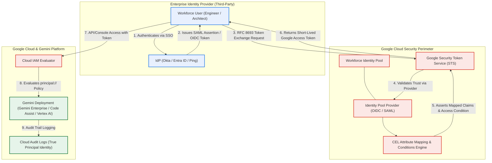

End-to-End Token Exchange & Authentication Flow

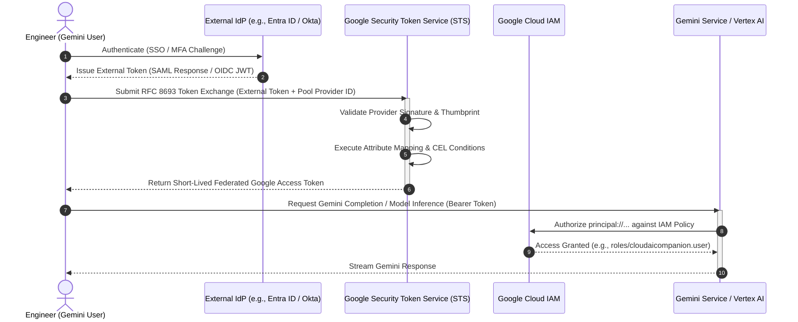

### Architecture Evaluation Matrix (Google Landing Metrics & Well-Architected Framework)

| Architectural Dimension | Directory Sync (Google Cloud Directory Sync) | Service Account Impersonation | Workforce Identity Federation (Target Pattern) |
| --- | --- | --- | --- |
| Identity Duplication & Overhead | High (Requires provisioning Cloud Identity / Google Workspace users). | Moderate (Requires mapping service accounts per user or role group). | Zero (Syncless; authenticates directly against third-party IdP). |
| Audit Log Attribution (Traceability) | Attributed to synced Google identity. | Obfuscated (Attributed to shared Service Account unless custom audit fields are parsed). | Directly Attributed to external IdP google.subject in Cloud Audit Logs. |
| Credential Lifecycle Risk | Elevated (Password hashes / synced identity lifecycles to govern). | High (Risk of key leaks if user credentials/keys are exported). | Minimal (Ephemeral, short-lived tokens via Security Token Service). |
| CEL Attribute Flexibility | Static group mapping in Cloud Identity. | Limited to IAM Condition expressions on SA bindings. | Dynamic claim transformation & token filtering at authentication boundary. |
| Gemini Integration Readiness | Requires manual seat assignment in Google Admin console. | Incompatible with direct Gemini user experience / Cloud Console. | Native (Direct support for Gemini Cloud Console and CLI/API workflows). |

Architectural Magic Quadrant: Identity Approaches for Agentic AI Deployments

| Lower Integration Agility | Higher Integration Agility |
| --- | --- |
| High Enterprise Governance & Zero-Trust |  |

Challengers:

• Directory Synchronization (GCDS / Cloud Identity)

• Fully governed, but high synchronizer maintenance overhead and directory data replication.

Leaders (WIF Architecture):

• Workforce Identity Federation + CEL Mapping

• Syncless, organization-scoped, exact audit traceability, seamless Gemini role binding.

| Low Enterprise Governance & Zero-Trust |  |
| --- | --- |

Niche Players:

• Manual Local Google Accounts / CSV Provisioning

• High risk of orphan accounts, zero automated offboarding, no enterprise IdP tie-in.

Visionaries / Transitional:

• Service Account Impersonation Bridges

• Quick to script, but masks audit attribution and introduces credential escalation risks.

Say "next page" when you are ready to review the next section.

---

Page 1 Analysis: The Identity Challenge

| Concept | Architectural Definition | Enterprise Scenario Grounding (GlobalTech) | GCP Well-Architected / Landing Metric Impact |
| --- | --- | --- | --- |
| Workforce Identity Federation (WIF) | Trust federation framework enabling external IdP users to access Google Cloud console and APIs via RFC 8693 Token Exchange without provisioning native Google accounts. | 500 PartnerCorp developers logging into GlobalTech's GCP projects using existing corporate Okta credentials. | Operational Excellence: 100% reduction in user lifecycle synchronization tasks; eliminates credential distribution pipelines. |
| Zombie Accounts (Anti-Pattern) | Orphaned cloud accounts remaining active after contractor termination in their home IdP due to asynchronous offboarding. | A PartnerCorp developer departs PartnerCorp; their Okta login is revoked, but a static dev@globaltech.com account persists unmanaged. | Security (Zero Trust): Eliminates offboarding lag; access is revoked immediately when the external IdP session/credential is terminated. |
| Borrowing Trust vs. Synchronizing State | Architectural shift from identity data replication (GCDS/SCIM) to dynamic assertion verification via Security Token Service (STS) or Cloud OAuth API. | Google Cloud validates Okta's cryptographic signature on-the-fly instead of maintaining a local user directory. | Cost Optimization & Governance: Removes Cloud Identity Premium licensing overhead and eliminates sync directory drift. |
| Federated Console Access | Browser-based console interface initiated via a dedicated workforce pool sign-in URL rather than accounts.google.com. | PartnerCorp developers accessing the GCP Console via [https://console.cloud.google/gateway/workforce/](https://console.cloud.google/gateway/workforce/).... | User Experience & Security: Single sign-on with PartnerCorp's corporate MFA policies without maintaining secondary Google 2FA tokens. |

### Concept Graph: Identity Triad & Architectural Topology

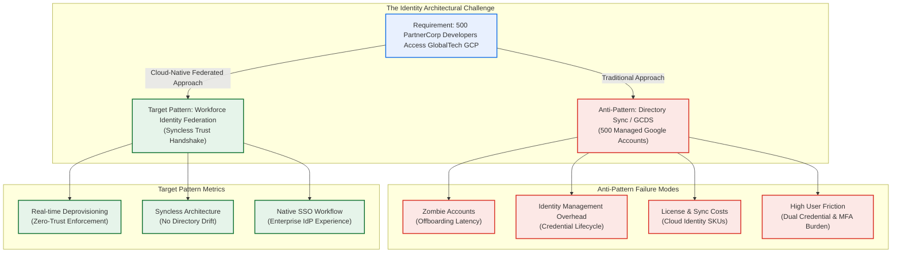

Page Diagram: Traditional Synchronization vs. Federated Trust Flow

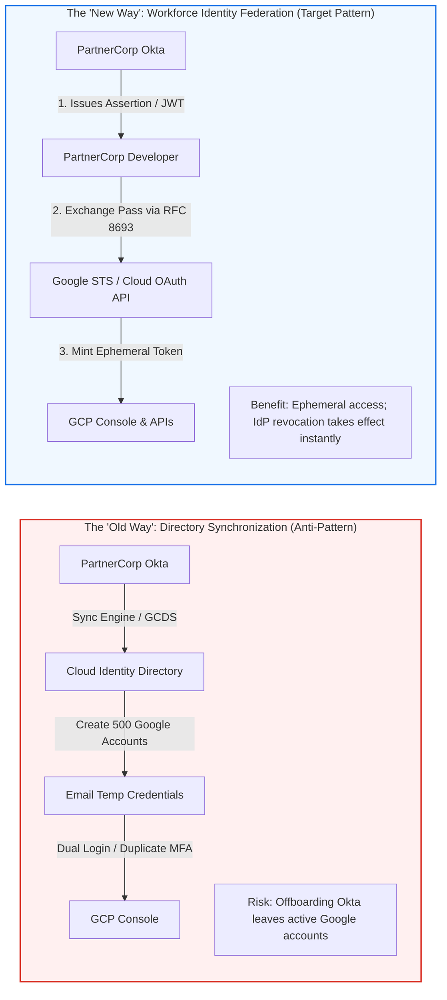

Comparative Architecture Matrix: Identity Archetypes

| Architectural Dimension | Cloud Identity (Employee Badge) | Workload Identity Federation (Machine Pass) | Workforce Identity Federation (Visitor Badge) |
| --- | --- | --- | --- |
| Target Subject | Internal Full-time Employees. | Machines, CI/CD runners, workloads (AWS, GitHub). | External Personnel, Partners, Contractors, Vendors. |
| Identity Ingestion | Synchronization (User objects persisted in Google directory). | Token Exchange (No user provisioning; ephemeral). | Token Exchange (No user provisioning; ephemeral). |
| Credential Type | Persistent Google credentials (@company.com). | Short-lived OIDC tokens exchanged for Google OAuth tokens. | Short-lived IdP SAML/OIDC tokens exchanged for Google access tokens. |
| Access Modality | Google Cloud Console, Google Workspace, APIs, SDKs. | Headless APIs, SDKs, CI/CD pipelines (No Console UI). | Federated Console UI and Developer CLI (gcloud). |
| Deprovisioning Latency | Asynchronous (bounded by sync cycle interval). | Immediate (contingent on CI/CD runner token validity). | Immediate (tied directly to external IdP session/credential revocation). |

### Magic Quadrant: Enterprise External Access Strategies

| Higher Operational Overhead | Lower Operational Overhead |
| --- | --- |
| Strict Governance & Zero-Trust Alignment |  |

Challengers:

• Cloud Identity + GCDS Sync + Custom Webhooks

• Centralized, but carries directory synchronization pipelines, zombie account exposure, and license costs.

Leaders (Target Architecture):

• Workforce Identity Federation (WIF)

• Ephemeral token exchanges, zero credential replication, IdP-governed session revocation, federated console access.

| Permissive Governance & High Risk |  |
| --- | --- |

Niche Players:

• Direct CSV Batch Account Creation

• Manual password lifecycle, uncoordinated offboarding, high potential for persistent zombie accounts.

Visionaries / Workarounds:

• Shared Contractor Service Account Impersonation

• Fast onboarding, but breaks Cloud Audit Log traceability and violates the principle of least privilege.

Say "next page" when you are ready to review the next section.

---

Page 2 Analysis: The Architecture of Federation

| Concept | Architectural Definition | Enterprise Real-World Example & Grounding | Well-Architected / Landing Metric Impact |
| --- | --- | --- | --- |
| Security Token Service (STS) / Cloud OAuth API | The Google broker implementing RFC 8693 token exchange that accepts an external credential, validates trust, and mints an ephemeral Google OAuth 2.0 access token. | An Okta-authenticated developer presents an ID token to sts.googleapis.com or cloudoauth.googleapis.com to obtain a Google access token. | Security & Reliability: Eliminates persistent Google service account keys and mitigates lateral movement risks with short-lived tokens (1 hour default). Dedicated workforce endpoints isolate traffic from workload services. |
| Subject Token ("Foreign Currency") | The signed digital assertion issued by the external IdP (SAML 2.0 XML assertion or OIDC JWT ID token) proving identity outside Google Cloud. | A signed JWT from Microsoft Entra ID (login.microsoftonline.com) containing claims like sub, email, and groups. | Zero-Trust Identity: The external IdP retains full ownership of user lifecycle and MFA enforcement; Google never processes or stores external passwords. |
| Access Token ("Local Currency") | A short-lived, Google-scoped OAuth 2.0 bearer token used to authenticate directly to Google Cloud APIs, CLI tools, and console endpoints. | An ephemeral bearer token (ya29...) passed in the HTTP Authorization: Bearer header to invoke Gemini or Vertex AI APIs. | Least Privilege & Blast Radius: Expiring credentials enforce continuous re-authentication and immediate propagation of external account revocations. |
| Trust Configuration (OIDC JWKS / SAML Metadata) | Cryptographic verification layer where STS validates subject token signatures using public key pairs obtained from the IdP. | An OIDC discovery call to /.well-known/jwks.json to verify JWT signatures, or an imported SAML metadata XML containing the IdP signing certificate. | Operational Excellence: Automatic key rotation via OIDC JWKS eliminates manual certificate maintenance and expired-cert outages. |

### Concept Graph: The Currency Exchange Model

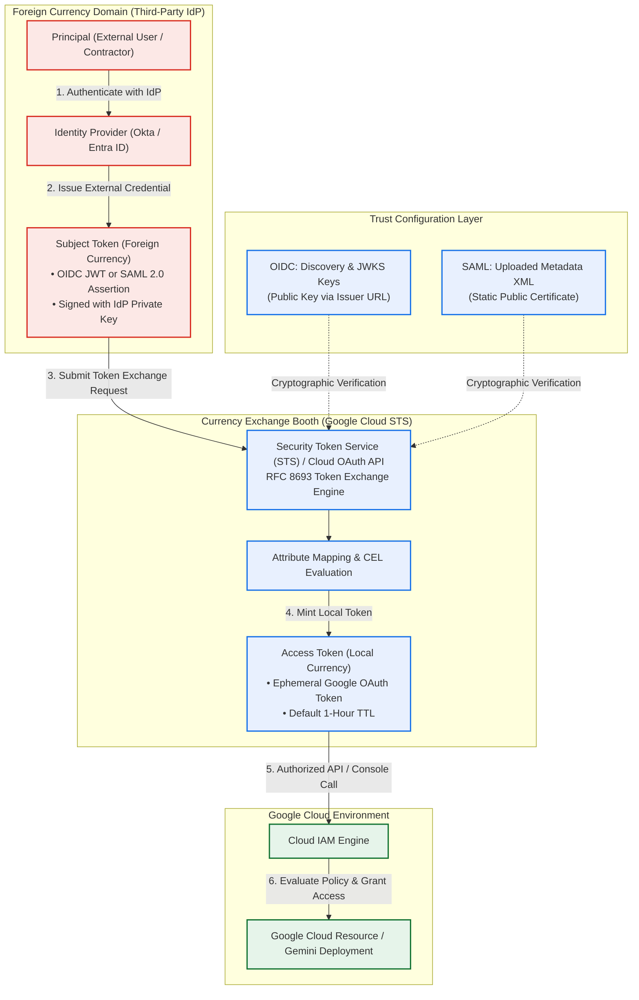

Page Workflow: Visualizing the Flow (Mermaid Sequence Diagram)

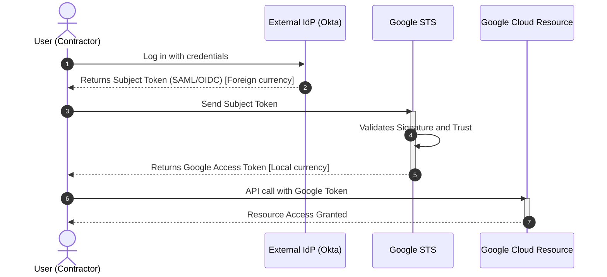

Deep Dive: Protocol Comparison for Trust Handshake

| Trust Characteristic | OpenID Connect (OIDC) | SAML 2.0 |
| --- | --- | --- |
| Trust Establishment | Dynamic discovery via Issuer URL. Google pulls JWKS keys from /.well-known/openid-configuration. | Static exchange of SAML 2.0 metadata XML file containing embedded X.509 signing certificates. |
| Token Format (Foreign Currency) | Compact, base64url-encoded JSON Web Token (JWT). | Verbose XML document containing digitally signed assertion nodes. |
| Certificate Rotation | Automated; Google STS periodically fetches updated public keys from the provider's JWKS endpoint. | Manual / Operational Overhead; requires re-uploading updated metadata XML before certificates expire. |
| Supported Access Modalities | Google Cloud Console, Google Cloud CLI (gcloud), and Client Libraries. | Google Cloud Console and CLI (gcloud). |
| Landing Metric Impact | Higher Reliability & Maintainability; zero outages caused by expired manual certificates. | Compatible with legacy enterprise directories (e.g., AD FS) that lack native OIDC endpoints. |

### Architecture Evaluation Matrix (Google Landing Metrics & Well-Architected Framework)

| Metric Category | Target Standard | WIF Token Exchange Implementation |
| --- | --- | --- |
| Operational Efficiency | Minimize administrative overhead in credential provisioning and sync pipelines. | Eliminates credential synchronization engines entirely. Onboarding only requires pointing the external identity to the STS exchange endpoint. |
| Security (Zero Trust) | Short-lived credentials; no long-lived static secrets stored on endpoints or workstations. | STS mints ephemeral access tokens valid for 1 hour by default. Session revoking in external IdP prevents future token exchanges. |
| Traceability & Audit | Cloud Audit Logs must directly reflect individual workforce identities. | The google.subject attribute is mapped directly from the IdP token claims (e.g., Okta user sub), ensuring clear non-repudiation in audit trails. |
| Interoperability | Standardized, open-standard protocols without proprietary client software. | Built directly on industry-standard RFC 8693 (OAuth 2.0 Token Exchange) and RFC 6749. |

Say "next page" when you are ready to review the next section.

make sure the entire page is captured
Lesson 2 Breakdown: The Architecture of Federation

| Concept / Entity | Exact Course Definition | Real-World Enterprise Example & Grounding | Well-Architected & Landing Metrics Impact |
| --- | --- | --- | --- |
| Token Exchange Flow (RFC 8693) | The cryptographic conversion of an external identity claim into a scoped Google credential via STS. | A developer in Okta runs gcloud or hits the workforce console gateway, initiating a token exchange handshake. | Operational Excellence: Fully automated; zero manual credential creation or maintenance overhead. |
| The Principal (User) | The external contractor or employee attempting to gain access to Google Cloud resources. | External partner developer at PartnerCorp requesting access to GlobalTech's Gemini model endpoint. | Auditability: Retains distinct external user attribution rather than hiding behind a generic role. |
| The IdP (Identity Provider) | The external authority (e.g., Okta, Microsoft Entra ID) that vouches for the identity of the user. | Okta enterprise tenant executing corporate MFA before issuing token assertions. | Security (Zero Trust): Enforces native organizational MFA and conditional access at the perimeter. |
| Subject Token ("Foreign Currency") | Digital ID card issued by the IdP (typically a SAML 2.0 Assertion or OIDC ID Token). | An RS256-signed OIDC JWT containing claims sub, email, and department. | Zero Credential Drift: Google Cloud stores no persistent passwords; verification relies strictly on signed assertions. |
| Google STS (Security Token Service) | The Google service that validates the Subject Token signature and trust relationship. | Google STS endpoint verifying Okta signatures against cached JWKS public keys. | Reliability & Security: Validates signatures dynamically and blocks forged/tampered tokens at entry. |
| Access Token ("Local Currency") | The short-lived Google credential used to access cloud services and resources. | An ephemeral Google OAuth 2.0 bearer token (ya29...) valid for 60 minutes. | Least Privilege: Minimizes exposure windows; access expires automatically upon token invalidation. |
| OIDC Trust Handshake (Issuer URL / JWKS) | Dynamic discovery where Google calls /.well-known/jwks.json on the IdP to retrieve public keys. | An OIDC workforce pool provider configured with [https://dev-123.okta.com](https://dev-123.okta.com). | Maintainability: Automatic key rollover without service interruptions or manual updates. |
| SAML 2.0 Trust Handshake (Metadata XML) | Static exchange where the IdP's metadata XML containing public X.509 certs is uploaded to GCP. | Uploading an Entra ID federation metadata XML file to the workforce pool provider. | Legacy Compatibility: Bridges older enterprise directories lacking OpenID Connect endpoints. |

### Concept Graph: Architecture of Federation

```mermaid
graph TD
    subgraph External_IdP_Domain["Foreign Currency Domain (PartnerCorp)"]
        Principal["The Principal<br>(External Contractor / Developer)"]
        IdP["The IdP<br>(Okta / Entra ID)"]
        SubjectToken["Subject Token ('Foreign Currency')<br>• OIDC ID Token (JWT) or SAML Assertion<br>• Contains sub, email, groups"]

        Principal -->|1. Authenticates (MFA)| IdP
        IdP -->|2. Issues| SubjectToken
    end

    subgraph Trust_Establishment["Configuration Phase: Cryptographic Trust Establishment"]
        OIDC_Path["OIDC Configuration<br>Google STS calls IdP Issuer URL<br>to fetch JWKS Public Keys"]
        SAML_Path["SAML Configuration<br>Administrator uploads IdP<br>Metadata XML containing X.509 Cert"]
    end

    subgraph Google_STS_Exchange["Exchange Booth (Google Security Token Service)"]
        STS["Google STS<br>(Token Exchange Engine)"]
        Validate{"Signature & Trust<br>Verification"}
        AccessToken["Access Token ('Local Currency')<br>• Short-Lived Google OAuth Token<br>• Default 1-Hour Expiration"]

        SubjectToken -->|3. Submit Token| STS
        OIDC_Path -.->|Dynamic Verification| Validate
        SAML_Path -.->|Static Cert Verification| Validate
        STS --> Validate
        Validate -->|4. If Valid, Mint| AccessToken
    end

    subgraph Cloud_Authorization["Google Cloud Consumption"]
        IAM["Google Cloud IAM"]
        Resource["Google Cloud Resource / Gemini APIs"]

        AccessToken -->|5. Authorized Call| IAM
        IAM -->|6. Grant Access| Resource
    end

    classDef ext fill:#fce8e6,stroke:#d93025,stroke-width:2px;
    classDef sts fill:#e8f0fe,stroke:#1a73e8,stroke-width:2px;
    classDef gcp fill:#e6f4ea,stroke:#137333,stroke-width:2px;
    class Principal,IdP,SubjectToken ext;
    class STS,Validate,AccessToken,OIDC_Path,SAML_Path sts;
    class IAM,Resource gcp;
```

Step-by-Step Flow: "Tracing the Packet" & "Visualizing the Flow"

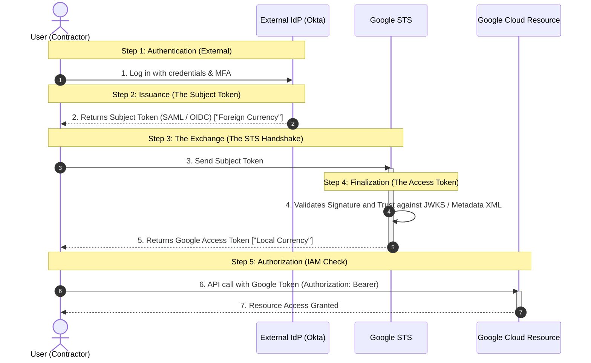

Detailed Step-by-Step Trace Matrix

| Step Number | Phase Name | Actor / Component | Payload / Protocol | Action & Outcome |
| --- | --- | --- | --- | --- |
| Step 1 | Authentication (External) | User & External IdP | Corporate MFA / SSO | User authenticates against Okta or Entra ID; identity proofing occurs outside Google Cloud. |
| Step 2 | Issuance (Subject Token) | External IdP | SAML 2.0 XML or OIDC JWT | IdP issues signed "Foreign Currency" bearing user identity claims (sub, email, groups). |
| Step 3 | The Exchange (STS Handshake) | User & Google STS | RFC 8693 Token Exchange Request | User submits Subject Token along with Workforce Pool & Provider identifiers to STS. |
| Step 4 | Finalization (Access Token) | Google STS | Cryptographic Signature Check | STS verifies token signature via IdP public keys and returns an ephemeral Google Access Token ("Local Currency"). |
| Step 5 | Authorization (IAM Check) | User & GCP Resource | Bearer Token / HTTPS API | User calls GCP APIs; Cloud IAM evaluates permissions bound to principal://... and grants access. |

Trust Protocol Architecture Matrix: OIDC vs. SAML 2.0

| Architectural Aspect | OpenID Connect (OIDC) | SAML 2.0 |
| --- | --- | --- |
| Token Representation | Compact JSON Web Token (JWT). | Verbose XML assertion with digital signatures. |
| Trust Setup Mechanism | Dynamic: Configure IdP Issuer URL (e.g., [https://dev-123.okta.com](https://dev-123.okta.com)). | Static: Upload IdP Metadata XML file directly to GCP. |
| Public Key Discovery | Google queries the IdP's JWKS endpoint (/.well-known/jwks.json). | Google extracts the public certificate embedded in the metadata XML. |
| Key Rollover Operational Cost | Zero: Keys rotate automatically when IdP updates its JWKS endpoint. | Manual: Administrative re-upload needed before certificate expiration. |
| Failure Mode | STS rejects token exchange if token signature fails JWKS check. | STS rejects token exchange if signing cert does not match XML metadata. |

Say "next page" when you are ready to review the next section.

---

## Concept Analysis: Comparing OIDC and SAML Protocols

| Concept | Architectural Definition | Enterprise Real-World Scenario Grounding | GCP Well-Architected & Landing Metrics Impact |
| --- | --- | --- | --- |
| SAML 2.0 (The Enterprise Veteran) | XML-based federation standard using base64-encoded assertion envelopes signed with embedded X.509 certificates. | Connecting legacy corporate Active Directory Federation Services (AD FS) or legacy PingFederate instances to GCP. | Reliability & Maintenance Overhead: Manual cert management introduces planned downtime risks during key rotations. |
| OpenID Connect / OIDC (The Modern Standard) | Lightweight identity layer built on OAuth 2.0 exchanging signed JSON Web Tokens (JWTs) via dynamic discovery endpoints. | Okta or Microsoft Entra ID tenants issuing RS256-signed JWTs using public JWKS discovery. | Operational Excellence & Resiliency: Automated public key retrieval eliminates maintenance windows and key rollover outages. |
| Automated vs. Manual Key Rotation | Comparison between dynamic JWKS discovery (/.well-known/jwks.json) and static XML metadata file ingestion. | Okta rotates signing keys automatically; Google fetches new keys seamlessly via OIDC vs. SAML breaking until an admin re-uploads XML metadata. | High Availability (Landing Metric): 0 outages during identity provider certificate rollover events under OIDC. |
| Attribute Refresh Behavior | Propagation latency of user profile changes (e.g., department, cost center) from the IdP into downstream Google IAM. | A contractor changes departments in Okta. OIDC reflects new claims on next login; SAML may require re-provisioning/re-adding in the IdP app. | Security (Least Privilege): Eliminates attribute drift; immediate enforcement of attribute-based access control (ABAC) CEL conditions. |
| Debugging Modality | Operational visibility into issued tokens (raw SAML assertions in HTTP browser POST vs. encoded JWTs parsed in debuggers). | Inspecting SAML via Chrome DevTools SAML-tracer vs. decoding OIDC bearer tokens via jwt.io or CLI decoders. | Operational Velocity: Browser-level tracing simplifies edge SAML inspection; OIDC requires token interception for payload evaluation. |
| GlobalTech Decision Pattern | Enterprise architectural decision selecting OIDC for modern IdPs (Okta) requiring Client ID, Client Secret, and Issuer URL. | GlobalTech providing Redirect URI to PartnerCorp, requesting Okta Issuer URL, Client ID, and Client Secret for WIF pool setup. | Landing Zone Governance: Standardizes integration parameter handshakes across multi-tenant external partner organizations. |

### Concept Graph: Protocol Comparison & Decision Tree

```mermaid
graph TD
    subgraph Enterprise_IdP_Evaluation["Identity Provider Evaluation"]
        IdP["PartnerCorp Identity Provider (e.g., Okta)"]
        Eval{"Evaluate Supported Protocols"}
        IdP --> Eval
    end

    subgraph Protocol_Selection["Protocol Implementation Branch"]
        SAML["SAML 2.0 (XML-based)"]
        OIDC["OIDC (JSON-based / OAuth 2.0)"]

        Eval -->|Legacy AD FS / Ping| SAML
        Eval -->|Modern Cloud IdP (Okta / Entra)| OIDC
    end

    subgraph Trust_and_Lifecycle["Trust Establishment & Maintenance"]
        SAML_Trust["Static Trust Setup:<br>• Upload Metadata XML<br>• Embedded X.509 Certificate"]
        SAML_Rot["Key Rotation:<br>• Manual Admin Upload<br>• Outage Risk on Rollover"]
        SAML_Attr["User Attribute Updates:<br>• May require removing/re-adding user<br>• Potential sync lag"]

        OIDC_Trust["Dynamic Discovery:<br>• Issuer URL + /.well-known/<br>• Application Client ID & Secret"]
        OIDC_Rot["Key Rotation:<br>• Fully Automated via JWKS<br>• Zero Administrative Outage"]
        OIDC_Attr["User Attribute Updates:<br>• Seamless refresh on next login<br>• Live CEL Claim Evaluation"]

        SAML --> SAML_Trust --> SAML_Rot --> SAML_Attr
        OIDC --> OIDC_Trust --> OIDC_Rot --> OIDC_Attr
    end

    subgraph Decision_Outcome["GlobalTech Architectural Decision"]
        Decision["Selected: OpenID Connect (OIDC)<br>• Redirect URI to Partner<br>• Lower Operational TCO"]
        OIDC_Attr --> Decision
    end

    classDef legacy fill:#fff0f0,stroke:#d93025,stroke-width:2px;
    classDef modern fill:#e6f4ea,stroke:#137333,stroke-width:2px;
    classDef neutral fill:#e8f0fe,stroke:#1a73e8,stroke-width:2px;
    class IdP,Eval,Decision neutral;
    class SAML,SAML_Trust,SAML_Rot,SAML_Attr legacy;
    class OIDC,OIDC_Trust,OIDC_Rot,OIDC_Attr modern;
```

Protocol Architecture & Ingestion Flow

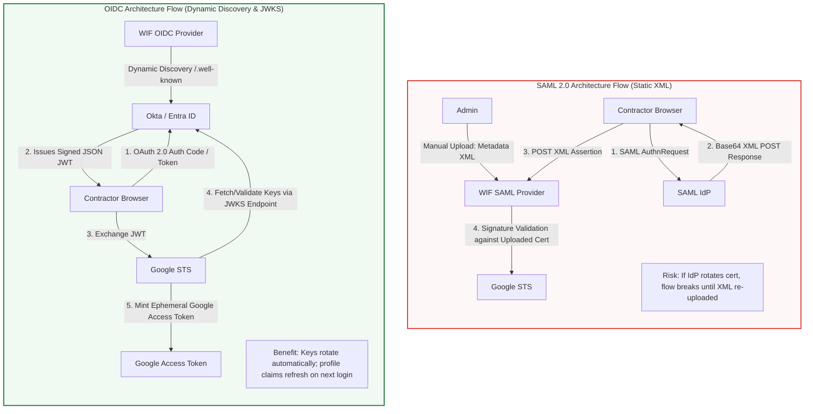

Comparative Evaluation Matrix: SAML 2.0 vs. OpenID Connect (OIDC)

| Architectural Dimension | SAML 2.0 (The Enterprise Veteran) | OpenID Connect (The Modern Standard) | Architectural Recommendation |
| --- | --- | --- | --- |
| Data Payload Format | XML (Extensible Markup Language). Heavyweight envelope. | JSON (JSON Web Token / JWT). Compact, base64url-encoded. | OIDC for lower payload overhead and REST-native API flows. |
| Trust Configuration | Static file upload: Requires importing SAML Metadata XML with public key. | Dynamic Discovery: Configured via IdP Issuer URL (/.well-known/openid-configuration). | OIDC eliminates manual configuration drift across environments. |
| Key Rollover Operations | Manual & Error-Prone: Certificate rotation requires manual admin re-upload in GCP Console. | Automated & Resilient: Google checks the provider's JWKS URI dynamically when keys change. | OIDC eliminates certificate-expiration outages (Well-Architected: Reliability). |
| Attribute Synchronization | Department or role updates may fail to flow downstream without removing and re-adding user in IdP app. | User field updates transfer automatically during the next token issuance / login event. | OIDC maintains dynamic alignment with IAM CEL attribute mappings. |
| Inspection & Debugging | Directly readable in the browser via Chrome DevTools / SAML-tracer extensions. | Requires intercepting the token and decoding the JWT payload (e.g., via jwt.io). | SAML offers native browser tracing; OIDC requires token extraction. |
| Industry Adoption | Stable to declining legacy enterprise standard. | Fast-growing, modern enterprise and cloud-native standard. | OIDC aligns with modern Zero-Trust roadmap. |

### Magic Quadrant: Protocol Selection for Agentic AI Identity

| Higher Operational Maintenance | Lower Operational Maintenance |
| --- | --- |
| High Governance & Automation |  |

Challengers:

• SAML 2.0 with Automated CI/CD Cert Sync

• Enterprise-proven, but requires custom pipelines to re-upload metadata XML before X.509 expiration.

Leaders (Target Architectural Choice):

• OpenID Connect (OIDC) with Dynamic JWKS

• Zero cert-management overhead, automatic key discovery, instant claim attribute updates, native OAuth 2.0 integration.

| Low Governance & Brittle Maintenance |  |
| --- | --- |

Niche Players:

• Static SAML 2.0 (Manual XML Upload)

• High risk of credential expiration outages, poor attribute propagation dynamics.

Visionaries / Edge Cases:

• OIDC with Static Uploaded JWK JSON Files

• Useful for isolated air-gapped environments, but loses the benefit of automated dynamic discovery.

The GlobalTech Architecture Decision Summary

| Interaction Role | Stakeholder Statement / Deliverable | Architectural Purpose |
| --- | --- | --- |
| PartnerCorp (Partner) | "We use Okta." | Confirms modern cloud IdP capability supporting both SAML 2.0 and OIDC. |
| GlobalTech (Architect) | "We prefer OIDC because it automates certificate rotation, meaning less maintenance for us later." | Selects OIDC to reduce operational TCO and mitigate rollover-induced outages. |
| Handshake Parameters |  |  |

GCP to Partner: Redirect URI.

Partner to GCP: Issuer URL, Client ID, Client Secret.

Configures OIDC Workforce Identity Pool Provider in Google Cloud Console.
Say "next page" when you are ready to review the next section.

answer all that is correct in the following question: You have a CI/CD pipeline running in GitHub Actions that needs to deploy code to App Engine. You also have a QA Team from a third-party vendor that needs to manually verify the deployment in the Google Cloud Console. Which Federation services should you use? (Select two options)

Workspace Identity Federation

Workforce Identity Federation

Workload Identity Federation

Cloud Identity

GitHub Identity Federation
Correct Options Evaluation

| Option | Verdict | Rationale & Architectural Grounding |
| --- | --- | --- |
| Workforce Identity Federation | CORRECT | Designed specifically for external human users (such as third-party vendor QA engineers, contractors, and partners) who authenticate via their enterprise Identity Provider (IdP) to access Google Cloud web interfaces (Google Cloud Console) and CLI tools without managing separate Google accounts. |
| Workload Identity Federation | CORRECT | Designed specifically for machine-to-machine / non-Google workloads (such as GitHub Actions CI/CD workflows, AWS, or Azure pipelines) to authenticate to Google Cloud APIs (App Engine deployments) via RFC 8693 token exchange without long-lived, high-risk service account keys. |
| Workspace Identity Federation | INCORRECT | Not an existing Google Cloud federation service (distractor). |
| Cloud Identity | INCORRECT | An identity synchronization/provisioning platform (Identity-as-a-Service), not a syncless federation service. It requires provisioning and managing duplicate Google directory accounts for external users. |
| GitHub Identity Federation | INCORRECT | Not an official Google Cloud service name (GitHub Actions connects to GCP via Workload Identity Federation). |

Architectural Mapping Matrix

| Requirement | Entity Type | Target Access Surface | Google Cloud Federation Service |
| --- | --- | --- | --- |
| GitHub Actions CI/CD Pipeline | Automated Machine Workload | App Engine Admin API (gcloud app deploy) | Workload Identity Federation |
| Third-Party Vendor QA Team | Human Workforce (Contractors) | Google Cloud Console (Web GUI) | Workforce Identity Federation |

### Architecture & Trust Boundary Diagram

```mermaid
flowchart TD
    subgraph Machine_Workload["Machine / Pipeline Flow"]
        GHA["GitHub Actions Runner"] -->|OIDC Token Exchange| STS1["Google STS / Workload Identity Pool"]
        STS1 -->|Ephemeral Access Token| GAE["App Engine Deployment API"]
    end

    subgraph Human_Workforce["Human / Vendor QA Flow"]
        Vendor["Vendor QA Engineer"] -->|IdP SSO / SAML / OIDC| STS2["Google STS / Workforce Identity Pool"]
        STS2 -->|Federated Console Session| Console["Google Cloud Console GUI"]
    end

    classDef machine fill:#e8f0fe,stroke:#1a73e8,stroke-width:2px;
    classDef human fill:#e6f4ea,stroke:#137333,stroke-width:2px;
    class GHA,STS1,GAE machine;
    class Vendor,STS2,Console human;
```

The two correct options to select are:

Workforce Identity Federation

Workload Identity Federation

Answer all that is correct here: A developer successfully logs into their Okta dashboard. However, when they try to access the Google Cloud Console through WIF, they receive an error saying "Token Exchange Failed: Invalid Audience." Based on the architecture of federation, where did the failure occur?
Step 3 (The Exchange)
Step 2: Issuance (The Subject Token)
Step 5: Authorization (IAM Check)
Step 1 (Authentication)
Step 4: Finalization (The Access Token)

### Evaluation of Options

| Federation Step | Step Name | Event Analysis & Outcome | Verdict |
| --- | --- | --- | --- |
| Step 1 | Authentication | The developer successfully signs into the Okta dashboard. Identity proofing and MFA challenge succeeded at the external IdP. | Incorrect (No failure here; login succeeded). |
| Step 2 | Issuance (The Subject Token) | Okta issues the SAML assertion / OIDC ID token. While the token may contain an incorrect aud claim configuration, token issuance itself completed. | Incorrect |
| Step 3 | The Exchange | The developer submits the Subject Token to Google Security Token Service (STS) via RFC 8693. Google STS validates token claims (signature, issuer, and audience matching the workforce pool provider). STS rejects the token exchange because the aud claim in the Subject Token does not match the configured Provider/Client ID. | CORRECT |
| Step 4 | Finalization (The Access Token) | STS mints and returns the ephemeral Google Access Token. Because exchange validation failed during Step 3, execution never reached finalization. | Incorrect |
| Step 5 | Authorization (IAM Check) | Cloud IAM checks permissions bound to principal://... against GCP resources. The flow aborted prior to any IAM evaluation. | Incorrect |

Step-by-Step Failure Point Flow

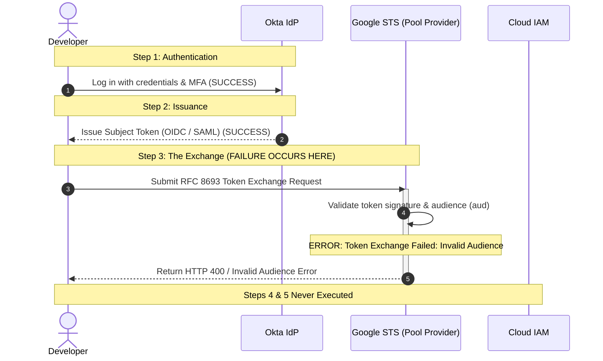

The single correct option to select is:

Step 3 (The Exchange)

answer all that is correct: You are setting up Federation for a legacy bank that uses an on-premise ADFS server behind a strict firewall. They tell you they can provide a metadata.xml file. Which protocol must you use?
OAuth 2.0
OIDC
SAML 1.0
SAML 2.0
Protocol Evaluation & Selection

| Option | Verdict | Protocol Rationale & Grounding |
| --- | --- | --- |
| OAuth 2.0 | Incorrect | An authorization framework, not an identity federation protocol handling static XML metadata files. |
| OIDC | Incorrect | Uses JSON-based metadata (/.well-known/openid-configuration) and JWKS endpoints; it does not ingest metadata.xml files. |
| SAML 1.0 | Incorrect | Legacy, deprecated standard not supported by Workforce Identity Federation. |
| SAML 2.0 | CORRECT | The enterprise XML-based federation standard. Google Cloud Workforce Identity Federation configures SAML 2.0 providers by importing an IdP metadata.xml file containing endpoints and X.509 public signing certificates—making it compatible with on-premise Active Directory Federation Services (AD FS) located behind strict corporate firewalls. |

On-Premise AD FS Firewall & Ingestion Architecture

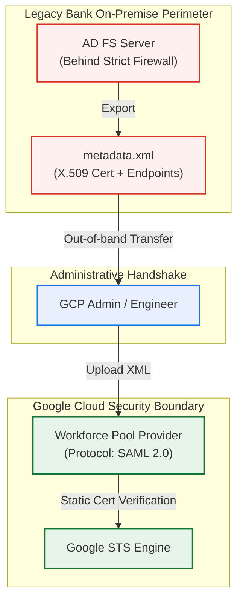

The single correct option to select is:

SAML 2.0

answer the following question: Why is OIDC often considered lower maintenance than SAML regarding "Key Rotation"?
OIDC relies on exchanging Metadata Files. You download an XML file from the Partner and upload it to Google Cloud.
OIDC allows Google to periodically check the IdP's "Discovery URL" to find new public keys.
OIDC requires the administrator to manually upload a new certificate file when the old one expires.
With OIDC, users may need to be deleted and recreated in the Identity Provider application for updates on users to transfer.
Correct Answer Evaluation

| Option | Verdict | Architectural Explanation |
| --- | --- | --- |
| OIDC relies on exchanging Metadata Files. You download an XML file from the Partner and upload it to Google Cloud. | Incorrect | This describes SAML 2.0 static configuration, not OpenID Connect. |
| OIDC allows Google to periodically check the IdP's "Discovery URL" to find new public keys. | CORRECT | OIDC standardizes dynamic discovery via the IdP's OpenID configuration endpoint (/.well-known/openid-configuration), which provides the JSON Web Key Set (jwks_uri). Google STS automatically retrieves and caches updated public signing keys without manual intervention or service disruption during key rotations. |
| OIDC requires the administrator to manually upload a new certificate file when the old one expires. | Incorrect | This is the exact operational limitation of SAML 2.0 that OIDC solves. |
| With OIDC, users may need to be deleted and recreated in the Identity Provider application for updates on users to transfer. | Incorrect | User attribute claims in OIDC dynamically refresh on each authentication and token issuance cycle. |

Key Rotation Mechanism Comparison

```mermaid
flowchart TD
    subgraph SAML_Key_Rotation["SAML 2.0 (High Maintenance / Manual)"]
        IdP1["IdP generates new X.509 Cert"] --> Admin["Admin downloads metadata.xml"]
        Admin --> GCP1["Admin re-uploads XML to Google Cloud"]
        GCP1 -.-> Outage["Risk of authentication outage if cert expires before upload"]
    end

    subgraph OIDC_Key_Rotation["OIDC (Low Maintenance / Automated)"]
        IdP2["IdP rotates private/public key pair"] --> JWKS["IdP updates /.well-known/jwks.json"]
        GCP2["Google STS fetches new keys dynamically via Discovery URL"]
        JWKS --> GCP2
        GCP2 -.-> ZeroOutage["Zero downtime & zero administrative overhead"]
    end

    classDef saml fill:#fff0f0,stroke:#d93025,stroke-width:1px;
    classDef oidc fill:#f0f9f2,stroke:#137333,stroke-width:1px;
    class SAML_Key_Rotation saml;
    class OIDC_Key_Rotation oidc;
```

The correct option to select is:

OIDC allows Google to periodically check the IdP's "Discovery URL" to find new public keys.

---

Lesson Analysis: Pools and Providers

| Key Concept | Architectural Definition | Real-World Enterprise Scenario & Grounding | Well-Architected / Landing Metric Impact |
| --- | --- | --- | --- |
| Organization Root Resource | The top-level node in the Google Cloud resource hierarchy where Workforce Pools are anchored and governed. | GlobalTech's GCP Organization (organizations/123456789012) acting as the administrative root for contractor identity governance. | Governance & Landing Zone: Centralizes external identity boundary at root organization scope, preventing fragmented project-level access silos. |
| Workforce Pool | Organization-scoped identity container acting as a centralized directory for external user groups. | Creating partner-pool or creative-agencies to aggregate external developers across vendors without individual Google accounts. | Operational Excellence: Aggregates functional access across multiple third parties, reducing IAM policy overhead from N×M to 1×M. |
| Provider (Doorway) | Specific protocol connection and trust configuration inside a Pool (e.g., Okta OIDC or Entra ID SAML). | Adding an Okta provider configuration inside partner-pool pointing to PartnerCorp's tenant. | Reliability & Interoperability: Decouples the IdP connection from authorization policies; multiple IdP "doors" can enter the same functional "room". |
| Required IAM Role | roles/iam.workforcePoolAdmin (IAM Workforce Pool Admin) required at the organization level to create and manage pools. | Assigned to GlobalTech's Principal Cloud Security Architect on the GCP Organization node. | Security (Least Privilege): Restricts pool provisioning rights to authorized enterprise security personnel, mitigating unauthorized IdP federation. |
| Globally Unique Pool ID | Global identifier constraint across all Google Cloud customers: 4–32 characters (letters, numbers, hyphens); gcp- is strictly reserved. | GlobalTech choosing globaltech-partner-pool (avoiding collisions and invalid names like gcp-dev-pool). | Naming Conventions & Standards: Enforces enterprise uniqueness across global STS endpoints and avoids reserved namespace conflicts. |
| Session Duration Settings | Configurable lifetime policy balancing operational token validity against re-authentication frequency. | Setting a session duration of 8 hours for interactive console sessions vs. 1 hour for automated/elevated roles. | Security vs. UX: Enforces automatic credential expiry without disrupting standard contractor working shifts. |
| Multi-Provider Aggregation Pattern | Architectural design principle: "Group by function, not just by source". | A single creative-agencies pool containing three providers (Agency A: Okta, Agency B: Ping, Agency C: Entra ID) accessing one bucket. | Maintainability & Landing Metrics: Prevents IAM policy sprawl. Single IAM policy binding grants access to all aggregated external providers. |

### Concept Graph: Hierarchy, Metaphor & Aggregation Model

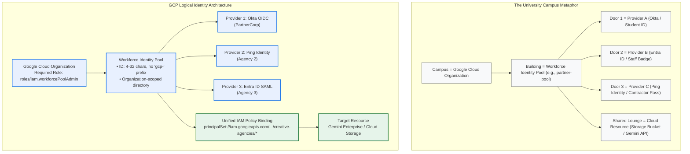

Page Diagram: Single Pool vs. Multi-Pool Architectural Topology

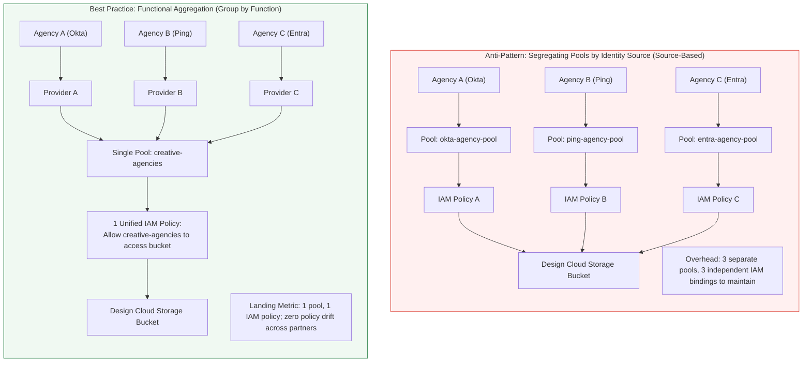

Step-by-Step Pool Provisioning Sequence

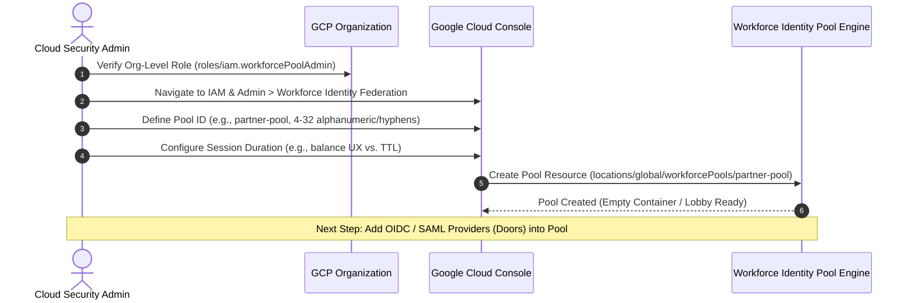

Architectural Decision Matrix: Single-Provider vs. Multi-Provider Aggregation

| Evaluation Criteria | Multi-Pool Architecture (Source-Based) | Multi-Provider Aggregated Pool (Function-Based) | Architectural Verdict |
| --- | --- | --- | --- |
| IAM Policy Management | Requires independent IAM bindings across projects and buckets for every external IdP. | Write one IAM policy targeting the entire workforce pool or common pool attributes. | Aggregated Pool: Eliminates IAM policy duplication. |
| Administrative Scalability | Onboarding partner N+1 requires duplicating all role assignments across resources. | Onboarding partner N+1 only requires adding a new Provider "door" to the existing pool. | Aggregated Pool: Reduces operational onboarding cycle time from hours to minutes. |
| Access Boundary Isolation | Clean physical separation between partner pools. | Requires CEL attribute conditions if strict intra-partner isolation is mandated. | Multi-Pool only when strict legal isolation requires separate audit domains. |
| Landing Zone Metric Alignment | High risk of permission drift across pools over time. | Centralized governance with consistent attribute mappings and session duration policies. | Aggregated Pool: Aligns directly with Google Cloud Landing Zone best practices. |

### Magic Quadrant: External Identity Ingestion Architecture

| Higher Operational Overhead | Lower Operational Overhead |
| --- | --- |
| High Governance & Role-Based Control |  |

Challengers:

• Source-Siloed Workforce Pools

• Secure and isolated, but creates linear IAM policy explosion as external partner count increases.

Leaders (Best Practice Pattern):

• Functionally Aggregated Multi-Provider Pools

• Centralized functional container, unified IAM policies, standardized session timeouts, dynamic IdP mapping.

| Low Governance & Fragile Architecture |  |
| --- | --- |

Niche Players:

• Per-Partner Project IAM Duplication

• Inconsistent role bindings, manual sync, and high blast radius for orphan entitlements.

Visionaries / Edge Cases:

• Ad-Hoc Attribute-Only Pools

• Minimal upfront setup, but complex CEL rules are difficult to audit across multiple external teams.

Want to take a 4-question quiz on Workforce Identity Pool hierarchy, constraints, and aggregation?

---

Lesson Analysis: Connect an IdP (OIDC)

| Key Concept | Architectural Definition | Enterprise Scenario Grounding (PartnerCorp) | GCP Well-Architected & Landing Metrics Impact |
| --- | --- | --- | --- |
| Workforce Provider ID | Alphanumeric identifier (≥ 4 characters; lowercase, digits, hyphens) naming the provider in the workforce pool. | Defining partnercorp-devs-oidc inside partner-pool. | Governance & Landing Zone: Enforces structured, audit-friendly naming standards for IdP endpoints. |
| Redirect URI (Callback URL) | The Google Cloud endpoint where Okta returns the user with the authorization code/token during federated login. | [https://auth.cloud.google/signin-callback/](https://auth.cloud.google/signin-callback/)... provided to the PartnerCorp Okta administrator. | Security (RFC 6749): Prevents open-redirect attacks by whitelisting Google's exact callback endpoint in Okta. |
| Issuer URI (The Source) | The base URL of the Identity Provider issuing the tokens. | [https://partnercorp.okta.com](https://partnercorp.okta.com) configured in the GCP Provider settings. | Identity Assurance: Identifies the trusted cryptographic authority. Must match token iss claim exactly. |
| Client ID (The Audience) | The public identifier assigned to the Google Cloud application within the IdP portal. | PartnerCorp's registered App ID in Okta; validated against the aud claim in incoming JWTs. | Security (Confused Deputy Prevention): Ensures the token was minted specifically for this Google Cloud deployment. |
| Client Secret | The shared secret associated with the Client ID used to verify authorization code exchanges. | Shared secret provided out-of-band by PartnerCorp for server-side token redemption. | Confidentiality: Protects authorization code redemption workflows against interception. |
| Dynamic Discovery & JWKS | Automatic resolution where Google queries /.well-known/openid-configuration to download public verification keys. | Google STS calling [https://partnercorp.okta.com/.well-known/openid-configuration](https://partnercorp.okta.com/.well-known/openid-configuration) to retrieve signing keys. | Operational Excellence & High Availability: Zero downtime during IdP signing key rotations. |
| Issuer Mismatch (Trailing Slash) | Exact string comparison failure where [https://oidc.partner.com](https://oidc.partner.com) does not match [https://oidc.partner.com/](https://oidc.partner.com/). | Contractor login rejected with Invalid Issuer because the IdP JWT includes a trailing slash absent in GCP. | Reliability & Mean Time to Resolution (MTTR): Resolved via JWT inspection (jwt.io) and matching string representations. |

### Concept Graph: Dynamic OIDC Handshake & Parameter Exchange

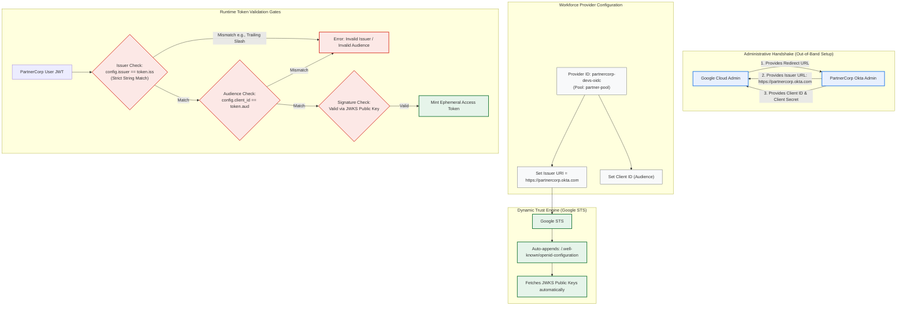

Step-by-Step Flow: OIDC Configuration & Runtime Authentication

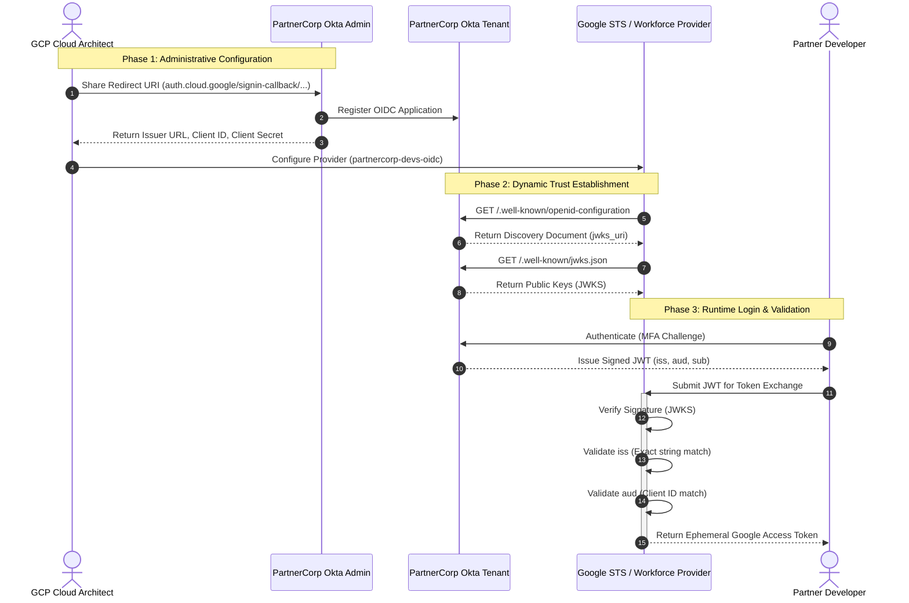

Troubleshooting Matrix: The "Issuer Mismatch" Edge Case

| Diagnostic Dimension | Misconfigured State | Resolved State | Technical Rationale |
| --- | --- | --- | --- |
| GCP Provider Issuer URL | [https://oidc.partner.com](https://oidc.partner.com) | [https://oidc.partner.com/](https://oidc.partner.com/) | Missing trailing slash in GCP provider configuration. |
| Token iss Claim (JWT) | "iss": "[https://oidc.partner.com/](https://oidc.partner.com/)" | "iss": "[https://oidc.partner.com/](https://oidc.partner.com/)" | Okta / IdP appends trailing slash to token issuer claim. |
| Verification Logic | String Comparison: != | String Comparison: == | Google STS enforces strict binary string equality; URLs are not normalized before comparison. |
| Observed Error | Token Exchange Failed: Invalid Issuer | 200 OK (Token issued) | Token exchange is halted at Step 3 before signature evaluation. |
| Investigation Tool | Decode JWT using jwt.io or jq | Inspect and confirm identical string representation | Inspect the exact raw string inside the payload claims. |

### Architecture Decision Matrix: Issuer URI vs. Client ID

| Attribute | Issuer URI (iss) | Client ID (aud) |
| --- | --- | --- |
| Architectural Role | The Source | The Audience / Target |
| What it Represents | The identity provider tenant issuing the credential. | The specific application created in the IdP for Google Cloud. |
| Security Risk Mitigated | Spoofing / Untrusted IdP: Prevents arbitrary identity sources from presenting untrusted claims. | Confused Deputy: Prevents valid tokens minted for a different enterprise app from accessing GCP. |
| Resolution Method | Queried dynamically via discovery endpoints (/.well-known/...). | Statically validated against the authorized client list. |
| Failure Response | Invalid Issuer | Invalid Audience |

Say "next page" when you are ready to review the next section.

make sure you capture everything on this page including the contents in this video.
Complete Page & Video Analysis: Connect to an IdP (OIDC)

| Architectural Concept / Parameter | Exact Course & Video Definition | Enterprise Grounding (PartnerCorp Scenario) | Well-Architected / Landing Metric Impact |
| --- | --- | --- | --- |
| Workforce Provider ID | Identifier for the provider within the workforce pool (≥4 characters; lowercase letters, numbers, and hyphens). | Defined in video as: partnercorp-engineers-oidc (or partnercorp-devs-oidc). | Governance & Landing Zone: Standardized, immutable resource naming within the organization hierarchy. |
| Redirect URI (Callback URL) | Canonical callback URI format: [https://auth.cloud.google/signin-callback/locations/global/workforcePools/WORKFORCE_POOL_ID/providers/WORKFORCE_PROVIDER_ID](https://auth.cloud.google/signin-callback/locations/global/workforcePools/WORKFORCE_POOL_ID/providers/WORKFORCE_PROVIDER_ID). | Provided to PartnerCorp Okta admin before provider creation by pre-populating target pool and provider IDs. | Security (RFC 6749): Strictly whitelisted in Okta to eliminate open-redirect and authorization code interception attacks. |
| Issuer URL (The Source) | Base address of the Okta instance providing identity claims (iss claim). | [https://partnercorp.okta.com](https://partnercorp.okta.com) (configured in GCP Provider settings). | Identity Boundary: Must match the signed token payload iss claim exactly byte-for-byte. |
| Client ID (The Audience) | Unique ID generated during IdP app creation (aud claim). | Populated in Okta as App Integration Name (PartnerCorp Google Cloud Web App) and registered in GCP. | Security (Confused Deputy Prevention): Validates that credentials were minted specifically for this Google Cloud pool. |
| Client Secret | Shared secret generated by the IdP during app integration setup. | Issued by Okta upon saving the Web App integration; saved to GCP provider for server-side code exchange. | Confidentiality: Protects authorization code redemption workflows from rogue actors. |
| Dynamic Discovery & JWKS (The Invisible Handshake) | Google appends /.well-known/openid-configuration to the Issuer URL and automatically downloads public signing keys (jwks_uri). | [https://partnercorp.okta.com/.well-known/openid-configuration](https://partnercorp.okta.com/.well-known/openid-configuration) → downloads JSON Web Key Sets. | Operational Excellence & High Availability: Automated key rollover with zero downtime or manual administrator intervention. |
| Okta Web App Integration (From Video) | The application type created in Okta: OIDC - OpenID Connect → Web Application. | PartnerCorp admin selects OIDC Web App, pastes GCP Redirect URI, and generates Client ID & Secret. | Interoperability: Standardized protocol deployment across enterprise identity vendors. |
| Issuer Mismatch (Trailing Slash Edge Case) | String mismatch between GCP config ([https://oidc.partner.com](https://oidc.partner.com)) and token payload ("iss": "[https://oidc.partner.com/](https://oidc.partner.com/)"). | User login fails with Invalid Issuer. Fixed by decoding via jwt.io and updating GCP config to include the slash. | Reliability & MTTR: Strict binary string equality check; URLs are not normalized before evaluation. |

### Concept Graph: Dynamic Trust Handshake & Okta Provisioning

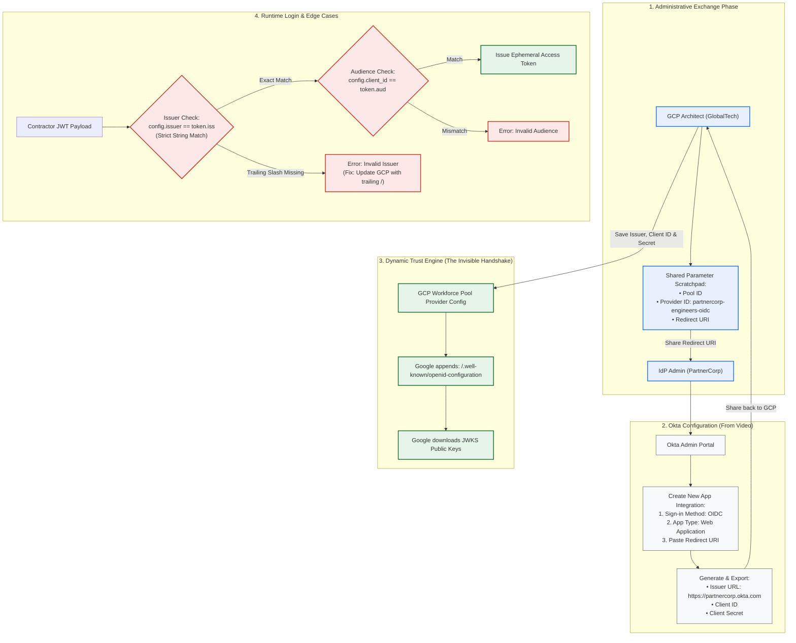

End-to-End Video & Runtime Sequence Flow

```mermaid
sequenceDiagram
    autonumber
    actor Admin as GCP Architect
    actor OktaAdmin as Okta Admin
    participant Okta as Okta Tenant
    participant STS as Google Cloud STS / Provider
    actor Contractor as PartnerCorp Developer

    Note over Admin,OktaAdmin: Phase 1: Video Walkthrough - App Creation & Handshake
    Admin->>Admin: Construct Redirect URI with Pool ID & Provider ID (partnercorp-engineers-oidc)
    Admin->>OktaAdmin: Provide Redirect URI
    OktaAdmin->>Okta: Create App: OIDC -> Web Application
    OktaAdmin->>Okta: Set Grant Type & Paste Redirect URI
    Okta-->>OktaAdmin: Generates Client ID & Client Secret
    OktaAdmin-->>Admin: Returns Issuer URL, Client ID, Client Secret
    Admin->>STS: Input Provider ID, Issuer URL, Client ID, and Secret

    Note over STS,Okta: Phase 2: The Invisible Handshake (Dynamic Discovery)
    STS->>Okta: GET /.well-known/openid-configuration
    Okta-->>STS: Returns OpenID Metadata Document
    STS->>Okta: GET /.well-known/jwks.json
    Okta-->>STS: Returns Public JWKS Key Set

    Note over Contractor,STS: Phase 3: Runtime Login & Trailing Slash Evaluation
    Contractor->>Okta: Log in via corporate SSO / MFA
    Okta-->>Contractor: Issues ID Token JWT
    Contractor->>STS: Submit Token for Exchange
    alt Issuer has Trailing Slash Mismatch
        STS-->>Contractor: Error: Invalid Issuer (iss string comparison failure)
        Note over Admin: Diagnose via jwt.io -> Add trailing slash to GCP Provider URL
    else Correct String Configuration
        STS->>STS: Validate Signature (JWKS) & Audience (Client ID)
        STS-->>Contractor: Returns Google Access Token (Local Currency)
    end
```

Step-by-Step Implementation Matrix (Console & Video Procedures)

| Step # | Stage | Actor | Interface / Action | Output / Parameters Captured |
| --- | --- | --- | --- | --- |
| 1 | Identity Collection | GCP Architect | Local Scratchpad / Documentation | • Pool ID<br>• Provider ID: partnercorp-engineers-oidc |
| 2 | Construct Callback | GCP Architect | URL Assembly | [https://auth.cloud.google/signin-callback/locations/global/workforcePools/](https://auth.cloud.google/signin-callback/locations/global/workforcePools/){POOL_ID}/providers/{PROVIDER_ID} |
| 3 | App Registration | Okta Admin | Okta Admin Console (trial-8360769-admin.okta.com) | Select OIDC - OpenID Connect → Web Application |
| 4 | Configure Redirect | Okta Admin | Okta General Settings | Paste Google Cloud Redirect URI; configure application name |
| 5 | Export Credentials | Okta Admin | Okta Credentials Tab | • Issuer URL: [https://partnercorp.okta.com](https://partnercorp.okta.com)<br>• Client ID<br>• Client Secret |
| 6 | Provider Creation | GCP Architect | GCP Cloud Console (Workforce Federation) | Input Provider Name, Issuer URL, Client ID, and Client Secret |
| 7 | Dynamic Verification | Google STS | Background Automation | Fetches /.well-known/openid-configuration & downloads JWKS public keys |

Flashcard Troubleshooting Matrix: The Issuer Mismatch

| Stage | Observed Condition | Technical Explanation | Resolution Procedure |
| --- | --- | --- | --- |
| The Scenario | Provider Issuer configured as [https://oidc.partner.com](https://oidc.partner.com) (no trailing slash). | Google rejects user login with Invalid Issuer. | Initiates troubleshooting workflow. |
| The Investigation | Decoded JWT payload inspected via jwt.io or CLI: "iss": "[https://oidc.partner.com/](https://oidc.partner.com/)". | Token issuer generated by Okta contains an automated trailing slash. | Token inspection confirms syntax discrepancy. |
| The Verdict | String comparison fails: '[https://oidc.partner.com](https://oidc.partner.com)' != '[https://oidc.partner.com/](https://oidc.partner.com/)'. | Google STS enforces strict binary string equality without normalization. | Fix: Update Google Cloud Provider configuration to include the trailing slash. |

Parameter Function & Security Boundary Matrix

| Parameter | Configuration Scope | Protocol Role | Security Risk Mitigated |
| --- | --- | --- | --- |
| Redirect URI | Provided by GCP → Configured in Okta | Authorized Target Callback | Prevents authorization code interception and open-redirect attacks. |
| Issuer URL | Provided by Okta → Configured in GCP | Token Origin (iss claim) | Prevents token spoofing from untrusted, rogue identity providers. |
| Client ID | Provided by Okta → Configured in GCP | Intended Recipient (aud claim) | Prevents Confused Deputy attacks across different enterprise apps. |
| Client Secret | Provided by Okta → Configured in GCP | Server-Side Authenticator | Authenticates Google STS directly to the IdP during token exchange. |

Say "next page" when you are ready to review the next section.

can you be as fine grained as possible in this page
Granular Architectural Analysis: Connect an IdP (OIDC)

| Granular Entity / Parameter | Exact Specification & Source Definition | Technical Function & Protocol Mechanics | Enterprise Failure Mode & Landing Metric Impact |
| --- | --- | --- | --- |
| Workforce Pool ID | Pre-requisite identifier created in the prior lesson (e.g., partner-pool). | Scopes the administrative and cryptographic trust hierarchy within the GCP Organization (locations/global/workforcePools/$POOL_ID). | Invalid Pool ID prevents provider routing; STS rejects authentication requests at the organization perimeter. |
| Workforce Provider ID | ≥4 characters; lowercase letters, numbers, hyphens (e.g., partnercorp-engineers-oidc or partnercorp-devs-oidc). | Identifies the specific trust gate ("door") within the pool; forms the suffix of the federated callback URI. | Using uppercase letters or special symbols violates GCP schema constraints and causes initial API validation failures. |
| Redirect URI (Callback URL) | [https://auth.cloud.google/signin-callback/locations/global/workforcePools/WORKFORCE_POOL_ID/providers/WORKFORCE_PROVIDER_ID](https://auth.cloud.google/signin-callback/locations/global/workforcePools/WORKFORCE_POOL_ID/providers/WORKFORCE_PROVIDER_ID) | OAuth 2.0 redirection endpoint provided out-of-band to the external Okta administrator to receive authorization tokens. | RFC 6749: Mismatched URI causes IdP authorization rejection (redirect_uri_mismatch), blocking the authorization code flow. |
| Issuer URL (iss) | Base URL of the Okta instance (e.g., [https://partnercorp.okta.com](https://partnercorp.okta.com) or [https://oidc.partner.com/](https://oidc.partner.com/)). | Identifies the identity provider. Google uses this root URL to fetch public signing keys and validate the token's origin claim. | Zero-Trust Boundary: Inability to resolve or mismatch halts the token exchange immediately with Invalid Issuer. |
| Client ID (aud) | Unique string identifier generated during IdP app creation (e.g., Okta Client ID). | Audience claim indicating the intended consumer of the token assertion; matches the registered GCP deployment. | Confused Deputy Prevention: Rejects tokens generated for other SaaS/enterprise apps within the same Okta tenant. |
| Client Secret | Alphanumeric secret issued by the IdP during web app creation. | Enables secure server-to-server token redemption between Google STS and the Okta token endpoint. | Secret leakage compromises token exchange integrity; secret expiration blocks token exchange. |
| Sign-in Method | OIDC - OpenID Connect (selected in Okta admin portal). | Modern JSON/REST identity layer built on OAuth 2.0 specifications. | Incompatible if selected as SAML; changes metadata and cryptographic requirements. |
| Application Type | Web Application (selected in Okta admin portal). | Designates the client architecture in Okta to support authorization code and implicit token delivery to Google's redirect URI. | Selecting SPA or Native limits server-side client secret validation. |
| App Name | E.g., PartnerCorp GlobalTech Workforce Identity Federation. | Descriptive label inside the third-party IdP portal identifying the trust integration. | Purely administrative; lacks protocol impact but aids tenant auditability. |
| Grant Type | Implicit (Hybrid) Grant (toggled in Okta advanced options). | Instructs Okta to issue ID tokens directly or via hybrid exchange patterns to browser endpoints. | Omitting required grant types blocks token issuance to the Google callback URI. |
| Group Assignment | Skipped during initial app integration creation. | Deferring access controls to dynamic attribute mapping and downstream CEL conditions rather than static Okta assignment. | Premature group filtering can block users before attribute claim verification. |
| Discovery Automation | Appends /.well-known/openid-configuration dynamically to the Issuer URL. | Automates resolution of identity metadata, authorization endpoints, and the jwks_uri public key set. | Operational Excellence: Eliminates manual public key exchanges and prevents rollover outages. |
| JWKS Endpoint | Public endpoint (JSON Web Key Set) queried dynamically by Google STS. | Publishes active RSA/EC public keys used to cryptographically verify RS256 token signatures. | Reliability Metric: Enables automatic key rotation with zero downtime when Okta rotates signing keys. |
| Trailing Slash Nuance | Binary string mismatch: [https://oidc.partner.com](https://oidc.partner.com) vs. [https://oidc.partner.com/](https://oidc.partner.com/). | Google STS enforces strict byte-for-byte binary string equality on the iss claim without URL normalization. | MTTR Metric: Causes Token Exchange Failed: Invalid Issuer errors despite valid signatures; resolved by appending / in GCP. |

End-to-End Handshake & Video Configuration Architecture

```mermaid
graph TD
    subgraph Phase1_Admin_Coordination["Phase 1: Administrative Coordination (Video 00:00 - 01:21)"]
        GCP_Admin["GCP Architect (GlobalTech)"]
        Notepad["Shared Parameter Scratchpad:<br>• Pool ID: partner-pool<br>• Provider ID: partnercorp-engineers-oidc"]
        Calc_URI["Construct Canonical Redirect URI:<br>https://auth.cloud.google/signin-callback/.../partner-pool/.../partnercorp-engineers-oidc"]
        Okta_Admin["PartnerCorp Okta Admin"]

        GCP_Admin --> Notepad
        Notepad --> Calc_URI
        Calc_URI -->|Share Callback URL| Okta_Admin
    end

    subgraph Phase2_Okta_Provisioning["Phase 2: Okta Portal Provisioning (Video 01:21 - 02:22)"]
        Okta_Console["Okta Admin Console"]
        Create_App["Create App Integration:<br>• Sign-in Method: OIDC<br>• Application Type: Web App<br>• Name: PartnerCorp GlobalTech WIF"]
        Set_Grant["Check: Implicit (Hybrid) Grant"]
        Paste_URI["Paste Sign-in Redirect URI (ends with Provider ID)"]
        Save_App["Skip Group Assignment & Click Save"]
        Extract_Creds["Export Identity Metadata:<br>1. Issuer URL: https://partnercorp.okta.com<br>2. Client ID (App ID)<br>3. Client Secret"]

        Okta_Admin --> Okta_Console
        Okta_Console --> Create_App
        Create_App --> Set_Grant
        Set_Grant --> Paste_URI
        Paste_URI --> Save_App
        Save_App --> Extract_Creds
        Extract_Creds -->|Handshake back to GCP| GCP_Admin
    end

    subgraph Phase3_GCP_Dynamic_Trust["Phase 3: Dynamic Trust & Key Resolution"]
        GCP_WIF["GCP Workforce Identity Provider"]
        Discovery_Engine["Appends: /.well-known/openid-configuration"]
        JWKS_Resolver["Fetches Public JWKS Keys from Okta"]

        GCP_Admin -->|Configure Issuer URL, Client ID, Secret| GCP_WIF
        GCP_WIF --> Discovery_Engine
        Discovery_Engine --> JWKS_Resolver
    end

    subgraph Phase4_Runtime_Evaluation["Phase 4: Runtime Token Exchange & Validation Gates"]
        Dev_Token["Incoming User JWT Token"]
        Check_Sig{"Cryptographic Signature Check<br>(via Okta JWKS)"}
        Check_Iss{"Issuer Match Check (iss):<br>Strict Byte-for-Byte Match?"}
        Check_Aud{"Audience Match Check (aud):<br>Matches GCP Client ID?"}
        Mint_Token["Mint Ephemeral Google Access Token<br>(Default TTL: 1 Hour)"]
        Err_Iss["Reject: Invalid Issuer<br>(Check Trailing Slash)"]
        Err_Aud["Reject: Invalid Audience"]

        Dev_Token --> Check_Sig
        Check_Sig -->|Valid| Check_Iss
        Check_Iss -->|Pass| Check_Aud
        Check_Iss -->|Trailing Slash Missing| Err_Iss
        Check_Aud -->|Pass| Mint_Token
        Check_Aud -->|Mismatch| Err_Aud
    end

    classDef admin fill:#e8f0fe,stroke:#1a73e8,stroke-width:2px;
    classDef okta fill:#f8f9fa,stroke:#5f6368,stroke-width:1px;
    classDef trust fill:#e6f4ea,stroke:#137333,stroke-width:2px;
    classDef error fill:#fce8e6,stroke:#d93025,stroke-width:2px;
    class GCP_Admin,Notepad,Calc_URI,Okta_Admin admin;
    class Okta_Console,Create_App,Set_Grant,Paste_URI,Save_App,Extract_Creds okta;
    class GCP_WIF,Discovery_Engine,JWKS_Resolver,Mint_Token trust;
    class Check_Sig,Check_Iss,Check_Aud,Err_Iss,Err_Aud error;
```

Step-by-Step Flow: Video Walkthrough & STS Authentication

```mermaid
sequenceDiagram
    autonumber
    actor GCPAdmin as GCP Architect
    actor OktaAdmin as Okta Admin
    participant Okta as Okta Tenant (PartnerCorp)
    participant STS as Google STS / Workforce Provider
    actor Dev as PartnerCorp Developer

    Note over GCPAdmin: 1. Setup & Pre-calculation
    GCPAdmin->>GCPAdmin: Define Pool ID (partner-pool) & Provider ID (partnercorp-engineers-oidc)
    GCPAdmin->>GCPAdmin: Assemble Redirect URI: https://auth.cloud.google/signin-callback/...
    GCPAdmin->>OktaAdmin: Provide Redirect URI out-of-band

    Note over OktaAdmin,Okta: 2. Okta Configuration (Video 01:21 - 02:22)
    OktaAdmin->>Okta: Create App Integration (OIDC -> Web Application)
    OktaAdmin->>Okta: Enable Implicit (Hybrid) Grant
    OktaAdmin->>Okta: Paste Sign-in Redirect URI
    OktaAdmin->>Okta: Skip Group Assignments & Save
    Okta-->>OktaAdmin: Display Client ID, Client Secret, and Issuer URL
    OktaAdmin-->>GCPAdmin: Provide Issuer URL, Client ID, Client Secret

    Note over GCPAdmin,STS: 3. GCP Provider Configuration & Dynamic Handshake
    GCPAdmin->>STS: Input Provider ID, Issuer URL, Client ID, Client Secret
    STS->>Okta: GET /.well-known/openid-configuration
    Okta-->>STS: Return Discovery Document (jwks_uri endpoint)
    STS->>Okta: GET /.well-known/jwks.json
    Okta-->>STS: Return Public Signing Keys (JWKS)

    Note over Dev,STS: 4. Runtime Login & Assertion Verification
    Dev->>Okta: Authenticate via Corporate SSO / MFA
    Okta-->>Dev: Issue Signed JWT (iss, aud, sub)
    Dev->>STS: Submit JWT for RFC 8693 Token Exchange
    activate STS
    alt Issuer Trailing Slash Mismatch (e.g. config lacks '/')
        STS-->>Dev: HTTP 400: Invalid Issuer (Strict string comparison failed)
    else Correct String Alignment
        STS->>STS: Validate Signature against JWKS
        STS->>STS: Validate Audience against Client ID
        STS-->>Dev: Return Ephemeral Google Access Token
    end
    deactivate STS
```

Flashcard Matrix: The "Issuer Mismatch" Edge Case

| Flashcard Dimension | Raw State / Payload Example | Technical Explanation | Resolution & Landing Metric Impact |
| --- | --- | --- | --- |
| 1. The Scenario |  |  |  |

Provider Issuer Config:

[https://oidc.partner.com](https://oidc.partner.com)

| User authenticates through Okta successfully, but Google rejects the exchange with Invalid Issuer. | Identifies an authentication breakdown at Step 3 (The Exchange). |
| --- | --- |
| 2. The Investigation |  |

Decoded JWT Payload (jwt.io):

{ "iss": "[https://oidc.partner.com/](https://oidc.partner.com/)", "sub": "usr_102" }

| Inspecting the raw token claims reveals that Okta appends a trailing slash (/) to the iss attribute. | Confirms cryptographic validity while revealing a string mismatch. |
| --- | --- |
| 3. The Verdict |  |

Comparison:

"[https://oidc.partner.com](https://oidc.partner.com)" 

= "[https://oidc.partner.com/](https://oidc.partner.com/)"

| Google STS performs strict binary string equality on issuer claims without applying URL normalization rules. | Resolution: Update GCP Provider configuration to include the trailing slash ([https://oidc.partner.com/](https://oidc.partner.com/)). |
| --- | --- |

Architectural Parameter Comparison: Issuer URL vs. Client ID

| Attribute Dimension | Issuer URL (iss) | Client ID (aud) |
| --- | --- | --- |
| Architectural Concept | The Source (The Origin) | The Audience (The Target) |
| Entity Represented | The Identity Provider tenant issuing claims (e.g., [https://partnercorp.okta.com](https://partnercorp.okta.com)). | The registered application identifier in Okta assigned to Google Cloud. |
| Primary Security Defense | Anti-Spoofing: Blocks forged tokens from unauthorized identity sources. | Confused Deputy Prevention: Ensures tokens minted for other apps cannot access GCP. |
| Verification Method | Evaluated via OpenID Discovery and strict string comparison. | Evaluated via strict string matching against configured Client IDs. |
| Protocol Failure Code | Invalid Issuer | Invalid Audience |

Want to take a 4-question quiz on OIDC provider parameters, redirect URI syntax, and the trailing slash edge case?

---

Lesson Analysis: Connect an IdP (SAML)

| Key Concept / Parameter | Architectural & Exact Course Definition | Real-World Enterprise Grounding (Legacy Corp Scenario) | GCP Well-Architected & Landing Metrics Impact |
| --- | --- | --- | --- |
| SAML 2.0 Workforce Provider | A federated trust connector configured within an existing Workforce Identity Pool to enable XML-based SAML authentication. | Integrating Legacy Corp's on-premises Active Directory Federation Services (AD FS) server into GlobalTech's partner-pool. | Interoperability & Modernization: Enables legacy enterprise M&A integration without requiring an immediate IdP migration. |
| Workforce Provider ID | Alphanumeric identifier (≥ 4 characters; lowercase letters, digits, hyphens). | Defined as legacycorp-saml inside the existing workforce pool. | Standardization & Governance: Identifies the specific door within the pool hierarchy. |
| Assertion Consumer Service (ACS) URL | The Google authentication callback endpoint where the SAML assertion is posted: [https://auth.cloud.google/signin-callback/locations/global/workforcePools/WORKFORCE_POOL_ID/providers/WORKFORCE_PROVIDER_ID](https://auth.cloud.google/signin-callback/locations/global/workforcePools/WORKFORCE_POOL_ID/providers/WORKFORCE_PROVIDER_ID). | Provided to the Legacy Corp AD FS admin to configure the Relying Party Trust endpoint. | Security (RFC 7522): Ensures signed assertions are posted strictly to Google's authorized handler. |
| Audience URI (SP Entity ID) | The Service Provider entity identifier: [https://iam.googleapis.com/locations/global/workforcePools/WORKFORCE_POOL_ID/providers/WORKFORCE_PROVIDER_ID](https://iam.googleapis.com/locations/global/workforcePools/WORKFORCE_POOL_ID/providers/WORKFORCE_PROVIDER_ID). | Configured as the Relying Party Identifier in AD FS to establish trust with Google Cloud. | Confused Deputy Prevention: Rejects assertions minted for other service providers or mismatching pools. |
| IdP Metadata XML | An XML document exported by the IdP containing its Entity ID, SSO endpoints, and X.509 public signing certificates. | AD FS metadata XML file transferred out-of-band and uploaded directly to the GCP Provider configuration. | Operational Reliability: Automates cert ingestion and eliminates manual entry errors. |
| The "Entity ID" Error (Case Sensitivity & Formatting) | Exact string match requirement between the XML entityID and token Issuer (e.g., [http://adfs.legacycorp.com/adfs/services/trust](http://adfs.legacycorp.com/adfs/services/trust)). | Failures caused by typing https instead of http or adding a trailing slash / during manual configuration. | MTTR Metric: Uploading the XML file directly prevents handshake breakages caused by manual typing errors. |

### Concept Graph: Multi-Provider Workforce Pool & SAML Trust Architecture

```mermaid
graph TD
    subgraph GlobalTech_Identity_Perimeter["Google Cloud Organization Perimeter"]
        Pool["Workforce Identity Pool: partner-pool<br>(The Central Lobby)"]
        Door_OIDC["Provider 1: partnercorp-engineers-oidc<br>(The OIDC Door - Okta)"]
        Door_SAML["Provider 2: legacycorp-saml<br>(The SAML Door - AD FS)"]

        Pool --- Door_OIDC
        Pool --- Door_SAML
    end

    subgraph LegacyCorp_ADFS["Legacy Corp On-Premises Environment"]
        ADFS["AD FS Server<br>(Strict Firewall / No OIDC)"]
        Meta_XML["IdP Metadata XML<br>• entityID='http://adfs.legacycorp.com/...'<br>• X.509 Public Signing Certificate<br>• SingleSignOnService HTTP-POST"]

        ADFS -->|Export| Meta_XML
    end

    subgraph Administrative_Handshake["Administrative Endpoint Exchange"]
        GCP_Admin["GlobalTech Cloud Architect"]
        ADFS_Admin["Legacy Corp AD FS Admin"]

        GCP_Admin -->|1. Provide ACS URL & SP Entity ID| ADFS_Admin
        ADFS_Admin -->|2. Configure Relying Party Trust| ADFS
        ADFS_Admin -->|3. Export and share Metadata XML| GCP_Admin
        GCP_Admin -->|4. Upload XML directly to GCP Provider| Door_SAML
    end

    subgraph Runtime_Handshake["Runtime Handshake & Validation"]
        User["Legacy Corp Factory Engineer"]
        STS["Google Security Token Service (STS)"]
        IAM["Cloud IAM & Resource Access"]

        User -->|1. Authenticate with AD FS| ADFS
        ADFS -->|2. Issue Signed SAML Assertion| User
        User -->|3. POST Assertion to ACS URL| STS
        STS -->|4. Validate Signature & Entity ID Match| Door_SAML
        STS -->|5. Issue Ephemeral Google Token| IAM
    end

    classDef gcp fill:#e8f0fe,stroke:#1a73e8,stroke-width:2px;
    classDef adfs fill:#fff0f0,stroke:#d93025,stroke-width:2px;
    classDef admin fill:#f8f9fa,stroke:#5f6368,stroke-width:1px;
    classDef runtime fill:#e6f4ea,stroke:#137333,stroke-width:2px;
    class Pool,Door_OIDC,Door_SAML gcp;
    class ADFS,Meta_XML adfs;
    class GCP_Admin,ADFS_Admin admin;
    class User,STS,IAM runtime;
```

SAML Configuration & Ingestion Sequence

```mermaid
sequenceDiagram
    autonumber
    actor Architect as GlobalTech Architect
    actor ADFSAdmin as Legacy Corp AD FS Admin
    participant ADFS as On-Premises AD FS
    participant Console as Google Cloud Console (WIF)
    participant STS as Google STS

    Note over Architect,ADFSAdmin: Phase 1: Endpoint Construction & Handshake
    Architect->>Architect: Construct ACS URL: https://auth.cloud.google/signin-callback/.../legacycorp-saml
    Architect->>Architect: Construct Audience URI: https://iam.googleapis.com/.../legacycorp-saml
    Architect->>ADFSAdmin: Provide ACS URL and Audience URI (SP Entity ID)
    ADFSAdmin->>ADFS: Add Relying Party Trust using ACS URL & Audience URI
    ADFSAdmin->>ADFS: Export FederationMetadata.xml
    ADFSAdmin-->>Architect: Transfer Metadata XML file

    Note over Architect,Console: Phase 2: Provider Configuration in Existing Pool
    Architect->>Console: Open existing Pool (partner-pool)
    Architect->>Console: Add Provider: SAML 2.0 (ID: legacycorp-saml)
    Architect->>Console: Upload Metadata XML (Automatic parsing of Entity ID & certs)
    Console->>STS: Register SAML Provider & Trust Certificate

    Note over Architect,Console: Phase 3: Entity ID Verification
    STS->>STS: Verify IdP entityID matches Token Issuer byte-for-byte
```

SAML Parameter & URL Reference Matrix

| Parameter / Endpoint | URL Format / Syntax | Recipient & Location | Technical Function |
| --- | --- | --- | --- |
| Assertion Consumer Service (ACS) URL | [https://auth.cloud.google/signin-callback/locations/global/workforcePools/WORKFORCE_POOL_ID/providers/WORKFORCE_PROVIDER_ID](https://auth.cloud.google/signin-callback/locations/global/workforcePools/WORKFORCE_POOL_ID/providers/WORKFORCE_PROVIDER_ID) | Provided to AD FS Admin → Configured in AD FS Relying Party Trust Endpoints | Endpoint where the user's browser posts the signed SAML XML assertion response. |
| Audience URI (SP Entity ID) | [https://iam.googleapis.com/locations/global/workforcePools/WORKFORCE_POOL_ID/providers/WORKFORCE_PROVIDER_ID](https://iam.googleapis.com/locations/global/workforcePools/WORKFORCE_POOL_ID/providers/WORKFORCE_PROVIDER_ID) | Provided to AD FS Admin → Configured as AD FS Relying Party Identifier | Unique URI identifying Google Cloud IAM as the intended Relying Party / Service Provider. |
| IdP Entity ID | E.g., [http://adfs.legacycorp.com/adfs/services/trust](http://adfs.legacycorp.com/adfs/services/trust) | Present in IdP Metadata XML → Parsed by Google Cloud | Uniquely identifies the external identity authority. Must match the token's Issuer string exactly. |
| Signing Certificate | Embedded X.509 Certificate in <KeyDescriptor use="signing"> | Present in IdP Metadata XML → Uploaded to Google Cloud | Public key used by Google STS to verify cryptographic signatures on incoming SAML assertions. |

Troubleshooting Matrix: The "Entity ID" Error

| Error Dimension | Misconfigured State | Validated Production State | Root Cause & Remediation |
| --- | --- | --- | --- |
| Protocol Scheme | [https://adfs.legacycorp.com/](https://adfs.legacycorp.com/)... | [http://adfs.legacycorp.com/](http://adfs.legacycorp.com/)... | AD FS historically defaults to http in its entity identifier; typing https causes an immediate string mismatch. |
| Trailing Slash | .../services/trust/ | .../services/trust | Adding an unnecessary trailing slash fails binary string equality during token exchange. |
| Casing | .../Services/Trust | .../services/trust | Entity IDs are evaluated case-sensitively by Google STS. |
| Recommended Practice | Manual entry into GCP Console | Upload metadata.xml directly | Direct file upload eliminates manual transcription errors. |

Architectural Comparison: The Two "Doors" in GlobalTech's Pool

| Dimension | Provider 1: PartnerCorp (Modern) | Provider 2: Legacy Corp (Acquisition) |
| --- | --- | --- |
| Protocol | OpenID Connect (OIDC) | SAML 2.0 |
| Identity System | Okta (Cloud SaaS) | Active Directory Federation Services (AD FS On-Prem) |
| Trust Establishment | Dynamic discovery via Issuer URL (/.well-known/...) | Static ingestion via IdP metadata.xml |
| Client Callback | Redirect URI | Assertion Consumer Service (ACS) URL |
| Audience Parameter | Client ID (aud) | SP Entity ID / Audience URI |
| Key Rollover | Automatic (JWKS endpoint) | Manual (Re-upload metadata XML when cert expires) |

Want to test your understanding of SAML workforce provider setup, ACS URLs, and Entity ID errors with a 4-question quiz?

You configured the SAML provider. The Legacy Corp admin claims they set up their side. A user tries to log in and gets the error: Error: The audience in the assertion does not match the expected audience. What is the most likely cause?
The user forgot their password.
The ADFS server was not configured.
The Metadata XML file is expired.
The Legacy Corp admin pasted the wrong string into their ADFS configuration.
Cause Analysis & Verification

| Evaluation Option | Verdict | Detailed Architectural Grounding |
| --- | --- | --- |
| The user forgot their password. | Incorrect | Authentication with AD FS succeeded; an assertion was generated and sent, so credentials were valid. |
| The ADFS server was not configured. | Incorrect | AD FS successfully issued a SAML assertion; the error occurs downstream when Google STS validates the received token. |
| The Metadata XML file is expired. | Incorrect | An expired signing certificate results in a signature validation failure (Signature verification failed), not an audience mismatch. |
| The Legacy Corp admin pasted the wrong string into their ADFS configuration. | CORRECT | In SAML 2.0 federation, the Audience URI (SP Entity ID) tells AD FS which relying party the assertion is meant for ([https://iam.googleapis.com/locations/global/workforcePools/WORKFORCE_POOL_ID/providers/WORKFORCE_PROVIDER_ID](https://iam.googleapis.com/locations/global/workforcePools/WORKFORCE_POOL_ID/providers/WORKFORCE_PROVIDER_ID)). If the AD FS admin enters an incorrect Relying Party Identifier (such as a typo, wrong pool/provider ID, or the ACS URL instead of the Audience URI), AD FS stamps the wrong audience into the <saml:Audience> element. Google STS detects the discrepancy and rejects the token with: Error: The audience in the assertion does not match the expected audience. |

Step-by-Step Audience Evaluation Flow

```mermaid
sequenceDiagram
    autonumber
    actor User as Legacy Corp Engineer
    participant ADFS as AD FS Server
    participant STS as Google STS

    User->>ADFS: Log in with credentials
    Note over ADFS: Admin misconfigured Relying Party Identifier<br/>(e.g., Typo or wrong Audience URI pasted)
    ADFS-->>User: Issues SAML Assertion with mismatched <saml:Audience>
    User->>STS: POST Assertion to ACS URL
    activate STS
    STS->>STS: Parse <saml:AudienceRestriction>
    Note over STS: Token Audience != Expected Provider Audience URI
    STS-->>User: HTTP 400: Error: The audience in the assertion does not match the expected audience.
    deactivate STS
```

The correct answer is:
The Legacy Corp admin pasted the wrong string into their ADFS configuration.

answer the following question: You have created a pool with a Session Duration of 1 hour. A developer logs in at 9:00 AM. They open a Cloud Shell terminal and start a long-running script that takes 90 minutes to complete. What happens with this pool?
The script finishes successfully because the session auto-renews.
The session stays active because a script is running.
The script fails at 10:00 AM.
The session fails at 16:00 PM.
Session Duration Evaluation & Architectural Analysis

| Evaluation Option | Verdict | Architectural Explanation |
| --- | --- | --- |
| The script finishes successfully because the session auto-renews. | Incorrect | Workforce Identity Federation sessions do not automatically extend themselves in the background when executing CLI/API commands without re-authentication. |
| The session stays active because a script is running. | Incorrect | Background activity or active terminal processes do not keep an expired OAuth/STS session alive. Google Cloud evaluates absolute token and session lifetime boundaries. |
| The script fails at 10:00 AM. | CORRECT | When a Workforce Identity Pool is configured with a Session Duration of 1 hour, the federated credentials expire exactly 60 minutes after authentication (9:00 AM + 1 hour = 10:00 AM). Once 10:00 AM arrives, subsequent API calls issued by the running script fail with an authentication error (401 Unauthorized / expired token). |
| The session fails at 16:00 PM. | Incorrect | A 1-hour session duration configured at 9:00 AM expires at 10:00 AM, not 16:00 (4:00 PM). |

Timeline of Execution & Token Expiration

```mermaid
timeline
    title Workforce Identity Session Lifecycle (1-Hour Duration)
    9:00 AM : Developer logs into GCP Console / Cloud Shell
            : Ephemeral federated credentials issued (TTL = 60 mins)
            : Developer kicks off 90-minute script
    9:30 AM : Script runs successfully (T + 30 mins)
            : Valid bearer token presented for API calls
    10:00 AM : Session Duration threshold reached (T + 60 mins)
             : Federated session & access token expire
             : SCRIPT FAILS (401 Unauthorized / Token Expired)
    10:30 AM : Script would have finished if session had not expired
```

The correct option to select is:

The script fails at 10:00 AM.

answer the following question: You have created a pool with a Session Duration of 1 hour. A developer logs in at 9:00 AM. They open a Cloud Shell terminal and start a long-running script that takes 90 minutes to complete. What happens with this pool?
The script finishes successfully because the session auto-renews.
The session stays active because a script is running.
The script fails at 10:00 AM.
The session fails at 16:00 PM.

| Evaluation Option | Technical Verdict | Detailed Architecture Rationale |
| --- | --- | --- |
| The script finishes successfully because the session auto-renews. | Incorrect | Workforce Identity Federation sessions and ephemeral access tokens do not auto-extend in the background during active terminal runs. |
| The session stays active because a script is running. | Incorrect | Background activity or execution state does not prolong or pause an absolute Google STS session expiry window. |
| The script fails at 10:00 AM. | CORRECT | A Session Duration of 1 hour establishes a strict, non-negotiable lifetime. Starting at 9:00 AM, the issued federated token and console/Cloud Shell session expire after 60 minutes (10:00 AM), causing any ongoing script requiring authenticated GCP API calls to fail immediately with an authentication error. |
| The session fails at 16:00 PM. | Incorrect | 16:00 PM (4:00 PM) would correspond to a 7-hour session duration, not 1 hour. |

```mermaid
timeline
    title Workforce Identity Session Lifecycle (1-Hour Duration)
    9:00 AM : Developer authenticates via WIF
            : 1-hour session & token lifetime granted
            : 90-minute script initiated in Cloud Shell
    9:30 AM : Active API calls succeed (Valid credentials)
    10:00 AM : 1-Hour Session Duration threshold reached
             : STS credentials expire
             : SCRIPT TERMINATES / FAILS (401 Unauthorized)
```

The correct option to select is:

The script fails at 10:00 AM.

answer the following question: A developer asks, "If Google already trusts the Issuer URL (PartnerCorp's Directory), why do I also need to configure the Client ID (Audience)? Isn't the Issuer enough?" How do you answer?
To prevent session timeout.
To prevent a malicious attack.
To prevent Token expiration
To ensure string exactness.
Architectural Evaluation & Threat Analysis

| Option | Evaluation | Technical Rationale & Zero-Trust Architecture |
| --- | --- | --- |
| To prevent session timeout. | Incorrect | Session timeouts are governed by workforce pool session duration settings, not client/audience verification. |
| To prevent a malicious attack. | CORRECT | Validating the Client ID (Audience / aud) protects against the Confused Deputy Attack and token redirection attacks. If Google only checked the Issuer URL, an attacker with a legitimate account in PartnerCorp could obtain a valid token for an unrelated third-party app in PartnerCorp's directory and maliciously replay/present that token to your Google Cloud environment. Enforcing the specific Client ID ensures Google Cloud only accepts tokens minted explicitly for this exact cloud integration. |
| To prevent Token expiration | Incorrect | Token lifetime is set by the IdP's token issuance policies and STS token duration limits. |
| To ensure string exactness. | Incorrect | String matching is a validation mechanic, not the fundamental security purpose of configuring an audience constraint. |

Threat Model: The Confused Deputy Attack Without Audience Check

```mermaid
flowchart TD
    subgraph PartnerCorp_Directory["PartnerCorp Okta / Entra ID Tenant"]
        Attacker["Contractor / Malicious Insider"]
        AppA["HR / Payroll App<br>(Client ID: app-hr-123)"]
        AppGCP["Google Cloud Integration<br>(Client ID: gcp-wif-999)"]

        Attacker -->|Legitimate Login| AppA
        AppA -->|Issues Valid JWT<br>iss: partnercorp.okta.com<br>aud: app-hr-123| Attacker
    end

    subgraph Security_Check["Google Security Token Service (STS)"]
        Token["Present Token to Google STS"]
        Attacker -->|Replay Token| Token

        Check1{"Check Issuer (iss)?<br>partnercorp.okta.com"}
        Check2{"Check Audience (aud)?<br>Matches gcp-wif-999?"}

        Token --> Check1
        Check1 -->|Trusted Issuer| Check2
        Check2 -->|Mismatch: aud is app-hr-123| Block["REJECT / 400 Bad Request<br>Malicious Replay Blocked"]
        Check2 -.->|If aud was NOT checked| Breach["SECURITY BREACH:<br>Access Granted via Unrelated Token"]
    end

    classDef danger fill:#fce8e6,stroke:#d93025,stroke-width:2px;
    classDef success fill:#e6f4ea,stroke:#137333,stroke-width:2px;
    classDef neutral fill:#e8f0fe,stroke:#1a73e8,stroke-width:2px;
    class Attacker,Breach danger;
    class Check1,Check2,Token neutral;
    class Block success;
```

The correct option is:

To prevent a malicious attack.

answer the following question: You are configuring an OIDC provider. You enter https://sts.windows.net/partner-id as the Issuer URI. When a user attempts to log in, the attempt fails with an "Invalid Issuer" error. You inspect the token in jwt.io and notice the issuer claim is exactly the same URL you typed, but with a / at the end.
Google STS never returned a Federated Access Token.
String exactness (the trailing slash)
It was identified as malicious, trying to access your Google Cloud environment.
The Google Access Token expires due to a short session duration.

### Evaluation of Options

| Option | Verdict | Technical Explanation |
| --- | --- | --- |
| Google STS never returned a Federated Access Token. | Incorrect | This describes a downstream symptom of the failure, not the root cause of why the token exchange rejected the request. |
| String exactness (the trailing slash) | CORRECT | Google Cloud Security Token Service (STS) enforces strict, byte-for-byte binary string equality when validating the iss (issuer) claim against the configured Provider Issuer URI. It does not perform URL normalization. Because [https://sts.windows.net/partner-id](https://sts.windows.net/partner-id) |


= [https://sts.windows.net/partner-id/](https://sts.windows.net/partner-id/), the check fails and throws Invalid Issuer.

| It was identified as malicious, trying to access your Google Cloud environment. | Incorrect | An issuer string mismatch is a configuration syntax error during claim evaluation, not a flagged intrusion attempt. |
| --- | --- | --- |
| The Google Access Token expires due to a short session duration. | Incorrect | Token lifetime and session duration settings are evaluated only after an access token has been minted; here, the exchange failed prior to token generation. |

String Comparison Breakdown

```mermaid
flowchart TD
    Config["GCP Provider Issuer URI Config:<br><code>https://sts.windows.net/partner-id</code>"]
    Token["Decoded JWT Payload (jwt.io):<br><code>\"iss\": \"https://sts.windows.net/partner-id/\"</code>"]

    Config --> Comp{"Strict Binary String Equality Check<br>config.issuer == token.iss"}
    Token --> Comp

    Comp -->|Mismatch due to trailing slash| Reject["HTTP 400 Bad Request:<br><strong>Token Exchange Failed: Invalid Issuer</strong>"]
    Comp -.->|If trailing slash added to config| Pass["Validation Succeeded -> Mint Access Token"]

    classDef red fill:#fce8e6,stroke:#d93025,stroke-width:2px;
    classDef blue fill:#e8f0fe,stroke:#1a73e8,stroke-width:2px;
    classDef green fill:#e6f4ea,stroke:#137333,stroke-width:2px;
    class Config,Token blue;
    class Comp,Reject red;
    class Pass green;
```

The correct option to select is:

String exactness (the trailing slash)

---

Lesson Analysis: The Logic of Access — Attribute Mapping

| Key Concept / Construct | Course & Architectural Definition | Concrete Enterprise Scenario (Alice / PartnerCorp) | GCP Well-Architected & Landing Metrics Impact |
| --- | --- | --- | --- |
| Attribute Mapping ("Universal Translator") | Translation layer bridging external Identity Provider (IdP) claims to Google Cloud's internal identity schema using Common Expression Language (CEL). | Okta sends custom_job_role: "eng", which Google translates to attribute.dept = assertion.custom_job_role so IAM policies can read it. | Operational Excellence: Decouples external directory taxonomy from Google IAM policies; eliminates hardcoded external claim dependencies. |
| Mapping Syntax (Left = Right) | Strict CEL grammar format: TARGET_ATTRIBUTE = SOURCE_ASSERTION, where the left side is Google's target bucket and the right side is the IdP claim via the assertion keyword. | google.subject = assertion.email (Google principal target on left; incoming Okta SAML/OIDC assertion claim on right). | Standardization & Auditability: Enforces consistent transformation logic across external provider integrations. |
| The assertion Keyword | Reserved CEL keyword providing programmatic access to the token payload claims (JWT claims or SAML assertion attributes). | assertion.sub, assertion.email, assertion.custom_job_role. | Security & Integrity: Accesses verified, cryptographically signed token claims directly from the IdP payload. |
| Built-in Attribute: google.subject | Reserved, mandatory identity bucket (The Who). Represents the primary principal identifier in Google IAM. | Mapping google.subject = assertion.email so Alice appears as alice@partnercorp.com rather than a cryptic ID like 00uxopt8.... | Auditability (Cloud Audit Logs): Non-repudiation; logs clearly reflect human-readable user identities instead of opaque external hashes. |
| Built-in Attribute: google.display_name | Optional identity bucket (The Label). Determines what name appears in the top-right user badge of the Cloud Console. | google.display_name = assertion.email.split('@')[0].title() → displays "Alice" in the console UI. | User Experience & Observability: Human-friendly console tracking without affecting RBAC/ABAC authorization rules. |
| Built-in Attribute: google.groups | Optional identity bucket (The List). Captures an array of group memberships asserted by the IdP. | google.groups = assertion.groups | Governance & RBAC: Direct mapping allows IAM policies to grant access to entire external teams via principalSet://.../group/.... |
| Custom Attributes (attribute.*) | User-defined buckets prefixed with attribute. representing corporate metadata (e.g., job role, cost center, department, clearance). | attribute.department = assertion.custom_job_role | Security (Attribute-Based Access Control - ABAC): Enables fine-grained authorization filters without modifying IdP directories. |
| Pool Schema Pre-Definition Rule | Architectural constraint: custom attribute buckets must be declared in the Workforce Pool schema before mapping them in the Provider. | Defining department in partner-pool settings before writing attribute.department = assertion.custom_job_role. | Reliability & Consistency: Prevents runtime mapping failures and orphaned claim ingestion across multiple providers. |
| CEL String Manipulation Functions | In-flight CEL transformation methods (e.g., .split(), .title(), in, contains) used to sanitize and normalize messy IdP assertions. | assertion.email.split('@')[0].title() extracting and capitalizing username from full email strings. | Operational Resiliency: Normalizes divergent vendor claim naming schemes before token issuance. |

### Concept Graph: The Universal Translator Architecture

```mermaid
graph TD
    subgraph External_Token_Claims["Incoming Token Payload (assertion.*)"]
        Sub["sub: 'alice-123'"]
        Email["email: 'alice@partnercorp.com'"]
        Job["custom_job_role: 'engineering'"]
        Loc["location: 'us-east'"]
    end

    subgraph CEL_Mapping_Engine["CEL Translation Engine (TARGET = SOURCE)"]
        MapSub["google.subject = assertion.email<br>(Required: The Who)"]
        MapName["google.display_name = assertion.email.split('@')[0].title()<br>(Optional: The Label)"]
        MapDept["attribute.dept = assertion.custom_job_role<br>(Custom ABAC Bucket)"]
        DropLoc["Unmapped Claims Filter<br>(location: 'us-east')"]
    end

    subgraph Google_Principal_Token["Outgoing Google Principal Schema"]
        TargetSub["Principal ID (google.subject):<br>alice@partnercorp.com"]
        TargetName["Console Display (google.display_name):<br>Alice"]
        TargetDept["Custom Tag (attribute.dept):<br>engineering"]
        Dropped["Dropped / Not Persisted"]
    end

    subgraph Google_IAM_Evaluation["Cloud IAM & Resource Access"]
        IAM_Subject["principal://.../subject/alice@partnercorp.com"]
        IAM_ABAC["principalSet://.../attribute.dept/engineering"]
    end

    Email --> MapSub
    Email --> MapName
    Job --> MapDept
    Loc --> DropLoc
    Sub -.-> DropLoc

    MapSub --> TargetSub
    MapName --> TargetName
    MapDept --> TargetDept
    DropLoc --> Dropped

    TargetSub --> IAM_Subject
    TargetDept --> IAM_ABAC

    classDef incoming fill:#f8f9fa,stroke:#5f6368,stroke-width:1px;
    classDef mapping fill:#e8f0fe,stroke:#1a73e8,stroke-width:2px;
    classDef outgoing fill:#e6f4ea,stroke:#137333,stroke-width:2px;
    classDef dropped fill:#fce8e6,stroke:#d93025,stroke-width:1px;
    class Sub,Email,Job,Loc incoming;
    class MapSub,MapName,MapDept mapping;
    class DropLoc,Dropped dropped;
    class TargetSub,TargetName,TargetDept,IAM_Subject,IAM_ABAC outgoing;
```

Data Transformation Matrix: "Visualizing the Transformation"

| Incoming IdP Claim (assertion.*) | Raw Claim Value | CEL Mapping Expression (Target = Source) | Outgoing Google Attribute | Architectural Purpose |
| --- | --- | --- | --- | --- |
| assertion.sub | "alice-123" | (Ignored / Dropped) | (Dropped) | Cryptic unique identifier bypassed in favor of human-readable email. |
| assertion.email | "alice@partnercorp.com" | google.subject = assertion.email | google.subject (alice@partnercorp.com) | Principal Identity: The mandatory unique identifier used in IAM policies and audit logs. |
| assertion.email | "alice@partnercorp.com" | google.display_name = assertion.email.split('@')[0].title() | google.display_name (Alice) | Console UI: Cosmetic label shown in the top-right user menu. |
| assertion.custom_job_role | "engineering" | attribute.dept = assertion.custom_job_role | attribute.dept (engineering) | ABAC Tagging: Enforces department-level permissions across Gemini and GCP workloads. |
| assertion.location | "us-east" | (Ignored / Dropped) | (Dropped) | Non-essential metadata excluded from Google token payload to minimize footprint. |

Built-in vs. Custom Attributes Specification Matrix

| Attribute Bucket | Syntax Prefix | Cardinality & Requirement | Typical Source Mapping | GCP Consumption & Enforcement |
| --- | --- | --- | --- | --- |
| google.subject | google.* | Mandatory (1:1) | assertion.sub, assertion.oid, assertion.email | Bound directly in IAM: principal://[iam.googleapis.com/.../subject/USER_ID](https://iam.googleapis.com/.../subject/USER_ID). Written to Cloud Audit Logs. |
| google.display_name | google.* | Optional (1:1) | assertion.name, assertion.email, CEL string split | Rendered in the Google Cloud Console UI header. Not referenced in IAM authorization policies. |
| google.groups | google.* | Optional (1:Many list) | assertion.groups, assertion.roles | Bound via principalSet://[iam.googleapis.com/.../group/GROUP_NAME](https://iam.googleapis.com/.../group/GROUP_NAME) for team-level RBAC. |
| Custom Attributes | attribute.* (e.g., attribute.dept) | Optional (Custom defined) | assertion.custom_job_role, assertion.cost_center | Must be declared in Pool schema first. Bound via principalSet://[iam.googleapis.com/.../attribute.KEY/VALUE](https://iam.googleapis.com/.../attribute.KEY/VALUE). |

CEL Function Transformation Reference

```mermaid
flowchart LR
    A["Raw Assertion:<br><code>assertion.email = 'alice@partnercorp.com'</code>"] 
    --> B["CEL Function 1: <code>.split('@')</code><br>Result: <code>['alice', 'partnercorp.com']</code>"]
    --> C["CEL Function 2: <code>[0]</code><br>Result: <code>'alice'</code>"]
    --> D["CEL Function 3: <code>.title()</code><br>Result: <code>'Alice'</code>"]
    --> E["Target Output:<br><code>google.display_name = 'Alice'</code>"]

    classDef step fill:#e8f0fe,stroke:#1a73e8,stroke-width:1px;
    classDef out fill:#e6f4ea,stroke:#137333,stroke-width:2px;
    class A,B,C,D step;
    class E out;
```

Want to take a 4-question quiz on CEL attribute mapping syntax, built-in vs custom attributes, and schema pre-definition?

---

Lesson Analysis: Attribute Conditions (The Guardrails)

| Key Concept / Construct | Course & Architectural Definition | Concrete Enterprise Scenario (PartnerCorp & GlobalTech) | GCP Well-Architected & Landing Metrics Impact |
| --- | --- | --- | --- |
| Attribute Condition ("The Gatekeeper / Bouncer") | A Boolean Common Expression Language (CEL) expression executed by STS after token signature verification but before issuing a Google access token. If it evaluates to false, the exchange halts immediately. | PartnerCorp has 10,000 employees in Okta, but GlobalTech restricts pool access to only the 500 developers in the Engineering department. | Defense-in-Depth & Zero-Trust: Drops unauthorized identities at the STS perimeter before they enter the GCP environment or interact with IAM. |
| Boolean Expression Syntax | Logical rules resolving strictly to true or false using boolean (==, !=, &&, ` |  | ) and string operators (.contains(),.matches(),.startsWith(),.endsWith(),.lowerAscii(),.upperAscii()`). |
| Defense-in-Depth (Pool Entry vs. IAM Policy) | Filtering at the Identity Pool boundary rather than relying exclusively on downstream IAM permission denial. | Blocking PartnerCorp sales/HR users at the front gate rather than granting them a token that receives 403 Forbidden on every GCP API call. | Operational & Security Landing Metrics: Prevents lateral movement, reduces IAM permission evaluation load, and isolates unentitled traffic. |
| Cleaner Audit Logs | Mitigating log noise and false-positive security alerts by dropping unentitled users before they generate cloud audit trails. | Cloud Audit Logs remain clear of thousands of contractor 403 Access Denied events from non-technical staff attempting to explore GCP links. | Observability & SIEM Cost: Reduces ingestion volume in Cloud Logging and SIEMs (Chronicle, Splunk); lowers security operations noise. |
| Reduced Blast Radius | Eliminating shadow attack surfaces where an external user might discover accidentally broad default project-level IAM bindings. | If a junior admin inadvertently binds roles/viewer to allAuthenticatedUsers or a broad pool set, unauthorized partner employees are still blocked at the pool boundary. | Blast Radius Containment: Guarantees external contractors cannot exploit misconfigured internal IAM permissions. |
| Cost Management (Landing Metric) | Preventing unlicensed or unauthorized external seats from invoking billable Gemini or Vertex AI inference endpoints. | Ensuring non-engineering employees cannot initialize Gemini Code Assist seats or trigger model quota consumption. | Financial Governance & FinOps: Enforces strict user-tier gating before billable API calls or seat allocations can occur. |
| The Case Sensitivity Trap | CEL evaluations are strictly case-sensitive; 'Engineering' |  |  |



| = 'engineering'. | Okta sends assertion.department = 'Engineering', while a condition specifies 'engineering', causing an unintended false (Access Denied). Fixed via .lowerAscii(). | Reliability & MTTR: Normalizing string inputs with .lowerAscii() prevents authentication breakages from casing discrepancies. |  |
| --- | --- | --- | --- |
| The Missing Claim Pitfall | An attribute condition evaluating an assertion field not released by the IdP (e.g., evaluating assertion.department when Okta's app integration does not expose it). | Evaluates to an error or false, rejecting all users regardless of validity. Diagnosed by inspecting decoded JWT payloads in jwt.io. | Operational Resiliency: Requires aligning claim release policies in the IdP app integration with pool CEL rules. |
| List vs. String Pitfall | Applying string methods (==, .startsWith()) to multi-valued claims (e.g., assertion.groups array) or vice versa. | If assertion.groups is an array ["eng", "dev"], using assertion.groups == "eng" fails. Proper syntax requires 'eng' in assertion.groups or .contains(). | Policy Accuracy: Ensures data types match between IdP token payloads and CEL operations. |

### Concept Graph: Gatekeeper Logic & Perimeter Defense

```mermaid
graph TD
    subgraph PartnerCorp_Okta["1. External Identity Provider (Okta)"]
        Alice["Alice (Engineer)<br>• email: alice@partnercorp.com<br>• dept: Engineering<br>• email_verified: true"]
        Bob["Bob (Sales)<br>• email: bob@partnercorp.com<br>• dept: Sales<br>• email_verified: true"]
        Eve["Eve (Unverified / Personal)<br>• email: eve@gmail.com<br>• dept: Engineering<br>• email_verified: false"]
    end

    subgraph Google_STS_Perimeter["2. Security Token Service (STS) - The Bouncer"]
        Sig["Step 1: Validate Token Signature & Trust (JWKS)"]
        Gatekeeper{"Step 2: Attribute Condition Evaluation<br>(CEL Boolean Logic)"}
        Cond["Rule:<br>assertion.email.endsWith('@partnercorp.com') &&<br>assertion.department.lowerAscii() == 'engineering' &&<br>assertion.email_verified == true"]

        Sig --> Gatekeeper
        Cond -.-> Gatekeeper
    end

    subgraph Authentication_Outcomes["3. Perimeter Filter Result"]
        Pass["ACCESS GRANTED<br>Mint Ephemeral Google Access Token"]
        Drop["ACCESS DENIED (Dropped at Gate)<br>• No Google Token Issued<br>• No Cloud Audit Log Spam<br>• Zero GCP Attack Surface"]
    end

    subgraph GCP_Workloads["4. Google Cloud Environment"]
        Lobby["Workforce Pool Lobby<br>(No Permissions Yet)"]
        IAM_Eval["IAM Policy Binding Check"]
        Workload["Gemini Enterprise / Cloud Storage"]

        Pass --> Lobby
        Lobby --> IAM_Eval
        IAM_Eval --> Workload
    end

    Alice -->|Present Token| Sig
    Bob -->|Present Token| Sig
    Eve -->|Present Token| Sig

    Gatekeeper -->|Alice: True && True && True| Pass
    Gatekeeper -->|Bob: True && False && True| Drop
    Gatekeeper -->|Eve: False && True && False| Drop

    classDef pass fill:#e6f4ea,stroke:#137333,stroke-width:2px;
    classDef drop fill:#fce8e6,stroke:#d93025,stroke-width:2px;
    classDef sts fill:#e8f0fe,stroke:#1a73e8,stroke-width:2px;
    classDef idp fill:#f8f9fa,stroke:#5f6368,stroke-width:1px;
    class Alice,Bob,Eve idp;
    class Sig,Gatekeeper,Cond sts;
    class Pass,Lobby,IAM_Eval,Workload pass;
    class Drop drop;
```

Condition Execution Flow: The Construction Job Site Metaphor

```mermaid
sequenceDiagram
    autonumber
    actor ExternalUser as PartnerCorp User (Alice / Bob / Eve)
    participant IdP as Okta Identity Provider
    participant STS as Google STS (The Bouncer)
    participant IAM as Google Cloud IAM & Workloads

    Note over ExternalUser,IdP: Step 1: Authentication (ID Check)
    ExternalUser->>IdP: Authenticate via SSO / MFA
    IdP-->>ExternalUser: Issue Signed Subject Token (OIDC JWT)

    Note over ExternalUser,STS: Step 2: The Perimeter Gatekeeper
    ExternalUser->>STS: Submit Subject Token for Token Exchange
    activate STS
    STS->>STS: Verify Cryptographic Signature against JWKS

    alt Bob (Sales) or Eve (Unverified)
        STS->>STS: Evaluate CEL Condition -> Evaluates to FALSE
        STS-->>ExternalUser: HTTP 403 / Access Denied: Attribute condition failed
        Note over ExternalUser,STS: Access rejected at perimeter; no token issued
    else Alice (Engineer, Verified)
        STS->>STS: Evaluate CEL Condition -> Evaluates to TRUE
        STS-->>ExternalUser: Returns Ephemeral Google Access Token
        deactivate STS

        Note over ExternalUser,IAM: Step 3: Authorization (Standing in the Lobby)
        ExternalUser->>IAM: Invoke GCP Resource API / Gemini Endpoint
        activate IAM
        Note over IAM: Requires IAM Role Binding (Covered in Next Lesson)
        IAM-->>ExternalUser: Evaluates Resource Permissions
        deactivate IAM
    end
```

Scenario Evaluation Matrix: GlobalTech PartnerCorp Gating

| User Candidate | Incoming Claims Payload | CEL Boolean Evaluation Steps | Final Decision | Architectural Rationale |
| --- | --- | --- | --- | --- |
| Alice (Dev / Engineer) | • email: "alice@partnercorp.com"<br>• department: "Engineering"<br>• email_verified: true |  |  |  |

True (domain) &&

True ("engineering" == "engineering") &&

True (verified) → True

| ACCESS GRANTED | Passes all corporate boundary criteria; receives a short-lived token to enter the workforce pool lobby. |
| --- | --- |
| Bob (Sales Executive) | • email: "bob@partnercorp.com"<br>• department: "Sales"<br>• email_verified: true |

True (domain) &&

False ("sales" != "engineering") &&

True (verified) → False

| ACCESS DENIED | Filtered at perimeter. Drops unauthorized department traffic without generating internal IAM failure logs. |
| --- | --- |
| Eve (Unverified / Freelancer) | • email: "eve@partnercorp.com"<br>• department: "Engineering"<br>• email_verified: false |

True (domain) &&

True ("engineering" == "engineering") &&

False (unverified) → False

| ACCESS DENIED | Fails security hygiene check; protects against unvalidated or unconfirmed corporate email handles. |
| --- | --- |

Architectural Defense-in-Depth Matrix: Pool Filter vs. IAM Policy

| Architectural Metric | Filter at Pool Entry Level (Attribute Condition) | Filter at IAM Policy Level (Default Allow to Pool) | Recommendation & Landing Metric Impact |
| --- | --- | --- | --- |
| Blast Radius | Zero. Unauthorized users receive no Google credentials, neutralizing misconfigured default IAM bindings. | Vulnerable. If an internal project grants wide permissions (e.g., allAuthenticatedUsers), unauthorized external users can access data. | Pool-level filtering guarantees strict blast radius containment. |
| Audit Log Volume & Hygiene | Clean. Unauthorized users are dropped at STS, keeping Cloud Audit Logs focused on legitimate engineers. | Noisy. Generates high volumes of 403 Permission Denied events in Cloud Logging, triggering unnecessary SIEM alerts. | Pool-level filtering reduces log ingestion costs and analyst fatigue. |
| Cost Management (FinOps) | Blocks non-engineering users from accessing Gemini Enterprise or Vertex AI model inference endpoints. | Accidental viewer or user bindings could allow non-technical staff to initiate billable interactive sessions. | Pool-level filtering enforces organization-level cost controls. |
| Credential Lifetime Exposure | No Google access token is minted for non-qualifying identities. | Issues a 1-hour access token that exists on client machines, creating unnecessary credential exposure. | Pool-level filtering enforces zero-trust token issuance. |

Troubleshooting Matrix: The 3 Common CEL Pitfalls

| Pitfall Category | Faulty Configuration Example | Runtime Outcome | Production Solution |
| --- | --- | --- | --- |
| 1. The Case Sensitivity Trap | assertion.department == 'engineering' against Okta claim 'Engineering' | Evaluates to False due to capital E. User is rejected despite valid department. |  |

Normalize case before comparison:

assertion.department.lowerAscii() == 'engineering'

| 2. The Missing Claim | Condition checks assertion.cost_center, but Okta does not expose that attribute. | Evaluation fails with an error or evaluates to false, blocking all users. | Verify IdP app claim mapping; test token payload using jwt.io or test conditions via has(assertion.cost_center). |
| --- | --- | --- | --- |
| 3. List vs. String Mismatch |  |  |  |

Evaluating a multi-valued claim using scalar equality:

assertion.groups == 'developers'

| Runtime type mismatch error or evaluation failure. |  |
| --- | --- |

Use collection operators:

'developers' in assertion.groups or

assertion.groups.contains('developers')

Want to take a 4-question quiz on CEL attribute conditions, defense-in-depth, and case-sensitivity pitfalls?

---

Lesson Analysis: The Logic of Access — IAM Policy Binding

| Key Concept / Construct | Course & Architectural Definition | Concrete Enterprise Scenario (PartnerCorp & GlobalTech) | GCP Well-Architected & Landing Metrics Impact |
| --- | --- | --- | --- |
| Federated Principal Identifier | Specialized IAM identity string required because workforce users lack native Google accounts (user:email@gmail.com). | Binding permissions to Alice using her workforce pool identity string rather than creating a Google Workspace seat. | Zero Credential Drift: Eliminates duplicate directory accounts; binds permissions directly to federated assertions. |
| principal:// (The Subject) | IAM member type used to target exactly one person using their mapped google.subject. | principal://[iam.googleapis.com/locations/global/workforcePools/partner-pool/subject/alice@partnercorp.com](https://iam.googleapis.com/locations/global/workforcePools/partner-pool/subject/alice@partnercorp.com) | Exception Handling: Targets single named individuals for temporary, one-off, or break-glass access. |
| principalSet:// (The Attribute / Group) | IAM member type used to target a group, category, or all members matching specific pool claims. | principalSet://[iam.googleapis.com/locations/global/workforcePools/partner-pool/attribute.dept/engineering](https://iam.googleapis.com/locations/global/workforcePools/partner-pool/attribute.dept/engineering) | Operational Scalability & RBAC: Scales automatically; onboarded users inheriting the claim receive access without IAM policy edits. |
| Syntax Construction Rules | Strict resource URI prefix: principal://[iam.googleapis.com/locations/global/workforcePools/POOL_ID/](https://iam.googleapis.com/locations/global/workforcePools/POOL_ID/).... | Pasted into the standard Cloud Console "Add Principal" dialog box or defined via Terraform/CLI. | Security (Deterministic Addressing): Prevents cross-pool privilege escalation through explicit URI scoping. |
| Abstract vs. Concrete (The Golden Rule) | Architectural best practice: "Use Attributes (principalSet) for Roles (RBAC). Use Subjects (principal) only when exceptions are required." | Granting roles/logging.viewer to all attribute.dept/engineering users rather than maintaining 50 discrete subject bindings. | Landing Metric (IAM Policy Complexity): Reduces policy size from O(N) to O(1), eliminating IAM policy file bloat and sync delays. |
| Delayed Validation Pitfall | IAM Console accepts syntactically valid principal:// strings even if the pool, provider, or subject has not been created yet. | Admin pastes a typo in the pool ID; IAM accepts the binding, but user authentication fails at runtime. | Reliability & MTTR: Requires programmatic linting (Terraform/CI validation) to prevent broken authorization bindings. |
| The Mapped Attribute Check | Runtime failure where an attribute binding fails because the provider did not map the claim in its attribute mapping table. | User has department: "engineering" in Okta, but the provider lacks attribute.dept = assertion.department, so IAM denies access. | Security & Policy Audit: All IAM-targeted attributes must be declared in both the pool schema and provider mapping rules. |

### Concept Graph: The Visitor Badge & IAM Binding Architecture

```mermaid
graph TD
    subgraph External_Auth_Boundary["External Authentication (IdP + STS)"]
        User["Alice (External Contractor)"]
        PassIdP["1. Authenticates at Okta"]
        PassCond["2. Passes Attribute Condition Check"]
        Lobby["3. Inside GCP Ecosystem (The Visitor Badge)<br>Default State: ZERO PERMISSIONS"]

        User --> PassIdP --> PassCond --> Lobby
    end

    subgraph IAM_Binding_Strategies["IAM Policy Binding Strategies"]
        direction TB
        Lobby --> Strategy{"Choose IAM Binding Strategy"}

        Concrete["Concrete / Single User:<br>principal://.../subject/alice@partnercorp.com"]
        Abstract["Abstract / Scalable Group:<br>principalSet://.../attribute.dept/engineering"]

        Strategy -->|Exception / Break-glass| Concrete
        Strategy -->|Scalable RBAC (Golden Rule)| Abstract
    end

    subgraph Google_Cloud_Workloads["Google Cloud Authorization Engine"]
        IAM_Eval["Cloud IAM Evaluator"]
        Role["IAM Role Assignment<br>(e.g., roles/logging.viewer, roles/cloudaicompanion.user)"]
        GCP_Resource["Resource Access Granted<br>(Cloud Logging / Gemini APIs / Cloud Storage)"]

        Concrete --> IAM_Eval
        Abstract --> IAM_Eval
        IAM_Eval --> Role --> GCP_Resource
    end

    classDef lobby fill:#fff0f0,stroke:#d93025,stroke-width:1px;
    classDef strategy fill:#e8f0fe,stroke:#1a73e8,stroke-width:2px;
    classDef grant fill:#e6f4ea,stroke:#137333,stroke-width:2px;
    class Lobby lobby;
    class Strategy,Concrete,Abstract,IAM_Eval strategy;
    class Role,GCP_Resource grant;
```

### Comparison Matrix: principal:// vs. principalSet://

| Architectural Dimension | Concrete Principal (principal://) | Abstract PrincipalSet (principalSet://) |
| --- | --- | --- |
| Target Scope | Exactly one person (Individual Subject). | A group, department, role, or entire pool. |
| URI Syntax | principal://[iam.googleapis.com/locations/global/workforcePools/POOL_ID/subject/SUBJECT_ID](https://iam.googleapis.com/locations/global/workforcePools/POOL_ID/subject/SUBJECT_ID) | principalSet://[iam.googleapis.com/locations/global/workforcePools/POOL_ID/attribute.KEY/VALUE](https://iam.googleapis.com/locations/global/workforcePools/POOL_ID/attribute.KEY/VALUE) (or /group/GROUP_NAME or /*) |
| Enterprise Example | .../partnercorp-engs/subject/alice@partnercorp.com | .../partnercorp-engs/attribute.department/engineering |
| Onboarding 50 New Engineers | 50 manual IAM policy edits (high overhead, error-prone). | 0 IAM edits (automatic inheritance on login). |
| Recommended Usage | Exceptions, temporary debugging, break-glass access. | Standard RBAC/ABAC (The Golden Rule). |
| Landing Zone Metric Impact | High policy churn; risks hitting IAM policy size limits. | Constant O(1) policy footprint; automated lifecycle. |

Syntax Reference: Federated Principal Strings

| Target Category | Federated Principal Syntax | Real-World Scenario |
| --- | --- | --- |
| Single Specific User | principal://[iam.googleapis.com/locations/global/workforcePools/POOL_ID/subject/SUBJECT_ID](https://iam.googleapis.com/locations/global/workforcePools/POOL_ID/subject/SUBJECT_ID) | Granting a lead contractor project owner or emergency debug rights. |
| Specific Attribute Value | principalSet://[iam.googleapis.com/locations/global/workforcePools/POOL_ID/attribute.KEY/VALUE](https://iam.googleapis.com/locations/global/workforcePools/POOL_ID/attribute.KEY/VALUE) | Granting roles/logging.viewer to all users where department = "engineering". |
| Specific Group | principalSet://[iam.googleapis.com/locations/global/workforcePools/POOL_ID/group/GROUP_ID](https://iam.googleapis.com/locations/global/workforcePools/POOL_ID/group/GROUP_ID) | Granting bucket reader access to the sre-team security group from Okta. |
| All Users in Pool | principalSet://[iam.googleapis.com/locations/global/workforcePools/POOL_ID/](https://iam.googleapis.com/locations/global/workforcePools/POOL_ID/)* | Granting default base telemetry read permissions to all authenticated contractors. |

Troubleshooting Matrix: Common Binding Failures

| Failure Mode | Root Cause Analysis | Remediation Protocol |
| --- | --- | --- |
| The Mapped Attribute Check | The IAM binding references attribute.dept/engineering, but the Provider attribute mapping table does not map incoming IdP claims to attribute.dept. | Update Provider configuration to add: attribute.dept = assertion.department. Verify the token in jwt.io. |
| Delayed Validation Trap | The IAM Console does not validate whether the pool or subject exists when saving the string; typos (e.g., workforcepools instead of workforcePools) silently fail at login. | Validate resource paths against gcloud iam workforce-pools describe POOL_ID --location=global. Use Infrastructure-as-Code (Terraform) to avoid typos. |
| Zero Default Permissions | User authenticates through Okta and passes the attribute condition check, but receives 403 Forbidden on all resources. | Add the user's principal:// or principalSet:// string to the appropriate IAM role binding on the target project or resource. |

Want to test your mastery of principal vs principalSet syntax and troubleshooting with a 4-question quiz?

next page; entire page including the video; 
Lesson Analysis: IAM Policy Binding

| Key Concept / Construct | Course & Architectural Definition | Exact Enterprise Scenario (PartnerCorp & Alice) | Well-Architected & Landing Metrics Impact |
| --- | --- | --- | --- |
| The "Visitor Badge" Metaphor | State where an external user completes IdP authentication and passes Attribute Conditions to enter the GCP perimeter, but holds 0 default permissions until explicitly bound in IAM. | Alice logs in via Okta; she is authenticated into partner-pool but cannot view projects, list VMs, or query logs until IAM policies are attached. | Security (Zero Trust & Default Deny): Eliminates implicit permissions; prevents accidental exposure by isolating external users in a zero-privilege boundary. |
| Federated Principal Identifier | Specialized IAM resource URI required because external users lack native Google accounts (user:alice@gmail.com). | Pasting principal://... or principalSet://... directly into the "Add Principal" field in Cloud IAM. | Operational Excellence: Binds roles natively without provisioning, synchronizing, or licensing duplicate Google accounts. |
| Targeting a Specific User (principal://) | IAM member prefix used to grant permissions to exactly one person using their mapped google.subject. | principal://[iam.googleapis.com/locations/global/workforcePools/partner-pool/subject/alice@partnercorp.com](https://iam.googleapis.com/locations/global/workforcePools/partner-pool/subject/alice@partnercorp.com) | Auditability & Exception Handling: Targets single named individuals for temporary debugging, project ownership, or break-glass access. |
| Targeting a Group (principalSet://) | IAM member prefix used to grant permissions to a group, category, or all members matching specific pool attributes. | principalSet://[iam.googleapis.com/locations/global/workforcePools/partner-pool/attribute.dept/engineering](https://iam.googleapis.com/locations/global/workforcePools/partner-pool/attribute.dept/engineering) | Scalability & RBAC: Scales horizontally; new engineers matching the mapped attribute inherit access immediately with zero IAM churn. |
| The Golden Rule (Abstract vs. Concrete) | Core architectural principle: "Use Attributes (principalSet) for Roles (RBAC). Use Subjects (principal) only when exceptions are required." | Granting roles/logging.viewer to attribute.dept/engineering so 50 newly hired PartnerCorp engineers automatically inherit access without 50 manual IAM updates. | Landing Metric (IAM Policy Complexity): Reduces IAM policy growth from O(N) to O(1), eliminating policy bloat and maintenance bottlenecks. |
| The Mapped Attribute Check (Troubleshooting) | Failure where an attribute binding (attribute.dept/engineering) fails at runtime because the Provider attribute mapping table did not map incoming claims to attribute.dept. | Okta sends department: engineering, but the Provider configuration omitted attribute.dept = assertion.department, leaving the user with zero roles. | Security & Policy Audit: Ensures target attributes are declared in the Pool schema and mapped explicitly in Provider rules. |
| Delayed Validation (Troubleshooting) | Cloud IAM Console accepts syntactically valid principal:// strings even if the pool, provider, or subject has not yet been created. | An administrator mistypes workforcepools (lowercase) or enters a non-existent pool ID; IAM saves the binding without error, but the user is denied access at runtime. | Reliability & MTTR: Requires Infrastructure-as-Code (Terraform) validation and strict naming standards to prevent silent authorization failures. |

### Concept Graph: Federated Principal Architecture & The Golden Rule

```mermaid
graph TD
    subgraph Perimeter_Authentication["1. External Authentication (IdP + STS)"]
        Alice["Alice (PartnerCorp Developer)"]
        Okta["Okta IdP (Authenticates Alice)"]
        Gatekeeper["Attribute Condition (Passed)"]
        VisitorBadge["Inside GCP: The Visitor Badge<br>DEFAULT STATE: 0 PERMISSIONS"]

        Alice --> Okta
        Okta --> Gatekeeper
        Gatekeeper --> VisitorBadge
    end

    subgraph IAM_Binding_Taxonomy["2. IAM Binding Taxonomy (Console 'Add Principal')"]
        VisitorBadge --> Decision{"Apply The Golden Rule"}

        SubPath["Concrete: Single Subject<br><code>principal://iam.googleapis.com/.../subject/alice@partnercorp.com</code>"]
        AttrPath["Abstract: Attribute Group (RBAC)<br><code>principalSet://iam.googleapis.com/.../attribute.dept/engineering</code>"]

        Decision -->|Exception / Break-Glass Only| SubPath
        Decision -->|Standard Roles / Highly Scalable| AttrPath
    end

    subgraph Cloud_Authorization_Execution["3. Cloud IAM & Target Resources"]
        IAM_Engine["Cloud IAM Evaluation Engine"]
        Role["Assigned Role: roles/logging.viewer (Logs Viewer)"]
        Resource["GCP Target: Cloud Logging / Gemini Deployments"]

        SubPath --> IAM_Engine
        AttrPath --> IAM_Engine
        IAM_Engine --> Role
        Role --> Resource
    end

    subgraph Failure_Modes["4. Troubleshooting Pitfalls"]
        Unmapped["The Mapped Attribute Check:<br>Provider didn't map attribute.dept"]
        Delayed["Delayed Validation:<br>Console accepts typos in Pool ID silently"]

        Unmapped -.->|Causes 403 Forbidden| IAM_Engine
        Delayed -.->|Causes 403 Forbidden| IAM_Engine
    end

    classDef neutral fill:#f8f9fa,stroke:#5f6368,stroke-width:1px;
    classDef warning fill:#fff0f0,stroke:#d93025,stroke-width:1px;
    classDef secure fill:#e8f0fe,stroke:#1a73e8,stroke-width:2px;
    classDef success fill:#e6f4ea,stroke:#137333,stroke-width:2px;
    class Alice,Okta,Gatekeeper neutral;
    class VisitorBadge,Unmapped,Delayed warning;
    class Decision,SubPath,AttrPath,IAM_Engine secure;
    class Role,Resource success;
```

Step-by-Step Security Policy Implementation (Video Walkthrough)

```mermaid
sequenceDiagram
    autonumber
    actor Admin as GCP Cloud Security Architect
    participant Console as Google Cloud IAM Console
    participant WIF as Workforce Identity Pool
    participant Logging as Cloud Logging Service
    actor Alice as Alice (PartnerCorp Developer)

    Note over Admin,Console: Phase 1: Constructing the Specialized Principal String
    Admin->>Admin: Identify Target: PartnerCorp Engineers
    Admin->>Admin: Construct string: principalSet://iam.googleapis.com/locations/global/workforcePools/partner-pool/attribute.dept/engineering
    Admin->>Console: Navigate to Project IAM > Click "Grant Access" (Add Principal)
    Admin->>Console: Paste principalSet string into "New Principals" field
    Admin->>Console: Assign Role: roles/logging.viewer (Logs Viewer)
    Admin->>Console: Click "Save" (IAM accepts string via delayed validation)

    Note over Alice,Logging: Phase 2: Runtime Verification & Dynamic Inheritance
    Alice->>WIF: Authenticates via Okta SSO (claims: dept=engineering, email=alice@partnercorp.com)
    WIF->>Alice: Mints Google Access Token bearing attribute.dept=engineering
    Alice->>Logging: Open Cloud Logging Console & query runtime logs
    Logging->>Console: Evaluate IAM policy for principalSet matching attribute.dept=engineering
    Console-->>Logging: Match confirmed -> Allow roles/logging.viewer
    Logging-->>Alice: Logs displayed successfully
```

Syntax Reference: Federated Principal Identifier Formats

| Binding Target | Identifier Type | Exact Syntax Template | Enterprise Production Example |
| --- | --- | --- | --- |
| Specific User | principal:// | principal://[iam.googleapis.com/locations/global/workforcePools/POOL_ID/subject/SUBJECT_ID](https://iam.googleapis.com/locations/global/workforcePools/POOL_ID/subject/SUBJECT_ID) | principal://[iam.googleapis.com/locations/global/workforcePools/partner-pool/subject/alice@partnercorp.com](https://iam.googleapis.com/locations/global/workforcePools/partner-pool/subject/alice@partnercorp.com) |
| Custom Attribute | principalSet:// | principalSet://[iam.googleapis.com/locations/global/workforcePools/POOL_ID/attribute.KEY/VALUE](https://iam.googleapis.com/locations/global/workforcePools/POOL_ID/attribute.KEY/VALUE) | principalSet://[iam.googleapis.com/locations/global/workforcePools/partner-pool/attribute.dept/engineering](https://iam.googleapis.com/locations/global/workforcePools/partner-pool/attribute.dept/engineering) |
| External Group | principalSet:// | principalSet://[iam.googleapis.com/locations/global/workforcePools/POOL_ID/group/GROUP_ID](https://iam.googleapis.com/locations/global/workforcePools/POOL_ID/group/GROUP_ID) | principalSet://[iam.googleapis.com/locations/global/workforcePools/partner-pool/group/contractor-devs](https://iam.googleapis.com/locations/global/workforcePools/partner-pool/group/contractor-devs) |
| All Pool Members | principalSet:// | principalSet://[iam.googleapis.com/locations/global/workforcePools/POOL_ID/](https://iam.googleapis.com/locations/global/workforcePools/POOL_ID/)* | principalSet://[iam.googleapis.com/locations/global/workforcePools/partner-pool/](https://iam.googleapis.com/locations/global/workforcePools/partner-pool/)* |

Architectural Decision Matrix: Abstract vs. Concrete (The Golden Rule)

| Architectural Dimension | Concrete: Subjects (principal://) | Abstract: Attributes (principalSet://) | Architecture Recommendation |
| --- | --- | --- | --- |
| Primary Scope | Exactly one person. | A group, category, or department. | Attributes for RBAC; Subjects for Exceptions. |
| Scenario: 50 New Hires | 50 discrete IAM policy edits; high administrative toil and error probability. | 0 IAM edits; new hires automatically inherit permissions upon first login. | principalSet:// reduces onboarding latency to 0 minutes. |
| IAM Policy Scalability | O(N) scaling; risks exceeding Cloud IAM policy size limits (64 KB limit). | O(1) scaling; single policy binding handles thousands of contractors. | principalSet:// prevents IAM policy bloat. |
| Lifecycle / Offboarding | Requires cleaning up orphaned subject strings when contractors depart. | Fully automated; deprovisioning in external IdP revokes claims instantly. | principalSet:// aligns with Zero-Trust automated revocation. |

Troubleshooting Matrix: The 2 Core IAM Binding Failure Modes

| Failure Mode | Symptom / Error | Root Cause Analysis | Remediation Protocol |
| --- | --- | --- | --- |
| The Mapped Attribute Check | User logs in successfully, passes condition checks, but receives 403 Permission Denied when accessing resources. | The IAM policy targets attribute.dept/engineering, but the Provider attribute mapping table failed to map attribute.dept = assertion.department. |  |

1. Decode token in jwt.io to verify incoming IdP claim.

2. Add attribute.dept = assertion.department to the Provider attribute mapping.

3. Verify dept is declared in the Pool schema.

| Delayed Validation | IAM Console saves the binding successfully without warning, but the user cannot access resources. | The IAM Console does not validate whether the pool or subject exists when saving the string. Typos (e.g., typing workforcepools instead of camelCase workforcePools, or misspelling the pool name) silently fail authorization checks at runtime. |  |
| --- | --- | --- | --- |

1. Copy the exact Pool Resource Name from gcloud iam workforce-pools describe.

2. Use Terraform / IaC modules to construct principal URIs programmatically rather than pasting manually.

Want to take a 4-question quiz on federated IAM syntax, the Golden Rule, and delayed validation troubleshooting?

answer the following question: You are setting up access for a contractor, "VendorX". They use Okta. You write the condition: assertion.aud == 'prod-app' || assertion.aud == 'test-app' What is the logic of this condition?
It requires the user to have a Client ID for the Production app AND the Test app.
It allows the user in, if they come from EITHER the Production App OR the Test App.
It performs audit logging on the Production app OR the Test app.
It allows the user in, if they have access to the Production App AND the Test App.
Boolean Logic Breakdown & Architectural Evaluation

| Evaluation Option | Verdict | Detailed Technical Explanation |
| --- | --- | --- |
| It requires the user to have a Client ID for the Production app AND the Test app. | Incorrect | In CEL, logical AND is represented by &&. A single assertion token issued by an IdP cannot have two different mutually exclusive scalar audience values simultaneously via AND. |
| It allows the user in, if they come from EITHER the Production App OR the Test App. | CORRECT | The double vertical bar ` |
| It performs audit logging on the Production app OR the Test app. | Incorrect | CEL Attribute Conditions act as access gates (authorization filters at the STS boundary); they do not configure telemetry, logging levels, or audit sinks. |
| It allows the user in, if they have access to the Production App AND the Test App. | Incorrect | This confuses user-level multi-app assignments in Okta with the specific token assertion being evaluated during a single authentication handshake. |

Logic Evaluation Flow

```mermaid
flowchart TD
    Token["Incoming Token: assertion.aud"]

    Check1{"assertion.aud == 'prod-app'?"}
    Check2{"assertion.aud == 'test-app'?"}

    Token --> Check1
    Check1 -->|True| Allow["Evaluation: TRUE<br>Allow Token Exchange"]
    Check1 -->|False| Check2
    Check2 -->|True| Allow
    Check2 -->|False| Deny["Evaluation: FALSE<br>Reject Token Exchange (403 Forbidden)"]

    classDef pass fill:#e6f4ea,stroke:#137333,stroke-width:2px;
    classDef fail fill:#fce8e6,stroke:#d93025,stroke-width:2px;
    classDef eval fill:#e8f0fe,stroke:#1a73e8,stroke-width:2px;
    class Check1,Check2,Token eval;
    class Allow pass;
    class Deny fail;
```

The correct option is:

It allows the user in, if they come from EITHER the Production App OR the Test App.

answer the following question: You need to grant the "Owner" role to a specific contractor, alice@partner.com, to manage a specific project. You paste the following string into the IAM console: principalSet://iam.googleapis.com/.../subject/alice@partner.com The console rejects the entry. What is the syntax error?
You should specify the users Client ID not their email
You should define the owner category after subject within the principalSet
Wrong Prefix (principalSet or principal)
You cannot specify individuals in the principal
Syntax Error Analysis

| Option | Verdict | Technical Explanation |
| --- | --- | --- |
| You should specify the users Client ID not their email | Incorrect | The subject identifier in Google Cloud Workforce Identity Federation matches whatever is mapped to google.subject (which is commonly mapped to the user's corporate email, such as alice@partner.com). |
| You should define the owner category after subject within the principalSet | Incorrect | Roles (like "Owner" or roles/owner) are bound to principals via IAM role bindings; they are never appended as URI path segments inside the principal string itself. |
| Wrong Prefix (principalSet or principal) | CORRECT | You are targeting an individual subject (.../subject/alice@partner.com). Individual identities require the singular prefix principal://. The plural prefix principalSet:// is strictly reserved for groups, custom attributes (attribute.KEY/VALUE), or entire pools (/*). Using principalSet:// with /subject/... violates the URI schema and causes the Cloud IAM console to reject the string. |
| You cannot specify individuals in the principal | Incorrect | principal:// is designed specifically to target individual federated subjects. |

Correct vs. Incorrect URI Syntax

```mermaid
flowchart TD
    Bad["❌ Invalid Entry:<br><code>principalSet://iam.googleapis.com/.../subject/alice@partner.com</code>"]
    GoodSingle["✅ Target Single Subject:<br><code>principal://iam.googleapis.com/.../subject/alice@partner.com</code>"]
    GoodSet["✅ Target Group / Attribute:<br><code>principalSet://iam.googleapis.com/.../attribute.dept/engineering</code>"]

    Bad -->|Fix Prefix to Singular| GoodSingle
    Bad -->|Convert to Group / Attribute| GoodSet

    classDef red fill:#fce8e6,stroke:#d93025,stroke-width:1px;
    classDef green fill:#e6f4ea,stroke:#137333,stroke-width:1px;
    class Bad red;
    class GoodSingle,GoodSet green;
```

The correct option to select is:

Wrong Prefix (principalSet or principal)

answer the following question: You are configuring a pool. You enter the following mapping: assertion.email = google.subject You get a syntax error. Why?
There is no attribute defined
Bucket doesn't exist
Backward Syntax
Split String
Syntax Error Analysis

| Option | Verdict | Technical Explanation |
| --- | --- | --- |
| There is no attribute defined | Incorrect | google.subject is a valid built-in attribute, and email is an assertion claim. |
| Bucket doesn't exist | Incorrect | Attribute buckets are created/predefined in schema or built-in; this does not cause a parser grammar error. |
| Backward Syntax | CORRECT | Attribute mapping in Google Cloud Workforce Identity Federation enforces a strict TARGET = SOURCE structure. The target Google attribute must be on the left-hand side, and the incoming IdP claim expression referencing the assertion keyword must be on the right-hand side (google.subject = assertion.email). Writing assertion.email = google.subject places the source on the left and the target on the right, which violates the CEL mapping grammar and produces an immediate syntax error. |
| Split String | Incorrect | A string split operation (e.g., .split('@')) is an optional CEL string transformation function, not a cause of this syntax error. |

Grammar Structure Comparison

```mermaid
flowchart TD
    Invalid["❌ Backward Syntax (Syntax Error):<br><code>assertion.email = google.subject</code><br><i>(Source = Target)</i>"]
    Valid["✅ Correct Target-First Grammar:<br><code>google.subject = assertion.email</code><br><i>(Target Google Bucket = Incoming Assertion Source)</i>"]

    Invalid -->|Reverse Direction| Valid

    classDef red fill:#fce8e6,stroke:#d93025,stroke-width:1px;
    classDef green fill:#e6f4ea,stroke:#137333,stroke-width:2px;
    class Invalid red;
    class Valid green;
```

The correct option is:

Backward Syntax

answer the following question: You have configured your attribute mapping as follows: attribute.department = assertion.cost_center You now want to grant the "Storage Object Viewer" role to everyone in Cost Center "101". You attempt to add the following principal to the IAM policy: principalSet://iam.googleapis.com/.../attribute.cost_center/101 The policy has no effect. Why?
You used the Internal Name instead of the External Name.
You used the External Name instead of the Internal Name.
You should be using principal and not principalSet
You didn't map the assertion to the correct attribute.
Technical Analysis & Architectural Explanation

| Option | Verdict | Detailed Technical Grounding |
| --- | --- | --- |
| You used the Internal Name instead of the External Name. | Incorrect | The internal name in Google Cloud is attribute.department. The error here is using attribute.cost_center directly in IAM. |
| You used the External Name instead of the Internal Name. | CORRECT |  |

In your mapping rule:

attribute.department = assertion.cost_center

• assertion.cost_center is the External Name (the incoming claim from the external IdP).

• attribute.department is the Internal Name (the mapped Google Cloud workforce attribute bucket).

Downstream Cloud IAM policies evaluate internal Google attribute names, not raw external assertion claim names. When you typed principalSet://.../attribute.cost_center/101, you used the external claim name instead of the mapped internal attribute name (attribute.department/101). Because no internal attribute named cost_center exists, the policy never matches incoming tokens.

| You should be using principal and not principalSet | Incorrect | principalSet:// is the correct prefix for targeting group/attribute collections (attribute.KEY/VALUE). Using principal:// is reserved strictly for individual subjects (/subject/...). |
| --- | --- | --- |
| You didn't map the assertion to the correct attribute. | Incorrect | Mapping assertion.cost_center to attribute.department is syntactically valid; the failure occurs because the IAM policy references the external name rather than the mapped internal target. |

Mapping vs. IAM Policy Alignment Flow

```mermaid
flowchart TD
    subgraph External_Token["External Token Assertion"]
        Claim["External Claim Name:<br><code>assertion.cost_center = '101'</code>"]
    end

    subgraph STS_Mapping["STS Attribute Mapping (Universal Translator)"]
        Rule["<code>attribute.department = assertion.cost_center</code><br><i>(Target Internal Name = Source External Name)</i>"]
    end

    subgraph Internal_Principal["Google Internal Identity Schema"]
        Attr["Internal Attribute Created:<br><code>attribute.department = '101'</code>"]
    end

    subgraph IAM_Evaluation["Cloud IAM Evaluation"]
        PolicyAttempt["❌ Policy configured with External Name:<br><code>principalSet://.../attribute.cost_center/101</code><br><b>Result: NO EFFECT / 403 Forbidden</b>"]
        PolicyCorrect["✅ Policy configured with Internal Name:<br><code>principalSet://.../attribute.department/101</code><br><b>Result: ACCESS GRANTED</b>"]
    end

    Claim --> Rule
    Rule --> Attr
    Attr -.->|Does not match| PolicyAttempt
    Attr -->|Matches successfully| PolicyCorrect

    classDef red fill:#fce8e6,stroke:#d93025,stroke-width:1px;
    classDef green fill:#e6f4ea,stroke:#137333,stroke-width:2px;
    classDef blue fill:#e8f0fe,stroke:#1a73e8,stroke-width:1px;
    class Claim,Rule,Attr blue;
    class PolicyAttempt red;
    class PolicyCorrect green;
```

The correct answer to select on your screen is:

You used the External Name instead of the Internal Name.

---

Lesson Analysis: Access the Console

| Key Concept / Construct | Course & Architectural Definition | Exact Enterprise Scenario (Alice / PartnerCorp) | GCP Well-Architected & Landing Metrics Impact |
| --- | --- | --- | --- |
| "Couldn't find your Google Account" (The Front Door Problem) | Failure when an external federated user attempts to access the standard Google Cloud Console entry point (console.cloud.google.com), triggering a Cloud Identity / Google Workspace lookup. | Alice enters alice@partnercorp.com at the standard Google login screen; Google rejects it because syncless WIF avoids provisioning native Google accounts. | Zero Trust & Directory Decoupling: Proves zero account duplication in Cloud Identity; external users are barred from standard entry points. |
| The "Side Entrance" (Federated Sign-in URL) | Specialized, organization-scoped gateway URL routing external users directly to the Security Token Service and external IdP login flow. | Alice accessing [https://console.cloud.google/gateway/workforce/locations/global/workforcePools/POOL_ID](https://console.cloud.google/gateway/workforce/locations/global/workforcePools/POOL_ID)... instead of console.cloud.google.com. | User Experience & Identity Routing: Provides a dedicated, predictable entry point for contractors without directory synchronization. |
| Direct Provider Routing (&provider= parameter) | Appending the provider identifier to the sign-in URL to bypass the interactive "Select Provider" intermediary menu. | Distributing ...workforcePools/partner-pool/providers/partnercorp-devs-oidc directly to PartnerCorp developers. | Operational Excellence & MTTR: Prevents user confusion in multi-provider pools containing both modern (OIDC) and legacy (SAML) vendors. |
| Callback URL / Redirect URI | Dedicated Google authentication callback endpoint where the browser returns following successful authentication at the IdP. | [https://auth.cloud.google/signin-callback/locations/global/workforcePools/](https://auth.cloud.google/signin-callback/locations/global/workforcePools/)<POOL_ID>/providers/<PROVIDER_ID>. | Security (RFC 6749 / RFC 7522): Validates and restricts post-auth browser redirects strictly to Google Cloud's verified auth gateway. |
| Redirect URI Mismatch ("The Gotcha") | Error occurring when the IdP administrator fails to register the exact Google callback URL in Okta/AD FS application settings. | Alice logs into Okta successfully, but Okta halts the journey with Redirect URI mismatch, preventing the browser from returning to Google. | Reliability & Onboarding Velocity: Strict string alignment between GCP provider configuration and IdP app settings eliminates login stalls. |
| Protocol Plumbing Alignment | Equivalent technical implementations of the callback endpoint between OIDC and SAML protocols. |  |  |

OIDC: Configured as the Sign-in Redirect URI in Okta.

SAML: Configured as the Assertion Consumer Service (ACS) URL in AD FS.

Interoperability: Standardizes callback plumbing across heterogeneous corporate identity platforms.

### Concept Graph: The Front Door vs. Side Entrance Gateway

```mermaid
graph TD
    subgraph The_Front_Door["Anti-Pattern: The Standard Front Door"]
        Dev1["External User (Alice)"]
        StandardURL["Standard Console URL:<br>console.cloud.google.com"]
        GoogleDir["Google Internal Directory<br>(Cloud Identity / Workspace)"]
        Reject["ERROR:<br>'Couldn't find your Google Account'"]

        Dev1 --> StandardURL
        StandardURL --> GoogleDir
        GoogleDir -->|No synced account exists| Reject
    end

    subgraph The_Side_Entrance["Target Architecture: The Federated Side Entrance"]
        Dev2["External User (Alice)"]
        GatewayURL["Federated Sign-in URL:<br>console.cloud.google/gateway/workforce/...<br><code>&provider=partnercorp-devs-oidc</code>"]
        IdP_Auth["PartnerCorp Identity Provider<br>(Okta SSO + MFA)"]
        Callback["Google Callback Handler (STS)<br>auth.cloud.google/signin-callback/..."]
        Landing["Authenticated Google Cloud Console<br>(Scoped by IAM Policy Bindings)"]

        Dev2 --> GatewayURL
        GatewayURL -->|Direct Redirect| IdP_Auth
        IdP_Auth -->|Authorized Return| Callback
        Callback --> Landing
    end

    classDef danger fill:#fce8e6,stroke:#d93025,stroke-width:2px;
    classDef success fill:#e6f4ea,stroke:#137333,stroke-width:2px;
    class StandardURL,GoogleDir,Reject danger;
    class GatewayURL,IdP_Auth,Callback,Landing success;
```

End-to-End User Authentication Journey (The 5-Step Simulation)

```mermaid
sequenceDiagram
    autonumber
    actor Alice as Alice (PartnerCorp Developer)
    participant Browser as User Browser
    participant Gateway as Google Cloud Gateway
    participant IdP as External IdP (Okta)
    participant STS as Google STS (Callback URI)
    participant Console as Google Cloud Console

    Note over Alice,Browser: Step 1: The Hand-Off
    Alice->>Browser: Clicks Federated Login URL with &provider= parameter

    Note over Browser,Gateway: Step 2: The Redirect
    Browser->>Gateway: Initiates handshake (locations/global/workforcePools/...)
    Gateway-->>Browser: HTTP 302 Redirect to PartnerCorp Okta Login Endpoint

    Note over Browser,IdP: Step 3: The Authentication
    Browser->>IdP: Arrives at Corporate Okta Portal
    Alice->>IdP: Submits credentials & satisfies corporate MFA challenge

    Note over IdP,STS: Step 4: The Return (The Redirect)
    IdP-->>Browser: Issues authorization token / assertion & redirects
    Browser->>STS: POST/GET to auth.cloud.google/signin-callback/...
    activate STS
    alt Redirect URI Not Whitelisted in Okta
        IdP-->>Browser: STOP: Error "Redirect URI mismatch" (Never reaches STS)
    else Whitelisted & Valid Signature
        STS->>STS: RFC 8693 Token Exchange & Session Initialization
        STS-->>Browser: Sets session cookie & issues federated token
    end
    deactivate STS

    Note over Browser,Console: Step 5: The Landing
    Browser->>Console: Loads Cloud Console Dashboard
    Console-->>Alice: Displays authorized projects & services (roles/logging.viewer)
```

Step-by-Step Simulation Trace Matrix

| Journey Step | Phase Name | Actor / System | Technical Event | Outcome & Failure Mode |
| --- | --- | --- | --- | --- |
| Step 1 | The Hand-Off | External User | Navigates to the specialized workforce pool console URL. | Routes away from the standard Google account login page toward the organization pool gateway. |
| Step 2 | The Redirect | Google Gateway | Resolves workforce pool provider settings; issues 302 redirect. | Browser is routed directly to the PartnerCorp Okta login page. |
| Step 3 | The Authentication | User & External IdP | User logs in using enterprise SSO and completes MFA. | Identity verified by the partner organization; Okta mints subject token. |
| Step 4 | The Return (The Redirect) | Browser & Google STS | Browser sends assertion/token to [https://auth.cloud.google/signin-callback/](https://auth.cloud.google/signin-callback/).... | The Gotcha: If callback URI is missing from Okta, halts with Redirect URI mismatch. Otherwise, exchanges for Google session. |
| Step 5 | The Landing | Google Cloud Console | Evaluates mapped claims against IAM policy bindings. | Alice lands in the Cloud Console dashboard with access scoped strictly to granted permissions. |

Multi-Provider Gateway URL Routing Matrix

| Link Strategy | URL Structure | User Experience | Operational Recommendation |
| --- | --- | --- | --- |
| Pool-Only Link (Generic) | [https://console.cloud.google/gateway/workforce/locations/global/workforcePools/POOL_ID](https://console.cloud.google/gateway/workforce/locations/global/workforcePools/POOL_ID) |  |  |

Displays an intermediary "Select Provider" menu:

• Button 1: Partner Corp (OIDC)

• Button 2: Legacy Corp (SAML)

Requires users to know and select their specific provider manually; introduces user confusion.

| Provider-Specific Link (Direct) | [https://console.cloud.google/gateway/workforce/locations/global/workforcePools/POOL_ID/providers/PROVIDER_ID](https://console.cloud.google/gateway/workforce/locations/global/workforcePools/POOL_ID/providers/PROVIDER_ID) (or appending &provider=...) | Bypasses the intermediary menu; redirects directly to the user's specific IdP login page. | Best Practice: Distribute direct URLs to partners to eliminate onboarding friction and help-desk tickets. |
| --- | --- | --- | --- |

Protocol Callback Alignment Matrix

| Federation Protocol | External Identity Platform | Google Callback Identifier | Destination URL Format |
| --- | --- | --- | --- |
| OpenID Connect (OIDC) | PartnerCorp Okta | Sign-in Redirect URI | [https://auth.cloud.google/signin-callback/locations/global/workforcePools/](https://auth.cloud.google/signin-callback/locations/global/workforcePools/)<POOL_ID>/providers/<PROVIDER_ID> |
| SAML 2.0 | Legacy Corp AD FS | Assertion Consumer Service (ACS) URL | [https://auth.cloud.google/signin-callback/locations/global/workforcePools/](https://auth.cloud.google/signin-callback/locations/global/workforcePools/)<POOL_ID>/providers/<PROVIDER_ID> |

Want to take a 4-question quiz on console sign-in URLs, the 5-step user journey, and redirect URI mismatch troubleshooting?

---

Lesson Analysis: Operations, Security, and Troubleshooting — CLI and API Access

| Key Concept / Construct | Course & Architectural Definition | Exact Scenario Grounding (Alice / PartnerCorp) | GCP Well-Architected & Landing Metrics Impact |
| --- | --- | --- | --- |
| Credential Configuration File (login-config.json) | A non-secret, client-side metadata descriptor generated by an administrator that instructs the gcloud CLI and client libraries how to reach the external IdP and Workforce Pool. | GlobalTech security generating and emailing login-config.json to Alice so she can run Python data ingestion scripts from her laptop terminal. | Operational Excellence & Security: Eliminates service account key distribution; provides zero-secret configuration artifacts that are safe to share internally. |
| create-login-config Command | Administrative gcloud iam workforce-pools create-login-config utility generating the configuration mapping file. | gcloud iam workforce-pools create-login-config locations/global/workforcePools/partner-pool/providers/partnercorp-devs-oidc --output-file=login-config.json | Automation & Governance: Produces standard, reusable connection templates across enterprise teams. |
| Provider-Level Scoping | Target resource path requirement specifying the full provider resource string (.../workforcePools/POOL_ID/providers/PROVIDER_ID) rather than just the pool. | Passing the entire provider URI so gcloud knows whether to invoke Okta OIDC or Legacy AD FS SAML flows. | Reliability & Determinism: Directs terminal authentication directly to the intended IdP without ambiguous routing. |
| Federated CLI Login (gcloud auth login --cred-file) | Authenticating the local CLI environment using an external credential file rather than a standard Google account: gcloud auth login --cred-file=login-config.json. | Alice runs the command; gcloud starts a local loopback server, routes her browser to Okta (not Google), and receives the token back. | User Experience & Zero Trust: Standardizes corporate MFA enforcement for terminal workflows without requiring Gmail/Cloud Identity accounts. |
| Headless / Non-Interactive Authentication | Authenticating CLI or scripts in environments lacking an interactive web browser (e.g., CI/CD runners, scheduled cron jobs) by supplying a pre-minted file-based external token. | A background Python dataset upload running in a scheduled terminal environment using a disk-based OIDC token. | Automation vs. Governance: Supports programmatic execution while requiring token refresh lifecycle management. |
| Workforce vs. Workload Federation Boundary | Foundational architectural distinction: Workforce Identity Federation is built for human personas; Workload Identity Federation is the required standard for machine-to-machine CI/CD pipelines (e.g., GitHub Actions, Jenkins). | Clarifying that automated GitHub Actions or Jenkins runners deploying workloads must use Workload Identity Federation rather than workforce user configs. | Landing Metric (Least Privilege & Blast Radius): Prevents human credentials from leaking into automation pipelines; isolates automated service identities. |

### Concept Graph: CLI Authentication & Credential Exchange Architecture

```mermaid
graph TD
    subgraph Admin_Generation["1. Administrative Phase (GlobalTech Security)"]
        Admin["GCP Security Administrator"]
        GenCmd["Run: gcloud iam workforce-pools create-login-config<br>locations/global/workforcePools/partner-pool/providers/partnercorp-devs-oidc<br>--output-file=login-config.json"]
        ConfigFile["login-config.json (The Map)<br>• Contains URLs & IDs<br>• Contains NO Secrets / Private Keys"]

        Admin --> GenCmd
        GenCmd --> ConfigFile
    end

    subgraph Client_Distribution["2. Distribution & Local Execution (Alice)"]
        ConfigFile -->|Safe Email / Internal Share| AliceMachine["Alice's Laptop Terminal"]
        AliceRun["Run: gcloud auth login --cred-file=login-config.json"]
        AliceMachine --> AliceRun
    end

    subgraph Runtime_Handshake["3. Runtime Token Handshake"]
        CLI["gcloud CLI"]
        Okta["PartnerCorp Okta (Browser Popup)"]
        STS["Google Security Token Service (STS)"]
        GCP_Token["Ephemeral Google Access Token"]
        Target_API["Cloud Storage API (gsutil cp)"]

        AliceRun --> CLI
        CLI -->|Reads config & launches browser| Okta
        Okta -->|User satisfies MFA & returns token| CLI
        CLI -->|Submits external token to STS| STS
        STS -->|Returns short-lived OAuth token| GCP_Token
        GCP_Token --> CLI
        CLI --> Target_API
    end

    subgraph Automation_Boundary["4. Headless & Pipeline Architectural Boundary"]
        HumanPath["Human Interactive Terminal<br>-> Use Workforce Identity Federation"]
        MachinePath["Headless CI/CD (GitHub Actions / Jenkins)<br>-> Use Workload Identity Federation"]
    end

    AliceRun -.-> HumanPath
    MachinePath -.->|Architectural Best Practice| STS

    classDef admin fill:#e8f0fe,stroke:#1a73e8,stroke-width:2px;
    classDef client fill:#f8f9fa,stroke:#5f6368,stroke-width:1px;
    classDef runtime fill:#e6f4ea,stroke:#137333,stroke-width:2px;
    classDef boundary fill:#fff0f0,stroke:#d93025,stroke-width:1px;
    class Admin,GenCmd,ConfigFile admin;
    class AliceMachine,AliceRun,HumanPath client;
    class CLI,Okta,STS,GCP_Token,Target_API runtime;
    class MachinePath,Automation_Boundary boundary;
```

Step-by-Step CLI Execution Flow (What Happens Next?)

```mermaid
sequenceDiagram
    autonumber
    actor Alice as Alice (PartnerCorp Developer)
    participant CLI as Local gcloud CLI
    participant Browser as Local Browser
    participant Okta as PartnerCorp Okta
    participant STS as Google STS
    participant GCS as Cloud Storage API

    Alice->>CLI: gcloud auth login --cred-file=login-config.json
    activate CLI
    CLI->>CLI: 1. Reads JSON file (extracts Provider URI & IdP endpoints)
    CLI->>CLI: 2. Identifies provider type (OIDC) & starts loopback listener
    CLI->>Browser: 3. Opens browser window to Okta (not Google)
    deactivate CLI

    activate Browser
    Browser->>Okta: Loads PartnerCorp Okta login screen
    Alice->>Okta: Authenticates with corporate SSO & MFA
    Okta-->>Browser: Redirects back to local loopback URL with IdP token
    Browser-->>CLI: 4. Passes OIDC token back to local CLI
    deactivate Browser

    activate CLI
    CLI->>STS: 5. Submits OIDC token via RFC 8693 Token Exchange
    activate STS
    STS->>STS: Validates token signature & maps attributes
    STS-->>CLI: Returns ephemeral Google Access Token
    deactivate STS
    CLI-->>Alice: Authenticated successfully as alice@partnercorp.com
    deactivate CLI

    Alice->>CLI: gsutil cp huge-file.dat gs://my-bucket
    CLI->>GCS: Authorized API call using ephemeral bearer token
    GCS-->>Alice: Dataset upload completed
```

CLI Command & Parameter Reference Matrix

| Administrative / User Stage | CLI Command Syntax | Flag / Parameter Purpose | Security & Governance Implication |
| --- | --- | --- | --- |
| 1. Admin: Generate Config | gcloud iam workforce-pools create-login-config <PROVIDER_RESOURCE_PATH> --output-file=login-config.json | • <PROVIDER_RESOURCE_PATH>: Full URI to provider (locations/global/workforcePools/.../providers/...).<br>• --output-file: Destination JSON path. |  |

The generated file contains only endpoints and client IDs—no private keys or secrets. It can be distributed across developer workstations without risk of credential exposure.

| 2. User: Authenticate | gcloud auth login --cred-file=login-config.json | • --cred-file: Directs gcloud to parse external workforce configuration instead of opening standard Google OAuth. | Bypasses accounts.google.com; routes the developer to their enterprise IdP (Okta/Entra ID). |
| --- | --- | --- | --- |
| 3. User: Set Project | gcloud config set project <PROJECT_ID> | • project: Sets the active working project for subsequent CLI invocations. | Ensures API calls target the specific resource project where IAM roles are bound. |
| 4. User: Execute Programmatic Workload |  |  |  |

gsutil cp huge-file.dat gs://my-bucket

or Python SDK scripts

| Uses the active authenticated ADC (Application Default Credentials) context. | Operates under the short-lived federated token without long-lived service account keys. |
| --- | --- |

Architectural Decision Matrix: Interactive Terminal vs. Headless CI/CD

| Dimension | Human Terminal Access (This Lesson) | Machine Automation / CI/CD Pipelines |
| --- | --- | --- |
| Target Actor | Human developers, engineers, data scientists. | Automated runners (GitHub Actions, Jenkins, GitLab CI). |
| Recommended Service | Workforce Identity Federation | Workload Identity Federation |
| Interactive Modality | Browser popup via local loopback listener to corporate IdP. | Fully headless; machine exchanges runner-issued OIDC tokens directly. |
| Configuration Artifact | login-config.json generated via create-login-config. | Workload Identity credential configuration generated via pool bindings. |
| Landing Zone Metric Alignment | Zero Google Credentials: Enforces external IdP SSO and human MFA at the terminal. | Zero Service Account Keys: Eliminates high-risk JSON keys in repository secrets. |

Want to take a 4-question quiz on CLI login-config generation, gcloud auth flags, and workforce vs workload automation?

---

Detailed Lesson Analysis: Operations, Security, and Troubleshooting — CLI and API Access

| Key Concept / Construct | Course & Architectural Definition | Exact Scenario Grounding (Alice / PartnerCorp) | GCP Well-Architected & Landing Metrics Impact |
| --- | --- | --- | --- |
| create-login-config Utility | Administrative gcloud command generating the client-side workforce identity configuration descriptor: gcloud iam workforce-pools create-login-config. | Executed by GlobalTech security targeting locations/global/workforcePools/partnercorp-engs/providers/partnercorp-engs-oidc. | Operational Automation: Generates standardized client integration profiles without manual schema drafting. |
| Credential Configuration File (login_config.json) | A non-secret, declarative JSON "map" directing gcloud and client libraries to Google STS, the authorization endpoint, and the workforce pool provider. | Admin emails login_config.json to Alice so she can run Python data ingestion scripts from her terminal. | Zero Credential Drift: Contains zero private keys or secrets; safe to distribute across developer workstations. |
| Provider-Level Scoping | Target resource path requirement specifying the full provider resource string (.../workforcePools/POOL_ID/providers/PROVIDER_ID) rather than just the pool. | The long path locations/global/workforcePools/partnercorp-engs/providers/partnercorp-engs-oidc passed to create-login-config. | Deterministic Routing: Prevents ambiguous identity resolution by telling gcloud explicitly which IdP provider to engage. |
| Federated CLI Login Flag (--login-file) | The gcloud auth login parameter pointing to the local configuration descriptor: gcloud auth login --login-file=~/login-config.json. | Alice runs this command; gcloud launches a local listener, redirects her browser to Okta (not Google), and ingests the resulting token. | User Experience & Zero Trust: Eliminates requests for native Google accounts (@gmail.com) while preserving enterprise SSO and MFA. |
| Federated Principal String Output | The explicit principal identity returned upon successful login: principal://[iam.googleapis.com/locations/global/workforcePools/](https://iam.googleapis.com/locations/global/workforcePools/)<POOL>/subject/<SUBJECT>. | CLI returns Alice's subject: [principal://[iam.googleapis.com/locations/global/workforcePools/partnercorp-engs/subject/00uxtl72q9F6xbe1o697](https://iam.googleapis.com/locations/global/workforcePools/partnercorp-engs/subject/00uxtl72q9F6xbe1o697)]. | Auditability & Traceability: Binds terminal actions directly to the mapped IdP subject in Cloud Audit Logs. |
| CLI Project Scoping | Setting the active GCP project context via gcloud config set project PROJECT_ID after federated authentication. | Alice targets GlobalTech's data project before executing storage transfers: gsutil cp huge-file.dat gs://my-bucket. | Operational Reliability: Ensures terminal API calls point to the specific resource hierarchy where IAM roles are bound. |
| Headless / Non-Interactive Authentication | Authenticating CLI or scripts in environments lacking an interactive web browser (e.g., CI/CD runners, scheduled cron jobs) by supplying a pre-minted file-based external token. | A background Python dataset upload running in a scheduled terminal environment using a disk-based OIDC token. | Automation vs. Governance: Supports programmatic execution while requiring token refresh lifecycle management. |
| Workforce vs. Workload Federation Boundary | Foundational architectural distinction: Workforce Identity Federation is built for human personas; Workload Identity Federation is the required standard for machine-to-machine CI/CD pipelines (e.g., GitHub Actions, Jenkins). | Clarifying that automated GitHub Actions or Jenkins runners deploying workloads must use Workload Identity Federation rather than workforce user configs. | Landing Metric (Least Privilege & Blast Radius): Prevents human credentials from leaking into automation pipelines; isolates automated service identities. |

### Concept Graph: CLI Authentication & Credential Exchange Architecture

```mermaid
graph TD
    subgraph Admin_Generation["1. Administrative Phase (GlobalTech Security)"]
        Admin["GCP Security Administrator"]
        GenCmd["Run: gcloud iam workforce-pools create-login-config<br>locations/global/workforcePools/partnercorp-engs/providers/partnercorp-engs-oidc<br>--output-file=login_config.json"]
        ConfigFile["login_config.json (The Map)<br>• Contains URLs & IDs<br>• Contains NO Secrets / Private Keys"]

        Admin --> GenCmd
        GenCmd --> ConfigFile
    end

    subgraph Client_Distribution["2. Distribution & Local Execution (Alice)"]
        ConfigFile -->|Safe Email / Internal Share| AliceMachine["Alice's Laptop Terminal"]
        AliceRun["Run: gcloud auth login --login-file=~/login-config.json"]
        AliceMachine --> AliceRun
    end

    subgraph Runtime_Handshake["3. Runtime Token Handshake"]
        CLI["gcloud CLI"]
        Okta["PartnerCorp Okta (Browser Popup)"]
        STS["Google Security Token Service (STS)"]
        GCP_Token["Ephemeral Google Access Token"]
        Target_API["Cloud Storage API (gsutil cp)"]

        AliceRun --> CLI
        CLI -->|Reads config & launches browser| Okta
        Okta -->|User satisfies MFA & returns token| CLI
        CLI -->|Submits external token to STS| STS
        STS -->|Returns short-lived OAuth token| GCP_Token
        GCP_Token --> CLI
        CLI --> Target_API
    end

    subgraph Automation_Boundary["4. Headless & Pipeline Architectural Boundary"]
        HumanPath["Human Interactive Terminal<br>-> Use Workforce Identity Federation"]
        MachinePath["Headless CI/CD (GitHub Actions / Jenkins)<br>-> Use Workload Identity Federation"]
    end

    AliceRun -.-> HumanPath
    MachinePath -.->|Architectural Best Practice| STS

    classDef admin fill:#e8f0fe,stroke:#1a73e8,stroke-width:2px;
    classDef client fill:#f8f9fa,stroke:#5f6368,stroke-width:1px;
    classDef runtime fill:#e6f4ea,stroke:#137333,stroke-width:2px;
    classDef boundary fill:#fff0f0,stroke:#d93025,stroke-width:1px;
    class Admin,GenCmd,ConfigFile admin;
    class AliceMachine,AliceRun,HumanPath client;
    class CLI,Okta,STS,GCP_Token,Target_API runtime;
    class MachinePath,Automation_Boundary boundary;
```

Step-by-Step CLI Execution Flow (What Happens Next?)

```mermaid
sequenceDiagram
    autonumber
    actor Alice as Alice (PartnerCorp Lead)
    participant CLI as Local gcloud CLI
    participant Browser as Local Browser
    participant Okta as PartnerCorp Okta
    participant STS as Google STS
    participant GCS as Cloud Storage API

    Alice->>CLI: gcloud auth login --login-file=~/login_config.json
    activate CLI
    CLI->>CLI: 1. Reads login_config.json (extracts Provider URI & endpoints)
    CLI->>CLI: 2. Identifies OIDC provider & starts local loopback listener
    CLI->>Browser: 3. Opens browser window to Okta (not Google accounts)
    deactivate CLI

    activate Browser
    Browser->>Okta: Loads PartnerCorp Okta login screen
    Alice->>Okta: Authenticates with corporate SSO & MFA
    Okta-->>Browser: Redirects back to local loopback URL with IdP token
    Browser-->>CLI: 4. Passes OIDC token back to local CLI
    deactivate Browser

    activate CLI
    CLI->>STS: 5. Submits OIDC token via RFC 8693 Token Exchange
    activate STS
    STS->>STS: Validates token signature & maps attributes
    STS-->>CLI: Returns ephemeral Google Access Token
    deactivate STS
    CLI-->>Alice: Authenticated as principal://.../subject/00uxtl72q9F6xbe1o697
    deactivate CLI

    Alice->>CLI: gcloud config set project PROJECT_ID
    Alice->>CLI: gsutil cp huge-file.dat gs://my-bucket
    CLI->>GCS: Authorized API call using ephemeral bearer token
    GCS-->>Alice: Dataset upload completed
```

Anatomy of login_config.json

| Key in login_config.json | JSON Value | Purpose & Architectural Function |
| --- | --- | --- |
| universe_domain | "googleapis.com" | Specifies the target Google API universe. |
| universe_cloud_web_domain | "cloud.google" | Specifies the web domain for federated console and gateway interactions. |
| type | "external_account_authorized_user_login_config" | Identifies the credential format for workforce user authentication. |
| audience | "//[iam.googleapis.com/locations/global/workforcePools/partnercorp-engs/providers/partnercorp-engs-oidc](https://iam.googleapis.com/locations/global/workforcePools/partnercorp-engs/providers/partnercorp-engs-oidc)" | The full provider resource identifier representing the target trust boundary. |
| auth_url | "[https://auth.cloud.google/authorize](https://auth.cloud.google/authorize)" | The Google authorization endpoint handling browser-based user redirects. |
| token_url | "[https://sts.googleapis.com/v1/oauthtoken](https://sts.googleapis.com/v1/oauthtoken)" | Google Security Token Service (STS) endpoint for RFC 8693 token exchange. |
| token_info_url | "[https://sts.googleapis.com/v1/introspect](https://sts.googleapis.com/v1/introspect)" | Introspection endpoint used to validate and inspect minted token metadata. |

Command & Configuration Execution Matrix

| Stage | Command / Syntax | Technical Inputs & Flags | Outcome / Artifact |
| --- | --- | --- | --- |
| Admin: Create Config | gcloud iam workforce-pools create-login-config |  |  |

locations/global/workforcePools/partnercorp-engs/providers/partnercorp-engs-oidc

--output-file=login_config.json

Creates a non-secret JSON file containing STS endpoints and provider audience mappings.

| User: Login via CLI | gcloud auth login --login-file=~/login_config.json | --login-file=~/login_config.json pointing to downloaded configuration. | Launches browser to Okta; exchanges resulting token for short-lived Google credentials. |
| --- | --- | --- | --- |
| User: Scoping Context | gcloud config set project PROJECT_ID | Project identifier where IAM permissions reside. | Directs CLI calls to the authorized project scope. |
| User: Resource Execution | gsutil cp huge-file.dat gs://my-bucket | Storage CLI operation using Application Default Credentials (ADC). | Executes Cloud Storage API calls without static service account keys. |

Architectural Boundary Matrix: Workforce vs. Workload Federation

| Architectural Dimension | Workforce Identity Federation | Workload Identity Federation |
| --- | --- | --- |
| Primary Actor Type | Humans (Contractors, Partners, Engineers, Data Scientists). | Machines / Workloads (CI/CD Runners, Compute Instances, Cloud Tasks). |
| Typical Identity Sources | Okta, Microsoft Entra ID, PingFederate, On-Prem AD FS. | GitHub Actions, GitLab CI, AWS IAM, Azure AD Managed Identities, Kubernetes. |
| Interaction Modality | Interactive browser loopback SSO, Cloud Console GUI. | Non-interactive headless API calls and automated deployment pipelines. |
| Configuration Artifact | login_config.json via create-login-config. | Credential configuration files mapping OIDC audience to Workload Identity Pools. |
| Target Security Metric | Zero Google User Accounts: Syncless external human access. | Zero Service Account Keys: Eliminates static JSON keys in pipeline secrets. |

Say "next page" when you are ready to review the next section.

---

Lesson Analysis: Investigate Logs (Cloud Logging & Troubleshooting)

| Key Diagnostic Entity | Architectural Definition & Log Path | Real-World Scenario (Alice / PartnerCorp) | Well-Architected & Landing Metrics Impact |
| --- | --- | --- | --- |
| The "Black Box Recorder" | Cloud Audit Logs capturing exact federated authentication and authorization events when users encounter generic UI errors ("Error: Authentication Failed"). | Alice attempts to access the Cloud Console and is blocked with a vague error; the security team audits Cloud Logging rather than guessing. | Security & User Experience: Hides internal infrastructure details from end-users while retaining forensic auditability. |
| Token Exchange Failures (STS) | Front-door authentication breakdowns where the token exchange at Google Security Token Service (STS) fails before a Google credential can be minted. | Filter: protoPayload.serviceName="sts.googleapis.com". | Zero-Trust Boundary: Fails early at the edge before any internal GCP resources or IAM evaluators are touched. |
| IAM Authorization Failures (Permission) | Downstream authorization failures (The Room Key) where the user authenticated successfully, but attempted to access an unauthorized GCP resource. | Filter: protoPayload.status.code=7 (PERMISSION_DENIED) on services like storage.googleapis.com. | Least Privilege & Blast Radius: Enforces granular access boundaries after token issuance. |
| Attribute Condition Failure Message | Explicit STS log status: "The given credential is rejected by the attribute condition". | Found within protoPayload.status.message in STS audit logs. | MTTR & Debugging: Directly identifies that Okta issued valid credentials, but Google's CEL gatekeeper rejected the user's claims. |
| The "Mapped Attributes" View | Metadata dump of claims ingested and mapped from the IdP: protoPayload.metadata.mappedAttributes. | Located in successful or partially evaluated STS log entries where protoPayload.methodName="SignIn". | Auditability & Non-Repudiation: Exposes the exact JSON payload sent by the external IdP. |
| Identity Assertion Divergence (The Intern Trap) | Claim mismatch between employee assumptions and directory attributes. | Alice claims to be an "Engineer", but protoPayload.metadata.mappedAttributes proves Okta sent "role": "Intern". | Operational Resiliency: Pinpoints root cause to external IdP directory data, directing resolution to HR/IT rather than GCP configuration. |

### Concept Graph: Diagnostic Branching & Auditing Engine

```mermaid
graph TD
    subgraph User_Experience["1. User Failure Presentation"]
        User["Alice Attempts Login / Action"]
        VagueError["Generic UI Error:<br><em>'Error: Authentication Failed'</em>"]
        User --> VagueError
    end

    subgraph Diagnostic_Triage["2. Diagnostic Triage (Cloud Logging)"]
        Triage{"Where did the failure occur?"}
        VagueError --> Triage

        STS_Branch["The Front Door: STS Failure<br><code>protoPayload.serviceName='sts.googleapis.com'</code>"]
        IAM_Branch["The Room Key: IAM Failure<br><code>protoPayload.status.code=7 (PERMISSION_DENIED)</code>"]

        Triage -->|Cannot reach Console| STS_Branch
        Triage -->|In Console, Cannot Access Resource| IAM_Branch
    end

    subgraph STS_Root_Cause["3. STS Forensic Inspection"]
        StatusMsg["Inspect protoPayload.status.message:<br><em>'The given credential is rejected by the attribute condition'</em>"]
        MappedAttr["Inspect protoPayload.metadata.mappedAttributes:<br>JSON dump of actual claims from Okta"]

        STS_Branch --> StatusMsg
        StatusMsg --> MappedAttr

        Resolution["Root Cause Discovery:<br>Okta sent 'Intern' instead of 'Engineer'<br>-> Escalate to PartnerCorp HR/IT"]
        MappedAttr --> Resolution
    end

    subgraph IAM_Root_Cause["4. IAM Forensic Inspection"]
        PolicyCheck["Check Target Resource & Required Permission<br>(e.g., storage.objects.get)"]
        BindingFix["Verify principalSet attribute mapping & IAM Role Bindings"]

        IAM_Branch --> PolicyCheck
        PolicyCheck --> BindingFix
    end

    classDef danger fill:#fce8e6,stroke:#d93025,stroke-width:2px;
    classDef sts fill:#e8f0fe,stroke:#1a73e8,stroke-width:2px;
    classDef iam fill:#fef7e0,stroke:#f9ab00,stroke-width:2px;
    classDef success fill:#e6f4ea,stroke:#137333,stroke-width:2px;
    class VagueError,StatusMsg danger;
    class STS_Branch,MappedAttr,Resolution sts;
    class IAM_Branch,PolicyCheck,BindingFix iam;
```

Cloud Logging Query Reference & Triage Matrix

| Diagnostic Stage | Targeted Cloud Logging Filter | Key JSON Payload Field | Expected Forensic Indicator / Meaning |
| --- | --- | --- | --- |
| 1. Isolate STS Exchange Events | protoPayload.serviceName="sts.googleapis.com" | protoPayload.status.message | Identifies whether the handshake halted at the Security Token Service boundary. |
| 2. Attribute Condition Denial |  |  |  |

protoPayload.serviceName="sts.googleapis.com"

protoPayload.status.code!=0

| protoPayload.status.message | Displays: "The given credential is rejected by the attribute condition". |
| --- | --- |
| 3. Inspect Received Claims |  |

protoPayload.serviceName="sts.googleapis.com"

protoPayload.methodName="SignIn"

| protoPayload.metadata.mappedAttributes | JSON object containing the exact key-value pairs evaluated from the IdP assertion (e.g., {"department": "Intern"}). |
| --- | --- |
| 4. Isolate IAM Access Denials |  |

protoPayload.status.code=7

resource.type="gcs_bucket" (or relevant service)

| protoPayload.authenticationInfo.principalSubject | Confirms the user holds valid credentials, but lacks the required IAM role binding on the resource. |
| --- | --- |

Step-by-Step Triage Sequence

```mermaid
sequenceDiagram
    autonumber
    actor Alice as Alice (PartnerCorp Developer)
    actor Architect as GCP Security Architect
    participant Console as Cloud Logging Console
    participant STS as Google STS Audit Logs
    participant IdP as PartnerCorp Okta Tenant

    Alice->>Architect: "Help! I get 'Authentication Failed' at the sign-in URL."
    Architect->>Console: Query: protoPayload.serviceName="sts.googleapis.com"
    Console->>STS: Fetch latest exchange logs for pool
    STS-->>Console: protoPayload.status.message = "The given credential is rejected by the attribute condition"

    Architect->>Console: Inspect protoPayload.metadata.mappedAttributes
    Console-->>Architect: Claims JSON shows: { "role": "Intern", "email": "alice@partnercorp.com" }

    Note over Architect: CEL Rule expects: assertion.role == 'Engineer'<br/>Comparison fails because role is 'Intern'

    Architect->>Alice: "Google's condition is working as designed. Okta asserts your role as 'Intern'."
    Alice->>IdP: Request IT/HR update Okta profile to 'Engineer'
    IdP-->>Alice: Profile updated
    Alice->>Console: Retry sign-in -> SUCCESS (Access token issued)
```

Want to take a 4-question quiz on STS vs IAM log queries, protoPayload fields, and mapped attributes debugging?

can you please make sure the contents of the video are captured as well
Lesson & Video Breakdown: Investigate Logs

| Granular Concept / Log Entity | Architectural Definition & Log Path | Real-World Scenario (Alice / PartnerCorp) | Well-Architected & Landing Metrics Impact |
| --- | --- | --- | --- |
| The "Black Box Recorder" | Cloud Audit Logs capturing authentication handshakes and authorization decisions when users receive generic UI messages ("Error: Authentication Failed"). | Alice attempts to access the Cloud Console and is blocked; administrators inspect Cloud Logging instead of guessing IdP or IAM failures. | Security (Information Concealment): Prevents information leakage to unauthenticated actors while providing forensic audit trails. |
| Token Exchange Failures (STS) | Front-door authentication breakdowns where the token exchange at Google Security Token Service (STS) fails before a Google credential can be minted. | Filter: protoPayload.serviceName="sts.googleapis.com". | Zero-Trust Boundary: Fails early at the edge before any internal GCP resources or IAM evaluators are touched. |
| IAM Authorization Failures (Permission) | Downstream authorization failures (The Room Key) where the user authenticated successfully, but attempted to access an unauthorized GCP resource. | Filter: protoPayload.status.code=7 (PERMISSION_DENIED) on services like storage.googleapis.com. | Least Privilege & Blast Radius: Enforces granular access boundaries after token issuance. |
| Attribute Condition Failure Message | Explicit STS log status: "The given credential is rejected by the attribute condition". | Found within protoPayload.status.message in STS audit logs. | MTTR & Debugging: Directly identifies that Okta issued valid credentials, but Google's CEL gatekeeper rejected the user's claims. |
| The "Mapped Attributes" View | Metadata dump of claims ingested and mapped from the IdP: protoPayload.metadata.mappedAttributes. | Located in successful or partially evaluated STS log entries where protoPayload.methodName="SignIn". | Auditability & Non-Repudiation: Exposes the exact JSON payload sent by the external IdP. |
| Third-Party Principal Payload (From Video) | The nested JSON structure inside the audit log exposing the raw incoming IdP claims: protoPayload.metadata.thirdPartyPrincipal.payload. |  |  |

Video shows the exact payload:

"sub": "alice-123",

"job_role": "Intern",

"email": "alice@partner.com"

Root-Cause Attribution: Confirms whether the configuration error is in Google Cloud or upstream in the partner directory.

| The Missing Claim / Role Discrepancy | Claim mismatch between employee assumptions and directory attributes. | Alice swore she was an "Engineer", but the log payload proves Okta sent "job_role": "Intern", causing the condition to reject her. | Operational Resiliency: Pinpoints root cause to external IdP directory data, directing resolution to HR/IT rather than GCP configuration. |
| --- | --- | --- | --- |

### Concept Graph: Cloud Logging Triage & Forensic Analysis

```mermaid
graph TD
    subgraph UI_Failure["1. User Experience Layer"]
        Alice["Alice Attempts Login / Action"]
        VagueError["Generic UI Error:<br><em>'Error: Authentication Failed'</em>"]
        Alice --> VagueError
    end

    subgraph Log_Triage["2. Cloud Logging Triage (The Black Box)"]
        Decision{"Where did the failure happen?"}
        VagueError --> Decision

        STS_Gate["The Front Door: STS Token Exchange<br><code>protoPayload.serviceName='sts.googleapis.com'</code>"]
        IAM_Gate["The Room Key: IAM Permission Denied<br><code>protoPayload.status.code=7</code>"]

        Decision -->|Cannot Reach Console / Token Rejected| STS_Gate
        Decision -->|Inside Console, Blocked on GCS Bucket| IAM_Gate
    end

    subgraph Video_Payload_Inspection["3. Video Demonstration: STS Forensics"]
        StatusCheck["Check protoPayload.status.message:<br><em>'The given credential is rejected by the attribute condition'</em>"]
        MappedView["Inspect protoPayload.metadata.thirdPartyPrincipal.payload<br>(Method: SignIn)"]

        RawJSON["Raw Token Claims (Video):<br><code>{ 'sub': 'alice-123', 'job_role': 'Intern', 'email': 'alice@partner.com' }</code>"]

        STS_Gate --> StatusCheck
        StatusCheck --> MappedView
        MappedView --> RawJSON
    end

    subgraph Resolution_Path["4. Root Cause & Remediation"]
        Verdict["Comparison:<br>Condition expects 'Engineer'<br>Okta sent 'Intern'"]
        Action["Action: Google Cloud is working as designed.<br>Alice must contact PartnerCorp HR/IT to update Okta profile."]

        RawJSON --> Verdict
        Verdict --> Action
    end

    classDef err fill:#fce8e6,stroke:#d93025,stroke-width:2px;
    classDef sts fill:#e8f0fe,stroke:#1a73e8,stroke-width:2px;
    classDef iam fill:#fef7e0,stroke:#f9ab00,stroke-width:2px;
    classDef ok fill:#e6f4ea,stroke:#137333,stroke-width:2px;
    class VagueError,StatusCheck err;
    class STS_Gate,MappedView,RawJSON,Verdict sts;
    class IAM_Gate iam;
    class Action ok;
```

Step-by-Step Triage & Troubleshooting Sequence

```mermaid
sequenceDiagram
    autonumber
    actor Alice as Alice (PartnerCorp Developer)
    actor Admin as GCP Security Architect
    participant Log as Cloud Logging Console
    participant STS as Google STS Audit Trail
    participant Okta as PartnerCorp Okta Tenant

    Alice->>Admin: "Help! I get 'Authentication Failed' at the sign-in URL."
    Note over Admin,Log: Step 1: Query the Front Door (STS)
    Admin->>Log: Filter: protoPayload.serviceName="sts.googleapis.com"
    Log->>STS: Query exchange entries
    STS-->>Log: protoPayload.status.message = "The given credential is rejected by the attribute condition"

    Note over Admin,Log: Step 2: Inspect Incoming IdP Claims (Video Demo)
    Admin->>Log: Expand protoPayload.metadata.thirdPartyPrincipal.payload
    Log-->>Admin: Displays claims:<br/>sub: "alice-123"<br/>job_role: "Intern"<br/>email: "alice@partner.com"

    Note over Admin: Step 3: Evaluate Condition Logic<br/>Condition requires: assertion.job_role == "Engineer"<br/>Incoming payload has: "Intern" -> Evaluates to FALSE

    Admin->>Alice: "The Google condition is functioning correctly. Okta asserts your job_role as 'Intern'."
    Alice->>Okta: Contact PartnerCorp HR/IT to update profile to 'Engineer'
    Okta-->>Alice: Profile updated in IdP
    Alice->>Log: Retries sign-in -> SUCCESS (Access token issued)
```

Diagnostic Query & Payload Reference Matrix

| Troubleshooting Phase | Query Syntax (Cloud Logging) | Target JSON Log Field | Expected Value & Meaning |
| --- | --- | --- | --- |
| Isolate STS Exchange | protoPayload.serviceName="sts.googleapis.com" | protoPayload.status.message | Identifies if the handshake halted at the token exchange perimeter. |
| Attribute Condition Denial |  |  |  |

protoPayload.serviceName="sts.googleapis.com"

protoPayload.status.code!=0

| protoPayload.status.message | "The given credential is rejected by the attribute condition" |
| --- | --- |
| Inspect Incoming Claims (Video) |  |

protoPayload.serviceName="sts.googleapis.com"

protoPayload.methodName="SignIn"

| protoPayload.metadata.thirdPartyPrincipal.payload |  |
| --- | --- |

Raw IdP assertion dump:

"job_role": "Intern"

"email": "alice@partner.com"

| Isolate IAM Access Denials | protoPayload.status.code=7 | protoPayload.authenticationInfo.principalSubject | Confirms token exchange succeeded, but the user lacks role bindings on the target resource (PERMISSION_DENIED). |
| --- | --- | --- | --- |

Want to test your knowledge of Cloud Logging filters, STS error payloads, and mapped attributes debugging with a 4-question quiz?

answer the following question: Alice successfully authenticates using gcloud auth login --login-file=login-config.json. The CLI says "Logged in." She immediately runs gcloud compute instances list and receives a "Permission Denied" error stating she cannot access proj-globaltech-identity-prod. Alice knows she has permission to access VMs in the Development project. What is happening?
It is using a Headless flow
Alice hasn't been granted specific permission
Wrong Project Context
The VMs are not in the Development project
Root Cause Analysis

| Option | Verdict | Technical Explanation |
| --- | --- | --- |
| It is using a Headless flow | Incorrect | Alice is running an interactive terminal command on her local machine after authenticating via gcloud auth login --login-file=.... |
| Alice hasn't been granted specific permission | Incorrect | Alice already has the appropriate Compute Engine permissions granted on the Development project. |
| Wrong Project Context | CORRECT | Authenticating via gcloud auth login establishes her identity context but does not automatically switch her active project context. Her local gcloud configuration is currently pointing to proj-globaltech-identity-prod (either from a previous session, a default configuration, or an organization default). Because Alice does not have permissions in the production project, gcloud compute instances list attempts to query proj-globaltech-identity-prod and returns Permission Denied. She needs to switch her active project context using: gcloud config set project <DEVELOPMENT_PROJECT_ID> (or specify --project=<DEVELOPMENT_PROJECT_ID>). |
| The VMs are not in the Development project | Incorrect | The error explicitly states she was denied access to proj-globaltech-identity-prod, proving the request was routed to the wrong project. |

Remediation Workflow

```mermaid
flowchart TD
    A["Run: gcloud auth login --login-file=login-config.json<br/><i>(Authenticated as federated principal)</i>"] --> B["Default Context Points to:<br/><code>proj-globaltech-identity-prod</code>"]
    B --> C["Run: gcloud compute instances list<br/><i>(Queries prod project)</i>"]
    C --> D["❌ 403 Permission Denied on prod project"]

    D --> E["Fix: Set Active Project Context<br/><code>gcloud config set project proj-dev-123</code>"]
    E --> F["Run: gcloud compute instances list<br/><i>(Queries dev project)</i>"]
    F --> G["✅ Successfully lists VMs"]

    classDef err fill:#fce8e6,stroke:#d93025,stroke-width:1px;
    classDef fix fill:#e8f0fe,stroke:#1a73e8,stroke-width:1px;
    classDef ok fill:#e6f4ea,stroke:#137333,stroke-width:1px;
    class D err;
    class E fix;
    class G ok;
```

The correct option to select is:

Wrong Project Context

answer the following: You notice an error in the logs: protoPayload.serviceName="sts.googleapis.com" protoPayload.status.message="The value of attribute [google.subject] must be a string." What type of error is this?
This is a logging configuration error
This is a platform error
This is an Okta profile error
This is a mapping error

| Option | Verdict | Technical Explanation |
| --- | --- | --- |
| This is a logging configuration error | Incorrect | Cloud Logging correctly ingested and formatted the event payload from the Security Token Service. |
| This is a platform error | Incorrect | Google Cloud STS is operating normally and enforcing schema validation rules. |
| This is an Okta profile error | Incorrect | Okta released a valid claim value, but the mapping configuration failed to transform or select a string representation. |
| This is a mapping error | CORRECT | Google Cloud Workforce Identity Federation requires google.subject to resolve to a scalar string. If the attribute mapping rule maps google.subject to a non-string claim (such as a JSON array/list like assertion.groups, an integer, or an unindexed collection), Google STS halts token exchange with the error: "The value of attribute [google.subject] must be a string." This is resolved by correcting the CEL attribute mapping expression (e.g., using assertion.email or selecting an index such as assertion.groups[0]). |

The correct option to select is:

This is a mapping error

answer the following question: You email the Federated Link to a consultant. They reply: "I clicked the link, logged in to my Okta, and then the page just spun and gave me a '400 Error: Invalid Redirect URI'." What is the Diagnosis?
Google is down
There is a root cause
You require an Assertion Consumer Service (ACS) URL
Okta is down

| Option | Verdict | Technical Explanation |
| --- | --- | --- |
| Google is down | Incorrect | The error occurs during the browser interaction with Okta, not due to a Google Cloud outage. |
| There is a root cause | CORRECT | In troubleshooting methodology, a generic error like "400 Error: Invalid Redirect URI" is a symptom with a specific underlying root cause—namely, the callback/redirect URI passed in the request does not match the allowed Sign-in Redirect URIs configured in the Okta application integration. |
| You require an Assertion Consumer Service (ACS) URL | Incorrect | An ACS URL is strictly used for SAML 2.0 assertions. The prompt explicitly specifies that the user is authenticating through Okta via the OIDC workflow where the endpoint is called the Redirect URI. |
| Okta is down | Incorrect | Okta is reachable and functional, as the user successfully logged in before Okta rejected the unwhitelisted callback target. |

The correct option to select is:

There is a root cause

next page; give a detailed conceptual breakdown of the video
Lesson & Video Breakdown: Grant Federated Users Access to Gemini

| Key Concept / Step | Exact Technical Definition & Video Action | Real-World Scenario Grounding (PartnerCorp / GlobalTech) | Well-Architected & Landing Metrics Impact |
| --- | --- | --- | --- |
| AI Applications Identity Integration | The bridging mechanism that links Google Cloud AI Applications (Gemini for Google Cloud / Gemini Code Assist) to a designated Workforce Identity Pool. | GlobalTech enterprise enabling external PartnerCorp engineers to query Gemini inside the Google Cloud Console and development environments without Workspace accounts. | Governance & Unified Control: Eliminates dual-directory administration; applies centralized corporate identity to generative AI workloads. |
| Target Workforce Pool Selection | Navigating within the Google Cloud Console to AI Applications settings and selecting the pre-configured workforce pool (partner-pool). | Selecting the pool where PartnerCorp’s OIDC and AD FS SAML providers are already defined and validated. | Standardization & Isolation: Reuses existing Zero Trust identity guardrails across downstream Google Cloud AI services. |
| Licensing & Seat Allocation | Mapping Gemini access entitlements to federated principals or attribute groups (attribute.dept/engineering) rather than individual static emails. | Assigning Gemini licenses dynamically to incoming contractors possessing the verified engineer attribute claim. | FinOps & Cost Management: Prevents unauthorized seat allocation; licenses are reclaimed automatically when partner contractors are deprovisioned in their native IdP. |
| Gemini IAM Role Binding | Binding the specialized service role Cloud AI Companion User (roles/cloudaicompanion.user) to the federated principal set. | Granting roles/cloudaicompanion.user to principalSet://[iam.googleapis.com/.../partner-pool/attribute.dept/engineering](https://iam.googleapis.com/.../partner-pool/attribute.dept/engineering). | Least Privilege & Blast Radius: Authorizes Gemini prompt interactions without granting broader data viewer or infrastructure management permissions. |
| Federated Gemini Experience | The runtime console and IDE experience where the Gemini chat pane authenticates the user via the active federated session token. | Alice opens the Gemini side panel in the Cloud Console or VS Code; Gemini verifies her roles/cloudaicompanion.user entitlement seamlessly. | Developer Velocity & Observability: Enables partner developers to leverage AI code generation while audit logs track prompts against their corporate subject identifier. |

### Concept Graph: End-to-End Gemini Federated Access Architecture

```mermaid
graph TD
    subgraph External_Identity["1. Partner Directory (Okta)"]
        Contractor["Alice (PartnerCorp Engineer)<br>claims: { dept: 'engineering', email: 'alice@partnercorp.com' }"]
    end

    subgraph Workforce_Foundation["2. Workforce Identity Pool (partner-pool)"]
        STS["Google STS Token Exchange"]
        AttrMapping["Attribute Mapping Engine<br>attribute.dept = assertion.dept"]
        Badge["Federated Identity Principal:<br><code>principalSet://.../attribute.dept/engineering</code>"]

        Contractor --> STS
        STS --> AttrMapping
        AttrMapping --> Badge
    end

    subgraph Gemini_Integration["3. AI Applications Identity Configuration (From Video)"]
        AI_Config["Console: AI Applications > Settings"]
        LinkPool["Select Workforce Pool: partner-pool"]
        IAM_Role["Assign Role:<br><strong>roles/cloudaicompanion.user</strong><br>(Cloud AI Companion User)"]

        AI_Config --> LinkPool
        LinkPool --> IAM_Role
    end

    subgraph Runtime_Consumption["4. Developer Interface & Execution"]
        Badge --> IAM_Role
        IDE["Cloud Console / IDE Side Panel<br>(Gemini Code Assist)"]
        Model["Gemini Enterprise Foundation Model"]

        IAM_Role --> IDE
        IDE -->|Prompt Ingestion & Code Generation| Model
    end

    classDef idp fill:#f8f9fa,stroke:#5f6368,stroke-width:1px;
    classDef wif fill:#e8f0fe,stroke:#1a73e8,stroke-width:2px;
    classDef gemini fill:#fef7e0,stroke:#f9ab00,stroke-width:2px;
    classDef success fill:#e6f4ea,stroke:#137333,stroke-width:2px;
    class Contractor idp;
    class STS,AttrMapping,Badge wif;
    class AI_Config,LinkPool,IAM_Role gemini;
    class IDE,Model success;
```

Step-by-Step Procedure: Granting Gemini Access (Console & Video Workflow)
Verify Workforce Pool Foundation:

Confirm the Workforce Identity Pool (e.g., partner-pool) and Provider (e.g., partnercorp-devs-oidc) are active.

Ensure incoming assertion claims (such as department or groups) are mapped to internal attributes (e.g., attribute.dept).

Configure AI Applications Identity Integration:

Navigate to AI Applications (or Gemini for Google Cloud settings) in the Google Cloud Console.

Under the identity configuration section, select Use a Workforce Identity Pool.

Choose the target pool (locations/global/workforcePools/partner-pool) as the identity source for the application.

Bind Cloud AI Companion User IAM Role:

Open the project or organization IAM page.

Click Grant Access and enter the federated principal string:
principalSet://[iam.googleapis.com/locations/global/workforcePools/partner-pool/attribute.dept/engineering](https://iam.googleapis.com/locations/global/workforcePools/partner-pool/attribute.dept/engineering)

Select the role: Cloud AI Companion User (roles/cloudaicompanion.user).

Save the policy binding.

Verify Federated End-User Access:

The contractor signs in using the dedicated federated console link:
[https://console.cloud.google/gateway/workforce/locations/global/workforcePools/partner-pool/providers/partnercorp-devs-oidc](https://console.cloud.google/gateway/workforce/locations/global/workforcePools/partner-pool/providers/partnercorp-devs-oidc)

Upon entering the console, they click the Gemini icon in the top header.

The Gemini panel initializes and accepts prompts, confirming active entitlement.

Architectural Decision Matrix: Native Accounts vs. Federated Gemini Access

| Architectural Dimension | Native Google Workspace / Cloud Identity Seats | Workforce Identity Federation Integration |
| --- | --- | --- |
| Account Lifecycle | Manual provisioning and offboarding in Google Admin Console. | Dynamic & Automated: Deprovisioning in the partner's IdP immediately revokes access. |
| Licensing Footprint | Requires purchasing duplicate Google Workspace identity licenses. | Uses existing third-party directory identities with zero account duplication. |
| Privilege Boundaries | Prone to broad organizational access if group memberships drift. | Scoped RBAC/ABAC: Bound strictly via principalSet:// to specific attribute values. |
| Audit Trails | Prompts logged under internal corporate email aliases. | Prompts logged under external federated principal strings (principal://.../subject/...). |

Want to take a 4-question quiz on configuring Workforce Identity Federation for Gemini, roles/cloudaicompanion.user, and license allocation?

---

Lesson Analysis: SCIM Support for Gemini Deployments

| Key Architectural Concept | Exact Definition & Specification | Enterprise Scenario Grounding (NotebookLM & Collaboration) | GCP Well-Architected & Landing Metrics Impact |
| --- | --- | --- | --- |
| System for Cross-domain Identity Management (SCIM) | Open-standard REST protocol automating the provisioning, updating, and deprovisioning of users and groups between an external IdP and Google Cloud. | Integrating Microsoft Entra ID or Okta with Google Cloud so directory groups sync into the workforce ecosystem automatically. | Operational Excellence & Automation: Replaces manual identity sync with real-time directory lifecycle management. |
| Human-Readable NotebookLM Sharing | Enabling Gemini users to share NotebookLM notebooks with groups using intuitive group display names rather than cryptic Object UUIDs. | An engineer shares a research notebook directly with Data-Science-Team instead of 00uxtl72q9F6xbe1o697 or Azure Object ID c8a2b1.... | User Experience & Collaboration Velocity: Streamlines enterprise AI artifact sharing and eliminates identity lookup friction. |
| Organization Tenant Limit | Strict architectural constraint: Only one SCIM tenant can exist per Google Cloud Organization. | A global enterprise must plan and scope its single SCIM tenant centrally rather than attempting to create distinct SCIM tenants per department or pool. | Governance & Landing Zone Architecture: Enforces centralized identity governance; requires deliberate cross-organizational planning. |
| 30-Day Soft-Delete Period | If a SCIM tenant is deleted without the --hard-delete flag, it enters a non-functional 30-day soft-deletion state. | An administrator deletes a test SCIM tenant to start over, but finds themselves locked out of creating a replacement for a month. | Reliability & Availability Risk: Prevents creating a new SCIM tenant in the same workforce pool during the 30-day lockout window. |
| The --hard-delete Flag | Command-line parameter permanently purging a SCIM tenant immediately, completely bypassing the 30-day retention lock. | Admin executes gcloud ... delete --hard-delete to cleanly redeploy or re-link a tenant during staging or migration. | Operational Agility & MTTR: Avoids prolonged operational downtime during deployment iterations or environment teardowns. |

### Concept Graph: SCIM Synchronization & Notebook Sharing Architecture

```mermaid
graph TD
    subgraph Enterprise_IdP["1. Identity Provider (Entra ID / Okta)"]
        IdPGroups["Security Groups & Rosters<br>e.g., 'Data-Science-Team'"]
        SCIMClient["SCIM 2.0 Provisioning Client"]
        IdPGroups --> SCIMClient
    end

    subgraph GCP_Workforce_Perimeter["2. Workforce Identity Federation (Single Tenant Limit)"]
        SCIMTenant["Google Cloud SCIM Tenant<br>(LIMIT: Max 1 per Organization)"]
        Pool["Workforce Identity Pool"]
        DirectorySync["Synchronized Group Schema<br>• Group Name: Data-Science-Team<br>• Group UUID: Linked Internally"]

        SCIMClient -->|REST Provisioning API| SCIMTenant
        SCIMTenant --> Pool
        Pool --> DirectorySync
    end

    subgraph Gemini_Workloads["3. Generative AI Collaboration"]
        Notebook["NotebookLM Notebook"]
        ShareDialog["Share Dialog Box"]
        User["PartnerCorp / Enterprise User"]

        User --> ShareDialog
        DirectorySync -->|Resolves Display Names| ShareDialog
        ShareDialog -->|Share directly with 'Data-Science-Team'| Notebook
    end

    subgraph Tenant_Lifecycle["4. Deletion Pitfalls & Safeguards"]
        DeleteCmd{"Delete SCIM Tenant"}
        SoftDel["Standard Delete:<br>30-Day Soft-Delete Period<br>• Tenant hidden & unusable<br>• Cannot create new tenant in pool"]
        HardDel["Delete with --hard-delete Flag:<br>• Immediate permanent purge<br>• Clean slate for new tenant"]

        DeleteCmd -->|No Flag| SoftDel
        DeleteCmd -->|--hard-delete| HardDel
    end

    classDef idp fill:#f8f9fa,stroke:#5f6368,stroke-width:1px;
    classDef gcp fill:#e8f0fe,stroke:#1a73e8,stroke-width:2px;
    classDef ai fill:#fef7e0,stroke:#f9ab00,stroke-width:2px;
    classDef danger fill:#fce8e6,stroke:#d93025,stroke-width:2px;
    classDef safe fill:#e6f4ea,stroke:#137333,stroke-width:2px;
    class Enterprise_IdP,IdPGroups,SCIMClient idp;
    class SCIMTenant,Pool,DirectorySync gcp;
    class Notebook,ShareDialog,User ai;
    class SoftDel danger;
    class HardDel safe;
```

Step-by-Step Flow: Lifecycle, Sharing, and Deletion Mechanics

```mermaid
sequenceDiagram
    autonumber
    actor Admin as Cloud Identity Architect
    participant IdP as External IdP (Entra ID / Okta)
    participant SCIM as GCP SCIM Tenant (Org Level)
    participant NLM as NotebookLM Service
    actor User as Research Scientist

    Note over Admin,SCIM: Phase 1: SCIM Tenant Provisioning
    Admin->>SCIM: Configure SCIM endpoint & generate bearer token
    Admin->>IdP: Configure SCIM connector (URL + Secret Token)
    IdP->>SCIM: Initial sync of users and group metadata ("ML-Engineers")

    Note over User,NLM: Phase 2: Notebook Sharing via Display Name
    User->>NLM: Open NotebookLM > Click "Share"
    User->>NLM: Types "ML-Engineers" (Human-readable group name)
    NLM->>SCIM: Resolves group membership from SCIM synced store
    NLM-->>User: Notebook shared with all group members

    Note over Admin,SCIM: Phase 3: Tenant Deletion Pitfall vs. Safe Purge
    alt Standard Delete (Accidental Lockout)
        Admin->>SCIM: gcloud iam workforce-pools scim-tenants delete
        SCIM-->>Admin: Tenant placed in 30-Day Soft-Delete period
        Note over SCIM: New tenant creation in pool BLOCKED for 30 days
    else Hard Delete (Recommended for Reconfiguration)
        Admin->>SCIM: gcloud iam workforce-pools scim-tenants delete --hard-delete
        SCIM-->>Admin: Tenant permanently purged immediately; new tenant ready
    end
```

Architectural Decision & Constraint Matrix

| Dimension | Standard Deletion | Hard Deletion (--hard-delete) |
| --- | --- | --- |
| Command Syntax | gcloud ... scim-tenants delete TENANT_ID | gcloud ... scim-tenants delete TENANT_ID --hard-delete |
| Immediate State | Hidden and non-functional | Permanently expunged from the organization |
| Retention Duration | 30 days soft-deletion retention window | 0 days (immediate cleanup) |
| Pool Reusability | Blocked: Cannot create a new SCIM tenant in the same workforce pool during the 30-day window. | Unblocked: Pool is immediately ready for a new SCIM tenant deployment. |
| Operational Impact | High risk of environment deployment delays if misconfigured during initial setup. | Fast turnaround during testing, landing zone refactoring, and proof-of-concept rebuilds. |

Want to take a 4-question quiz on SCIM tenant constraints, NotebookLM group sharing, and soft-delete behavior?

---

Course Summary: Use a Third-Party Identity Provider with Workforce Identity Federation

| Core Competency / Module | Architectural & Theoretical Grounding | Practical Implementation Details | Key Pitfalls & Edge Cases Mitigated |
| --- | --- | --- | --- |
| 1. Architecture & Token Exchange (WIF) | Eliminates Shadow IT and duplicate Google accounts by establishing syncless trust via Google Security Token Service (STS; RFC 8693). | Ephemeral federated access tokens minted directly from external OIDC/SAML assertions without storing passwords in Google Cloud. | Avoids security risks and administrative overhead of creating unmanaged consumer accounts (@gmail.com) for corporate partners. |
| 2. Identity Pools & Provider Setup | Scopes the trust perimeter (Workforce Pool) and specific authentication gateways (Providers) for both OIDC and SAML 2.0. | Configured Redirect URIs / ACS URLs (auth.cloud.google/signin-callback/...) and Audience URIs across Okta and AD FS. | Resolved the strict string equality check (e.g., missing trailing slash on Issuer URI causing Invalid Issuer errors). |
| 3. Attribute Mapping & Conditions (CEL) | Bridges external assertions to Google principal schema and acts as a perimeter gatekeeper using Common Expression Language. | Enforced TARGET = SOURCE mapping syntax (google.subject = assertion.email) and boolean gating (assertion.dept == 'eng'). | Avoids casing mismatches with .lowerAscii() and drops unauthorized users before they generate audit log noise or enter GCP. |
| 4. IAM Policy Bindings | Binds Google Cloud IAM roles to federated identity strings rather than standard Google Workspace accounts. | The Golden Rule: Use principalSet:// for scalable attribute/group RBAC; use principal:// only for individual subject exceptions. | Mitigated delayed validation traps where typos in pool IDs or unmapped attribute names result in runtime 403 Forbidden errors. |
| 5. Operations, CLI & Troubleshooting | Enables human interactive terminal access via non-secret login-config.json artifacts and forensic analysis via Cloud Logging. | Authenticated via gcloud auth login --login-file=...; queried sts.googleapis.com and protoPayload.metadata.mappedAttributes. | Differentiated between Workforce Federation (humans) and Workload Federation (CI/CD machines); diagnosed wrong project context CLI errors. |
| 6. Gemini & SCIM Integration | Integrates generative AI workloads and automated enterprise directory provisioning into the federated pool. | Assigned roles/cloudaicompanion.user for Gemini Code Assist; provisioned SCIM tenants for human-readable NotebookLM group sharing. | Strictly enforced the 1 SCIM tenant per Google Cloud Organization constraint and used --hard-delete to bypass the 30-day lockout. |

End-to-End Architectural Ecosystem

```mermaid
graph TD
    subgraph External_Directories["1. External Identity Providers"]
        Okta["PartnerCorp Okta<br>(OIDC Web App)"]
        ADFS["LegacyCorp AD FS<br>(SAML 2.0 Relying Party)"]
        Entra["Enterprise IdP<br>(SCIM 2.0 Provisioning)"]
    end

    subgraph Workforce_Pool_Perimeter["2. Google Cloud Workforce Identity Pool (partner-pool)"]
        Gatekeeper["Attribute Condition Gate<br>(CEL Boolean Filter)"]
        STS["Security Token Service (STS)<br>• Dynamic Discovery / JWKS<br>• Metadata XML Parsing"]
        Mapper["Universal Translator<br>(Attribute Mapping: Target = Source)"]
        SCIM["SCIM Tenant<br>(Max 1 per Organization)"]

        Okta --> Gatekeeper
        ADFS --> Gatekeeper
        Gatekeeper --> STS
        STS --> Mapper
        Entra -.->|Sync Groups & Users| SCIM
    end

    subgraph IAM_Authorization["3. Cloud IAM Authorization"]
        PrincipalSet["Abstract PrincipalSet Binding<br><code>principalSet://.../attribute.dept/engineering</code>"]
        PrincipalSub["Concrete Principal Binding<br><code>principal://.../subject/alice@partner.com</code>"]

        Mapper --> PrincipalSet
        Mapper --> PrincipalSub
    end

    subgraph Target_Workloads["4. Downstream Cloud Environments & AI"]
        Console["Cloud Console Gateway<br>(Federated Sign-in URL)"]
        Terminal["Developer CLI / SDKs<br>(login-config.json)"]
        Gemini["Gemini Enterprise / Code Assist<br>(roles/cloudaicompanion.user)"]
        NotebookLM["NotebookLM<br>(Group Display Name Sharing)"]

        PrincipalSet --> Console
        PrincipalSet --> Terminal
        PrincipalSet --> Gemini
        SCIM --> NotebookLM
    end

    classDef idp fill:#f8f9fa,stroke:#5f6368,stroke-width:1px;
    classDef pool fill:#e8f0fe,stroke:#1a73e8,stroke-width:2px;
    classDef iam fill:#fef7e0,stroke:#f9ab00,stroke-width:2px;
    classDef app fill:#e6f4ea,stroke:#137333,stroke-width:2px;
    class Okta,ADFS,Entra idp;
    class Gatekeeper,STS,Mapper,SCIM pool;
    class PrincipalSet,PrincipalSub iam;
    class Console,Terminal,Gemini,NotebookLM app;
```

Core Syntax & Command Cheat Sheet

```bash
# 1. Generate client login configuration descriptor (Non-secret map)
gcloud iam workforce-pools create-login-config \
    locations/global/workforcePools/POOL_ID/providers/PROVIDER_ID \
    --output-file=login-config.json

# 2. Authenticate terminal using external identity provider
gcloud auth login --login-file=login-config.json

# 3. Set the active GCP project context to avoid 403 project mismatch
gcloud config set project TARGET_PROJECT_ID

# 4. Permanently remove a SCIM tenant (Bypassing 30-day soft deletion lock)
gcloud iam workforce-pools scim-tenants delete SCIM_TENANT_ID --hard-delete
```
