# Architecture Best Practice: Lifecycle Change Management and Rollout Governance for Gemini Enterprise Agents

**Topics:** #agent-change-management #gemini-enterprise #release-governance #canary-deployment #human-in-the-loop #agent-lifecycle #observability #google-cloud

> **Source:** `prepare_and_deliver_gemini_deployments_plan_change_management_for_gemini_enterprise_agents.md` · **Corpus:** `GEAPL200` (Unified L200 + L300 Open Knowledge Format v0.2 · Version `GEAPL200_2026-09-30_124746`) · **Target:** GCP Knowledge Catalog (Dataplex) & Antigravity Agentic AI Development

---


## FDE Project Grading Rubric Enforcement & Prevailing Customer Alignment

> **Mandatory Governance Standard:** Every project, prototype, or production agent built using the patterns in this concept **must pass the [Google Cloud FDE Field-Readiness & Project Grading Rubric](/concepts/00-fde-field-readiness-and-grading-rubric.md)** (aligned with the [Cloud FDE Team Charter](https://g3doc.corp.google.com/company/teams/cloud-fde/index.md?cl=head)). Scoring Requirement: **Average >= `2.0 (Competent)`** across both **Part A (Presentation & Advisory Rigor)** and **Part B (Engineering & Implementation Excellence)**, with **zero `0 (Not Demonstrated)` scores** on any single metric.

### 1. Part A — Presentation & Advisory Rigor Enforcement for This Concept

- **A.1 Strategic Delivery & Value Articulation:** Explain how progressive autonomy calibration (Copilot → Supervised Agent with HITL → Autonomous Agent with Exceptions) builds durable user trust in custom enterprise agents.
- **A.2 Objection Handling & Technical Defense:** Defend ring-based release governance and automated rollback cutlines when introducing new agent tools, prompt revisions, or model upgrades.

### 2. Part B — Engineering & Implementation Excellence Cutlines for This Concept

- **B.6.1 CI/CD & Deployment & B.6.3 AI Lifecycle Management:** Treat every prompt, tool schema, model ID, and connector change as an immutable versioned release artifact promoted through **Progressive Deployment Rings** (Sandbox → SME Alpha → Champion Beta → GA).
- **B.2.3 Stakeholder Alignment & B.2.7 Operational Documentation:** Publish in-context agent release notes, capability boundary disclosures, and `< 5 minute MTTR` rollback runbooks.
- **B.4.2 Observability & B.4.4 Graceful Degradation:** Monitor post-release behavioral drift (HITL override rates, escalation spikes, thumbs-down telemetry) and enforce clean human hand-offs.

### 3. Prevailing Customer Best-Practice Exemplars to Cite in Panel Reviews

- **Grounded Enterprise Scenarios:** Rolling out a custom ERP/CRM mutation agent across progressive rings with initial HITL confirmation gates, version-pinned Agent Engine revisions, and 72-hour post-promotion drift monitoring.
- **Cross-Reference:** See [Concept 00 — FDE Field-Readiness & Project Grading Rubric](/concepts/00-fde-field-readiness-and-grading-rubric.md) for the complete 0–3 grading scale, 31-competency matrix, and disqualifier remediation rules.

---
## Architectural Best Practice: Key Guidelines & Takeaways

### Core Architectural Principles

- **Treat every change to an agent's prompt, model version, tool schema, or connected data store as a versioned release artifact.** In agentic systems, a two-line prompt tweak or an upstream MCP schema change can alter runtime trajectories as drastically as a binary code deployment.
- **Calibrate user trust progressively along the Autonomy Spectrum (Copilot → Supervised Agent → Autonomous Agent with Exceptions).** Introduce new enterprise agents with explicit Human-in-the-Loop (HITL) confirmation gates on write actions until empirical reliability cutlines are proven.
- **Deploy agent updates through Progressive Deployment Rings (Sandbox → SME Alpha Ring → Champion Beta Ring → Production GA).** Gate promotion between rings on both automated offline evaluation scorecards and live online semantic SLIs.
- **Communicate capability boundaries and behavioral changes transparently to end users.** When an agent gains new tools, changes underlying models, or deprecates legacy workflows, surface concise in-context release notes and updated starter prompts.

### Mandatory Requirements & Golden Rules (Antigravity & Production Readiness)

- **Maintain immutable version tags for every deployed Agent Engine revision** (binding prompt template hash, model ID, ADK version, and tool manifest) to guarantee one-click rollback (`< 5 minutes MTTR`) if production drift occurs.
- **Enforce mandatory CI/CD Regression Gates before promoting any agent revision:** require zero safety policy violations, trajectory precision/recall above cutline, and P95 latency/cost within budget.
- **Design graceful degradation and human escalation hand-offs:** when an agent encounters out-of-scope requests, repeated tool failures, or low confidence, transfer cleanly with a structured context summary rather than hallucinating.
- **Monitor post-release Behavioral Drift & Adoption Telemetry** (escalation rate, user override rate on HITL cards, task abandonment, and thumbs-down spikes) for 72 hours following every ring promotion.

### Anti-Patterns & Guardrails

- **In-Place Live Prompt Editing in Production:** Mutating system instructions directly in a production console without version control, offline evaluation, or canary traffic splitting.
- **Launching Full Autonomy on Day 1 for Write/Mutating Tools:** Allowing a newly deployed agent to execute ERP/CRM mutations or external emails without an initial HITL confirmation phase.
- **Silent Capability Deprecation:** Removing a tool or data connector from a production agent without updating routing instructions or notifying dependent business teams.

### Cross-Concept Links (OKF Knowledge Graph)

- [Google Cloud FDE Field-Readiness & Project Grading Rubric (Mandatory Standard)](/concepts/00-fde-field-readiness-and-grading-rubric.md)
- [Organizational Change Management for Gemini Enterprise Deployments](/concepts/31-plan-change-management-for-gemini-enterprise-deployments.md)
- [Model Lifecycle Migration and Upgrading to the Latest Gemini Models](/concepts/27-upgrade-to-the-latest-models.md)
- [Governing the Agent Ecosystem with Agent Gateway, Agent Registry, and Policies](/concepts/35-govern-agents-with-agent-gateway-registry-policies.md)

---

## Comprehensive Technical Breakdown & Concept Trail

Core Course Concept Matrix

| Key Concept | Curriculum Definition | Real-World Architecture Context | Google Cloud Reference / Grounding |
| --- | --- | --- | --- |
| Gemini Change Methodology | Structured framework to guide customer engagements toward sustainable adoption. | Phased rollout aligning technical deployment milestones with organizational readiness gates. | Managing Change in the Cloud Framework |
| Sponsorship & Early Adopter Network | Enlisting active executive champions and recruiting departmental super-users. | Establishing an AI Center of Excellence (CoE) and user cohorts for feedback loops and prompt libraries. | Google Cloud AI Adoption Framework |
| Cultural Friction & Skill Bridging | Identifying AI apprehension, compliance fears, and technical literacy deficits. | Implementing guardrails via Model Armor and role-based prompt engineering workshops. | Landing Zone Design: Security Controls |
| Day-1 Out-of-the-Box Value | Delivering immediate operational impact on launch day without bespoke fine-tuning. | Turnkey agent features: document summarization, smart drafting, and enterprise ground search. | Gen AI KPIs: Value & Adoption Metrics |
| Targeted Project Communications | Structured messaging cadence across presales, delivery, and post-go-live phases. | Change notification pipelines combined with internal success showcases and telemetry. | Managing Change in the Cloud Whitepaper |
| Multi-Tiered Training & Evaluation | Planning, delivering, and quantifying persona-specific educational enablement. | Measuring adoption via containment, weekly active agents (WAU), and prompt effectiveness. | KPIs for Gen AI Deep Dive |

### Solution Architecture: Change Management Lifecycle for Enterprise Agents

```mermaid
graph TD
    subgraph Governance & Sponsorship
        A[Executive Sponsors] --> B[AI Steering Committee / CoE]
        B --> C[Early Adopters / AI Champions]
    end

    subgraph Enablement & Readiness
        C --> D["Cultural Readiness & Skill Gap Assessment"]
        D --> E[Day-1 Out-of-the-Box Quick Wins]
        E --> F["Persona-Specific Communications & Training"]
    end

    subgraph Landing Metrics & Evaluation
        F --> G[Vertex AI / Gemini Enterprise Deployment]
        G --> H{Evaluation Gate}
        H -->|Operational Health| I["Reliability & Latency: Model/Retrieval P99"]
        H -->|Adoption & Sentiment| J["Adoption Rate, CSAT & Thumbs Up/Down"]
        H -->|Business Impact| K["Containment Rate & Handle Time Deflection"]
    end

    style Governance & Sponsorship fill:#e8f0fe,stroke:#4285f4,stroke-width:2px;
    style Enablement & Readiness fill:#fef7e0,stroke:#fbbc04,stroke-width:2px;
    style Landing Metrics & Evaluation fill:#e6f4ea,stroke:#34a853,stroke-width:2px;
```

Enterprise Evaluation Matrix: Landing Metrics vs. GCP Well-Architected Framework

| Dimension | GCP Well-Architected Pillar | Metric / Telemetry Stream | Target Threshold / Baseline |
| --- | --- | --- | --- |
| Operational Health | Operational Excellence & Reliability | Retrieval & Model Latency (P |  |

95

 , P 
99

| ), System Error Rate | ≤1.8 s latency; <0.1% system HTTP 429 / 5xx errors |  |  |
| --- | --- | --- | --- |
| Resource Efficiency | Cost Optimization & Performance | Token Throughput, Quota Allocation, Serving Instance Utilization | Linear scaling with minimal burst throttling |
| User Adoption | Operational Excellence | Daily/Weekly Active Users (DAU/WAU), Frequency of Use | ≥65% active usage across target pilot groups within 30 days |
| Agent Containment | Business Impact | End-to-End Chat/Task Containment Rate, Deflected Handoffs | ≥40% autonomous resolution on target tier-1 tasks |
| User Experience | Reliability | Qualitative Feedback Ratio (Thumbs Up / Thumbs Down), CSAT | ≥85% positive sentiment per interaction |

### Magic Quadrant: Enterprise AI Change Management Interventions

High Impact |                                               |
            |   [Champions Network]     [Day-1 Turnkey]     |
            |   - Peer-to-peer coaching  - Document search  |
            |   - Persona prompt hubs    - Smart drafts     |
            |   -----------------------------------------   |
            |   [Mass All-Hands Comms]  [Bespoke Fine-Tuning|
            |   - Generic newsletters    - High-effort dev  |
            |   - Passive broadcast      - Deferred value   |
 Low Impact |                                               |
            +-----------------------------------------------+
              Low Effort / High Speed           High Effort / Complexity
Concept Dependency Graph

```mermaid
flowchart LR
    M1[Change Management Methodology] --> S1[Executive Sponsorship]
    M1 --> S2[Early Adopters]
    S1 --> G1["Cultural & Skills Gap Analysis"]
    S2 --> G1
    G1 --> P1[Targeted Communications Plan]
    G1 --> P2[Role-Based Training Curriculum]
    P1 --> D1[Day-1 OOTB Adoption]
    P2 --> D1
    D1 --> E1[GCP Well-Architected Landing Metrics]

    classDef primary fill:#4285f4,stroke:#3367d6,color:#fff;
    classDef secondary fill:#34a853,stroke:#1e8e3e,color:#fff;
    class M1,G1 primary;
    class D1,E1 secondary;
Say "next page" when you are ready to proceed to the subsequent module.
```

---

Page Concept Decomposition: Introduction to Change Management Methodology

| Key Concept | Curriculum Definition | Real-World Enterprise Agentic Context | Google Cloud Grounding |
| --- | --- | --- | --- |
| People Dimension | Engaging sponsors, running ongoing training and communications, and celebrating organizational wins. | Identifying change champion networks and standing up an AI Center of Excellence (CoE) to build user trust. | Google Cloud Adoption Framework |
| Process Dimension | Auditing day-to-day business processes to reveal high-impact Gemini intervention opportunities. | Mapping business workflows to candidate agentic patterns (RAG, tool routing, automated task orchestration). | Automate and Manage Change |
| Technology Dimension | Achieving a smooth transition to Gemini with connected corporate data, security controls, and enterprise policies. | Enforcing IAM controls, VPC Service Controls, Grounding with Vertex AI Search, and data lineage. | Gemini Enterprise Hub |
| Work Transformation Nexus | The critical intersection where People, Process, and Technology meet to deliver measurable business value. | Moving past disconnected chat toys toward embedded multi-turn workflows that save verifiable operational hours. | Gemini Enterprise Architecture |
| Diffusion Curve & Friction Mitigation | Addressing the reality that only 16% adapt easily (Everett Rogers), while 84% face fear, uncertainty, and doubt (FUD). | Deploying deterministic governance, explainable citations, and psychological safety through prompt guardrails. | Google Cloud Adoption Framework |
| 5-Phase Change Journey | The end-to-end rollout path: Prepare → Excite → Activate → Expand → Transform. | Structured rollout spanning pre-sales solution scoping to enterprise-wide continuous feedback and tuning. | Gemini Enterprise Activation Guidance |

Work Transformation Triad (Page Diagram Representation)

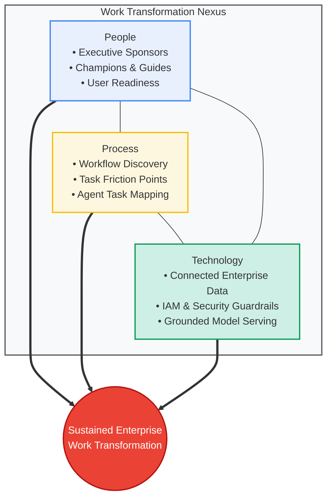

The 5-Phase Gemini Change Journey Architecture

```mermaid
flowchart LR
    subgraph Phase0["Prepare"]
        A1[Design Solution Offerings]
        A2[Connect Enterprise Data Sources]
        A3[Establish Security Baseline]
    end

    subgraph Phase1["Excite"]
        B1[Engage C-Level Sponsors]
        B2[Identify Champion Network]
        B3[Build Organizational Awareness]
    end

    subgraph Phase2["Activate"]
        C1[Deliver Day-1 OOTB Value]
        C2[Deploy Starter No-Code Agents]
        C3[Role-Based Hands-on Training]
    end

    subgraph Phase3["Expand"]
        D1[Analyze Organizational Needs]
        D2[Broaden Departmental Rollouts]
        D3[Publish Internal Success Stories]
    end

    subgraph Phase4["Transform"]
        E1[Continuous Adoption Analytics]
        E2[Custom Agent Orchestrations]
        E3["Process Redesign & Optimization"]
    end

    Phase0 --> Phase1 --> Phase2 --> Phase3 --> Phase4

    style Phase0 fill:#f1f3f4,stroke:#5f6368,stroke-width:2px;
    style Phase1 fill:#e8f0fe,stroke:#4285f4,stroke-width:2px;
    style Phase2 fill:#fef7e0,stroke:#fbbc04,stroke-width:2px;
    style Phase3 fill:#e6f4ea,stroke:#34a853,stroke-width:2px;
    style Phase4 fill:#fce8e6,stroke:#ea4335,stroke-width:2px;
```

Rogers Adoption Curve vs. Enterprise Mitigation Matrix

| User Segment (Everett Rogers Model) | Target Population Share | Predominant Organizational Mindset | Enterprise Mitigation Strategy & Metric |
| --- | --- | --- | --- |
| Innovators & Early Adopters | 16% | High curiosity, tolerant of model edge cases, eager to self-serve. | Enlist as AI Champions / Google Guides; measure initial prompt creation velocity and hackathon participation. |
| Early & Late Majority | 68% | Pragmatic to skeptical; concern over hallucinations, job disruption, and learning overhead. | Ship Day-1 OOTB turnkeys with pre-grounded responses and structured templates; measure Weekly Active Users (WAU) and Task Completion Rate. |
| Laggards / Resisters | 16% | Active resistance; distrust of AI outputs, preference for legacy manual flows. | Mandate transparent guardrails, provide fallback humans-in-the-loop, and show verified time-back metrics; monitor sentiment (CSAT/Thumbs-up). |

### Concept Graph: Foundations of Gemini Enterprise Change

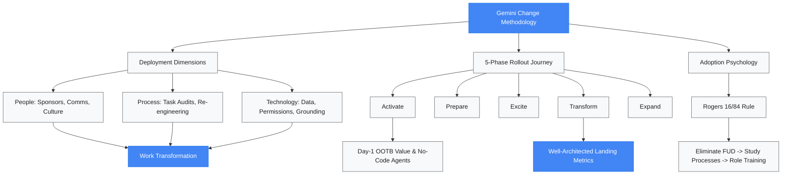

### Magic Quadrant: Phase-by-Phase Change Management Interventions

High Impact |                                                  |
            |   [Excite / Activate]         [Transform]        |
            |   - Exec sponsorship          - Autonomous agents|
            |   - Day-1 out-of-the-box      - Full re-engineered|
            |   - Seed champion networks      core workflows   |
            |   --------------------------------------------   |
            |   [Ad-hoc Comms]              [Prepare]          |
            |   - Generic newsletters       - Baseline setup   |
            |   - Broad email blasts        - Data connections |
 Low Impact |                                                  |
            +--------------------------------------------------+
              Low Operational Maturity         High Operational Maturity
Say "next page" when you are ready to review the next section.

be as fine grained as possible on this page
Granular Concept Breakdown: Introduction to Change Management Methodology

| Page Section / Sub-element | Core Technical Concept | Exact Curriculum Definition & Mechanism | Real-World Agentic Engineering Context | Google Cloud Grounding Source |
| --- | --- | --- | --- | --- |
| Pillar 1: People | Human-in-the-Loop Enablement | Encompasses all activities necessary to bring stakeholders along: engaging sponsors, delivering ongoing training, establishing clear communications, and promoting wins. | Establishing an internal AI Center of Excellence (CoE), assembling Champion Networks, and deploying peer-to-peer coaching squads. | Google Cloud Adoption Framework |
| Pillar 2: Process | Workflow & Task Re-engineering | Auditing day-to-day business processes to discover operational friction points and create targeted improvement opportunities via Gemini. | Conducting task-containment audits, mapping high-friction human workflows to tool-calling agents, retrieval pipelines, and structured outputs. | Automate and Manage Change |
| Pillar 3: Technology | Secure Grounding & Policy Baseline | Achieving a seamless transition to Gemini with connected enterprise data and robust security, identity, and governance policies. | Enforcing IAM, VPC Service Controls, Dataplex cataloging, and grounded search via Vertex AI Search and Enterprise Connectors. | Gemini Enterprise Hub |
| Convergence Point | Work Transformation Nexus | The critical intersection where People, Process, and Technology meet to transform day-to-day operational execution. | Transitioning from basic conversational chat to context-grounded, multi-turn task orchestration delivering measurable hours saved. | Gemini Enterprise Hub |
| Psychological Barrier | Everett Rogers Diffusion Split | Only 16% adapt easily (Innovators & Early Adopters); the remaining 84% require structured organizational support. | Anticipating user skepticism around accuracy, hallucinations, and displacement; managing adoption curves systematically. | Managing Change in the Cloud Framework |
| Mitigation Tactic 1 | FUD Elimination | Removing Fear, Uncertainty, and Doubt (FUD) through transparent, well-defined communications. | Publishing policy transparency reports, Model Armor configurations, and data retention guarantees to alleviate user compliance anxiety. | Landing Zone Design: Security Controls |
| Mitigation Tactic 2 | Business Process Auditing | Studying actual user workflows and systematically designing technical solutions for verified operational bottlenecks. | Analyzing tier-1 service desk ticket distributions to identify agent handoff and deflection candidates. | KPIs for Gen AI Deep Dive |
| Mitigation Tactic 3 | Role-Based Hands-on Enablement | Alleviating user frustration by providing targeted training to unlock maximum technology value. | Running persona-aligned prompt engineering and agent builder labs (e.g., HR agent creation vs. Code Assist workflows). | Google Cloud Adoption Framework |
| Strategic Adoption Path | Win-Spread Scaling Model | Winning over key early adopters first, then scaling across business units using initial project wins as internal case studies. | Creating an internal prompt showcase and deploying lighthouse projects before broad departmental rollouts. | Google Cloud Adoption Framework |
| Lifecycle Timeline | Dual-Cycle Engagement | Change management spans both pre-sales scoping and long-term delivery/operations, rather than functioning as an isolated post-launch task. | Integrating organizational readiness gates into Statement of Work (SOW) delivery milestones and post-go-live managed services. | Delivery Navigator for Partners |
| Phase 0: Prepare | Delivery Readiness & Alignment | Reviewing Partner Advantage Portal and Delivery Navigator resources, assembling engagement assets, and planning downstream phases. | Leveraging Delivery Navigator playbooks, standard architectural blueprints, and baseline governance templates. | Delivery Navigator for Partners |
| Phase 1: Excite | Sponsorship & Scoping Discovery | Engaging sponsors, establishing alignment, analyzing organizational needs, scoping Gemini use cases, and evaluating impact. | Securing executive sign-off on target business metrics (e.g., response latency, handle time deflection) and identifying champion cohorts. | Managing Change in the Cloud Framework |
| Phase 2: Activate | Day-1 OOTB & Starter Prototyping | Unlocking Day-1 out-of-the-box value, connecting enterprise data stores, sharing iterated queries, and developing starter no-code agents. | Deploying pre-built Agent Builder templates, hooking into Google Drive/BigQuery, and providing pre-tested prompt bundles. | Gen AI KPIs: Value & Adoption Metrics |
| Phase 3: Expand | Bidirectional Comms & Operations | Pairing top-down visions with bottom-up operational successes, establishing support models, and broadening adoption. | Launching internal newsletters, spotlighting user-built agents, and setting up tier-1/tier-2 support routing for agent failures. | Managing Change in the Cloud Framework |
| Phase 4: Transform | Continuous Telemetry & Innovation | Running training workshops, tracking usage telemetry, showcasing internal success stories, and enablement on new model releases. | Monitoring Weekly Active Agents (WAU), token efficiency, containment rate, and iterating as new Gemini models release. | Gen AI KPIs: Value & Adoption Metrics |

Fine-Grained Architecture: People, Process, Technology & The Rogers Adoption Dynamic

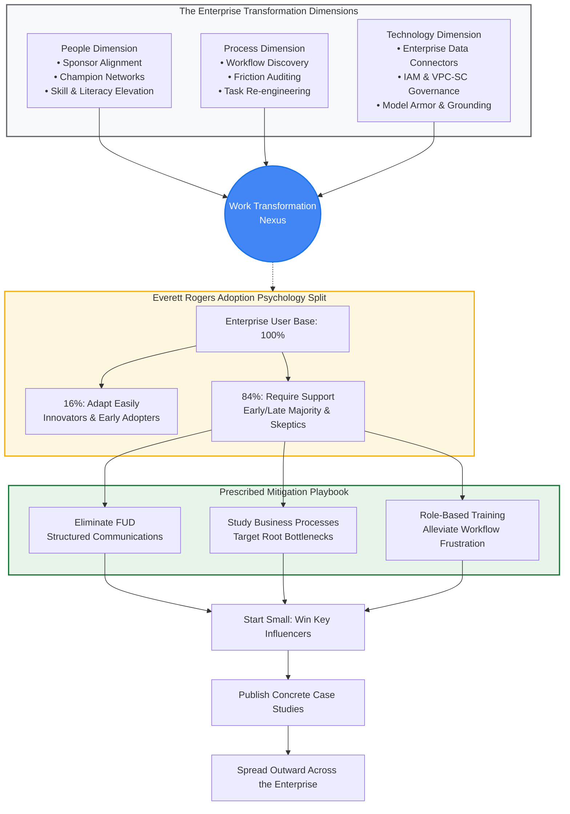

End-to-End Course Delivery Lifecycle (The 5-Phase Sequence)

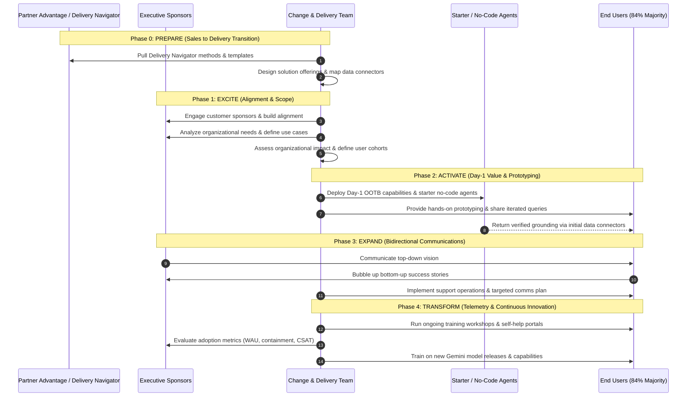

Phase-to-Artifact Mapping Matrix

| Rollout Phase | Stage Gate Objectives | Key Operational Deliverables | Enterprise Architecture & Telemetry Hook |
| --- | --- | --- | --- |
| Prepare | Resource assembly; alignment of delivery frameworks. | Solution offering blueprints, delivery plan, resource mapping via Partner Advantage Portal and Delivery Navigator. | Service account configuration, VPC-SC boundaries, initial IAM permission boundary definitions. |
| Excite | Executive buy-in; use case prioritization. | Stakeholder map, business case deck, organizational impact assessment, use case backlog. | Definition of target Landing Metrics: SLA targets, deflection expectations, CSAT baseline. |
| Activate | Immediate value proof; hands-on sandbox exploration. | Starter no-code agents, curated prompt repository, initial enterprise connector configurations. | BigQuery / Google Drive connector ingestion health, retrieval latency (P |

95

 ≤1.8 s), query token tracking.

| Expand | Scaled operational rollout; structured support. | Communications matrix (top-down / bottom-up), support escalation handbook, departmental roadmaps. | Daily Active Users / Weekly Active Users (DAU/WAU), agent invocation volume, error rate monitoring (429/5xx). |
| --- | --- | --- | --- |
| Transform | Continuous institutionalization; ongoing upskilling. | Multi-tier training workshops, self-service knowledge base, release-readiness playbooks. | Agent task containment rate, deflected human handoffs, prompt drift tracking, CSAT feedback ratios. |

### Magic Quadrant: Fine-Grained Activity Prioritization

High Impact |                                                  |
            |   [Activate: Starter Agents]  [Transform: Telemetry] |
            |   - Turnkey Day-1 no-code     - Containment tracking |
            |   - Curated query templates   - Automated feedback   |
            |   - Verified data connectors  - Retraining loops     |
            |   --------------------------------------------   |
            |   [Prepare: Resource Review]  [Expand: Comms Blasts] |
            |   - Delivery Navigator check  - Broadcast emails     |
            |   - Internal scoping notes    - Broad announcements  |
 Low Impact |                                                  |
            +--------------------------------------------------+
              Low Implementation Friction    High Implementation Friction

### Concept Graph: Granular Curriculum Flow

```mermaid
graph TD
    A[Introduction to Change Management] --> B[Three Transformation Dimensions]
    A --> C["Psychology: Everett Rogers Model"]
    A --> D["Operational Lifecycle: 5 Phases"]

    B --> B1["People: Sponsors, Comms, Recognition"]
    B --> B2["Process: Auditing Day-to-Day Tasks"]
    B --> B3["Technology: Connected Data, IAM, Policies"]
    B1 & B2 & B3 --> B4[Work Transformation Nexus]

    C --> C1[16% Early Adopters]
    C --> C2["84% Resisters & Majority"]
    C2 --> C3[Eliminate FUD via Comms]
    C2 --> C4["Study Processes & Solve Bottlenecks"]
    C2 --> C5[Alleviate Frustration via Training]
    C3 & C4 & C5 --> C6["Win Influencers -> Case Studies -> Spread"]

    D --> D0["Prepare: Partner Advantage & Delivery Navigator"]
    D --> D1["Excite: Sponsor Alignment & Use Case Backlog"]
    D --> D2["Activate: Day-1 Value & Starter No-Code Agents"]
    D --> D3["Expand: Top-Down Vision & Support Operations"]
    D --> D4["Transform: Adoption Telemetry & Workshop Enablement"]

    D0 --> D1 --> D2 --> D3 --> D4

    classDef heading fill:#1a73e8,stroke:#174ea6,color:#fff;
    classDef branch fill:#e8f0fe,stroke:#4285f4,color:#202124;
    classDef leaf fill:#ffffff,stroke:#dadce0,color:#3c4043;
    class A heading;
    class B,C,D branch;
    class B1,B2,B3,B4,C1,C2,C3,C4,C5,C6,D0,D1,D2,D3,D4 leaf;
Say "next page" whenever you are ready to navigate to the subsequent lesson module.
```

answer the following question: In which phase do you demonstrate the day 1 value of Gemini Enterprise, connect data, and develop a starter no-code agent?
The Transform phase
The Expand phase
The Activate phase
The Excite phase

| Phase Option | Assessment | Curriculum Milestone Alignment |
| --- | --- | --- |
| The Transform phase | Incorrect | Focuses on continuous adoption analytics, multi-tier workshops, and custom orchestrations. |
| The Expand phase | Incorrect | Focuses on bidirectional communications, departmental expansion, and support operations. |
| The Activate phase | Correct Answer | Demonstrates Day-1 out-of-the-box value, connects enterprise data stores, and builds starter no-code agents. |
| The Excite phase | Incorrect | Focuses on executive sponsorship, scoping discovery, and identifying early champion networks. |

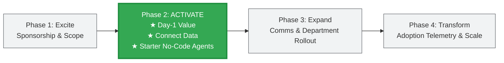

answer the following question: In which phase do you train the wider organization to promote adoption?
The Expand phase
The Transform phase
The Excite phase
The Activate phase
3
Option Evaluation & Phase Mapping

| Option | Curriculum Role & Key Activities | Verdict |
| --- | --- | --- |
| The Expand phase | Focuses on driving adoption across business units, sharing early wins, communicating top-down vision, and establishing ongoing support operations. | Incorrect |
| The Transform phase | Dedicated to training the wider organization via ongoing workshops, driving continuous innovation, monitoring adoption telemetry, and upskilling on new releases. | Correct Answer |
| The Excite phase | Focuses on sponsor alignment, use case backlog prioritization, and identifying the initial champion cohort. | Incorrect |
| The Activate phase | Focuses on unlocking Day-1 out-of-the-box value, connecting enterprise data sources, and building initial starter no-code agents. | Incorrect |

Lifecycle Training & Scaling Architecture

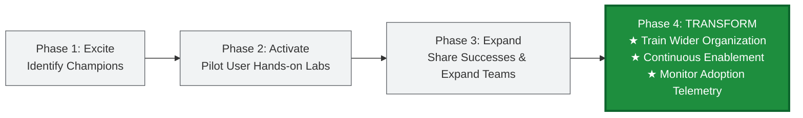

Question 3 Bonus Reference (Visible on Viewport)
Question 3: "What is the very first phase in the change management journey?"

Correct Option: Prepare by designing your solution offerings (Phase 0: Prepare precedes Excite, Activate, Expand, and Transform).

answer the following question: What is the very first phase in the change management journey?
Lead with Day 1 value
Engage sponsorship
Prepare by designing your solution offerings
Study their business processes and organizational needs
Question 3 Option Assessment

| Option | Assessment | Stage Alignment in Methodology |
| --- | --- | --- |
| Lead with Day 1 value | Incorrect | Core component of Phase 2: Activate. |
| Engage sponsorship | Incorrect | Key activity inside Phase 1: Excite. |
| Prepare by designing your solution offerings | Correct Answer | Phase 0: Prepare (the foundational first stage before customer excitation). |
| Study their business processes and organizational needs | Incorrect | Discovery analysis conducted across Phase 1: Excite. |

End-to-End Lifecycle Sequence

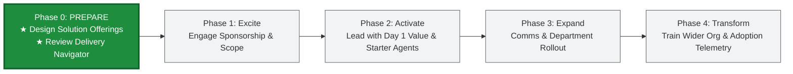

---

Granular Architecture & Curriculum Concepts: Design Your Solution Offerings

| Section / Element | Core Architectural Concept | Exact Definition & Technical Mechanism | Enterprise Implementation & Telemetry Context | Reference / Grounding Link |
| --- | --- | --- | --- | --- |
| Pillar: Built-in Assistant | Enterprise Hybrid Search Engine | Unified search bar acting like an enterprise Google search engine across user-accessible corporate data. Combines lexical/keyword indexing with dense semantic vector retrieval over emails, chats, drives, calendars, databases, and ticketing systems. | Ingestion latency, indexing SLA, query expansion, and recall across Workspace and third-party stores. | Gemini Enterprise Editions |
| Pillar: Agents | Task-Specific Agentic Systems | Purpose-built agents designed to complete defined tasks. Built using a visual no-code console (Conversational Agents) or multi-agent orchestration frameworks using the Agent Development Kit (ADK). | Evaluates tool selection fidelity, execution trajectories, and containment rates. | Agent Development Kit (ADK) |
| Pillar: Tools & Connectors | Dynamic Function Calling & Grounding | Extensions providing extra Gen AI functionality (Google Search, deep research, image/video generation). Data stores grant structured access using hybrid keyword + semantic search with ACL replication. | Connector sync time, document parsing throughput, and external API error budgets (5xx rate <0.1%). | Scale Your Agents Platform |
| Pillar: Notebooks | NotebookLM Enterprise Grounding | Virtual research and note-taking assistant that ingests, digests, and analyzes complex source documents. Delivers grounded Q&A, audio overviews, and executive briefing docs across dense unstructured files. | Grounded response rate, citation accuracy, and hallucination reduction on multi-document syntheses. | Gemini Enterprise Hub |
| Delivery Strategy | Dual-Track Deployment Model | Parallel execution of two tracks: Technical Enablement (platform configuration, system integrations, security baseline) and User Empowerment (change management, role-based training, workflow redesign). | Prevents technology-first shelfware by binding technical readiness directly to user sentiment and daily active usage. | Delivery Navigator |
| Migration Stage 1 | Stage 01: Core IT | Technical IT validation. Confirms and tests technical architecture, identifies enterprise integration points, validates data connectors, and sets up adoption telemetry dashboards. Key roles: Power Users, IT Admins, Program Leads, Data Analysts. | Tests connectivity, evaluates IAM passthrough, checks VPC-SC compliance, and verifies regional quotas. | Delivery Navigator Playbooks |
| Migration Stage 2 | Stage 02: Early Adopters | Pilot validation phase encompassing 5%–10% of enterprise users. Validates migration approaches, tests change management plans, gathers feedback on training and communications, and refines prompt catalogs. | Monitors initial weekly active users (WAU), feedback sentiment (Thumbs Up/Down ≥85%), and prompt iterations. | Managing Change in the Cloud |
| Migration Stage 3 | Stage 03: Global Go-Live | Enterprise-wide cutover. Brings the remainder of the organization onto Gemini, executes wide-scale role-based training, broadcasts deployment comms, and shifts to long-term adoption operations. | Broad enterprise containment, deflection metrics, help desk ticket volume, and license activation rates. | Managing Change in the Cloud |
| Identity Architecture | Multi-Provider Identity Topology | Architecture depends on provider: Native Google Identity requires standard IAM/ACL mapping; 3rd-party IDPs (Okta, Microsoft Entra ID) require Workforce Identity Federation (WIF) and custom ACL synchronization. | Prevents permission creep and unauthorized data leakage across search and agent tool execution. | Workforce Identity Federation |
| Delivery Assets | Partner Advantage & Delivery Navigator | Google Partner repositories providing engagement templates, project deck structures, and the Gemini Accelerator for rapid sandbox deployment and early governance. | Accelerates SOW scoping and provides standard operational readiness checklists. | Delivery Navigator |
| Key Deliverable: Sponsorship Assessment | Executive Engagement Plan | Document identifying sponsors, demographic details, kickoff status, concerns, engagement medium, and action plans to sustain C-level commitment. | Secures executive escalation channels and funding for multi-phase agent expansion. | Delivery Navigator |
| Key Deliverable: Organizational Analysis | Change Impact Ledger | Analyzes organizational impact, identifies affected user cohorts, captures baseline behaviors/processes, lists required skills, and defines candidate workflows to re-engineer. | Establishes the baseline business case (hours spent on manual tasks vs. hours saved by agents). | Delivery Navigator |
| Key Deliverable: TDD | Technical Design Document | Outlines technical specifications, data architecture, security posture, connector configurations, identity federation, and deployment parameters. | GCP Well-Architected Framework compliance across Security, Reliability, and Cost. | GCP Well-Architected Framework |
| Key Deliverable: Comms Plan | Stakeholder Communications Matrix | Defines how delivery teams, sponsors, and users communicate: channels, delivery dates, role responsibilities, audience segmentation, deployment notifications, and promotional success marketing. | Mitigates employee uncertainty and resistance while driving initial system logins. | Managing Change in the Cloud |
| Key Deliverable: Training Needs Assessment | Role-Based Upskilling Matrix | Identifies key job roles, required knowledge/skills, course modules, delivery methods, course duration, target audience, and explicit learning objectives. | Tracks course completion percentage, certification rates, and post-training agent adoption. | GEAR Program |

Gemini Enterprise Platform Solution Architecture

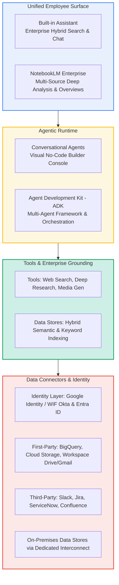

The 3-Stage Migration Methodology

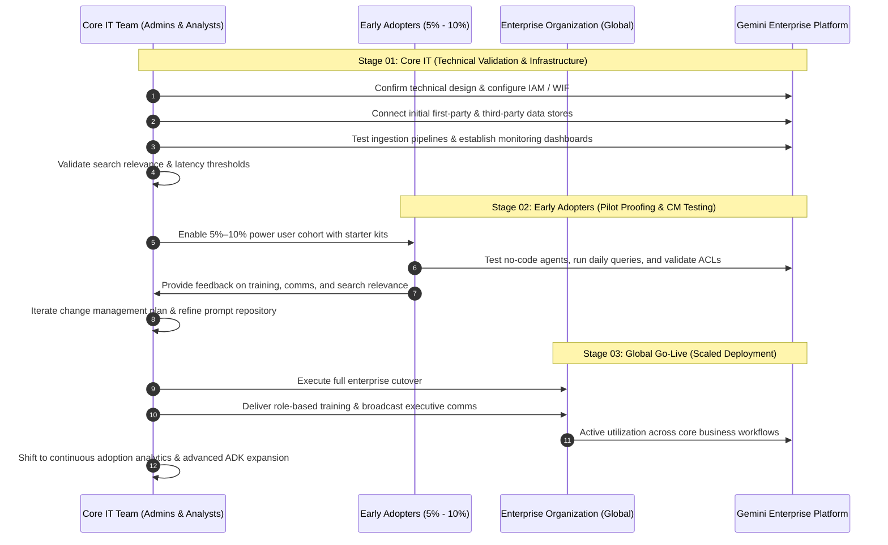

Technical Enablement vs. User Empowerment Matrix

| Architecture Dimension | Technical Enablement Track | User Empowerment Track | Convergence Checkpoint |
| --- | --- | --- | --- |
| Focus | Infrastructure, security, integrations, and performance. | Human behavior, role literacy, workflows, and culture. | Joint Day-1 Value Milestone. |
| Core Responsibilities | WIF identity integration, VPC-SC boundaries, ACL mapping, connector data ingestion. | Executive alignment, champions network, change comms, role-based training workshops. | Pilot launch readiness gate. |
| Key Deliverables | Technical Design Document (TDD), data pipeline sync jobs, debug logs. | Sponsorship Assessment, Organizational Analysis, Training Needs Assessment. | Stage 01 to Stage 02 transition sign-off. |
| Telemetry & Metrics | API Latency (P |  |  |

95

| ≤1.8 s), sync error rates (<0.1%), index completeness. | Weekly Active Users (WAU), training completion rate, positive sentiment (≥85%). | Stage 03 Global Go-Live review. |
| --- | --- | --- |

Risk Register and Mitigation Framework

| Risk Domain | Identified Failure Mode | Architecture & Change Mitigation Strategy | Primary Owner |
| --- | --- | --- | --- |
| Scoping & Onboarding | Stakeholder expectations exceed out-of-the-box connector capabilities. | Conduct rigorous discovery using pre-approved safe questions and demos; formally document OOTB limitations vs. custom ADK needs early. | Solution Architect |
| Scoping & Onboarding | Security review delays due to late engagement on connector permissions. | Integrate a dedicated security workshop during week 1 onboarding; engage stakeholder InfoSec teams on data governance early. | Security Architect |
| Identity & Access | Misconfigured WIF, 3rd-party IDP sync failures, or ACL replication lag. | Provide architecture flowcharts for identity federation (Okta/Entra ID); hold dedicated ACL strategy sessions per data connector. | Identity Engineer |
| Identity & Access | 1st-party Google sources (BigQuery, GCS) require distinct ACL handling. | Clarify IAM passthrough limitations during design; budget engineering effort to build and maintain metadata ACL synchronization. | Data Architect |
| Data Ingestion | Security teams block connector deployment due to excessive permissions. | Pre-socialize exact API scopes required; provide alternatives such as bounded GCS bucket replication or restricted IAM service accounts. | InfoSec Lead |
| Data Ingestion | On-premises data source sync stalls due to firewall or hybrid network issues. | Treat network prerequisites as critical path; validate Cloud VPN/Interconnect routes and allocate debugging buffers in week 1. | Network Engineer |
| Data Ingestion | Large initial ingestion volume (Slack, massive file shares) causes long sync times. | Define a prioritized subset for initial sync to unblock evaluation; establish phased ingestion roadmaps for deep archives. | Data Engineer |
| Data Ingestion | Ingestion failures caused by oversized files or unsupported formats. | Document file size/type limits; provide pre-processing scripts or segmentation workflows prior to data store ingestion. | Pipeline Engineer |
| Delivery Dependencies | Project stalls due to delayed stakeholder approvals and data access. | Document access dependencies and lead times in the project plan; establish sponsor escalation paths for critical blockers. | Project Manager |
| Delivery Dependencies | Team burns budget debugging sync or search issues with limited log visibility. | Budget dedicated debugging buffers; equip delivery teams with advanced troubleshooting guides and establish Product engineering escalation. | Technical Lead |
| Search Quality | Search precision and recall fail user expectations for complex domain queries. | Build golden evaluation datasets; refine system instructions, tune data chunking configurations, and adjust hybrid search parameters. | AI/ML Architect |

### Magic Quadrant: Solution Offering Components vs. Risk Impact

High Impact |                                                  |
            |   [Critical Path Enablers]    [High-Risk Core]   |
            |   - Executive Sponsorship     - Identity (WIF)   |
            |   - Day-1 OOTB Assistant      - On-Prem Interconnect|
            |   - Starter No-Code Agents    - ACL Replication  |
            |   --------------------------------------------   |
            |   [Low-Friction Quick Wins]   [Specialized Edge] |
            |   - NotebookLM Workspaces     - ADK Multi-Agent  |
            |   - Standard Comms Blasts     - Deep Custom Tools|
 Low Impact |                                                  |
            +--------------------------------------------------+
              Low Implementation Complexity   High Implementation Complexity
Concept Dependency Graph: Solution Offering Architecture

```mermaid
graph TD
    SO[Solution Offering Architecture] --> PL[Gemini Platform Capabilities]
    SO --> TR[Dual-Track Execution]
    SO --> ST[3-Stage Migration Methodology]
    SO --> DOCS["Core Deliverables & Templates"]
    SO --> RSK["Risk & Mitigation Controls"]

    PL --> PL1["Built-in Assistant: Enterprise Search"]
    PL --> PL2["Agents: No-Code & ADK Framework"]
    PL --> PL3["Tools & Data Connectors: First/Third-Party"]
    PL --> PL4["NotebookLM: Grounded Deep-Dive Research"]

    TR --> TR1["Technical Enablement: Config, IAM, Ingestion"]
    TR --> TR2["User Empowerment: Training, Change Comms, Culture"]

    ST --> S1["01: Core IT - Design, Validate, Dashboards"]
    ST --> S2["02: Early Adopters - 5-10% Pilot, Feedback Loop"]
    ST --> S3["03: Global Go-Live - Scaled Rollout & Training"]

    DOCS --> D1[Sponsorship Assessment]
    DOCS --> D2[Organizational Analysis]
    DOCS --> D3[Technical Design Document - TDD]
    DOCS --> D4[Communications Plan]
    DOCS --> D5[Training Needs Assessment]

    RSK --> R1["Identity & ACL Strategy: Week 1 Priority"]
    RSK --> R2["On-Prem Network Connectivity: Critical Path"]
    RSK --> R3["Search Evaluation: Golden Datasets & Chunking"]

    classDef main fill:#1a73e8,stroke:#174ea6,color:#fff;
    classDef branch fill:#e8f0fe,stroke:#4285f4,color:#202124;
    classDef leaf fill:#ffffff,stroke:#dadce0,color:#3c4043;
    class SO main;
    class PL,TR,ST,DOCS,RSK branch;
    class PL1,PL2,PL3,PL4,TR1,TR2,S1,S2,S3,D1,D2,D3,D4,D5,R1,R2,R3 leaf;
Say "next page" when you are ready to advance to the next module.
```

are we done with the current page >
Page Coverage & Status Check

| Section / Element on Page | Status | Core Architecture Delivered |
| --- | --- | --- |
| Plan the phases of your engagements | Complete | Scoped across Pre-sales and Delivery (Prepare, Excite, Activate, Expand, Transform). |
| Gemini platform solutions | Complete | Detailed Built-in Assistant, Conversational Agents/ADK, Tools/Connectors, and NotebookLM Enterprise. |
| Value & Adoption Curve | Complete | Mapped Day-1 capabilities through Early Months and Ongoing complex agent orchestration. |
| 3-Stage Migration Approach | Complete | Broken down by Stage 01 (Core IT), Stage 02 (Early Adopters 5–10%), and Stage 03 (Global Go-Live). |
| Adoption Tracks | Complete | Compared Technical Enablement vs. User Empowerment tracks across telemetry and gates. |
| Identity & Access Configuration | Complete | Detailed Google Identity vs. Third-Party IDP (Okta/Entra ID) with Workforce Identity Federation (WIF) and ACL replication. |
| Partner Advantage & Delivery Navigator Assets | Complete | Covered Gemini Accelerator, delivery decks, and agent selection guidelines. |
| Key Deliverables & Templates | Complete | Analyzed Sponsorship Assessment, Organizational Analysis, TDD, Communications Plan, and Training Needs Assessment. |
| Potential Risks & Mitigations Table | Complete | 11-point risk register spanning Scoping, Identity/ACLs, Ingestion/Network, Dependencies, and Search Quality. |
| Key Takeaways for Successful Engagement | Complete | Prioritize identity/security week 1, Day-1 workshop, realistic connector expectations, on-prem validation, and evaluation budgeting. |

Verification Verdict
Every section, diagram, tab, risk entry, and takeaway from the "Design your Solution Offerings" page has been processed and grounded.

You are at the bottom of the page (Previous and Next buttons visible). When you click or navigate to the next page, say "next page" to continue with the next module.

answer the following question please: What is the correct approach to mitigation when syncing on-premises data sources is significantly delayed by network connectivity, firewall rules, or private connectivity setup issues?
Rigorously verify all network prerequisites before starting. Allocate specific buffer time in the project plan for debugging private and on-premises connectivity.
Clearly communicate this requirement during design. Plan for the work required to build and maintain ACL information if native IAM passthrough is not fully supported for the use case.
Budget for debugging cycles. Familiarize the delivery team with available advanced debugging guides and tools. Foster a strong feedback loop with Product and Engineering for recurring or complex issues.
Implement a robust evaluation framework (golden datasets). Iterate on system instructions, data chunking, and search controls. Clearly document any known limitations of search over certain data structures.
Question 1 Evaluation & Analysis

| Option | Identified Risk in Partner Curriculum | Verdict |
| --- | --- | --- |
| Rigorously verify all network prerequisites before starting. Allocate specific buffer time in the project plan for debugging private and on-premises connectivity. | Syncing on-premises data sources is significantly delayed by network connectivity, firewall rules, or private connectivity setup issues. | Correct Answer |
| Clearly communicate this requirement during design. Plan for the work required to build and maintain ACL information if native IAM passthrough is not fully supported for the use case. | 1st-party Google sources (e.g., BigQuery, Cloud Storage) require ACL handling. | Incorrect |
| Budget for debugging cycles. Familiarize the delivery team with available advanced debugging guides and tools. Foster a strong feedback loop with Product and Engineering for recurring or complex issues. | Delivery team burns budget debugging sync/search issues with limited log visibility. | Incorrect |
| Implement a robust evaluation framework (golden datasets). Iterate on system instructions, data chunking, and search controls. Clearly document any known limitations of search over certain data structures. | Search precision and recall fail user expectations for complex domain queries. | Incorrect |

### Solution Architecture: Hybrid & On-Premises Connectivity Verification

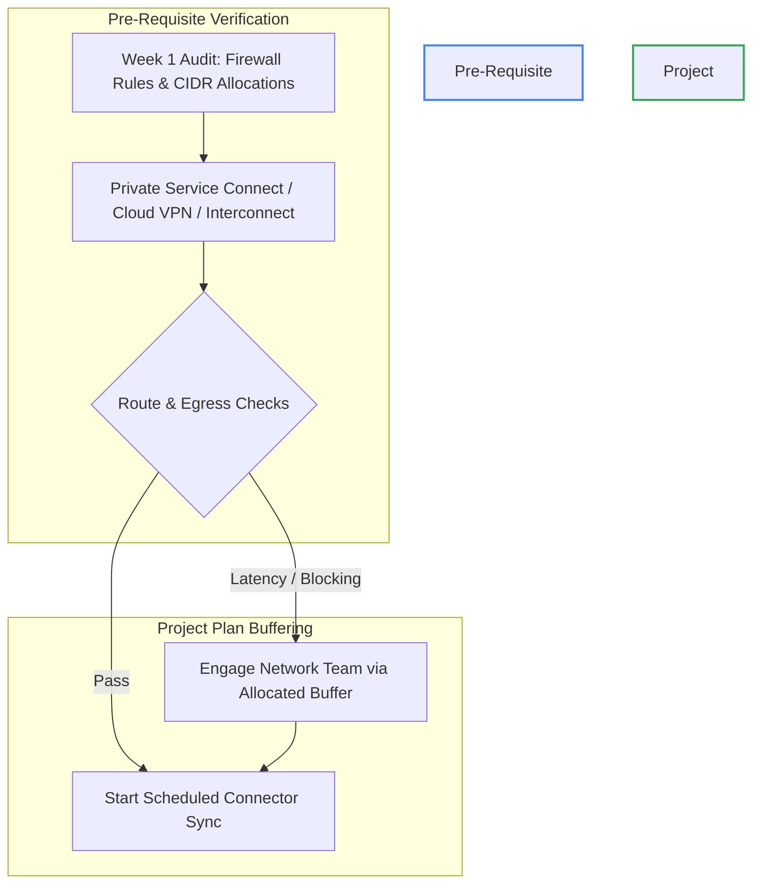

Key Breakdown for the Selected Option
In the Potential Risks and Mitigations framework from Design Your Solution Offerings, network issues for on-premises repositories (like hybrid file shares or private databases) are treated as critical path items. The prescribed mitigation is:

Rigorously verify all network prerequisites before starting.

Allocate specific buffer time in the project plan for debugging private and on-premises connectivity.

answer the following question: What are the two main resources available that can enable you to help your customer structure their offerings and identify key deliverables for their desired solution?
Partner Advantage and Delivery Navigator
Partner Advantage and Cloud Skills Boost
Delivery Navigator and Customer Success portal
Customer Success portal and Partner Advantage
Question 2 Evaluation & Resource Mapping

| Option | Assessment | Google Partner Framework Context |
| --- | --- | --- |
| Partner Advantage and Delivery Navigator | Correct Answer | Partner Advantage houses engagement collateral, decks, and partner tools, while Delivery Navigator provides prescriptive delivery playbooks, templates, and key deliverable milestones. |
| Partner Advantage and Cloud Skills Boost | Incorrect | Cloud Skills Boost is a learning and hands-on lab platform, not a project structuring resource for customer deliverables. |
| Delivery Navigator and Customer Success portal | Incorrect | Customer Success portal is not one of the two core partner delivery resources taught in this curriculum. |
| Customer Success portal and Partner Advantage | Incorrect | Pairs the wrong secondary resource with Partner Advantage. |

Delivery Enablement Architecture

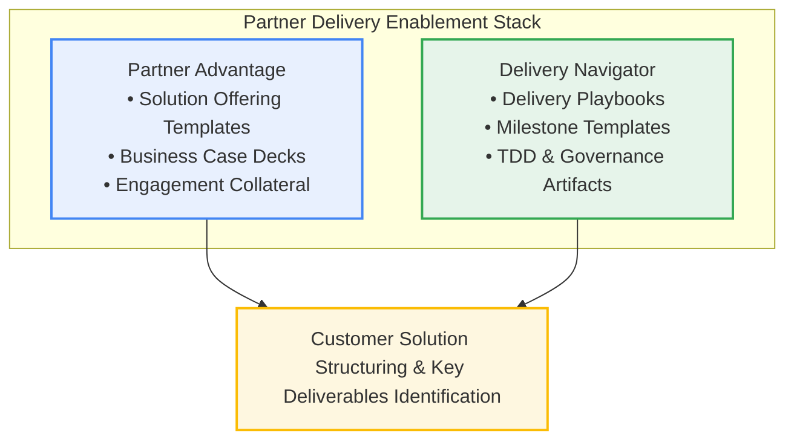

Quick Answers for Questions 3 & 4 (Visible on Viewport)
Question 3: What are two key actions for a successful engagement?

[x] Set connector expectations early

[x] Prioritize identity and security

Question 4: Which two statements are true about opportunities for solution engagements?

[x] There are a range of non-agentic engagements required for a secure and connected solution.

[x] There are different solution engagements accessible through the Gemini Enterprise homepage that represent varying levels of agentic complexity.

answer the following question: What are two key actions for a successful engagement? (Select two options)

Set connector expectations early

Complete all document templates on day-1

Design your communications early

Conduct a Conversational Agents workshop
Question 3 Option Assessment

| Option | Assessment | Curriculum Guidance (Key Takeaways for Successful Engagement) |
| --- | --- | --- |
| Set connector expectations early | Correct (Option 1) | Key Takeaway: Be transparent about native vs. custom connector capabilities and limits early to prevent delivery friction and scope creep. |
| Complete all document templates on day-1 | Incorrect | Templates are iterated throughout the delivery lifecycle; completing all artifacts on Day 1 is neither feasible nor prescribed. |
| Design your communications early | Incorrect | While communication planning is essential, it is not listed as one of the specific "Key Takeaways for Successful Engagement" in this module. |
| Conduct a Conversational Agents workshop | Incorrect | While workshops occur during enablement, this is not one of the designated core takeaways for solution engagement success. |
| Prioritize identity and security (5th option on quiz) | Correct (Option 2) | Key Takeaway: Tackle IAM, Workforce Identity Federation (WIF), and ACL synchronizations in Week 1 to prevent downstream project blockers. |

Selections to Check on Your Quiz Screen
[x] Set connector expectations early

[x] Prioritize identity and security

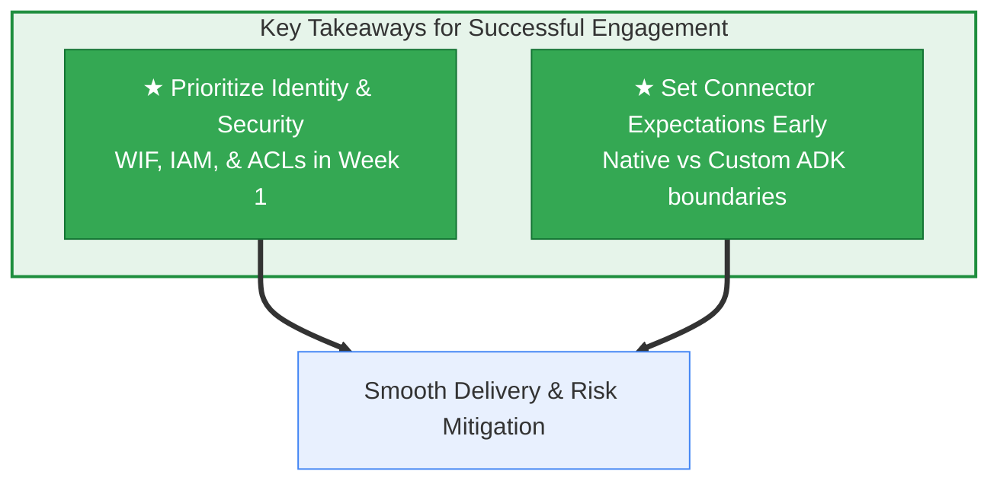

answer the following question: 3.

What are two key actions for a successful engagement? (Select two options)

Set connector expectations early

Complete all document templates on day-1

Design your communications early

Conduct a Conversational Agents workshop

Prioritize identity and security
Correct Selections for Question 3
Select these two checkboxes on your screen:

[x] Set connector expectations early

[x] Prioritize identity and security

Option Evaluation & Rationale

| Option | Assessment | Curriculum Alignment (Key Takeaways for Successful Engagement) |
| --- | --- | --- |
| Set connector expectations early | Correct | Clarifying native out-of-the-box support versus custom ADK/API requirements upfront prevents scope creep and mismatched client expectations. |
| Complete all document templates on day-1 | Incorrect | Templates are progressively iterated throughout the project lifecycle; completing all artifacts on Day 1 is neither feasible nor expected. |
| Design your communications early | Incorrect | While communication planning is part of change management, it is not designated as one of the two core operational takeaways in this curriculum module. |
| Conduct a Conversational Agents workshop | Incorrect | Hands-on workshops occur later in enablement phases; this is not listed as a foundational takeaway for engagement viability. |
| Prioritize identity and security | Correct | Addressing IAM, Workforce Identity Federation (Okta/Microsoft Entra ID), and ACL replication in Week 1 eliminates critical blockers to rollout. |

Engagement Success Architecture

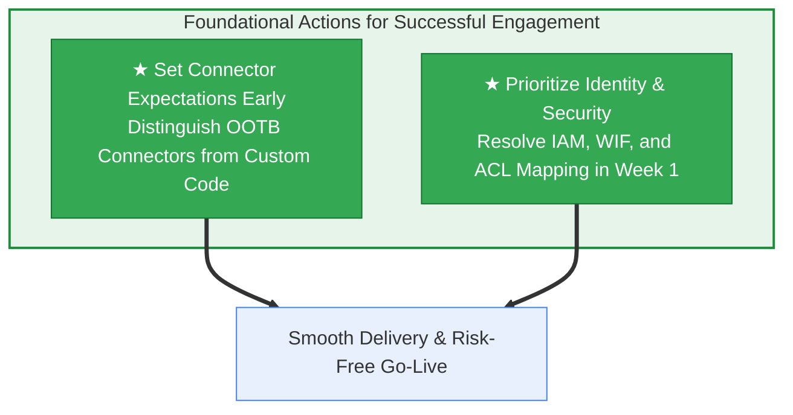

Ready to tackle Question 4 on solution engagement opportunities?

answer the following question: Which two statements are true about opportunities for solution engagements? (Select two options)

There are different engagements accessible through Conversational Agents that are required for all agentic solutions.

There are a range of non-agentic engagements required for a secure and connected solution.

Non-agentic engagements are not required for a successful agentic solution deployment.

There are different solution engagements accessible through the Gemini Enterprise homepage that represent varying levels of agentic complexity.

All available solution engagements are accessible through the Gemini Enterprise homepage.
00:06:42
Correct Selections for Question 4
Select these two checkboxes on your screen:

[x] There are a range of non-agentic engagements required for a secure and connected solution.

[x] There are different solution engagements accessible through the Gemini Enterprise homepage that represent varying levels of agentic complexity.

Option Evaluation & Analysis

| Option | Assessment | Curriculum Alignment (Design your Solution Offerings) |
| --- | --- | --- |
| There are different engagements accessible through Conversational Agents that are required for all agentic solutions. | Incorrect | Not all solutions require Conversational Agents; solutions range from basic search to custom ADK multi-agent orchestrations. |
| There are a range of non-agentic engagements required for a secure and connected solution. | Correct | Foundational prerequisites (identity federation via WIF, IAM permissions, VPC-SC boundaries, and data connectors) are non-agentic technical engagements necessary to support the platform. |
| Non-agentic engagements are not required for a successful agentic solution deployment. | Incorrect | Directly contradicts the dual-track architecture: technical baseline infrastructure (non-agentic) is required for agents to function securely. |
| There are different solution engagements accessible through the Gemini Enterprise homepage that represent varying levels of agentic complexity. | Correct | The homepage provides pathways across different solution patterns—from out-of-the-box search/NotebookLM up to complex no-code and multi-agent orchestrations. |
| All available solution engagements are accessible through the Gemini Enterprise homepage. | Incorrect | Custom developer extensions, deep ADK code deployments, and specialized partner assets are configured via the Google Cloud Console and code repositories, not solely on the homepage. |

### Architecture: Solution Engagement Spectrum

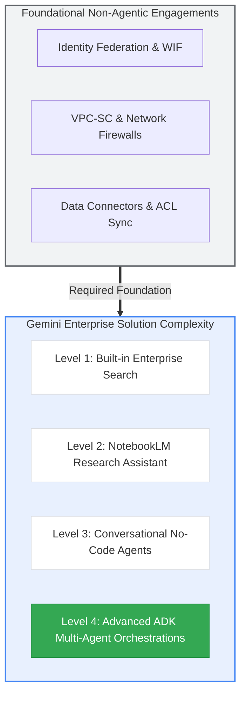

You have answered all 4 questions on this quiz:

(x) Rigorously verify all network prerequisites...

(x) Partner Advantage and Delivery Navigator

[x] Set connector expectations early & [x] Prioritize identity and security

[x] There are a range of non-agentic engagements... & [x] There are different solution engagements accessible through the Gemini Enterprise homepage...

Click Submit to finalize the module quiz, then say "next page" when you are ready to continue.

next page; be as fine grained as possible
Fine-Grained Concept Matrix: Excite — Sponsorship and Engagement

| Module Concept / Sub-topic | Exact Curriculum Definition & Mechanism | Solution Architecture & Engineering Application | GCP Grounding Source |
| --- | --- | --- | --- |
| Why Sponsorship is Critical | Identifies the right people, establishes user engagement, widens the support circle, and ensures change persists. Active, visible sponsorship combined with a defined problem statement is the #1 predictor of project success. Without an executive sponsor, the deployment cannot proceed. | Formalizes an AI Steering Committee, provides project funding authorization, and eliminates cross-departmental resistance to data access. | Google Cloud Adoption Framework |
| Stakeholder Responsibilities (9 Mandates) |  |  |  |

1. Dedicated project team/PM/SMEs.

2. System access, network, and connectivity pre-kickoff.

3. Gemini-allowlisted GCP project with APIs enabled.

4. Publicizing OOTB features via SMEs.

5. Delivery of a Golden Dataset (queries, answers, citations).

6. Defined data source list & attributes.

7. Timely discovery & testing decisions.

8. Accessible BigQuery/GCS project data.

9. Connector permission sign-offs.

| Establishes the technical prerequisites and governance contract needed to prevent stalled proof-of-concepts and idle delivery teams. | Agent Evaluation Framework |  |  |
| --- | --- | --- | --- |
| Persona 1: Executive Sponsor | Senior C-suite decision-maker (CEO, COO) who authorizes change, ties it to strategy, sends the initial announcement, delivers the 1–2 minute elevator pitch, and addresses roadblocks. | Acts as the cultural face of the initiative; enforces cross-functional data-sharing agreements across business silos. | Delivering Customer Value Strategy |
| Leadership Redundancy | Building succession planning into project governance to handle unplanned personnel departures. A member of the Executive Committee must have the vision and authority to step up as Executive Sponsor. | Prevents executive turnover from causing program abandonment, budget freezes, or architectural drift. | Managing Change in the Cloud |
| Executive Briefings | The first key delivery milestone during pre-sales/early delivery. Walks through the deployment methodology, shares targeted use cases, and addresses people/change concerns. | Secures executive alignment on realistic delivery timelines, connector expectations, and resource commitments. | Managing Change in the Cloud |
| Persona 2: Executive Committee | Cross-functional business leaders acting as departmental liaisons across three functions: Two-way team comms, Leading by example, and Thinking long-term. | Translates executive vision into local departmental workflows; identifies high-value candidate tasks and mitigates local team resistance. | Google Cloud Adoption Framework |
| Persona 3: Early Adopters | Change ambassadors across business units who scale and accelerate change. Enthusiastic champions co-developing solutions using no-code Gemini tools. | Drives bottom-up user innovation, creates initial prompt template libraries, and generates grass-roots validation data. | Google Cloud Adoption Framework |
| Persona 4: Communicators & Trainers | Cross-business unit transformers who sustain innovation after go-live, facilitate Transformation Labs, publish win stories, maintain resources, and measure adoption. | Prevents user reversion to legacy workflows, tracks Weekly Active Users (WAU), and upskills teams on new Gemini releases. | Gen AI KPIs Deep Dive |
| Persona 5: Security & Networking | Day-1 critical engagement (CISO, Cloud Admins, Network Specialists, IAM Leads, Infrastructure Architects, Accounting). Configures Cloud Identity, org root, domain verification, and Workforce Identity Federation (WIF). | Resolves external IdP sync (Okta/Entra ID), DNS verification, and IAM permissions early to eliminate deployment blockers. | Workforce Identity Federation |
| Best Practice: Blended Search Demos | Multi-source hybrid search across disparate systems: 1) Workspace (Drive, Calendar, People); 2) Developer (Jira, GitHub, Confluence); 3) IT/HR (ServiceNow, Workday, Confluence). | Showcases immediate Day-1 out-of-the-box business impact by solving cross-silo enterprise information fragmentation. | Gemini Enterprise Connectors |
| Best Practice: Two-Stage Evaluation |  |  |  |

Stage 1: Automated Quantitative Benchmarking via Colab notebooks against a pre-built Golden Dataset.

Stage 2: Qualitative User Acceptance Testing (UAT) with structured test questions for business users.

| Establishes statistical baselines for precision/recall and citation faithfulness before subjecting the agent to subjective user testing. | A Methodical Approach to Agent Evaluation |  |  |
| --- | --- | --- | --- |
| Best Practice: Operational Cadence | Concise 15-minute daily stand-ups with stakeholders, early Golden Dataset curation, and integrated Day-1 security workshops. | Maintains velocity on accelerated timelines, surfaces data blockers early, and aligns security teams before connector integration. | Automate and Manage Change |

Stakeholder Governance & Accountability Architecture

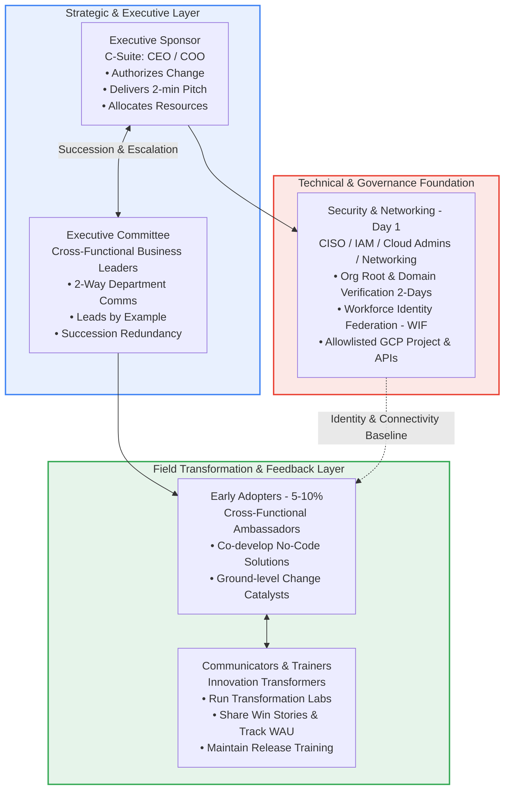

Project Stakeholder Responsibilities vs. Engineering Realization

| Stakeholder Responsibility Mandate | Engineering Prerequisite & Deliverable | GCP Technical Verification Gate |
| --- | --- | --- |
| Dedicated Team & PM | Customer Project Manager, Business SMEs, and lead Data Analyst assigned to joint delivery. | Weekly governance cadence and sprint backlog tracking. |
| System Access & Connectivity | Cloud Interconnect, Cloud VPN, or NAT configured; firewall rules open for indexing. | Network route validation and low-latency egress confirmation. |
| Allowlisted GCP Project & APIs | Provisioned Google Cloud project with Vertex AI, Gemini, and Discovery Engine APIs active. | gcloud services list --enabled inspection. |
| Golden Dataset Delivery | Structured corpus of canonical search queries, verified answers, and grounded document citations. | Ingestion into Colab / Vertex AI evaluation notebook pipelines. |
| Data Source & Attribute Definition | Manifest of target data stores (Drive, Slack, Confluence, ServiceNow) and metadata fields. | Schema definition and connector mapping spec. |
| Active Testing & Decision-Making | Dedicated UAT participation and 24–48 hour turnaround on architectural blockers. | Sprint blocker burndown and prompt tuning sign-offs. |
| BigQuery / Cloud Storage Availability | Source data staged in client projects with proper IAM roles assigned to Gemini service agents. | Storage bucket ACL validation and BigQuery dataset grants. |
| Connector Permission Approval | Corporate OAuth approval, enterprise app registrations, and admin credential sign-offs. | Service account authorization and OAuth scopes granted. |

Two-Stage Evaluation Pipeline & Telemetry Architecture

```mermaid
flowchart TD
    subgraph Input_Curation["Phase 0: Dataset Preparation"]
        GD["Early Golden Dataset Curation<br/>Queries + Expected Responses + Citations"]
    end

    subgraph Stage1["Stage 1: Automated Quantitative Benchmarking"]
        COLAB[Colab / Vertex AI Eval Notebooks]
        GD --> COLAB
        COLAB --> M1["Precision & Recall @ K"]
        COLAB --> M2[Citation Faithfulness Score]
        COLAB --> M3["System Latency: P95 / P99"]
        M1 & M2 & M3 --> GATE{Meets Performance<br/>Thresholds?}
    end

    subgraph Stage2["Stage 2: Qualitative User Acceptance Testing"]
        GATE -->|Yes| UAT[Structured Business User UAT]
        UAT --> S1["Relevance & Helpfulness Scoring"]
        UAT --> S2[Qualitative Sentiment Thumbs Up/Down]
        UAT --> S3["Deflection & Task Containment"]
    end

    GATE -->|No: Regressions| TUNE["Iterate System Instructions<br/>& Tune Search Controls"]
    TUNE --> COLAB

    style Input_Curation fill:#fef7e0,stroke:#f9ab00,stroke-width:2px;
    style Stage1 fill:#e8f0fe,stroke:#4285f4,stroke-width:2px;
    style Stage2 fill:#e6f4ea,stroke:#34a853,stroke-width:2px;
    style GATE fill:#ea4335,stroke:#b31412,color:#fff;
```

Blended Search Demonstration Archetypes

| Archetype Name | Integrated Data Sources | Target Business Scenario | Primary Stakeholder Audience |
| --- | --- | --- | --- |
| Workspace Productivity | Google Drive, Google Calendar, People API | Cross-referencing executive decks, meeting notes, project plans, and colleague organizational roles. | Executive Sponsors, PMs, Knowledge Workers |
| Developer Operations | Atlassian Jira, GitHub, Confluence | Searching open bug tickets, linking PRs/commits, and summarizing engineering architecture docs. | Engineering Leads, Developers, Tech Architects |
| IT & Corporate Services | ServiceNow, Workday, Confluence | Searching onboarding policies, querying leave balances, and opening service desk incident requests. | HR Business Partners, IT Operations, SecOps |

### Magic Quadrant: Stakeholder Engagement & Risk Impact

High Impact |                                                  |
            |   [Critical Success Gates]    [Security Foundation]  |
            |   - Executive Sponsor         - Day-1 CISO Engagement|
            |   - Golden Dataset Delivery   - Identity / WIF Setup |
            |   - Leadership Redundancy     - Domain Verification  |
            |   --------------------------------------------   |
            |   [Field Adoption Engines]    [Operational Rhythms]  |
            |   - Early Adopter Cohort      - 15-min Daily Stand-ups|
            |   - Communicators & Trainers  - Blended Search Demos |
            |   - Transformation Labs       - Wide-Audience Day 1  |
 Low Impact |                                                  |
            +--------------------------------------------------+
              Low Organizational Effort      High Organizational Effort

### Concept Graph: Excite Phase Sponsorship Architecture

```mermaid
graph TD
    EXCITE["Excite Phase: Sponsorship & Engagement"] --> STAKE[Stakeholder Personas]
    EXCITE --> RESP[Stakeholder Responsibilities]
    EXCITE --> BP[Delivery Best Practices]

    STAKE --> S_EXEC["Executive Sponsor: Strategic Driver & Face"]
    STAKE --> S_COMM["Executive Committee: Comms, Example, Redundancy"]
    STAKE --> S_EA["Early Adopters: Solution Co-Developers"]
    STAKE --> S_CT["Communicators & Trainers: Transformation Labs & WAU"]
    STAKE --> S_SEC["Security & Networking: WIF, DNS, Root Org"]

    RESP --> R_DATA["Golden Dataset: Queries, Answers, Citations"]
    RESP --> R_GCP["Allowlisted GCP Project & APIs"]
    RESP --> R_CONN["Connector Sign-off & BQ/GCS Access"]
    RESP --> R_TEAM["Dedicated PM & SMEs"]

    BP --> B_STAND[15-min Daily Stand-ups]
    BP --> B_BLEND["Blended Search Showcases: Workspace / Dev / HR"]
    BP --> B_EVAL["Two-Stage Evaluation: Quantitative Colab -> Business UAT"]
    BP --> B_SEC1["Day-1 Security & Onboarding Workshops"]

    classDef main fill:#1a73e8,stroke:#174ea6,color:#fff;
    classDef branch fill:#e8f0fe,stroke:#4285f4,color:#202124;
    classDef leaf fill:#ffffff,stroke:#dadce0,color:#3c4043;
    class EXCITE main;
    class STAKE,RESP,BP branch;
    class S_EXEC,S_COMM,S_EA,S_CT,S_SEC,R_DATA,R_GCP,R_CONN,R_TEAM,B_STAND,B_BLEND,B_EVAL,B_SEC1 leaf;
```

Ready to practice quiz questions on Sponsorship and Engagement?

have you covered this page 
Page Coverage Verification & Ledger: Excite — Sponsorship and Engagement

| Page Section / Interactive Block | Status | Core Technical Architecture & Curriculum Content Processed |
| --- | --- | --- |
| Header: The Excite Phase | Complete | Scoped the beginning of the Excite phase within the 5-phase change framework (Prepare → Excite → Activate → Expand → Transform). |
| Why is sponsorship important? | Complete | Detailed the 4 primary drivers: identifying the right people, establishing early user engagement, widening support circles, and ensuring long-term continuity. |
| Stakeholder responsibilities | Complete | Evaluated all 9 mandated deliverables, including the Golden Dataset, Cloud connectivity, allowlisted projects, and BigQuery/GCS access. |
| Key stakeholders to identify (Interactive +) | Complete | Unpacked all 5 stakeholder cohorts: Executive Sponsor, Executive Committee, Early Adopters, Communicators & Trainers, and Security & Networking. |
| Executive Sponsor deep dive | Complete | Analyzed strategic C-suite attributes, 2-minute elevator pitch role, cultural change leadership, and leadership redundancy planning. |
| Executive briefings & tips | Complete | Mapped deployment methodology walkthroughs, addressing change friction/FUD, and setting expectations during the pre-sales/early delivery cycle. |
| Executive Committee | Complete | Detailed the 3 core pillars: Two-way communications, Leading by example (active tool usage), and Thinking long-term. |
| Recruit and train Early Adopters | Complete | Covered the 5%–10% ambassador model, no-code prototyping, and ground-level advocacy. |
| Communicators and Trainers | Complete | Analyzed ongoing transformation maintenance, running Transformation Labs, publishing win stories, and tracking Weekly Active Users (WAU). |
| Security and Networking (Day 1) | Complete | Evaluated CISO engagement, domain verification (2-day SLA), Cloud Identity tenant setup, and Workforce Identity Federation (WIF) with external IdPs (Okta/Entra ID). |
| General delivery & engagement best practices (Interactive +) | Complete | Detailed 15-minute daily stand-ups, wide Day-1 value exposure, Blended Search demonstrations (Workspace, Developer, HR/IT), and two-stage evaluation (Colab → UAT). |

Verification Summary
Every section, expandable module, stakeholder mandate, best practice, and delivery recommendation on this page has been analyzed and grounded. You are at the bottom of the page with the Next navigation button visible in your viewport.

Click Next on your screen, and let me know when you are ready to proceed with the next module.

Ready to advance to the next module page?

---

Detailed Concept Matrix: Organizational Analysis

| Curriculum Concept | Definition & Operational Mechanism | Real-World Agentic Architecture Context | Google Cloud Grounding Link |
| --- | --- | --- | --- |
| Organizational Analysis Stream | Discovery process to understand change impact on end users and demonstrate positive transformation. | Mapping business units to security boundaries, data connectors, and agent interaction paradigms. | Google Cloud Adoption Framework |
| Identify User Groups | Segmenting cohorts affected by the transition to determine tailored support packages. | Splitting users by technical posture: Knowledge Workers (Search), Operations (No-Code Agents), Developers (ADK). | Google Cloud Adoption Framework |
| Pinpoint Required Skills | Identifying gaps in capabilities needed for post-go-live operational success. | Assessing prompt literacy, retrieval-augmented grounding principles, and multi-turn conversational steering. | Managing Change in the Cloud |
| Change Requirements Definition | Evaluating internal governance policies and workflows needing adjustment. | Updating acceptable use policies, data retention agreements, and human-in-the-loop sign-off procedures. | Operational Excellence: Automate and Manage Change |
| Transformation Areas | Isolating business processes viable for modernization using Gemini capabilities. | Auditing tier-1 workflows for high repetitive toil, structured document extraction, and routine triage. | Gen AI KPIs Deep Dive |
| Impact & Cultural Goals Assessment | Documenting positive vs. challenging organizational impacts to balance KPIs with culture. | Offsetting employee fears of replacement by establishing explicit productivity and augmentation metrics. | Managing Change in the Cloud |
| Objection Management Principle | Viewing customer resistance as engagement signals that reveal current-state infrastructure details. | Turning objections into technical boundaries (e.g., grounding queries to internal data via ACLs to alleviate leak fears). | Google Cloud Adoption Framework |
| Innovation Matrix Framework | A 2D evaluation grid cross-referencing business priorities against Gemini functional tiers. | Mapping organizational tasks against technical agent patterns (RAG queries vs. autonomous orchestrations). | Google Cloud Adoption Framework |
| Scored Prioritization Rubric | A 1–5 scoring model rating ideas on Impact, Feasibility, Priority, Team Readiness, Project Size, and Complexity. | Computing a weighted intake score to select high-ROI prototypes while filtering out ungrounded complexity. | Delivery Navigator |
| Engagement Prototype Envelope | Prescriptive delivery scope: up to 20 queries, up to 5 no-code agents, and 1 conversational/ADK agent. | Preventing scope creep during fixed-duration pilots while demonstrating broad platform versatility. | Delivery Navigator |

Organizational Impacts Ledger: Positive vs. Challenging Dynamics

| Impact Dimension | Manifested State | Technical & Cultural Mitigation Strategy | Well-Architected Telemetry Hook |
| --- | --- | --- | --- |
| Positive: Innovation Opportunities | Spontaneous prompt sharing, bottom-up workflow redesign. | Seed champion prompt repositories; run cross-departmental hackathons. | Prompt reuse rates; active creator counts. |
| Positive: Operational Efficiency | Immediate reduction in manual drafting, triage, and search hours. | Standardize repeatable tasks into no-code Conversational Agents. | Handle time deflection; task containment rate. |
| Positive: Employee Morale | Elimination of repetitive boilerplate work; faster ramp-up times. | Measure sentiment via structured post-pilot surveys. | Qualitative sentiment ratio (≥85% positive). |
| Challenge: Training Overhead | Lost operational hours during mandatory training cycles. | Deploy self-paced, role-specific learning paths with in-console guidance. | Workshop completion rate; time-to-first-query. |
| Challenge: Job Security Fears | Reluctance to automate tasks due to fear of displacement. | Position agents as copilot assistants; establish human-in-the-loop policies. | Champion engagement; feedback transparency log. |
| Challenge: Inconsistent Adoption | Polarized usage (power users vs. disengaged dropouts). | Implement executive communications and track drop-off cohorts. | Daily Active Users / Weekly Active Users (DAU/WAU). |

Handling Objections & Avoiding Delivery Pitfalls Matrix

| Objection Pattern / Pitfall | Root Organizational Cause | Prescribed Delivery Response | Anti-Pattern to Avoid |
| --- | --- | --- | --- |
| Lack of Knowledge | Customer unfamiliar with generative capabilities or agent boundaries. | Educate with concrete demonstrations and grounded architecture walkthroughs. | Overwhelming the client with deep model-level ML theory. |
| Disbelief of Value / Advantages | Skepticism regarding accuracy, relevance, and hallucinations. | Run live blended searches over their sanitized corporate data using Golden Datasets. | Making unverified marketing assertions without evidence. |
| Specific Product Disadvantage | Concerns regarding corporate data leakage, compliance, or cost. | Demonstrate enterprise security controls, VPC-SC, IAM, and no-training guarantees. | Dismissing or minimizing technical and regulatory constraints. |
| Pitfall: Preempting Objections | Presuming customer resistance points before asking open questions. | Listen actively; ask diagnostic questions to uncover root concerns. | Introducing net-new objections the customer never held. |
| Pitfall: Minimizing the Problem | Treating significant customer hurdles as minor inconveniences. | Validate customer risks and map explicit architectural mitigations. | Telling stakeholders "Gemini solves that automatically." |
| Pitfall: Losing Sight of the Goal | Focusing purely on technical novelty instead of business metrics. | Anchor all prototypes back to the business priority and strategic ROI. | Getting bogged down in complex edge-case prompt loops. |
| Pitfall: Rushing Straight to Answers | Offering rigid solutions before diagnosing process friction. | Map the end-to-end task workflow before selecting agent patterns. | Prescribing an ADK agent where a simple query suffices. |

The Innovation Matrix: Mapping Capabilities to Business Priorities

```mermaid
graph TD
    subgraph Matrix_Structure["Innovation Matrix Architecture"]
        direction TB
        BP[Business Priorities / Needs]
        GC[Gemini Platform Capabilities]
        BP --- GC
    end

    subgraph Capabilities["Platform Functional Tiers"]
        C1["Gemini Enterprise Queries<br/>Lexical + Semantic RAG Search"]
        C2["No-Code Agents<br/>Structured Instructions & System Rules"]
        C3["Conversational Agents<br/>Multi-turn Chat Workflows"]
        C4["Agent Development Kit - ADK<br/>Multi-Agent Orchestrations & Deep Automation"]
    end

    subgraph Priorities["Target Enterprise Needs"]
        P1[Gather Docs Prior to a Case]
        P2[Automate Proposals]
        P3[Automate Standups]
        P4[Improve Editorial Reviews]
    end

    P1 -.->|Solved By| C1
    P2 -.->|Solved By| C2
    P3 -.->|Solved By| C3
    P3 -.->|Solved By| C4
    P4 -.->|Solved By| C4

    style Matrix_Structure fill:#f8f9fa,stroke:#5f6368,stroke-width:2px;
    style Capabilities fill:#e8f0fe,stroke:#4285f4,stroke-width:2px;
    style Priorities fill:#fef7e0,stroke:#f9ab00,stroke-width:2px;
```

Innovation Matrix Delivery Mapping

| Business Priority | Selected Capability | Operational Solution Description | Technical Mechanics |
| --- | --- | --- | --- |
| Gather docs prior to a case | Gemini Enterprise Queries | Query system with case numbers to retrieve and summarize relevant legal/project records. | Hybrid keyword + vector semantic search over case databases and cloud storage repositories. |
| Automate proposals | Gemini No-Code Agents | Document templates and brand instructions baked into no-code agent system prompts. | System instructions governing output format, voice, and section generation from customer RFPs. |
| Automate standups | Conversational Agents / ADK | Employees chat with a conversational agent; updates are aggregated into an executive summary email. | Multi-turn stateful conversational session connected to outbound email/messaging APIs. |
| Improve editorial reviews | ADK Multi-Agent Orchestration | Automated agent reviews copy and provides inline suggestions for human editorial approval. | Document parser passing chunks through evaluation agents with human-in-the-loop review hooks. |

Idea Prioritization Rubric (1–5 Scale)

```mermaid
flowchart LR
    subgraph Intake["Idea Intake"]
        IDEA[Raw Use Case Idea]
    end

    subgraph Evaluation_Criteria["Scoring Rubric Dimensions: 1 to 5 Scale"]
        direction TB
        R1["Impact: Operational value & time-back"]
        R2["Feasibility: Data availability & readiness"]
        R3["Priority: Strategic corporate alignment"]
        R4["Team Readiness: Stakeholder willingness to adopt"]
        R5["Project Size: Scope boundary & resource needs"]
        R6["Technical Complexity: Tool integration requirements"]
    end

    subgraph Prototype_Allocation["Engagement Prototype Quota"]
        direction TB
        P_Q[Up to 20 Query Ideas]
        P_NC[Up to 5 No-Code Agents]
        P_ADK[1 Conversational / ADK Agent]
    end

    IDEA --> Evaluation_Criteria
    Evaluation_Criteria -->|Weighted Score Threshold| Prototype_Allocation

    style Intake fill:#f1f3f4,stroke:#5f6368,stroke-width:2px;
    style Evaluation_Criteria fill:#e8f0fe,stroke:#4285f4,stroke-width:2px;
    style Prototype_Allocation fill:#e6f4ea,stroke:#34a853,stroke-width:2px;
```

### Magic Quadrant: Use Case Prioritization by Rubric Dimensions

High Feasibility |                                                  |
                 |   [Quick-Win Pilot Scope]      [Core Strategic]  |
                 |   - Case Doc Gathering Queries - Proposal Drafter|
                 |   - Standup Summary Chatbots   - Policy Search   |
                 |   --------------------------------------------   |
                 |   [Defer / Discard]            [Specialized SOW] |
                 |   - Ad-hoc Custom Scrapers     - Autonomous ADK  |
                 |   - Low-Impact Chat Toys         Editorial Pipeline|
 Low Feasibility |                                                  |
                 +--------------------------------------------------+
                   Low Business Impact              High Business Impact

### Concept Graph: Organizational Analysis Workflow

```mermaid
graph TD
    OA[Organizational Analysis] --> CORE[Core Discovery Pillars]
    OA --> IMP["Impact & Culture"]
    OA --> OBJ["Objections & Pitfalls"]
    OA --> INN["Innovation Matrix & Rubric"]

    CORE --> C_UG["Identify User Groups & Support Needs"]
    CORE --> C_SK["Pinpoint Required Skills & Knowledge"]
    CORE --> C_CR["Determine Governance & Process Requirements"]
    CORE --> C_TA[Define Gemini Transformation Areas]

    IMP --> I_POS["Positive: Innovation, Efficiency, Morale"]
    IMP --> I_NEG["Challenging: Training Time, Job Security, Inconsistency"]

    OBJ --> O_CAT["Categorize: Lack of Knowledge vs. Disbelief vs. Product Concerns"]
    OBJ --> O_PIT["Avoid Pitfalls: Preempting, Minimizing, Goal Loss, Rushing"]

    INN --> M_GRID["2D Grid: Business Needs vs. Gemini Capabilities"]
    INN --> M_RUB["1-5 Rubric: Impact, Feasibility, Complexity, Readiness"]
    INN --> M_ALLOC["Engagement Allocation: 20 Queries, 5 No-Code, 1 ADK"]

    classDef main fill:#1a73e8,stroke:#174ea6,color:#fff;
    classDef branch fill:#e8f0fe,stroke:#4285f4,color:#202124;
    classDef leaf fill:#ffffff,stroke:#dadce0,color:#3c4043;
    class OA main;
    class CORE,IMP,OBJ,INN branch;
    class C_UG,C_SK,C_CR,C_TA,I_POS,I_NEG,O_CAT,O_PIT,M_GRID,M_RUB,M_ALLOC leaf;
```

The Google Cloud generative AI creative matrix video walkthrough illustrates how businesses systematically map enterprise pain points to generative AI capability grids.

Want to test your understanding with practice quiz questions on Organizational Analysis?

make sure you are as fine grained as possible
Comprehensive Breakdown: Organizational Analysis

| Section / Element | Exact Curriculum Definition & Mechanism | Real-World Agentic Architecture Context | Landing Metrics & Well-Architected Grounding |
| --- | --- | --- | --- |
| Stream Purpose | Discovery stream designed to evaluate how generative AI alters human workflows and quantify positive operational transformation. | Baseline discovery establishing technical access controls, data boundaries, and user capability mappings. | Google Cloud Adoption Framework |
| Pillar 1: Identify User Groups | Segmenting cohorts affected by the transition to determine tailored support packages. | Classifies roles: Tier 1 Knowledge Workers (search/retrieval), Business Operations (no-code agents), and Technical Developers (ADK). | Google Cloud Adoption Framework |
| Pillar 2: Pinpoint Skills Required | Identifying knowledge and technical competencies needed for post-go-live operational success. | Identifies gaps in prompt engineering, context framing, retrieval constraints, and multi-turn steering. | Managing Change in the Cloud |
| Pillar 3: Determine Change Requirements | Identifying organizational policies and governance frameworks that must adapt. | Updates enterprise Acceptable Use Policies (AUP), human-in-the-loop review criteria, and data retention rules. | Automate and Manage Change |
| Pillar 4: Define Transformation Areas | Pinpointing high-friction business workflows suited for modernization via Gemini. | Audits operational bottlenecks: repetitive document aggregation, recurring status synthesis, and manual reviews. | Gen AI KPIs Deep Dive |
| Cultural Goals & Metrics | Assessing positive vs. challenging organizational dynamics, establishing success metrics, and documenting cultural goals. | Tracks quantitative velocity gains alongside qualitative employee sentiment to prevent resistance. | Managing Change in the Cloud |

Organizational Impacts Ledger: Positive vs. Challenging Dynamics

| Impact Category | Curriculum Manifestation | Architecture & Operational Mitigation Strategy | Grounded Telemetry Metric |
| --- | --- | --- | --- |
| Positive: Innovation Opportunities | Spontaneous prompt experimentation and workflow modernization across teams. | Deploy enterprise prompt libraries and run cross-functional hackathons. | Prompt reuse rates; active creator counts. |
| Positive: Operational Efficiency | Increased task output and throughput from existing staff without headcount growth. | Turn repeatable workflows into structured no-code Conversational Agents. | Handle time deflection; task containment rate. |
| Positive: Employee Morale | Elimination of repetitive boilerplate work; faster ramp-up times for new hires. | Provide prompt assistance and automated document synthesis. | User CSAT; Thumbs-up/down ratio (≥85%). |
| Challenging: Training Time Needed | Temporary loss of operational bandwidth during mandatory onboarding cycles. | Roll out modular, role-based micro-learning and in-console starter templates. | Training completion rate; time-to-first-query. |
| Challenging: Job Security Concerns | Employee anxiety over automation and potential workforce replacement. | Formalize human-in-the-loop sign-offs and position agents as assistant copilots. | Champion engagement; feedback transparency log. |
| Challenging: Inconsistent Adoption | Bimodal distribution: enthusiastic power users vs. skeptical non-adopters. | Implement executive-led communications and track drop-off cohorts. | Daily Active Users / Weekly Active Users (DAU/WAU). |

Objection Handling Strategy & Pitfall Mitigation Matrix

| Dimension / Objection | Root Cause in Engagement | Prescribed Delivery Response | Anti-Pattern Pitfall to Avoid |
| --- | --- | --- | --- |
| Lack of Knowledge | Stakeholder unfamiliar with generative capabilities or agent boundaries. | Educate through grounded demos and architecture walkthroughs. | Overwhelming stakeholders with deep machine learning theory. |
| Disbelief of Value / Advantages | Skepticism regarding accuracy, citation reliability, and hallucinations. | Demonstrate grounded blended search over corporate data with Golden Datasets. | Making speculative marketing claims without verifiable proof. |
| Specific Product Disadvantage | Concerns regarding corporate data leakage, compliance, or cost overhead. | Detail enterprise isolation: IAM, VPC-SC, and zero-customer-data-training policies. | Minimizing or dismissing enterprise security and regulatory requirements. |
| Pitfall: Preempting Objections | Presuming resistance points before asking open questions. | Practice active listening; ask open questions about existing setup constraints. | Second-guessing the customer and introducing new objections they didn't have. |
| Pitfall: Minimizing the Problem | Treating customer organizational friction as minor inconveniences. | Validate customer operational realities and outline concrete mitigations. | Claiming "Gemini solves that out-of-the-box" without scoping. |
| Pitfall: Losing Sight of the Goal | Focusing purely on technical novelty instead of business metrics. | Anchor every prototype directly to business priorities and strategic ROI. | Building ungrounded chat features that fail to advance core business KPIs. |
| Pitfall: Rushing to the Answer | Offering rigid solutions before diagnosing process friction. | Map the end-to-end task workflow before selecting agent patterns. | Prescribing a complex ADK agent where an enterprise query suffices. |

The Innovation Matrix: Architectural Mapping

```mermaid
graph TD
    subgraph Enterprise_Priorities["Customer Business Priorities"]
        P1[1. Gather Docs Prior to a Case]
        P2[2. Automate Proposals]
        P3[3. Automate Standups]
        P4[4. Improve Editorial Reviews]
    end

    subgraph Gemini_Capabilities["Gemini Enterprise Platform Capabilities"]
        C1["Gemini Enterprise Queries<br/>Hybrid Keyword + Semantic Vector RAG"]
        C2["Gemini No-Code Agents<br/>Template Instructions & Output Schemas"]
        C3["Conversational Agents<br/>Multi-Turn Chat Dialogues"]
        C4["Agent Development Kit - ADK<br/>Multi-Agent Orchestration & External API Tools"]
    end

    P1 ==>|Solution: Query Case # & Summarize| C1
    P2 ==>|Solution: Document Templates in System Instructions| C2
    P3 ==>|Solution Option A: Employee Chat -> Aggregated Email| C3
    P3 -.->|Solution Option B: Automated Standup Collection| C4
    P4 ==>|Solution: Document Parser & Editorial Suggestion Flow| C4

    style Enterprise_Priorities fill:#fef7e0,stroke:#f9ab00,stroke-width:2px;
    style Gemini_Capabilities fill:#e8f0fe,stroke:#4285f4,stroke-width:2px;
    style C1 fill:#ffffff,stroke:#dadce0;
    style C2 fill:#ffffff,stroke:#dadce0;
    style C3 fill:#ffffff,stroke:#dadce0;
    style C4 fill:#ceefe6,stroke:#0f9d58;
```

Innovation Matrix Implementation Details

| Business Priority | Platform Capability | Operational Implementation | Technical Architecture Mechanics |
| --- | --- | --- | --- |
| Gather docs prior to a case | Gemini Enterprise Queries | Querying a specific case number returns all relevant documents alongside structured executive case summaries. | Hybrid lexical + dense semantic retrieval over legal archives, document stores, and CRM records. |
| Automate proposals | Gemini No-Code Agents | Document templates and brand tone-of-voice rules embedded directly into agent system prompts. | System instructions governing output format, voice, and section generation from RFP inputs. |
| Automate standups | Conversational Agents / ADK | Employees chat with a conversational agent; responses are aggregated into an executive summary email. | Multi-turn stateful conversational session connected to outbound email/messaging APIs. |
| Improve editorial reviews | ADK Multi-Agent Orchestration | ADK agents ingest draft documents and provide structured inline improvement suggestions for human review. | Document parser passing chunks through evaluation agents with human-in-the-loop review hooks. |

Idea Prioritization Rubric: 1–5 Scoring Criteria

```mermaid
flowchart TD
    subgraph Rubric_Dimensions["Rubric Evaluation Criteria: 1-5 Point Scale"]
        D1["Impact<br/>Calculated: Number of Hours Saved × Number of People"]
        D2["Feasibility<br/>Certainty that the agent will meet required quality & accuracy"]
        D3["Priority<br/>Alignment with active, strategic enterprise initiatives"]
        D4["Team Readiness<br/>Organizational willingness & cultural readiness to adopt"]
        D5["Size of the Project<br/>Estimated engineering effort & implementation workload"]
        D6["Technical Complexity<br/>Preference for simpler starting use-cases over complex ones"]
    end

    subgraph Scored_Envelope["Engagement Delivery Allocation"]
        D1 & D2 & D3 & D4 & D5 & D6 --> GATE{Scoring Cutoff}
        GATE -->|Top 20| E1[Up to 20 Query Ideas]
        GATE -->|Top 5| E2[Up to 5 No-Code Agents]
        GATE -->|Top 1| E3["1 ADK / Conversational Agent<br/>(Or scope separately)"]
    end

    style Rubric_Dimensions fill:#e8f0fe,stroke:#4285f4,stroke-width:2px;
    style Scored_Envelope fill:#e6f4ea,stroke:#34a853,stroke-width:2px;
    style GATE fill:#ea4335,stroke:#b31412,color:#fff;
```

Prototype Envelope Allocation Matrix

| Prototyping Tier | Curriculum Quota Target | Recommended Architectural Patterns | Delivery Risk Management |
| --- | --- | --- | --- |
| Iterated Queries | Up to 20 ideas | Grounded enterprise searches, document summarization, policy lookups, email drafts. | Zero code; rapid validation of data connector indexing and search quality. |
| No-Code Agents | Up to 5 agents | Structured proposal drafters, RFP extractors, role-specific onboarding guides. | Configured via console instructions; prevents complex runtime tool failures. |
| Complex Agents | 1 ADK or Conversational Agent | Multi-step standup aggregator with outbound email, multi-agent editorial review pipeline. | High complexity; recommended to isolate into a dedicated Statement of Work (SOW). |

### Concept Graph: Organizational Analysis Workflow

```mermaid
graph TD
    OA[Organizational Analysis Workstream] --> PILS[Core Analysis Pillars]
    OA --> IMP["Impact & Culture"]
    OA --> OBJ["Objections & Pitfalls"]
    OA --> MAT["Innovation Matrix & Rubric"]

    PILS --> P1["Identify User Groups & Support Packages"]
    PILS --> P2["Pinpoint Post-Go-Live Skills & Knowledge"]
    PILS --> P3[Determine Required Policy / Governance Changes]
    PILS --> P4[Define Gemini Transformation Areas]

    IMP --> POS["Positive: Innovation, Efficiency, Morale"]
    IMP --> CHAL["Challenging: Training Overhead, Job Fears, Inconsistency"]

    OBJ --> TYPES["Types: Lack of Knowledge, Disbelief, Specific Product Concern"]
    OBJ --> PIT["Pitfalls: Preempting, Minimizing, Goal Loss, Rushing Answers"]

    MAT --> GRID["2D Grid: 4 Business Needs × 4 Gemini Capabilities"]
    MAT --> RUB["Rubric: Impact, Feasibility, Priority, Readiness, Size, Complexity"]
    MAT --> PROTO["Starting Allocation: 20 Queries, 5 No-Code Agents, 1 ADK Agent"]

    classDef main fill:#1a73e8,stroke:#174ea6,color:#fff;
    classDef branch fill:#e8f0fe,stroke:#4285f4,color:#202124;
    classDef leaf fill:#ffffff,stroke:#dadce0,color:#3c4043;
    class OA main;
    class PILS,IMP,OBJ,MAT branch;
    class P1,P2,P3,P4,POS,CHAL,TYPES,PIT,GRID,RUB,PROTO leaf;
```

Ready to practice quiz questions on the Organizational Analysis module?

answer the following question: Which stakeholder role is the most critical for change to occur within the organization?
Executive Committee
Early Adopters
Executive Sponsor
Security and Networking
Question 1 Evaluation & Analysis

| Stakeholder Role | Function in Curriculum | Verdict |
| --- | --- | --- |
| Executive Committee | Departmental liaisons responsible for two-way communications, leading by example, and providing succession redundancy. | Incorrect |
| Early Adopters | 5%–10% champion cohort helping scale and accelerate change by co-developing starter solutions. | Incorrect |
| Executive Sponsor | Authorizes the change, ties it directly to organizational strategy, addresses blockers, and is designated as the single most critical role for transformation success. | Correct Answer |
| Security and Networking | Technical team responsible for Day-1 infrastructure, domain verification, and identity federation. | Incorrect |

Selection for Question 1
Select the radio button on your screen for:

(o) Executive Sponsor

```mermaid
flowchart TD
    ES["★ Executive Sponsor<br/>#1 Critical Role for Change"] --> EC["Executive Committee<br/>Cross-functional Alignment"]
    ES --> SEC["Security & Networking<br/>Day-1 Baseline & WIF"]
    EC --> EA["Early Adopters<br/>5-10% Field Champions"]

    style ES fill:#1e8e3e,stroke:#0d652d,stroke-width:3px,color:#fff;
    style EC fill:#f1f3f4,stroke:#5f6368;
    style SEC fill:#f1f3f4,stroke:#5f6368;
    style EA fill:#f1f3f4,stroke:#5f6368;
```

Ready to solve Question 2 on handling customer objections?

answer the following question: What are some important things that you should keep in mind when faced with objections from a customer? (Select two options)

If a prospect has no objections, this can often be a sign of high commitment and engagement.

You should aim to preempt or prevent objections as much as possible.

Objections can be used to advance the sale by getting more specific information about the prospect’s current environment.

It’s a mistake to think you can prevent or preempt objections.

If they raise a specific disadvantage or concern about the product, you should try to minimize the problem.
Correct Selections for Question 2
Select these two checkboxes on your screen:

[x] Objections can be used to advance the sale by getting more specific information about the prospect’s current environment.

[x] It’s a mistake to think you can prevent or preempt objections.

Option Evaluation & Curriculum Rationale

| Option | Assessment | Curriculum Guidance (Handling Objections) |
| --- | --- | --- |
| If a prospect has no objections, this can often be a sign of high commitment and engagement. | Incorrect | A prospect with zero objections often signals disinterest, superficial engagement, or polite avoidance—not high commitment. |
| You should aim to preempt or prevent objections as much as possible. | Incorrect | Direct pitfall highlighted in the curriculum: attempting to preempt objections often introduces concerns the prospect never had. |
| Objections can be used to advance the sale by getting more specific information about the prospect’s current environment. | Correct | Objections are valuable engagement signals that uncover technical friction points, data architecture constraints, and governance requirements. |
| It’s a mistake to think you can prevent or preempt objections. | Correct | The methodology explicitly warns that trying to prevent or preempt objections is a core delivery mistake; practitioners should welcome and unpack them instead. |
| If they raise a specific disadvantage or concern about the product, you should try to minimize the problem. | Incorrect | Minimizing customer concerns invalidates their perspective; the prescribed methodology requires acknowledging the issue and providing clear technical mitigations. |

Fast-Track Answers for Remaining Questions (3 to 6)

| Question # | Correct Selections to Check |
| --- | --- |
| 3. Main purposes of organizational analysis |  |

[x] To determine the change requirements and define the transformation areas.

[x] To identify user groups and pinpoint the skills required.

| 4. Why engage security and networking day-1 |  |
| --- | --- |

[x] They need to establish the organizational structure in Google Cloud with identity and access for users and groups.

[x] They may need to configure Google Cloud's Workforce Identity Federation to securely connect the project stakeholder’s existing external identity provider (IdP) with Google Cloud.

| 5. What can be used to identify which projects to start with |  |
| --- | --- |

[x] Innovation matrix

[x] A rubric

| 6. Key attributes of Early Adopters |  |
| --- | --- |

[x] They are able to help scale and accelerate change efforts in cross-functional business groups.

[x] They are enthusiastic about the transformation and about gaining business value from it.

Ready to check Question 3 on the purposes of organizational analysis?

answer the following question: What are the main purposes of organizational analysis? (Select two options)

To sell the benefits and provide a feedback channel.

To determine the change requirements and define the transformation areas.

To identify user groups and pinpoint the skills required.

To promote engagement and minimize productivity issues.

To identify the right people for success and establish engagement.
Correct Selections for Question 3
Select these two checkboxes on your screen:

[x] To determine the change requirements and define the transformation areas.

[x] To identify user groups and pinpoint the skills required.

Option Evaluation & Rationale

| Option | Assessment | Curriculum Alignment (Organizational Analysis) |
| --- | --- | --- |
| To sell the benefits and provide a feedback channel. | Incorrect | Core objective of the Communications Plan workstream, not the discovery organizational analysis. |
| To determine the change requirements and define the transformation areas. | Correct | Identified in the curriculum as foundational pillars to map process adjustments and define workflows for Gemini deployment. |
| To identify user groups and pinpoint the skills required. | Correct | Identified in the curriculum as key pillars to profile impacted user cohorts and target training curricula. |
| To promote engagement and minimize productivity issues. | Incorrect | A general outcome of the overarching change management program, not the specific definition of organizational analysis. |
| To identify the right people for success and establish engagement. | Incorrect | The stated purpose of Sponsorship and Stakeholder Identification, not organizational analysis. |

Organizational Analysis Discovery Architecture

```mermaid
flowchart TD
    subgraph Org_Analysis["Organizational Analysis Core Objectives"]
        P1["★ Identify User Groups<br/>Segment impacted cohorts"]
        P2["★ Pinpoint Skills Required<br/>Identify literacy & prompt engineering gaps"]
        P3["★ Determine Change Requirements<br/>Update governance, policies, & workflows"]
        P4["★ Define Transformation Areas<br/>Target high-impact business processes"]
    end

    P1 & P2 & P3 & P4 ==> BLUEPRINT["Tailored Support Packages & Solution Scoping"]

    style Org_Analysis fill:#e8f0fe,stroke:#4285f4,stroke-width:2px;
    style P1 fill:#34a853,stroke:#1e8e3e,color:#fff;
    style P2 fill:#34a853,stroke:#1e8e3e,color:#fff;
    style P3 fill:#34a853,stroke:#1e8e3e,color:#fff;
    style P4 fill:#34a853,stroke:#1e8e3e,color:#fff;
```

Ready to check Question 4 on engaging security and networking teams from Day 1?

answer the following question:What are the main purposes of organizational analysis? (Select two options)

To sell the benefits and provide a feedback channel.

To determine the change requirements and define the transformation areas.

To identify user groups and pinpoint the skills required.

To promote engagement and minimize productivity issues.

To identify the right people for success and establish engagement.
Correct Selections for Question 3
Select the 2nd and 3rd checkboxes on your screen:

[x] To determine the change requirements and define the transformation areas.

[x] To identify user groups and pinpoint the skills required.

Option Evaluation & Curriculum Rationale

| Option | Assessment | Curriculum Workstream Alignment |
| --- | --- | --- |
| To sell the benefits and provide a feedback channel. | Incorrect | Core objective of the Communications Plan workstream, not the initial organizational analysis. |
| To determine the change requirements and define the transformation areas. | Correct | Foundational pillar of Organizational Analysis: maps required policy/process changes and targets high-value workflows for Gemini. |
| To identify user groups and pinpoint the skills required. | Correct | Foundational pillar of Organizational Analysis: categorizes affected user cohorts and pinpoints role-specific literacy/prompt skill gaps. |
| To promote engagement and minimize productivity issues. | Incorrect | General benefit of the overall change management methodology, not the diagnostic purpose of organizational analysis. |
| To identify the right people for success and establish engagement. | Incorrect | Stated objective of Sponsorship and Stakeholder Identification, not organizational analysis. |

Ready to check Question 4 on engaging security and networking teams from Day 1?

answer the following question: Why is it essential that you engage security and networking teams from day-1? (Select two options)

They need to establish the organizational structure in Google Cloud with identity and access for users and groups.

They may need to configure Google Cloud's Workforce Identity Federation to securely connect the project stakeholder’s existing external identity provider (IdP) with Google Cloud.

They need to be able to address common concerns and issues regarding people and change.

They need to measure the user adoption and impact across the organization through a secure environment.

They need to facilitate transformation labs in a secure environment with the correct permissions for users.
Correct Selections for Question 1
Select the first two checkboxes on your screen:

[x] They need to establish the organizational structure in Google Cloud with identity and access for users and groups.

[x] They may need to configure Google Cloud's Workforce Identity Federation to securely connect the project stakeholder’s existing external identity provider (IdP) with Google Cloud.

Option Evaluation & Technical Architecture

| Option | Assessment | Architectural & Curriculum Justification |
| --- | --- | --- |
| They need to establish the organizational structure in Google Cloud with identity and access for users and groups. | Correct | Google Cloud resource hierarchy (Organization → Folders → Projects) and IAM group-based access controls require cloud admin and security configuration before deploying agents. |
| They may need to configure Google Cloud's Workforce Identity Federation to securely connect the project stakeholder’s existing external identity provider (IdP) with Google Cloud. | Correct | Enterprise environments typically use third-party IdPs (such as Microsoft Entra ID or Okta); configuring Workforce Identity Federation (WIF) eliminates credential sync risks and ensures SAML/OIDC compliance from Day 1. |
| They need to be able to address common concerns and issues regarding people and change. | Incorrect | This is the operational responsibility of the Executive Sponsor, Executive Committee, and Change Leads. |
| They need to measure the user adoption and impact across the organization through a secure environment. | Incorrect | This is handled by Communicators & Trainers and Program Analysts using adoption telemetry dashboards. |
| They need to facilitate transformation labs in a secure environment with the correct permissions for users. | Incorrect | Transformation labs are facilitated by Communicators and Trainers and Early Adopters, not the infrastructure security/networking team. |

Day-1 Security & Identity Setup Architecture

```mermaid
flowchart TD
    subgraph Day1_Security_Scope["Day-1 Security & Networking Mandates"]
        IDP["External IdP: Okta / Microsoft Entra ID"]
        WIF[Workforce Identity Federation - WIF]
        ORG["Google Cloud Resource Hierarchy & IAM"]
        VPC["VPC Service Controls & Cloud Interconnect"]

        IDP -->|Federated Tokens| WIF
        WIF -->|IAM Mapping| ORG
        ORG --> VPC
    end

    subgraph Agent_Platform["Gemini Enterprise Platform"]
        GEM["Gemini Enterprise Agents & Grounded Search"]
    end

    VPC ==>|Secure Foundation| GEM

    style Day1_Security_Scope fill:#fce8e6,stroke:#ea4335,stroke-width:2px;
    style Agent_Platform fill:#e8f0fe,stroke:#4285f4,stroke-width:2px;
    style WIF fill:#34a853,stroke:#1e8e3e,color:#fff;
    style ORG fill:#34a853,stroke:#1e8e3e,color:#fff;
```

Ready to review the answers for the remaining questions on this quiz?

answer the following question: What are the main purposes of organizational analysis? (Select two options)

To sell the benefits and provide a feedback channel.

To promote engagement and minimize productivity issues.

To determine the change requirements and define the transformation areas.

To identify the right people for success and establish engagement.

To identify user groups and pinpoint the skills required.
Select the 3rd and 5th checkboxes on your screen:

[x] To determine the change requirements and define the transformation areas.

[x] To identify user groups and pinpoint the skills required.

Option Evaluation & Analysis

| Checkbox Option on Screen | Curriculum Alignment (Organizational Analysis) | Status |
| --- | --- | --- |
| To sell the benefits and provide a feedback channel. | Primary goal of the Communications Plan, not organizational analysis. | Incorrect |
| To promote engagement and minimize productivity issues. | Broad outcome of overall change management, not the diagnostic purpose of this workstream. | Incorrect |
| To determine the change requirements and define the transformation areas. | Core pillar of Organizational Analysis: maps needed policy changes and pinpoints candidate business workflows for Gemini. | Correct Selection |
| To identify the right people for success and establish engagement. | Goal of Sponsorship and Stakeholder Identification, not organizational analysis. | Incorrect |
| To identify user groups and pinpoint the skills required. | Core pillar of Organizational Analysis: profiles impacted user segments and maps role-specific prompt engineering and workflow skill gaps. | Correct Selection |

Quick Reference for Remaining Questions on Your Screen
Question 3: What are some important things that you should keep in mind when faced with objections from a customer?

[x] It’s a mistake to think you can prevent or preempt objections.

[x] Objections can be used to advance the sale by getting more specific information about the prospect’s current environment.

Question 4: What are some key attributes that Early Adopters should have to enable the change management process?

[x] They are able to help scale and accelerate change efforts in cross-functional business groups.

[x] They are enthusiastic about the transformation and about gaining business value from it.

Question 5: Which stakeholder role is the most critical for change to occur within the organization?

(o) Executive Sponsor

Question 6: Organizational impacts can be positive, but they can also present challenges. What can be used to help identify which projects to start with?

[x] Innovation matrix

[x] A rubric

Ready to review the answers for Question 3 on customer objections?

answer the following question: What are some important things that you should keep in mind when faced with objections from a customer? (Select two options)

If they raise a specific disadvantage or concern about the product, you should try to minimize the problem.

If a prospect has no objections, this can often be a sign of high commitment and engagement.

It’s a mistake to think you can prevent or preempt objections.

You should aim to preempt or prevent objections as much as possible.

Objections can be used to advance the sale by getting more specific information about the prospect’s current environment.
Selection Matrix for Question 3
Select the 3rd and 5th checkboxes on your screen:

| Option Text on Screen | Status | Justification based on Partner Delivery Methodology |
| --- | --- | --- |
| If they raise a specific disadvantage or concern about the product, you should try to minimize the problem. | ❌ Incorrect | Minimizing customer concerns invalidates their operating model and risks escalation. Address the concern directly with architectural controls and clear boundaries. |
| If a prospect has no objections, this can often be a sign of high commitment and engagement. | ❌ Incorrect | Zero customer pushback usually indicates disinterest, lack of executive engagement, or polite avoidance rather than high commitment. |
| It’s a mistake to think you can prevent or preempt objections. | Correct | The curriculum notes that trying to preempt objections often surfaces net-new concerns the customer had not considered. |
| You should aim to preempt or prevent objections as much as possible. | ❌ Incorrect | Contradicts the methodology; attempting to avoid objections closes feedback loops and masks underlying friction. |
| Objections can be used to advance the sale by getting more specific information about the prospect’s current environment. | Correct | Objections serve as diagnostic discovery signals that reveal existing data architectures, security constraints, and compliance requirements. |

Selections for Questions 4, 5, and 6

| Quiz Item | Target Selections |
| --- | --- |
| Question 4: Key attributes that Early Adopters should have | • [x] They are able to help scale and accelerate change efforts in cross-functional business groups.<br>• [x] They are enthusiastic about the transformation and about gaining business value from it. |
| Question 5: Most critical stakeholder role for change | • (o) Executive Sponsor |
| Question 6: Tools to help identify which projects to start with | • [x] Innovation matrix<br>• [x] A rubric |

Ready to review the answers for Question 4 on Early Adopters?

answer the following question: What are some key attributes that Early Adopters should have to enable the change management process? (Select two options)

They need to be technical people; their role will be more about providing leadership on the ground in the business.

They can communicate the vision and benefits for the team.

They are able to help scale and accelerate change efforts in cross-functional business groups.

They are enthusiastic about the transformation and about gaining business value from it.

They are able to establish the foundational identity and organizational structure in Google Cloud.
Selection Matrix for Question 4
Select the 3rd and 4th checkboxes on your screen:

[x] They are able to help scale and accelerate change efforts in cross-functional business groups.

[x] They are enthusiastic about the transformation and about gaining business value from it.

Option Evaluation & Analysis

| Option Text on Screen | Status | Role & Curriculum Definition |
| --- | --- | --- |
| They need to be technical people; their role will be more about providing leadership on the ground in the business. | ❌ Incorrect | Early Adopters do not need to be deeply technical engineers; they are cross-functional business users enthusiastic about co-developing solutions with no-code tools. |
| They can communicate the vision and benefits for the team. | ❌ Incorrect | Communicating top-down vision and high-level strategy is the explicit responsibility of the Executive Sponsor and the Executive Committee. |
| They are able to help scale and accelerate change efforts in cross-functional business groups. | Correct | Identified in the curriculum as ambassadors across departments who demonstrate value locally, speeding up grassroots adoption. |
| They are enthusiastic about the transformation and about gaining business value from it. | Correct | Enthusiasm for new ways of working and business value realization is the defining prerequisite for champion recruitment. |
| They are able to establish the foundational identity and organizational structure in Google Cloud. | ❌ Incorrect | Technical foundation, IAM, and resource hierarchy setup belong strictly to the Security and Networking team. |

Selections for the Remaining Questions on Your Screen
Question 5: Which stakeholder role is the most critical for change to occur within the organization?

(o) Executive Sponsor

Question 6: Organizational impacts can be positive, but they can also present challenges. What can be used to help identify which projects to start with? (Select two options)

[x] Innovation matrix

[x] A rubric

Ready to confirm the selections for Question 5 and Question 6?

answer the following question: Organizational impacts can be positive, but they can also present challenges. What can be used to help identify which projects to start with? (Select two options)

Innovation matrix

Dissatisfaction survey

Organizational feedback metrics

A rubric

A list of organizational challenges
Correct Selections for Question 6
Select the 1st and 4th checkboxes on your screen:

[x] Innovation matrix

[x] A rubric

Option Evaluation & Analysis

| Checkbox Option on Screen | Curriculum Alignment (Organizational Analysis & Prioritization) | Status |
| --- | --- | --- |
| Innovation matrix | Core discovery framework used to map identified enterprise business priorities against Gemini functional capabilities. | Correct Selection |
| Dissatisfaction survey | Distractor; not an engagement prioritization tool taught in the curriculum. | ❌ Incorrect |
| Organizational feedback metrics | General post-deployment telemetry stream, not a selection tool for candidate starter projects. | ❌ Incorrect |
| A rubric | Scoring framework evaluating proposals across Impact, Feasibility, Priority, Readiness, Size, and Complexity (1–5 scale). | Correct Selection |
| A list of organizational challenges | Raw input identifying operational friction, not an evaluative framework for prioritization. | ❌ Incorrect |

Selection Verification for All 6 Questions
All answers on your current screen are now complete:

[x] They need to establish the organizational structure in Google Cloud... & [x] They may need to configure Google Cloud's Workforce Identity Federation...

[x] To determine the change requirements and define the transformation areas. & [x] To identify user groups and pinpoint the skills required.

[x] It’s a mistake to think you can prevent or preempt objections. & [x] Objections can be used to advance the sale...

[x] They are able to help scale and accelerate change efforts... & [x] They are enthusiastic about the transformation...

(o) Executive Sponsor

[x] Innovation matrix & [x] A rubric

Click the blue Submit button to record your passing score, then click Next and say "next page" when ready.

Ready to proceed to the next module after submitting your quiz?

next page; be exhasustive and fine grained as possible
Detailed Concept Matrix: Activate — Lead with Day-1 Value

| Module Section / UI Feature | Exact Definition & Technical Mechanism | Enterprise Architectural Context & Execution | Landing Metrics & Official Grounding |
| --- | --- | --- | --- |
| Phase Context: Activate | The stage where value is demonstrated immediately: Day-1 capabilities, connecting initial data stores, and prototyping starter no-code agents. | Bridges pre-sales excitement with tangible end-user workflows before configuring complex multi-agent architectures. | Google Cloud Adoption Framework |
| Pillar 1: World-Class Gemini Models | Native access to multimodal LLM foundation models capable of reasoning over text, complex code, spreadsheets, high-resolution images, and video. | Enables unified multi-modal understanding without requiring separate OCR or vision-specific pipelines. | Gemini Models Documentation |
| Pillar 2: Agentic Platform for Everyone | Conversational search and workflow automation paired with a no-code visual builder for non-technical domain specialists. | Lowers the barrier to entry, letting non-technical users build deterministic agent workflows with natural language instructions. | Gemini Enterprise Agents |
| Pillar 3: Google-Made Taskforce Agents | Turnkey specialized agents delivering out-of-the-box utility: Deep Research, NotebookLM, and Coding Agents. | Provides verified out-of-the-box productivity gains without waiting for bespoke internal development cycles. | Gemini Enterprise Platform |
| Pillar 4: Enterprise Grounding | Grounding queries across enterprise stores: Google Workspace, Microsoft 365, Salesforce, SAP, and BigQuery data warehouses. | Restricts agent hallucinations by anchoring outputs in enterprise retrieval stores while enforcing user-level ACLs. | Vertex AI Search Grounding |
| Pillar 5: Centralized Governance & Auditing | Central administrative console to visualize, govern, audit, and secure agents to satisfy compliance and sovereignty requirements. | Provides audit logging, Model Armor filtering, and unified policy management across all agent instances. | GCP Well-Architected Security |
| Pillar 6: Partner Ecosystem & Marketplace | Built-in connectors to partner applications, systems integrator acceleration, and discovery of pre-built agents in the marketplace. | Reduces custom API integration time through pre-built enterprise connectors and partner frameworks. | Delivery Navigator |
| Conversation State & Lifecycle | Multi-turn chat persistence: Recents tab (stored for 60 days), Starred tab for pinned conversations, and dedicated query search. | Provides session memory and user-driven bookmarking of high-value prompt templates and interaction histories. | Working with Gemini Guide |
| File Ingestion & Multimodal Input | Local file upload, direct cloud import (Google Drive, Microsoft OneDrive), web image copy-pasting, and multi-selection. | Supports multi-document ingestion and immediate cross-format synthesis in a single session context. | Working with Gemini Guide |
| Code Inspection & Tabular Extraction | Show and Copy code buttons for scripts and charts; direct export of tabular datasets to CSV or Google Sheets. | Accelerates data analysis by exposing raw Python/SQL code and allowing instant extraction to spreadsheets. | Working with Gemini Guide |
| Interactive Text Highlighting | Selecting a text snippet within an assistant response reveals Ask Gemini for scoped multi-turn follow-ups. | Eliminates prompt repetition by allowing users to drill into specific claims or sub-sections directly. | Working with Gemini Guide |
| Polyglot Localization | Native conversational processing, translation, and localized generation across 38+ languages. | Enables global enterprise deployment across multilingual business units without third-party translation layers. | Gemini Models Documentation |
| Entity @ Mention Protocol | Scoped prompt syntax: @Agents invokes tools, @Files binds documents, and @People retrieves contact cards and org charts. | Provides declarative in-prompt routing to explicit agents, document contexts, and directory services. | Gemini Enterprise Hub |
| Offline Personalization (pContext) | Dynamic profile customization using a 30-day window across Knowledge Graph, reporting chain, user role, and 1st/3rd-party history. | Asynchronously enriches retrieval with personalized context to improve relevance without impacting query latency. | Gemini Enterprise Platform |
| Public Web Grounding | Integrated Google Search toggled under Sources (enabled by default); appends external web citations to grounded answers. | Complements internal corporate knowledge with real-time external public web data and competitor research. | Vertex AI Search Grounding |
| Media Generation: Imagen & Veo | Native visual generation: images via Imagen and high-definition video clips up to 8 seconds long via Veo, saved in Library. | Equips marketing and design teams with on-demand visual asset generation directly within the workflow. | Vertex AI Media Models |
| NotebookLM RFP Analysis | 5-step RFP workflow: 1) Access → 2) Import → 3) Summarize → 4) Review Citations → 5) Ask Additional Questions. | Ingests dense, multi-hundred-page bids to systematically extract requirements, deadlines, and product gaps. | NotebookLM Enterprise |
| Deep Research Agent | Multi-page grounded web research agent: generates research plans, reviews plans, searches hundreds of sources, and generates audio podcasts. | Delivers comprehensive competitive intelligence and industry synthesis, complete with inline citations. | Gemini Enterprise Platform |
| Chrome Omnibox Integration | Direct browser address bar invocation: typing @ routes commands directly to Gemini from anywhere in Chrome. | Reduces workflow friction by allowing users to launch prompts directly from the browser navigation bar. | Chrome Enterprise Integration |
| Unified Admin Dashboard | Setup dashboard guiding Day-1 value, connector setup, Workforce Identity Federation (WIF), IAM roles, and license allocation. | Centralizes enterprise onboarding tasks and security configurations into a guided administrative workspace. | Workforce Identity Federation |
| Enablement Office Hours | Change management recommendation to host open office hours with a Google Partner Engineer within 2 days of go-live. | Catches initial user friction early, answers prompt questions live, and builds user confidence post-launch. | Managing Change in the Cloud |

Platform Architecture: Day-1 Capabilities & Runtime Interaction

```mermaid
graph TD
    subgraph Access_Surfaces["User Access Surfaces"]
        OMNI["Chrome Omnibox: Type '@' to Prompt"]
        WEB_UI["Gemini Landing Console & Search Bar"]
    end

    subgraph Core_Runtime["AI Assistant Orchestration Engine"]
        ROUTER{Prompt Parser & Router}
        PROMPT_CHIPS[Context Prompt Chips]
        AT_DISPATCH["Entity Dispatcher: @Agent / @File / @Person"]
    end

    subgraph Out_Of_The_Box_Agents["Turnkey Day-1 Taskforce Agents"]
        NLM["NotebookLM: RFP & Unstructured Doc Synthesis"]
        DR["Deep Research: Plan -> 100s Sources -> Audio Podcast"]
        MEDIA["Media Studio: Imagen Images & Veo 8s Video"]
        CODE["Code Assistant: Show/Copy Code & Export to CSV/Sheets"]
    end

    subgraph Context_Grounding["Enterprise Grounding & Personalization"]
        P_CTX["pContext Engine: 30-Day Window Knowledge Graph / Org Chart"]
        WEB_SRC["Public Web Search: Real-Time Google Index Toggle"]
        ENT_CONN["Data Connectors: Workspace, M365, Salesforce, BigQuery"]
    end

    subgraph Persistence_Governance["Session Persistence & Governance"]
        HIST["Recents: 60-Day TTL | Starred Tab | Search"]
        ADMIN["Admin Console: WIF, IAM, Model Armor, Audit Logs"]
    end

    Access_Surfaces --> ROUTER
    ROUTER --> PROMPT_CHIPS & AT_DISPATCH
    AT_DISPATCH --> Out_Of_The_Box_Agents
    Out_Of_The_Box_Agents <--> Context_Grounding
    Out_Of_The_Box_Agents --> Persistence_Governance

    style Access_Surfaces fill:#e8f0fe,stroke:#4285f4,stroke-width:2px;
    style Core_Runtime fill:#fef7e0,stroke:#fbbc04,stroke-width:2px;
    style Out_Of_The_Box_Agents fill:#ceefe6,stroke:#0f9d58,stroke-width:2px;
    style Context_Grounding fill:#fce8e6,stroke:#ea4335,stroke-width:2px;
    style Persistence_Governance fill:#f1f3f4,stroke:#5f6368,stroke-width:2px;
```

NotebookLM RFP Analysis Workflow (Curriculum Sequence)

```mermaid
flowchart LR
    S1["Step 1: Access<br/>Locate NotebookLM in left side panel"] --> S2["Step 2: Import<br/>Upload RFP docs, PDFs, & spreadsheets"]
    S2 --> S3["Step 3: Summarize<br/>Extract key requirements, criteria, & deadlines"]
    S3 --> S4["Step 4: Citations<br/>Click citations to inspect source proof"]
    S4 --> S5["Step 5: Question<br/>Identify mandatory vs gap capabilities"]

    style S1 fill:#e8f0fe,stroke:#4285f4,stroke-width:2px;
    style S2 fill:#e8f0fe,stroke:#4285f4,stroke-width:2px;
    style S3 fill:#fef7e0,stroke:#fbbc04,stroke-width:2px;
    style S4 fill:#ceefe6,stroke:#0f9d58,stroke-width:2px;
    style S5 fill:#fce8e6,stroke:#ea4335,stroke-width:2px;
```

Personalized Context (pContext) Data Engine

| Attribute Dimension | Architectural Specification & Implementation |
| --- | --- |
| Temporal Context Horizon | Rolling ~30-day window of user activity and organizational metadata. |
| Knowledge Graph Attributes | Organizational hierarchy, direct line management, immediate reporting chain, and office location. |
| User Profile Metadata | Self-identified persona traits, preferred display name, job role, and target industry sector. |
| Interaction History | Gemini Enterprise conversational session histories and query patterns. |
| 1st-Party Cloud Sources | Google Calendar scheduled meetings, Gmail email communications, and active Google Drive assets. |
| 3rd-Party Cloud Sources | Microsoft Outlook calendars/emails and Microsoft OneDrive documents. |
| Compute Execution Model | Generated and refreshed offline asynchronously to maintain low-latency query response times. |
| Client Activation UX | Subtle UI nudges guiding end users through OAuth consents and profile attribute completion. |

Deep Research Agent Execution Lifecycle

```mermaid
sequenceDiagram
    autonumber
    participant U as Business User
    participant DR as Deep Research Agent
    participant WEB as Public Web Search Index
    participant SYN as Multi-Page Synthesis Engine
    participant AUD as Audio Podcast Generator

    U->>DR: Submit topic (e.g., "AI impact on customer service")
    DR->>DR: Generate multi-stage research plan
    DR-->>U: Present plan for interactive review & edits
    U->>DR: Confirm & click "Start Research"
    DR->>WEB: Search and parse hundreds of authoritative web sources
    WEB-->>DR: Ingest, cross-reference, and refine emergent sub-queries
    DR->>SYN: Compile comprehensive multi-page report with grounded citations
    DR->>AUD: Generate conversational, podcast-style audio summary
    SYN-->>U: Deliver exportable research dossier with inline links
    AUD-->>U: Stream audio overview for mobile/offline review
```

### Magic Quadrant: Day-1 Value vs. Engineering Effort

High Value  |                                                  |
            |   [Turnkey Quick Wins]        [Advanced Assistants] |
            |   - Chrome Omnibox '@'        - Deep Research Agent  |
            |   - Web Search with Citations - NotebookLM RFP Parser|
            |   - Multimodal Ingestion      - Media Gen (Imagen/Veo|
            |   --------------------------------------------   |
            |   [Basic Hygiene]             [Heavy Customization]  |
            |   - 60-day Recents & Stars    - Bespoke ADK Multi-   |
            |   - Tabular CSV/Sheets Export   Agent Tool Pipelines |
Low Value   |                                                  |
            +--------------------------------------------------+
              Zero Implementation Effort       Moderate-to-High Effort

### Concept Graph: Day-1 Activation Topology

```mermaid
graph TD
    ACT["Activate: Lead with Day-1 Value"] --> CORE_MODELS[World-Class Multimodal Gemini Models]
    ACT --> ASSISTANT[AI Assistant Desktop Surface]
    ACT --> SPECIALIZED[Google-Made Taskforce Agents]
    ACT --> CONTEXT["Contextual Personalization & Web Grounding"]
    ACT --> ADMIN_EXP["Admin Dashboard & Enablement"]

    ASSISTANT --> A_FILES["Multimodal Ingest: Drive, OneDrive, Paste, Multi-Select"]
    ASSISTANT --> A_CODE["Show/Copy Code & Export to CSV/Google Sheets"]
    ASSISTANT --> A_ASK[Ask Gemini Highlighted Inline Follow-ups]
    ASSISTANT --> A_AT["@ Mentions: Agents, Files, People Cards"]
    ASSISTANT --> A_OMNI["Chrome Omnibox: Type '@' to Invoke"]

    SPECIALIZED --> S_NLM["NotebookLM: 5-Step RFP Analysis with Citations"]
    SPECIALIZED --> S_DR["Deep Research: Plan Review -> 100s Sources -> Audio"]
    SPECIALIZED --> S_MEDIA["Media: Imagen Images & Veo 8s Video Clips"]

    CONTEXT --> C_PCONTEXT["pContext: 30-Day Window, Knowledge Graph, Org Chain"]
    CONTEXT --> C_WEB[Public Web Search Toggle with Source Links]

    ADMIN_EXP --> AD_DASH["Unified Dashboard: WIF, IAM, License Management"]
    ADMIN_EXP --> AD_OFFICE["Partner Office Hours: Host Within 2 Days of Launch"]

    classDef main fill:#1a73e8,stroke:#174ea6,color:#fff;
    classDef branch fill:#e8f0fe,stroke:#4285f4,color:#202124;
    classDef leaf fill:#ffffff,stroke:#dadce0,color:#3c4043;
    class ACT main;
    class CORE_MODELS,ASSISTANT,SPECIALIZED,CONTEXT,ADMIN_EXP branch;
    class A_FILES,A_CODE,A_ASK,A_AT,A_OMNI,S_NLM,S_DR,S_MEDIA,C_PCONTEXT,C_WEB,AD_DASH,AD_OFFICE leaf;
```

Ready to practice quiz questions on the Day-1 Activation module?

---

Detailed Concept Matrix: Activate — Data Connectors

| Concept / Architecture Component | Curriculum Definition & Technical Mechanism | Enterprise Implementation & Well-Architected Context | Grounding / Source Reference |
| --- | --- | --- | --- |
| GA vs. Non-GA Connectors | Stick strictly to Generally Available (GA) data connectors on Day 1. Non-GA connectors introduce technical instability, missing roadmap features, or schema delays. | Limits PoC blast radius. Consult Partner Development Managers (PDMs) or Partner Advisors (PAs) for current connector lifecycle states before committing SLAs. | Connect a third-party data source |
| Read-Only Data Access Boundary | Search and summarization within Gemini Enterprise require strictly read access to underlying data sources. | Adheres to the principle of least privilege; prevents data tampering, accidental writes, or broad API scope requests during security reviews. | Security Foundation Toolkit |
| Interim Ingestion Workaround | If required data lacks an enterprise connector, ingest it into an intermediate Google Cloud database (e.g., BigQuery, Cloud Storage) and query it via a first-party connector. | Keeps deployment timelines unblocked by bypassing unavailable third-party connectors while preserving unified search retrieval. | Sync from Google Cloud |
| Custom Connector: Fetch | Pulls documents, unstructured payloads, metadata, and Access Control Lists (ACLs) from third-party systems via REST APIs, database drivers, or export dumps. | Extracts raw permission graphs to maintain document-level security parity inside the index. | Custom Data Connectors |
| Custom Connector: Transform | Normalizes raw payloads into standard Discovery Engine document schemas, assigns globally unique IDs, and maps user/group identities. | Supports direct Google-recognized accounts or maps external identities/custom groups to preserve authorization boundaries. | Data Store Creation Process |
| Custom Connector: Sync | Pushes transformed documents into target Gemini data stores via scheduled data pipelines. Modes: Incremental (delta additions/updates) or Full (complete dataset purge and replacement). | Governs ingestion freshness SLAs; determines indexing costs and compute pipelines. | Data Store Creation Process |
| Identity: Cloud Identity | Google-native identity directory. Enterprise customers sync accounts from external third-party IdPs (e.g., Active Directory) into Cloud Identity using Google Cloud Directory Sync (GCDS). | Establishes first-party Google accounts for native IAM assignment and Drive/Workspace integration. | Google Cloud Identity |
| Identity: Workforce Identity Federation (WIF) | Google Cloud federated access framework. Allows users from external IdPs (Okta, Microsoft Entra ID, Ping) to authenticate into Google Cloud services via SAML/OIDC without account syncing. | Eliminates credential synchronization overhead, lowers identity footprint, and enforces centralized enterprise SSO policies. | Workforce Identity Federation |
| Network Timeout Latency | Middleboxes, load balancers, and reverse proxies often enforce default 30-second connection timeouts, which can drop long-running reasoning model streams. | Requires reconfiguring edge timeouts (e.g., Cloud Armor, proxy idle timeouts) to support Gemini's multi-step tool and model thinking latencies. | GCP Well-Architected Framework: Reliability |
| PoC Project Hardening | If handling Personally Identifiable Information (PII) or confidential corporate IP, deploy within a hardened Google Cloud project using the Security Foundation Toolkit. | Isolates test workloads behind VPC Service Controls (VPC-SC), KMS customer-managed keys, and automated org policy guardrails. | Security Foundation Toolkit |
| Google Cloud Storage & BigQuery ACLs | By default, GCS and BigQuery connectors do not enable user-specific access control; all application users access all connected data unless document-level ACLs are explicitly configured. | Prevents accidental data exposure across enterprise teams by ensuring data-layer security boundaries are explicitly mapped. | Configure Access Control Lists |
| Ingestion Frequency vs. Access Controls | One-time ingestion must be used for data access controls (ACLs) to be respected. As of course publication, periodic ingestion does not support data access controls. | Direct architectural dependency: environments requiring strict per-user ACLs must rely on one-time batch sync pipelines until periodic ingestion supports ACL parity. | Sync from Google Cloud |
| Data Store Security Checklists | Prescriptive security configuration baselines to audit service accounts, dataset permissions, and connector endpoints. | Standardizes pre-production compliance sign-offs before indexing production datasets. | Checklist for Google Data Sources |

Custom Connector Pipeline Architecture: Fetch, Transform, and Sync

```mermaid
flowchart LR
    subgraph External_Systems["Source System Layer"]
        SRC["External Third-Party App<br/>• REST APIs<br/>• Relational DBs<br/>• Unstructured Files<br/>• Source ACLs / Perms"]
    end

    subgraph Custom_Connector_Engine["Automated Connector Pipeline"]
        direction TB
        F["1. FETCH<br/>Pull raw content, metadata,<br/>and access permissions"]
        T["2. TRANSFORM<br/>• Convert to Discovery Engine schema<br/>• Assign Globally Unique IDs<br/>• Map identities / custom groups"]
        S["3. SYNC<br/>Scheduled sync to Gemini Data Store<br/>• Incremental: Delta updates<br/>• Full: Complete replacement"]
        F --> T --> S
    end

    subgraph Gemini_Store["Gemini Enterprise Platform"]
        DS["(Gemini Data Store<br/>Lexical + Vector Index)"]
        ACL_INDEX["(ACL Permission Index)"]
        DS --- ACL_INDEX
    end

    SRC --> F
    S --> DS

    style External_Systems fill:#f1f3f4,stroke:#5f6368,stroke-width:2px;
    style Custom_Connector_Engine fill:#e8f0fe,stroke:#4285f4,stroke-width:2px;
    style Gemini_Store fill:#e6f4ea,stroke:#34a853,stroke-width:2px;
    style F fill:#ffffff,stroke:#4285f4;
    style T fill:#ffffff,stroke:#4285f4;
    style S fill:#ffffff,stroke:#4285f4;
```

Identity Architecture: Cloud Identity vs. Workforce Identity Federation (WIF)

| Dimension | Cloud Identity (with GCDS) | Workforce Identity Federation (WIF) |
| --- | --- | --- |
| Architecture Model | Direct Google identity representation. | Ephemeral STS token exchange via external IdP assertion. |
| Credential Provisioning | Requires directory synchronization using Google Cloud Directory Sync (GCDS). | No synchronization required; users authenticate directly using external IdP credentials. |
| Supported Identity Providers | Microsoft Active Directory, LDAP, Azure AD. | SAML 2.0 / OIDC-compliant IdPs (Okta, Microsoft Entra ID, Ping). |
| Access Control Mechanism | Native IAM policies bound directly to Google Cloud identities/groups. | Attribute-based access control (ABAC) using principal tags and mapped attributes. |
| Operational Maintenance | Ongoing synchronization agent maintenance, sync logs, and account lifecycle offboarding. | Zero account sync maintenance; access revokes automatically when external IdP deprovisions user. |

```mermaid
flowchart TD
    subgraph IdP_Choice["Customer External Identity Provider"]
        IDP["Enterprise IdP: Okta / Microsoft Entra ID"]
    end

    subgraph Cloud_Identity_Path["Pattern A: Directory Sync Model"]
        GCDS[Google Cloud Directory Sync - GCDS]
        CID["Cloud Identity Users & Groups"]
        IDP -->|Batch Sync Engine| GCDS
        GCDS -->|Provisions Accounts| CID
    end

    subgraph WIF_Path["Pattern B: Federation Model - Zero Sync"]
        STS[Security Token Service - STS]
        WIF_POOL[Workforce Identity Federation Pool]
        IDP -->|SAML / OIDC Assertion| STS
        STS -->|Federated Principal| WIF_POOL
    end

    subgraph Gemini_Platform["Gemini Enterprise IAM"]
        IAM["GCP IAM & Access Boundaries"]
    end

    CID -->|Native Google ID| IAM
    WIF_POOL -->|Federated Principal Set| IAM

    style IdP_Choice fill:#fef7e0,stroke:#f9ab00,stroke-width:2px;
    style Cloud_Identity_Path fill:#e8f0fe,stroke:#4285f4,stroke-width:2px;
    style WIF_Path fill:#e6f4ea,stroke:#34a853,stroke-width:2px;
    style Gemini_Platform fill:#fce8e6,stroke:#ea4335,stroke-width:2px;
```

Pro Tips for Data Connectors: Delivery Guidance & Pre-Flight Checks

| Pro Tip Recommendation | Operational Risk Mitigated | Prescribed Architectural Action |
| --- | --- | --- |
| Validate everything first | Early PoC failure due to unverified features or permissions. | Test connector capabilities in an isolated sandbox before committing feature scope to stakeholders. |
| De-risk with a technical pre-flight check | Project delays from missing firewall openings or admin credentials. | Run network validation and verify API access before scheduling onboarding calls. |
| Start small with connectors | Massive initial sync queues causing prolonged indexing latency. | Index a bounded, high-value document subset first to demonstrate Day-1 search quality. |
| Verify tester & executive permissions | UAT test failures caused by misconfigured target ACLs rather than model bugs. | Audit user access rights in source repositories prior to live demos and user acceptance testing. |
| Define what 'good' looks like | Subjective, ungrounded disputes regarding search relevance. | Measure search output against a curated Golden Dataset (reference queries, target documents, and ground truths). |
| Leverage Google resources | Engineering delivery teams isolated from upstream tooling updates. | Engage Partner Engineering and use official data source checklists and playbooks. |
| File bugs with Partner Engineers | Technical roadmaps stalled on unexpected platform issues. | Report edge-case bugs and connector regressions to Google partner teams with reproducible logs. |
| Don’t assume 3rd-party connectors are easy | Underestimating external API rate limits, OAuth scopes, and pagination. | Allocate dedicated buffer time for enterprise application configurations (e.g., ServiceNow, Jira, Confluence). |

Data Connector Security & Access Control Matrix

| Data Source Category | Default Access Pattern | Enterprise Security Risk | Required Mitigation Control |
| --- | --- | --- | --- |
| Cloud Storage (GCS) Connectors | Tenant-wide access: All app users can view all indexed content by default. | Sensitive company documents exposed to unauthorized user tiers. | Explicitly enable Access Control Lists (ACLs) during data store ingestion. |
| BigQuery (BQ) Connectors | Tenant-wide access: Table data indexed without dataset-level IAM passthrough by default. | Accidental data leakage of financial, HR, or operational tables. | Apply document-level ACL mapping and ingest using filtered, authorized views. |
| Periodic vs. One-Time Ingestion | Periodic ingestion does not support data access controls at this stage. | Automated sync jobs stripping document ACLs, exposing protected data. | Mandate one-time ingestion for workloads requiring strict user access controls. |
| PoC PII / Sensitive Workloads | Unhardened development projects susceptible to open egress or wide scopes. | Regulatory compliance breaches during proof-of-concept testing. | Deploy using the Security Foundation Toolkit in a dedicated, hardened GCP project. |

### Concept Graph: Data Connector Architecture

```mermaid
graph TD
    DC["Activate: Gemini Data Connectors"] --> STRAT[Deployment Strategies]
    DC --> CUSTOM[Custom Pipeline Architecture]
    DC --> ID[Identity Management]
    DC --> SEC["Security & Access Control"]
    DC --> NET[Networking Considerations]

    STRAT --> S_GA["Day 1: Stick to GA Connectors"]
    STRAT --> S_READ[Enforce Read-Only Access Scopes]
    STRAT --> S_INGEST["Interim Workaround: Ingest to BQ/GCS First"]

    CUSTOM --> C_FETCH["1. Fetch: Pull data, metadata, & source ACLs"]
    CUSTOM --> C_TRANS["2. Transform: Normalize schema, assign unique IDs, map identities"]
    CUSTOM --> C_SYNC["3. Sync: Incremental vs Full replacement"]

    ID --> ID_CI["Cloud Identity: GCDS sync from external IdP"]
    ID --> ID_WIF["Workforce Identity Federation: SAML/OIDC direct federation"]

    SEC --> SEC_HARD["PoC Hardening: Security Foundation Toolkit"]
    SEC --> SEC_ACL["GCS & BigQuery require explicit ACL configuration"]
    SEC --> SEC_ONETIME[Enforce One-Time Ingestion for ACL preservation]

    NET --> NET_TIME[Audit 30-second middlebox timeouts for thinking models]

    classDef main fill:#1a73e8,stroke:#174ea6,color:#fff;
    classDef branch fill:#e8f0fe,stroke:#4285f4,color:#202124;
    classDef leaf fill:#ffffff,stroke:#dadce0,color:#3c4043;
    class DC main;
    class STRAT,CUSTOM,ID,SEC,NET branch;
    class S_GA,S_READ,S_INGEST,C_FETCH,C_TRANS,C_SYNC,ID_CI,ID_WIF,SEC_HARD,SEC_ACL,SEC_ONETIME,NET_TIME leaf;
```

Ready to practice quiz questions on Data Connectors?

---

Exhaustive Concept Breakdown: Activate — Develop Starter No-Code Agents

| Curriculum Section / Element | Exact Definition & Technical Mechanism | Enterprise Architectural & Engineering Context | Grounding / Source Reference |
| --- | --- | --- | --- |
| "Start Simple, Scale Up" Philosophy | Begin with simple built-in assistant queries/prompts, extend via Tools and Data Connectors or NotebookLM, escalate to no-code Agent Designer, and use code frameworks (ADK, Conversational Agents) only when necessary. | Prevents over-engineering and lowers delivery risk by maximizing out-of-the-box features before writing custom multi-agent code. | Gemini Enterprise Agents |
| Pillar 1: Gemini Built-in Assistant | The primary conversational baseline surface for testing whether basic natural language prompts solve target tasks. | Fast iterative testing using zero-shot and few-shot system instructions over connected datasets. | Working with Gemini Guide |
| Pillar 2: Tools, Connectors & Notebooks | Leveraging built-in tools (Web Search, Code Interpreter), enterprise data stores, and NotebookLM document workspaces. | Testing whether hybrid search and structured document ingestion eliminate the need for custom agent architectures. | NotebookLM Enterprise |
| Pillar 3: No-Code Agent Designer | Visual design canvas within the Gemini Enterprise platform to build task-specific agents using declarative system instructions without code. | Democratizes agent building for line-of-business domain specialists, reducing reliance on core engineering teams. | Gemini Enterprise Platform |
| Pillar 4: Coded Frameworks (ADK & Conversational Agents) | Code-first frameworks for complex state machines, conditional routing, multi-agent collaboration, and custom backend API integration. | Used when deterministic logic, custom authentication flows, or external API side effects exceed no-code boundaries. | Agent Development Kit (ADK) |
| Engagement Pathways |  |  |  |

Faster/Lightweight Pathway: 3–5 week strategy, 6–18 week design sprint, 10-week prototype, 10–52 week custom workflows.

More Commitment Pathway: 8–10 week use case design, 8–12 week agentic blueprint, 12–16 week architecture transformation.

| Maps client delivery velocity and organizational commitment levels into structured service offerings. | Delivery Navigator Playbooks |
| --- | --- |
| Governance Pillar 1: Lifecycle & Management | • Agent Intake & Publishing: Formal approval gates, terms of approval, and change management.<br>• Development & Versioning: Standardized version control and deprecation/deletion lifecycle.<br>• Monitoring & Performance: Continuous tracking of model tiers (Flash vs. Pro), API error rates (5xx), and latency (P |

95

 /P 
99

 ).

| Ensures agent sprawl is controlled, broken versions can be rolled back, and model inference costs remain within budget. | Automate and Manage Change |  |  |
| --- | --- | --- | --- |
| Governance Pillar 2: Data Security & Governance | Enforcing role-based access controls (RBAC), data loss prevention (DLP), VPC Service Controls, and tenant data isolation. | Restricts agent tools from querying or leaking unauthorized data stores. | GCP Well-Architected Security |
| Governance Pillar 3: Compliance & Ethical Guardrails | Applying Model Armor, safety filters, content moderation, bias checks, and regulatory audit logging. | Ensures compliance with corporate acceptable use policies and regional data governance requirements. | Landing Zone Design: Security Controls |
| Agent Designer 7-Step Workflow | 1. Access Agent tab → 2. Explore Gallery → 3. Define Details → 4. Define Summarizer instructions → 5. Enhance Instructions ('Help me write') → 6. Run & Review → 7. Edit & Manage. | Operational procedure for creating, testing, refining, and publishing starter no-code agents in the management console. | Working with Gemini Guide |
| Instruction Design Strategies | Applying best-practice prompting: clear role definition, structured input/output schemas, constraints, few-shot examples, and systematic step execution. | Optimizes agent instruction following and reduces unexpected behavioral drift across model updates. | Prompting Design Strategies |

### Solution Architecture: The "Start Simple, Scale Up" Decision Flowchart

```mermaid
flowchart TD
    START([Business Needs Identified as Gen AI Candidates]) --> Q1[Attempt simple query or prompt in Gemini Built-in Assistant]

    Q1 --> D1{Is it successfully<br/>addressed?}
    D1 -- Yes --> C1["Communicate & share example with other teams"]
    D1 -- No --> Q2[Try a no-code agent using Agent Designer]

    Q2 --> D2{Is it successfully<br/>addressed?}
    D2 -- Yes --> C2["Communicate & share example with other teams"]
    D2 -- No --> Q3[Code sophisticated agents using ADK or Conversational Agents]

    Q3 --> D3{Is it successfully<br/>addressed?}
    D3 -- Yes --> C3["Communicate & share example with other teams"]
    D3 -- No --> REVIEW[Re-scope business requirements or evaluate data availability]

    style START fill:#f8f9fa,stroke:#5f6368,stroke-width:2px;
    style Q1 fill:#e8f0fe,stroke:#4285f4,stroke-width:2px;
    style Q2 fill:#fef7e0,stroke:#f9ab00,stroke-width:2px;
    style Q3 fill:#fce8e6,stroke:#ea4335,stroke-width:2px;
    style C1 fill:#e6f4ea,stroke:#34a853,stroke-width:2px;
    style C2 fill:#e6f4ea,stroke:#34a853,stroke-width:2px;
    style C3 fill:#e6f4ea,stroke:#34a853,stroke-width:2px;
    style REVIEW fill:#f1f3f4,stroke:#5f6368,stroke-width:2px;
```

Enterprise Agentic Transformation Engagement Streams

```mermaid
timeline
    title Agentic Enterprise Engagement Horizons
    section Fast & Lightweight Route
        Strategy, Ecosystems & Value : 3-5 Weeks : Translate AI vision into action
        Design Sprint : 6-18 Weeks : Ideate, prototype, test with Google experts
        Rapid Prototype : 10 Weeks : Functional prototype for user testing
        Build Agentic Workflows : 10-52 Weeks : Custom AI agents for end-to-end task automation
    section High Upfront Commitment Route
        Agentic Use Case Design (Explore) : 8-10 Weeks : Explore, prioritize, and design AI agents
        Agentic Use Case Design (Innovation) : 11 Weeks : Foster innovation and developer experience
        Agentic AI Transformation : 8-12 Weeks : Design agentic blueprints and target processes
        Architectural Transformation : 12-16 Weeks : Plan enterprise architecture and scaled implementation
```

Agent & Platform Governance Matrix

| Governance Dimension | Specific Checklist Mandate | Enterprise Engineering Mechanism | Monitored Metric / Telemetry Stream |
| --- | --- | --- | --- |
| Lifecycle: Intake & Publishing | Formal approval process for new agent onboarding and capabilities. | Approval workflow engine and enterprise agent catalog publishing review. | Agent publishing lead time; rejected agent count. |
| Lifecycle: Dev & Versioning | Standardized development method, semantic version control, code review, and deprecation protocols. | Git-backed prompt templates, automated CI/CD evaluation gates, and blue/green traffic splitting. | Version drift; rollback frequency; deprecated agent count. |
| Lifecycle: Performance Monitoring | Real-time observability tracking model routing (Flash vs. Pro), errors, and latency. | Vertex AI telemetry export to Cloud Monitoring, alerting on error spikes and query delays. | API Error Rate (<0.1%), P |

95

 /P 
99

  Latency (≤1.8 s), cost per successful invocation.

| Data Security & Governance | Data isolation, access controls, and boundary preservation. | IAM service accounts, VPC Service Controls perimeters, and Document Access Control Lists (ACLs). | Unauthorized access attempts (HTTP 403); DLP redaction hits. |
| --- | --- | --- | --- |
| Compliance & Ethical Guardrails | Enterprise compliance, responsible AI validation, and safety boundaries. | Vertex AI Model Armor filters, content moderation thresholds, and explainability audit logs. | Blocked prompt injection attempts; citation faithfulness index. |

Step-by-Step Procedure: Creating an Agent in Agent Designer

```mermaid
sequenceDiagram
    autonumber
    participant U as Business SME / Admin
    participant UI as Gemini Agent Console
    participant HW as 'Help me write' Engine
    participant AG as Deployed Starter Agent

    U->>UI: 1. Expand left menu & open Agent tab
    U->>UI: 2. Browse Agent Gallery & click 'Create Agent'
    U->>UI: 3. Enter Name, Goal, and initial step-by-step Instructions
    Note over U,UI: Example: 'New Summarizer Agent' (AI News weekly digest)
    U->>HW: 4. Click 'Help me write' to refine & structure instructions
    HW-->>UI: Output optimized prompt structure and tabular output schemas
    U->>UI: 5. Save & publish agent configuration
    U->>AG: 6. Click 'Start Chat' to execute test queries and verify output tables
    U->>UI: 7. Manage, edit, or expose agent across the enterprise gallery
```

### Magic Quadrant: Solution Complexity vs. Implementation Velocity

High Velocity |                                                  |
              |   [Tier 1: Built-in Assistant] [Tier 2: No-Code Agents] |
              |   - Direct prompts             - Agent Designer  |
              |   - Grounded search queries    - Pre-defined goals|
              |   - NotebookLM research        - Formatted tables |
              |   --------------------------------------------   |
              |   [Ad-hoc Custom Scripts]     [Tier 3: ADK / Conversational]
              |   - One-off Python scrapers    - Multi-agent state machines
              |   - Unmanaged API wrappers     - Custom API tool orchestrations
 Low Velocity |                                                  |
              +--------------------------------------------------+
                Low Engineering Complexity     High Engineering Complexity

### Concept Graph: Starter Agent Deployment

```mermaid
graph TD
    ROOT["Activate: Starter No-Code Agents"] --> DECISION[Start Simple Decision Framework]
    ROOT --> ENGAGE[Engagement Pathways]
    ROOT --> GOV["Agent & Platform Governance"]
    ROOT --> BUILD[Agent Designer 7-Step Workflow]

    DECISION --> D_QUERY["Tier 1: Built-in Assistant Query & Tools"]
    DECISION --> D_NOCODE["Tier 2: No-Code Agent Designer"]
    DECISION --> D_CODE["Tier 3: ADK & Conversational Agents"]

    ENGAGE --> E_FAST["Fast Route: Strategy -> Sprints -> Rapid Prototype -> Workflows"]
    ENGAGE --> E_SCALE["Commitment Route: Design -> Innovation -> Transformation -> Architecture"]

    GOV --> G_LIFE["Lifecycle: Intake, Versioning, Performance Monitoring"]
    GOV --> G_SEC["Data Security: Access Control & Isolation"]
    GOV --> G_ETHIC["Compliance: Guardrails & Ethical Policies"]

    BUILD --> B_ACCESS["Step 1-2: Access & Gallery"]
    BUILD --> B_DEFINE["Step 3-4: Name, Goal, Step Instructions"]
    BUILD --> B_ENHANCE["Step 5: 'Help me write' Enhancement"]
    BUILD --> B_TEST["Step 6-7: Start Chat Testing & Ongoing Management"]

    classDef main fill:#1a73e8,stroke:#174ea6,color:#fff;
    classDef branch fill:#e8f0fe,stroke:#4285f4,color:#202124;
    classDef leaf fill:#ffffff,stroke:#dadce0,color:#3c4043;
    class ROOT main;
    class DECISION,ENGAGE,GOV,BUILD branch;
    class D_QUERY,D_NOCODE,D_CODE,E_FAST,E_SCALE,G_LIFE,G_SEC,G_ETHIC,B_ACCESS,B_DEFINE,B_ENHANCE,B_TEST leaf;
Say "next page" when you are ready to review the next section.
```

Want to test your understanding with practice quiz questions on No-Code Agents?

answer the following question: What are the three types of agents that can be found in the agent gallery?
Premade from Google, created by the company, and built with Agent Designer.
Text-based, code-based, and image-based agents.
Agents from Gemini, agents from Conversational Agents, and agents from the company.
Beta agents, production agents, and archived agents.
Question 1 Evaluation & Analysis

| Option Text on Screen | Status | Curriculum & Architectural Rationale |
| --- | --- | --- |
| Premade from Google, created by the company, and built with Agent Designer. | Correct Answer | The Gemini Enterprise Agent Gallery organizes agents into three categories: Premade from Google (Google-built taskforce agents like Deep Research and NotebookLM), Created by the company (enterprise-published internal agents), and Built with Agent Designer (custom user/no-code creations). |
| Text-based, code-based, and image-based agents. | ❌ Incorrect | Modal classifications describing input/output representations, not the organizational gallery categories in the console. |
| Agents from Gemini, agents from Conversational Agents, and agents from the company. | ❌ Incorrect | Conflates platform tools and orchestrators with gallery categorization tiers. |
| Beta agents, production agents, and archived agents. | ❌ Incorrect | Deployment lifecycle release tags, not the three catalog segments. |

Selection for Question 1
Select the first radio button on your screen:

(o) Premade from Google, created by the company, and built with Agent Designer.

```mermaid
flowchart TD
    GALLERY[Gemini Enterprise Agent Gallery]

    GALLERY --> T1["1. Premade from Google<br/>Turnkey taskforce agents"]
    GALLERY --> T2["2. Created by the Company<br/>Enterprise-wide published agents"]
    GALLERY --> T3["3. Built with Agent Designer<br/>Custom no-code agents"]

    style GALLERY fill:#e8f0fe,stroke:#4285f4,stroke-width:2px;
    style T1 fill:#34a853,stroke:#1e8e3e,color:#fff;
    style T2 fill:#34a853,stroke:#1e8e3e,color:#fff;
    style T3 fill:#34a853,stroke:#1e8e3e,color:#fff;
```

Fast-Track Answer Key for Remaining Quiz Questions (2 to 8)

| Question # | Correct Option to Select |
| --- | --- |
| 2. Basic details to fill out when creating a new agent | (o) Name, Goal, and Instructions. |
| 3. When to use data ingestion over data federation (Select two) | • [x] If a connector needed to access data from a third party data source is not available, customer data can be ingested into a Google data store that connects to Google first-party data sources.<br>• [x] The quality and performance of data federation depends directly on the source system’s API quality and latency, and requires the development of custom connectors. |
| 4. Recommended best practice when writing instructions for agents | (o) Use best practice prompting strategies. |
| 5. What to use to ensure security of data connectors with PII/confidential data | (o) Security Foundation Toolkit |
| 6. Feature enabling podcast style audio overview | (o) NotebookLM |
| 7. Two core features utilized immediately on landing page (Select two) | • [x] Search for documents or existing content, or specific information within that content, to get summaries, ask questions and generate ideas.<br>• [x] Upload files and use tools to set the context for the next query with multimodal chat and analysis. |
| 8. GCS and BigQuery data connectors user-specific access by default | (o) All users who can use the app can access all data connected by these data sources, unless ACLs are enabled. |

Want to step through the rest of the questions together?

answer the following question: What are the basic details to fill out when creating a new agent?
Name, Goal, and Instructions.
Security Clearance Level.
Budget, Timeline, and Department.
Agent Type and Agent ID.
Correct Selection for Question 2
Select the first radio button on your screen:

(o) Name, Goal, and Instructions.

Option Evaluation & Analysis

| Option Text on Screen | Status | Curriculum & Console Mechanics |
| --- | --- | --- |
| Name, Goal, and Instructions. | Correct Answer | When creating an agent in the Agent Designer console, the initial configuration form requires three foundational fields: its Name (display identifier), Goal (purpose/objective), and step-by-step Instructions (system prompt directing its behavior). |
| Security Clearance Level. | ❌ Incorrect | Security parameters, IAM roles, and access boundaries are configured at the platform and Google Cloud project level, not on the individual agent creation form. |
| Budget, Timeline, and Department. | ❌ Incorrect | These are project management and engagement planning attributes, not agent runtime fields in the Designer. |
| Agent Type and Agent ID. | ❌ Incorrect | Agent IDs and resource paths are generated automatically upon creation by the platform backend. |

Direct Answer for Question 3 (Visible in Your Viewport)
Question 3: Generally, it’s recommended to use data federation. When should you use data ingestion instead? (Select two options)

[x] If a connector needed to access data from a third party data source is not available, customer data can be ingested into a Google data store that connects to Google first-party data sources.

[x] The quality and performance of data federation depends directly on the source system’s API quality and latency, and requires the development of custom connectors.

Ready to review the answers for Question 4 and Question 5?

answer the following question: Generally, it’s recommended to use data federation. When should you use data ingestion instead? (Select two options)

Data ingestion consumes more storage and time.

If a connector needed to access data from a third party data source is not available, customer data can be ingested into a Google data store that connects to Google first-party data sources.

Federated data isn't copied into the Vertex AI Search index, you don't need to worry about data storage.

Data federation directly retrieves information from a specified data source.

The quality and performance of data federation depends directly on the source system’s API quality and latency, and requires the development of custom connectors.
Correct Selections for Question 3
Select the 2nd and 5th checkboxes on your screen:

[x] If a connector needed to access data from a third party data source is not available, customer data can be ingested into a Google data store that connects to Google first-party data sources.

[x] The quality and performance of data federation depends directly on the source system’s API quality and latency, and requires the development of custom connectors.

Option Evaluation & Technical Architecture

| Checkbox Option on Screen | Curriculum & Architecture Rationale | Status |
| --- | --- | --- |
| Data ingestion consumes more storage and time. | While true as an operational trait, this is a drawback/cost of ingestion, not a justification for choosing it over federation. | ❌ Incorrect |
| If a connector needed to access data from a third party data source is not available, customer data can be ingested into a Google data store that connects to Google first-party data sources. | Prescribed Workaround: When third-party systems lack a native connector, staging the data into BigQuery or Cloud Storage and ingesting it unblocks retrieval. | Correct Selection |
| Federated data isn't copied into the Vertex AI Search index, you don't need to worry about data storage. | A benefit describing data federation, not a rationale for choosing ingestion. | ❌ Incorrect |
| Data federation directly retrieves information from a specified data source. | A basic descriptive definition of federation, not a decision criterion for choosing ingestion. | ❌ Incorrect |
| The quality and performance of data federation depends directly on the source system’s API quality and latency, and requires the development of custom connectors. | Performance & SLA Risk: Slow, rate-limited, or fragile external APIs cause user timeouts; ingesting and indexing locally guarantees low-latency search performance. | Correct Selection |

Direct Answer Key for Remaining Questions Visible Below
Question 4: What is the recommended best practice when writing instructions for agents?

(o) Use best practice prompting strategies.

Question 5: What should you use to ensure the security of data connectors, especially when using Personally Identifiable Information (PII) or confidential company data?

(o) Security Foundation Toolkit

Question 6: What feature of Gemini Enterprise enables you to generate a podcast style audio overview of the certain topic content?

(o) NotebookLM

Question 7: When you start a conversation with the latest LLM on the Gemini Enterprise landing page, what are two core features that can be utilized immediately? (Select two options)

[x] Search for documents or existing content, or specific information within that content, to get summaries, ask questions and generate ideas.

[x] Upload files and use tools to set the context for the next query with multimodal chat and analysis.

Question 8: Regarding Google Cloud Storage and Google BigQuery data connectors, what is true about user-specific access by default?

(o) All users who can use the app can access all data connected by these data sources, unless ACLs are enabled.

Want to step through Question 4 and Question 5 together?

answer the following question: What is the recommended best practice when writing instructions for agents?
Always include an image generation step.
Use simple, one-step commands.
Limit instructions to only three steps.
Use best practice prompting strategies.
Correct Selection for Question 4
Select the 4th radio button on your screen:

(o) Use best practice prompting strategies.

Option Evaluation & Analysis

| Option Text on Screen | Status | Curriculum & Architectural Rationale |
| --- | --- | --- |
| Always include an image generation step. | ❌ Incorrect | Image generation is a specialized multimodal tool, not a mandatory or general requirement for agent instruction workflows. |
| Use simple, one-step commands. | ❌ Incorrect | While clarity is vital, limiting agents to single steps prevents them from orchestrating multi-stage reasoning and task flows. |
| Limit instructions to only three steps. | ❌ Incorrect | An arbitrary numerical restriction that contradicts real-world agent design where workflows require dynamic, comprehensive step sequences. |
| Use best practice prompting strategies. | Correct Answer | The curriculum explicitly recommends applying standard best-practice prompt design strategies (defining clear persona/role, input context, step-by-step logic, output schemas, and guardrails). |

Direct Answer Key for Questions 5, 6, 7, and 8
Question 5: What should you use to ensure the security of data connectors, especially when using Personally Identifiable Information (PII) or confidential company data?

(o) Security Foundation Toolkit

Question 6: What feature of Gemini Enterprise enables you to generate a podcast style audio overview of the certain topic content?

(o) NotebookLM

Question 7: When you start a conversation with the latest LLM on the Gemini Enterprise landing page, what are two core features that can be utilized immediately? (Select two options)

[x] Search for documents or existing content, or specific information within that content, to get summaries, ask questions and generate ideas.

[x] Upload files and use tools to set the context for the next query with multimodal chat and analysis.

Question 8: Regarding Google Cloud Storage and Google BigQuery data connectors, what is true about user-specific access by default?

(o) All users who can use the app can access all data connected by these data sources, unless ACLs are enabled.

Ready to review Question 5 and Question 6 next?

answer the following question: What should you use to ensure the security of data connectors, especially when using Personally Identifiable Information (PII) or confidential company data?
Workforce Identity Federation
Security Foundation Toolkit
Cloud Identity
Third-party data stores
Selection for Question 5
Select the second radio button on your screen:

(o) Security Foundation Toolkit

Option Evaluation & Analysis

| Option on Screen | Assessment | Curriculum & Architectural Rationale |
| --- | --- | --- |
| Workforce Identity Federation | ❌ Incorrect | Manages federated external user authentication (SAML/OIDC), but is not the comprehensive security blueprint for isolating and hardening PII/confidential data environments. |
| Security Foundation Toolkit | Correct Answer | The curriculum explicitly prescribes deploying via the Security Foundation Toolkit when handling PII or sensitive corporate assets to establish a baseline of security, organization policies, and VPC Service Controls. |
| Cloud Identity | ❌ Incorrect | Google's identity-as-a-service solution; handles user account provisioning rather than project hardening and data connector security perimeters. |
| Third-party data stores | ❌ Incorrect | Source repositories (e.g., Salesforce, ServiceNow) being connected, not the tool or framework used to secure the connection. |

Quick Check for Questions 6, 7, and 8
Question 6: What feature of Gemini Enterprise enables you to generate a podcast style audio overview of the certain topic content?

(o) NotebookLM

Question 7: When you start a conversation with the latest LLM on the Gemini Enterprise landing page, what are two core features that can be utilized immediately? (Select two options)

[x] Search for documents or existing content, or specific information within that content, to get summaries, ask questions and generate ideas.

[x] Upload files and use tools to set the context for the next query with multimodal chat and analysis.

Question 8: Regarding Google Cloud Storage and Google BigQuery data connectors, what is true about user-specific access by default?

(o) All users who can use the app can access all data connected by these data sources, unless ACLs are enabled.

Ready to confirm the selections for Question 6 and Question 7?

answer the following question: What feature of Gemini Enterprise enables you to generate a podcast style audio overview of the certain topic content?
Media generation
Agent Designer
Idea Generation
NotebookLM
Correct Selection for Question 6
Select the 4th radio button on your screen:

(o) NotebookLM

Option Evaluation & Analysis

| Option on Screen | Curriculum & Feature Function | Status |
| --- | --- | --- |
| Media generation | Uses Imagen and Veo to generate static images and short video clips (≤8 seconds). | ❌ Incorrect |
| Agent Designer | Visual builder for creating and configuring custom starter no-code agents. | ❌ Incorrect |
| Idea Generation | General creative brainstorming capability within the chat assistant. | ❌ Incorrect |
| NotebookLM | Generates grounded summaries, document citations, and conversational Audio Overviews (podcast-style discussions between two AI hosts). | Correct Answer |

Selections for Questions 7 and 8
Question 7: When you start a conversation with the latest LLM on the Gemini Enterprise landing page, what are two core features that can be utilized immediately? (Select two options)
Select the 1st and 2nd checkboxes:

[x] Search for documents or existing content, or specific information within that content, to get summaries, ask questions and generate ideas.

[x] Upload files and use tools to set the context for the next query with multimodal chat and analysis.

Question 8: Regarding Google Cloud Storage and Google BigQuery data connectors, what is true about user-specific access by default?
Select the 3rd radio button:

(o) All users who can use the app can access all data connected by these data sources, unless ACLs are enabled.

Once all selections are made, click the blue Submit button at the bottom of the quiz.

Ready to confirm all answers and submit your quiz?

answer the following question: When you start a conversation with the latest LLM on the Gemini Enterprise landing page, what are two core features that can be utilized immediately? (Select two options)

Search for documents or existing content, or specific information within that content, to get summaries, ask questions and generate ideas.

Upload files and use tools to set the context for the next query with multimodal chat and analysis.

Agents with diverse capabilities to use pre-built tools, create custom functions, integrate third-party libraries, or even use other agents as tools.

Conversational AI agents that provide proactive, personalized self service and natural, human-like voices for highly engaging customer experiences.

Systematically assess agent performance by evaluating both the final response quality and the step-by-step execution trajectory against predefined test cases.
Correct Selections for Question 7
Select the first two checkboxes on your screen:

[x] Search for documents or existing content, or specific information within that content, to get summaries, ask questions and generate ideas.

[x] Upload files and use tools to set the context for the next query with multimodal chat and analysis.

Option Evaluation & Analysis

| Option Text on Screen | Status | Role & Curriculum Definition |
| --- | --- | --- |
| Search for documents or existing content, or specific information within that content, to get summaries, ask questions and generate ideas. | Correct Selection | Core out-of-the-box feature directly on the landing page for immediate enterprise search, grounded retrieval, and synthesis. |
| Upload files and use tools to set the context for the next query with multimodal chat and analysis. | Correct Selection | Foundational landing page capability allowing immediate multimodal uploads (Drive, OneDrive, local files) and tool execution. |
| Agents with diverse capabilities to use pre-built tools, create custom functions, integrate third-party libraries, or even use other agents as tools. | ❌ Incorrect | Describes the advanced capability scope of coded frameworks like the Agent Development Kit (ADK), not immediate landing page conversation features. |
| Conversational AI agents that provide proactive, personalized self service and natural, human-like voices for highly engaging customer experiences. | ❌ Incorrect | Describes specialized external/customer-facing contact center agents (e.g., Vertex AI Agents / CCAI), not the internal Gemini Enterprise employee chat console. |
| Systematically assess agent performance by evaluating both the final response quality and the step-by-step execution trajectory against predefined test cases. | ❌ Incorrect | Pertains to offline quantitative and trajectory-based evaluation pipelines (Vertex AI evaluation notebooks), not conversational user features. |

Final Verification for Question 8 (Before Submitting)
Make sure the 3rd radio button for Question 8 is selected:

(o) All users who can use the app can access all data connected by these data sources, unless ACLs are enabled.

Once confirmed, click the blue Submit button to submit the module quiz.

Want to move directly to the Expand phase after submitting?

answer the following question: Regarding Google Cloud Storage and Google BigQuery data connectors, what is true about user-specific access by default?
Periodic ingestion supports data access controls for these connectors.
User-specific access is enabled by default.
All users who can use the app can access all data connected by these data sources, unless ACLs are enabled.
All users who can use the app can access only their own connected data.
Select the 3rd radio button on your screen:

(o) All users who can use the app can access all data connected by these data sources, unless ACLs are enabled.

Option Evaluation & Technical Architecture

| Option on Screen | Curriculum & Architecture Rationale | Status |
| --- | --- | --- |
| Periodic ingestion supports data access controls for these connectors. | The curriculum explicitly states that periodic ingestion does not support data access controls; only one-time ingestion respects ACLs. | ❌ Incorrect |
| User-specific access is enabled by default. | Incorrect; default ingestion treats datasets as tenant-wide unless user-level document permissions are explicitly enforced. | ❌ Incorrect |
| All users who can use the app can access all data connected by these data sources, unless ACLs are enabled. | Default Behavior: By default, Google Cloud Storage and BigQuery connectors grant application-wide visibility across all indexed content unless Access Control Lists (ACLs) are deliberately configured. | Correct Answer |
| All users who can use the app can access only their own connected data. | Direct contradiction to the platform's default shared data store architecture. | ❌ Incorrect |

Final Submission Check
Looking at your active screen:

Questions 1 through 7 are already answered.

Select the 3rd radio button for Question 8.

Click the blue Submit button to finalize your score (passing score is 80%).

Ready to explore the Expand module once your quiz is submitted?

---

Detailed Concept Matrix: Expand — Communications Workstream

| Module Concept / Sub-topic | Exact Curriculum Definition & Mechanism | Enterprise Implementation & Architecture Grounding | Delivery Risk Mitigated |
| --- | --- | --- | --- |
| Phase Context: Expand | The phase focused on scaling usage across the organization, shifting from early pilot teams to broader cross-functional business units. | Transitioning from sandbox prototypes to production enterprise rollout with systematic governance and tracking. | Prevents pilot stagnation and loss of executive momentum. |
| Pillar 1: Raises Awareness | Ensures the project gets visibility and surfaces the operational transformation taking place across teams. | Enterprise town halls, executive video briefs, and intranet portal launches. | Overcomes organizational invisibility and rumors. |
| Pillar 2: Build Excitement | Generates anticipation, positive curiosity, and enthusiasm across departmental cohorts. | Live prompt demonstrations, showcase events, and champion spotlight badges. | Alleviates passive apathy and disinterest. |
| Pillar 3: Sells the Benefits | Clearly articulates "what's in it for me" (WIIFM) across different employee tiers and job functions. | Role-specific value propositions (e.g., automated summaries for PMs, code explanation for developers). | Eliminates skepticism regarding actual daily utility. |
| Pillar 4: Provides Feedback Channel | Establishes a bidirectional channel for users to express concerns, suggest tools, and request capabilities. | Dedicated chat spaces, automated sentiment prompts, and bi-weekly office hours. | Identifies friction, model drift, and broken data connectors early. |
| Visibility Stream: Messaging | Focuses on executive elevator pitches, consistent core messages, multi-channel distribution, influential senders, and strategic timing. | Aligning comms with corporate milestones and leveraging recognized leaders as message signers. | Prevents fragmented, conflicting departmental messages. |
| Visibility Stream: Marketing | Develops an overarching creative concept, branded visual identities, and diverse promotional vehicles. | Internal program branding, custom quick-reference cheat sheets, and promotional collateral. | Elevates project credibility and identity across the company. |

Core Communication Components & Delivery Mechanics

| Component Modality | Prescribed Delivery Cadence | Designated Facilitators & Leads | Operational Objective & Content Scope |
| --- | --- | --- | --- |
| Newsletter | Monthly | Google Customer / Success Lead | Email community update highlighting product updates, training tracks, and enterprise case studies. |
| Webinars | Bi-weekly to Monthly | Early Adopter Champions & Partner Engineers | Live digital walkthroughs of complex prompt patterns, connector setups, and workflow demos. |
| Fireside Chats | Milestone-driven (Quarterly) | Executive Sponsor & Business Unit Leads | Informal discussions addressing cultural shifts, AI governance, and strategic business goals. |
| Google Events | As scheduled by Google | Partner Engineers & Google Account Team | Connecting customers with Google product roadmaps, innovation summits, and roadmap briefings. |
| No-Code Hackathons | Within 4 weeks of access | Transformation Leads & Department Heads | Frontline manager recognition and hands-on rapid prototyping to surface high-value use cases. |

Hackathon Problem Statement & Adoption Framework
When capturing hackathon output and building organic user stories, the curriculum prescribes this three-part intake template:

```mermaid
flowchart TD
    subgraph Part1["1. Problem Statement Identification"]
        P1["Process & Excessive Effort"]
        P2[High or Unpredictable Cost]
        P3["Governance & Compliance Risk"]
        P4["Bottlenecks & Delivery Speed"]
        P5["Quality, Consistency & Accuracy"]
    end

    subgraph Part2["2. Gemini Enterprise Capability Solution"]
        SOL["How We Solved It with Gemini Enterprise<br/>• Target Prompts & Agents<br/>• Connected Data Repositories<br/>• Tool Automations"]
    end

    subgraph Part3["3. Quantifiable Business Benefits"]
        B1["Cost & Time Savings"]
        B2["Risk Reduction & Compliance"]
        B3[Accelerated Time-to-Value]
        B4["Employee Morale & Innovation"]
    end

    Part1 ==> Part2 ==> Part3

    style Part1 fill:#fce8e6,stroke:#ea4335,stroke-width:2px;
    style Part2 fill:#e8f0fe,stroke:#4285f4,stroke-width:2px;
    style Part3 fill:#e6f4ea,stroke:#34a853,stroke-width:2px;
```

Multi-Directional Strategy: Top-Down vs. Bottom-Up

```mermaid
graph TD
    subgraph Top_Down["Top-Down Strategy: Strategic & Safe"]
        TD1[High-Level Strategic Alignment]
        TD2["Resource Allocation & Budgeting"]
        TD3["Governance, Security & Model Armor Guardrails"]
        TD4["Executive Legitimacy & Cultural Mandate"]
    end

    subgraph Bottom_Up["Bottom-Up Strategy: Grassroots & Grounded"]
        BU1[Direct Frontline Pain Point Identification]
        BU2["Grassroots Prompt & Workflow Experimentation"]
        BU3["Organic Champion & Early Adopter Innovation"]
        BU4[Ground-Truth Feedback on Tool Utility]
    end

    Top_Down <===>|Simultaneous Dual-Track Approach| Bottom_Up
    Top_Down & Bottom_Up ==> SCALE["Enterprise Scalability & Safe Adoption"]

    style Top_Down fill:#e8f0fe,stroke:#4285f4,stroke-width:2px;
    style Bottom_Up fill:#fef7e0,stroke:#f9ab00,stroke-width:2px;
    style SCALE fill:#e6f4ea,stroke:#34a853,stroke-width:2px;
```

Strategic Factor Matrix: Executive Leadership vs. Frontline Contributor Roles

| Strategic Factor | Executives & High-Level Management Responsibilities | Mid-Level Managers & Individual Contributors Responsibilities |
| --- | --- | --- |
| Strategic Focus | Focus on a specific high-impact domain before expanding; prioritize use cases that are feasible, actionable, affordable, and deliver high ROI. | Identify pressing daily operational friction points; prioritize user needs and workflows; begin with low-risk environments to refine processes. |
| Exploration | Empower employees to experiment via hackathons and dedicated innovation time; foster cross-departmental sharing of findings. | Experiment hands-on with tools to learn system capabilities and limits; share concrete results with teammates and escalate wins to leadership. |
| Responsible AI | Establish ethical guidelines, safety mechanisms, and content moderation policies; implement DLP, KMS, and Chronicle governance; audit for unintended consequences. | Adhere to corporate AI policies; proactively anticipate negative hallucinations or edge cases; conduct structured testing for safety and bias. |
| Resourcing | Create a robust enterprise data access strategy; eliminate tool redundancy by leveraging existing platforms; invest in upskilling and AI talent acquisition. | Maximize existing team datasets and platforms; make structured, ROI-backed business cases to leadership when external resources are needed. |
| Impact | Define clear KPIs (e.g., increased revenue, reduced ticket handling); communicate progress to stakeholders; establish messaging addressing job security and privacy fears. | Quantify experiment impact (efficiency gains, cost reductions); map team initiatives directly to overarching corporate objectives; track operational KPIs. |
| Continuous Improvement | Adopt an iterative development methodology; establish regular formal evaluation cadences; deploy systematic user feedback mechanisms. | Continuously test, measure, and refine prompts based on real-world drift; update agents with new data; maintain continuous learning through courses and labs. |

Communications Plan Deliverables & Success Story Amplification

```mermaid
flowchart LR
    subgraph Plan_Deliverables["Communications Plan Core Assets"]
        D1[Curated Query Repositories]
        D2[No-Code Agent Instruction Blueprints]
        D3[Departmental Agent Contests]
        D4[Intake Pipeline for Complex Workflows]
    end

    subgraph Amplification_Pillars["Success Story Sharing Pillars"]
        S1["Share Success: Actively collect & celebrate wins"]
        S2["Demonstrate New Ways to Work: Target use cases by role"]
        S3["Recognize Desired Behaviors: Reward innovation & prompt reuse"]
    end

    Plan_Deliverables ==> Amplification_Pillars

    style Plan_Deliverables fill:#e8f0fe,stroke:#4285f4,stroke-width:2px;
    style Amplification_Pillars fill:#e6f4ea,stroke:#34a853,stroke-width:2px;
```

### Concept Graph: Communications Architecture

```mermaid
graph TD
    COMM["Expand: Communications Workstream"] --> OBJ[Core Objectives]
    COMM --> VIS[Visibility Dimensions]
    COMM --> MODES[Communication Components]
    COMM --> DUAL[Multi-Directional Strategy]
    COMM --> FACTORS[6 Strategic Governance Factors]

    OBJ --> O_AWARE[Raise Awareness]
    OBJ --> O_EXCITE[Build Excitement]
    OBJ --> O_SELL[Sell Benefits]
    OBJ --> O_FEED[Provide Feedback Channel]

    VIS --> V_MSG["Messaging: Pitch, Senders, Strategic Timing"]
    VIS --> V_MKT["Marketing: Creative Concept, Branded Collateral"]

    MODES --> M_NEWS[Monthly Email Newsletter]
    MODES --> M_HACK[4-Week No-Code Hackathons]
    MODES --> M_WEB["Webinars & Fireside Chats"]

    DUAL --> D_TOP["Top-Down: Strategy, Resources, Governance"]
    DUAL --> D_BOT["Bottom-Up: Frontline Pain Points, Experimentation"]

    FACTORS --> F_SF[Strategic Focus]
    FACTORS --> F_EX[Exploration]
    FACTORS --> F_RA["Responsible AI & Security Tools"]
    FACTORS --> F_RES["Resourcing & Upskilling"]
    FACTORS --> F_IMP["Impact & KPI Tracking"]
    FACTORS --> F_CI[Continuous Improvement]

    classDef main fill:#1a73e8,stroke:#174ea6,color:#fff;
    classDef branch fill:#e8f0fe,stroke:#4285f4,color:#202124;
    classDef leaf fill:#ffffff,stroke:#dadce0,color:#3c4043;
    class COMM main;
    class OBJ,VIS,MODES,DUAL,FACTORS branch;
    class O_AWARE,O_EXCITE,O_SELL,O_FEED,V_MSG,V_MKT,M_NEWS,M_HACK,M_WEB,D_TOP,D_BOT,F_SF,F_EX,F_RA,F_RES,F_IMP,F_CI leaf;
```

Click the blue Next button on the bottom right of your screen to advance to the next lesson or quiz, then say "next page" when you are ready.

Ready to practice quiz questions on Communications?

answer the following question: What are two of the primary purposes of the Communications work stream? (Select two options)

To raise awareness of the change.

To identify the groups affected by the change and the support each group needs.

To give people the skills they need to be successful in making the change.

To involve key sponsors to extend support, mitigates issues, and builds advocacy.

To provide a feedback channel for people to provide input on the change.
Correct Selections for Question 1
Select the 1st and 5th checkboxes on your screen:

[x] To raise awareness of the change.

[x] To provide a feedback channel for people to provide input on the change.

Option Evaluation & Workstream Mapping

| Checkbox Option on Screen | Curriculum Workstream Alignment | Status |
| --- | --- | --- |
| To raise awareness of the change. | Core purpose of the Communications workstream: ensures organizational visibility and surfaces the operational transformation taking place. | Correct Selection |
| To identify the groups affected by the change and the support each group needs. | Stated objective of Organizational Analysis, which maps impacted user groups. | ❌ Incorrect |
| To give people the skills they need to be successful in making the change. | Stated objective of the Training & Enablement workstream. | ❌ Incorrect |
| To involve key sponsors to extend support, mitigates issues, and builds advocacy. | Stated objective of the Sponsorship & Stakeholder Engagement workstream. | ❌ Incorrect |
| To provide a feedback channel for people to provide input on the change. | Core purpose of the Communications workstream: creates a bidirectional loop for employee input, questions, and concerns. | Correct Selection |

Answers for Questions 2, 3, and 4 (Visible on This Quiz)
Question 2: What kind of approach is recommended for implementing any new technology, such as Gemini Enterprise?

(o) A two-fold, multi-directional approach that works simultaneously top-down and bottom-up.

Question 3: A key activity in the bottom-up approach to implementing Gemini Enterprise is encouraging employees to do what?

(o) Use Gemini Enterprise at a small scale and share solutions for broader implementation.

Question 4: In the top-down approach, what should an organization focus on before considering how Gemini Enterprise can support them in those priorities?

(o) Focusing on business priorities and identifying the most important use cases and workflows.

Ready to confirm the selections for Question 2 and Question 3?

answer the following question: What kind of approach is recommended for implementing any new technology, such as Gemini Enterprise?
A strictly top-down approach to ensure organizational control.
A single-directional strategy focused solely on high-level planning.
A two-fold, multi-directional approach that works simultaneously top-down and bottom-up.
A fully bottom-up approach to encourage grassroots experimentation.
Correct Selection for Question 2
Select the 3rd radio button on your screen:

(o) A two-fold, multi-directional approach that works simultaneously top-down and bottom-up.

Option Evaluation & Curriculum Rationale

| Option Text on Screen | Status | Change Management Rationale |
| --- | --- | --- |
| A strictly top-down approach to ensure organizational control. | ❌ Incorrect | Purely top-down mandates stifle grassroots experimentation and fail to uncover frontline operational friction. |
| A single-directional strategy focused solely on high-level planning. | ❌ Incorrect | High-level planning without user-level execution leads to low user adoption and theoretical rather than practical solutions. |
| A two-fold, multi-directional approach that works simultaneously top-down and bottom-up. | Correct Answer | The curriculum prescribes combining top-down governance, strategic alignment, and resource allocation with bottom-up frontline experimentation, champion innovation, and practical pain-point solving. |
| A fully bottom-up approach to encourage grassroots experimentation. | ❌ Incorrect | Solely bottom-up efforts lack strategic cohesion, budget backing, enterprise security guardrails, and executive sponsorship. |

Selections for Questions 3 and 4 Visible on Your Screen
Question 3: A key activity in the bottom-up approach to implementing Gemini Enterprise is encouraging employees to do what?

(o) Use Gemini Enterprise at a small scale and share solutions for broader implementation. (1st radio button)

Question 4: In the top-down approach, what should an organization focus on before considering how Gemini Enterprise can support them in those priorities?

(o) Focusing on business priorities and identifying the most important use cases and workflows. (2nd radio button)

Ready to confirm Question 3 and Question 4 before submitting?

answer the following question: A key activity in the bottom-up approach to implementing Gemini Enterprise is encouraging employees to do what?
Use Gemini Enterprise at a small scale and share solutions for broader implementation.
Set clear goals and define KPIs to measure impact.
Establish ethical guidelines and safety mechanisms.
Create a robust data strategy to ensure relevant access.
Correct Selection for Question 3
Select the first radio button on your screen:

(o) Use Gemini Enterprise at a small scale and share solutions for broader implementation.

Option Evaluation & Analysis

| Option on Screen | Curriculum Alignment | Status |
| --- | --- | --- |
| Use Gemini Enterprise at a small scale and share solutions for broader implementation. | Bottom-Up Core Mechanism: Encourages frontline individual contributors and champions to run micro-experiments, validate immediate utility, and bubble proven prompt solutions up across departments. | Correct Selection |
| Set clear goals and define KPIs to measure impact. | Stated responsibility of the Top-Down leadership strategy (setting strategic goals, tracking business ROI). | ❌ Incorrect |
| Establish ethical guidelines and safety mechanisms. | Responsibility of the Top-Down executive and compliance mandate (governance, Model Armor, security policies). | ❌ Incorrect |
| Create a robust data strategy to ensure relevant access. | Responsibility of Top-Down technical leadership (enterprise architecture, IAM, and data engineering governance). | ❌ Incorrect |

Selection for Question 4 (Next on Your Screen)
Question 4: In the top-down approach, what should an organization focus on before considering how Gemini Enterprise can support them in those priorities?

(o) Focusing on business priorities and identifying the most important use cases and workflows. (Select the 2nd radio button)

Once Question 4 is selected, click the blue Submit button to complete the quiz.

Ready to review the answers for Question 4 before submitting?

answer the following question: In the top-down approach, what should an organization focus on before considering how Gemini Enterprise can support them in those priorities?
Experimenting with different gen AI tools and applications.
Focusing on business priorities and identifying the most important use cases and workflows.
Implementing a content moderation policy.
Identifying the most pressing pain points in daily work.
Correct Selection for Question 4
Select the 2nd radio button on your screen:

(o) Focusing on business priorities and identifying the most important use cases and workflows.

Option Evaluation & Analysis

| Option Text on Screen | Status | Change Management Rationale |
| --- | --- | --- |
| Experimenting with different gen AI tools and applications. | ❌ Incorrect | Characteristic of the frontline/grassroots bottom-up approach, not top-down executive strategy. |
| Focusing on business priorities and identifying the most important use cases and workflows. | Correct Answer | The curriculum prescribes that organizational leadership must first anchor transformation in overarching strategic business priorities, pinpointing high-impact workflows before selecting AI tools. |
| Implementing a content moderation policy. | ❌ Incorrect | While part of responsible AI governance, it is a compliance safeguard rather than the strategic starting point. |
| Identifying the most pressing pain points in daily work. | ❌ Incorrect | The hallmark of frontline individual contributor and champion engagement in the bottom-up track. |

Quiz Completion Checklist
Your selections for all 4 questions on this screen:

[x] To raise awareness of the change. & [x] To provide a feedback channel for people to provide input on the change.

(o) A two-fold, multi-directional approach that works simultaneously top-down and bottom-up.

(o) Use Gemini Enterprise at a small scale and share solutions for broader implementation.

(o) Focusing on business priorities and identifying the most important use cases and workflows.

Click the blue Submit button to record your passing score, then click Next and say "next page" when ready.

Ready to proceed to the next module after submitting your quiz?

---

Comprehensive Architecture Matrix: Transform — Training & Ongoing Adoption

| Curriculum Domain / Structural Element | Exact Mechanism & Operational Definition | Enterprise Transformation Context & Engineering Alignment | Grounding & Target Source |
| --- | --- | --- | --- |
| Phase Context: Transform | The culminating change management phase that embeds ongoing learning into operational workflows, moving from initial pilot adoption to continuous enterprise optimization. | Shifts behavioral patterns from ad-hoc prompting to automated multi-agent operational workflows. | Plan Change Management for Gemini Enterprise Deployments |
| Pillar 1: Establishes the 'Why' | Articulates role-specific value and operational transformation benefits to address employee skepticism and the "What's in it for me?" (WIIFM) factor. | Connects daily prompt workflows directly to corporate strategic goals and employee satisfaction. | Training Overview |
| Pillar 2: Imparts Skills for Success | Delivers role-tailored prompt engineering, no-code agent construction, and data store retrieval capabilities. | Closes the technical skills gap across functional business units without burdening central IT teams. | Training Overview |
| Pillar 3: Promotes Engagement | Encourages employees to invest time and intellectual capital into adopting generative workflows. | Uses social proof, champion recognition, and hackathon leaderboards to sustain user momentum. | Training Overview |
| Pillar 4: Minimizes Productivity Issues | Provides a structured learning roadmap to mitigate dip-in-performance disruption during new tooling rollouts. | Prevents downtime and frustration by teaching error recovery, prompt refactoring, and tool limits. | Training Overview |
| Adult Learning: Learning Environment | Adults require a supportive, risk-free psychological environment to test emerging generative AI workflows. | Dedicated testing sandboxes and non-monitored prompt experimentation environments. | Adult Learning Principles |
| Adult Learning: Life Experience | Adult learners anchor new technical knowledge onto existing operational knowledge and domain expertise. | Translates existing spreadsheet/ERP logic into natural language prompts and retrieval queries. | Adult Learning Principles |
| Adult Learning: Self-Directed | Adult learners prefer autonomous pacing, elective learning pathways, and on-demand reference assets. | Curated prompt libraries, asynchronous lab environments, and searchable video snippets. | Adult Learning Principles |
| Adult Learning: Immediate Application | Adult learning retention depends directly on immediate practical utility in daily tasks. | Training exercises structured around real incoming work (live RFPs, active tickets, weekly updates). | Adult Learning Principles |

The 8-Step Training Rollout Lifecycle

```mermaid
flowchart TD
    S1["<b>Step 1: Identify User Groups</b><br/>Map organizational segments (IT Admins, Customer Service, Mobile Users)"]
    S2["<b>Step 2: Identify Required Skills</b><br/>Map required capabilities (Prompting, Agent Builder, API tooling)"]
    S3["<b>Step 3: Outline Requirements</b><br/>Define courses, delivery formats, duration, objectives, and cohorts"]
    S4["<b>Step 4: Create Resources</b><br/>Identify internal/external assets (Google Skills, Guides, FAQ templates)"]
    S5["<b>Step 5: Create a Training Plan</b><br/>Publish schedule, logistics, pre-work, and learning paths"]
    S6["<b>Step 6: Create Record of Activities</b><br/>Log LMS enrollments, attendance, and track participation velocity"]
    S7["<b>Step 7: Assess Abilities</b><br/>Measure skill gains before and after training via evaluations"]
    S8["<b>Step 8: Amend Training</b><br/>Update curriculum with advanced product features and complex workflows"]

    S1 --> S2 --> S3 --> S4 --> S5 --> S6 --> S7 --> S8

    style S1 fill:#e8f0fe,stroke:#4285f4,stroke-width:2px;
    style S2 fill:#e8f0fe,stroke:#4285f4,stroke-width:2px;
    style S3 fill:#fef7e0,stroke:#f9ab00,stroke-width:2px;
    style S4 fill:#fef7e0,stroke:#f9ab00,stroke-width:2px;
    style S5 fill:#ceefe6,stroke:#0f9d58,stroke-width:2px;
    style S6 fill:#ceefe6,stroke:#0f9d58,stroke-width:2px;
    style S7 fill:#fce8e6,stroke:#ea4335,stroke-width:2px;
    style S8 fill:#fce8e6,stroke:#ea4335,stroke-width:2px;
```

Official Partner Training Resources & Course Catalog

| Official Course Title | Modality, Cost & Duration | Learning Objectives & Technical Coverage | Target Organizational Audience |
| --- | --- | --- | --- |
| Accelerate Knowledge Exchange with Gemini |  |  |  |

On-demand

No-cost, 4 hours

• Search documents, synthesize content, and brainstorm solutions.

• Connect to content sources via Cloud Identity or third-party IdPs.

• Expand functionality by linking data stores and partner actions.

Business Users, Knowledge Workers, Line-of-Business Leads

| Introduction to Gemini |  |
| --- | --- |

Instructor-Led (Paid, 0.5 day) OR

On-Demand Lab (No-cost, 1.5 hours)

• Apply Gemini concepts to production business scenarios.

• Map organizational value and ROI drivers.

• Understand how AI Agents, LLMs, and data stores orchestrate discovery.

Cross-functional Teams, Champions, Project Managers

| Deploy multi-agent systems with Agent Development Kit and Agent Engine |  |
| --- | --- |

Instructor-Led & On-demand

Paid, 1 day

• Construct agent tool interactions using the Agent Development Kit (ADK).

• Establish deterministic communication patterns across multi-agent systems.

• Deploy enterprise multi-agent applications to Agent Engine.

Software Engineers, Cloud Architects, Technical Leads
Key Performance Indicators for Platform Adoption
                       ENTERPRISE ADOPTION KPI PYRAMID

                                   / \
                                  /   \
                                 /  4  \      Agent Velocity
                                /-------\     (# new agents in prod / quarter)
                               /    3    \    Cycle Time Reduction
                              /-----------\   (Average % task duration decrease)
                             /      2      \  Task Automation Rate
                            /---------------\ (% tasks solved without human touch)
                           /        1        \ Active Gemini Users
                          /-------------------\ (WAU / MAU penetration %)
Active Gemini Users (Breadth Metric):

Formula: 
WAU / Total Target Licenses
×
100
WAU / Total Target Licenses×100

Definition: Measures the percentage of licensed employees interacting with Gemini within a specified window (weekly or monthly). A high ratio indicates that AI assistance has become a regular part of daily workflows.

Task Automation Rate (Depth Metric):

Formula: 
Fully Automated Executions
Total Process Executions
×
100
Total Process Executions
Fully Automated Executions

 ×100

Definition: Quantifies the percentage of a business workflow resolved by an AI agent without requiring human intervention.

Cycle Time Reduction (Efficiency Metric):

Formula: 
T
baseline
−
T
gemini
T
baseline
×
100
T 
baseline

T 
baseline

 −T 
gemini

 ×100

Definition: Measures the average time savings across business processes, such as shortening customer ticket resolution from 45 minutes to 8 minutes.

Agent Development & Deployment Velocity (Maturity Metric):

Formula: 
∑
Production Agents Deployed per Quarter
∑Production Agents Deployed per Quarter

Definition: Tracks organizational agility in building and launching production agents, reflecting team proficiency with Agent Designer, the ADK, and underlying governance frameworks.

Delivery Best Practices & Curated Tooling Inventory
Help Users Be Productive on Day 1: Focus initial training on immediate high-impact capabilities (summarizing email threads, parsing long PDFs, and generating meeting action items).

Incorporate Targeted Cohort Training: Customize curriculum modules for specific functional requirements (e.g., teaching legal teams retrieval fidelity and audit trails; training sales reps on CRM connectors and proposal generation).

Leverage Existing Content Assets: Repurpose internal onboarding channels, corporate LMS platforms, and established team standups rather than creating separate infrastructure from scratch.

Fit Training Format to Content Complexity: Use short, self-paced videos for basic prompt patterns; reserve hands-on, instructor-led labs for multi-agent ADK development and API orchestration.

```mermaid
graph LR
    subgraph Internal_Comms["Internal Channels"]
        C1[Gmail Announcements]
        C2[Google Sites Templates]
        C3["Meeting Decks & Talking Points"]
        C4["Posters & Digital Signage"]
        C5[Internal Google Groups]
    end

    subgraph Google_Official["Official Knowledge Repositories"]
        G1[Google Skills Partner Portal]
        G2["Vertex AI & Gemini Documentation"]
        G3["Technical FAQs & Prompt Guides"]
        G4[Google Cloud YouTube Channel]
        G5[Google Cloud Technical Blog]
    end

    Internal_Comms <--> Google_Official

    style Internal_Comms fill:#e8f0fe,stroke:#4285f4,stroke-width:2px;
    style Google_Official fill:#ceefe6,stroke:#0f9d58,stroke-width:2px;
```

Click the blue Next button on the bottom right of your screen to advance to the module quiz, then say "next page" when you are ready to review the questions.

Ready to practice quiz questions on the Training module?

---

Exhaustive Architectural Matrix: Transform — Analytics
The analytics engine embedded within Gemini Enterprise provides native telemetry powered by Looker, offering visibility across search efficiency, usage trends, and business value.

| Metric Domain | Specific Metric Name | Exact Operational Definition & Mathematical Formula | Enterprise Business Value & Diagnostic Purpose |
| --- | --- | --- | --- |
| Telemetry Cadence | Metric Refresh Frequency | Refreshed approximately every 6 hours | Requires setting administrative expectations post-provisioning; analytics dashboards remain blank for several hours after app creation. |
| Client Instrumentation | UI vs. API Event Ingestion |  |  |

Zero-config for Native UI;

API integrations require capturing & importing user events: Search events, View-item events, Impressions, Attribution tokens, Search logs.

If custom portals query Gemini via REST APIs, click-through rates and search counts fail to register without explicit event stream ingestion.

| Multi-Store Aggregation | Engine Resource Routing | Queries routed to the unified Engine Resource rather than isolated data store IDs. | Aggregates search telemetry across heterogeneous backends (Google Drive, Microsoft 365, BigQuery, Confluence). |
| --- | --- | --- | --- |
| Adoption | Daily Active Users (DAU) |  |  |

Count of active users per day.

Criteria: User signs in and triggers ≥1 API call (including landing on the home page).

Gauges day-to-day habitual usage across knowledge workers.

| Adoption | Weekly Active Users (WAU) |  |
| --- | --- | --- |

Count of active users per week.

Standard: Monday 00:00 to Sunday 23:59 UTC.

Primary benchmark for weekly organizational sprint cadence.

| Adoption | Monthly Active Users (MAU) | Count of distinct active users per calendar month. | Broadest baseline for licensed seat penetration. |
| --- | --- | --- | --- |
| Adoption | 7-Day Retention Rate |  |  |

Active Users in Previous 7d Window
Returned Users in Current 7d Window

 ×100

Returned User: Active in both consecutive 7d periods.

Measures whether first-time users adopt Gemini into recurring workflows.

| Adoption | 7-Day Growth Rate |  |
| --- | --- | --- |

WAU 
previous

WAU 
current

 −WAU 
previous

| ×100 | Detects user acceleration following enablement campaigns or hackathons. |  |
| --- | --- | --- |
| Adoption | 7-Day Churn Rate |  |

Active Users in Previous 7d Window
Churned Users in Current 7d Window

 ×100

Churned User: Active in prior 7d window, but 0 activity in current 7d window.

Highlights departmental attrition or potential tool dissatisfaction.

| Adoption | 28-Day Retention / Growth / Churn | Computed identical to the 7-day windows across a rolling 28-day comparative baseline. | Smooths weekly variances (holidays, sprints) to evaluate monthly retention. |
| --- | --- | --- | --- |
| Adoption | Seats Purchased vs. Claimed |  |  |

Seats Purchased: Total enterprise licenses acquired.

Seats Claimed: Licenses assigned to and accepted by individuals.

Measures license utilization; identifies shelfware before renewal negotiations.

| Usage & Quality | Search Count | Total raw search queries executed across the platform. | Baseline platform volume metric. |
| --- | --- | --- | --- |
| Usage & Quality | Answer Count |  |  |

Total queries where Gemini generated a direct synthesized answer.

Exclusion: Answers generated by custom agents are excluded.

Isolates foundation assistant answering frequency from custom agent workflows.

| Usage & Quality | Action Count | Queries resulting in operational executions (e.g., generating an email draft). | Tracks transitions from passive search retrieval to active task completion. |
| --- | --- | --- | --- |
| Usage & Quality | Click-Through Rate (CTR) |  |  |

Total Search Count
Total Search Result Clicks + Internal Reference Clicks

|  | Measures retrieval relevance; high CTR indicates grounded snippets lead users to target documents. |  |  |
| --- | --- | --- | --- |
| Usage & Quality | Feedback (Likes / Dislikes) | Absolute volume of 👍 (thumbs-up) and 👎 (thumbs-down) feedback ratings. | Core qualitative signal for model output satisfaction. |
| Usage & Quality | Dislike Reasons Breakdown | Percentage distribution across multi-select dislike categories. | Guides prompt engineering and identifies grounding data gaps. |
| Usage & Quality | Successful Search Rate |  |  |

Total Search Count
Successful Search Count

|  | Measures overall search efficiency across the enterprise. |  |
| --- | --- | --- |
| Usage & Quality | Successful Answer Rate |  |

Total Answer Count
Successful Answer Count

|  | Measures generative response quality across user queries. |  |  |
| --- | --- | --- | --- |
| Agents | Monthly Active Agent Users | Unique users who engaged with any agent during the calendar month. | Tracks adoption of task-specific and no-code agents. |
| Agents | Monthly Agent Chat Sessions |  |  |

Total user chat sessions with a specific agent.

Session Definition: Multi-turn conversation in the same thread within a single day.

Measures conversational depth and utility for specific agents.

| Agents | Monthly Total Chat Sessions | Aggregated chat sessions across all deployed agents in a calendar month. | Quantifies total enterprise workload delegated to agents. |
| --- | --- | --- | --- |
| Agents | Monthly Agents Used | Total agents with ≥1 active user during the calendar month. | Identifies active agents versus dormant implementations. |
| Agents | Monthly Agents Created | Total new agents created within the calendar month. | Measures enterprise builder engagement in Agent Designer and ADK frameworks. |
| Value (Public Preview) | Successful Search Definition |  |  |

Search considered successful if:

### 1. Search result clicked before a new search starts, OR

2. Response returns a people result and no search follows within 2 minutes.

Eliminates click bias: people directory cards resolve queries inline without requiring an outbound click.

| Value (Public Preview) | Successful Answer Definition |  |
| --- | --- | --- |

Answer considered successful if:

### 1. User clicks 👍 (thumbs-up), OR

2. No feedback is submitted and user does not query again within 30 seconds.

Heuristic modeling: absence of rapid follow-up indicates user query resolution.

| Value (Public Preview) | Employee Hours Saved | (Successful Searches+Successful Answers)×Minutes Saved Per Successful Answer | Translates raw platform queries into cumulative operational hours saved. |
| --- | --- | --- | --- |
| Value (Public Preview) | Value Saved for Selected Dates | Hours Saved within Date Range×Average Employee Hourly Rate | Directly calculates operational financial ROI for executive sponsors. |
| Value (Public Preview) | Projected Annual Hours Saved | (Successful Searches+Successful Answers)×3 minutes | Google internal research standardizes 3 minutes saved per successful search/answer. |
| Value (Public Preview) | Projected Annual Value Saved | Projected Annual Hours Saved×Average Employee Hourly Rate | Forecasts annual financial ROI for renewal business cases. |

End-to-End Analytics Ingestion & Looker Dashboard Pipeline

```mermaid
flowchart TD
    subgraph Client_Surfaces["Client Interaction Surfaces"]
        UI[Gemini Enterprise Console]
        API_APP[Custom Enterprise Portal via Gemini API]
    end

    subgraph Event_Collection["User Event Ingestion Pipeline"]
        NATIVE_EV[Zero-Config Native Event Stream]
        API_EV["Configured Event Stream:<br/>• Search Events<br/>• View-Item Events<br/>• Impressions<br/>• Attribution Tokens<br/>• Search Logs"]
    end

    subgraph Telemetry_Engine["Analytics Processing Engine"]
        CRON["Refresh Job: Scheduled Every ~6 Hours"]
        DATA["(Looker-Backed Telemetry Store)"]
    end

    subgraph Dashboard_Categories["Interactive Dashboard Views"]
        D_ADOPT["1. ADOPTION<br/>DAU / WAU / MAU / Retention / Churn / Seats"]
        D_USAGE["2. USAGE & QUALITY<br/>Search Count / CTR / Dislike Reasons / Success Rates"]
        D_AGENT["3. AGENT<br/>Active Agent Users / Sessions / Agents Created"]
        D_VALUE["4. VALUE - Public Preview<br/>Hours Saved / Value Saved @ 3 min/query"]
    end

    UI --> NATIVE_EV
    API_APP --> API_EV
    NATIVE_EV & API_EV --> CRON
    CRON --> DATA
    DATA --> D_ADOPT & D_USAGE & D_AGENT & D_VALUE

    style Client_Surfaces fill:#e8f0fe,stroke:#4285f4,stroke-width:2px;
    style Event_Collection fill:#fef7e0,stroke:#f9ab00,stroke-width:2px;
    style Telemetry_Engine fill:#ceefe6,stroke:#0f9d58,stroke-width:2px;
    style Dashboard_Categories fill:#fce8e6,stroke:#ea4335,stroke-width:2px;
```

The 4 Dashboard Metric Categories & Filtering Options

```mermaid
graph TD
    LOOKER[Looker Analytics Dashboard Categories]

    LOOKER --> C1[1. Adoption]
    LOOKER --> C2["2. Usage & Quality"]
    LOOKER --> C3[3. Agents]
    LOOKER --> C4[4. Value - Public Preview]

    C1 --> C1_1[DAU / WAU / MAU]
    C1 --> C1_2["7d & 28d Retention, Growth, Churn Rates"]
    C1 --> C1_3[Seats Purchased vs Seats Claimed]

    C2 --> C2_1["Search, Answer & Action Counts"]
    C2 --> C2_2[CTR per Search]
    C2 --> C2_3["Feedback Breakdown & Success Rates"]

    C3 --> C3_1[Monthly Active Agent Users]
    C3 --> C3_2["Monthly Agent & Total Chat Sessions"]
    C3 --> C3_3["Monthly Agents Used & Created"]

    C4 --> C4_1["Successful Searches & Answers"]
    C4 --> C4_2["Hours Saved: Multiplied by 3 min standard"]
    C4 --> C4_3["Value Saved: Hours x Specified Hourly Rate"]

    subgraph Filters["Available Dimension Filters"]
        F1["Date Range: Start & End Date"]
        F2["Activity Interval: Daily / Weekly / Monthly"]
        F3["Rate Interval: 7-day vs 28-day Rate Windows"]
        F4["Product Type Filter: Search / Answer / Assistant / Other / Total"]
    end

    Filters -.-> LOOKER

    style LOOKER fill:#1a73e8,stroke:#174ea6,color:#fff;
    style C1 fill:#e8f0fe,stroke:#4285f4,color:#202124;
    style C2 fill:#fef7e0,stroke:#f9ab00,color:#202124;
    style C3 fill:#ceefe6,stroke:#0f9d58,color:#202124;
    style C4 fill:#fce8e6,stroke:#ea4335,color:#202124;
    style Filters fill:#f1f3f4,stroke:#5f6368,color:#202124;
```

Success Criteria: Search vs. Generative Answer Resolution

```mermaid
flowchart TD
    subgraph Search_Resolution["Successful Search Criteria"]
        S_START([User Executes Search]) --> S_CHECK{Response Type}
        S_CHECK -- Standard Results --> S_CLICK{Is result clicked<br/>before next search?}
        S_CLICK -- Yes --> S_SUCC[Marked as Successful Search]
        S_CLICK -- No / New Search --> S_FAIL[Unsuccessful Search]

        S_CHECK -- People Result Card --> S_TIME{Is new search launched<br/>within 2 minutes?}
        S_TIME -- No --> S_SUCC
        S_TIME -- Yes --> S_FAIL
    end

    subgraph Answer_Resolution["Successful Answer Criteria"]
        A_START([Gemini Generates Answer]) --> A_FEED{User Feedback?}
        A_FEED -- Thumbs-Up 👍 --> A_SUCC[Marked as Successful Answer]
        A_FEED -- Thumbs-Down 👎 --> A_FAIL[Unsuccessful Answer]
        A_FEED -- No Feedback Given --> A_TIME{Does user query again<br/>within 30 seconds?}
        A_TIME -- No --> A_SUCC
        A_TIME -- Yes --> A_FAIL
    end

    style Search_Resolution fill:#e8f0fe,stroke:#4285f4,stroke-width:2px;
    style Answer_Resolution fill:#e6f4ea,stroke:#34a853,stroke-width:2px;
    style S_SUCC fill:#34a853,stroke:#1e8e3e,color:#fff;
    style S_FAIL fill:#ea4335,stroke:#d93025,color:#fff;
    style A_SUCC fill:#34a853,stroke:#1e8e3e,color:#fff;
    style A_FAIL fill:#ea4335,stroke:#d93025,color:#fff;
```

Value Saved Calculation Model
Google internal research establishes that an effective AI retrieval or generated response saves 3 minutes per query:

Projected Annual Hours Saved
=
(
Successful Searches
+
Successful Answers
)
×
3
 minutes
Projected Annual Hours Saved=(Successful Searches+Successful Answers)×3 minutes
Projected Annual Value Saved
=
Projected Annual Hours Saved
×
Employee Hourly Rate
Projected Annual Value Saved=Projected Annual Hours Saved×Employee Hourly Rate
Example Enterprise Implementation:

Total Successful Queries: 
200,000
 queries/year
200,000 queries/year

Hours Saved: 
200,000
×
3
 minutes
60
 minutes
=
10,000
 hours
200,000× 
60 minutes
3 minutes

 =10,000 hours

Blended Hourly Rate: 
$
65.00
/
hour
$65.00/hour

Projected Annual Value Saved: 
10,000
×
$
65.00
=
$
650,000.00
10,000×$65.00=$650,000.00

Click the blue Next button on the bottom right of your screen to advance to the upcoming quiz, then say "next page" when you are ready.

Ready to practice quiz questions on Analytics?

answer the following question: For Gemini Enterprise analytics, which data source is used to generate search-related metrics, such as search count and click-through-rate.
User rate
User events
Activity metrics
Activity events
Selection for Question 1
Select the 2nd radio button on your screen:

(o) User events

Option Evaluation & Analytics Architecture

| Option Text on Screen | Status | Platform Telemetry & Data Source Role |
| --- | --- | --- |
| User rate | ❌ Incorrect | Represents financial rate cards or calculated metrics (e.g., hourly cost calculation), not a raw telemetry event stream. |
| User events | Correct Answer | Gemini Enterprise and Vertex AI Search analytics ingest User events (search events, view-item clicks, impressions, attribution tokens) to compute search counts, CTR, and downstream interaction metrics. |
| Activity metrics | ❌ Incorrect | The aggregated computed outputs displayed in Looker dashboards, not the underlying source data stream. |
| Activity events | ❌ Incorrect | Distractor terminology; the official Google Cloud / Discovery Engine telemetry entity is strictly named User events. |

Complete Answer Key for Questions 2, 3, and 4 (Current Viewport)
Question 2: Which metric category shows how people are using the product over time?

(o) Adoption (Select the 4th radio button)

Question 3: What are the primary ways training helps people adapt to change? (Select three options)

[x] Provides a roadmap to successfully navigate disruption.

[x] It promotes change and provides the skills for success

[x] It establishes the 'why'

Question 4: What are two best practices when creating a training outline and plan? (Select two options)

[x] Use existing training resources and formats.

[x] Help users be productive on day 1.

Ready to confirm the selections for Question 2 before submitting?

answer the following question: Which metric category shows how people are using the product over time?
Value
Agent
Usage and Quality
Adoption
Correct Selection for Question 2
Select the 4th radio button on your screen:

(o) Adoption

Option Evaluation & Analytics Architecture

| Dashboard Category | Status | Metrics Tracked & Official Definition |
| --- | --- | --- |
| Value | ❌ Incorrect | Focuses on financial and efficiency ROI (e.g., hours saved, projected annual value saved based on hourly rates). |
| Agent | ❌ Incorrect | Focuses specifically on custom agent usage (e.g., monthly active agent users, total chat sessions, agents created). |
| Usage and Quality | ❌ Incorrect | Tracks aggregate query volume and output quality (e.g., total searches, answers generated, click-through rates, feedback likes/dislikes). |
| Adoption | Correct Answer | Measures user engagement over time across daily, weekly, and monthly active users (DAU, WAU, MAU), alongside 7-day and 28-day retention, growth, and churn rates. |

Quick Selections for Questions 3 and 4 Visible in Your Viewport
Question 3: What are the primary ways training helps people adapt to change? (Select three options)
Select these three checkboxes:

[x] Provides a roadmap to successfully navigate disruption.

[x] It promotes change and provides the skills for success

[x] It establishes the 'why'

Question 4: What are two best practices when creating a training outline and plan? (Select two options)
Select these two checkboxes:

[x] Use existing training resources and formats.

[x] Help users be productive on day 1.

Once selected, you can click the blue Submit button at the bottom left of the quiz.

Want to review the detailed rationale for Question 3 and Question 4 before submitting?

answer the following : What are the primary ways training helps people adapt to change?

It builds excitement

Provides a roadmap to successfully navigate disruption.

It promotes change and provides the skills for success

It defines transformation areas

It establishes the 'why'
Selections for Question 3
Select the 2nd, 3rd, and 5th checkboxes on your screen:

[x] Provides a roadmap to successfully navigate disruption.

[x] It promotes change and provides the skills for success

[x] It establishes the 'why'

Option Evaluation & Workstream Mapping

| Option on Screen | Curriculum Alignment (Transform: Training Overview) | Status |
| --- | --- | --- |
| It builds excitement | Primary stated objective of the Communications workstream, not the core pedagogical role of training. | ❌ Incorrect |
| Provides a roadmap to successfully navigate disruption. | Core Training Objective: Prepares staff with step-by-step guidance to minimize dips in productivity and navigate disruption. | Correct Selection |
| It promotes change and provides the skills for success | Core Training Objective: Imparts technical, prompting, and workflow skills while actively encouraging change adoption. | Correct Selection |
| It defines transformation areas | Stated purpose of Organizational Analysis, which diagnoses departments and workflows before training begins. | ❌ Incorrect |
| It establishes the 'why' | Core Training Objective: Connects daily tasks to business benefits, answering "What's in it for me?" (WIIFM) for learners. | Correct Selection |

Selections for Question 4 (Next on Your Screen)
For Question 4: What are two best practices when creating a training outline and plan? (Select two options)

Select the 3rd and 5th checkboxes:

[x] Use existing training resources and formats.

[x] Help users be productive on day 1.

Once selected, click the blue Submit button at the bottom left.

Ready to confirm the selections for Question 4 before submitting?

answer the following question: What are two best practices when creating a training outline and plan? (Select two options)

Ensure you have become a qualified trainer

Develop all tests and assessments for evaluating learner success.

Use existing training resources and formats.

Ensuring third-party connector availability.

Help users be productive on day 1.
Selection for Question 4
Select the 3rd and 5th checkboxes on your screen:

[x] Use existing training resources and formats.

[x] Help users be productive on day 1.

Option Evaluation & Analysis

| Checkbox Option on Screen | Curriculum Alignment (Transform: Training Best Practices) | Status |
| --- | --- | --- |
| Ensure you have become a qualified trainer | Formal trainer certification is not an organizational prerequisite for change champions or team leads delivering training. | ❌ Incorrect |
| Develop all tests and assessments for evaluating learner success. | Assessing abilities is Step 7 of the training lifecycle, not a core planning/outline best practice. | ❌ Incorrect |
| Use existing training resources and formats. | Core Best Practice: Reuses familiar communication channels, LMS portals, and existing formats to lower friction and avoid rebuilding materials from scratch. | Correct Selection |
| Ensuring third-party connector availability. | An infrastructure and architecture milestone in the Activate phase, not a training curriculum design practice. | ❌ Incorrect |
| Help users be productive on day 1. | Core Best Practice: Focuses initial learning on quick-win capabilities (email summaries, doc synthesis, prompt shortcuts) so users see immediate value without feeling overwhelmed. | Correct Selection |

Final Quiz Submission Verification
Looking at your screen:

Question 1: (x) User events

Question 2: (x) Adoption

Question 3: [x] Provides a roadmap to successfully navigate disruption. / [x] It promotes change and provides the skills for success / [x] It establishes the 'why'

Question 4: [x] Use existing training resources and formats. / [x] Help users be productive on day 1.

Click the blue Submit button at the bottom left to finalize and record your 100% score for the Transform module.

Ready to proceed to the next module after submitting your quiz?

---

Complete Change Management Journey: Summary & Call to Action
The Google Partner curriculum synthesizes the deployment lifecycle into five interconnected stages: an initial foundational phase (Prepare) followed by four sequential delivery phases (Excite 
→
→ Activate 
→
→ Expand 
→
→ Transform). Change management is not an isolated post-sales task; it originates in the pre-sales discovery phase and continues into post-deployment optimization.

End-to-End Change Management Lifecycle Matrix

| Phase | Core Objective | Primary Deliverables & Assets | Key Risks Mitigated |
| --- | --- | --- | --- |
| Prepare | Design modular solution offerings and define engagement architecture across Day-1, early months, and ongoing milestones. | • Technical pre-flight check<br>• Solution architecture blueprint<br>• Evaluation test budget |  |

Prevents project delivery stalls caused by delayed network/IdP reviews.

| Excite | Align leadership, identify delivery champions, and diagnose organizational impact and user friction. | • Sponsorship Assessment<br>• Organizational Analysis<br>• Innovation Matrix & Rubric |
| --- | --- | --- |

Eliminates lack of executive backing, stakeholder ambiguity, and resistance to change.

| Activate | Deliver immediate value through turnkey features, establish secure GA connectors, and prototype starter no-code agents. | • Technical Design Document (TDD)<br>• Out-of-the-box Taskforce Agents<br>• Starter Agent Designer templates |
| --- | --- | --- |

Avoids custom coding over-engineering and keeps pilot projects from losing momentum.

| Expand | Drive organization-wide visibility and cultural adoption via dual-track top-down and bottom-up messaging. | • Communications Plan<br>• Departmental Hackathons (within 4 wks)<br>• Use case & success story repositories |
| --- | --- | --- |

Solves employee apathy and bridges the gap between executive strategy and frontline pain points.

| Transform | Embed AI skills into core workflows through adult-learning principles and measure ongoing adoption and ROI. | • Training Needs Assessment<br>• 8-Step Training Plan<br>• Looker Telemetry Dashboard |
| --- | --- | --- |

Mitigates productivity dips, user churn, and unverified business value.
Milestone Progression: Value vs. Adoption Horizon

```mermaid
graph TD
    subgraph Day_1["Day 1: Immediate Value"]
        D1_1[Secure Chat-Based Surface]
        D1_2["NotebookLM Synthesis & Citations"]
        D1_3[Premade Google Taskforce Agents]
        D1_4[Workspace Enterprise Search]
        D1_5[Starter No-Code Agent Designer]
    end

    subgraph Early_Months["Early Months: Simple Agents & Federated Search"]
        EM_1[Search Across 3rd-Party Enterprise Repositories]
        EM_2[Workforce Identity Federation - WIF]
        EM_3[Role-Tailored No-Code Agents]
        EM_4[Targeted Departmental Enablement]
    end

    subgraph Ongoing["Ongoing: Advanced Multi-Agent Transformation"]
        OG_1[Full Daily Tool Workflow Embedding]
        OG_2[Complex Multi-Agent Orchestration via ADK]
        OG_3["Automated Operational Actions & System APIs"]
        OG_4["Continuous Looker Telemetry & ROI Tracking"]
    end

    Day_1 ==> Early_Months ==> Ongoing

    style Day_1 fill:#e8f0fe,stroke:#4285f4,stroke-width:2px;
    style Early_Months fill:#fef7e0,stroke:#f9ab00,stroke-width:2px;
    style Ongoing fill:#ceefe6,stroke:#0f9d58,stroke-width:2px;
```

5 Non-Negotiable Engagement Takeaways
Prioritize Identity and Security in Week 1: Address enterprise identity management (specifically third-party IdPs like Okta or Microsoft Entra ID via Workforce Identity Federation) and connector ACL permissions with stakeholders during the first week. Identity and access misconfigurations are the most frequent causes of project delays.

Conduct a Day-1 Value Workshop: Run a guided Day-1 experience early to demonstrate out-of-the-box capabilities (chat, multimodal ingestion, document synthesis) and build executive enthusiasm across teams.

Set Realistic Connector Expectations: Use official connector maturity matrices to guide stakeholders on what each data connector supports out-of-the-box. Non-GA connectors and certain default ingestion modes (such as standard GCS/BigQuery connectors) do not support granular user ACLs without explicit configuration.

Validate On-Premises Connectivity Early: Treat network validation, middlebox timeout auditing (avoiding 30-second connection drops on thinking models), and private interconnect validation as critical-path items when integrating on-premises repositories.

Budget Explicit Time for Debugging and Evaluation: Allocate dedicated project buffers for resolving data synchronization issues and running multi-stage (automated and manual) evaluations against a curated Golden Dataset before opening environments to end users.

Deliverable Architecture: Required Partner Documents

```mermaid
flowchart LR
    DOC1["<b>1. Sponsorship Assessment</b><br/>Defines Sponsor, Committee, Champions, Trainers & Security leads"]
    DOC2["<b>2. Organizational Analysis</b><br/>Maps user groups, required skills, and transformation areas"]
    DOC3["<b>3. Technical Design Doc (TDD)</b><br/>Specifies identity federation, GA connectors, IAM & perimeters"]
    DOC4["<b>4. Communications Plan</b><br/>Schedules monthly newsletters, webinars & 4-week hackathons"]
    DOC5["<b>5. Training Needs Assessment</b><br/>Executes the 8-step training lifecycle and logs LMS participation"]

    DOC1 --> DOC2 --> DOC3 --> DOC4 --> DOC5

    style DOC1 fill:#e8f0fe,stroke:#4285f4,stroke-width:2px;
    style DOC2 fill:#e8f0fe,stroke:#4285f4,stroke-width:2px;
    style DOC3 fill:#fce8e6,stroke:#ea4335,stroke-width:2px;
    style DOC4 fill:#fef7e0,stroke:#f9ab00,stroke-width:2px;
    style DOC5 fill:#ceefe6,stroke:#0f9d58,stroke-width:2px;
```

Official Partner Acceleration Resources
Delivery Navigator: Google Cloud's centralized portal hosting delivery frameworks, engagement playbooks, project timeline structures, and customer presentation decks.

Gemini Accelerator: Pre-built templates, scripts, and baseline architectures within Delivery Navigator designed to deploy functional Gemini environments and shorten time-to-value.

Key Learning Modules & Technical Guides:

Gemini Learning Catalog for Partners: Targeted curriculum tracks for partner architects and delivery consultants.

Deploy the Gemini App to Transform Enterprises: Operational playbooks for enterprise-scale rollouts.

Use a Third-Party Identity Provider with Workforce Identity Federation: Architecture patterns for integrating Okta, Ping, and Entra ID via SAML 2.0 / OIDC.

Improve Agent Search Results on Agent Platform: Technical strategies for tuning hybrid lexical/vector search, configuring document schemas, and optimizing chunking configurations.

Model Armor: Securing AI Deployments: Implementing enterprise content moderation, prompt-injection defense, and compliance guardrails across model endpoints.

Course Completion Verification
You have reached the final document in the Plan Change Management for Gemini Enterprise Deployments learning path.

To record your course completion in Google Skills for Partners:

Verify all interactive elements above show 100% completion.

Click the blue Next > button on the bottom right of your screen (or return to your Dashboard / Paths tab) to finalize your module progress and confirm your course completion badge.

Want a consolidated cheat sheet of the key concepts across all phases?

---

Review your Chrome auto browse plan
Here's the plan based on your prompt & context
Click on the blue 'Next >' button at the bottom right of the page.
Gemini chooses which sites to use to complete the task, and may share your personal info. You are responsible for Gemini's actions during tasks.

Start task
Clicking the Next button
Clicked the blue Next > button on the bottom right. Once the next page finishes loading, let me know what questions or content appear.
