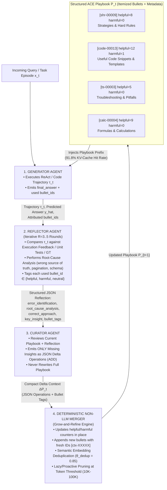
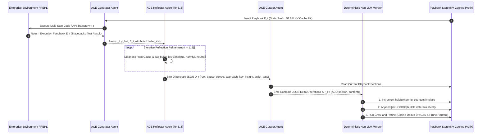
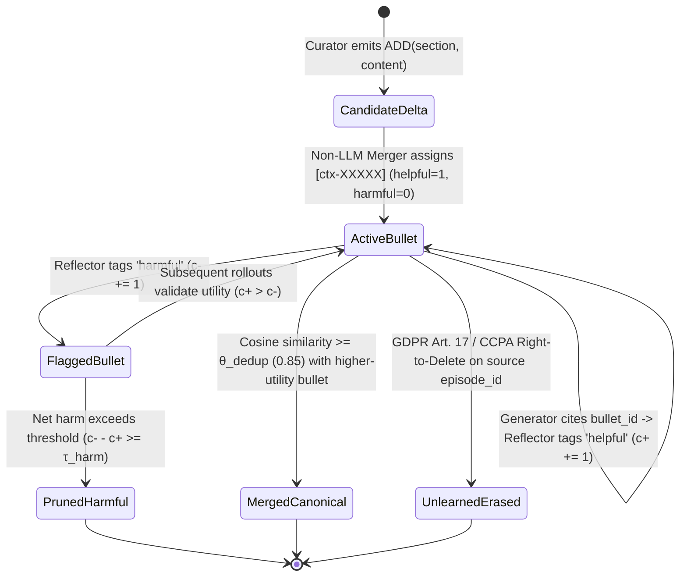

# Architecture Best Practice: Agentic Context Engineering (ACE) — Evolving Playbooks, Incremental Delta Updates, and Context Collapse Defense

**Topics:** #agentic-context-engineering #evolving-playbooks #generator-reflector-curator #context-collapse #brevity-bias #incremental-delta-updates #grow-and-refine #google-adk #socratic-reflection #fde-grading-rubric

> **Source:** `AGENTIC CONTEXT ENGINEERING- EVOLVING CONTEXTS FOR SELF-IMPROVING LANGUAGE MODELS.pdf` (Zhang, Hu, Upasani et al., Stanford University / SambaNova Systems / UC Berkeley, ICLR 2026, `arXiv:2510.04618v3`) · **Corpus:** `GEAPL200` (Unified L200 + L300 + L400 Open Knowledge Format v0.2 · Version `GEAPL200_2026-10-27_183500`) · **Standalone Catalog ID:** `01-agentic-context-engineering-evolving-playbooks` · **Target:** GCP Knowledge Catalog (Dataplex) & Antigravity Agentic AI Development

---

## Version & 6-Month TTL Governance Tab

| Document ID | Version Tag (Today's Date & Time) | Version Timestamp (PDT) | Time-To-Live (TTL) | Expiration (`stale_after`) | Status |
| :--- | :--- | :--- | :--- | :--- | :--- |
| `36-agentic-context-engineering-evolving-playbooks` | **`GEAPL200_2026-10-27_183500`** (`L400_version_20261027_1835`) | `2026-10-27 18:35:00 PDT` (`2026-10-27T18:35:00-07:00`) | **6 Months** (`180 days` / `P6M`) | `2027-04-27T18:35:00-07:00` | Published / Verified |

### Grounding Research Publications (Local PDF Sources)
- **`PAPER-01-ACE` — [`AGENTIC CONTEXT ENGINEERING- EVOLVING CONTEXTS FOR SELF-IMPROVING LANGUAGE MODELS.pdf`](../AGENTIC%20CONTEXT%20ENGINEERING-%20EVOLVING%20CONTEXTS%20FOR%20SELF-IMPROVING%20LANGUAGE%20MODELS.pdf):** *Agentic Context Engineering: Evolving Contexts for Self-Improving Language Models* — Qizheng Zhang, Changran Hu, Shubhangi Upasani, Boyuan Ma, Fenglu Hong, Vamsidhar Kamanuru, Jay Rainton, Chen Wu, Mengmeng Ji, Hanchen Li, Urmish Thakker, James Zou, Kunle Olukotun (Stanford University, SambaNova Systems, Inc., UC Berkeley; Published as a conference paper at ICLR 2026 (arXiv:2510.04618v3, 29 Mar 2026)). URL: `https://arxiv.org/abs/2510.04618` · Code/Data: `https://github.com/ace-agent/ace`
- **`PAPER-02-AKV` — [`CACHE ENGINEERING FOR AGENTS.pdf`](../CACHE%20ENGINEERING%20FOR%20AGENTS.pdf):** *Cache Engineering for Agents* — Tianyu Fu, Ruoxi Wang, Zihan Min, Zhongqi Ren, Zhihao Li, Tengxuan Liu, Shengxu Mu, Hanling Zhang, Yu Wang (Tsinghua University, The Chinese University of Hong Kong; arXiv Preprint (arXiv:2610.28577v1, 20 Oct 2026)). URL: `https://arxiv.org/abs/2610.28577` · Code/Data: `https://github.com/thu-nics/AKV`
- **`PAPER-05-MCE` — [`Meta Context Engineering via Agentic Skill Evolution.pdf`](../Meta%20Context%20Engineering%20via%20Agentic%20Skill%20Evolution.pdf):** *Meta Context Engineering via Agentic Skill Evolution* — Haoran Ye, Xuning He, Vincent Arak, Haonan Dong, Guojie Song (State Key Laboratory of General Artificial Intelligence, School of Intelligence Science and Technology & School of EECS, Peking University; arXiv Preprint (arXiv:2601.21557v2, 11 Feb 2026)). URL: `https://arxiv.org/abs/2601.21557` · Code/Data: `https://github.com/metaevo-ai/meta-context-engineering`

---


## 0. OKF Document Metadata & Topic Modeling Taxonomy
**Topic Tags:** `#L400_version_20261027_1835` `#OKFMetadata` `#AgenticContextEngineering` `#EvolvingPlaybooks` `#ContextCollapseDefense`

| Metadata Field | Value |
| :--- | :--- |
| **OKF Document ID** | `36-agentic-context-engineering-evolving-playbooks` (Standalone Index: `01`) |
| **Primary Literature** | Qizheng Zhang*, Changran Hu*, Shubhangi Upasani, Boyuan Ma, Fenglu Hong, Vamsidhar Kamanuru, Jay Rainton, Chen Wu, Mengmeng Ji, Hanchen Li, Urmish Thakker, James Zou, Kunle Olukotun (ICLR 2026, `arXiv:2510.04618v3`) |
| **Architectural Domain** | Self-Improving Multi-Agent Context Adaptation, Offline System Prompt Evolution & Online Test-Time Memory |
| **Target GCP Runtimes** | Vertex AI Agent Engine, Google ADK 2.0, Vertex AI Memory Bank, Cloud Spanner / AlloyDB Playbook Store |
| **Enforced FDE Standard** | `concepts/00-fde-field-readiness-and-grading-rubric.md` & `OKF-L400-21` (`https://g3doc.corp.google.com/company/teams/cloud-fde/index.md?cl=head`) |

---

## FDE Project Grading Rubric Enforcement & Prevailing Customer Alignment

> **Mandatory Governance Standard:** Every project, prototype, or production agent built using the patterns in this concept **must pass the [Google Cloud FDE Field-Readiness & Project Grading Rubric](/concepts/00-fde-field-readiness-and-grading-rubric.md)** (aligned with the [Cloud FDE Team Charter](https://g3doc.corp.google.com/company/teams/cloud-fde/index.md?cl=head) and `OKF-L400-21`). Scoring Requirement: **Average >= `2.0 (Competent)`** across both **Part A (Presentation & Advisory Rigor)** and **Part B (Engineering & Implementation Excellence)**, with **zero `0 (Not Demonstrated)` scores** on any single metric.

### 1. Part A — Presentation & Advisory Rigor Enforcement for This Concept

- **A.1 Strategic Delivery & Value Articulation (CUJ & 16-Line TCO Justification):** Frame Agentic Context Engineering (ACE) not as an academic prompt-tuning exercise, but as a production alternative to weight fine-tuning that achieves **+10.6% accuracy on multi-step agent tasks (`AppWorld`)** and **+8.6% on regulated financial reasoning (`FiNER`, `Formula`)** while cutting adaptation latency by **86.9%** and serving **91.8% of playbook tokens from KV cache** (-82.6% billed input token cost).
- **A.2 Objection Handling & Technical Defense:** Calmly defend why monolithic prompt optimizers (`GEPA`, `MIPROv2`) and full-rewrite memory systems (`Dynamic Cheatsheet`) fail on long-horizon enterprise workflows due to **Brevity Bias** and **Context Collapse**, using empirical trajectory evidence (e.g., `AppWorld` Step 60 collapsing from `18,282 tokens` at `66.7%` accuracy to `122 tokens` at `57.1%` accuracy).
- **A.4 AI-Driven Development ("In-the-Loop" vs. "Outside-the-Loop"):** Articulate how ACE's **Generator–Reflector–Curator** triad powers both *offline* pre-deployment prompt compilation (with ground-truth or unit-test feedback) and *online* test-time memory evolution (from natural execution feedback without human labels), plus GDPR Article 17 / CCPA §1798.105 **selective machine unlearning** via itemized bullet deletion.

### 2. Part B — Engineering & Implementation Excellence Cutlines for This Concept

- **B.1.1 Agentic & Multi-Agent Systems:** Implement strict separation of concerns across the **Generator** (trajectory execution + `bullet_ids` attribution), **Reflector** (iterative root-cause diagnosis + `helpful`/`harmful`/`neutral` credit assignment), and **Curator** (JSON `ADD` delta synthesis merged deterministically via non-LLM logic).
- **B.2.5 Decision Records (ADRs):** Document explicit thresholds for **Grow-and-Refine** semantic embedding deduplication (`cosine_similarity >= 0.85` / `50%–90%` dedup aggressiveness), Reflector iteration limits (`R = 3..5` rounds), and pruning triggers (`10K–100K` token budget).
- **B.5.1 & B.5.3 AI Evaluation, Observability & Cost Management:** Track per-bullet credit counters (`helpful`, `harmful`, `neutral`) and enforce append-friendly or batch-compacted playbook ordering to preserve prefix KV-cache hit rates above 90%.

### 3. Prevailing Customer Exemplars & Cross-KB Links

| Customer / Benchmark Exemplar | Architectural Challenge | ACE Pattern Applied | Quantified Production Outcome |
| :--- | :--- | :--- | :--- |
| **Regulated XBRL Financial Analysis (`FiNER` & `Formula`)** | 139 fine-grained US GAAP XBRL tags (`DebtInstrumentFaceAmount` vs `MaximumBorrowingCapacity`) where concise prompt optimizers drop edge-case disambiguation rules. | Itemized ACE Playbook (`strategies_and_hard_rules`, `formulas_and_calculations`, `verification_checklist`) with 5-epoch offline warmup. | **`81.9%` average accuracy** (`+12.8%` over Base LLM `69.1%`; `+9.4%` over GEPA `72.5%`), with **91.5% lower online adaptation latency** (`5,503s` vs `65,104s` DC) and **83.6% lower token dollar cost** (`$2.90` vs `$17.70`). |
| **Enterprise Multi-App API Agent (`AppWorld` vs `IBM-CUGA`)** | Multi-turn Python REPL execution across email, Venmo, Spotify, Phone contacts, and filesystem APIs with pagination and auth traps. | Online + Offline ACE (`ReAct + ACE`) with non-LLM delta merging and execution-feedback reflection (zero GT labels required). | **`59.5%` overall accuracy** (`+17.1%` over ReAct `42.4%`), matching GPT-4.1-powered `IBM-CUGA` (`60.3%`) using open-weights `DeepSeek-V3.1` and surpassing it on `Test-Challenge` (`66.0%` TGC vs `57.6%`, `48.9%` SGC vs `48.2%`). |
| **Clinical Diagnostic Reasoning (`DDXPlus` / `StreamBench`)** | High-stakes differential diagnosis across 1,000+ clinical training cases where generic instructions fail to capture symptom interactions. | Offline ACE multi-epoch playbook curation over 1,000 cases. | **`90.2%` diagnostic accuracy** (`+15.0%` over Base LLM `75.2%`; `+13.8%` over GEPA `76.4%`). |

**Related OKF Concepts:**
- [Google Cloud FDE Field-Readiness & Project Grading Rubric](/concepts/00-fde-field-readiness-and-grading-rubric.md)
- [Context Engineering for Stateful AI Agents on Google Cloud](/concepts/08-context-engineering-stateful-agents.md)
- [Context Engineering — Sessions & Memory](/concepts/20-context-engineering-sessions-memory.md)
- [Stateful Agents with Persistent Memories and Vertex AI Memory Bank](/concepts/24-agent-with-persistent-memories-deep-dive.md)
- [Cache Engineering & KV-Prefix Optimization for Agents](/concepts/37-cache-engineering-kv-prefix-optimization-for-agents.md)
- [Meta Context Engineering via Agentic Skill Evolution](/concepts/40-meta-context-engineering-and-agentic-skill-evolution.md)
- [Socratic Grilling: User-to-Agent and Agent-to-Agent Protocols](/concepts/41-socratic-grilling-user-to-agent-and-agent-to-agent-protocols.md)

---

## 1. Executive Summary & Paradigm Shift: Contexts as Evolving Playbooks

Modern compound AI systems and enterprise agents increasingly rely on **context adaptation**—modifying model inputs with domain heuristics, API contracts, failure-mode guardrails, and verified exemplars—rather than parameter weight updates (LoRA/RLHF). Context adaptation provides four foundational enterprise advantages:
1. **Human & Auditor Interpretability:** Strategies are stored in natural language and structured code snippets rather than opaque weight matrices.
2. **Zero-Downtime Runtime Plasticity:** Newly discovered API quirks or regulatory changes take effect immediately without GPU fine-tuning pipelines.
3. **Cross-Model Portability:** A curated context playbook can be shared across heterogeneous models (e.g., `DeepSeek-V3.1`, `GPT-5.1`, `Gemini 2.5 Pro`, `Llama-3.3-70B`).
4. **Selective Machine Unlearning (GDPR Art. 17 / CCPA §1798.105):** Outdated, erroneous, or privacy-restricted rules can be surgically excised in $O(1)$ time by deleting specific context bullets.

However, first-generation context adaptation methods suffer from two structural failure modes that cause catastrophic reliability drops in production agents:

### 1.1 Failure Mode 1: Brevity Bias in Prompt Optimizers
Reflective prompt optimizers such as **GEPA (Genetic-Pareto)** and **MIPROv2** treat brevity and abstraction as virtues, compressing execution lessons into short, generic instruction prompts (e.g., *"Create unit tests to ensure methods behave as expected"* or *"Carefully check XBRL tags before answering"*). While concise prompts work on simple QA tasks (`HotpotQA`), they systematically strip away the long-tail domain heuristics, API pagination patterns, and edge-case disambiguation rules required by multi-step coding agents and financial/legal reasoning systems.

### 1.2 Failure Mode 2: Context Collapse in Monolithic Rewriting
Adaptive memory systems such as **Dynamic Cheatsheet (`DC-CU`)** update external memory by prompting an LLM to rewrite the entire accumulated cheatsheet at each step:

$$M_{t} = \text{LLM}_{\text{rewrite}}\left(M_{t-1}, \tau_t\right)$$

As $M_{t-1}$ grows beyond $10,000\text{–}20,000$ tokens, the rewriting LLM hits an implicit output-length ceiling and spontaneously summarizes or truncates the entire memory into a tiny fraction of its prior size—a phenomenon Zhang et al. (ICLR 2026) formalize as **Context Collapse**.

| Metric / Observation | `AppWorld` Before Collapse (`Step 60`) | `AppWorld` After Collapse (`Step 61`) | Unadapted `ReAct` Baseline | Net Operational Impact |
| :--- | :---: | :---: | :---: | :--- |
| **Playbook Token Count** | `18,282 tokens` | **`122 tokens`** (`-99.3%`) | `0` (Default Prompt) | Monolithic LLM rewrite erased 60 steps of accumulated API & schema rules in a single step. |
| **Task Accuracy (%)** | **`66.7%`** | **`57.1%`** (`-9.6%`) | `63.7%` | Post-collapse agent performs **6.6 percentage points worse** than having no memory adaptation at all. |

### 1.3 The ACE Thesis: Comprehensive Playbooks + Incremental Deltas
Unlike humans—who suffer cognitive overload from long checklists and prefer terse generalizations—long-context LLMs (`Gemini 2.5 Pro`, `DeepSeek-V3.1`, `GPT-5.1`, `Claude Opus 4.5`) excel at **autonomous relevance distillation** over long, structured, high-specificity contexts. **Agentic Context Engineering (ACE)** replaces monolithic rewrites with:
1. **A Modular Three-Agent Division of Labor:** Separating **Generator** (task execution), **Reflector** (Socratic error diagnosis & credit assignment), and **Curator** (delta synthesis).
2. **Structured Itemized Bullets with Credit Metadata:** Representing the context playbook $\mathcal{P} = \{b_1, b_2, \dots, b_N\}$ as discrete, addressable bullets where each bullet $b_i = (\text{id}_i, \text{sec}_i, c_i^+, c_i^-, \text{text}_i)$ tracks how many times it was tagged `helpful` ($c_i^+$) or `harmful` ($c_i^-$).
3. **Incremental Delta Updates + Non-LLM Deterministic Merging:** The Curator emits only compact JSON delta operations ($\Delta \mathcal{P}_t$), which are merged into $\mathcal{P}_{t-1}$ by deterministic host code—eliminating context collapse and cutting adaptation token costs by >80%.
4. **Grow-and-Refine Lifecycle:** Combining steady append-only expansion with periodic or lazy semantic-embedding deduplication and low-utility pruning.

---

## 2. ACE Architectural Deep Dive: Generator–Reflector–Curator Triad



### 2.1 Mathematical Formulation of Incremental Delta Adaptation

Let a playbook at step $t$ be an ordered, section-partitioned set of itemized bullets:

$$\mathcal{P}_t = \bigcup_{s \in \mathcal{S}} \left\{ b_i = \left(\text{id}_i, s, c_i^+, c_i^-, \mathbf{e}_i, \text{text}_i\right) \right\}_{i=1}^{N_t}$$

where:
- $\text{id}_i \in \Sigma^*$ is a globally unique, immutable identifier (e.g., `shr-00009`, `code-00013`, `ts-00003`, `calc-00001`),
- $s \in \mathcal{S}$ is the semantic playbook section (`strategies_and_hard_rules`, `apis_to_use_for_specific_information`, `useful_code_snippets_and_templates`, `troubleshooting_and_pitfalls`, `formulas_and_calculations`, `verification_checklist`),
- $c_i^+, c_i^- \in \mathbb{N}_0$ are cumulative credit counters tracking how often bullet $b_i$ contributed to a successful (`helpful`) or erroneous (`harmful`) reasoning trace,
- $\mathbf{e}_i = f_{\text{embed}}(\text{text}_i) \in \mathbb{R}^d$ is the normalized semantic embedding ($\|\mathbf{e}_i\|_2 = 1$).

#### Step 1 — Generator Rollout & Attribution
Given input query $x_t$ and playbook $\mathcal{P}_t$, the Generator executes a multi-turn trajectory $\tau_t$ and outputs both its prediction $\hat{y}_t$ and the subset of active bullets $B_{\text{used}}^{(t)} \subseteq \mathcal{P}_t$ it relied upon:

$$(\tau_t, \hat{y}_t, B_{\text{used}}^{(t)}) = \text{Generator}_{\theta}(x_t, \mathcal{P}_t)$$

#### Step 2 — Reflector Socratic Critique & Credit Assignment
Given the trajectory $\tau_t$, environment execution feedback $E_t$ (such as Python REPL exceptions, API schema mismatches, or unit-test outcomes, optionally augmented by ground truth $y_t^*$ during offline warmup), and the attributed bullets $B_{\text{used}}^{(t)}$, the Reflector conducts up to $R$ rounds of iterative refinement ($R=5$ optimal on `AppWorld`) to produce a structured diagnostic object $\mathcal{D}_t$:

$$\mathcal{D}_t = \left(\text{reasoning}_t, \text{error\_id}_t, \text{root\_cause}_t, \text{correct\_approach}_t, \text{key\_insight}_t, \{(\text{id}_i, \text{tag}_i)\}_{b_i \in B_{\text{used}}^{(t)}}\right)$$

where $\text{tag}_i \in \{\texttt{helpful}, \texttt{harmful}, \texttt{neutral}\}$.

#### Step 3 — Curator Delta Emission
Rather than rewriting $\mathcal{P}_t$, the Curator inspects $(\mathcal{P}_t, \mathcal{D}_t)$ and outputs a minimal set of additive delta operations $\Delta \mathcal{P}_t$:

$$\Delta \mathcal{P}_t = \text{Curator}_{\theta}(x_t, \mathcal{P}_t, \mathcal{D}_t) = \left\{ \texttt{ADD}(s_j, \text{text}_j) \right\}_{j=1}^{k}, \quad k \ll N_t$$

If existing bullets already cover the insight, the Curator returns `"operations": []`.

#### Step 4 — Deterministic Non-LLM Merge & Grow-and-Refine
A deterministic host function $\text{Merge}(\mathcal{P}_t, \mathcal{D}_t, \Delta \mathcal{P}_t)$ updates the playbook in three sub-steps:
1. **In-Place Credit Update:** For each $(\text{id}_i, \text{tag}_i) \in \mathcal{D}_t$:
   $$c_i^+ \leftarrow c_i^+ + \mathbb{I}[\text{tag}_i = \texttt{helpful}], \qquad c_i^- \leftarrow c_i^- + \mathbb{I}[\text{tag}_i = \texttt{harmful}]$$
2. **Localized Delta Append:** Each $\texttt{ADD}(s_j, \text{text}_j) \in \Delta \mathcal{P}_t$ is assigned a fresh monotonic ID (`[ctx-XXXXX]`) with $c_j^+ = 1, c_j^- = 0$ and appended to section $s_j$. Because delta entries are localized and itemized, **multiple deltas $\Delta \mathcal{P}_{t_1}, \dots, \Delta \mathcal{P}_{t_B}$ from parallel worker rollouts can be merged concurrently in batch**.
3. **Semantic Deduplication & Utility Pruning (Grow-and-Refine):** Whenever triggered (proactively after each delta or lazily when $|\mathcal{P}_t|_{\text{tokens}} > L_{\max}$), pairs $(b_u, b_v)$ with cosine similarity $\mathbf{e}_u^\top \mathbf{e}_v \ge \theta_{\text{dedup}}$ (e.g., $\theta_{\text{dedup}} \in [0.50, 0.90]$) are merged by keeping the higher-utility entry and summing credit counters, while bullets with net negative utility ($c_i^- > c_i^+ + \tau_{\text{harm}}$) are pruned.


### 2.2 Sequence Diagram: Monolithic Rewrite Collapse vs. ACE Incremental Delta Protocol



### 2.3 State Machine: Grow-and-Refine Bullet Lifecycle & GDPR Selective Unlearning



---

## 3. Empirical Benchmarks, Ablations, and KV-Cache Economics

### 3.1 Multi-Turn Autonomous Agent Benchmark (`AppWorld` — DeepSeek-V3.1-671B, GPT-OSS-120B, GPT-5.1)

`AppWorld` evaluates autonomous coding agents interacting with realistic enterprise and consumer APIs (email, Venmo, Spotify, Phone contacts, filesystem) via a multi-step Python REPL across `Test-Normal` and `Test-Challenge` splits, reporting **Task Goal Completion (TGC)** and **Scenario Goal Completion (SGC)**.

| Backbone Model | Adaptation Setting & Method | GT Labels Used? | Test-Normal TGC (%) | Test-Normal SGC (%) | Test-Challenge TGC (%) | Test-Challenge SGC (%) | Overall Average (%) | Delta vs. Base ReAct |
| :--- | :--- | :---: | :---: | :---: | :---: | :---: | :---: | :---: |
| **DeepSeek-V3.1 (671B)** | Base `ReAct` (Default Prompt) | N/A | 63.7 | 42.9 | 41.5 | 21.6 | 42.4 | — |
| **DeepSeek-V3.1 (671B)** | Offline `ReAct + ICL` | Yes | 64.3 | 46.4 | 46.0 | 27.3 | 46.0 | `+3.6%` |
| **DeepSeek-V3.1 (671B)** | Offline `ReAct + GEPA` (DSPy Heavy) | Yes | 64.9 | 44.6 | 46.0 | 30.2 | 46.4 | `+4.0%` |
| **DeepSeek-V3.1 (671B)** | **Offline `ReAct + ACE` (Supervised)** | **Yes** | **76.2** | **64.3** | **57.3** | **39.6** | **59.4** | **`+17.0%`** |
| **DeepSeek-V3.1 (671B)** | **Offline `ReAct + ACE` (Label-Free)** | **No** | **75.0** | **64.3** | **54.4** | **35.2** | **57.2** | **`+14.8%`** |
| **DeepSeek-V3.1 (671B)** | Online `ReAct + Dynamic Cheatsheet (DC-CU)` | No | 65.5 | 58.9 | 52.3 | 30.8 | 51.9 | `+9.5%` |
| **DeepSeek-V3.1 (671B)** | **Online `ReAct + ACE` ( + Offline Warmup)** | **No** | **69.6** | **53.6** | **66.0** | **48.9** | **59.5** | **`+17.1%`** |
| **GPT-4.1 (Production Ref)** | `IBM-CUGA` (Leaderboard Top-1 Reference) | N/A | 73.2 | 62.5 | 57.6 | 48.2 | 60.3 | — |
| **GPT-OSS-120B** | Base `ReAct` | N/A | 54.8 | 33.9 | 34.5 | 15.1 | 34.6 | — |
| **GPT-OSS-120B** | Offline `ReAct + GEPA` | Yes | 56.0 | 33.9 | 40.1 | 20.9 | 37.7 | `+3.1%` |
| **GPT-OSS-120B** | **Offline `ReAct + ACE` (Supervised)** | **Yes** | **61.3** | **39.3** | **40.3** | **20.9** | **40.5** | **`+5.9%`** |
| **GPT-OSS-120B** | Online `ReAct + DC (CU)` | No | 49.4 | 33.9 | 30.8 | 18.2 | 33.1 | `-1.5%` (Collapse) |
| **GPT-OSS-120B** | **Online `ReAct + ACE`** | **No** | **60.7** | **44.6** | **43.2** | **20.1** | **42.2** | **`+7.6%`** |
| **GPT-5.1** | Base `ReAct` (Test-Normal) | N/A | 61.9 | 46.4 | — | — | 54.2 | — |
| **GPT-5.1** | Offline `ReAct + GEPA` | Yes | 64.3 | 48.2 | — | — | 56.2 | `+2.0%` |
| **GPT-5.1** | **Offline `ReAct + ACE` (Label-Free)** | **No** | **67.3** | **55.4** | — | — | **61.3** | **`+7.1%`** |
| **GPT-5.1** | **Online `ReAct + ACE`** | **No** | **72.6** | **58.9** | — | — | **65.8** | **`+11.6%`** |

### 3.2 Domain-Specific Benchmarks: Financial (`FiNER`, `Formula`), Medical (`DDXPlus`), and `BIRD-SQL`

| Benchmark & Domain | Base Model (`DeepSeek-V3.1`) | `ICL` | `MIPROv2` | `GEPA` | `DC (CU)` Online | `ACE` Offline (w/ GT) | `ACE` Online (w/ GT) | Key Architectural Finding |
| :--- | :---: | :---: | :---: | :---: | :---: | :---: | :---: | :--- |
| **`FiNER` (139-Tag XBRL NER)** | 70.7% | 72.3% | 72.4% | 73.5% | 74.2% (68.3% w/o GT) | **`78.3%`** (`+7.6%`) | **`76.7%`** (`+6.0%`) | Preserves fine-grained US GAAP tag disambiguation rules that GEPA compresses away. |
| **`Formula` (XBRL Numerical Reasoning)** | 67.5% | 67.0% | 69.5% | 71.5% | 69.5% (62.5% w/o GT) | **`85.5%`** (`+18.0%`) | **`76.5%`** (78.5% w/o GT) | Accumulates exact financial calculation formulas and accounting identities. |
| **Finance Average (`FiNER` + `Formula`)** | 69.1% | 69.6% | 70.9% | 72.5% | 71.8% (65.4% w/o GT) | **`81.9%`** (`+12.8%`) | **`76.6%`** (`+7.5%`) | Label-free online adaptation without reliable execution signals can degrade (`67.3%` on FiNER); verification signals are mandatory. |
| **`DDXPlus` (Medical Diagnosis)** | 75.2% | — | — | 76.4% | — | **`90.2%`** (`+15.0%`) | — | Massive `+13.8%` lead over GEPA on multi-step clinical differential diagnosis. |
| **`BIRD-SQL` (Enterprise Text-to-SQL)** | 47.8% | — | — | 52.2% | — | **`52.9%`** (`+5.1%`) | — | Strongest gains on `Simple` (`53.5%`, `+7.1%`) and consistent gains across `Moderate`/`Challenging`. |

### 3.3 Component Ablation & Hyperparameter Sensitivity (`AppWorld` & `FiNER`)

| Ablation / Sensitivity Dimension | Configuration Variant | Test-Normal TGC (%) | Test-Normal SGC (%) | Average Accuracy (%) | Architectural Takeaway |
| :--- | :--- | :---: | :---: | :---: | :--- |
| **Incremental Delta Update Ablation** | `ReAct` Baseline | 63.7 | 42.9 | 53.3 | Baseline without playbook. |
| **Incremental Delta Update Ablation** | `ACE` **without** Incremental Delta Updates (Full Rewrite) | 67.3 (`+3.6`) | 46.4 (`+3.5`) | 56.9 (`+3.6`) | Full rewrites suffer context collapse, losing `-11.7%` TGC and `-27.8%` SGC relative to delta updates! |
| **Incremental Delta Update Ablation** | `ACE` **with** Incremental Delta Updates | **76.2 (`+12.5`)** | **64.3 (`+21.4`)** | **70.3 (`+17.0`)** | Incremental delta updates account for over **78% of ACE's total accuracy gain**. |
| **Reflector & Multi-Epoch Ablation** | `ACE` w/o Reflector or Multi-Epoch (All Splits) | 70.8 | 55.4 | 55.1 (`+12.7`) | Direct curation helps, but lacks root-cause error diagnosis. |
| **Reflector & Multi-Epoch Ablation** | `ACE` w/ Reflector, w/o Multi-Epoch (All Splits) | 72.0 | 60.7 | 56.8 (`+14.4`) | Dedicated Reflector adds `+1.7%` overall (`+5.3%` Normal SGC). |
| **Reflector & Multi-Epoch Ablation** | **Full `ACE` (Reflector + 5-Epoch Refinement)** | **76.2** | **64.3** | **59.4 (`+17.0`)** | Multi-epoch pass progressively strengthens playbook coverage. |
| **Reflector Refinement Rounds ($R$)** | $R = 1$ / $R = 3$ / **$R = 5$** / $R = 10$ (Test-Normal Avg) | — | — | `61.3%` / `65.8%` / **`67.6%`** / `65.2%` | **$R = 3\text{–}5$ rounds is optimal**; $R = 1$ under-extracts, $R = 10$ overthinks and injects noise. |
| **Harmful Reflector Corruption Stress Test** | Adversarial injection every $X \in \{100, 50, 25, 10, 5, 1\}$ steps on `FiNER` | — | — | `78.2%`, `78.2%`, `77.8%`, `77.0%`, `76.1%`, `66.7%` | Stays above `70.7%` base LLM even when **20% of reflections ($X=5$) are actively adversarial**, thanks to Grow-and-Refine credit filtering. |

### 3.4 Adaptation Cost, Rollout Efficiency, and KV-Cache Amortization (`Longer Context != Higher Cost`)

A common misconception among enterprise architects is that a rich 25,000-token ACE Playbook increases serving cost linearly compared to a 1,000-token GEPA prompt. ACE disproves this at both the **Adaptation Stage** and the **Evaluation/Serving Stage**:

| Stage & Metric | `ReAct + GEPA` (Offline `AppWorld`) | `ReAct + ACE` (Offline `AppWorld`) | `DC (CU)` (Online `FiNER`) | `ACE` (Online `FiNER`) | Relative Savings / Economic Impact |
| :--- | :---: | :---: | :---: | :---: | :--- |
| **Adaptation Wall-Clock Latency (s)** | `53,898 s` (~15.0 hrs) | **`9,517 s`** (~2.6 hrs) | `65,104 s` (~18.1 hrs) | **`5,503 s`** (~1.5 hrs) | **`-82.3%` offline latency**; **`-91.5%` online latency**. |
| **Adaptation Total Input Tokens** | `204,076,096` (65M gen + 139M val) | **`39,250,925`** (31M Gen, 4.7M Ref, 3.6M Cur) | — | — | **`-80.8%` input tokens** (eliminates GEPA's 57-query validation loop). |
| **Adaptation Total Output Tokens** | `1,870,188` | **`307,128`** | — | — | **`-83.6%` output tokens** (Curator emits compact JSON deltas, not full rewrites). |
| **Online Adaptation Token Cost ($)** | — | — | `$17.70` | **`$2.90`** | **`-83.6%` dollar cost** on sequential test-time adaptation. |
| **Serving KV-Cache Reuse (`GPT-5.1`)** | Compact prompt | `24,912` avg input tokens/rollout (**`91.8%` KV-cache hit rate**) | — | — | **`-82.6%` billed input-token cost** relative to raw token count because the static Playbook prefix is cached across turns! |

---

## 4. Production Implementation Blueprint: ADK 2.0 + Vertex AI ACE Playbook Engine

```python
from __future__ import annotations
import dataclasses
import hashlib
import json
from typing import Dict, List, Literal, Optional
import numpy as np
from pydantic import BaseModel, Field

BulletTag = Literal["helpful", "harmful", "neutral"]

@dataclasses.dataclass
class PlaybookBullet:
    bullet_id: str
    section: str
    content: str
    helpful_count: int = 0
    harmful_count: int = 0
    neutral_count: int = 0
    embedding: Optional[np.ndarray] = None

    def format_line(self) -> str:
        return (
            f"[{self.bullet_id}] helpful={self.helpful_count} "
            f"harmful={self.harmful_count} :: {self.content}"
        )

class BulletTagEntry(BaseModel):
    id: str = Field(description="Exact bullet_id from the playbook, e.g. shr-00009")
    tag: BulletTag = Field(description="Credit assignment: helpful, harmful, or neutral")

class ACEReflectionOutput(BaseModel):
    reasoning: str = Field(description="Step-by-step analysis of trajectory vs execution feedback")
    error_identification: str = Field(description="What specifically went wrong in the reasoning or tool use")
    root_cause_analysis: str = Field(description="Why the error occurred (e.g. wrong API source of truth, fixed-range pagination)")
    correct_approach: str = Field(description="Concrete step-by-step correction the agent should take")
    key_insight: str = Field(description="Generalizable strategy, formula, or API rule to remember")
    bullet_tags: List[BulletTagEntry] = Field(default_factory=list)

class CuratorDeltaOp(BaseModel):
    type: Literal["ADD"] = "ADD"
    section: Literal[
        "strategies_and_hard_rules",
        "apis_to_use_for_specific_information",
        "useful_code_snippets_and_templates",
        "troubleshooting_and_pitfalls",
        "formulas_and_calculations",
        "verification_checklist",
    ]
    content: str = Field(description="Actionable, specific new playbook bullet without bullet_id prefix")

class ACECuratorOutput(BaseModel):
    reasoning: str
    operations: List[CuratorDeltaOp] = Field(default_factory=list)

class ACEPlaybookManager:
    """Deterministic Non-LLM Merger & Grow-and-Refine Engine for ADK 2.0 Agents."""

    def __init__(
        self,
        dedup_threshold: float = 0.85,
        max_tokens_trigger: int = 50_000,
        max_harmful_delta: int = 3,
    ) -> None:
        self.bullets: Dict[str, PlaybookBullet] = {}
        self.dedup_threshold = dedup_threshold
        self.max_tokens_trigger = max_tokens_trigger
        self.max_harmful_delta = max_harmful_delta
        self._counter = 1

    def apply_reflection_and_deltas(
        self,
        reflection: ACEReflectionOutput,
        curator_out: ACECuratorOutput,
        embed_fn,
    ) -> int:
        # 1. Update helpful / harmful counters in place
        for entry in reflection.bullet_tags:
            if entry.id in self.bullets:
                b = self.bullets[entry.id]
                if entry.tag == "helpful":
                    b.helpful_count += 1
                elif entry.tag == "harmful":
                    b.harmful_count += 1
                else:
                    b.neutral_count += 1

        # 2. Deterministically append new delta operations
        added = 0
        for op in curator_out.operations:
            if op.type == "ADD" and op.content.strip():
                prefix = op.section[:3].lower()
                bid = f"{prefix}-{self._counter:05d}"
                self._counter += 1
                vec = embed_fn(op.content.strip())
                vec = vec / (np.linalg.norm(vec) + 1e-12)
                self.bullets[bid] = PlaybookBullet(
                    bullet_id=bid,
                    section=op.section,
                    content=op.content.strip(),
                    helpful_count=1,
                    harmful_count=0,
                    embedding=vec,
                )
                added += 1

        # 3. Grow-and-Refine: Deduplicate & prune harmful bullets
        self.grow_and_refine()
        return added

    def grow_and_refine(self) -> None:
        # Prune bullets consistently flagged as harmful
        to_delete = [
            bid for bid, b in self.bullets.items()
            if (b.harmful_count - b.helpful_count) >= self.max_harmful_delta
        ]
        for bid in to_delete:
            del self.bullets[bid]

        # Semantic embedding deduplication within each section
        ids = list(self.bullets.keys())
        removed = set()
        for i, id_a in enumerate(ids):
            if id_a in removed or id_a not in self.bullets:
                continue
            ba = self.bullets[id_a]
            for id_b in ids[i + 1:]:
                if id_b in removed or id_b not in self.bullets:
                    continue
                bb = self.bullets[id_b]
                if ba.section != bb.section or ba.embedding is None or bb.embedding is None:
                    continue
                sim = float(np.dot(ba.embedding, bb.embedding))
                if sim >= self.dedup_threshold:
                    # Keep the bullet with higher net helpfulness; merge counters
                    ba.helpful_count += bb.helpful_count
                    ba.harmful_count += bb.harmful_count
                    removed.add(id_b)
        for bid in removed:
            self.bullets.pop(bid, None)

    def render_kv_stable_playbook(self) -> str:
        """Renders playbook grouped by section with stable ordering for KV-cache prefix reuse."""
        sections: Dict[str, List[PlaybookBullet]] = {}
        for b in self.bullets.values():
            sections.setdefault(b.section, []).append(b)
        blocks = ["PLAYBOOK_BEGIN"]
        for sec in sorted(sections.keys()):
            blocks.append(f"\n### {sec.upper()}")
            for b in sorted(sections[sec], key=lambda x: x.bullet_id):
                blocks.append(b.format_line())
        blocks.append("PLAYBOOK_END")
        return "\n".join(blocks)
```

---

## 5. Anti-Patterns & Failure Modes in Self-Improving Playbooks

| Anti-Pattern | Observable Symptom | Root Cause | Architectural Remediation |
| :--- | :--- | :--- | :--- |
| **Monolithic Playbook Rewriting (`DC-CU` Anti-Pattern)** | Playbook size suddenly drops from `18K+` tokens to `<200` tokens mid-run; accuracy plunges below zero-shot baseline. | Asking an LLM to output the entire updated playbook in a single generation call triggers length-compression bias (**Context Collapse**). | Replace full-context LLM rewrites with **Curator JSON `ADD` Delta Operations** merged by deterministic non-LLM host code. |
| **Unverified Online Adaptation (Feedback Starvation)** | Online adaptation on `FiNER` without GT labels or execution validators drops accuracy from `70.7%` to `67.3%` (`-3.4%`). | Without reliable environment signals (code execution, unit test, schema validator, or verifier), the Reflector hallucinates spurious lessons that pollute the playbook. | Gate online Curator commits behind **deterministic verification signals** (REPL exit code, SQL parser/execution check, or Socratic multi-gate validation). |
| **Reflector Overthinking ($R \ge 10$ Rounds)** | Adaptation latency doubles while `AppWorld` Test-Normal accuracy drops from `67.6%` ($R=5$) to `65.2%` ($R=10$). | Excessive reflection iterations speculate beyond observed execution errors and inject overfitted edge-case rules. | Cap Reflector iterative refinement at **$R = 3\text{–}5$ rounds** and require concrete trace citations for every proposed insight. |
| **KV-Cache Thrashing via Dynamic Bullet Sorting** | Billed input token cost increases 5x despite stable playbook size; TTFT spikes on every turn. | Sorting playbook bullets by `helpful_count` on every turn mutates the token prefix and invalidates the serving engine's radix KV cache. | Sort bullets by **immutable `bullet_id` within append-only sections**, and batch Grow-and-Refine compactions at epoch/window boundaries (`Concept 37`). |

---

## 6. Socratic FDE Field-Readiness & Customer Grilling Questions (L100–L400)

### Q1 (L200 — Advisory & FinOps Defense): *"Why shouldn't we just use DSPy MIPROv2 or GEPA to optimize a concise 1,000-token system prompt instead of maintaining a 25,000-token ACE Playbook that costs 25x more input tokens per query?"*
- **Model Answer (Score 3 — Proficient):**
  1. **Accuracy & Brevity Bias:** On multi-step enterprise agents (`AppWorld`) and high-dimensional regulated domains (`FiNER` 139 XBRL tags, `DDXPlus` medical diagnosis), concise prompt optimizers suffer from **Brevity Bias**—they abstract away specific API pagination rules (`while True` vs `for i in range(10)`), source-of-truth disambiguations (`Phone` app vs `Venmo` description), and accounting formulas. ACE outperforms GEPA by **`+13.0%` on `AppWorld` (`59.4%` vs `46.4%`)**, **`+9.4%` on Finance (`81.9%` vs `72.5%`)**, and **`+13.8%` on `DDXPlus` (`90.2%` vs `76.4%`)**.
  2. **Adaptation Cost:** During offline optimization, GEPA's held-out validation loop consumes **204.1M input tokens (`53,898s`)**, whereas ACE's localized delta updates consume **39.3M input tokens (`9,517s`)**—an **80.8% token reduction** and **82.3% latency reduction**.
  3. **Serving KV-Cache Economics:** A 25K-token ACE Playbook placed in the static prompt prefix achieves a **91.8% KV-cache hit rate** (`GPT-5.1` empirical measurement), reducing billed input-token cost by **82.6%**. Thus, longer context does *not* equal linearly higher serving cost.
- **Red-Flag Answer (Score 0/1):** Agreeing that ACE is 25x more expensive at inference time without accounting for prefix KV caching, or claiming prompt optimizers and playbooks have identical expressivity.

### Q2 (L300 — Systems Architecture): *"In production, our agent adapts online without ground-truth human labels. When does online ACE succeed without labels, and when does it fail?"*
- **Model Answer (Score 3 — Proficient):** Online ACE succeeds without ground-truth labels **if and only if the environment provides high-signal execution feedback**—such as Python REPL tracebacks, HTTP/API status codes, schema validation errors, or deterministic post-condition checks. On `AppWorld`, label-free ACE achieves **`57.2%` offline (`+14.8%`)** and **`59.5%` online (`+17.1%`)** because failed API calls and empty pagination loops leave unambiguous execution signals. Conversely, on pure classification tasks without execution feedback (such as `FiNER` online without GT labels), unverified self-reflection pollutes the playbook (`70.7% -> 67.3%`, `-3.4%`). Therefore, in label-free enterprise deployments, FDEs must pair ACE with **Contract-First Verification Gates** (`Concept 39` / `Concept 41`) so the Curator only commits deltas when an objective execution or Socratic verification signal is present.
- **Red-Flag Answer (Score 0/1):** Claiming online ACE always improves accuracy on every task without ground-truth labels or environment verification.

### Q3 (L400 — Adversarial Resilience & GDPR Unlearning): *"What happens if a compromised tool output or noisy Reflector injects bad advice into the ACE Playbook, or a regulator demands GDPR Article 17 erasure of rules derived from a specific customer episode?"*
- **Model Answer (Score 3 — Proficient):** ACE handles both via **itemized bullet provenance and credit counters**:
  1. **Adversarial / Noisy Reflection Resilience:** Each playbook bullet `[ctx-XXXXX]` tracks `helpful` and `harmful` counters across subsequent rollouts. Even under active corruption where a harmful Reflector injects bad bullets every $X=5$ steps on `FiNER`, ACE maintains **`76.1%` accuracy (`+5.4%` over base)** because downstream Reflector passes tag misleading bullets as `harmful` and **Grow-and-Refine** prunes them.
  2. **O(1) Selective Machine Unlearning:** Unlike weight fine-tuning (which requires costly retraining or approximate unlearning) or monolithic summaries (where provenance is entangled), every ACE bullet carries an immutable `bullet_id` linked to the source episode `trace_id`. Deleting all bullets derived from a revoked customer record executes deterministically in $O(1)$ time without degrading the rest of the playbook.