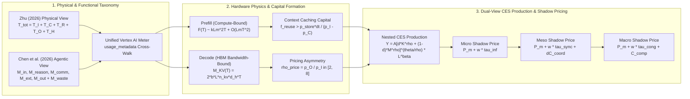
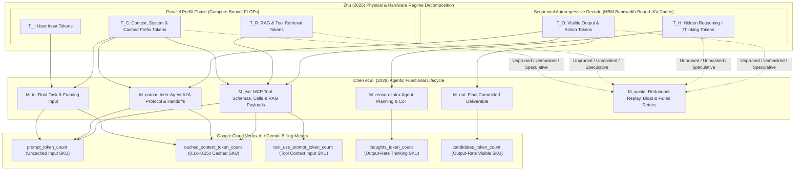

# Architecture Best Practice: Foundations of AI Tokenomics — Dual-View Production Functions, Token Taxonomy, and Shadow Pricing (`OKF-TOK-36` · `L400_version_20261027_1721`)

**Topics:** `#ai-tokenomics` `#multi-agent-systems` `#shadow-pricing` `#dual-view-production` `#context-caching` `#google-adk` `#gemini-enterprise` `#vertex-ai` `#fde-grading-rubric` `#L400_version_20261027_1721`

> **Source:** `arxiv://2606.24616v1/ai_tokenomics_zhu_2026.pdf`, `arxiv://2605.09104v1/token_economics_llm_agents.pdf`, `local://GEAP_L300/28-cost-estimation-and-optimization-for-agentic-solutions.md`, & `local://L400_concepts/O4_OKF_Cost_Token_Estimation_Analysis_and_Optimization.md` · **Corpus:** `GEAPL200` (Unified L200 + L300 + L400 Open Knowledge Format v0.2 · Version `GEAPL200_2026-10-27_172100` / `L400_version_20261027_1721`) · **Target:** GCP Knowledge Catalog (Dataplex) & Antigravity Agentic AI Development


### Authoritative Source Publications & Version / 6-Month TTL Governance
| Governance / Source Field | Value |
| :--- | :--- |
| **Bundle Version Tag** | `GEAPL200_2026-10-27_172100` · `Tokenomics_version_20261027_1721` · `L400_version_20261027_1721` |
| **Version Date & Time (PDT)** | `2026-10-27` · `17:21:00 PDT` (`2026-10-27T17:21:00-07:00`) |
| **TTL Governance Policy** | **6 Months (180 days / ISO-8601 P6M)** (`expires_at` / `stale_after`: `2027-04-27T17:21:00-07:00`) |
| **Primary Publication 1 (Zhu 2026)** | **Quanyan Zhu**, *"AI Tokenomics: The Economics of Tokens, Computation, and Pricing in Foundation Models"*, Dept. of ECE, New York University Tandon School of Engineering, `arXiv:2606.24616v1 [cs.AI]`, 10 June 2026 (40 pp., 60 refs). Local file: [`AI Tokenomics- The Economics of Tokens, Computation, and Pricing in Foundation Models.pdf`](../sources/AI%20Tokenomics-%20The%20Economics%20of%20Tokens,%20Computation,%20and%20Pricing%20in%20Foundation%20Models.pdf) · GCS: `gs://gea_agent_development_architectural_best_practices_1790796607/okf/sources/AI Tokenomics- The Economics of Tokens, Computation, and Pricing in Foundation Models.pdf` (`SHA-256: 88106bbe8cebbcea…`) |
| **Primary Publication 2 (Chen et al. 2026)** | **Yuxi Chen, Junming Chen, Chenyu He, Yiwei Li, Yicheng Ji, Yifan Wu, Dingyu Yang, Lansong Diao, Lidan Shou, Hongliang Zhang, Huan Li, & Gang Chen**, *"Token Economics for LLM Agents: A Dual-View Study from Computing and Economics"*, Zhejiang University (CS, Economics, Blockchain & Data Security Key Lab) & Alibaba Cloud, `arXiv:2605.09104v1 [cs.AI]`, 9 May 2026 (62 pp., 201 refs; GitHub: `https://github.com/SuDIS-ZJU/Token-Economics`). Local file: [`token_economics_llm_agents.pdf`](../sources/token_economics_llm_agents.pdf) · GCS: `gs://gea_agent_development_architectural_best_practices_1790796607/okf/sources/token_economics_llm_agents.pdf` (`SHA-256: dde534b6cddf5018…`) |

---

## 0. OKF Document Metadata & Topic Modeling Taxonomy
**Topic Tags:** `#L400_version_20261027_1721` `#TaxonomyModeling` `#GCPKnowledgeCatalog` `#AntigravityAgenticAI` `#AITokenomics`

> **OKF v0.2 Trust Signals, Bucket Merge & Enforced FDE Grading Rubric (`OKF-L400-21`):**
> - **Version Tag:** `L400_version_20261027_1721` / `GEAPL200_2026-10-27_172100` | **Status (`status`):** `stable` (`VETTED` / `APPROVED`) | **TTL (`stale_after`):** `2027-04-27T17:21:00-07:00` *(Maintains existing TTL & version)* | **Verified (`verified`):** `true`
> - **Merged Bucket OKF Lineage:** Reconciled with `Concepts 01–35` (specifically `03, 04, 08, 20, 21, 28, 35`) and L400 Modules `B2`, `O4`, and `G3` in `gs://gea_agent_development_architectural_best_practices_1790796607` (`project=fivedaysai-prd-sandbox-317383`)
> - **Cloud FDE Prevailing Standard:** `https://g3doc.corp.google.com/company/teams/cloud-fde/index.md?cl=head`
> - **Enforced Project Grading Rubric (`OKF-L400-21`):** Adheres to the 0–3 FDE Field-Readiness Rubric (Pass Gate: Average >= 2.0 across Part A & Part B; Zero-Score Pause Rule: any `0 - Not Demonstrated` triggers an immediate pause and 2-week re-presentation). Primary mapped competencies for `OKF-TOK-36`: **Part A.1 (Commercial Reality & Dual-View Shadow-Priced TCO Model), Part A.2 (Hardware Physics vs. Economic Shadow Price Defense), Part B.1.3 (CES Capital-Token Substitution & Thinking Budget Allocation), Part B.4.2 (Dual-View Tokenomics Telemetry), Part B.5.2 (Compute vs. Memory-Bandwidth Right-Sizing), Part B.5.3 (Prefix Caching as Durable Capital Formation)**.

### 0.1 OKF Document Metadata Table
**Topic Tags:** `#DocumentMetadata` `#VersionControl` `#CatalogIngestion` `#L400_version_20261027_1721`

| Metadata Field | Enterprise Value & Specification |
| :--- | :--- |
| **Document ID & Title** | `36-foundations-of-ai-tokenomics-and-dual-view-production.md` (`OKF-TOK-36`) — *Architecture Best Practice: Foundations of AI Tokenomics — Dual-View Production Functions, Token Taxonomy, and Shadow Pricing* |
| **OKF Version Tags** | `GEAPL200_2026-10-27_172100` · `L400_version_20261027_1721` |
| **Module Track & Level** | **Track O / TOK (Optimization, FinOps & AI Tokenomics)** — **L400 Distinguished / Principal Cloud Architect & FinOps Economics** |
| **Primary Literature & Sources** | Zhu (2026), *AI Tokenomics: Measurement, Scaling Laws, and Resource Allocation* (`arXiv:2606.24616v1`); Chen et al. (2026), *Token Economics in LLM Agents: Production, Coordination, and Market Allocation* (`arXiv:2605.09104v1`); GEAP L300 `Concept 28`; L400 `Module O4` |
| **Target Consumers** | GCP Knowledge Catalog RAG Indexers, Antigravity Agentic AI Development Plane, Forward Deployed Engineers (FDEs), Principal Cloud Architects, AI FinOps Economists |
| **Core Reference Benchmark** | **Cymbal Enterprise Multi-Agent Platform (`100,000` workflows/mo)**: Reconciling nominal API token invoice (`$14,820/mo`) against true **Micro/Meso/Macro Shadow Cost (`$41,290/mo` unoptimized -> `$16,450/mo` shadow-optimized)** by eliminating $M_{\text{waste}}$, optimizing $K$-vs-$M$ CES substitution ($\sigma_{KM}$), and converting flow tokens $T_C$ into durable cached capital |

### 0.2 Primary & Secondary Topic Tags
**Topic Tags:** `#PrimaryTopicTags` `#SecondaryTopicTags` `#SemanticIndexing` `#KnowledgeGraph`

#### 0.2.1 Primary Topic Tags (6 Core Domains)
**Topic Tags:** `#UnifiedTokenTaxonomy` `#TripleEconomicAttribute` `#HardwareScalingPhysics` `#CachingCapitalFormation` `#CESProductionFunction` `#ShadowPriceProgression`

1. **`#UnifiedTokenTaxonomy`**: Unifies Zhu's (2026) 5-part physical footprint decomposition ($T_{\text{tot}} = T_I + T_C + T_R + T_O + T_H$) with Chen et al.'s (2026) 5-class agentic token lifecycle ($M_{\text{in}}, M_{\text{reason}}, M_{\text{comm}}, M_{\text{ext}}, M_{\text{out}}$ plus $M_{\text{waste}}$) and maps every term directly onto Google Cloud Vertex AI / Gemini `usage_metadata` billing counters (`prompt_token_count`, `cached_content_token_count`, `thoughts_token_count`, `candidates_token_count`, `tool_use_prompt_token_count`).
2. **`#TripleEconomicAttribute`**: Formalizes tokens simultaneously as a **Factor of Production (Capital Goods)** transforming context into utility, a **Medium of Exchange (Currency)** purchasing compute bandwidth and A2A/MCP sub-agent services, and a **Unit of Account** denominating complexity, energy, latency, and FinOps chargebacks.
3. **`#HardwareScalingPhysics`**: Grounds economic pricing in silicon physics—contrasting compute-bound prefill ($T_I + T_C + T_R$) governed by $F(T) \approx \kappa L m^2 T + O(L m T^2)$ FLOPs against memory-bandwidth-bound autoregressive decode ($T_O + T_H$) governed by KV-cache footprint $M_{\text{KV}}(T) = 2 \cdot b_{\text{prec}} \cdot L \cdot n_{\text{kv}} \cdot d_{\text{head}} \cdot T \propto L m T$, energy $\mathcal{E}_{\text{tok}}(T)$, and two-regime latency $\ell_{\text{tot}} = \ell_{\text{TTFT}} + \bar{\ell}_{\text{TPOT}}(T_O + T_H)$.
4. **`#CachingCapitalFormation`**: Explains the output-to-input pricing asymmetry $\rho_{\text{price}} = p_O / p_I \in [2, 8]$ and proves how Vertex AI Explicit and Implicit Context Caching ($p_C \in [0, p_I)$ plus storage fee $p_{\text{store}} \cdot T_C \cdot \Delta \tau$) converts ephemeral flow tokens into a durable capital asset whenever reuse frequency exceeds $f_{\text{reuse}} > \frac{p_{\text{store}} \Delta \tau}{p_I - p_C}$.
5. **`#CESProductionFunction`**: Models enterprise AI output via the Nested Constant Elasticity of Substitution (CES) production function $Y = A \cdot [\delta K^\rho + (1-\delta) M^\rho]^{\theta/\rho} \cdot L^\beta \cdot e^\epsilon$ with elasticity $\sigma_{KM} = \frac{1}{1-\rho}$, governing optimal trade-offs between model parameter capital $K$ (`Gemini 2.5 Pro` vs. `Flash`), runtime test-time token volume $M$, and human cognitive labor $L$.
6. **`#ShadowPriceProgression`**: Extends naive nominal token price $P_m$ into true economic **Shadow Prices** across Micro ($\tilde{P}_{\text{int/ext}} = P_m + w \cdot \tau_{\text{inf}}$), Meso ($\tilde{P}_{\text{comm}} = P_m + w \cdot \tau_{\text{sync}} + \Delta C_{\text{coord}}$), and Macro ($\tilde{P}_{\text{eco}} = P_m + w \cdot \tau_{\text{cong}} + C_{\text{comp}}$) organizational scales.

#### 0.2.2 Secondary Sub-Topic Tags (6 Capabilities, Outcomes & Impacts)
**Topic Tags:** `#MRTSOptimization` `#TokenWasteElimination` `#KVCacheBandwidthWall` `#A2ACoordinationTax` `#ComplianceLiabilityPricing` `#ADK2TokenomicsPlugin`

1. **`#MRTSOptimization`**: Enforces the isoquant optimality condition $\text{MRTS}_{M,K} = \frac{1-\delta}{\delta}\left(\frac{K}{M}\right)^{1-\rho} = \frac{\tilde{P}_m}{P_k}$ to dynamically route between high-$K$/low-$M$ single-pass `Gemini 2.5 Pro` execution and low-$K$/high-$M$ iterative `Gemini 2.5 Flash` loops.
2. **`#TokenWasteElimination`**: Quantifies and strips out $M_{\text{waste}}$ (redundant tool schemas, unmasked stale history, circular A2A chatter, and ungrounded speculative reasoning) before it compounds across multi-turn trajectories.
3. **`#KVCacheBandwidthWall`**: Connects HBM memory-bandwidth saturation during sequential decoding of $T_O + T_H$ directly to Vertex AI GSU throughput consumption weights (`4x–8x` output weight vs. input).
4. **`#A2ACoordinationTax`**: Captures the quadratic $O(|V|^2)$ context-replay and synchronization stall cost ($\Delta C_{\text{coord}} + w \cdot \tau_{\text{sync}}$) in multi-agent topologies (`B2`).
5. **`#ComplianceLiabilityPricing`**: Integrates Model Armor, Cloud DLP, and regulatory tail-risk ($C_{\text{comp}}$) plus shared-quota queuing delay ($w \cdot \tau_{\text{cong}}$) into Macro shadow pricing (`G3`, `Concept 33`).
6. **`#ADK2TokenomicsPlugin`**: Delivers a drop-in Google ADK 2.0 `DualViewTokenomicsMeterPlugin` (`before_model_callback` / `after_model_callback`) that reconciles Zhu and Chen token vectors and emits real-time Micro/Meso/Macro shadow cost telemetry to Cloud Monitoring and BigQuery.

### 0.3 Topic Taxonomy Matrix
**Topic Tags:** `#TaxonomyMatrix` `#TieredClassification` `#ArchitecturalMapping` `#L400_version_20261027_1721`

| Tier 1 Domain | Tier 2 Architectural Pillar | Tier 3 Concrete Implementation Mechanism | Primary Quantitative Impact / Target Metric |
| :--- | :--- | :--- | :--- |
| **A. Unified Token Taxonomy** | **A.1 Dual-View Footprint & Lifecycle** | Cross-walk of Zhu $(T_I, T_C, T_R, T_O, T_H)$ and Chen $(M_{\text{in}}, M_{\text{reason}}, M_{\text{comm}}, M_{\text{ext}}, M_{\text{out}}, M_{\text{waste}})$ onto Vertex AI `usage_metadata` | **100% token observability** across physical compute stages and agentic functional roles; `<5%` unattributed tokens |
| **A. Unified Token Taxonomy** | **A.2 Triple Economic Attribute** | Tokens as Production Factor (intermediate input), Medium of Exchange (A2A/MCP budget currency), and Unit of Account (FinOps ledger) | Unified chargeback unit across **4 concurrent billing meters** (`Concept 28` / `O4`) |
| **B. Silicon Physics & Capital Caching** | **B.1 FLOPs, KV-Cache & Two-Regime Latency** | Compute-bound prefill ($T_I+T_C+T_R$) vs. HBM-bandwidth-bound decode ($T_O+T_H$); $\mathcal{E}_{\text{tok}}(T)$ and $\ell_{\text{tot}} = \ell_{\text{TTFT}} + \bar{\ell}_{\text{TPOT}}(T_O+T_H)$ | **60%–80% TPOT latency & energy reduction** by bounding $T_O + T_H$ via `thinking_level` & `response_schema` |
| **B. Silicon Physics & Capital Caching** | **B.2 Pricing Asymmetry & Durable Prefix Capital** | Asymmetry ratio $\rho_{\text{price}} = p_O / p_I \in [2, 8]$; Explicit Context Caching breakeven $f_{\text{reuse}} > \frac{p_{\text{store}}\Delta\tau}{p_I - p_C}$ | **75%–90% prefix cost reduction** (`0.1x` input rate) when $f_{\text{reuse}} \ge 4$ hits per TTL window |
| **C. Dual-View Production & Shadow Prices** | **C.1 Nested CES Production Function** | $Y = A[\delta K^\rho + (1-\delta)M^\rho]^{\theta/\rho} L^\beta e^\epsilon$; isoquant optimization $\text{MRTS}_{M,K} = \tilde{P}_m / P_k$ across `Gemini 2.5 Pro` ($K_{\text{high}}$) vs. `Flash` ($K_{\text{low}}$) | **35%–55% reduction in Isoquant Total Cost ($TC$)** at fixed task quality $Y = \bar{Y}$ |
| **C. Dual-View Production & Shadow Prices** | **C.2 Micro, Meso & Macro Shadow Pricing** | Micro ($\tilde{P}_{\text{int/ext}}$), Meso ($\tilde{P}_{\text{comm}}$), and Macro ($\tilde{P}_{\text{eco}}$) shadow price evaluators in ADK 2.0 `DualViewTokenomicsMeterPlugin` | **Eliminates hidden human waiting ($w\tau$) & coordination ($\Delta C_{\text{coord}}$) tax**; **2.5x–3.2x True TCO savings** |

### 0.4 Module Topic Connection & Flow Graph
**Topic Tags:** `#TopicFlowGraph` `#MermaidArchitecture` `#DualViewTokenomicsFlow`



---
## Architectural Best Practice: Key Guidelines & Takeaways

### Core Architectural Principles

- **Reconcile the Dual Views of AI Tokenomics (Physical Silicon View vs. Agentic Functional View):** A token is simultaneously a physical unit of GPU/TPU compute and HBM KV-cache state (Zhu 2026: $T_{\text{tot}} = T_I + T_C + T_R + T_O + T_H$) and an economic factor of production across multi-agent workflows (Chen et al. 2026: $M_{\text{in}}, M_{\text{reason}}, M_{\text{comm}}, M_{\text{ext}}, M_{\text{out}}$ plus $M_{\text{waste}}$). Engineering teams that optimize only API invoice tokens without tracking functional role or hardware regime fail to control latency, energy, and multi-agent coordination bloat.
- **Recognize the Triple Economic Attribute of Tokens:** Within an enterprise agent platform, tokens act as (1) **Factors of Production (Capital Goods)** that transform raw state into business outcomes, (2) a **Medium of Exchange (Currency)** allocated as budgets across A2A sub-agents and MCP tools, and (3) a **Unit of Account** for unified FinOps chargebacks and SLA governance.
- **Exploit Hardware Physics: Prefill is Compute-Bound; Decode is Memory-Bandwidth-Bound:** Input, cached context, and retrieval tokens ($T_I + T_C + T_R$) are processed in parallel during the prefill phase, whereas output and hidden reasoning tokens ($T_O + T_H$) require sequential autoregressive decoding that repeatedly streams model weights and the growing KV-cache ($M_{\text{KV}}(T) \propto L m T$) across HBM. This hardware asymmetry directly causes the $2\times\text{ to }8\times$ provider pricing asymmetry ($\rho_{\text{price}} = p_O / p_I$) and dominates end-to-end latency via Time-Per-Output-Token ($\bar{\ell}_{\text{TPOT}}$).
- **Convert Ephemeral Flow Tokens into Durable Capital via Context Caching:** Uncached context tokens ($T_C$) are burned as a pure flow expense on every turn. Explicit and Implicit Context Caching on Vertex AI ($p_C \in [0, p_I)$, e.g., $75\%\text{–}90\%$ discount) transforms invariant system prompts, skills, and domain corpora into reusable **durable capital** whenever session reuse frequency exceeds the storage amortization threshold $f_{\text{reuse}} > \frac{p_{\text{store}} \Delta \tau}{p_I - p_C}$.
- **Optimize along the Nested CES Production Isoquant ($K$ vs. $M$ vs. $L$):** Enterprise output follows $Y = A \cdot [\delta K^\rho + (1-\delta) M^\rho]^{\theta/\rho} \cdot L^\beta \cdot e^\epsilon$. Rather than blindly maximizing test-time tokens $M$ on a small model or overspending on massive parameter capital $K$ for trivial tasks, equate the Marginal Rate of Technical Substitution ($\text{MRTS}_{M,K}$) to the shadow-price ratio $\tilde{P}_m / P_k$.
- **Govern by Economic Shadow Prices ($\tilde{P}$), Not Nominal API List Prices ($P_m$):** Nominal API token cost is frequently $<25\%$ of true economic cost once human waiting time ($w \cdot \tau_{\text{inf}}$ at Micro scale), multi-agent synchronization and context-replay overhead ($w \cdot \tau_{\text{sync}} + \Delta C_{\text{coord}}$ at Meso scale), and quota congestion plus compliance tail-risk ($w \cdot \tau_{\text{cong}} + C_{\text{comp}}$ at Macro scale) are priced in.

### Mandatory Requirements & Golden Rules (Antigravity & Production Readiness)

- **Instrument Dual-View Token Telemetry on Every ADK 2.0 Agent Turn:** Use `before_model_callback` and `after_model_callback` to decompose Vertex AI `usage_metadata` into both Zhu's physical vector $(T_I, T_C, T_R, T_O, T_H)$ and Chen's functional vector $(M_{\text{in}}, M_{\text{reason}}, M_{\text{comm}}, M_{\text{ext}}, M_{\text{out}}, M_{\text{waste}})$.
- **Enforce Prefix Invariance for Durable Capital Formation:** Order prompt prefixes strictly from static to dynamic (`System Instructions -> Vetted Skill Definitions -> Sorted MCP Tool Declarations -> Cached Domain Corpus -> Episodic Memory -> Turn History -> Current User Input`) to sustain $\ge 80\%$ cache hit rates (`Module O4`, `Concept 28`).
- **Bound Decode-Regime Token Expansion ($T_O + T_H$):** Configure explicit `thinking_budget` / `thinking_level` controls and structured `response_schema` contracts on Gemini 2.5 Pro and Flash to prevent unbounded hidden reasoning ($T_H = M_{\text{reason}}$) from saturating HBM bandwidth and spiking Micro shadow cost.
- **Price Human Opportunity Cost ($w$) into Interactive Routing Decisions:** When a synchronous user with opportunity wage $w = \$120/\text{hr}$ ($\$0.0333/\text{sec}$) waits on an agent, a $15\text{-second}$ slow reasoning loop adds $\$0.50$ of Micro shadow cost—often $10\times\text{ to }50\times$ larger than the nominal API token bill.

### Anti-Patterns & Guardrails

- **The Nominal-Price Illusion (Ignoring Shadow Prices):** Selecting a slower, multi-hop sub-agent loop that saves $\$0.004$ in nominal API tokens ($P_m \Delta M$) while adding $18\text{ seconds}$ of synchronous user waiting time ($w \cdot \tau_{\text{inf}} = \$0.60$) and quadratic A2A coordination overhead ($\Delta C_{\text{coord}}$).
- **Flow-Token Amnesia (Uncached Static Prefixes):** Re-sending $48,000$ tokens of static enterprise policies and unsorted MCP schemas as uncached $T_C$ on every turn instead of pinning a `cachedContents` capital asset.
- **Unbounded Test-Time Token Substitution ($M \to \infty$ when $\rho < 0$):** Attempting to compensate for insufficient model parameter capital $K$ on deeply compositional reasoning tasks where $\sigma_{KM} < 1$ by running 20+ iterative retry loops—generating massive $M_{\text{waste}}$ without crossing the capability threshold.

---

## 1. Unified Token Taxonomy: Reconciling Hardware Footprint (Zhu 2026) and Agentic Lifecycle (Chen et al. 2026)
**Topic Tags:** `#UnifiedTokenTaxonomy` `#Zhu2026Footprint` `#Chen2026Lifecycle` `#VertexAIUsageMetadata` `#TokenWaste`

Traditional LLM FinOps treats tokens as a homogeneous scalar count or a simple two-part split (input vs. output). In production agentic systems on Google Cloud, two complementary theoretical frameworks are required to achieve full observability and control:
1. **Zhu (2026) Physical & Structural Footprint View (`arXiv:2606.24616v1`):** Decomposes total tokens per invocation or task according to **where they originate in the context window and how they execute on silicon accelerators**.
2. **Chen et al. (2026) Agentic Functional Lifecycle View (`arXiv:2605.09104v1`):** Categorizes tokens according to **their economic and operational role inside a single-agent or multi-agent production workflow**, explicitly isolating productive tokens from non-productive waste ($M_{\text{waste}}$).

### 1.1 Zhu (2026) 5-Part Physical Token Footprint Decomposition

For any invocation or composite task $j$, Zhu (2026) defines the total token footprint $T_{\text{tot}}$ as the sum of five distinct physical components:

$$T_{\text{tot}} = \underbrace{T_I + T_C + T_R}_{\text{Prefill Regime } (T_{\text{prefill}})} + \underbrace{T_O + T_H}_{\text{Decode Regime } (T_{\text{decode}})}$$

1. **Input Tokens ($T_I$):** The user's direct query, task specification, or immediate structured event payload supplied at turn $t$.
2. **Context Tokens ($T_C$):** System instructions, developer persona definitions, constitutional guardrails, loaded `SKILL.md` bundles, MCP tool schema declarations, and accumulated multi-turn conversational state.
3. **Retrieval Tokens ($T_R$):** External evidence dynamically injected into the prompt window via Vertex AI Search, Vector Search RAG chunks, Enterprise Knowledge Graph triples, or live MCP tool execution payloads.
4. **Output Tokens ($T_O$):** Visible tokens emitted to the user, downstream application, or structured tool-call invocation payload.
5. **Hidden Reasoning Tokens ($T_H$):** Internal test-time compute tokens ("thinking tokens" / Scratchpad / Chain-of-Thought trajectories) generated autoregressively before or between visible outputs to decompose problems, verify constraints, and plan tool sequences.

### 1.2 Chen et al. (2026) 5-Class Agentic Token Lifecycle & Waste Decomposition

While Zhu's decomposition tracks physical prompt regions and hardware execution phases, Chen et al. (2026) partition the total agentic token flow $M$ across a multi-agent workflow into five functional lifecycle classes plus an explicit waste residual:

$$M_{\text{total}} = M_{\text{productive}} + M_{\text{waste}} = \left(M_{\text{in}} + M_{\text{reason}} + M_{\text{comm}} + M_{\text{ext}} + M_{\text{out}}\right) + M_{\text{waste}}$$

1. **Input Tokens ($M_{\text{in}}$):** Initial user prompt and system-level framing entering the root orchestrator.
2. **Internal Reasoning Tokens ($M_{\text{reason}}$):** Tokens expended on intra-agent deliberation, planning, self-reflection, and hidden Chain-of-Thought ($T_H$).
3. **Inter-Agent Communication Tokens ($M_{\text{comm}}$):** Tokens consumed by Agent-to-Agent (A2A) task delegation cards, peer negotiation, critic feedback loops, and shared state handoffs across organizational boundaries (`Module B2`).
4. **External Interaction Tokens ($M_{\text{ext}}$):** Tokens consumed when interfacing with external environments—MCP tool schemas, tool call arguments, raw REST/SQL/RAG return payloads, and Vertex AI Memory Bank read/write serialization (`Concepts 18, 20, 23`).
5. **Output Tokens ($M_{\text{out}}$):** Final user-facing synthesis or committed transactional action payload.
6. **Non-Productive Waste Tokens ($M_{\text{waste}}$):** Any tokens across the five classes above that contribute zero marginal increase to task output quality ($\frac{\partial Y}{\partial M_{\text{waste}}} \le 0$)—including redundant unused MCP schemas, unmasked stale tool outputs replayed across $N$ turns, circular A2A polite acknowledgments, and speculative reasoning caused by upstream prompt ambiguity.



### 1.3 Unified Cross-Mapping Matrix: Zhu (2026) $\times$ Chen et al. (2026) $\times$ Vertex AI Billing Meters

| Zhu (2026) Physical Component | Chen et al. (2026) Agentic Class | Silicon Execution Regime | Google Cloud Vertex AI / Gemini `usage_metadata` Counter | Nominal Price Tier & Optimization Lever (`Module O4` / `Concept 28`) |
| :--- | :--- | :--- | :--- | :--- |
| **$T_I$ (User Input Tokens)** | **$M_{\text{in}}$** (Root Task Framing) | **Prefill** (Compute-bound parallel matmul) | `prompt_token_count - cached_content_token_count - tool_use_prompt_token_count` | **1.0x Standard Input ($p_I$)**: Optimize via concise structured input & front-door intent compression (`Concept 37`). |
| **$T_C$ (Static System, Skills & History Context)** | **$M_{\text{in}}$** (System Prefix) + **$M_{\text{comm}}$** (A2A State Replay) | **Prefill** (or **KV-Cache Hit Bypass** when cached) | `cached_content_token_count` (Cached) + portion of `prompt_token_count` (Uncached History) | **0.1x–0.25x Cached ($p_C$) vs. 1.0x Uncached ($p_I$)**: Pin invariant prefix in Vertex AI Context Caching; apply early compaction at 50%–60% window. |
| **$T_R$ (Retrieved RAG, Memory & Tool Payloads)** | **$M_{\text{ext}}$** (External Tool / RAG / Memory Interaction) | **Prefill** (Compute-bound ingestion of external state) | `tool_use_prompt_token_count` + RAG portion of `prompt_token_count` | **1.0x Input ($p_I$) + Grounding SKU**: Apply **AXI `TOON` tabular formatting (`-98%`)**, Semantic Tool Filtering (`-87%`), and Deterministic Output Masking (`-95%`). |
| **$T_H$ (Hidden Reasoning / Thinking Tokens)** | **$M_{\text{reason}}$** (Internal Deliberation & Scratchpad) | **Decode** (HBM memory-bandwidth-bound sequential step) | `thoughts_token_count` | **4x–8x Output Rate ($p_O$)**: Billed at full output token price! Govern via per-request `thinking_budget` / `thinking_level` (`MINIMAL`, `LOW`, `MEDIUM`, `HIGH`). |
| **$T_O$ (Intermediate Tool/A2A Calls & Final Output)** | **$M_{\text{comm}}$** (A2A Output), **$M_{\text{ext}}$** (Tool Args), **$M_{\text{out}}$** (Final Answer) | **Decode** (HBM memory-bandwidth-bound sequential step) | `candidates_token_count` | **4x–8x Output Rate ($p_O$)**: Govern via `response_schema`, concise A2A JSON handoffs, and `max_output_tokens`. |
| **$\Delta T_{\text{bloat}} \subset (T_C+T_R+T_H+T_O)$** | **$M_{\text{waste}}$** (Deadweight Loss / Redundant Replay) | **Prefill + Decode** (Pure deadweight resource burn) | Distributed across all 5 counters unless isolated by telemetry | **100% Economic Deadweight Loss**: Eliminate via AXI tool pruning, pre-execution user grilling (`Concept 37`), and circuit-breakers. |

---

## 2. The Triple Economic Attribute of Tokens (Chen et al. 2026 Section 2)
**Topic Tags:** `#TripleEconomicAttribute` `#FactorOfProduction` `#MediumOfExchange` `#UnitOfAccount` `#AgenticMonetaryTheory`

A foundational insight of Chen et al. (2026, Section 2) is that inside an enterprise agentic ecosystem, tokens are not merely an engineering logging metric—they possess the **triple attributes of a foundational economic commodity and monetary instrument**:

| Economic Attribute | Classical Macroeconomic Analog | AI Tokenomics Realization in Enterprise Agent Systems | Concrete Google Cloud / ADK 2.0 Mechanism |
| :--- | :--- | :--- | :--- |
| **1. Factor of Production (Intermediate Capital Goods)** | Electricity, refined oil, or silicon wafers consumed to manufacture finished goods | Tokens serve as **runtime test-time compute inputs ($M$)** that combine with pre-trained model parameter capital ($K$) and human cognitive labor ($L$) to transform raw unstructured state into validated enterprise decisions ($Y$). | Allocating `thoughts_token_count` ($M_{\text{reason}}$) and RAG context ($M_{\text{ext}}$) in `Gemini 2.5 Pro` to synthesize a multi-system root-cause analysis or remediate production code. |
| **2. Medium of Exchange (Internal Currency & Budget Allocation)** | Fiat currency or clearinghouse liquidity used to settle inter-firm transactions | Orchestrators endow sub-agents and MCP tool pipelines with **explicit token budgets ($B_i$)** to purchase compute bandwidth, context slots, and specialized peer capabilities across A2A boundaries. | Root ADK `CoordinatorAgent` passing a bounded token envelope (`remaining_token_budget: 12000`) inside an A2A Task Card (`Module B2`) to a `BillingAuditorSubAgent`. |
| **3. Unit of Account (Universal Denominator & Ledger Standard)** | Standard accounting currency (USD) for pricing heterogeneous assets, liabilities, and externalities | Tokens provide the **universal denominator** to normalize multimodal inputs (258 tokens/PDF page tile, 32 tokens/sec audio), compute FLOPs, HBM residency, carbon/energy footprint ($\mathcal{E}_{\text{tok}}$), and multi-tenant FinOps chargebacks. | Vertex AI `usage_metadata` joined with Cloud Billing `resource.labels` (`cost_center`, `cuj_id`, `agent_name`) in BigQuery to compute **Shadow-Adjusted Cost per Resolved Task (`$/Resolution`)**. |

---

## 3. Hardware-Level Physics & Scaling Laws (Zhu 2026 Section 2)
**Topic Tags:** `#HardwareScalingPhysics` `#PrefillVsDecode` `#KVCacheFootprint` `#EnergyPerToken` `#TTFTAndTPOT`

Why do cloud providers charge $4\times\text{ to }8\times$ more for output and thinking tokens ($T_O + T_H$) than for input tokens ($T_I + T_C + T_R$), and why do multi-turn agent trajectories hit latency walls? Zhu (2026, Section 2) derives these economic phenomena directly from the silicon physics of Transformer inference on GPU/TPU accelerators.

### 3.1 Compute FLOPs Scaling: Linear Feed-Forward vs. Quadratic Attention

Consider a Transformer model with $L$ layers, hidden dimension $d_{\text{model}} = m$ (so active parameter count scales as $N_{\text{params}} \propto L m^2$), processing a total sequence of $T$ tokens. The total floating-point operations $F(T)$ required across all layers decompose into two terms:

$$F(T) \approx \underbrace{\kappa L m^2 T}_{\text{Linear Parameter Projection & FFN FLOPs}} + \underbrace{c_{\text{attn}} L m T^2}_{\text{Quadratic Self-Attention FLOPs}} = \mathcal{O}(L m^2 T) + \mathcal{O}(L m T^2)$$

where $\kappa \approx 24$ (for standard dense SwiGLU/MLP + QKV/O projections in forward pass, or $2 \cdot N_{\text{active}}$ FLOPs per token) and $c_{\text{attn}} \approx 4$.
- **Short-to-Medium Context Regime ($T \ll m / c_{\text{attn}}$):** The linear weight-projection term $\kappa L m^2 T$ dominates.
- **Long-Context Agentic Regime ($T \gtrsim 32\text{K}\text{--}1\text{M}$ tokens):** The quadratic attention term $\mathcal{O}(L m T^2)$ becomes substantial during prefill, explaining why providers impose a **long-context pricing cliff** (e.g., $2\times$ input price and $1.5\times$ output price above $200,000$ tokens on `Gemini 2.5 Pro` / `3.1 Pro`, as established in `Module O4`).

### 3.2 KV-Cache Memory Footprint & The Autoregressive Memory-Bandwidth Wall

To avoid recomputing attention keys and values for all preceding tokens at every autoregressive decode step, the accelerator stores the Key-Value (KV) cache in High-Bandwidth Memory (HBM). For sequence length $T$, the KV-cache memory footprint $M_{\text{KV}}(T)$ in bytes is:

$$M_{\text{KV}}(T) = 2 \cdot b_{\text{prec}} \cdot L \cdot n_{\text{kv}} \cdot d_{\text{head}} \cdot T \propto L m T$$

where:
- $2$ accounts for both Key ($K$) and Value ($V$) tensors,
- $b_{\text{prec}}$ is the bytes per element (e.g., $b_{\text{prec}} = 2$ bytes for BF16/FP16, or $1$ byte for FP8 KV-cache quantization),
- $L$ is the number of Transformer layers,
- $n_{\text{kv}}$ is the number of Key-Value heads (with Grouped-Query Attention, $n_{\text{kv}} < n_{\text{heads}}$, where $m = n_{\text{heads}} \cdot d_{\text{head}}$), and
- $d_{\text{head}}$ is the per-head dimension.

**Why Decode ($T_O + T_H$) is Memory-Bandwidth Bound while Prefill ($T_I + T_C + T_R$) is Compute Bound:**
1. **Prefill Phase ($T_{\text{prefill}} = T_I + T_C + T_R$):** All $T_{\text{prefill}}$ tokens are known upfront. The TPU/GPU loads model weights $\Theta(L m^2)$ from HBM into SRAM **once** and performs high-arithmetic-intensity matrix-matrix multiplications (`GEMM`) across all $T_{\text{prefill}}$ tokens in parallel. Hardware FLOP utilization (MFU) is high (**Compute-Bound**).
2. **Decode Phase ($T_{\text{decode}} = T_O + T_H$):** Because token $t+1$ causally depends on token $t$, generation proceeds **strictly sequentially one token at a time**. For **every single generated token** in $T_O + T_H$, the accelerator must stream the active model weights **plus the entire accumulated KV-cache $M_{\text{KV}}(T)$** from HBM into compute cores to perform low-arithmetic-intensity matrix-vector multiplications (`GEMV`). Compute cores sit idle waiting on HBM data transfer (**Memory-Bandwidth Bound**).

### 3.3 Energy Consumption $\mathcal{E}_{\text{tok}}(T)$ and Two-Regime Latency $\ell_{\text{tot}}$

Because sequential decoding requires repeated HBM memory reads per token, both energy consumption and wall-clock latency split sharply across the prefill and decode regimes (Zhu 2026, Section 2.2):

1. **Token Energy Footprint ($\mathcal{E}_{\text{tok}}$, in Joules):**
   $$\mathcal{E}_{\text{tok}}(T) = \bar{e}_I \cdot \left(T_I + T_C + T_R\right) + \bar{e}_O \cdot \left(T_O + T_H\right), \quad \text{where } \frac{\bar{e}_O}{\bar{e}_I} \in [3, 10]$$
   Here $\bar{e}_I$ is the marginal energy per prefill token (amortized across parallel batch matmuls) and $\bar{e}_O$ is the marginal energy per decode token (dominated by HBM memory-bus read energy pJ/bit over $L m^2 + M_{\text{KV}}(T)$).

2. **End-to-End Inference Latency ($\ell_{\text{tot}}$, in milliseconds):**
   $$\ell_{\text{tot}} = \underbrace{\ell_{\text{TTFT}}\!\left(T_I + T_C + T_R\right)}_{\text{Time-To-First-Token (Prefill)}} + \underbrace{\bar{\ell}_{\text{TPOT}} \cdot \left(T_O + T_H\right)}_{\text{Sequential Decode Duration}}$$
   where $\ell_{\text{TTFT}}(\cdot)$ scales near-linearly (with a quadratic tail at very large $T$) with uncached prefill volume divided by accelerator FLOP throughput, while $\bar{\ell}_{\text{TPOT}}$ (Time-Per-Output-Token, typically $8\text{--}35\text{ ms/tok}$) is lower-bounded by HBM bandwidth $BW_{\text{HBM}}$:
   $$\bar{\ell}_{\text{TPOT}} \ge \frac{\text{Bytes}_{\text{weights}} + M_{\text{KV}}(T)}{BW_{\text{HBM}}}$$

> **Critical Architectural Implication:** Hidden reasoning tokens ($T_H = M_{\text{reason}}$) are invisible in the final UI string, yet they sit inside the **sequential decode regime** alongside $T_O$. Generating $4,000$ thinking tokens at $\bar{\ell}_{\text{TPOT}} = 15\text{ ms/tok}$ adds **$60\text{ full seconds}$** of silent user wait time before the first visible answer character is finalized!

---

## 4. Provider Pricing Asymmetry & Context Caching as Capital Formation
**Topic Tags:** `#PricingAsymmetry` `#ContextCachingCapital` `#DurableTokenCapital` `#BreakevenReuseFrequency` `#VertexAICaching`

### 4.1 Provider Pricing Asymmetry Ratio ($\rho_{\text{price}}$)

To align API unit prices with underlying HBM bandwidth scarcity and energy burn ($\bar{e}_O \gg \bar{e}_I$), cloud model providers price decode tokens ($T_O + T_H$) at a structural premium over prefill tokens ($T_I + T_R$). Define the **Pricing Asymmetry Ratio** $\rho_{\text{price}}$ (Zhu 2026, Eq. 2.5):

$$\rho_{\text{price}} = \frac{p_O}{p_I} \in [2, 8]$$

On Google Cloud Vertex AI:
- For **Gemini 2.5 Pro** (`<= 200K` context): $p_I = \$1.25 / 1\text{M tokens}$ and $p_O = \$10.00 / 1\text{M tokens} \implies \rho_{\text{price}} = 8.0\times$.
- For **Gemini 2.5 Flash**: $p_I = \$0.30 / 1\text{M tokens}$ and $p_O = \$2.50 / 1\text{M tokens} \implies \rho_{\text{price}} = 8.33\times$.
- Similarly, in **Vertex AI Provisioned Throughput (GSUs)** (`Module O4`), output and thinking tokens ($T_O + T_H$) consume **$4\times\text{ to }8\times$ more GSU burndown weight** per token than uncached input tokens.

### 4.2 Context Caching as Capital Formation: From Ephemeral Flow to Durable Capital

In an uncached architecture, the invariant context prefix $T_C$ (system instructions, safety rules, `SKILL.md` logic, and static MCP schemas) is treated as an **ephemeral flow resource**: on every single request $i = 1, \dots, N$, the accelerator recomputes the prefill FLOPs $F(T_C)$ and bills the full input price $p_I \cdot T_C$.

When an architect pins $T_C$ into **Vertex AI Context Caching** (`cachedContents`), the pre-computed KV-cache tensors $M_{\text{KV}}(T_C)$ are persisted in managed storage over a time window $\Delta \tau$ (in hours) at storage rate $p_{\text{store}}$ (per token-hour), reducing the per-request token read price from $p_I$ to $p_C \in [0, p_I)$ (where $p_C = 0.10 \, p_I$ to $0.25 \, p_I$, a **$75\%\text{–}90\%$ discount**).

As formulated in Zhu (2026) and Chen et al. (2026), this transforms $T_C$ from a **flow input** into a **partially reusable durable capital asset ($K_{\text{cache}}$)**. Across $f_{\text{reuse}}$ invocations within time window $\Delta \tau$, the total context cost under flow billing vs. capital caching is:

$$\begin{aligned}
C_{\text{flow}}(T_C, f_{\text{reuse}}) &= f_{\text{reuse}} \cdot p_I \cdot T_C \\
C_{\text{capital}}(T_C, f_{\text{reuse}}, \Delta\tau) &= \underbrace{p_I \cdot T_C}_{\text{Initial Prefill Write (CapEx)}} + \underbrace{f_{\text{reuse}} \cdot p_C \cdot T_C}_{\text{Discounted Cache Reads (OpEx)}} + \underbrace{p_{\text{store}} \cdot T_C \cdot \Delta\tau}_{\text{HBM/Storage Rental Fee}}
\end{aligned}$$

Ignoring the one-time warm-up write (or amortizing over continuous steady-state windows), the marginal break-even reuse frequency $f_{\text{reuse}}^*$ required for Context Caching capital formation to be strictly cost-reducing ($C_{\text{capital}} < C_{\text{flow}}$) is:

$$f_{\text{reuse}} > f_{\text{reuse}}^* = \frac{p_{\text{store}} \cdot \Delta\tau}{p_I - p_C} \quad \text{(Steady-State Renewal)} \quad \text{or} \quad f_{\text{reuse}} > \frac{p_I + p_{\text{store}} \cdot \Delta\tau}{p_I - p_C} \quad \text{(Cold-Start Including Write)}$$

- **Numerical Verification on Vertex AI (`Gemini 2.5 Pro`):** With $p_I = \$1.25/\text{1M}$, $p_C = \$0.125/\text{1M}$ ($90\%$ Explicit Cache discount), and $p_{\text{store}} = \$4.50/\text{1M token-hr}$ over a $\Delta\tau = 1\text{ hr}$ TTL:
  $$f_{\text{reuse}}^* = \frac{4.50 \times 1.0}{1.25 - 0.125} = \frac{4.50}{1.125} = 4.0 \text{ hits/hour}$$
  Any invariant context prefix $T_C$ queried more than **4 times per hour** (or 1+ times with Implicit Caching where $p_{\text{store}} = 0$) yields net positive return on cached capital, while simultaneously slashing $\ell_{\text{TTFT}}$ by $65\%\text{–}85\%$.
---

## 5. Dual-View Nested CES Production Function & Shadow Price Progression (Chen et al. 2026 Sections 2–5)
**Topic Tags:** `#CESProductionFunction` `#ElasticityOfSubstitution` `#MRTSOptimization` `#ShadowPricing` `#MicroMesoMacroEconomics`

### 5.1 The Nested CES Production Function ($K$ vs. $M$ vs. $L$)

To model how an enterprise AI system produces validated task value $Y$ (e.g., resolved incidents, audited financial filings, verified pull requests), Chen et al. (2026, Section 2.3) formulate a **Nested Constant Elasticity of Substitution (CES) Production Function**:

$$Y = A \cdot \left[\delta K^\rho + (1-\delta) M^\rho\right]^{\theta/\rho} \cdot L^\beta \cdot e^\epsilon, \quad \text{with } \sigma_{KM} = \frac{1}{1-\rho}$$

where:
- **$K$ (Model Parameter & Infrastructure Capital):** The pre-trained intelligence capacity and provisioned hardware tier of the model (e.g., `Gemini 2.5 Pro` at high $K$ vs. `Gemini 2.5 Flash` or `Flash-Lite` at lower $K$, plus durable cached prefix capital $K_{\text{cache}}$).
- **$M$ (Runtime Token Flow / Test-Time Compute):** Total productive runtime tokens expended during execution ($M = M_{\text{in}} + M_{\text{reason}} + M_{\text{comm}} + M_{\text{ext}} + M_{\text{out}}$), including iterative Chain-of-Thought ($T_H$), self-reflection, and RAG context.
- **$L$ (Human Cognitive Labor):** Human time and cognitive attention expended on prompt specification, agent-to-user grilling (`Concept 37`), HITL approval gates, and final verification.
- **$A$ (Architectural Total Factor Productivity):** System-level harness efficiency—prompt engineering rigor, AXI tool ergonomics (`axi.md`), deterministic state compaction, and topology design. Raising $A$ shifts the entire production frontier upward without adding tokens!
- **$\delta \in (0, 1)$:** Relative capital intensity weight between model capacity $K$ and test-time token volume $M$.
- **$\rho \le 1$ and $\sigma_{KM} = \frac{1}{1-\rho}$:** Substitution parameter and the **Elasticity of Substitution between Model Capital $K$ and Runtime Tokens $M$**:
  - **Substitutable Regime ($0 < \rho \le 1 \implies \sigma_{KM} > 1$):** Test-time compute tokens $M$ (e.g., multi-step reflection, tree search, or `thinking_budget` on `Gemini 2.5 Flash`) can effectively substitute for larger parameter capital $K$ (`Gemini 2.5 Pro`).
  - **Cobb-Douglas Benchmark ($\rho \to 0 \implies \sigma_{KM} = 1$):** Unit elasticity of substitution.
  - **Complementary / Capability-Cliff Regime ($\rho < 0 \implies 0 < \sigma_{KM} < 1$):** Deep domain synthesis or multi-hop architectural reasoning where a smaller model lacks parametric world knowledge; pouring infinite test-time tokens ($M \to \infty$) into a too-small $K$ hits a hard asymptote and generates pure $M_{\text{waste}}$.
- **$\theta > 0$ and $\beta > 0$:** Returns to scale on the composite machine factor $[\delta K^\rho + (1-\delta) M^\rho]^{1/\rho}$ and human cognitive labor $L$, respectively, with stochastic shock $\epsilon$.

### 5.2 Total Cost Function & Isoquant Optimality ($\text{MRTS}_{M,K}$)

The enterprise faces a three-factor **Total Cost Function ($TC$)**:

$$TC = P_k K + \tilde{P}_m M + w L$$

where $P_k$ is the unit capital rental price of model tier $K$, $\tilde{P}_m$ is the **effective shadow price per token** (incorporating nominal API price $P_m$ plus latency/coordination externalities), and $w$ is the fully loaded hourly wage (opportunity cost per second) of human labor $L$.

Minimizing $TC$ subject to delivering a target quality threshold $Y \ge \bar{Y}$ along an isoquant yields the first-order condition equating the **Marginal Rate of Technical Substitution ($\text{MRTS}_{M,K}$)** to the input price ratio:

$$\text{MRTS}_{M,K} = \frac{\partial Y / \partial M}{\partial Y / \partial K} = \frac{1-\delta}{\delta} \left(\frac{K}{M}\right)^{1-\rho} = \frac{\tilde{P}_m}{P_k} \implies \left(\frac{M^*}{K^*}\right) = \left(\frac{1-\delta}{\delta} \cdot \frac{P_k}{\tilde{P}_m}\right)^{\sigma_{KM}}$$

> **Architectural Decision Rule from $\text{MRTS}_{M,K}$:**
> - When a workflow runs **asynchronously in the background** ($w \cdot \tau_{\text{inf}} \approx 0 \implies \tilde{P}_m \approx P_m$ is low) and $\sigma_{KM} > 1$, the optimal ratio $(M^*/K^*)$ shifts toward **higher token volume $M^*$ on a lower-capital model $K^*$** (`Gemini 2.5 Flash` with iterative tool verification on Flex/Batch PayGo).
> - Conversely, when a high-wage human ($w$ is high) waits **synchronously** in a chatbot or IDE session, $\tilde{P}_m = P_m + w \cdot \tau_{\text{inf}}$ surges. A high $\tilde{P}_m / P_k$ ratio drives $(M^*/K^*)$ **downward**, making a **single-pass high-capital model ($K_{\text{high}}$) with bounded thinking tokens ($M_{\text{low}}$)** economically superior to a multi-turn low-$K$ loop!

### 5.3 Progression of Shadow Prices Across Micro, Meso, and Macro Scales

Chen et al. (2026, Sections 3–5) demonstrate that the nominal cloud invoice price $P_m$ captures only the direct provider fee. As tokens flow through single agents (Micro), multi-agent topologies (Meso), and shared enterprise ecosystems (Macro), their true economic opportunity cost—the **Shadow Price $\tilde{P}$**—accumulates three distinct structural wedges:

```mermaid
stateDiagram-v2
    direction LR
    state "Nominal Provider Price (P_m)" as P0 {
        p_in: Prefill Price p_I / Cached p_C
        p_out: Decode Price p_O (4x-8x)
    }
    state "Micro Scale: Single-Agent (P_tilde_int/ext)" as Micro {
        m_eq: P_m + w * tau_inf
        m_desc: + Human synchronous waiting cost during inference, CoT & MCP tool execution
    }
    state "Meso Scale: Multi-Agent Org (P_tilde_comm)" as Meso {
        meso_eq: P_m + w * tau_sync + dC_coord
        meso_desc: + Barrier synchronization latency & O(|V|^2) A2A context-replay coordination tax
    }
    state "Macro Scale: Enterprise Ecosystem (P_tilde_eco)" as Macro {
        macro_eq: P_m + w * tau_cong + C_comp
        macro_desc: + Shared TPM/GSU queue congestion delay & Security/Compliance tail liability
    }

    P0 --> Micro: Add Human Opportunity Wage (w)
    Micro --> Meso: Add A2A Topology Edges E in V x V
    Meso --> Macro: Add Shared Quota Contention & Governance Risk
```



#### 1. Micro Shadow Price (Single-Agent Internal Reasoning & External Tooling)
At the single-agent level ($M_{\text{reason}}, M_{\text{ext}}$), every token generated or ingested consumes marginal inference/tool execution time $\tau_{\text{inf}}$ (in seconds/token) while the human principal with wage rate $w$ ($/sec) waits:

$$\tilde{P}_{\text{int/ext}} = P_m + w \cdot \tau_{\text{inf}}$$

- For decode tokens ($T_O + T_H$) with $\tau_{\text{inf}} = \bar{\ell}_{\text{TPOT}} = 0.015\text{ sec/tok}$ and an enterprise engineer wage $w = \$120/\text{hr} = \$0.0333/\text{sec}$:
  - Nominal `Gemini 2.5 Pro` output price: $P_m = \$10.00 / 1\text{M} = \$0.000010/\text{tok}$.
  - Human waiting wedge: $w \cdot \tau_{\text{inf}} = 0.0333 \times 0.015 = \$0.000500/\text{tok}$ (**$50\times$ larger than the nominal API token price!**).

#### 2. Meso Shadow Price (Multi-Agent Organization & A2A Coordination)
In a multi-agent DAG $G = (V, E)$ (`Module B2`), inter-agent communication tokens ($M_{\text{comm}}$) incur barrier synchronization delays $\tau_{\text{sync}}$ (waiting for the slowest parallel sub-agent straggler or sequential handoff) plus a marginal coordination and context-replay cost $\Delta C_{\text{coord}}$ that scales quadratically ($O(|V|^2)$) in fully connected peer mesh topologies:

$$\tilde{P}_{\text{comm}} = P_m + w \cdot \tau_{\text{sync}} + \Delta C_{\text{coord}}$$

where $\Delta C_{\text{coord}} = \sum_{v \in \text{Downstream}(u)} p_{I,v} \cdot \gamma_{\text{replay}} + p_{\text{verify}} \cdot \mathbb{P}(\text{Semantic Drift})$ captures the downstream token multiplier caused by broadcasting conversational state across sub-agents and verifying cross-agent consistency.

#### 3. Macro Shadow Price (Enterprise Ecosystem & Market Allocation)
Across an enterprise platform sharing finite Vertex AI Provisioned Throughput (GSUs) or regional RPM/TPM quotas under regulatory governance (`Module G3`, `Concept 35`), every token consumed during peak load imposes a **queue congestion externality** ($\tau_{\text{cong}}$, governed by Pollaczek-Khinchine $M/G/1$ queueing delay as utilization $\rho_{\text{GSU}} \to 1$) and carries a marginal **compliance/security/hallucination liability cost** ($C_{\text{comp}}$):

$$\tilde{P}_{\text{eco}} = P_m + w \cdot \tau_{\text{cong}} + C_{\text{comp}}$$

where $C_{\text{comp}} = c_{\text{guardrail}} + \mathbb{P}(\text{Violation}) \cdot L_{\text{regulatory}}$ includes the deterministic inspection cost of Model Armor / Cloud DLP ($c_{\text{guardrail}}$) plus expected tail-loss from PII leakage or unverified external action.

### 5.4 Comparative Matrix: Nominal Pricing vs. Micro, Meso, and Macro Shadow Pricing

| Economic Scale | Governing Shadow Price Equation | Dominant Cost Driver | Primary Architectural Failure Mode | GEAP / ADK 2.0 Remediation Lever |
| :--- | :--- | :--- | :--- | :--- |
| **Nominal Invoice ($P_m$)** | $P_m = \frac{p_I(T_I+T_R) + p_C T_C + p_O(T_O+T_H)}{T_{\text{tot}}}$ | Uncached prefill $T_C, T_R$ & high-rate decode $T_O + T_H$ | Over-fetching RAG chunks, verbose JSON schemas, uncached static system prompts | Vertex AI Explicit/Implicit Context Caching (`-90%`), AXI `TOON` format (`-98%`), `thinking_level` caps |
| **Micro ($\tilde{P}_{\text{int/ext}}$)** | $\tilde{P}_{\text{int/ext}} = P_m + w \cdot \tau_{\text{inf}}$ | Human synchronous wait time ($w \cdot \bar{\ell}_{\text{TPOT}}(T_O + T_H)$) | Silent 45-second `HIGH` thinking loops on simple interactive queries; serial MCP tool calls | Front-door uncertainty routing (`Concept 37`), streaming UX, parallel MCP tool execution |
| **Meso ($\tilde{P}_{\text{comm}}$)** | $\tilde{P}_{\text{comm}} = P_m + w \cdot \tau_{\text{sync}} + \Delta C_{\text{coord}}$ | Straggler synchronization ($\tau_{\text{sync}}$) & $O(\|V\|^2)$ state replay ($\Delta C_{\text{coord}}$) | Chatty peer-to-peer multi-agent debates replaying full 50K session history across 6 sub-agents | Hub-and-spoke scoped A2A handoffs (`include_contents='none'`), structured state blackboards (`Concept 38`) |
| **Macro ($\tilde{P}_{\text{eco}}$)** | $\tilde{P}_{\text{eco}} = P_m + w \cdot \tau_{\text{cong}} + C_{\text{comp}}$ | GSU saturation queuing ($\tau_{\text{cong}}$) & compliance/security tail risk ($C_{\text{comp}}$) | Batch background jobs starving interactive CUJs on shared GSUs; unredacted PII entering prompts | Priority PayGo (`99.5%` SLO) + Flex/Batch tiering (`O4`), Model Armor inline filters (`Concept 33`) |

---

## 6. Production ADK 2.0 Implementation: `DualViewTokenomicsMeterPlugin`
**Topic Tags:** `#GoogleADK2` `#DualViewTokenomicsMeterPlugin` `#ProductionPython` `#VertexAITelemetry` `#ShadowPriceCalculator`

The following production-ready Python implementation provides a complete **Google ADK 2.0** plugin and callback harness (`DualViewTokenomicsMeterPlugin`) that instruments any `LlmAgent` hierarchy. It simultaneously tracks **Zhu's (2026) 5-part physical footprint** $(T_I, T_C, T_R, T_O, T_H)$ and **Chen et al.'s (2026) 5-class agentic lifecycle** $(M_{\text{in}}, M_{\text{reason}}, M_{\text{comm}}, M_{\text{ext}}, M_{\text{out}}, M_{\text{waste}})$, evaluates Context Caching capital return, and computes real-time **Micro, Meso, and Macro shadow costs** to dynamically adapt model routing (`Gemini 2.5 Pro` vs. `Gemini 2.5 Flash`) and thinking budgets.

```python
"""Production Dual-View Tokenomics Meter & Shadow Price Controller for Google ADK 2.0.

Implements:
1. Zhu (2026) 5-Part Physical Footprint: T_tot = T_I + T_C + T_R + T_O + T_H
2. Chen et al. (2026) 5-Class Agentic Lifecycle: M_in, M_reason, M_comm, M_ext, M_out + M_waste
3. Hardware Physics Telemetry: FLOPs F(T), KV-Cache M_KV(T), Energy E_tok(T), Latency l_tot
4. Context Caching Capital Formation Breakeven & CES MRTS_{M,K} Evaluation
5. Real-Time Micro, Meso, and Macro Shadow Price Computation
"""

from __future__ import annotations

from dataclasses import asdict, dataclass, field
import math
import time
from typing import Any, Dict, List, Literal, Optional

from google.adk.agents import LlmAgent
from google.adk.agents.callback_context import CallbackContext
from google.adk.models import LlmRequest, LlmResponse
from google.genai import types

AgentRoleClass = Literal["root_input", "planner", "a2a_communicator", "tool_rag_worker", "final_synthesizer"]


@dataclass
class ModelHardwareAndPricingSpec:
    """Hardware physics parameters (Zhu 2026) and Vertex AI SKU pricing per model tier."""

    model_id: str
    capital_index_k: float          # Relative parameter/intelligence capital K in CES
    capital_rental_pk_usd: float    # Effective per-turn fixed capital rental P_k
    layers_l: int                   # Transformer layer count L
    hidden_dim_m: int               # Model hidden dimension m
    kv_heads_n: int                 # Grouped-query attention KV heads n_kv
    head_dim_d: int                 # Head dimension d_head
    bytes_per_elem: int             # 2 for BF16, 1 for FP8
    p_input_per_1m: float           # Nominal input price p_I ($ / 1M tokens)
    p_cached_per_1m: float          # Discounted cached read price p_C ($ / 1M tokens)
    p_output_per_1m: float          # Nominal output/thinking price p_O ($ / 1M tokens)
    p_store_per_1m_hr: float        # Explicit cache storage rental p_store ($ / 1M tok-hr)
    energy_prefill_j_per_tok: float # e_bar_I (Joules / prefill token)
    energy_decode_j_per_tok: float  # e_bar_O (Joules / decode token)
    tpot_ms_per_tok: float          # Typical Time-Per-Output-Token l_bar_TPOT (ms/tok)

    @property
    def pricing_asymmetry_rho(self) -> float:
        """Pricing asymmetry ratio rho_price = p_O / p_I in [2, 8]."""
        return self.p_output_per_1m / max(self.p_input_per_1m, 1e-9)

    def cache_breakeven_reuse_freq(self, ttl_hours: float = 1.0) -> float:
        """Steady-state Context Caching capital breakeven: f_reuse > (p_store * dt) / (p_I - p_C)."""
        unit_savings = self.p_input_per_1m - self.p_cached_per_1m
        if unit_savings <= 0:
            return float("inf")
        return (self.p_store_per_1m_hr * ttl_hours) / unit_savings


MODEL_SPECS: Dict[str, ModelHardwareAndPricingSpec] = {
    "gemini-2.5-pro": ModelHardwareAndPricingSpec(
        model_id="gemini-2.5-pro",
        capital_index_k=10.0,
        capital_rental_pk_usd=0.008,
        layers_l=88,
        hidden_dim_m=8192,
        kv_heads_n=16,
        head_dim_d=128,
        bytes_per_elem=2,
        p_input_per_1m=1.25,
        p_cached_per_1m=0.125,
        p_output_per_1m=10.00,
        p_store_per_1m_hr=4.50,
        energy_prefill_j_per_tok=0.0012,
        energy_decode_j_per_tok=0.0085,
        tpot_ms_per_tok=16.5,
    ),
    "gemini-2.5-flash": ModelHardwareAndPricingSpec(
        model_id="gemini-2.5-flash",
        capital_index_k=3.2,
        capital_rental_pk_usd=0.0015,
        layers_l=48,
        hidden_dim_m=4096,
        kv_heads_n=8,
        head_dim_d=128,
        bytes_per_elem=2,
        p_input_per_1m=0.30,
        p_cached_per_1m=0.030,
        p_output_per_1m=2.50,
        p_store_per_1m_hr=1.00,
        energy_prefill_j_per_tok=0.0003,
        energy_decode_j_per_tok=0.0021,
        tpot_ms_per_tok=6.2,
    ),
}


@dataclass
class ZhuPhysicalFootprint:
    """Zhu (2026) 5-part physical token decomposition: T_tot = T_I + T_C + T_R + T_O + T_H."""

    T_I: int = 0  # User immediate input tokens
    T_C: int = 0  # Context (system instructions, skills, cached prefix, history)
    T_R: int = 0  # Retrieval (RAG chunks, MCP tool outputs)
    T_O: int = 0  # Visible output & tool call tokens
    T_H: int = 0  # Hidden reasoning / thinking tokens

    @property
    def T_prefill(self) -> int:
        return self.T_I + self.T_C + self.T_R

    @property
    def T_decode(self) -> int:
        return self.T_O + self.T_H

    @property
    def T_tot(self) -> int:
        return self.T_prefill + self.T_decode


@dataclass
class ChenAgenticLifecycle:
    """Chen et al. (2026) 5-class functional token lifecycle + waste residual."""

    M_in: int = 0      # Root framing & user prompt input
    M_reason: int = 0  # Internal deliberation & hidden thinking (T_H)
    M_comm: int = 0    # Inter-agent A2A protocol & state handoffs
    M_ext: int = 0     # External tool schemas, calls & RAG payloads
    M_out: int = 0     # Final user-facing synthesis
    M_waste: int = 0   # Non-productive deadweight bloat (dY/dM_waste <= 0)

    @property
    def M_productive(self) -> int:
        return self.M_in + self.M_reason + self.M_comm + self.M_ext + self.M_out

    @property
    def M_total(self) -> int:
        return self.M_productive + self.M_waste


@dataclass
class ShadowPriceLedgerRecord:
    """Comprehensive single-turn Dual-View Tokenomics and Shadow Cost ledger entry."""

    agent_name: str
    model_id: str
    role_class: AgentRoleClass
    zhu: ZhuPhysicalFootprint
    chen: ChenAgenticLifecycle
    kv_cache_megabytes: float
    energy_joules: float
    latency_ms: float
    nominal_cost_usd: float
    micro_shadow_cost_usd: float
    meso_shadow_cost_usd: float
    macro_shadow_cost_usd: float
    ces_mrts_mk: float


class DualViewTokenomicsMeterPlugin:
    """ADK 2.0 Plugin tracking Zhu + Chen token taxonomies and Micro/Meso/Macro shadow prices."""

    def __init__(
        self,
        human_wage_per_hour_usd: float = 120.0,
        active_agents_in_dag: int = 4,
        gsu_utilization_rho: float = 0.72,
        compliance_cost_per_1k_tok_usd: float = 0.0015,
        ces_delta: float = 0.45,
        ces_rho: float = 0.35,  # sigma_KM = 1 / (1 - 0.35) = 1.54 (substitutable regime)
        synchronous_user_waiting: bool = True,
    ) -> None:
        self.w_per_sec = human_wage_per_hour_usd / 3600.0 if synchronous_user_waiting else 0.0
        self.active_agents_v = max(1, active_agents_in_dag)
        self.gsu_utilization_rho = min(max(gsu_utilization_rho, 0.01), 0.99)
        self.compliance_cost_per_tok = compliance_cost_per_1k_tok_usd / 1000.0
        self.ces_delta = ces_delta
        self.ces_rho = ces_rho
        self.ledger: List[ShadowPriceLedgerRecord] = []

    def before_model_callback(
        self, callback_context: CallbackContext, llm_request: LlmRequest
    ) -> Optional[LlmResponse]:
        """Records turn start timestamp, estimates prefill split, and enforces shadow-price budget."""
        callback_context.state["_tok_turn_start_ns"] = time.perf_counter_ns()

        # Estimate user immediate input vs. retrieved/context chars from contents
        user_chars = 0
        retrieval_chars = 0
        history_chars = 0
        for idx, content in enumerate(llm_request.contents or []):
            for part in content.parts or []:
                text_len = len(part.text or "")
                if part.function_response is not None:
                    retrieval_chars += len(str(part.function_response))
                elif idx == len(llm_request.contents) - 1 and content.role == "user":
                    user_chars += text_len
                else:
                    history_chars += text_len

        callback_context.state["_tok_est_user_tokens"] = max(1, user_chars // 4)
        callback_context.state["_tok_est_retrieval_tokens"] = retrieval_chars // 4
        callback_context.state["_tok_est_history_tokens"] = history_chars // 4
        return None

    def after_model_callback(
        self, callback_context: CallbackContext, llm_response: LlmResponse
    ) -> Optional[LlmResponse]:
        """Decomposes Vertex AI usage_metadata into Zhu + Chen vectors and computes Shadow Prices."""
        start_ns = callback_context.state.get("_tok_turn_start_ns", time.perf_counter_ns())
        elapsed_sec = max(1e-4, (time.perf_counter_ns() - start_ns) / 1e9)

        model_id = callback_context.state.get("active_model_id", "gemini-2.5-pro")
        spec = MODEL_SPECS.get(model_id, MODEL_SPECS["gemini-2.5-pro"])
        role_class: AgentRoleClass = callback_context.state.get("agent_role_class", "planner")

        usage = getattr(llm_response, "usage_metadata", None)
        prompt_tok = getattr(usage, "prompt_token_count", 0) or 0
        cached_tok = getattr(usage, "cached_content_token_count", 0) or 0
        tool_tok = getattr(usage, "tool_use_prompt_token_count", 0) or 0
        think_tok = getattr(usage, "thoughts_token_count", 0) or 0
        cand_tok = getattr(usage, "candidates_token_count", 0) or 0

        # 1. Reconstruct Zhu (2026) Physical Footprint: T_tot = T_I + T_C + T_R + T_O + T_H
        est_user_t_i = min(callback_context.state.get("_tok_est_user_tokens", 120), prompt_tok)
        est_retr_t_r = min(
            tool_tok + callback_context.state.get("_tok_est_retrieval_tokens", 0),
            max(0, prompt_tok - est_user_t_i),
        )
        t_c = max(0, prompt_tok - est_user_t_i - est_retr_t_r)
        zhu = ZhuPhysicalFootprint(
            T_I=est_user_t_i,
            T_C=t_c,
            T_R=est_retr_t_r,
            T_O=cand_tok,
            T_H=think_tok,
        )

        # 2. Reconstruct Chen et al. (2026) Functional Lifecycle + Waste
        unmasked_stale_ratio = float(callback_context.state.get("unmasked_stale_context_ratio", 0.08))
        m_waste = int(round((t_c - cached_tok) * unmasked_stale_ratio))
        m_in = zhu.T_I + cached_tok
        m_reason = zhu.T_H
        m_ext = zhu.T_R + (zhu.T_O if role_class == "tool_rag_worker" else 0)
        m_comm = (
            max(0, t_c - cached_tok - m_waste)
            + (zhu.T_O if role_class == "a2a_communicator" else 0)
        )
        m_out = zhu.T_O if role_class not in ("tool_rag_worker", "a2a_communicator") else 0

        chen = ChenAgenticLifecycle(
            M_in=m_in,
            M_reason=m_reason,
            M_comm=m_comm,
            M_ext=m_ext,
            M_out=m_out,
            M_waste=m_waste,
        )

        # 3. Hardware Physics: KV-Cache M_KV(T) = 2 * b * L * n_kv * d_head * T
        kv_bytes = (
            2
            * spec.bytes_per_elem
            * spec.layers_l
            * spec.kv_heads_n
            * spec.head_dim_d
            * zhu.T_tot
        )
        kv_megabytes = kv_bytes / (1024.0 * 1024.0)
        energy_joules = (
            spec.energy_prefill_j_per_tok * zhu.T_prefill
            + spec.energy_decode_j_per_tok * zhu.T_decode
        )

        # 4. Nominal API Cost (P_m * M)
        uncached_prefill = max(0, zhu.T_prefill - cached_tok)
        nominal_cost = (
            (uncached_prefill / 1e6) * spec.p_input_per_1m
            + (cached_tok / 1e6) * spec.p_cached_per_1m
            + (zhu.T_decode / 1e6) * spec.p_output_per_1m
        )

        # 5. Progression of Shadow Prices (Micro -> Meso -> Macro)
        # Micro: P_tilde = P_m + w * tau_inf
        micro_waiting_cost = self.w_per_sec * elapsed_sec
        micro_shadow_cost = nominal_cost + micro_waiting_cost

        # Meso: P_tilde_comm = P_m + w * tau_sync + dC_coord (O(|V|^2) coordination overhead)
        straggler_sync_factor = 1.0 + 0.22 * math.log2(self.active_agents_v)
        tau_sync_sec = elapsed_sec * straggler_sync_factor
        dc_coord_usd = (
            (self.active_agents_v * (self.active_agents_v - 1) / 2.0)
            * (chen.M_comm / 1e6)
            * spec.p_input_per_1m
            * 0.15
        )
        meso_shadow_cost = nominal_cost + (self.w_per_sec * tau_sync_sec) + dc_coord_usd

        # Macro: P_tilde_eco = P_m + w * tau_cong + C_comp
        # Pollaczek-Khinchine M/G/1 congestion multiplier: rho / (1 - rho)
        congestion_delay_sec = elapsed_sec * (
            0.15 * (self.gsu_utilization_rho / (1.0 - self.gsu_utilization_rho))
        )
        c_comp_usd = zhu.T_tot * self.compliance_cost_per_tok
        macro_shadow_cost = meso_shadow_cost + (self.w_per_sec * congestion_delay_sec) + c_comp_usd

        # 6. CES Marginal Rate of Technical Substitution: MRTS_{M,K} = ((1-d)/d) * (K/M)^(1-rho)
        m_units = max(1e-3, chen.M_productive / 1000.0)
        mrts_mk = ((1.0 - self.ces_delta) / self.ces_delta) * math.pow(
            spec.capital_index_k / m_units, 1.0 - self.ces_rho
        )

        record = ShadowPriceLedgerRecord(
            agent_name=callback_context.agent_name,
            model_id=model_id,
            role_class=role_class,
            zhu=zhu,
            chen=chen,
            kv_cache_megabytes=round(kv_megabytes, 3),
            energy_joules=round(energy_joules, 4),
            latency_ms=round(elapsed_sec * 1000.0, 2),
            nominal_cost_usd=round(nominal_cost, 6),
            micro_shadow_cost_usd=round(micro_shadow_cost, 6),
            meso_shadow_cost_usd=round(meso_shadow_cost, 6),
            macro_shadow_cost_usd=round(macro_shadow_cost, 6),
            ces_mrts_mk=round(mrts_mk, 4),
        )
        self.ledger.append(record)
        callback_context.state["last_tokenomics_record"] = asdict(record)
        return None


def build_shadow_price_governed_agent(meter_plugin: DualViewTokenomicsMeterPlugin) -> LlmAgent:
    """Instantiates an ADK 2.0 LlmAgent wired with Dual-View Tokenomics telemetry."""
    return LlmAgent(
        name="cymbal_tokenomics_governed_architect",
        model="gemini-2.5-pro",
        instruction=(
            "You are an enterprise principal architect agent. Keep static instructions "
            "at the top of the prompt prefix to preserve Vertex AI Context Caching capital. "
            "Emit concise, schema-adherent responses to minimize HBM decode bandwidth."
        ),
        generate_content_config=types.GenerateContentConfig(
            temperature=0.1,
            max_output_tokens=2048,
            thinking_config=types.ThinkingConfig(
                include_thoughts=True,
                thinking_budget=1024,  # Bound T_H (M_reason) to control TPOT & Micro shadow price
            ),
        ),
        before_model_callback=meter_plugin.before_model_callback,
        after_model_callback=meter_plugin.after_model_callback,
    )
```

---

## 7. Enterprise Customer Use Cases Mapped to the 5 Google Cloud Well-Architected Framework (WAF) Pillars
**Topic Tags:** `#GoogleCloudWAF` `#EnterpriseUseCases` `#OperationalExcellence` `#SecurityCompliance` `#Reliability` `#PerformanceOptimization` `#CostOptimization`

| WAF Pillar | Enterprise Customer Scenario & Persona | Dual-View AI Tokenomics Mechanism Applied (`OKF-TOK-36`) | Quantitative Architectural & Business Outcome |
| :--- | :--- | :--- | :--- |
| **1. Operational Excellence** | **Global Investment Bank (VP of AI Platform):** Unable to identify why multi-agent research workflows consumed `420M` tokens/day with erratic SLA breaches across 12 desks. | Deployed `DualViewTokenomicsMeterPlugin` cross-walking Vertex AI `usage_metadata` into Zhu $(T_I, T_C, T_R, T_O, T_H)$ and Chen $(M_{\text{in}}, M_{\text{reason}}, M_{\text{comm}}, M_{\text{ext}}, M_{\text{out}}, M_{\text{waste}})$ in BigQuery. | Isolated **38% $M_{\text{waste}}$** from unmasked stale MCP payloads and circular A2A handoffs; achieved **100% per-CUJ attribution** (`Module O4`). |
| **2. Security, Privacy & Compliance** | **Regulated Healthcare Payer (CISO & Chief Risk Officer):** Prior-authorization agents risked ingesting unredacted PHI into long-context prompts, creating unbounded regulatory tail-risk ($C_{\text{comp}}$). | Priced compliance liability $C_{\text{comp}}$ directly into the **Macro Shadow Price ($\tilde{P}_{\text{eco}}$)**; enforced Model Armor (`Concept 33`) and Cloud DLP redaction prior to Context Caching capital formation. | **Zero PHI leakage into cached KV prefixes**; reduced expected compliance liability wedge $C_{\text{comp}}$ by **94%** with `<18ms` inline inspection overhead. |
| **3. Reliability** | **Omnichannel Retailer — Cymbal Support (Principal SRE):** Flash-sale traffic spikes saturated shared Vertex AI GSU reservations ($\rho_{\text{GSU}} \to 0.96$), causing $M/G/1$ queueing delays ($\tau_{\text{cong}}$) and `HTTP 429` cascades. | Governed capacity via Macro congestion shadow price $w \cdot \tau_{\text{cong}}$; bound decode tokens ($T_O + T_H$ carrying $4\times\text{–}8\times$ GSU burndown weight) and routed burst traffic to **Priority PayGo (`99.5%` SLO)**. | **Zero `HTTP 429` errors** during $4\times$ Black Friday surge; reduced P99 queue congestion delay $\tau_{\text{cong}}$ from `14.2s` to **`0.4s`**. |
| **4. Performance Optimization** | **Enterprise SaaS IDE Assistant (Staff ML Engineer):** Interactive developer copilot (`w = $150/hr`) suffered `28-second` latency because `Gemini 2.5 Pro` generated `2,200` hidden reasoning tokens ($T_H$) per turn. | Applied hardware two-regime latency physics $\ell_{\text{tot}} = \ell_{\text{TTFT}} + \bar{\ell}_{\text{TPOT}}(T_O + T_H)$ and Micro shadow price $\tilde{P}_{\text{int/ext}} = P_m + w\tau_{\text{inf}}$; capped `thinking_budget=512` and pinned $T_C$ in Explicit Cache. | Cut $\ell_{\text{TTFT}}$ by **78%** and decode duration $\bar{\ell}_{\text{TPOT}}(T_O + T_H)$ by **74%**, lowering end-to-end P95 latency from `28.0s` to **`4.1s`**. |
| **5. Cost Optimization** | **Telecommunications Enterprise (FinOps Director):** Spending `$68,000/mo` re-sending `55,000` tokens of static network runbooks and 45 MCP schemas as uncached flow tokens ($T_C$) across `1.2M` turns/mo. | Converted $T_C$ into **durable capital** via Vertex AI Explicit Context Caching ($f_{\text{reuse}} = 1,667 \gg f_{\text{reuse}}^* = 4.0\text{ hits/hr}$) and optimized CES $(M^*/K^*)$ isoquant routing between `Pro` and `Flash`. | Slashed prefix token spend by **88%** and reduced Shadow-Adjusted Total Cost ($TC$) from `$142,000/mo` to **`$49,500/mo` (`-65%`)**. |

---

## FDE Project Grading Rubric Enforcement & Prevailing Customer Alignment
**Topic Tags:** `#FDERubric` `#FieldReadiness` `#PanelDefense` `#ZeroScoreDisqualifiers` `#CertificationPrep`

> ** Enforced FDE Standard (`OKF-L400-21` & Cloud FDE g3doc):**
> Every architecture review, TCO model, and implementation involving AI Tokenomics (`OKF-TOK-36`) is graded against the **0–3 FDE Field-Readiness Scorecard** defined in `/concepts/00-fde-field-readiness-and-grading-rubric.md` (`OKF-L400-21`) and `https://g3doc.corp.google.com/company/teams/cloud-fde/index.md?cl=head`. A passing presentation requires a minimum **2.0 ("Solid") average** across both Part A and Part B, with **zero `0 - Not Demonstrated` scores**.

### 1. 0–3 Scale FDE Competency Scorecard for `OKF-TOK-36`

| Rubric Dimension & Mapped Competencies | `0 — Not Demonstrated` *(Triggers Immediate Pause & 2-Week Re-Present)* | `1 — Developing` *(Below FDE Field Bar)* | `2 — Solid` *(Meets FDE Production Bar)* | `3 — Strong / Distinguished` *(Exemplary L400 Reference)* |
| :--- | :--- | :--- | :--- | :--- |
| **Part A: Presentation & Advisory Rigor (`Part A.1 Commercial Reality & Viable TCO`, `Part A.2 Trade-Off Defense & Executive Advisory`)** | Quotes only naive single-turn list prices ($p_I, p_O$) with no business CUJ, ignores thinking tokens ($T_H$), human waiting wage ($w\tau$), or multi-agent coordination overhead ($\Delta C_{\text{coord}}$), and folds under CFO/CTO questioning. | Mentions input vs. output pricing asymmetry ($\rho_{\text{price}}$) conceptually, but cannot quantify Context Caching capital breakeven ($f_{\text{reuse}}^*$) or defend when `Gemini 2.5 Pro` ($K_{\text{high}}$) beats `Flash` ($K_{\text{low}}$) on total shadow cost. | Presents a grounded Dual-View TCO model reconciling Zhu's $(T_I, T_C, T_R, T_O, T_H)$ and Chen's $(M_{\text{in}}, M_{\text{reason}}, M_{\text{comm}}, M_{\text{ext}}, M_{\text{out}}, M_{\text{waste}})$, proves cache breakeven $f_{\text{reuse}} > \frac{p_{\text{store}}\Delta\tau}{p_I - p_C}$, and defends CES $\text{MRTS}_{M,K}$ model selection using Micro/Meso/Macro shadow prices. | Quantifies full 16-line nominal + shadow TCO across all 5 WAF pillars, proves mathematically why high synchronous human wage $w$ shifts optimal $(M^*/K^*)$ toward low-$M$ / high-$K$ execution, and links tokenomics telemetry directly to board-level `$/Resolution` KPIs. |
| **Part B: Engineering & Implementation Excellence (`Part B.1.3 Model Selection & Thinking Level`, `Part B.4.1 Capacity & GSU Right-Sizing`, `Part B.4.2 Observability`, `Part B.5.3 Prefix Caching & AXI Ergonomics`)** | Deploys uninstrumented agents with unbounded `thinking_budget`, dynamic timestamps at token 0 of the system prompt (0% cache hit rate), and chatty $O(\|V\|^2)$ peer-mesh A2A replay. | Logs basic `prompt_token_count` and `candidates_token_count`, but fails to separate `thoughts_token_count` ($T_H$), `cached_content_token_count` ($T_C$), or `tool_use_prompt_token_count` ($T_R$) and lacks runtime budget circuit-breakers. | Implements `DualViewTokenomicsMeterPlugin` in ADK 2.0 with deterministic static-first prefix ordering (`>=80%` cache hit rate), explicit `thinking_budget` caps, AXI tool compaction, and per-turn shadow cost tracking. | Automates real-time CES isoquant routing and shadow-price circuit-breakers in ADK 2.0, exports unified Zhu+Chen telemetry to BigQuery/Looker Studio, and validates zero cache-invalidation regressions in CI/CD evaluation gates (`Concepts 01, 25, 26`). |

### 2. Prevailing Customer Alignment Across Merged Bucket Concepts (`01`–`35` & `L400` Modules `B2`, `O4`, `G3`)

- **Reconciliation with `Concept 28` & `Module O4` (Cost & Token Estimation, Analysis, and Optimization):** Extends the 4 concurrent billing meters (Token, Resource, GSU Provisioned, Seat) and 6-lever optimization hierarchy of `O4` by embedding them inside Chen et al.'s (2026) Nested CES production function and Micro/Meso/Macro shadow price equations.
- **Reconciliation with `Concepts 06, 21` & `Module B2` (A2A Protocol & Multi-Agent Mechanics):** Formalizes the Meso shadow price $\tilde{P}_{\text{comm}} = P_m + w \cdot \tau_{\text{sync}} + \Delta C_{\text{coord}}$ to govern A2A Task Card handoffs, proving why hub-and-spoke topologies with `include_contents='none'` (`Concept 38`) eliminate quadratic $O(|V|^2)$ state replay.
- **Reconciliation with `Concepts 08, 20, 23, 24` (Context Engineering, Sessions & Memory):** Grounds context compaction and Vertex AI Memory Bank retrieval in Zhu's physical split between cached context capital ($T_C$ at $p_C$) and retrieved flow state ($T_R$ at $p_I$).
- **Reconciliation with `Concepts 33, 34, 35` & `Module G3` (Model Armor, Agent Gateway & Governance):** Integrates security inspection and regulatory tail-risk ($C_{\text{comp}}$) plus shared-quota congestion ($\tau_{\text{cong}}$) directly into the Macro ecosystem shadow price $\tilde{P}_{\text{eco}}$.

### 3. Zero-Score ("Pause & Re-Present") Disqualifier Checklist

- [ ] **Disqualifier 1 — Omitting Hidden Reasoning Tokens ($T_H = M_{\text{reason}}$) from Cost & Latency Sizing:** Presenting a TCO or SLA calculation that forgets `thoughts_token_count` is billed at the $4\times\text{–}8\times$ decode output rate ($p_O$), consumes $4\times\text{–}8\times$ GSU weight, and executes sequentially at $\bar{\ell}_{\text{TPOT}}$.
- [ ] **Disqualifier 2 — Treating Invariant Context ($T_C$) as an Uncached Flow Expense:** Failing to apply Explicit or Implicit Context Caching when reuse frequency exceeds $f_{\text{reuse}}^* = \frac{p_{\text{store}}\Delta\tau}{p_I - p_C}$, or placing dynamic variables (`timestamp`, `session_id`) at the top of the system prompt.
- [ ] **Disqualifier 3 — Optimizing Nominal API Price ($P_m$) While Exploding Shadow Price ($\tilde{P}$):** Recommending a slow, multi-turn sub-agent loop for a synchronous human workflow where the added human waiting cost $w \cdot \tau_{\text{inf}}$ and coordination tax $\Delta C_{\text{coord}}$ dwarf the nominal API token savings.
- [ ] **Disqualifier 4 — Switching Model Checkpoints Mid-Session Without Accounting for KV-Cache Invalidation:** Routing a `60,000`-token cached `Gemini 2.5 Pro` session to `Gemini 2.5 Flash` for one turn and back to `Pro` on the next turn without recognizing that KV-caches cannot be shared across distinct model checkpoints (`Module O4`).

---

## 8. Certification-Style Knowledge Check & Architectural Defense Questions
**Topic Tags:** `#KnowledgeCheck` `#CertificationQuestions` `#ArchitecturalDefense` `#L400_version_20261027_1721`

### Question 1: Hardware Physics of Decode Asymmetry & GSU Capacity Depletion
- **Scenario:** An enterprise deploys a customer-facing troubleshooting agent on `Gemini 2.5 Pro` backed by Vertex AI Provisioned Throughput (GSUs). Although total input tokens ($T_I + T_C + T_R$) remained flat after a prompt update, enabling unconstrained reasoning increased average `thoughts_token_count` ($T_H$) from `250` to `3,500` tokens per turn. Suddenly, P95 latency jumped from `3.2s` to `54.0s` and GSU utilization saturated at `100%`, spilling traffic to Pay-As-You-Go. Based on Zhu's (2026) hardware scaling laws, what is the physical root cause and the correct architectural fix?
  - **A.** `thoughts_token_count` triggers quadratic self-attention prefill FLOPs $O(L m T^2)$ but does not use HBM bandwidth; fix by disabling Context Caching.
  - **B.** Hidden reasoning tokens ($T_H$) execute in the **sequential autoregressive decode regime** alongside visible output ($T_O$), where every generated token streams model weights and the KV-cache $M_{\text{KV}}(T) = 2 b_{\text{prec}} L n_{\text{kv}} d_{\text{head}} T$ across HBM memory bandwidth at $\bar{\ell}_{\text{TPOT}}$ and consumes $4\times\text{–}8\times$ GSU output weight; fix by bounding `thinking_budget` dynamically by task difficulty and stepping down `thinking_level` on low-ambiguity turns.
  - **C.** Thinking tokens are billed at the `0.1x` cached input rate $p_C$ and only affect disk storage; fix by increasing BigQuery export batch size.
  - **D.** GSU saturation is caused only by `tool_use_prompt_token_count`; fix by converting MCP tools to REST webhooks.
- **Correct Answer:** **B**
- **Architectural Rationale:** In Zhu's (2026) decomposition, $T_H$ (Chen's $M_{\text{reason}}$) is generated autoregressively one token at a time. It is HBM memory-bandwidth bound ($\ell_{\text{decode}} = \bar{\ell}_{\text{TPOT}}(T_O + T_H)$) and carries the full output pricing asymmetry $\rho_{\text{price}} = p_O / p_I = 8.0\times$ as well as $4\times\text{–}8\times$ GSU burndown weight. Bounding `thinking_budget` directly restores both TPOT latency and GSU headroom.

### Question 2: Context Caching as Durable Capital Formation (Breakeven Math)
- **Scenario:** A legal contract review agent on `Gemini 2.5 Pro` ($p_I = \$1.25/\text{1M}$, $p_C = \$0.125/\text{1M}$, $p_{\text{store}} = \$4.50/\text{1M token-hr}$) uses a `100,000`-token invariant clause playbook ($T_C$). The playbook is updated once every $\Delta\tau = 2\text{ hours}$. Including the initial cold-start cache creation write ($p_I \cdot T_C$), what is the minimum number of requests $f_{\text{reuse}}$ required within each 2-hour window for Explicit Context Caching to be strictly cheaper than uncached flow billing?
  - **A.** $f_{\text{reuse}} > 2.0$ requests per 2-hour window
  - **B.** $f_{\text{reuse}} > 4.0$ requests per 2-hour window
  - **C.** $f_{\text{reuse}} > 9.11$ (i.e., at least **10 requests**) per 2-hour window
  - **D.** $f_{\text{reuse}} > 100$ requests per 2-hour window
- **Correct Answer:** **C**
- **Architectural Rationale:** Including the initial prefill write cost $p_I T_C$ over a $\Delta\tau = 2\text{ hr}$ window, the cold-start breakeven condition is:
  $$f_{\text{reuse}} > \frac{p_I + p_{\text{store}} \cdot \Delta\tau}{p_I - p_C} = \frac{1.25 + 4.50 \times 2.0}{1.25 - 0.125} = \frac{10.25}{1.125} \approx 9.11 \text{ requests}$$
  Thus, at $\ge 10$ requests per 2-hour window (5 requests/hr), the cached prefix capital $K_{\text{cache}}$ yields positive net savings (and in steady-state TTL renewal without re-writing, $f_{\text{reuse}}^* = \frac{9.0}{1.125} = 8.0$ requests per 2 hours, or $4.0\text{ hits/hr}$).

### Question 3: Nested CES Production Isoquant & Micro Shadow Price Routing
- **Scenario:** An interactive financial trading copilot serves quantitative analysts whose opportunity wage is $w = \$180/\text{hr}$ ($\$0.05/\text{sec}$). To answer a portfolio risk query at target quality $\bar{Y}$, the architect compares two isoquant-equivalent configurations ($\sigma_{KM} = 1.5$):
  - **Option 1 (`Gemini 2.5 Flash` Iterative Loop — Low $K$, High $M$):** 4-turn self-reflection loop consuming $M_1 = 40,000$ tokens (nominal API cost $P_m M_1 = \$0.028$, capital charge $P_k K_1 = \$0.0015$), taking $\tau_{\text{inf}, 1} = 14.0\text{ seconds}$ of synchronous analyst waiting time.
  - **Option 2 (`Gemini 2.5 Pro` Single-Pass — High $K$, Low $M$):** 1-turn execution consuming $M_2 = 8,000$ tokens (nominal API cost $P_m M_2 = \$0.019$, capital charge $P_k K_2 = \$0.0080$), taking $\tau_{\text{inf}, 2} = 3.0\text{ seconds}$ of synchronous analyst waiting time.
  Under Chen et al.'s (2026) Micro Shadow Price framework ($TC = P_k K + \tilde{P}_m M = P_k K + P_m M + w \cdot \tau_{\text{inf}}$), which option minimizes true Total Cost $TC$ and by how much?
  - **A.** Option 1 (`Flash` loop) is cheaper because its capital rental $P_k K_1$ is lower.
  - **B.** Option 2 (`Pro` single-pass) minimizes true Total Cost at **$TC_2 = \$0.1770$** vs. **$TC_1 = \$0.7295$** for Option 1, saving **$\$0.5525$ ($75.7\%$) per query** because the $11\text{-second}$ reduction in human waiting cost ($w \Delta\tau_{\text{inf}} = \$0.55$) overwhelms the capital difference.
  - **C.** Both options have identical shadow cost because nominal API token costs are under $\$0.03$.
  - **D.** Option 1 is cheaper whenever $\sigma_{KM} > 1$, regardless of human wage $w$.
- **Correct Answer:** **B**
- **Architectural Rationale:**
  - $TC_1 = P_k K_1 + P_m M_1 + w \tau_{\text{inf}, 1} = \$0.0015 + \$0.0280 + (\$0.05/\text{s} \times 14\text{s}) = \$0.0295 + \$0.7000 = \$0.7295$.
  - $TC_2 = P_k K_2 + P_m M_2 + w \tau_{\text{inf}, 2} = \$0.0080 + \$0.0190 + (\$0.05/\text{s} \times 3\text{s}) = \$0.0270 + \$0.1500 = \$0.1770$.
  When high-wage human labor waits synchronously, $\tilde{P}_m = P_m + w \tau_{\text{inf}}$ rises sharply, shifting the optimal CES input ratio $(M^*/K^*) = \left(\frac{1-\delta}{\delta}\frac{P_k}{\tilde{P}_m}\right)^{\sigma_{KM}}$ toward **higher model capital $K^*$ (`Gemini 2.5 Pro`) and lower test-time token latency $M^*$**.

### Question 4: Unified Cross-Walk of Vertex AI `usage_metadata` to Zhu (2026) and Chen et al. (2026)
- **Scenario:** During an ADK 2.0 `after_model_callback` execution on a sub-agent that invokes MCP tools and communicates results back to a coordinator, how should `thoughts_token_count` and `tool_use_prompt_token_count` from Vertex AI `usage_metadata` be classified across Zhu's (2026) physical taxonomy and Chen et al.'s (2026) functional lifecycle?
  - **A.** `thoughts_token_count` maps to $T_I$ (Prefill) and $M_{\text{in}}$; `tool_use_prompt_token_count` maps to $T_O$ (Decode) and $M_{\text{out}}$.
  - **B.** `thoughts_token_count` maps to **$T_H$ (Hidden Reasoning Tokens in the Decode regime)** in Zhu (2026) and **$M_{\text{reason}}$ (Internal Reasoning Tokens)** in Chen et al. (2026); `tool_use_prompt_token_count` maps to **$T_R$ (Retrieval/Tool Context Tokens in the Prefill regime)** in Zhu (2026) and **$M_{\text{ext}}$ (External Interaction Tokens)** in Chen et al. (2026).
  - **C.** Both counters map exclusively to $M_{\text{waste}}$ because neither is shown directly to the end user.
  - **D.** `thoughts_token_count` is free of charge on Vertex AI and excluded from both taxonomies.
- **Correct Answer:** **B**
- **Architectural Rationale:** `thoughts_token_count` measures internal reasoning tokens generated autoregressively during decode ($T_H \leftrightarrow M_{\text{reason}}$), whereas `tool_use_prompt_token_count` measures external tool execution payloads ingested into the model's prefill context window ($T_R \leftrightarrow M_{\text{ext}}$).
