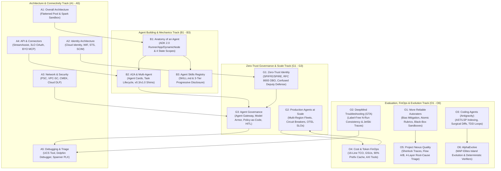

# L400_concepts: Master Google OKF Knowledge Catalog Index & Antigravity Agentic AI Blueprint (`L400_version_20261026_0350`)
**Topic Tags:** `#L400_version_20261026_0350` `#GoogleOKFKnowledgeCatalog` `#AntigravityAgenticAI` `#GeminiEnterpriseL400` `#GoogleCloudWAF` `#EnterpriseAgentArchitecture`

---

## 0. OKF Document Metadata & Catalog Schema
**Topic Tags:** `#L400_version_20261026_0350` `#GoogleOKFKnowledgeCatalog` `#CatalogSchema`

> **OKF v0.2 Trust Signals, Bucket Merge & Enforced FDE Grading Rubric (`OKF-L400-21`):**
> - **Version Tag:** `L400_version_20261026_0350` | **Status (`status`):** `stable` (`VETTED` / `APPROVED`) | **TTL (`stale_after`):** `2027-04-26T00:00:00Z` *(Maintains existing TTL & version)* | **Verified (`verified`):** `true`
> - **Merged Bucket OKF Lineage:** Reconciled with `Concepts 01-15` in `gs://gea_agent_development_architectural_best_practices_1790796607` (`project=fivedaysai-prd-sandbox-317383`)
> - **Cloud FDE Prevailing Standard:** `https://g3doc.corp.google.com/company/teams/cloud-fde/index.md?cl=head`
> - **Enforced Project Grading Rubric (`OKF-L400-21`):** Adheres to the 0–3 FDE Field-Readiness Rubric (Pass Gate: Average >= 2.0 across Part A & Part B; Zero-Score Pause Rule: any `0 - Not Demonstrated` triggers an immediate pause and 2-week re-presentation). Primary mapped competencies for `OKF-L400-00`: **Part A.1-A.5 (Presentation & Advisory Rigor) & Part B.1-B.7 (All 28 Engineering & Implementation Excellence Competencies)**.

| OKF Field | Value |
| :--- | :--- |
| **Catalog Identifier** | `GCP-OKF-CATALOG-L400-MASTER` |
| **OKF Version Tag** | `L400_version_20261026_0350` |
| **Target Platform** | Google Cloud Knowledge Catalog / Vertex AI Search / Antigravity Agentic AI Context Engine |
| **Curriculum Tracks** | Architecture (`A1`–`A5`), Build (`B1`–`B3`), Govern & Scale (`G1`–`G3`), Optimize (`O1`–`O6`), Cross-KB Synthesis (`18`–`20`) |
| **Source Corpus** | 44 L400 Markdown Artifacts (18 Raw Transcripts & Q&As, 9 Video Concept Analyses, 17 Slide-Deck Architecture Conversions) |
| **Well-Architected Alignment** | Operational Excellence, Security/Privacy/Compliance, Reliability, Performance Optimization, Cost Optimization (FinOps) |
| **Status** | Approved for Production Knowledge Catalog Ingestion |

---

## 1. Executive Overview & Antigravity Agentic AI Consumption Model
**Topic Tags:** `#L400_version_20261026_0350` `#AntigravityAgenticAI` `#GeminiEnterpriseL400`

> **Enforced FDE Project Grading Rubric Reference (`OKF-L400-21` & `g3doc/company/teams/cloud-fde`):** Every project applying Section 1 of `OKF-L400-00` is graded against **Part A.1-A.5 (Presentation & Advisory Rigor) & Part B.1-B.7 (All 28 Engineering & Implementation Excellence Competencies)** and merged bucket **Concepts 01-15** (`stale_after: 2027-04-26T00:00:00Z`, version `L400_version_20261026_0350`). Builders must achieve >= 2 (**Competent**) across Part A & Part B and avoid any 0 (**Not Demonstrated**) pause triggers.

This `L400_concepts/` repository is structured in **Google OKF (Operational Knowledge Framework / One Knowledge Format)** and explicitly version-tagged as **`L400_version_20261026_0350`**. It is engineered for direct ingestion into a **Google Cloud Knowledge Catalog** (backed by Vertex AI Search, BigQuery metadata tables, or MCP knowledge servers) so that **Antigravity coding and architecture agents** can deterministically retrieve:
- **Architectural Reference Patterns & Matrices** (Flattened Root Agents, Spark Sandboxes, ADK 2.0 `DynamicNode` Graphs, A2A Protocol, 3-Tier `SKILL.md` Progressive Disclosure, Dual-Path Identity & VPC-SC Network Perimeters).
- **Production Guardrails & Anti-Patterns** (Confused Deputy prevention, RFC 8693 On-Behalf-Of token exchange, SPIFFE/SPIRE attestation, AXI tool ergonomics, and 16-line GenAI TCO models).
- **End-to-End Enterprise Customer Use Cases** mapped across all five **Google Cloud Well-Architected Framework (WAF)** pillars.
- **Exhaustive Scenario & PCA Certification Question Banks** and **Multi-Tier FAQ Compendiums** (both inline per section, per module, and cross-knowledge-base).

---

## 2. Complete Catalog Manifest (`L400_concepts/` — 21 OKF Documents)
**Topic Tags:** `#L400_version_20261026_0350` `#GoogleOKFKnowledgeCatalog` `#TopicTaxonomy`

> **Enforced FDE Project Grading Rubric Reference (`OKF-L400-21` & `g3doc/company/teams/cloud-fde`):** Every project applying Section 2 of `OKF-L400-00` is graded against **Part A.1-A.5 (Presentation & Advisory Rigor) & Part B.1-B.7 (All 28 Engineering & Implementation Excellence Competencies)** and merged bucket **Concepts 01-15** (`stale_after: 2027-04-26T00:00:00Z`, version `L400_version_20261026_0350`). Builders must achieve >= 2 (**Competent**) across Part A & Part B and avoid any 0 (**Not Demonstrated**) pause triggers.

| OKF File Name | Module ID | Track | Primary Domain Focus | Key Antigravity Development Use Case |
| :--- | :--- | :--- | :--- | :--- |
| **`00_OKF_KNOWLEDGE_CATALOG_INDEX.md`** | `OKF-L400-00` | Master Index | Catalog Schema, Manifest & Cross-Pillar Map | Entry point for MCP / RAG catalog discovery and routing. |
| **`A1_OKF_Overall_Architecture.md`** | `OKF-L400-A1` | Architecture | 4-Layer Stack, Flattened Pool, Spark Sandbox | Selecting between Search-First, Flattened Root-Agent, and Spark runtimes. |
| **`A2_OKF_Identity_Architecture.md`** | `OKF-L400-A2` | Architecture | Cloud Identity vs. WIF, STS, SCIM, OIDC/SAML Limits | Configuring authentication, SCIM group pre-sync, and Agent Identity. |
| **`A3_OKF_Network_Architecture_and_Security.md`** | `OKF-L400-A3` | Architecture | Ingress/Egress, PSC, VPC-SC, CMEK, Cloud DLP/SDP | Wiring private networking, VPC-SC perimeters, and Drive SDP inspection. |
| **`A4_OKF_API_Integration_Federated_Connector_and_BYO_MCP.md`** | `OKF-L400-A4` | Architecture | `StreamAssist`, Federated 3LO OAuth, BYO MCP | Implementing custom UI clients, 3P federated auth, and Cloud Run MCP tools. |
| **`A5_OKF_Debugging_and_Troubleshooting.md`** | `OKF-L400-A5` | Architecture | Assistant/Dolphin Servers, UCS Tool, Sherlog, Spanner PLX | Diagnosing missing citations, JQL rewrite bugs, ACL drops, and latency. |
| **`B1_OKF_Anatomy_of_an_Enterprise_Agent.md`** | `OKF-L400-B1` | Build | 7 Agent Organs, ADK 2.0 `Runner`/`App`/`DynamicNode`, State Scopes | Writing production ADK 2.0 workflow graphs, processors, and callbacks. |
| **`B2_OKF_A2A_Protocol_and_Multi_Agent_Mechanics.md`** | `OKF-L400-B2` | Build | A2A vs. MCP, Agent Cards, Task States, v0.3/v1.0 Shims | Building cross-agent A2A interoperability and registering on Agent Gateway. |
| **`B3_OKF_Agent_Skills_and_Skills_Registry.md`** | `OKF-L400-B3` | Build | `SKILL.md`, 3-Tier Progressive Disclosure, Skills Registry | Packaging modular domain SOPs and helper scripts with minimal token footprint. |
| **`G1_OKF_Zero_Trust_Identity_Foundation.md`** | `OKF-L400-G1` | Govern & Scale | SPIFFE/SPIRE, RFC 8693 OBO Token Exchange, Confused Deputy | Enforcing cryptographic workload identity and hop-by-hop scope attenuation. |
| **`G2_OKF_Managing_Production_Agents_at_Scale.md`** | `OKF-L400-G2` | Govern & Scale | Multi-Region Fleets, Canary Rollouts, Circuit Breakers, OTEL SLOs | Scaling agent fleets with high availability, quota partitioning, and graceful fallback. |
| **`G3_OKF_Agent_Governance.md`** | `OKF-L400-G3` | Govern & Scale | Enterprise Agent Gateway, Model Armor, Policy-as-Code, HITL | Centralizing agent registration, prompt-injection defense, and compliance audits. |
| **`O1_OKF_More_Reliable_Autoraters.md`** | `OKF-L400-O1` | Optimize | Autorater Calibration, Bias Mitigation, Atomic Rubrics, Sandboxes | Building bias-hardened LLM judges and black-box verification containers. |
| **`O2_OKF_DeepMind_Troubleshooting_Tool.md`** | `OKF-L400-O2` | Optimize | Gemini Task Analysis (`GTA`), Label-Free $N$-Sampling, JetSki Traces | Diagnosing prompt/schema defects and agent trajectory inefficiencies without labels. |
| **`O3_OKF_Design_and_Optimization_of_Coding_Agents.md`** | `OKF-L400-O3` | Optimize | Antigravity Architecture, AST/LSP Indexing, Surgical Diffs, TDD Loops | Optimizing autonomous coding agents for massive enterprise monorepos. |
| **`O4_OKF_Cost_Token_Estimation_Analysis_and_Optimization.md`** | `OKF-L400-O4` | Optimize | 16-Line TCO Ledger, GSUs vs. PayGo, Prefix Caching, AXI Tools | Achieving 3x+ TCO reduction via model tiering, 90% cache reads, and AXI design. |
| **`O5_OKF_Project_Nexus_Model_Quality_Reporting.md`** | `OKF-L400-O5` | Optimize | Project Nexus, Sherlock Traces, Flow A/B Escalation, 4-Layer Triage | Isolating model vs. prompt vs. harness vs. retrieval defects and hill-climbing quality. |
| **`O6_OKF_Alpha_Evolve.md`** | `OKF-L400-O6` | Optimize | Evolutionary Coding Agent, MAP-Elites Islands, Automated Verifiers | Discovering novel algorithms, kernel optimizations, and heuristics via evolution. |
| **`18_OKF_TOPIC_CONNECTION_AND_FLOW_GRAPH.md`** | `OKF-L400-18` | Cross-KB Graph | Master Topic Taxonomy (~200 Tags) & Inter-Module Flow Graphs | Navigating semantic dependencies across all 17 modules. |
| **`19_OKF_MASTER_ENTERPRISE_FAQ_COMPENDIUM.md`** | `OKF-L400-19` | Cross-KB FAQ | Overarching Multi-Module FAQs & Symptom-to-Fix Decision Matrix | Instant answers to cross-cutting architectural and operational questions. |
| **`20_OKF_CROSS_KB_BEST_PRACTICES_AND_CUSTOMER_USE_CASES.md`** | `OKF-L400-20` | Cross-KB Best Practices | Golden Rules, WAF Checklists & 12+ Enterprise Case Studies | Reference architectures and landing metrics for customer deployments. |

---

## 3. Master Architectural & Topic Flow Diagram
**Topic Tags:** `#L400_version_20261026_0350` `#CrossPillarArchitecture` `#TopicFlowGraph`

> **Enforced FDE Project Grading Rubric Reference (`OKF-L400-21` & `g3doc/company/teams/cloud-fde`):** Every project applying Section 3 of `OKF-L400-00` is graded against **Part A.1-A.5 (Presentation & Advisory Rigor) & Part B.1-B.7 (All 28 Engineering & Implementation Excellence Competencies)** and merged bucket **Concepts 01-15** (`stale_after: 2027-04-26T00:00:00Z`, version `L400_version_20261026_0350`). Builders must achieve >= 2 (**Competent**) across Part A & Part B and avoid any 0 (**Not Demonstrated**) pause triggers.

---

## FDE Project Grading Rubric Enforcement & Prevailing Customer Alignment

> **Mandatory Governance Standard:** Every project, prototype, or production agent built using the patterns in this concept **must pass the [Google Cloud FDE Field-Readiness & Project Grading Rubric](/concepts/00-fde-field-readiness-and-grading-rubric.md)** (aligned with the [Cloud FDE Team Charter](https://g3doc.corp.google.com/company/teams/cloud-fde/index.md?cl=head)). Scoring Requirement: **Average >= `2.0 (Competent)`** across both **Part A (Presentation & Advisory Rigor)** and **Part B (Engineering & Implementation Excellence)**, with **zero `0 (Not Demonstrated)` scores** on any single metric.

## 8. Enforceable FDE Field-Readiness & Project Grading Rubric Alignment (`OKF-L400-21` & `g3doc/company/teams/cloud-fde`)
**Topic Tags:** `#L400_version_20261026_0350` `#FDEGradingRubric` `#FieldReadinessStandard` `#CloudFDECharter` `#BucketOKFMerge`

### 8.1 Module-Specific FDE Grading Rubric Scorecard (0–3 Scale: Part A & Part B)
**Topic Tags:** `#L400_version_20261026_0350` `#FDEGradingRubric` `#PresentationAndAdvisoryRigor` `#EngineeringAndImplementationExcellence`

Every application or architecture built using **`OKF-L400-00` (Master OKF Knowledge Catalog Index & Antigravity Blueprint)** is evaluated against the standalone **FDE Grading Rubric (`OKF-L400-21`)**. To pass field readiness, the solution must achieve an average score of **>= 2.0 (Competent)** in both **Part A (Presentation & Advisory Rigor)** and **Part B (Engineering & Implementation Excellence)** with **zero `0 (Not Demonstrated)` scores**:

| Rubric Competency (`OKF-L400-21`) | `0 - Not Demonstrated` (Automatic Pause & 2-Week Re-Present) | `1 - Awareness` (Needs Coaching) | `2 - Competent` (Field-Ready Pass) | `3 - Proficient` (L400 Strong Pass) |
| :--- | :--- | :--- | :--- | :--- |
| **Part A.1 & A.2: Strategic Value, TCO & Technical Defense** | Presents `OKF-L400-00` as an ungrounded "science project" with no CUJ, no TCO estimate, and inability to defend trade-offs under pushback. | Names high-level benefits of `Master OKF Knowledge Catalog Index & Antigravity Blueprint` but lacks quantitative TCO math or data-backed trade-off defense. | Frames `Master OKF Knowledge Catalog Index & Antigravity Blueprint` around customer personas & Critical User Journeys (CUJs), presents a viable TCO model (`O4`), and calmly defends design choices using data-backed matrices. | Quantifies unit economics across the 16-line TCO ledger, pre-empts CISO/CFO objections with empirical ablation stats, and links ADRs directly to commercial KPIs. |
| **Part A.4: AI-Driven Development Harness (In-Loop & Out-Loop)** | Built without a pre-configured AI harness, `SKILL.md`, or automated verification loop; agent mistakes are repeated manually. | Used basic IDE autocomplete without distinguishing In-the-Loop vs. Outside-the-Loop workflows or updating instructions. | Demonstrates pre-coding harness setup (`SKILL.md` + OKF MCP `tool_filter`), executes both **In-the-Loop** (spec fixes) and **Outside-the-Loop** (goal-driven lint/test loops), and feeds agent mistakes back into instructions. | Operates a self-improving Antigravity + `GCPSkillRegistry` (`B3`, `O3`) harness with containerized TDD verifiers (`O1`) and a versioned mistake-to-`Gotchas` ledger. |
| **Part B: Core Engineering Competencies (`Part A.1-A.5 (Presentation & Advisory Rigor) & Part B.1-B.7 (All 28 Engineering & Implementation Excellence Competencies)`)** | Ignores the production guardrails of `OKF-L400-00`, leaving single points of failure, unscoped credentials, or unverified LLM outputs. | Understands `Master OKF Knowledge Catalog Index & Antigravity Blueprint` conceptually but misses critical production edge cases (e.g., group truncation, Confused Deputy, or context bloat). | Implements the production patterns of `OKF-L400-00` and merged bucket `Concepts 01-15` meeting latency SLAs, least-privilege security, deterministic + autorater evaluation, and graceful degradation. | Masters all L400 edge cases in `OKF-L400-00`, automates shift-left policy/security gates in CI/CD across Progressive Deployment Rings, and teaches the panel novel optimization insights. |
| **Part B.2: Scoping, ADRs, API Specs & Operational Runbooks** | Missing architecture/sequence diagrams, ADRs, OpenAPI/MCP/A2A contracts, or troubleshooting runbooks. | Provides high-level box diagrams without sequence flows, formal ADRs, or actionable operational runbooks. | Delivers complete Mermaid/ASCII architecture & sequence diagrams, ADRs with trade-off rationale, contract-first API/MCP schemas, and day-2 troubleshooting runbooks. | Publishes version-pinned OKF v0.2 documentation bundles (`L400_version_20261026_0350`, `stale_after: 2027-04-26T00:00:00Z`) verified by automated `skills-ref` and schema linters. |

### 8.2 Cloud-FDE Prevailing Customer Best Practices & Bucket OKF Integration (`g3doc/company/teams/cloud-fde` & `Concepts 01-15`)
**Topic Tags:** `#L400_version_20261026_0350` `#CloudFDECharter` `#BucketOKFMerge` `#PrevailingCustomerBestPractices`

In accordance with **`https://g3doc.corp.google.com/company/teams/cloud-fde/index.md?cl=head`** and the merged Cloud Storage bucket **`gs://gea_agent_development_architectural_best_practices_1790796607`** (`Concepts 01-15`), engineers implementing `OKF-L400-00` must follow these prevailing customer best practices while maintaining the existing TTL (`stale_after: 2027-04-26T00:00:00Z`) and version (`L400_version_20261026_0350`):
* **Enforce Architectural Separation & Progressive Disclosure (`Concepts 01, 03, 04, 05`)**: Keep MCP tools atomic and stateless (scoped via `McpToolset` `tool_filter`), package procedural reasoning in `GCPSkillRegistry` `SKILL.md` bundles (`< 5,000 tokens` Tier 2), validate OKF v0.2 frontmatter trust signals (`status`, `stale_after`, `verified`, `content_sha256`) before execution, and place static prefixes first for 75–90% Context Caching discounts.
* **Enforce Zero-Trust Gateway, PAB & Model Armor (`Concepts 13, 14, 15`)**: Register all agents, skills, and MCP servers in **Agent Registry** (`VETTED`/`PRODUCTION`), route all data-plane calls through **Enterprise Agent Gateway** over **Private Service Connect (PSC)**, bind least-privilege IAM with **Principal Access Boundaries (PAB)** and out-of-band `GcpAuthProviderScheme` token injection, and screen all inputs/outputs through **Model Armor** + **Cloud DLP**.
* **Enforce Component-Level Trajectory Eval & Progressive Rings (`Concepts 06, 07, 12`)**: Validate every skill and agent trajectory in Vertex AI Evaluation Service (`IN_ORDER` / `ANY_ORDER`, Goal Completion >92%, Tool Precision >98%, Step Token Bloat <15%, P95 Step Latency <500ms) using deterministic verifiers **beyond LLM-as-a-Judge** before promoting across `Sandbox -> SME Alpha -> Champion Beta -> Production GA` rings.

### 8.3 Zero-Score ("Pause & Re-Present") Disqualifier Checklist for `OKF-L400-00`
**Topic Tags:** `#L400_version_20261026_0350` `#ZeroScorePauseGate` `#FDEGradingRubric`

* [ ] **Commercial & CUJ Anchoring Verified (`Part A.1` / `Part B.2.1`)**: No ungrounded "science project" elements; `OKF-L400-00` is tied to a specific customer persona, CUJ, Definition of Done, and TCO model.
* [ ] **Pre-Coding Harness & Mistake Feedback Verified (`Part A.4`)**: Both In-the-Loop and Outside-the-Loop Antigravity harness workflows are documented, and mistakes discovered during `OKF-L400-00` implementation were fed back into `SKILL.md` `Gotchas`.
* [ ] **Evaluation Beyond LLM-as-a-Judge Verified (`Part B.1.4`)**: Deterministic schema/code/citation verifiers and retrieval/trajectory metrics are active alongside calibrated autoraters.
* [ ] **Zero-Trust & Least Privilege Verified (`Part B.3.1`–`B.3.5`)**: No static keys/PATs; PAB, OAuth/WIF, CMEK, VPC-SC, and Model Armor guardrails are enforced.
* [ ] **ADRs, Diagrams, API Contracts & Runbooks Complete (`Part B.2.4`–`B.2.7`)**: All required design and operational artifacts for `OKF-L400-00` are complete and pinned to `L400_version_20261026_0350`.

