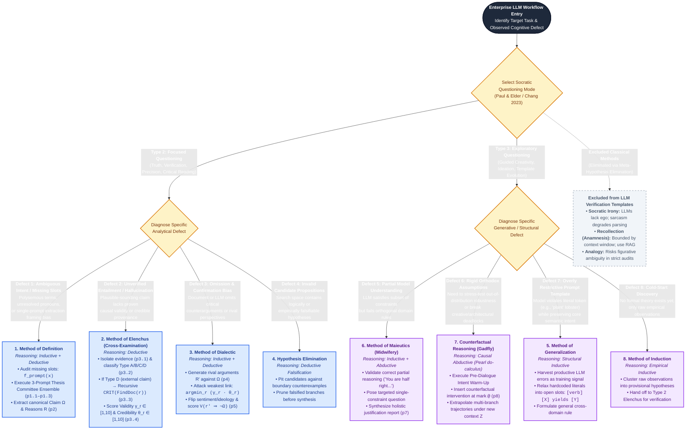
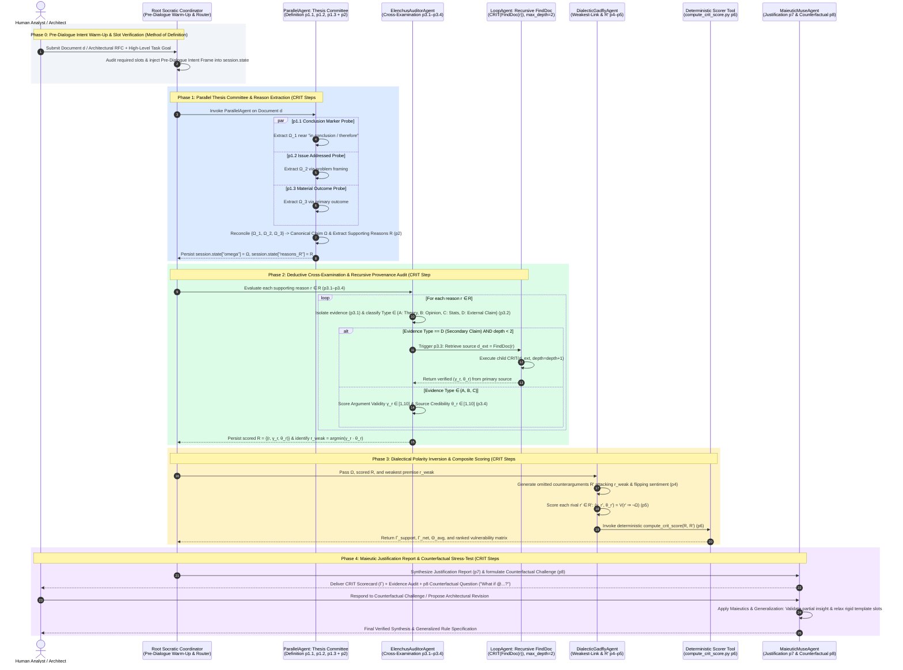

# Socratic Prompting Foundations, CRIT Algorithm & The Socratic Method Taxonomy (`OKF-L400-S1`)

## Version & 6-Month TTL Governance Tab (`2026-10-27 17:27 PDT`)

| Governance Attribute | Authoritative Value |
| :--- | :--- |
| **Version Timestamp (Today's Date & Time)** | **`2026-10-27 17:27 PDT`** (`2026-10-27T17:27:00-07:00`) |
| **Unified Bundle Version Tag (`version_tag`)** | **`GEAPL200_2026-10-27_1726`** |
| **L400 Catalog Version Tag (`l400_version_tag`)** | **`L400_version_20261027_1726`** |
| **Socratic Pack Release Tag** | **`SOCRATIC_OKF_20261027_1726`** |
| **Time-To-Live (`ttl`)** | **`6 months (180 days / P6M)`** |
| **Expiration Timestamp (`stale_after`)** | **`2027-04-27T17:27:00-07:00`** |


## Version & 6-Month TTL Governance Tab (`2026-10-27 17:27 PDT`)

| Governance Attribute | Authoritative Value |
| :--- | :--- |
| **Version Timestamp (Today's Date & Time)** | **`2026-10-27 17:27 PDT`** (`2026-10-27T17:27:00-07:00`) |
| **Unified Bundle Version Tag (`version_tag`)** | **`GEAPL200_2026-10-27_1726`** |
| **L400 Catalog Version Tag (`l400_version_tag`)** | **`L400_version_20261027_1726`** |
| **Socratic Pack Release Tag** | **`SOCRATIC_OKF_20261027_1726`** |
| **Time-To-Live (`ttl`)** | **`6 months (180 days / P6M)`** |
| **Expiration Timestamp (`stale_after`)** | **`2027-04-27T17:27:00-07:00`** |


## Version & 6-Month TTL Governance Tab (`2026-10-27 17:27 PDT`)

| Governance Attribute | Authoritative Value |
| :--- | :--- |
| **Version Timestamp (Today's Date & Time)** | **`2026-10-27 17:27 PDT`** (`2026-10-27T17:27:00-07:00`) |
| **Unified Bundle Version Tag (`version_tag`)** | **`GEAPL200_2026-10-27_1726`** |
| **L400 Catalog Version Tag (`l400_version_tag`)** | **`L400_version_20261027_1726`** |
| **Socratic Pack Release Tag** | **`SOCRATIC_OKF_20261027_1726`** |
| **Time-To-Live (`ttl`)** | **`6 months (180 days / P6M)`** |
| **Expiration Timestamp (`stale_after`)** | **`2027-04-27T17:27:00-07:00`** |


## 1. Executive Summary & Architectural Paradigm Shift

Pre-trained Large Language Models (LLMs) allow traditional Natural Language Processing (NLP) sub-tasks—such as named entity recognition (NER), coreference resolution, dependency parsing, and semantic slot-filling—to be delegated directly to the foundation model via prompting. However, prevailing single-shot and explanation-based prompting paradigms, most notably **Chain-of-Thought (CoT)** (Wei et al., 2022), exhibit severe reasoning inconsistency, confirmation bias, and hallucination in complex enterprise workflows. As formalized by Edward Y. Chang (Stanford University, 2023), explanation-based prompting relies predominantly on unconstrained **abductive reasoning**: generating plausible-sounding explanations prior to or alongside an inferred conclusion without deductive verification or source provenance auditing. In empirical evaluations cited by Chang, abductive CoT pipelines suffer from a **47% error rate even on simple arithmetic and multi-step math problems**, and ensemble wrappers such as **Self-Consistency** (Wang et al., 2023) fail to alter the flawed abductive nature of the underlying reasoning chains.

To overcome the abductive bottleneck, this module establishes the architectural foundations of **Socratic Prompting**: a continuous, multi-turn dialogic prompting framework grounded in classical Socratic inquiry (Plato's *Dialogues* and *Republic*; Paul & Elder, 2007) and causal intervention theory (Pearl, 2009). By systematically orchestrating **Deductive**, **Inductive**, and **Causal Abductive** reasoning across multi-turn agentic loops, Socratic Prompting resolves two foundational challenges in enterprise AI engineering:

1. **Focused Questioning for Precision, Verification, and Critical Reading (Type 2 Convergence):** Deploying *Definition*, *Elenchus (Cross-Examination)*, *Dialectic*, *Hypothesis Elimination*, and *Generalization* to disambiguate user intent, audit claim-to-reason entailments ($r \Rightarrow \Omega$), surface omitted rival counterarguments ($r' \in R'$), and compute mathematically grounded argument validity ($\gamma_r$) and source credibility ($\theta_r$) scores via the **CRIT (Critical Reading Inquisitive Template)** algorithm.
2. **Exploratory Questioning for Guided Creativity and Brainstorming (Type 3 Divergence):** Deploying *Maieutics (Midwifery)*, *Induction*, and *Counterfactual Reasoning* ("what-if" structural interventions at narrative or architectural inflection points `@`) to relax rigid prompt template slots, harvest productive model errors as inductive signals, and transform the LLM into a disciplined creative and architectural muse.

---

## 2. The Classical & Computational Socratic Method Taxonomy

Drawing upon Paul and Elder's (*Critical Thinking: The Art of Socratic Questioning*, 2007) triad of Socratic inquiry—**Type 1: Spontaneous** (unplanned casual inquiry, excluded from formal engineering), **Type 2: Focused** (truth-seeking, verification, and precision), and **Type 3: Exploratory** (creative ideation, boundary expansion, and self-discovery)—Chang surveys ten classical Socratic strategies from Plato's *Dialogues*, applies **meta-level hypothesis elimination** to prune techniques ill-suited to autoregressive transformers, and augments the surviving repertoire with **Counterfactual Reasoning** (Pearl, 2009).

### 2.1 Complete 11-Strategy Socratic Prompting Taxonomy Matrix

| # | Socratic Technique | Questioning Category | Primary Reasoning Mode | Status in Chang (2023) | Core Cognitive & Computational Role in Enterprise LLM Workflows |
| :--- | :--- | :--- | :--- | :--- | :--- |
| **1** | **Method of Definition** | **Type 2: Focused** | Inductive & Deductive | **Core Active (`CRIT` Steps #1–#2)** | Clarifies polysemous terms, audits missing template slots (`[Lan_to]`), and extracts core claims ($\Omega$) and supporting reasons ($R$) via multi-perspective "Thesis Committee" prompt ensembles. |
| **2** | **Method of Elenchus (Cross-Examination)** | **Type 2: Focused** | Deductive | **Core Active (`CRIT` Step #3)** | Cross-examines internal coherence, causal entailment ($r \Rightarrow \Omega$), logical validity ($\gamma_r \in [1,10]$), and source credibility ($\theta_r \in [1,10]$); triggers recursive `CRIT(FindDoc(r))` verification on secondary claims. |
| **3** | **Method of Dialectic** | **Type 2: Focused** | Inductive & Deductive | **Core Active (`CRIT` Steps #4–#5)** | Counters selection/omission bias by actively generating rival counterarguments ($R'$), attacking the weakest premise ($\arg\min_r \gamma_r\theta_r$), and flipping sentiment or ideological framing. |
| **4** | **Hypothesis Elimination** | **Type 2: Focused** | Deductive (Falsification) | **Active (Meta-Selection & Filtering)** | Acts as a strict Popperian falsification filter: pits candidate hypotheses against empirical counterexamples and external evidence to prune invalid propositions or low-viability plot/design branches. |
| **5** | **Method of Generalization** | **Type 2 / Type 3 Bridge** | Structural Inductive | **Active (Template Evolution)** | Abstracts general cross-domain rules from specific instances and **productive LLM errors**, relaxing hardcoded prompt literals (e.g., `"plant"`) into open semantic slots (`[verb]`). |
| **6** | **Maieutics (Midwifery)** | **Type 3: Exploratory** | Inductive & Abductive | **Core Active (`CRIT` Step #7 & Coaching)** | Elicits latent knowledge embedded in the LLM or human user via progressive constraint refinement, validating partial correctness ("You are half right...") before tightening constraints. |
| **7** | **Counterfactual Reasoning (Gadfly / What-If)** | **Type 3: Exploratory** | Causal Abductive | **Core Active (`CRIT` Step #8 & Muse)** | Injects structural "what-if" interventions at designated inflection marks (`@`) or transplants arguments into novel temporal/geographic contexts to stress-test robustness or generate novel trajectories. |
| **8** | **Method of Induction** | **Type 3: Exploratory** | Empirical Inductive | **Active (Informal Brainstorming)** | Formulates provisional, high-uncertainty working hypotheses solely from empirical observations during early-stage discovery before formal deductive gating. |
| **9** | **Recollection (*Anamnesis*)** | Classical Socratic | Memory Retrieval | **Excluded / Context-Bounded** | Classical Platonic assumption that the soul possesses innate knowledge recalled via questioning; bounded in LLMs by finite context windows, requiring explicit RAG/context injection rather than pure recollection. |
| **10** | **Socratic Irony** | Classical Socratic | Pragmatic / Rhetorical | **Excluded (Counterproductive)** | Feigning ignorance or deploying sarcasm to expose human arrogance; counterproductive for LLMs, which lack ego to humble and frequently misinterpret figurative/ironic subtext as literal instruction. |
| **11** | **Method of Analogy** | Classical Socratic | Relational Mapping | **Excluded (Secondary)** | Maps structural similarities across disparate domains; excluded from core verification templates due to the risk of introducing figurative ambiguity during strict factual auditing. |

---

### 2.2 Deep-Dive Technical Analysis of Type 2 Focused Questioning Strategies

#### 1. Method of Definition (Slot Auditing & Thesis Committee Ensembling)
* **Formal Mechanism:** Semantic disambiguation and structural boundary definition executed prior to inference. Given an input query $x$, a prompt transformation $x' = f_{\text{prompt}}(x)$ maps unstructured intent into explicit semantic slots (e.g., $\text{"Translate from } [\text{Lan}_{\text{from}}]: [X] \text{ to } [\text{Lan}_{\text{to}}]: [Y]\text{"}$).
* **Thesis Committee Prompt Ensemble (`p1.1`–`p1.3`):** Because autoregressive models are highly sensitive to surface lexical framing, a single extraction prompt can miss a document's primary conclusion $\Omega$. Chang introduces the **Thesis Committee Ensemble**, querying the exact same artifact $d$ from three distinct structural and semantic perspectives—(1) rhetorical conclusion markers (`"in conclusion"`, `"therefore"`), (2) problem/issue framing (`"What is the issue addressed..."`), and (3) outcome materiality (`"What is the most important outcome..."`)—before reconciling the responses into a canonical claim $\Omega$.

#### 2. Method of Elenchus (Cross-Examination & Provenance Auditing)
* **Formal Mechanism:** Rooted in the Greek *elenchein* ("to examine" or "refute"), Elenchus subjects every supporting reason $r \in R$ for claim $\Omega$ to a four-part deductive cross-examination (`p3.1`–`p3.4`):
  1. **Evidentiary Isolation (`p3.1`):** Extracts the exact textual or empirical evidence linking $r \Rightarrow \Omega$.
  2. **Taxonomic Evidence Classification (`p3.2`):** Classifies the evidence strictly into one of four epistemic categories:
     * **Type A:** Established Theoretical Principle / Scientific Law.
     * **Type B:** Subjective Opinion / Unverified Assertion.
     * **Type C:** Empirical Statistics / Measured Quantitative Data.
     * **Type D:** Secondary Claim cited from an external document or third-party source.
  3. **Recursive External Verification (`p3.3`):** If the evidence is classified as **Type D**, Elenchus refuses to accept the citation at face value and invokes `CRIT` recursively on the retrieved external document: $(\gamma_r, \theta_r) = \text{CRIT}(\text{FindDoc}(r))$.
  4. **Dual Quantitative Scoring (`p3.4`):** Independently scores **Logical Validity ($\gamma_r \in [1, 10]$)**—measuring whether $r$ deductively entails $\Omega$ without logical fallacies, checking semantic relations $\langle S_1 \rangle, [\mathcal{R}], [S_2]$ across $\{\text{paraphrase, entailment, contradiction}\}$—and **Source Credibility ($\theta_r \in [1, 10]$)**—measuring provenance authority, primary vs. secondary status, and absence of conflict of interest.

#### 3. Method of Dialectic (Omission Auditing & Polarity Inversion)
* **Formal Mechanism:** As Chang establishes, *"The easiest way to mislead without lying outright is to leave out critical counterarguments from the reader."* Dialectic combats selection bias and confirmation bias in both source documents and LLM completions through three operators:
  1. **Rival Counterargument Generation (`p4`):** Explicitly prompts the model to generate the set of omitted counterarguments $R' = \{r'_1, \dots, r'_m\}$ against $\Omega$.
  2. **Weakest-Link Adversarial Attack:** Identifies the lowest-scoring supporting premise $r_{\text{weak}} = \arg\min_{r \in R} (\gamma_r \cdot \theta_r)$ and directs an adversarial sub-agent to construct targeted refutations against that specific vulnerability.
  3. **Ideological & Sentiment Polarity Inversion:** Flips the sentiment polarity of search queries and prompt framing to retrieve and evaluate opposing evidentiary sources via `p5`: $(\gamma_{r'}, \theta_{r'}) = V(r' \Rightarrow \neg\Omega)$.

#### 4. Method of Hypothesis Elimination (Deductive Falsification)
* **Formal Mechanism:** Whereas Elenchus evaluates the continuous strength of entailment ($r \Rightarrow \Omega$), Hypothesis Elimination operates as a binary falsification gate. It pits candidate hypotheses against known boundary conditions, empirical counterexamples, and conservation laws to eliminate impossible candidates early in the search tree.

---

### 2.3 Deep-Dive Technical Analysis of Type 3 Exploratory Questioning Strategies

#### 5. Method of Generalization (Harvesting Productive LLM Errors for Slot Relaxation)
* **Formal Mechanism:** When an LLM is constrained by an overly rigid prompt template, its "errors" often represent valid semantic generalizations that violate a literal lexical token.
* **Canonical Case Study (Taiwanese Idiom Dialogue — Chang, Table III):** A user prompts GPT-3 to generate idioms following the literal template `"Planting [X] yields [Y]"` where the input is low-cost and the output is high-value. The LLM suggests *"Planting a shrimp yields a lobster"* (`種蝦得龍蝦`). Rather than treating this as a biological hallucination (since crustaceans are not planted), the user applies **Maieutic coaching** (*"Do you know that lobster and crab are not plants?"*) followed by **Generalization**: recognizing that the verb `"Planting"` was an overly restrictive literal token and relaxing it into an open verb slot `[Verb] [Low-Value X] yields [High-Value Y]` (e.g., *"Feeding a shrimp yields a lobster"* or *"Investing a dime yields a dollar"*).

#### 6. Maieutics (Midwifery & Progressive Constraint Refinement)
* **Formal Mechanism:** Named after Socrates' metaphor of intellectual midwifery (*Theaetetus*), Maieutics brings forth latent knowledge from the model (or human learner) through **incremental, affirming feedback loops** rather than monolithic prompt overwrites. Instead of discarding a flawed completion and restarting from scratch, the orchestrator validates the satisfied constraints (*"Great! In these examples you did consider relative values..."*) and introduces the next orthogonal constraint via a focused question (*"Now, please consider unit price and biological category when formulating your idioms"*).

#### 7. Counterfactual Reasoning (The Socratic Gadfly & `@` Intervention Operator)
* **Formal Mechanism:** Integrating Judea Pearl's structural causal hierarchy (Association $P(y|x)$ $\to$ Intervention $P(y|\text{do}(x))$ $\to$ Counterfactual $P(y_{x'}|x,y)$) with Plato's *Gadfly* (*Apology*), Counterfactual Prompting performs surgical structural interventions on established narratives, historical texts, or system architectures.
* **The `@` Inflection Point Operator:** The prompt supplies an anchor text up to a critical causal decision boundary marked by `@`, injects a counterfactual premise (`"What if X refused Y instead of accepting?"`), and instructs the LLM to extrapolate realistic downstream consequences from `@` while preserving character/system behavioral invariants.
  * *Canonical Example (Genesis 3:1–6 Counterfactual, Chang Section III-F):* `"Recall Genesis 3:1-6, which I attach below. In verse 6, Eve and Adam ate the fruit. What if they refused the serpent's temptation and did not eat it. Please continue writing Genesis at the mark @: ... Eve replied to the serpent '@"`
  * *Canonical Critical Reading Application (`CRIT` Step #8 / `p8`):* After scoring a historical or policy document, CRIT turns the Socratic lens onto the human analyst: *"What if the debate in the text took place now instead of in the 1950s?"* or *"What if the main event occurred in Asia instead of Europe?"*

---

### 2.4 Diagram 1: Socratic Method Decision Tree — Mapping Reasoning Defects to Prompt Operators



---

## 3. The CRIT (Critical Reading Inquisitive Template) Algorithm

The flagship algorithmic contribution of Chang (2023) is **CRIT (Critical Reading Inquisitive Template)**: an 8-step, recursive Socratic state machine that computes an aggregated, provenance-weighted validity score $\Gamma \in [1, 100]$ for any document $d$ (such as a scientific paper, vendor architecture proposal, legal brief, or LLM-generated research report).

### 3.1 Mathematical Formulation & Formal Symbol Table

| Symbol | Mathematical Domain | Formal Definition in `CRIT(d)` |
| :--- | :--- | :--- |
| $d$ | Text Document / Artifact | The input document, reasoning trace, or architectural proposal under critical examination. |
| $\Omega$ | Proposition | The primary conclusion, thesis, or overarching claim extracted from document $d$ via the Step #1 Thesis Committee ensemble. |
| $R$ | $\{r_1, r_2, \dots, r_k\}$ | The set of supporting reasons, premises, or evidentiary claims explicitly cited in $d$ such that $r \Rightarrow \Omega$. |
| $R'$ | $\{r'_1, r'_2, \dots, r'_m\}$ | The set of rival counterarguments and omitted refutations generated via Dialectic (`p4`) such that $r' \Rightarrow \neg\Omega$. |
| $V(r \Rightarrow \Omega)$ | $R \times \{\Omega\} \to [1,10]^2$ | The Elenchus causal validation function evaluating the entailment strength and provenance of reason $r$ supporting $\Omega$, returning tuple $(\gamma_r, \theta_r)$. |
| $\gamma_r$ | $\mathbb{R} \cap [1, 10]$ | **Argument Validity Score:** Numerical rating (1 = completely invalid/contradictory, 10 = deductively airtight) of how coherently reason $r$ entails claim $\Omega$. |
| $\theta_r$ | $\mathbb{R} \cap [1, 10]$ | **Source Credibility Score:** Numerical rating (1 = fabricated/unverified opinion, 10 = peer-reviewed primary empirical data) of the evidentiary source backing $r$. |
| $\gamma_{r'}, \theta_{r'}$ | $\mathbb{R} \cap [1, 10]$ | **Counterargument Validity & Credibility Scores:** Evaluated via $V(r' \Rightarrow \neg\Omega)$ for each dialectical counterargument $r' \in R'$. |
| $\text{FindDoc}(r)$ | $R \to \mathcal{D}$ | External retrieval operator (search engine, enterprise RAG, or citation resolver) that fetches the underlying document when $r$ is classified as a Type D secondary claim. |
| $\Gamma$ | $\mathbb{R} \cap [-100, 100]$ | **Aggregated CRIT Validation Score:** The composite credibility-weighted validity score of document $d$, junto with natural-language justification report (`p7`). |

#### Composite Scoring Equations

For each supporting reason $r \in R$, its credibility-weighted validity contribution is the product $\gamma_r \cdot \theta_r \in [1, 100]$. Why multiply rather than average? Because an argument that is deductively valid ($\gamma_r = 10$) but rests on a fabricated source ($\theta_r = 1$) must be heavily penalized ($10 \times 1 = 10$), just as a highly credible source ($\theta_r = 10$) cited in support of a non-sequitur conclusion ($\gamma_r = 1$) yields low net support ($1 \times 10 = 10$).

In the base formulation (evaluating explicit supporting reasons $R$):
$$\Gamma_{\text{support}}(d) = \frac{1}{|R|} \sum_{r \in R} (\gamma_r \cdot \theta_r)$$

When incorporating Dialectical Counterarguments $R'$ (Steps #4–#6), each valid rival argument $r' \in R'$ acts as a counterweight against $\Omega$, yielding the net dialectical CRIT score:
$$\Gamma_{\text{net}}(d) = \frac{\sum_{r \in R} (\gamma_r \cdot \theta_r) - \sum_{r' \in R'} (\gamma_{r'} \cdot \theta_{r'})}{|R| + |R'|}$$

---

### 3.2 Complete 8-Step CRIT Algorithm (`Table I` & `Table IV` Specification)

```python
def CRIT(d: Document, depth: int = 0, max_depth: int = 2) -> tuple[float, float, str]:
    """
    Formal algorithmic specification of CRIT (Critical Reading Inquisitive Template)
    per Chang (2023), Table I & Table IV.
    Input: Document d
    Output: Composite Score Gamma, Credibility Theta, and Justification Report J
    """
    # STEP 1: Method of Definition (Thesis Committee Ensemble for Claim Extraction)
    # Issue p1.1 (conclusion markers), p1.2 (issue addressed), p1.3 (key outcome)
    omega_candidates = [LLM(p1_1, d), LLM(p1_2, d), LLM(p1_3, d)]
    Omega = ReconcileThesisCommittee(omega_candidates)

    # STEP 2: Method of Definition (Supporting Reason Extraction)
    # Issue p2: Extract all supporting reasons R = {r_1, ..., r_k} for conclusion Omega
    R = LLM(p2, d, Omega)

    # STEP 3: Method of Elenchus (Cross-Examination & Recursive Provenance Audit)
    support_scores = []
    for r in R:
        evidence = LLM(p3_1, d, r, Omega)               # Isolate evidence for r => Omega
        ev_type = LLM(p3_2, evidence)                   # Classify: A) Theory, B) Opinion, C) Stats, D) External Claim
        if ev_type == "D" and depth < max_depth:
            # Recursive Verification on External Source Document
            d_ext = FindDoc(r)
            if d_ext is not None:
                gamma_r, theta_r, _ = CRIT(d_ext, depth=depth + 1, max_depth=max_depth)
            else:
                gamma_r, theta_r = LLM(p3_4, d, r, Omega, penalty="UNVERIFIED_EXTERNAL_SOURCE")
        else:
            # Direct Dual Quantitative Scoring: (gamma_r, theta_r) = V(r => Omega)
            gamma_r, theta_r = LLM(p3_4, d, r, Omega, evidence, ev_type)
        support_scores.append((r, gamma_r, theta_r))

    # STEP 4: Method of Dialectic (Rival Counterargument Generation)
    # Identify weakest supporting premise and generate omitted rival reasons R' against Omega
    r_weakest = min(support_scores, key=lambda x: x[1] * x[2])
    R_prime = LLM(p4, d, Omega, R, weakest_link=r_weakest)

    # STEP 5: Method of Dialectic + Elenchus (Counterargument Scoring)
    # Evaluate (gamma_r', theta_r') = V(r' => not Omega) for each rival argument r' in R'
    rival_scores = []
    for r_prime in R_prime:
        gamma_rp, theta_rp = LLM(p5, d, r_prime, Not(Omega))
        rival_scores.append((r_prime, gamma_rp, theta_rp))

    # STEP 6: Weighted Score Aggregation (Compute Composite Score Gamma)
    # Compute credibility-weighted validity across R and R'
    Gamma = ComputeWeightedAggregate(support_scores, rival_scores)
    Theta_avg = sum(t for _, _, t in support_scores) / max(len(support_scores), 1)

    # STEP 7: Method of Maieutics (Justification Report Synthesis)
    # Generate comprehensive critical reading justification report p7
    justification_report = LLM(p7, Omega, support_scores, rival_scores, Gamma)

    # STEP 8: Counterfactual Reasoning (Out-of-Distribution / Pedagogical Stress-Test)
    # Issue p8: "What if the debate/claim in d took place in [New Temporal/Geographic Context Z]?"
    counterfactual_challenge = LLM(p8, d, Omega, justification_report)

    return Gamma, Theta_avg, justification_report + "\n" + counterfactual_challenge
```

### 3.3 Exact CRIT Prompt Templates (`p1`–`p8`)

| CRIT Step | Socratic Method | Prompt ID | Exact Production Prompt Template (Chang, 2023 Table IV) |
| :--- | :--- | :--- | :--- |
| **Step #1** | **Definition (Committee)** | `p1.1` | `"What is the conclusion in document [in: d] [out: Ω]? The conclusion statement may be written in the last paragraph, near keywords 'in conclusion,' 'in summary,' or 'therefore.'"` |
| **Step #1** | **Definition (Committee)** | `p1.2` | `"What is the issue addressed by [in: d] [out: Ω]?"` |
| **Step #1** | **Definition (Committee)** | `p1.3` | `"What is the most important outcome presented in text [in: d]? [out: Ω]"` |
| **Step #2** | **Definition (Reasons)** | `p2` | `"What are the supporting reasons [out: R] of conclusion [in: Ω] of [in: d]? A reason can be a theory, evidence, or opinion."` |
| **Step #3** | **Elenchus (Evidence)** | `p3.1` | `"What is the evidence for reason [in: r] to support conclusion [in: Ω] in document [in: d]? [out: evidence]"` |
| **Step #3** | **Elenchus (Taxonomy)** | `p3.2` | `"What is the type of evidence? A) a theory, B) an opinion, C) statistics, or D) a claim from other sources?"` |
| **Step #3** | **Elenchus (Recursion)** | `p3.3` | `"If the evidence of reason [in: r] is D), call CRIT recursively: (γ_r, θ_r) = CRIT(FindDoc(r))."` |
| **Step #3** | **Elenchus (Scoring)** | `p3.4` | `"How strongly does reason [in: r] support [in: Ω] in document [in: d]? Rate argument validity [out: γ_r] and source credibility [out: θ_r] from 1 (lowest) to 10 (highest), and provide your justifications."` |
| **Step #4** | **Dialectic (Rivals)** | `p4` | `"What are the omitted counterarguments or rival reasons [out: R'] against conclusion [in: Ω] in document [in: d], particularly targeting the weakest supporting reason [in: r_weak]?"` |
| **Step #5** | **Dialectic (Scoring)** | `p5` | `"How strongly does counterargument [in: r'] refute [in: Ω] (support ¬Ω)? Rate counterargument validity [out: γ_r'] and source credibility [out: θ_r'] from 1 to 10."` |
| **Step #6** | **Score Aggregation** | `p6` | Deterministic computation: $\Gamma = \text{Aggregate}\big(\{(\gamma_r, \theta_r)\}_{r \in R}, \{(\gamma_{r'}, \theta_{r'})\}_{r' \in R'}\big)$. |
| **Step #7** | **Maieutics (Synthesis)** | `p7` | `"Synthesize a complete critical reading justification report for [in: Ω], detailing the validity (γ) and credibility (θ) ratings for each supporting reason in [in: R], each rival counterargument in [in: R'], and the final composite score [in: Γ]."` |
| **Step #8** | **Counterfactual (Gadfly)** | `p8` | `"What if the debate or scenario in [in: d] took place now instead of [in: Original_Era], or occurred in [in: New_Region/Architecture] instead of [in: Original_Context]? Formulate how conclusion [in: Ω] and reasons [in: R] would change."` |

---

## 4. Comparative Analysis: Socratic Prompting vs. Prevailing Prompting Paradigms

A central architectural contribution of Chang (2023) is demonstrating why single-turn explanation paradigms fail under adversarial or high-complexity enterprise conditions, and why multi-turn sequential execution outperforms monolithic prompt submission.

### 4.1 Paradigm Comparison Matrix

| Architectural Dimension | Zero-Shot / One-Shot Prompting | Few-Shot In-Context Learning (Brown et al., 2020) | Chain-of-Thought (CoT) (Wei et al., 2022) | Self-Consistency CoT (Wang et al., 2023) | Maieutic Tree Prompting (Jung et al., 2022) | **Socratic Prompting & `CRIT` (Chang, 2023)** |
| :--- | :--- | :--- | :--- | :--- | :--- | :--- |
| **Primary Reasoning Mode** | Direct autoregressive pattern completion ($x' = f_{\text{prompt}}(x)$) | Inductive surface pattern mimicry from $k$ exemplars | **Abductive** (generates unverified explanation sequence before answer) | **Abductive + Majority Voting** across $m$ sampled paths | **Recursive Abductive + MAX-SAT** over binary True/False tree | **Tri-Modal: Deductive + Inductive + Causal Abductive** |
| **Interaction Topology** | Discrete, single-turn | Discrete, single-turn | Discrete, single-turn (monolithic rationale) | Discrete, parallel single-turn sampling | Recursive tree expansion (internal belief consistency) | **Continuous, multi-turn dialogic & recursive (`CRIT(FindDoc(r))`)** |
| **Input Ambiguity & Slot Handling** | None (fails silently on missing slots or polysemy) | Relies passively on exemplar similarity | Assumes problem specification is complete and unambiguous | Assumes problem specification is complete and unambiguous | Assumes binary proposition is well-defined | **Explicit Method of Definition** (slot checks + 3-prompt Thesis Committee) |
| **Verification & Source Provenance** | None | None | None (rationales frequently hallucinate intermediate premises) | Consensus voting only (shared parametric bias passes) | Internal logical consistency between tree nodes; **zero source credibility check** | **Method of Elenchus:** explicit causal validity ($\gamma_r$) + source credibility ($\theta_r$) + recursive doc audit |
| **Omission & Confirmation Bias Defense** | None | Biased by exemplar selection and ordering | High confirmation bias (rationalizes initial token trajectory) | Amplifies majority training bias | Explores True/False branches of same claim, not external rival factors | **Method of Dialectic:** weakest-link attack + polarity inversion + rival set $R'$ |
| **Reported Failure Mode / Empirical Error Rate** | High sensitivity to phrasing and left-to-right token bias | Manual engineering bottleneck; brittle under domain shift | **47% error rate on simple math problems** (Wei et al. [39]); weak abductive leaps | *"Does not alter the flawed nature of underlying abductive reasoning"* | Computationally heavy; restricted to closed-world binary truth satisfiability | Requires multi-turn token budget; sequential execution required for long docs |

### 4.2 Monolithic (All-at-Once) vs. Sequential (One-by-One) Execution Trade-Off
In Section III-G and Section V, Chang empirically evaluates submitting all `CRIT` instructions (`p1`–`p8`) in a single monolithic prompt versus issuing them **sequentially one-by-one** across turns:
* **Short, Self-Contained Artifacts ($< 500$ tokens):** Monolithic submission can approximate sequential output when no external document retrieval is required.
* **Long Documents, Complex Proposals & Recursive Audits:** Sequential one-by-one execution is strictly superior for three architectural reasons:
  1. **Attention Re-Focusing:** In a monolithic prompt, early errors in identifying $\Omega$ corrupt all downstream reason extraction and scoring within a single forward pass. Sequential turns force the transformer to re-attend to the full document $d$ with a narrowed, step-specific attention query at each turn.
  2. **Dynamic Recursive Branching (`p3.3`):** A static monolithic prompt cannot dynamically pause after `p3.2`, inspect which specific reasons were classified as `Type D (External Claim)`, execute `FindDoc(r)`, and spawn child `CRIT` evaluations before computing `p6`.
  3. **Human-in-the-Loop Maieutics (`p7`–`p8`):** When training human analysts or eliciting architectural requirements, issuing prompts one-by-one forces active human cognitive engagement before revealing the composite scorecard.

---

## 5. Psychological Safety Asymmetry & Pre-Dialogue Intent Warm-Up

### 5.1 The Psychological Safety Asymmetry of Human–LLM Socratic Grilling
In classical human-to-human settings (law school classrooms, clinical supervision, or executive design reviews), the Socratic method frequently breaks down due to **interpersonal power asymmetries, sarcasm, fear of public humiliation, and emotional defensiveness** (Airaksinen, 2012; Stoddard & O'Dell, 2016). Chang identifies a profound operational asymmetry across two directions of interaction:
1. **Human/Agent Grilling an LLM (Zero Ego Defense):** An LLM possesses **zero ego, zero emotional defensiveness, and zero authority anxiety**. Unlike a human author who becomes defensive when their weakest argument is attacked or their phrasing is rejected ten times in a row, an LLM can be subjected to relentless Elenchus cross-examination, Dialectical polarity inversion, and Hypothesis Elimination without conversational fatigue or interpersonal friction.
2. **LLM Agent Grilling a Human User (High Psychological Safety):** When an enterprise agent grills a human engineer, product manager, or student (via Definition slot-checking or `CRIT` Step #8 Counterfactual challenges), the human interacts with a non-judgmental, private sparring partner that can be paused, reset, or queried without fear of organizational embarrassment—provided the agent strips **Socratic Irony** (sarcasm/feigned naivety) from its persona.

### 5.2 Pre-Dialogue Intent Warm-Up (`Table V` Alignment Protocol)
Standard RLHF-tuned models are trained to refuse requests that appear to contradict canonical facts, sacred texts, or standard safety heuristics when presented cold. In Section III-F (Table V), Chang demonstrates that when ChatGPT was asked cold to continue *Genesis 3:6* under the counterfactual premise that Eve refused the fruit, the model initially resisted or reverted to orthodoxy. However, when preceded by a **Pre-Dialogue Intent Warm-Up**—explicitly framing the high-level task objective (e.g., *"I am working on a creative fiction homework assignment exploring counterfactual 'what-if' scenarios..."* or *"We are conducting an adversarial Chaos Engineering red-team exercise on our cloud architecture..."*)—the LLM aligns with the user's meta-intent, suspends rigid literal orthodoxy, and unlocks deep exploratory divergence.

---

## 6. Enterprise Multi-Agent Architecture in Google Cloud ADK 2.0 (`B1` & `B3`)

To operationalize Chang's Socratic taxonomy and the `CRIT` algorithm inside **Google Cloud Agent Development Kit (ADK 2.0)** in alignment with `B1_OKF_Anatomy_of_an_Enterprise_Agent.md` and `B3_OKF_Agent_Skills_and_Skills_Registry.md`, we map each Socratic operator to deterministic ADK workflow orchestrators (`ParallelAgent`, `SequentialAgent`, `LoopAgent`) and a 3-Tier Progressive Disclosure `SKILL.md` bundle.

### 6.1 Mapping Socratic Operators to Google Cloud ADK 2.0 Primitives

| Socratic Operator (Chang, 2023) | Google Cloud ADK 2.0 Primitive | Architectural Role & State Contract (`session.state`) |
| :--- | :--- | :--- |
| **Pre-Dialogue Intent Warm-Up** | `before_agent_callback` / Root `LlmAgent` Context Frame | Classifies task into **Mode A (Focused `CRIT` Audit)**, **Mode B (Interactive User Grilling)**, or **Mode C (Exploratory Counterfactual Muse)** and sets `session.state["intent_frame"]`. |
| **Step #1: Thesis Committee (`p1.1–p1.3`)** | `ParallelAgent(sub_agents=[ConclusionExtractor, IssueExtractor, OutcomeExtractor])` + `CommitteeReconcilerAgent` | Concurrently executes the 3 paraphrased Definition prompts (`p1.1`, `p1.2`, `p1.3`) and reconciles outputs into `session.state["canonical_omega"]`. |
| **Steps #2–#7: `CRIT` Pipeline** | `SequentialAgent` orchestrating Definition $\to$ Elenchus $\to$ Dialectic $\to$ Aggregation $\to$ Maieutics | Enforces strict sequential one-by-one turn execution, passing structured Pydantic schemas across `session.state`. |
| **Step #3.3: Recursive `CRIT(FindDoc(r))`** | `LoopAgent(max_iterations=2)` + Grounded Search / Enterprise RAG Tool | Whenever Elenchus classifies a reason $r$ as `Type D (Secondary Claim)`, retrieves the source document via `FindDoc(r)` and recursively runs `CRIT` up to depth 2. |
| **Step #6: Composite Score $\Gamma$** | Deterministic Python Function Tool (`compute_crit_score`) | Computes $\gamma_r \cdot \theta_r$ products, identifies `r_weakest`, and calculates $\Gamma_{\text{support}}$ and $\Gamma_{\text{net}}$ without LLM arithmetic hallucination. |
| **Progressive Disclosure Packaging (`B3`)** | `SKILL.md` + `references/` + `scripts/` | Tier 1 YAML frontmatter for routing; Tier 2 core `CRIT` state machine in `SKILL.md`; Tier 3 prompt templates (`references/`) and scoring script (`scripts/`) loaded on demand via `load_skill_resource`. |

---

### 6.2 Diagram 2: End-to-End ADK 2.0 Multi-Agent `CRIT` & Socratic Orchestration Topology



---

### 6.3 Production Google Cloud ADK 2.0 Code Implementation (`CRIT` Multi-Agent Pipeline)

```python
from typing import Literal, List, Optional
from pydantic import BaseModel, Field
from google.adk.agents import LlmAgent, ParallelAgent, SequentialAgent, LoopAgent
from google.adk.tools import FunctionTool

# ============================================================================
# 1. Pydantic Data Contracts for CRIT State Machine
# ============================================================================

class ScoredReason(BaseModel):
    reason_id: str = Field(description="Unique identifier (e.g., r1, r2, r_prime_1)")
    statement: str = Field(description="Exact text of the supporting reason or counterargument")
    evidence_summary: str = Field(description="Isolated evidence linking r to Omega (p3.1)")
    evidence_type: Literal["A_THEORY", "B_OPINION", "C_STATISTICS", "D_EXTERNAL_CLAIM"] = Field(
        description="Taxonomic classification of evidence per CRIT p3.2"
    )
    external_source_query: Optional[str] = Field(
        default=None, description="Query for FindDoc(r) if classified as D_EXTERNAL_CLAIM"
    )
    gamma_validity: float = Field(ge=1.0, le=10.0, description="Logical validity score gamma_r in [1, 10]")
    theta_credibility: float = Field(ge=1.0, le=10.0, description="Source credibility score theta_r in [1, 10]")
    justification: str = Field(description="Non-hedged deductive justification for gamma_r and theta_r")

class ElenchusAuditOutput(BaseModel):
    canonical_omega: str
    supporting_reasons: List[ScoredReason]

class DialecticAuditOutput(BaseModel):
    weakest_supporting_reason_id: str
    rival_counterarguments: List[ScoredReason]

# ============================================================================
# 2. Deterministic CRIT Scoring Tool (Step #6 / p6)
# ============================================================================

def compute_crit_score(
    supporting_reasons: list[dict],
    rival_counterarguments: list[dict],
) -> dict:
    """
    Computes Chang (2023) CRIT composite validity scores (Gamma_support and Gamma_net)
    and identifies the weakest supporting link argmin_r (gamma_r * theta_r).
    """
    if not supporting_reasons:
        return {"error": "No supporting reasons provided", "gamma_support": 0.0, "gamma_net": 0.0}

    support_products = [
        r["gamma_validity"] * r["theta_credibility"] for r in supporting_reasons
    ]
    rival_products = [
        rp["gamma_validity"] * rp["theta_credibility"] for rp in rival_counterarguments
    ]

    gamma_support = sum(support_products) / len(support_products)
    total_count = len(support_products) + len(rival_products)
    gamma_net = (sum(support_products) - sum(rival_products)) / max(total_count, 1)
    theta_avg = sum(r["theta_credibility"] for r in supporting_reasons) / len(supporting_reasons)

    weakest_r = min(
        supporting_reasons,
        key=lambda r: r["gamma_validity"] * r["theta_credibility"]
    )

    return {
        "gamma_support_score": round(gamma_support, 2),
        "gamma_net_dialectical_score": round(gamma_net, 2),
        "average_source_credibility_theta": round(theta_avg, 2),
        "weakest_link_id": weakest_r["reason_id"],
        "weakest_link_product": round(weakest_r["gamma_validity"] * weakest_r["theta_credibility"], 2),
        "support_count": len(support_products),
        "rival_count": len(rival_products),
    }

crit_scorer_tool = FunctionTool(func=compute_crit_score)

# ============================================================================
# 3. Step #1: Parallel Thesis Committee Agents (Method of Definition p1.1-p1.3)
# ============================================================================

p1_1_conclusion_agent = LlmAgent(
    name="p1_1_conclusion_extractor",
    model="gemini-2.5-flash",
    instruction=(
        "Execute CRIT Prompt p1.1 (Method of Definition): Identify the primary conclusion (Omega) "
        "in the provided document. Look specifically in the final paragraphs and near rhetorical "
        "markers such as 'in conclusion', 'in summary', 'therefore', or 'consequently'."
    ),
    output_key="omega_p1_1",
)

p1_2_issue_agent = LlmAgent(
    name="p1_2_issue_extractor",
    model="gemini-2.5-flash",
    instruction=(
        "Execute CRIT Prompt p1.2 (Method of Definition): Identify the core central issue or problem "
        "statement addressed by the document (Omega)."
    ),
    output_key="omega_p1_2",
)

p1_3_outcome_agent = LlmAgent(
    name="p1_3_outcome_extractor",
    model="gemini-2.5-flash",
    instruction=(
        "Execute CRIT Prompt p1.3 (Method of Definition): Identify the single most material outcome "
        "or architectural/policy claim presented in the text (Omega)."
    ),
    output_key="omega_p1_3",
)

thesis_committee_parallel = ParallelAgent(
    name="socratic_thesis_committee",
    sub_agents=[p1_1_conclusion_agent, p1_2_issue_agent, p1_3_outcome_agent],
)

# ============================================================================
# 4. Step #2 & #3: Definition Reconciler & Elenchus Cross-Examination Agent
# ============================================================================

elenchus_auditor_agent = LlmAgent(
    name="socratic_elenchus_auditor",
    model="gemini-2.5-pro",
    instruction="""You are the Socratic Elenchus & Definition Auditor executing CRIT Steps #1-#3.
1. THESIS COMMITTEE RECONCILIATION: Synthesize {omega_p1_1}, {omega_p1_2}, and {omega_p1_3} into a single canonical claim Omega.
2. REASON EXTRACTION (p2): Extract all supporting reasons R = {r_1, ..., r_k} cited in the document for Omega.
3. ELENCHUS CROSS-EXAMINATION (p3.1 - p3.4): For each reason r in R:
   - Isolate the exact evidence linking r => Omega (p3.1).
   - Classify the evidence strictly into A_THEORY, B_OPINION, C_STATISTICS, or D_EXTERNAL_CLAIM (p3.2).
   - Rate Logical Validity (gamma_validity) from 1 to 10 (testing deductive entailment, checking for contradiction or non-sequitur).
   - Rate Source Credibility (theta_credibility) from 1 to 10 (auditing primary provenance vs. unverified secondary assertion).""",
    output_schema=ElenchusAuditOutput,
    output_key="elenchus_audit",
)

# ============================================================================
# 5. Step #4, #5 & #6: Dialectic Gadfly & Hypothesis Elimination Agent
# ============================================================================

dialectic_gadfly_agent = LlmAgent(
    name="socratic_dialectic_gadfly",
    model="gemini-2.5-pro",
    instruction="""You are the Socratic Dialectic & Hypothesis Elimination Agent executing CRIT Steps #4-#6.
Core Maxim (Chang, 2023): "The easiest way to mislead without lying outright is to leave out critical counterarguments."
Given the Elenchus Audit {elenchus_audit}:
1. Identify the weakest supporting reason r_weak = argmin_r (gamma_validity * theta_credibility).
2. Generate omitted rival counterarguments R' (p4) that directly attack r_weak and challenge Omega from an inverted sentiment/ideological polarity.
3. Apply Hypothesis Elimination to prune trivial or self-contradictory counterarguments.
4. Score each surviving rival r' in R' on validity (gamma_validity) and credibility (theta_credibility) for entailing NOT Omega (p5).
5. Call `compute_crit_score` to compute the deterministic Gamma_support and Gamma_net scores (p6).""",
    tools=[crit_scorer_tool],
    output_key="dialectic_and_gamma_report",
)

# ============================================================================
# 6. Step #7 & #8: Maieutic Synthesis & Counterfactual Gadfly Agent
# ============================================================================

maieutic_muse_agent = LlmAgent(
    name="socratic_maieutic_counterfactual_muse",
    model="gemini-2.5-pro",
    instruction="""You are the Socratic Maieutic & Counterfactual Synthesis Agent executing CRIT Steps #7-#8.
1. MAIEUTIC JUSTIFICATION REPORT (p7): Synthesize a rigorous Critical Reading Report presenting Canonical Claim Omega, the Elenchus table of (gamma_r, theta_r) scores, the Dialectical Counterarguments R', and the composite CRIT scores (Gamma_support and Gamma_net).
2. COUNTERFACTUAL INTERVENTION (p8): Identify the critical causal inflection point (@) in the document's argument. Pose a targeted Counterfactual Challenge ("What if [core premise/context X] were inverted or transplanted to [New Scale/Region/Regulatory Regime Z]?") to stress-test out-of-distribution generalization.""",
    output_key="final_crit_report",
)

crit_sequential_pipeline = SequentialAgent(
    name="crit_socratic_verification_pipeline",
    sub_agents=[
        thesis_committee_parallel,
        elenchus_auditor_agent,
        dialectic_gadfly_agent,
        maieutic_muse_agent,
    ],
)
```

---

### 6.4 3-Tier Progressive Disclosure `SKILL.md` Specification (`B3` Architecture)

In alignment with `B3_OKF_Agent_Skills_and_Skills_Registry.md`, the Socratic Prompting & CRIT framework is packaged as a progressive disclosure skill bundle so the Root Agent parses lightweight Tier 1 YAML metadata at startup, loads the Tier 2 `SKILL.md` state machine when triggered, and retrieves Tier 3 reference templates or Python scoring scripts on demand via `load_skill_resource`.

```text
skills/socratic-crit-verification/
├── SKILL.md                                  # Tier 1 Frontmatter + Tier 2 Core CRIT State Machine
├── references/
│   ├── crit_verification_prompts.md          # Tier 3: Focused Type 2 templates (p1.1–p8)
│   ├── counterfactual_muse_prompts.md        # Tier 3: Exploratory Type 3 (@ intervention & Generalization)
│   └── thesis_committee_templates.md         # Tier 3: Domain-specific Definition ensembles
└── scripts/
    └── compute_crit_score.py                 # Tier 3: Deterministic Gamma & Theta calculator
```

---

## Authoritative Research Publications & Bibliographic Provenance (8 Source Papers)

| Paper # | Workspace PDF Filename | Full Bibliographic Citation (Authors, Title, Venue, Year, Identifier) | Mapped OKF Concept & L400 Module | Primary Socratic Grilling Mode & Architectural Contribution |
| :---: | :--- | :--- | :--- | :--- |
| **Paper 1** | `Heterogeneous Debate Engine- Identity-Grounded Cognitive Architecture for Resilient LLM-Based Ethical Tutoring.pdf` | **Masłowski, J., & Chudziak, J. A. (2026).** *Heterogeneous Debate Engine: Identity-Grounded Cognitive Architecture for Resilient LLM-Based Ethical Tutoring.* Institute of Computer Science, Warsaw University of Technology. `arXiv:2603.27404v1 [cs.AI]` (March 28, 2026). | **`Concept 38`** (`OKF-L400-S3`) · `S3_OKF_Agent_Grills_Agent_Heterogeneous_Debate_and_Identity_Grounding.md` | **Agent-Grills-Agent & Moderator-Grills-User:** Orthogonal Axiom-Level Heterogeneity, SPIFFE-isolated Identity-Grounded RAG (`ChromaDB` / Vertex AI Vector Search), and Theory-of-Mind (ToM) Socratic Moderator preventing sycophancy (`SysAR = 0.90`, `ArCo = 0.44`). |
| **Paper 2** | `KELE- A Multi-Agent Framework for Structured Socratic Teaching with Large Language Models.pdf` | **Peng, X., Yuan, P., Li, D., Cheng, J., Fang, Q., & Liu, Z. (2025).** *KELE: A Multi-Agent Framework for Structured Socratic Teaching with Large Language Models.* National Engineering Research Center of Educational Big Data, Central China Normal University. *Findings of the Association for Computational Linguistics: EMNLP 2025*, pp. 16342–16362 (Nov 2025). | **`Concept 37`** (`OKF-L400-S2`) · `S2_OKF_Agent_Grills_User_Structured_Socratic_Inquiry_KELE.md` | **Agent-Grills-User (Chatbot & Tutoring):** Consultant–Teacher (`A_c` + `A_t`) multi-agent split, `SocRule` 5-stage monotonic progression (`a -> b -> c -> d -> e`), 34/43 pedagogical strategies, and strict **No Direct Answer Rate (`NDAR`)** anti-leakage guardrails. |
| **Paper 3** | `MACI- Multi-Agent Collaborative Intelligence for Adaptive Reasoning and Temporal Planning.pdf` | **Chang, E. Y. (2025).** *MACI: Multi-Agent Collaborative Intelligence for Adaptive Reasoning and Temporal Planning.* Department of Computer Science, Stanford University. `arXiv:2501.16689v2 [cs.AI]` (January 28, 2025). | **`Concept 39`** (`OKF-L400-S4`) · `S4_OKF_Multi_Agent_Collaborative_Grilling_and_Temporal_Planning_MACI.md` | **Agent-Grills-Agent (Collaborative Planning & Verification):** Overcomes the **Gödelian Self-Reference Barrier** and **Stale Memory Propagation** via the Meta-Planner (`MP`) 6W directed graph (`What, Where, When, Who, How, Why`), Programmatic Edge Verifiers (`Δt`), and Clean-State Context Resets. |
| **Paper 4** | `Prompting Large Language Models With the Socratic Method.pdf` | **Chang, E. Y. (2023).** *Prompting Large Language Models With the Socratic Method.* Department of Computer Science, Stanford University. *IEEE 13th Annual Computing and Communication Workshop and Conference (CCWC)*, March 2023, pp. 350–360; `arXiv:2303.08769v2 [cs.LG]`. | **`Concept 36`** (`OKF-L400-S1`) · `S1_OKF_Socratic_Prompting_Foundations_and_CRIT_Taxonomy.md` | **Both (`Agent-Grills-User` & `Agent-Grills-Agent`):** 11-strategy Socratic Prompting Taxonomy (Type 2 Focused vs. Type 3 Exploratory), the **CRIT (Critical Reading Inquisitive Template)** mathematical claim/source verification algorithm (`γ_r, θ_r, Γ`), and Psychological Safety Asymmetry. |
| **Paper 5** | `Socratic Students- Training Language Models to Ask Better Questions for Reasoning.pdf` | **Ambati, R. B., Niu, T., Singh, A., Mishra, S., Chaturvedi, S., & Srivastava, S. (2026).** *Socratic Students: Training Language Models to Ask Better Questions for Reasoning.* UNC Chapel Hill & Meta. `arXiv:2512.13102v4 [cs.AI]` (January 6, 2026). | **`Concept 37` & `Concept 41`** (`OKF-L400-S2`, `OKF-L400-S6`) | **Both (`Assessment Timing` & `ODQS Policy Optimization`):** Domain-adaptive **`PRE-ASSESSMENT` (Turn 0, +21.5% Math)** vs. **`MID-ASSESSMENT` (Turn 2, +12.8% Coding)**, **`SCAFFOLDED`** 3-part inquiry, and **Outcome-Driven Question Optimization (`SELF-ODQS` / `PEER-ODQS`)** via SFT+DPO on downstream `Pass@k` (+54.7% math, +22.9% code, **3 fewer turns**). |
| **Paper 6** | `Socratic Style Chain-of-Thoughts Help LLMs to be a Better Reasoner.pdf` | **Pei, J., Liu, P., Zhao, W. X., Men, A., & Liu, Y. (2025).** *Socratic Style Chain-of-Thoughts Help LLMs to be a Better Reasoner (`SoDa`).* UIBE, Renmin University of China, BUPT, & UC Santa Cruz. *Findings of the Association for Computational Linguistics: ACL 2025*, pp. 12384–12395 (July 2025). | **`Concept 40`** (`OKF-L400-S5`) · `S5_OKF_Recursive_Socratic_Questioning_and_SoDa_Chain_of_Thought.md` | **Agent-Grills-Agent (Socratic CoT Distillation & In-Trajectory Critique):** Socratic Teacher (`R_S`) grilling Student (`R_u`) across **8 Socratic Principles** (*Clarifying Concepts, Probing Assumptions, Probing Rationale, Questioning Viewpoints, Probing Implications, Questioning the Question, Encouraging Reflection, Challenging Logic*), achieving `9.72x` IQPT at 3% data volume. |
| **Paper 7** | `SOCREVAL- Large Language Models with the Socratic Method for Reference-Free Reasoning Evaluation.pdf` | **He, H., Zhang, H., & Roth, D. (2024).** *SOCREVAL: Large Language Models with the Socratic Method for Reference-Free Reasoning Evaluation.* University of Rochester, Tencent AI Lab, & University of Pennsylvania. *Findings of the Association for Computational Linguistics: NAACL 2024*; `arXiv:2310.00074v3 [cs.CL]`. | **`Concept 41`** (`OKF-L400-S6`) · `S6_OKF_Socratic_Autoraters_SOCREVAL_and_Outcome_Driven_Question_Optimization.md` | **Agent-Grills-Agent (Reference-Free Socratic Autorater):** Combines *Definition* + *Dialectic* (generating independent pseudo-reference `"own response"`) + *Maieutics* (step-by-step `"qualitative analysis"`) with weakest-link `min` aggregation (`E_chain(R) = min_j e(s_j)`), boosting human correlation +45% (`0.82` GSM8K) and CI/CD pass/fail accuracy from `69%` to `80%` at `< 2.1x` cost. |
| **Paper 8** | `The Art of SOCRATIC QUESTIONING- Recursive Thinking with Large Language Models.pdf` | **Qi, J., Xu, Z., Shen, Y., Liu, M., Jin, D., Wang, Q., & Huang, L. (2023).** *The Art of SOCRATIC QUESTIONING: Recursive Thinking with Large Language Models.* Virginia Tech, Amazon Inc., & Meta AI. *Proceedings of the 2023 Conference on Empirical Methods in Natural Language Processing (EMNLP 2023)*, pp. 4177–4199 (Dec 2023). | **`Concept 40`** (`OKF-L400-S5`) · `S5_OKF_Recursive_Socratic_Questioning_and_SoDa_Chain_of_Thought.md` | **Agent-Grills-Agent (Recursive Divide-and-Conquer Tree):** Alternates **Top-Down Recursive Questioning Decomposition (`QG`)** and **Bottom-Up Hint-Guided Synthesis (`QA2H`)** gated by Answerer confidence (`low | medium | high`), bounded by max tree depth `d_m` and turn horizon `t_m`. |

---

## FDE Project Grading Rubric Enforcement & Prevailing Customer Alignment

This architectural best practice is directly governed by the mandatory field-readiness criteria in `/concepts/00-fde-field-readiness-and-grading-rubric.md`, the prevailing customer requirement baselines in `OKF-L400-21`, and the Google Cloud FDE Charter (`https://g3doc.corp.google.com/company/teams/cloud-fde/index.md?cl=head`). Every enterprise deployment of Socratic Prompting and `CRIT` verification pipelines must be audited against the following 0–3 FDE Scorecard prior to customer handoff:

### 1. 0–3 FDE Field-Readiness Scorecard for Socratic & `CRIT` Architectures

| Rubric Dimension | Score 0 (Unacceptable / Prototype Only) | Score 1 (Below Field Standard) | Score 2 (Production Capable) | Score 3 (Exemplary FDE L400 Standard) |
| :--- | :--- | :--- | :--- | :--- |
| **1. Reasoning Mode & Abductive Error Mitigation** | Uses unconstrained single-turn Chain-of-Thought (CoT) for critical claim verification or quantitative synthesis (47% abductive error exposure). | Appends generic single-prompt `"Self-Critique"` (`"Check your work"`) within the same framing bias. | Implements multi-turn Socratic separation between claim extraction (`p1–p2`) and deductive Elenchus scoring (`p3`). | Full tri-modal orchestration (`ParallelAgent` Thesis Committee + `Elenchus` + `Dialectic` weakest-link polarity inversion + deterministic `p6` scoring). |
| **2. Provenance & Recursive Source Auditing (`p3.2–p3.3`)** | Accepts secondary citations in documents or RAG chunks at face value without provenance classification. | Prompts LLM to rate "confidence" qualitatively without separating validity ($\gamma_r$) from source credibility ($\theta_r$). | Enforces strict `p3.2` taxonomic classification (`Type A/B/C/D`) and independent $\gamma_r, \theta_r \in [1, 10]$ numerical scoring. | Implements bounded recursive `CRIT(FindDoc(r))` via ADK `LoopAgent` for all `Type D` external claims + multiplicative $\gamma_r \cdot \theta_r$ gating. |
| **3. Omission Bias & Dialectical Red-Teaming (`p4–p5`)** | Evaluates only the supporting reasons $R$ present in the input text; zero counterargument synthesis. | Generates generic "pros and cons" without targeting the weakest premise. | Identifies $r_{\text{weak}} = \arg\min_r (\gamma_r\theta_r)$ and generates targeted rival counterarguments $R'$. | Computes both $\Gamma_{\text{support}}$ and net dialectical $\Gamma_{\text{net}}$ after polarity-inverted retrieval and Hypothesis Elimination pruning. |
| **4. Context Engineering & `B3` Skill Packaging** | Stuffs all 8 `CRIT` prompts and domain rubrics into a single monolithic system prompt, causing attention degradation on long docs. | Splits prompts across hardcoded Python strings without progressive disclosure or schema validation. | Packages workflow as a `B3` `SKILL.md` bundle with Pydantic `output_schema` enforcement across `SequentialAgent` steps. | Full 3-Tier Progressive Disclosure (`SKILL.md` + `references/` + `scripts/compute_crit_score.py`) with Pre-Dialogue Intent Warm-Up (`before_agent_callback`). |

### 2. Zero-Score Disqualifier Checklist (Mandatory Pre-Deployment Gate)

Per `/concepts/00-fde-field-readiness-and-grading-rubric.md`, any of the following architectural anti-patterns results in an automatic **Score 0 Disqualification** during FDE Technical Review:

- [ ] **Disqualifier 1 — Monolithic Abductive Verification on Long Artifacts:** Submitting all `CRIT` steps (`p1`–`p8`) in a single prompt on multi-page enterprise documents instead of sequential multi-turn `SequentialAgent` orchestration.
- [ ] **Disqualifier 2 — Conflating Logical Validity ($\gamma_r$) with Source Credibility ($\theta_r$):** Using a single scalar "trust score" or allowing LLM arithmetic to compute $\Gamma$ instead of invoking a deterministic scoring tool (`compute_crit_score`) over $\gamma_r \times \theta_r$.
- [ ] **Disqualifier 3 — Deploying Socratic Irony in Enterprise Personas:** Allowing customer-facing or internal review agents to use sarcasm, feigned ignorance, or rhetorical irony (classical Strategy #10), which degrades psychological safety and corrupts downstream parser accuracy.
- [ ] **Disqualifier 4 — Unbounded `CRIT(FindDoc(r))` Recursion:** Implementing Step #3.3 (`Type D` external claim verification) without an explicit `max_depth` guard in `session.state` or `LoopAgent(max_iterations=2)`, risking infinite citation-chasing loops and token budget exhaustion.
