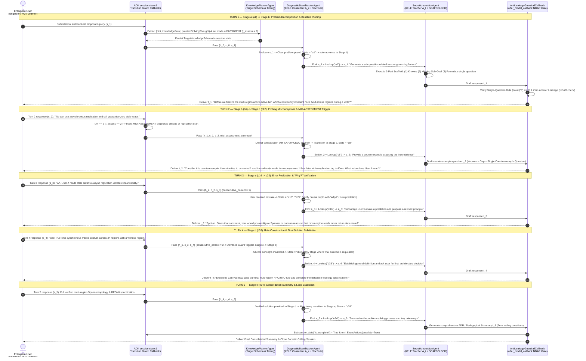

# Agent Grills the User: Structured Socratic Inquiry, KELE Multi-Agent State Tracking & Assessment Timing (`OKF-L400-S2`)

## Version & 6-Month TTL Governance Tab (`2026-10-27 17:27 PDT`)

| Governance Attribute | Authoritative Value |
| :--- | :--- |
| **Version Timestamp (Today's Date & Time)** | **`2026-10-27 17:27 PDT`** (`2026-10-27T17:27:00-07:00`) |
| **Unified Bundle Version Tag (`version_tag`)** | **`GEAPL200_2026-10-27_1726`** |
| **L400 Catalog Version Tag (`l400_version_tag`)** | **`L400_version_20261027_1726`** |
| **Socratic Pack Release Tag** | **`SOCRATIC_OKF_20261027_1726`** |
| **Time-To-Live (`ttl`)** | **`6 months (180 days / P6M)`** |
| **Expiration Timestamp (`stale_after`)** | **`2027-04-27T17:27:00-07:00`** |


## Version & 6-Month TTL Governance Tab (`2026-10-27 17:27 PDT`)

| Governance Attribute | Authoritative Value |
| :--- | :--- |
| **Version Timestamp (Today's Date & Time)** | **`2026-10-27 17:27 PDT`** (`2026-10-27T17:27:00-07:00`) |
| **Unified Bundle Version Tag (`version_tag`)** | **`GEAPL200_2026-10-27_1726`** |
| **L400 Catalog Version Tag (`l400_version_tag`)** | **`L400_version_20261027_1726`** |
| **Socratic Pack Release Tag** | **`SOCRATIC_OKF_20261027_1726`** |
| **Time-To-Live (`ttl`)** | **`6 months (180 days / P6M)`** |
| **Expiration Timestamp (`stale_after`)** | **`2027-04-27T17:27:00-07:00`** |


## Version & 6-Month TTL Governance Tab (`2026-10-27 17:27 PDT`)

| Governance Attribute | Authoritative Value |
| :--- | :--- |
| **Version Timestamp (Today's Date & Time)** | **`2026-10-27 17:27 PDT`** (`2026-10-27T17:27:00-07:00`) |
| **Unified Bundle Version Tag (`version_tag`)** | **`GEAPL200_2026-10-27_1726`** |
| **L400 Catalog Version Tag (`l400_version_tag`)** | **`L400_version_20261027_1726`** |
| **Socratic Pack Release Tag** | **`SOCRATIC_OKF_20261027_1726`** |
| **Time-To-Live (`ttl`)** | **`6 months (180 days / P6M)`** |
| **Expiration Timestamp (`stale_after`)** | **`2027-04-27T17:27:00-07:00`** |


## 1. Executive Summary & The Case 1 ("Agent-Grills-User") Paradigm

In standard enterprise deployments, Large Language Models (LLMs) operate in a **reactive answer-delivery mode**: a user submits an underspecified prompt—such as a vague Product Requirements Document (PRD), an incomplete cloud architecture diagram, an ambiguous production outage alert, or a training query—and the model immediately fabricates missing assumptions to deliver a monolithic answer. Across high-stakes enterprise domains, this reactive posture fails for four structural reasons quantified in **KELE (*Knowledge-Enlightened Learning Enhanced by LLMs*, Peng et al., EMNLP Findings 2025)** and **Socratic Students (Ambati et al., 2025)**:

1. **Premature Answer Leakage (Failure of Heuristic Restraint):** Standard instruction-tuned LLMs are heavily aligned via RLHF to be immediately accommodating. When tasked with Socratic elicitation or tutoring via single-agent prompting, models prematurely leak solutions, hallucinate unstated user requirements, or give away answers before cognitive scaffolding occurs—a failure mode measured via the **No Direct Answer Rate (`NDAR`)** metric (where unstructured Socratic baselines like `SocraticLM-7B` collapse to **30.26% NDAR**, leaking answers in nearly 70% of dialogues).
2. **Unstructured Questioning & Behavioral Randomness:** Single-LLM agents mimic superficial Socratic phrasing (*"What do you think about X?"*) without a macro-level state machine, resulting in abrupt topic shifts, circular questioning loops, or interrogation walls (dumping 5–10 questions in a single turn).
3. **Loss of Epistemic State & Stagnation Loops:** A single LLM simultaneously tracking dialogue history, diagnosing user misconceptions, enforcing turn budgets, and generating surface responses loses track of the user's epistemic state after 3–4 turns, either stalling indefinitely in the same misconception or terminating before rule consolidation.
4. **Domain-Misaligned Diagnostic Timing:** As proven by Ambati et al. (*Socratic Students*), questioning without diagnostic assessment—or triggering diagnostic critiques at the wrong conversational turn—wastes early turns on trivial lexical clarifications rather than resolving core sub-goal bottlenecks.

This module formalizes **Case 1: Agent Grills the User** across four canonical enterprise scenarios:
* **Scenario 1 — Requirements Elicitation & PRD Grilling:** Systematically probing product managers and stakeholders to surface unstated SLAs, edge-case failure modes, compliance boundaries, and acceptance criteria before writing code.
* **Scenario 2 — Architectural Design Review Grilling (Well-Architected Red-Teaming):** Cross-examining principal engineers on single points of failure (SPOFs), regional failover invariants, and cost/latency trade-offs.
* **Scenario 3 — Clinical & Production Incident Diagnostic Intake (SRE 5-Whys Grilling):** Guiding on-call engineers or clinicians through structured hypothesis formation, telemetry verification, and distractor elimination without jumping to unverified root-cause guesses.
* **Scenario 4 — Structured Socratic Teaching & Certification:** Guiding enterprise learners to construct governing domain principles (`knowledgePoint`) through heuristic questioning rather than passive answer consumption.

---

## 2. The KELE Multi-Agent Framework & `SocRule` Finite State Machine

To achieve controllable, non-leaking Socratic inquiry, **KELE** decouples **pedagogical/epistemic state tracking and planning** from **surface natural-language questioning**.

### 2.1 Mathematical Formulation of Multi-Agent Socratic Coordination

At dialogue turn $n$, let the historical user–agent interaction trace be $h_{n-1} = \{(s_1, t_1), \dots, (s_{n-1}, t_{n-1})\}$ (where $s_i$ is the user/student utterance and $t_i$ is the agent/teacher utterance) and let the historical consultant state trace be $c_{n-1} = \{(e_1, n_1, a_1), \dots, (e_{n-1}, n_{n-1}, a_{n-1})\}$. KELE decomposes turn $n$ into three sequential operations:

1. **Diagnostic State Estimation (`ConsultantAgent` $A_c$):**
   $$(e_n, n_n) = A_c\big(h_{n-1},\; c_{n-1},\; s_n \;\big|\; \mathcal{R}_{\text{SocRule}},\; N_{\text{stage\_max}},\; N_{\text{total\_max}}\big)$$
   where $e_n$ is the explicit natural-language diagnostic evaluation of the user's cognitive state and $n_n \in \{a_0, a_1, b_2..b_7, c_8..c_{29}, d_{30}..d_{33}, e_{34}\}$ is the discrete state identifier.
2. **Deterministic Policy Lookup (`SocRule` Matcher):**
   $$a_n = \text{Lookup}_{\text{SocRule}}(n_n)$$
   which maps state $n_n$ deterministically to its exact Socratic questioning strategy $a_n$.
3. **Constrained Surface Generation (`Teacher/InquisitorAgent` $A_t$):**
   Defining the turn-level task requirement tuple as $p_i = \{s_i, e_i, a_i\}$ and string concatenation as $\oplus$, the Inquisitor LLM parameters $\varphi$ maximize the conditional autoregressive probability over the multi-turn questioning sequence $q = \{t_1, t_2, \dots, t_n\}$ (Eq. 1 in Peng et al., 2025):
   $$P_{\text{LLMs}}(q \mid p; \varphi) = \prod_{i=1}^{n} P_{\text{LLMs}}\big(t_i \;\big|\; h_{i-1} \oplus p_i;\; \varphi\big)$$

---

### 2.2 Target Knowledge Decomposition Schema (`KnowledgePlannerAgent`)

Before initiating a Socratic grilling loop, KELE extracts and structures the target problem space into a four-part **Target Knowledge Schema** (curated across 6,803 multi-turn dialogues and 42,892 turns in `SocratDataset`):
1. **Anchor Problem & Candidate Options (`question`, `options`, `answer`):** The initial problem, architectural RFC, or incident symptom presented by the user, along with candidate design paths.
2. **Directional Heuristic Hint (`hint`):** A high-level directional cue pointing toward the governing system invariant without revealing the answer (e.g., *"Think about which factors govern quorum consistency during a split-brain network partition"*).
3. **Core Governing Invariant (`knowledgePoint`):** The explicit domain law, architectural principle, or requirement specification the user must articulate by Stage `d`.
4. **Causal Derivation & Distractor Elimination (`problemSolvingThought`):** The step-by-step causal reasoning chain linking the `knowledgePoint` to the valid solution while falsifying invalid distractors.

---

### 2.3 Monotonic 5-Stage Progression (`a -> b -> c -> d -> e`) & Anti-Stagnation Guards

KELE enforces a **strictly monotonic 5-stage finite-state progression** (`Stage a` $\to$ `Stage b` $\to$ `Stage c` $\to$ `Stage d` $\to$ `Stage e`). Skipping stages (e.g., jumping from `a` to `d`) or regressing backward (e.g., retreating from `c` to `b`) is strictly forbidden:

* **Stage `a` — Problem Posing & Clarification Gate (`a0`–`a1`, 1 turn max):** Verifies that the user has stated a concrete, specific problem or requirement (`a0` if vague/missing; transitions to `a1` and immediately into Stage `b` once clarified).
* **Stage `b` — Baseline Concept Probing (`b2`–`b7`, 1–2 turns recommended):** Diagnoses the user's baseline grasp of prerequisite concepts, constraints, and boundary conditions (`b4`: major conceptual error with available sub-questions; `b5`: verify true understanding; `b6`/`b7`: review previously learned concepts or compare errors).
* **Stage `c` — Inductive Reasoning & Counterexample Grilling (`c8`–`c29`, core multi-turn engine):** Guides the user to recognize contradictions, confront edge-case counterexamples (`c8`, `c12`, `c13`), isolate irrelevant factors (`c11`), answer `"Why?"` on correct assertions (`c22`), and form/test causal hypotheses (`c23`–`c29`).
* **Stage `d` — Rule Construction & Solution Application (`d30`–`d33`, 1–2 turns recommended):** Assists the user in synthesizing the general rule/invariant (`d33`) and **explicitly gates final answer/decision solicitation**. *Answer Protocol Rule:* Solutions or final sign-offs may **only** be requested in Stage `d`.
* **Stage `e` — Consolidation & Summary (`e34`, terminal turn):** Triggered immediately once the user provides the verified solution in Stage `d`. The agent synthesizes the complete problem-solving trajectory and closes the loop.

#### Mandatory Stage Advancement & Anti-Loop Guards
To prevent the infinite questioning loops common in naive Socratic chatbots, the state tracker enforces four deterministic transition guards at every turn:
1. **Two-Consecutive-Correct Breakthrough Guard:** If `consecutive_correct_count >= 2`, immediately advance to the next stage.
2. **State Persistence Anti-Stall Guard:** If the user remains in the exact same state code $n_n = n_{n-1} = n_{n-2}$ (`same_state_turns > 2`), force transition to a new state or advance to the next stage.
3. **Per-Stage Turn Budget Guard:** If `stage_turns > N_stage_max` in Stage `b`, `c`, or `d` without a breakthrough, force transition to the next stage (using `d31` in Stage `d` to directly scaffold the rule if dialectical inquiry was exhausted).
4. **Total Session Turn Cap:** Enforce `total_turns <= N_total_max` (typically 6–12 turns; average 6.3 turns in `SocratDataset`).

---

### 2.4 Complete 43-Strategy Pedagogical & Enterprise Grilling Taxonomy (`SocRule` 35 Core States + 8 Extended Assessment/Scaffolding Operators)

While KELE's core `SocRule` table defines **35 discrete state codes (`a0`–`e34`) mapping to 34 executable teaching strategies**, enterprise deployments combine these 35 `SocRule` states with **8 domain-adaptive Assessment & Epistemic Scaffolding strategies** from *Socratic Students* (Ambati et al., 2025) and Chang (2023), yielding a unified **43-Strategy Socratic Grilling Registry**:

| Stage / Phase | Strategy ID | Triggering User Cognitive / Behavioral State | Prescribed Agent Grilling Action ($a_n$) | `SocratDataset` Turn Count / Source |
| :--- | :--- | :--- | :--- | :--- |
| **Stage 0: Pre-Loop Assessment & Scaffolding**<br>*(Socratic Students & Chang)* | `s0_intent` | Cold start on sensitive, adversarial, or creative architecture exploration. | **Pre-Dialogue Intent Warm-Up:** Frame session as a safe red-team/design-review sparring loop to prevent defensive refusal. | Chang (2023) Table V |
| | `s1_pre_assess` | Stepwise/Analytical domain (`Math`, `Financial Modeling`, `Capacity Sizing`) at Turn $t=0$. | **Trigger `PRE-ASSESSMENT` ($t_{\text{assess}}=0$):** Have user submit initial setup/derivation $\hat{y}_0$; run verifier; critique setup error without leaking answer. | Ambati et al. (2025) RQ2 |
| | `s2_mid_assess` | Divergent/Synthesis domain (`Coding`, `System Architecture`, `PRD Design`) at Turn $t=2$. | **Trigger `MID-ASSESSMENT` ($t_{\text{assess}}=2$):** Allow 2 turns of sub-goal exploration first, then critique concrete draft $\hat{y}_2$ without providing code/patches. | Ambati et al. (2025) RQ2 |
| | `s3_scaffold_known` | Agent preparing to formulate a high-utility diagnostic question (Part 1 of 3). | **Epistemic Audit (Knowns):** Explicitly summarize established invariants, constraints, and verified parameters in the dialogue so far. | Ambati et al. (`SCAFFOLDED`) |
| | `s4_scaffold_gap` | Agent preparing to formulate a high-utility diagnostic question (Part 2 of 3). | **Epistemic Audit (Missing Sub-Goals):** Isolate the exact unresolved bottleneck or unverified assumption blocking solution synthesis. | Ambati et al. (`SCAFFOLDED`) |
| | `s5_scaffold_ask` | Agent executing surface question generation (Part 3 of 3). | **Targeted Single-Question Emission:** Emit exactly ONE concise question targeting the highest marginal $\text{Pass}@k$ gain. | Ambati et al. (`SELF-ODQS`) |
| | `s6_elenchus_slot` | User prompt contains polysemous terms or missing mandatory schema slots. | **Method of Definition Slot Grill:** Halt execution and ask one targeted slot-disambiguation question before entering Stage `b`. | Chang (2023) Sec IV-B |
| | `s7_counterfactual` | User has completed Stage `d`/`e` but needs out-of-distribution stress-testing. | **Counterfactual Gadfly (`p8` / `@`):** Ask *"What if [core constraint X] were inverted or traffic scaled $100\times$ in [New Context Z]?"* | Chang (2023) Step #8 |
| **Stage a: Problem Posing**<br>*(KELE `SocRule`)* | `a0` | User has not yet posed a clear, specific problem or target objective. | Remain in `a0`; prompt user to clarify their problem statement and scope. | Entry Guard |
| | `a1` | User poses a clear and specific problem / architectural objective. | Decompose problem and generate an initial sub-question related to core governing concepts (auto-transitions to Stage `b`). | 6,803 |
| **Stage b: Concept Probing**<br>*(KELE `SocRule`)* | `b2` | No specialized strategy applies, and baseline problem investigation is incomplete. | Generate probing questions from unexplored perspectives or architectural angles. | 1,578 |
| | `b3` | No specialized strategy applies, and current angle has already been explored. | Rephrase or modify the probing question to lower cognitive friction. | 80 |
| | `b4` | User holds a major conceptual error / flawed assumption and sub-questions exist. | Generate decomposed sub-questions from multiple angles targeting the misconception. | 1,520 |
| | `b5` | Need to verify whether user genuinely understands the prerequisite concept/SLA. | Pose a targeted verification question to check true conceptual mastery. | 2,607 |
| | `b6` | User's initial exercise, calculation, or baseline response is incorrect. | Guide user to review previously established foundational concepts/constraints. | 1,580 |
| | `b7` | User makes an error in a concept that was already reviewed and agreed upon. | Review those concepts and explicitly contrast them against the user's current error. | 56 |
| **Stage c: Inductive Reasoning**<br>*(KELE `SocRule` Core Grilling)* | `c8` | User's prediction or design claim is incomplete or internally inconsistent. | **Provide a concrete counterexample** that exposes the inconsistency. | 49 |
| | `c9` | User's response/analysis is incorrect. | Help user form a partial/provisional rule for further exploration, or pose a Socratic misleading (elenchus) question. | 3,049 |
| | `c10` | User's response directly contradicts previously established concepts/SLAs. | Point out the contradiction and ask the user to explain the reason behind the inconsistency. | 36 |
| | `c11` | User introduces irrelevant factors, out-of-scope features, or red-herring metrics. | Explicitly isolate the irrelevant factor and ask the user to justify or discard it. | 25 |
| | `c12` | User provides an incomplete causal explanation. | Scaffold formation of a partial rule for exploration, ask a misleading test question, or offer a counterexample. | 3,634 |
| | `c13` | Agent's misleading (elenchus) test question successfully exposes user uncertainty. | Follow up immediately with a concrete counterexample to anchor the correction. | 23 |
| | `c14` | A new operational context, edge case, or failure scenario arises. | Encourage the user to make predictions and propose governing principles for the new context. | 58 |
| | `c15` | Practicing or applying concepts already familiar to the user. | Prompt the user to predict system behavior and state the governing principle. | 1,152 |
| | `c16` | User recognizes and realizes their own mistake during questioning. | Validate the realization and prompt the user to make a fresh prediction and propose a revised principle. | 2,526 |
| | `c17` | User overlooks a critical key point/constraint, and relevant sub-questions exist. | Generate a targeted sub-question directly spotlighting the overlooked key point. | 270 |
| | `c18` | User overlooks a critical key point, and no decomposed sub-question is available. | Directly ask the user to reconsider the overlooked factor. | 43 |
| | `c19` | The exact root cause of the user's misunderstanding or ambiguity is unclear. | Generate diagnostic differential questions to isolate the misconception type. | 39 |
| | `c20` | User makes an incorrect prediction on a test scenario. | Guide user to re-validate the newly learned concept against the scenario parameters. | 302 |
| | `c21` | User is stuck and unable to make a prediction. | Prompt the user to walk through the mechanism step-by-step in detail. | 78 |
| | `c22` | User answers the intermediate question correctly. | **Follow up by asking `"Why?"`** to verify causal reasoning rather than lucky guessing. | 465 |
| | `c23` | User proposes a partial or incomplete causal hypothesis. | Guide the user to refine, complete, and formalize the hypothesis. | 85 |
| | `c24` | User proposes a hypothesis and possesses relevant domain experience. | Ask the user to design a test or verification check for the hypothesis independently. | 31 |
| | `c25` | User proposes a hypothesis but lacks experience on how to verify it. | Provide a concrete verification method (e.g., telemetry query, load test, unit test) for them to apply. | 99 |
| | `c26` | User cannot test the hypothesis despite having relevant domain experience. | Present two contrasting examples/cases and ask the user to compare them. | 19 |
| | `c27` | User cannot test the hypothesis and lacks relevant verification experience. | Provide step-by-step scaffolding to help them execute the hypothesis verification. | 34 |
| | `c28` | User tests the hypothesis incorrectly despite having relevant experience. | Identify the methodological error in their test and ask for alternative concepts. | 18 |
| | `c29` | User tests the hypothesis incorrectly and lacks relevant experience. | Provide the correct governing concept and ask why that factor was not initially considered. | 6,434 |
| **Stage d: Rule Construction**<br>*(KELE `SocRule`)* | `d30` | Agent needs final verification that user truly grasps the synthesized rule. | Present an analogous case and ask the user to predict the outcome or explain `"Why?"`. | 428 |
| | `d31` | After full dialectical inquiry in Stage `c`, user still fails to grasp the concept. | Directly present the correct governing rule (`knowledgePoint`) and ask user to apply it to solve the original problem. | 185 |
| | `d32` | User has thoroughly explored a specific sub-problem branch. | Present a related synthesis case and ask the user to make a final prediction. | 94 |
| | `d33` | All relevant concepts, constraints, and sub-goals have been mastered. | **Establish the general definition/rule and ask the user to state the final solution to the original problem.** | 6,196 |
| **Stage e: Teacher Summary**<br>*(KELE `SocRule`)* | `e34` | User has correctly provided the final answer/design in Stage `d`. | **Summarize the complete problem-solving derivation, consolidate key takeaways, and terminate loop.** | 6,803 |

---

### 2.5 Empirical Superiority of Decoupled Multi-Agent Grilling & Preventing Answer Leakage (`NDAR`)

KELE's benchmark evaluation across 680 held-out multi-turn dialogues (4,245 turn instances) demonstrates why separating the **Consultant State Tracker ($A_c$)** from the **Fine-Tuned Socratic Executor ($A_t$, `SocratTeachLLM-9B`)** is mandatory for production deployments:

| Model / Architecture | ROUGE-L | BLEU-4 | Problem Relevance `PRR` (%) | **No Direct Answer Rate `NDAR` (%)** | Stage Progression `SPR` (%) | Instruction Adherence `IAR` (%) | Guidance (1–5) | Logicality (1–5) | Flexibility (1–5) |
| :--- | :---: | :---: | :---: | :---: | :---: | :---: | :---: | :---: | :---: |
| **SocraticLM-7B** (Unstructured SFT Baseline) | 14.56 | 10.93 | 26.83% | **30.26%** *(69.7% leakage!)* | 36.00% | 27.05% | 2.62 | 2.88 | 2.78 |
| **EduChat-13B** (Style-Oriented SFT Baseline) | 26.07 | 21.11 | 47.62% | 90.73% | 51.00% | 69.02% | 2.93 | 3.42 | 3.18 |
| **GLM4-9B (Base Model)** | 26.82 | 22.00 | 52.46% | 75.95% | 66.00% | 70.00% | 3.83 | 4.01 | 3.89 |
| **Qwen2.5-32B** | 37.22 | 28.85 | 65.57% | 83.13% | 81.00% | 84.68% | 4.12 | 4.44 | 4.21 |
| **GPT-4o** | 38.27 | 29.93 | 72.13% | 81.19% | 85.00% | 87.74% | 4.35 | 4.50 | 4.33 |
| **KELE `SocratTeachLLM-9B` ($A_c + A_t$)** | **50.77** | **41.96** | **75.13%** | **94.71%** | **87.00%** | **89.03%** | **4.66** | **4.53** | **4.45** |

* **Critical Engineering Insight:** Even frontier models like `GPT-4o` leak direct answers in **18.81% of turns (`NDAR = 81.19%`)** when relying solely on prompt instructions, and unstructured Socratic fine-tunes (`SocraticLM-7B`) leak answers in **69.74% of turns (`NDAR = 30.26%`)**. By binding `SocratTeachLLM` to $A_c$'s explicit `SocRule` state code and enforcing deterministic output guardrails, KELE achieves **94.71% `NDAR`** and **87.00% Stage Progression Rate (`SPR`)**.

---

## 3. Socratic Students: Domain-Adaptive Assessment Timing & `SCAFFOLDED` Questioning

While KELE governs the **macro-level 5-stage state machine**, **Socratic Students** (Ambati et al., 2025) solves two complementary micro-level optimization challenges: (1) **when** the grilling agent should request and critique a concrete solution attempt from the user (`PRE-ASSESSMENT` vs. `MID-ASSESSMENT`), and (2) **how** an agent should structure its internal reasoning before emitting a question (`SCAFFOLDED` 3-part inquiry).

### 3.1 Domain-Dependent Assessment Timing (`PRE-ASSESSMENT` at Turn 0 vs. `MID-ASSESSMENT` at Turn 2)

Ambati et al. prove empirically across `GSM8K` (stepwise mathematical reasoning) and `HumanEval`/`OpenCoder` (divergent code & architecture synthesis) that injecting a one-shot diagnostic assessment $a = (\hat{y}_{\text{attempt}}, \text{eval\_summary}, f_{\mathcal{T}})$—where the user/student attempts a draft $\hat{y}_{\text{attempt}}$ and the agent critiques errors **without giving away the answer or writing code patches**—dramatically accelerates reasoning progress, **but only if timed to match the domain's branching topology**:

| Assessment Strategy | Target Domain Topology | Optimal Turn ($t_{\text{assess}}$) | Why This Timing Works (Cognitive & Search Mechanics) | Empirical $\text{Pass}@5$ Gain (`Qwen2.5-7B` & `Mistral-7B`) |
| :--- | :--- | :---: | :--- | :--- |
| **`PRE-ASSESSMENT`** | **Stepwise / Analytical Domains**<br>*(Math, Capacity Planning, Financial Modeling, SQL Query Auditing, Clinical Dosage Calculation)* | **Turn 0 ($t_{\text{assess}} = 0$)**<br>*(Before open questioning begins)* | In stepwise domains, reasoning follows a linear chain of algebraic or logical dependencies. If an initial setup error occurs at Turn 0, every subsequent turn compounds the error. Critiquing the user's initial setup $\hat{y}_0$ at $t=0$ immediately anchors the trajectory. | Jumps Turn 0 $\text{Pass}@5$ from **$0.107 \to 0.322$ ($+21.5\%$)** on `Qwen-7B` and Turn 1 $\text{Pass}@5$ from **$0.295 \to 0.489$ ($+19.4\%$)** on `Mistral-7B`. |
| **`MID-ASSESSMENT`** | **Divergent / Multi-Path Synthesis Domains**<br>*(Software Engineering, Cloud Architecture Design, PRD Elicitation, Incident Triage)* | **Turn 2 ($t_{\text{assess}} = 2$)**<br>*(After 2 turns of Stage `b`/`c` concept & constraint probing)* | Coding and architecture problems admit multiple valid paradigms (e.g., event-driven vs. synchronous RPC; DP vs. greedy). Forcing `PRE-ASSESSMENT` at Turn 0 prematurely locks the user into patching a fundamentally flawed initial draft (**hurting** Turn 0 $\text{Pass}@5$ from $0.168 \to 0.084$ on `Mistral-7B` Coding). Waiting until Turn 2 allows the user to disambiguate requirements first, then receive targeted critique on a mature prototype $\hat{y}_2$. | Boosts Turn 3 Coding $\text{Pass}@5$ from **$0.464 \to 0.679$ ($+21.5\%$)** on `Qwen-7B` (`HumanEval`), whereas `PRE-ASSESSMENT` underperforms at $0.607$. |

---

### 3.2 `SCAFFOLDED` 3-Part Question Generation Protocol

In `UNSCAFFOLDED` questioning, an agent directly emits a question $q_t \sim \pi(\cdot \mid H_{t-1})$, which empirically wastes Turns 1–2 on trivial lexical confirmations (e.g., *"Could you confirm if '3 dozen' means 36?"*). In **`SCAFFOLDED` mode**, the agent is required to execute an explicit **3-part internal epistemic audit** before emitting its surface question:

1. **Part 1 — Summarize Knowns (`known_invariants`):** Explicitly inventory what facts, architectural constraints, SLAs, or verified concepts have already been established in $H_{t-1}$.
2. **Part 2 — Identify Missing Sub-Goals (`missing_subgoals`):** Isolate the exact epistemic blind spot, unverified assumption, or causal bottleneck blocking transition from the current state to the target `knowledgePoint`.
3. **Part 3 — Ask One Targeted High-Utility Question (`surface_question`):** Formulate a single, concise question that directly resolves the highest-priority missing sub-goal without leaking the underlying solution.

When combined with **Outcome-Driven Question Selection (`SELF-ODQS` / `PEER-ODQS`)**—which trains agents via SFT + DPO ($\beta = 0.1$) to prefer questions that maximize downstream $\text{Pass}@k$ and judge progress $\Delta \text{Progress}_t \in [0, 1]$—this scaffold compresses a 5-turn unstructured dialogue into **2 turns (60% turn reduction)**, achieving **$0.958$ $\text{Pass}@5$ at Turn 2** vs. $0.955$ at Turn 5 for unscaffolded inquiry.

---

### 3.3 Diagram 1: Unified KELE + Socratic Students Architecture (Macro State Machine + Micro Assessment Timing)

```mermaid
flowchart TB
    subgraph Prep["Phase 0: Target Knowledge Extraction & Domain Timing Router"]
        UserQuery(["<b>User Initial Input (s_1)</b><br/>Vague PRD / Architecture RFC / Incident Alert / Learner Query"])
        KP["<b>KnowledgePlannerAgent</b><br/>• Decompose Target Knowledge Schema:<br/><code>hint</code>, <code>knowledgePoint</code>, <code>problemSolvingThought</code><br/>• Classify Domain Topology: <code>STEPWISE</code> vs. <code>DIVERGENT</code>"]
        TimingGate{"Domain Assessment<br/>Timing Policy"}
        PreAssess["<b>PRE-ASSESSMENT (t_assess = 0)</b><br/><i>For Stepwise / Analytical Domains</i><br/>• Request initial setup/calculation ŷ_0 at Turn 0<br/>• Critique setup flaw without leaking final answer"]
        MidAssess["<b>MID-ASSESSMENT Armed (t_assess = 2)</b><br/><i>For Divergent / Architecture / Coding Domains</i><br/>• Defer draft critique until Turn 2 after Stage b/c probing"]
        UserQuery --> KP --> TimingGate
        TimingGate -->|"STEPWISE<br/>(Math, Sizing, SQL)"| PreAssess
        TimingGate -->|"DIVERGENT<br/>(Architecture, Code, PRD)"| MidAssess
    end

    subgraph Loop["ADK 2.0 LoopAgent: Monotonic 5-Stage Socratic Grilling Engine (a -> b -> c -> d -> e)"]
        direction TB
        BeforeCB["<b>before_model_callback: Transition & Turn Guard</b><br/>• Enforce monotonic <code>a → b → c → d → e</code> (no skipping/regression)<br/>• Check <code>consecutive_correct >= 2</code> → Advance Stage<br/>• Check <code>same_state_turns > 2</code> or <code>stage_turns > N_max</code> → Force Advance<br/>• If <code>turn == 2</code> and <code>DIVERGENT</code> → Inject <code>MID-ASSESSMENT</code> critique"]

        Tracker["<b>DiagnosticStateTrackerAgent (KELE Consultant A_c)</b><br/>• Evaluates user input s_n against 35 <code>SocRule</code> states<br/>• Emits structured JSON: <code>{evaluation: e_n, state: n_n}</code><br/>• Deterministic Lookup: <code>a_n = SOC_RULE[n_n]</code>"]

        Inquisitor["<b>SocraticInquisitorAgent (KELE Teacher A_t + SCAFFOLDED)</b><br/>Executes 3-Part Internal Epistemic Audit before generating t_n:<br/>1. <b>Summarize Knowns:</b> Inventory verified constraints in h_{n-1}<br/>2. <b>Identify Missing Sub-Goals:</b> Pinpoint bottleneck per action a_n<br/>3. <b>Ask Targeted Question:</b> Emit 1 question (Stages a–d) or Summary (e34)"]

        AfterCB["<b>after_model_callback: AntiLeakageGuardrailCallback</b><br/>• <b>NDAR Enforcement:</b> Block direct answer/code leakage in Stages a–c<br/>• <b>Single-Question Rule:</b> Strip multi-question interrogation walls<br/>• <b>Termination Trigger:</b> Escalate LoopAgent when <code>state == 'e34'</code>"]

        BeforeCB --> Tracker --> Inquisitor --> AfterCB
    end

    PreAssess --> BeforeCB
    MidAssess --> BeforeCB
    AfterCB -->|"Stages a, b, c, d<br/>(Await User Turn s_{n+1})"| BeforeCB
    AfterCB -->|"Stage e (state == 'e34')<br/>Verified Mastery / ADR Sign-Off"| FinalOut(["<b>Consolidated Deliverable</b><br/>Verified PRD / Architecture Decision Record / Post-Mortem / Mastery Summary"])

    classDef prep fill:#e0f2fe,stroke:#0284c7,color:#0c4a6e,stroke-width:2px;
    classDef agent fill:#fef3c7,stroke:#d97706,color:#78350f,stroke-width:2px;
    classDef guard fill:#dcfce7,stroke:#16a34a,color:#14532d,stroke-width:2px;
    classDef term fill:#f3e8ff,stroke:#9333ea,color:#581c87,stroke-width:2px;

    class KP,PreAssess,MidAssess prep;
    class Tracker,Inquisitor agent;
    class BeforeCB,AfterCB guard;
    class UserQuery,FinalOut term;
```



---

## 4. Enterprise Case 1 Scenarios Mapped Across KELE Stages `a -> b -> c -> d -> e`

To apply KELE's `SocRule` beyond academic tutoring into enterprise FDE engagements, the table below maps each monotonic stage and assessment hook across four production "Agent-Grills-User" workloads:

| Stage / Mechanism | 1. Product Requirements Elicitation (PRD Grilling) | 2. Cloud Architecture Design Review (Well-Architected Grilling) | 3. Incident Root-Cause Diagnostic Intake (SRE 5-Whys) | 4. Enterprise Technical Tutoring & Certification |
| :--- | :--- | :--- | :--- | :--- |
| **Assessment Timing Policy** | **`MID-ASSESSMENT` ($t_{\text{assess}}=2$):** Probe personas and SLAs for 2 turns before critiquing draft user stories. | **`MID-ASSESSMENT` ($t_{\text{assess}}=2$):** Probe workload invariants for 2 turns before critiquing draft topology diagram. | **`PRE-ASSESSMENT` ($t_{\text{assess}}=0$):** Immediately audit responder's initial mitigation hypothesis against telemetry at Turn 0. | **Adaptive:** `PRE-ASSESSMENT` ($t=0$) for quantitative/SQL sizing; `MID-ASSESSMENT` ($t=2$) for coding/architecture labs. |
| **Stage `a`: Problem Posing (`a0–a1`)** | Verify PM has stated a concrete product problem and target user outcome (`a1`); if vague (`"Build an AI agent"`), hold in `a0`. | Verify architect has specified workload type, QPS, and target availability SLA (`a1`). | Verify on-call engineer has stated the exact firing alert, symptom window, and blast radius (`a1`). | Verify learner has selected or posed a specific technical scenario question (`a1`). |
| **Stage `b`: Concept Probing (`b2–b7`)** | Probe baseline constraints: data residency, latency budgets, human-in-the-loop gates (`b5`), flagging contradictory KPIs (`b4`). | Probe foundational topology choices: statefulness, VPC boundaries, database consistency model (`b2–b7`). | Probe recent deployments, config changes, and upstream dependency health (`b5–b7`). | Probe prerequisite cloud/AI concepts (`b5`); review prior modules if foundational errors appear (`b6–b7`). |
| **Stage `c`: Inductive Reasoning (`c8–c29`)** | **Core Grilling:** Present edge-case counterexamples (`c8`, `c13`), strip out-of-scope feature creep (`c11`), surface overlooked abuse/failure modes (`c17`). | **Core Grilling:** Inject regional outage or $10\times$ traffic spike (`c14`), expose SPOFs with counterexamples (`c8`), ask `"Why?"` on database choices (`c22`). | **Core Grilling:** Guide responder to form causal hypotheses (`c23`), provide log/trace verification queries (`c25`), falsify wrong root causes with counter-metrics (`c8`, `c28`). | **Core Grilling:** Confront misconceptions via counterexamples (`c8–c13`), ask `"Why?"` on correct answers (`c22`), scaffold hypothesis testing (`c23–c29`). |
| **Stage `d`: Rule Construction (`d30–d33`)** | Require PM to synthesize the final non-functional requirements and acceptance criteria (`d33`). | Require architect to articulate the governing resilience invariant and final failover design (`d33`). | Require responder to state the verified root-cause mechanism and exact rollback/mitigation command (`d33`). | Require learner to formulate the governing `knowledgePoint` principle and solve the original problem (`d33`). |
| **Stage `e`: Summary (`e34`)** | Emit structured PRD & Acceptance Criteria specification (`e34`). | Emit formal Architecture Decision Record (ADR) & review sign-off (`e34`). | Emit structured Post-Mortem / RCA timeline and remediation backlog (`e34`). | Emit comprehensive pedagogical summary and update mastery graph (`e34`). |

---

### 4.1 Diagram 2: Multi-Turn State-Tracked Grilling Sequence (`SocRule` + `MID-ASSESSMENT` Trace)



---

## 5. Production Google Cloud ADK 2.0 Implementation Patterns

### 5.1 Complete `session.state` Schema Specification

Every ADK 2.0 Case 1 Socratic Grilling deployment must maintain the following typed keys inside `session.state` to guarantee deterministic stage progression, assessment timing, and anti-leakage auditing:

```json
{
  "socratic_session": {
    "domain_topology": "DIVERGENT",
    "assessment_turn_target": 2,
    "assessment_completed": true,
    "last_assessment_feedback": "Draft uses async replication which violates zero-stale-read requirement under 40ms inter-region RTT.",
    "current_stage": "c",
    "current_state_code": "c16",
    "recommended_action": "Encourage the user to make predictions and propose new principles.",
    "total_turns": 3,
    "max_total_turns": 10,
    "stage_turns": 2,
    "max_stage_turns": 4,
    "same_state_turns": 1,
    "consecutive_correct_count": 1,
    "ndar_violation_retries": 0,
    "is_complete": false,
    "target_knowledge_schema": {
      "anchor_problem": "Design a multi-region financial ledger with RPO=0 and linearizable reads.",
      "hint": "Consider the trade-off between replication latency and read linearizability across WAN boundaries.",
      "knowledge_point": "Linearizable cross-region reads with RPO=0 require synchronous consensus (e.g., Paxos/Raft with TrueTime) rather than asynchronous replication.",
      "problem_solving_thought": "Async replication risks data loss on primary failure (RPO > 0) and stale reads; synchronous quorum across 3 zones/regions guarantees RPO=0 and external consistency."
    },
    "consultant_history": [
      {"turn": 1, "stage": "a", "state": "a1", "evaluation": "User posed clear architectural goal.", "action": "Generate a sub-question related to problem-solving."},
      {"turn": 2, "stage": "c", "state": "c8", "evaluation": "User proposed async replication contradicting zero stale reads.", "action": "Provide a counterexample."}
    ]
  }
}
```

---

### 5.2 Complete ADK 2.0 Multi-Agent Code Blueprint (`KnowledgePlannerAgent`, `DiagnosticStateTrackerAgent`, `SocraticInquisitorAgent`, `AntiLeakageGuardrailCallback`)

```python
import re
from typing import Literal, Optional, List
from pydantic import BaseModel, Field
from google.adk.agents import LlmAgent, SequentialAgent, LoopAgent
from google.adk.agents.callback_context import CallbackContext
from google.adk.models import LlmRequest, LlmResponse
from google.adk.events import Event, EventActions
from google.genai import types

# ============================================================================
# 1. Deterministic SocRule Strategy Lookup Table (35 Core States + Extensions)
# ============================================================================

SOC_RULE_ACTIONS: dict[str, str] = {
    "a0": "Remain in a0; prompt the user to clarify their problem statement and concrete objective.",
    "a1": "Generate a sub-question related to core governing concepts of the problem (transitions to Stage b).",
    "b2": "Generate probing questions from unexplored perspectives or architectural angles.",
    "b3": "Rephrase or modify the probing question to make it clearer.",
    "b4": "User holds a major conceptual error; generate decomposed sub-questions from different angles.",
    "b5": "Pose a targeted question that effectively verifies true conceptual understanding.",
    "b6": "User's response is incorrect; guide user to review foundational prerequisite concepts.",
    "b7": "User erred on a previously reviewed concept; compare those concepts directly with the current error.",
    "c8": "User's prediction/claim is inconsistent; provide a concrete counterexample.",
    "c9": "User's response is incorrect; help form a partial rule for exploration or pose a misleading test question.",
    "c10": "User contradicts previously established constraints; ask for the reason behind the inconsistency.",
    "c11": "Irrelevant factors introduced; point out the irrelevant factor and ask for clarification.",
    "c12": "Incomplete explanation; scaffold a partial rule, ask a misleading test question, or offer a counterexample.",
    "c13": "Misleading test question exposed uncertainty; follow up immediately with a concrete counterexample.",
    "c14": "New context/failure scenario arises; encourage user to make predictions and propose principles.",
    "c15": "Practicing familiar concepts; encourage user to make predictions and state governing principles.",
    "c16": "User realized their own mistake; validate and prompt them to make a new prediction and principle.",
    "c17": "User overlooked a key constraint; generate a targeted sub-question based on that key point.",
    "c18": "User overlooked a key constraint (no sub-question available); ask user to reconsider that point.",
    "c19": "Misunderstanding type is unclear; generate diagnostic differential questions to isolate it.",
    "c20": "User made an incorrect prediction; guide them to validate the newly learned concept.",
    "c21": "User is unable to make a prediction; prompt them to walk through the problem step-by-step.",
    "c22": "User answered correctly; follow up by asking 'Why?' to verify causal understanding.",
    "c23": "User formed a partial hypothesis; help them refine and complete the hypothesis.",
    "c24": "User proposed a hypothesis and has experience; ask them to test the hypothesis independently.",
    "c25": "User proposed a hypothesis but lacks verification experience; provide a concrete verification method.",
    "c26": "User cannot test hypothesis despite experience; present two contrasting examples to compare.",
    "c27": "User cannot test hypothesis and lacks experience; provide step-by-step verification guidance.",
    "c28": "User tested hypothesis incorrectly despite experience; identify error and ask for alternative concepts.",
    "c29": "User tested hypothesis incorrectly and lacks experience; provide correct concept and ask why it was missed.",
    "d30": "Present an analogous case and ask the user to make a prediction or explain 'Why?'.",
    "d31": "Dialectical inquiry exhausted without breakthrough; present correct rule and ask user to solve problem.",
    "d32": "Sub-problem explored; present a related synthesis case and ask user to make a prediction.",
    "d33": "All relevant concepts mastered; establish general definition/rule and ask user for final solution.",
    "e34": "User provided the verified final answer in Stage d; summarize the problem-solving process and key takeaways.",
}

STAGE_ORDER = {"a": 0, "b": 1, "c": 2, "d": 3, "e": 4}

# ============================================================================
# 2. Pydantic Data Schemas for Multi-Agent Contracts
# ============================================================================

class TargetKnowledgeSchema(BaseModel):
    domain_topology: Literal["STEPWISE", "DIVERGENT"] = Field(
        description="STEPWISE for math/analytical/sizing (t_assess=0); DIVERGENT for architecture/code/PRD (t_assess=2)"
    )
    anchor_problem: str = Field(description="Canonical problem statement or architectural objective")
    hint: str = Field(description="Directional heuristic cue without revealing the solution")
    knowledge_point: str = Field(description="Core governing domain law or invariant user must construct by Stage d")
    problem_solving_thought: str = Field(description="Causal derivation and distractor elimination logic")
    forbidden_answer_tokens: List[str] = Field(
        description="Exact final answer strings or code snippets that MUST NOT be leaked during Stages a-c"
    )

class DiagnosticStateOutput(BaseModel):
    evaluation: str = Field(
        description="Detailed diagnostic evaluation of current stage, user cognitive state, and transition rationale"
    )
    state: str = Field(
        description="Exact SocRule state code in {a0, a1, b2..b7, c8..c29, d30..d33, e34}"
    )
    user_response_correct: bool = Field(
        description="True if user's latest turn demonstrated accurate reasoning on the sub-goal"
    )

class ScaffoldedInquisitorOutput(BaseModel):
    known_invariants_summary: str = Field(
        description="Part 1 (SCAFFOLDED): Summary of what facts/constraints the user has already established"
    )
    missing_subgoal_analysis: str = Field(
        description="Part 2 (SCAFFOLDED): Exact epistemic gap or misconception targeted in this turn"
    )
    surface_response: str = Field(
        description="Part 3 (SCAFFOLDED): Single concise Socratic question (Stages a-d) or final consolidation summary (e34)"
    )

# ============================================================================
# 3. Callbacks: Monotonic Stage Enforcement & Anti-Leakage Guardrail (NDAR)
# ============================================================================

def enforce_monotonic_state_and_assessment_before_tracker(
    callback_context: CallbackContext,
    llm_request: LlmRequest,
) -> Optional[LlmResponse]:
    """
    before_model_callback on DiagnosticStateTrackerAgent:
    Enforces KELE monotonic stage progression (a->b->c->d->e), turn budgets,
    and Socratic Students domain-adaptive assessment timing (t_assess=0 vs t_assess=2).
    """
    st = callback_context.state
    total_turns = st.get("total_turns", 0) + 1
    st["total_turns"] = total_turns

    prev_stage = st.get("current_stage", "a")
    stage_turns = st.get("stage_turns", 0)
    same_state_turns = st.get("same_state_turns", 0)
    consec_correct = st.get("consecutive_correct_count", 0)
    max_stage_turns = st.get("max_stage_turns", 4)

    # Determine assessment trigger per Socratic Students (Ambati et al., 2025)
    kn = st.get("target_knowledge_schema", {})
    topology = kn.get("domain_topology", "DIVERGENT")
    t_assess = 0 if topology == "STEPWISE" else 2
    assessment_directive = ""
    if total_turns - 1 == t_assess and not st.get("assessment_completed", False):
        st["assessment_completed"] = True
        assessment_directive = (
            f"\n[ASSESSMENT TRIGGER ACTIVE (t_assess={t_assess}, topology={topology})]: "
            "Critique the structural flaw in the user's current attempt without revealing the answer."
        )

    # Build deterministic transition guard directive for Consultant Agent A_c
    forced_advance = False
    reasons = []
    if consec_correct >= 2 and prev_stage in ("b", "c"):
        forced_advance = True
        reasons.append("2 consecutive correct responses achieved")
    if same_state_turns > 2:
        forced_advance = True
        reasons.append("same state persisted > 2 turns (anti-stagnation rule)")
    if stage_turns >= max_stage_turns and prev_stage in ("b", "c", "d"):
        forced_advance = True
        reasons.append(f"stage '{prev_stage}' turn budget ({max_stage_turns}) exhausted")

    guard_banner = (
        f"\n[SYSTEM STATE TRACKER TELEMETRY]: Current Stage='{prev_stage}', "
        f"Stage Turns={stage_turns}, Same-State Persistence={same_state_turns}, "
        f"Consecutive Correct={consec_correct}, Total Turns={total_turns}.\n"
        f"STRICT MONOTONIC RULE: Stage must be >= '{prev_stage}' in order a -> b -> c -> d -> e. "
        f"Force Advance Required={forced_advance} ({', '.join(reasons) if reasons else 'none'})."
        f"{assessment_directive}"
    )
    if llm_request.config and llm_request.config.system_instruction:
        llm_request.config.system_instruction += guard_banner
    return None


def bind_socrule_action_after_tracker(
    callback_context: CallbackContext,
    llm_response: LlmResponse,
) -> Optional[LlmResponse]:
    """
    after_model_callback on DiagnosticStateTrackerAgent:
    Validates monotonic stage progression, updates counters, and performs deterministic
    SocRule lookup: a_n = SOC_RULE_ACTIONS[n_n].
    """
    import json
    st = callback_context.state
    prev_stage = st.get("current_stage", "a")
    prev_state = st.get("current_state_code", "a0")

    try:
        raw_text = llm_response.content.parts[0].text
        parsed = json.loads(raw_text)
        n_n = parsed.get("state", "b2").strip()
        is_correct = bool(parsed.get("user_response_correct", False))
    except Exception:
        n_n, is_correct = "b2", False

    if n_n not in SOC_RULE_ACTIONS:
        n_n = "b2"

    new_stage = n_n[0]
    # Enforce strict monotonicity: forbid regression (e.g., c -> b)
    if STAGE_ORDER.get(new_stage, 1) < STAGE_ORDER.get(prev_stage, 0):
        new_stage = prev_stage
        fallback_map = {"a": "a1", "b": "b5", "c": "c12", "d": "d33", "e": "e34"}
        n_n = fallback_map[new_stage]

    # Auto-transition a1 -> Stage b on subsequent tracking
    st["same_state_turns"] = st.get("same_state_turns", 0) + 1 if n_n == prev_state else 1
    st["stage_turns"] = st.get("stage_turns", 0) + 1 if new_stage == prev_stage else 1
    st["consecutive_correct_count"] = st.get("consecutive_correct_count", 0) + 1 if is_correct else 0
    st["current_stage"] = "b" if n_n == "a1" else new_stage
    st["current_state_code"] = n_n
    st["recommended_action"] = SOC_RULE_ACTIONS[n_n]
    return None


def anti_leakage_guardrail_callback(
    callback_context: CallbackContext,
    llm_response: LlmResponse,
) -> Optional[LlmResponse]:
    """
    AntiLeakageGuardrailCallback (after_model_callback on SocraticInquisitorAgent):
    Enforces:
    1. No Direct Answer Rate (NDAR): Blocks leakage of forbidden_answer_tokens or direct code blocks in Stages a, b, c.
    2. Single-Question Rule: Strips multi-question interrogation walls so only ONE question is asked per turn.
    3. Stage e34 Termination: Sets is_complete=True when state == 'e34'.
    """
    import json
    st = callback_context.state
    state_code = st.get("current_state_code", "b2")
    stage = state_code[0]
    kn = st.get("target_knowledge_schema", {})
    forbidden_tokens = [t.lower() for t in kn.get("forbidden_answer_tokens", []) if len(t) > 3]

    try:
        raw_text = llm_response.content.parts[0].text
        parsed = json.loads(raw_text)
        surface = parsed.get("surface_response", "")
    except Exception:
        surface = llm_response.content.parts[0].text if llm_response.content.parts else ""
        parsed = {"known_invariants_summary": "", "missing_subgoal_analysis": "", "surface_response": surface}

    # Guard 1: Stage e34 Consolidation Summary (Must NOT ask trailing questions)
    if state_code == "e34":
        st["is_complete"] = True
        return None

    # Guard 2: NDAR Answer & Code Block Leakage Prevention in Stages a, b, c
    leaked = False
    surface_lower = surface.lower()
    if stage in ("a", "b", "c"):
        if "```" in surface:  # Block direct code patch leakage per Socratic Students Prompt 16/18
            leaked = True
        for token in forbidden_tokens:
            if token in surface_lower:
                leaked = True
                break

    if leaked:
        st["ndar_violation_retries"] = st.get("ndar_violation_retries", 0) + 1
        safe_question = (
            f"Let's step back and examine the governing principle ({kn.get('hint', 'core system constraint')}). "
            f"Based on what we established so far, what factor do you think governs this behavior?"
        )
        parsed["surface_response"] = safe_question

    # Guard 3: Single-Question Rule (Strip interrogation walls if >1 question mark appears)
    sentences = re.split(r'(?<=[.?!])\s+', parsed["surface_response"].strip())
    questions = [s for s in sentences if s.endswith("?")]
    statements = [s for s in sentences if not s.endswith("?")]
    if len(questions) > 1:
        # Preserve affirming context statements + ONLY the final targeted question
        parsed["surface_response"] = (" ".join(statements[:2] + [questions[-1]])).strip()

    sanitized_json = json.dumps(parsed)
    return LlmResponse(
        content=types.Content(role="model", parts=[types.Part(text=sanitized_json)])
    )

# ============================================================================
# 4. Agent Definitions: KnowledgePlanner, DiagnosticStateTracker, SocraticInquisitor
# ============================================================================

knowledge_planner_agent = LlmAgent(
    name="KnowledgePlannerAgent",
    model="gemini-2.5-pro",
    instruction="""You are the Socratic Knowledge Planner & Assessment Timing Architect.
Given the user's initial problem, requirement request, or architectural proposal:
1. Extract the 4-part KELE Target Knowledge Schema:
   - `anchor_problem`: The concrete problem or decision under inquiry.
   - `hint`: A directional heuristic cue pointing toward the governing concept WITHOUT giving the answer.
   - `knowledge_point`: The exact domain law, architectural invariant, or acceptance criterion the user must construct by Stage d.
   - `problem_solving_thought`: The causal derivation and distractor elimination logic.
2. Classify `domain_topology`:
   - `STEPWISE` for analytical, mathematical, SQL, or capacity-sizing tasks -> triggers `PRE-ASSESSMENT` at Turn 0.
   - `DIVERGENT` for software coding, system architecture, or PRD elicitation -> triggers `MID-ASSESSMENT` at Turn 2.
3. List `forbidden_answer_tokens` that must never be leaked prior to Stage d.""",
    output_schema=TargetKnowledgeSchema,
    output_key="target_knowledge_schema",
)

diagnostic_state_tracker_agent = LlmAgent(
    name="DiagnosticStateTrackerAgent",
    model="gemini-2.5-pro",
    instruction="""You are the KELE Teaching Consultant & Diagnostic State Tracker (Agent A_c).
Analyze the dialogue history, the Target Knowledge Schema {target_knowledge_schema}, and the user's latest input.
Strictly adhere to the 5-stage monotonic Socratic progression: a -> b -> c -> d -> e (never skip or regress):
- Stage a (`a0`, `a1`): Verify user posed a clear question/problem.
- Stage b (`b2`..`b7`): Probe prerequisite concepts and baseline constraints (1-2 turns).
- Stage c (`c8`..`c29`): Core inductive reasoning—deploy counterexamples (`c8`, `c12`, `c13`), isolate irrelevant factors (`c11`), ask 'Why?' on correct answers (`c22`), and guide hypothesis testing (`c23`..`c29`).
- Stage d (`d30`..`d33`): Rule construction. ONLY in Stage d (`d33`) may you request the final answer/solution.
- Stage e (`e34`): Triggered immediately when the user provides the correct final solution in Stage d.
Emit valid JSON matching DiagnosticStateOutput.""",
    before_model_callback=enforce_monotonic_state_and_assessment_before_tracker,
    after_model_callback=bind_socrule_action_after_tracker,
    output_schema=DiagnosticStateOutput,
    output_key="diagnostic_state_eval",
)

socratic_inquisitor_agent = LlmAgent(
    name="SocraticInquisitorAgent",
    model="gemini-2.5-flash",
    instruction="""You are the Socratic Inquisitor & Heuristic Executor (KELE Agent A_t + Socratic Students SCAFFOLDED Policy).
You receive:
- Diagnostic State Evaluation: {diagnostic_state_eval}
- Prescribed SocRule Action Directive: {recommended_action}
- Target Knowledge Schema: {target_knowledge_schema}

MANDATORY EXECUTION RULES:
1. Execute the 3-Part SCAFFOLDED Epistemic Audit before formulating your response:
   - `known_invariants_summary`: Summarize what the user already knows or has verified.
   - `missing_subgoal_analysis`: Pinpoint the exact missing sub-goal or misconception identified in {diagnostic_state_eval}.
   - `surface_response`: Execute {recommended_action}.
2. SINGLE-QUESTION RULE: In Stages a-d, ask ONLY ONE concise question at a time. Never output a wall of multiple questions.
3. ZERO ANSWER LEAKAGE (NDAR): Never reveal `knowledge_point`, never provide direct code implementations, and never give away the final answer in Stages a, b, or c.
4. STAGE e34 CONSOLIDATION: If state is `e34`, synthesize a clear, encouraging summary of the full derivation without asking any further questions.""",
    after_model_callback=anti_leakage_guardrail_callback,
    output_schema=ScaffoldedInquisitorOutput,
    output_key="inquisitor_turn_output",
)

socratic_turn_pipeline = SequentialAgent(
    name="socratic_grilling_turn_pipeline",
    sub_agents=[diagnostic_state_tracker_agent, socratic_inquisitor_agent],
)

socratic_grilling_loop = LoopAgent(
    name="kele_socratic_grilling_loop",
    sub_agents=[socratic_turn_pipeline],
    max_iterations=10,
)
```

---

## Authoritative Research Publications & Bibliographic Provenance (8 Source Papers)

| Paper # | Workspace PDF Filename | Full Bibliographic Citation (Authors, Title, Venue, Year, Identifier) | Mapped OKF Concept & L400 Module | Primary Socratic Grilling Mode & Architectural Contribution |
| :---: | :--- | :--- | :--- | :--- |
| **Paper 1** | `Heterogeneous Debate Engine- Identity-Grounded Cognitive Architecture for Resilient LLM-Based Ethical Tutoring.pdf` | **Masłowski, J., & Chudziak, J. A. (2026).** *Heterogeneous Debate Engine: Identity-Grounded Cognitive Architecture for Resilient LLM-Based Ethical Tutoring.* Institute of Computer Science, Warsaw University of Technology. `arXiv:2603.27404v1 [cs.AI]` (March 28, 2026). | **`Concept 38`** (`OKF-L400-S3`) · `S3_OKF_Agent_Grills_Agent_Heterogeneous_Debate_and_Identity_Grounding.md` | **Agent-Grills-Agent & Moderator-Grills-User:** Orthogonal Axiom-Level Heterogeneity, SPIFFE-isolated Identity-Grounded RAG (`ChromaDB` / Vertex AI Vector Search), and Theory-of-Mind (ToM) Socratic Moderator preventing sycophancy (`SysAR = 0.90`, `ArCo = 0.44`). |
| **Paper 2** | `KELE- A Multi-Agent Framework for Structured Socratic Teaching with Large Language Models.pdf` | **Peng, X., Yuan, P., Li, D., Cheng, J., Fang, Q., & Liu, Z. (2025).** *KELE: A Multi-Agent Framework for Structured Socratic Teaching with Large Language Models.* National Engineering Research Center of Educational Big Data, Central China Normal University. *Findings of the Association for Computational Linguistics: EMNLP 2025*, pp. 16342–16362 (Nov 2025). | **`Concept 37`** (`OKF-L400-S2`) · `S2_OKF_Agent_Grills_User_Structured_Socratic_Inquiry_KELE.md` | **Agent-Grills-User (Chatbot & Tutoring):** Consultant–Teacher (`A_c` + `A_t`) multi-agent split, `SocRule` 5-stage monotonic progression (`a -> b -> c -> d -> e`), 34/43 pedagogical strategies, and strict **No Direct Answer Rate (`NDAR`)** anti-leakage guardrails. |
| **Paper 3** | `MACI- Multi-Agent Collaborative Intelligence for Adaptive Reasoning and Temporal Planning.pdf` | **Chang, E. Y. (2025).** *MACI: Multi-Agent Collaborative Intelligence for Adaptive Reasoning and Temporal Planning.* Department of Computer Science, Stanford University. `arXiv:2501.16689v2 [cs.AI]` (January 28, 2025). | **`Concept 39`** (`OKF-L400-S4`) · `S4_OKF_Multi_Agent_Collaborative_Grilling_and_Temporal_Planning_MACI.md` | **Agent-Grills-Agent (Collaborative Planning & Verification):** Overcomes the **Gödelian Self-Reference Barrier** and **Stale Memory Propagation** via the Meta-Planner (`MP`) 6W directed graph (`What, Where, When, Who, How, Why`), Programmatic Edge Verifiers (`Δt`), and Clean-State Context Resets. |
| **Paper 4** | `Prompting Large Language Models With the Socratic Method.pdf` | **Chang, E. Y. (2023).** *Prompting Large Language Models With the Socratic Method.* Department of Computer Science, Stanford University. *IEEE 13th Annual Computing and Communication Workshop and Conference (CCWC)*, March 2023, pp. 350–360; `arXiv:2303.08769v2 [cs.LG]`. | **`Concept 36`** (`OKF-L400-S1`) · `S1_OKF_Socratic_Prompting_Foundations_and_CRIT_Taxonomy.md` | **Both (`Agent-Grills-User` & `Agent-Grills-Agent`):** 11-strategy Socratic Prompting Taxonomy (Type 2 Focused vs. Type 3 Exploratory), the **CRIT (Critical Reading Inquisitive Template)** mathematical claim/source verification algorithm (`γ_r, θ_r, Γ`), and Psychological Safety Asymmetry. |
| **Paper 5** | `Socratic Students- Training Language Models to Ask Better Questions for Reasoning.pdf` | **Ambati, R. B., Niu, T., Singh, A., Mishra, S., Chaturvedi, S., & Srivastava, S. (2026).** *Socratic Students: Training Language Models to Ask Better Questions for Reasoning.* UNC Chapel Hill & Meta. `arXiv:2512.13102v4 [cs.AI]` (January 6, 2026). | **`Concept 37` & `Concept 41`** (`OKF-L400-S2`, `OKF-L400-S6`) | **Both (`Assessment Timing` & `ODQS Policy Optimization`):** Domain-adaptive **`PRE-ASSESSMENT` (Turn 0, +21.5% Math)** vs. **`MID-ASSESSMENT` (Turn 2, +12.8% Coding)**, **`SCAFFOLDED`** 3-part inquiry, and **Outcome-Driven Question Optimization (`SELF-ODQS` / `PEER-ODQS`)** via SFT+DPO on downstream `Pass@k` (+54.7% math, +22.9% code, **3 fewer turns**). |
| **Paper 6** | `Socratic Style Chain-of-Thoughts Help LLMs to be a Better Reasoner.pdf` | **Pei, J., Liu, P., Zhao, W. X., Men, A., & Liu, Y. (2025).** *Socratic Style Chain-of-Thoughts Help LLMs to be a Better Reasoner (`SoDa`).* UIBE, Renmin University of China, BUPT, & UC Santa Cruz. *Findings of the Association for Computational Linguistics: ACL 2025*, pp. 12384–12395 (July 2025). | **`Concept 40`** (`OKF-L400-S5`) · `S5_OKF_Recursive_Socratic_Questioning_and_SoDa_Chain_of_Thought.md` | **Agent-Grills-Agent (Socratic CoT Distillation & In-Trajectory Critique):** Socratic Teacher (`R_S`) grilling Student (`R_u`) across **8 Socratic Principles** (*Clarifying Concepts, Probing Assumptions, Probing Rationale, Questioning Viewpoints, Probing Implications, Questioning the Question, Encouraging Reflection, Challenging Logic*), achieving `9.72x` IQPT at 3% data volume. |
| **Paper 7** | `SOCREVAL- Large Language Models with the Socratic Method for Reference-Free Reasoning Evaluation.pdf` | **He, H., Zhang, H., & Roth, D. (2024).** *SOCREVAL: Large Language Models with the Socratic Method for Reference-Free Reasoning Evaluation.* University of Rochester, Tencent AI Lab, & University of Pennsylvania. *Findings of the Association for Computational Linguistics: NAACL 2024*; `arXiv:2310.00074v3 [cs.CL]`. | **`Concept 41`** (`OKF-L400-S6`) · `S6_OKF_Socratic_Autoraters_SOCREVAL_and_Outcome_Driven_Question_Optimization.md` | **Agent-Grills-Agent (Reference-Free Socratic Autorater):** Combines *Definition* + *Dialectic* (generating independent pseudo-reference `"own response"`) + *Maieutics* (step-by-step `"qualitative analysis"`) with weakest-link `min` aggregation (`E_chain(R) = min_j e(s_j)`), boosting human correlation +45% (`0.82` GSM8K) and CI/CD pass/fail accuracy from `69%` to `80%` at `< 2.1x` cost. |
| **Paper 8** | `The Art of SOCRATIC QUESTIONING- Recursive Thinking with Large Language Models.pdf` | **Qi, J., Xu, Z., Shen, Y., Liu, M., Jin, D., Wang, Q., & Huang, L. (2023).** *The Art of SOCRATIC QUESTIONING: Recursive Thinking with Large Language Models.* Virginia Tech, Amazon Inc., & Meta AI. *Proceedings of the 2023 Conference on Empirical Methods in Natural Language Processing (EMNLP 2023)*, pp. 4177–4199 (Dec 2023). | **`Concept 40`** (`OKF-L400-S5`) · `S5_OKF_Recursive_Socratic_Questioning_and_SoDa_Chain_of_Thought.md` | **Agent-Grills-Agent (Recursive Divide-and-Conquer Tree):** Alternates **Top-Down Recursive Questioning Decomposition (`QG`)** and **Bottom-Up Hint-Guided Synthesis (`QA2H`)** gated by Answerer confidence (`low | medium | high`), bounded by max tree depth `d_m` and turn horizon `t_m`. |

---

## FDE Project Grading Rubric Enforcement & Prevailing Customer Alignment

This architectural best practice is directly governed by the mandatory field-readiness criteria in `/concepts/00-fde-field-readiness-and-grading-rubric.md`, the prevailing customer requirement baselines in `OKF-L400-21`, and the Google Cloud FDE Charter (`https://g3doc.corp.google.com/company/teams/cloud-fde/index.md?cl=head`). Every customer-facing "Agent-Grills-User" elicitation, architectural review, diagnostic intake, or Socratic tutoring system must be scored against the following 0–3 FDE Scorecard:

### 1. 0–3 FDE Field-Readiness Scorecard for Case 1 Socratic Grilling Systems

| Rubric Dimension | Score 0 (Unacceptable / Prototype Only) | Score 1 (Below Field Standard) | Score 2 (Production Capable) | Score 3 (Exemplary FDE L400 Standard) |
| :--- | :--- | :--- | :--- | :--- |
| **1. Planner–Executor Decoupling & State Tracking (`KELE`)** | Single-agent LLM prompted with `"Act like a Socratic tutor/interviewer"` with zero external state tracking. | Single agent using free-form Chain-of-Thought to guess what question to ask next without a finite-state machine. | Multi-agent separation between `DiagnosticStateTrackerAgent` ($A_c$) and `SocraticInquisitorAgent` ($A_t$) over `SocRule` stages `a->e`. | Full KELE pipeline: `KnowledgePlannerAgent` + deterministic `SocRule` lookup + `before_model_callback` enforcing monotonic `a->b->c->d->e` and anti-stagnation guards. |
| **2. Heuristic Restraint & Anti-Leakage (`NDAR` Enforcement)** | Agent leaks final answers, writes code patches directly, or fabricates missing PRD assumptions in Stages `a–c` (`NDAR < 50%`). | Relies solely on negative system prompt instructions (`"Do not give the answer"`), failing under user pressure (`NDAR ~80%`). | Separates Stage `d` (`d33` answer solicitation) from Stages `a–c` and strips code blocks via post-processing. | Enforces `AntiLeakageGuardrailCallback` (`after_model_callback`) checking `forbidden_answer_tokens`, code block stripping, and Single-Question Rule (`NDAR >= 94.7%`). |
| **3. Domain-Adaptive Assessment Timing (`Socratic Students`)** | Never critiques user draft artifacts, or applies identical Turn 0 assessment across both math and divergent architecture tasks. | Requests user drafts ad-hoc without verifier grounding or structured diagnostic feedback. | Implements `SCAFFOLDED` 3-part questioning (`Summarize Knowns` $\to$ `Identify Missing Sub-Goals` $\to$ `Ask Targeted Question`). | Dynamically routes `STEPWISE` tasks to `PRE-ASSESSMENT` ($t_{\text{assess}}=0$) and `DIVERGENT` coding/architecture tasks to `MID-ASSESSMENT` ($t_{\text{assess}}=2$). |
| **4. Consolidation & Loop Termination (`Stage d -> e34`)** | Loops endlessly without termination bounds or ends abruptly as soon as user guesses an answer without rule consolidation. | Hard-caps turns via a static counter without verifying whether the user constructed the governing `knowledgePoint`. | Transitions from `d33` to `e34` upon verified solution and emits a structured summary. | Enforces all 4 KELE advancement guards (`consecutive_correct >= 2`, `same_state <= 2`, `stage_turns <= N_max`, and mandatory `e34` ADR/PRD/mastery consolidation). |

### 2. Zero-Score Disqualifier Checklist (Mandatory Pre-Deployment Gate)

Per `/concepts/00-fde-field-readiness-and-grading-rubric.md`, any of the following architectural defects results in an automatic **Score 0 Disqualification** during FDE Technical Review:

- [ ] **Disqualifier 1 — Single-Agent Unstructured Socratic Prompting:** Deploying a single LLM without a decoupled `DiagnosticStateTrackerAgent` ($A_c$) and deterministic `SocRule` state machine (`a -> b -> c -> d -> e`), exposing the workflow to behavioral randomness and stagnation loops.
- [ ] **Disqualifier 2 — Multi-Question Interrogation Walls:** Allowing `SocraticInquisitorAgent` to emit multiple questions in a single turn (`count("?") > 1`) without an `after_model_callback` filter, overwhelming enterprise stakeholders during requirements elicitation.
- [ ] **Disqualifier 3 — Premature Answer or Code Leakage Prior to Stage `d`:** Allowing the agent to reveal the target `knowledgePoint`, final numerical solution, or direct code implementation during Stages `a`, `b`, or `c` (`NDAR` violation).
- [ ] **Disqualifier 4 — Applying Turn-0 `PRE-ASSESSMENT` to Divergent Coding/Architecture Tasks:** Forcing users or student agents to lock into a full code or architecture implementation at Turn 0 before 2 turns of Stage `b`/`c` requirement and sub-goal exploration (`MID-ASSESSMENT` at $t_{\text{assess}}=2$).
