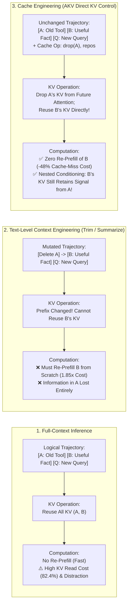
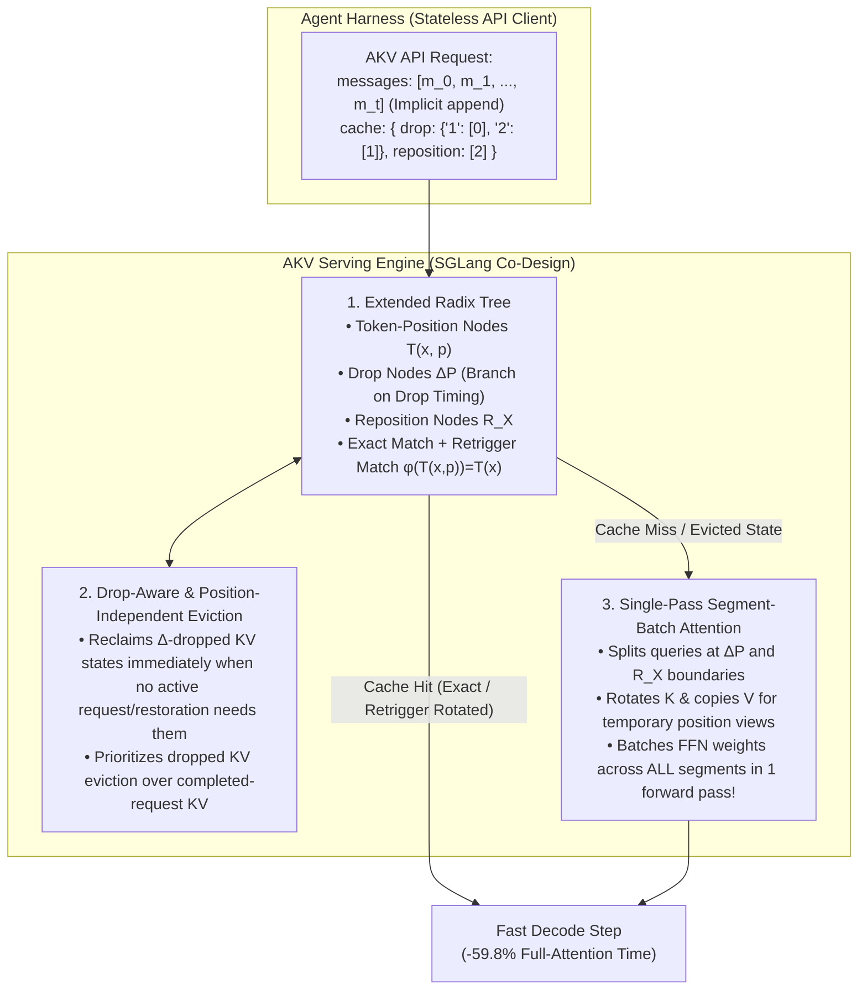

# Architecture Best Practice: Cache Engineering for Agents — Direct KV-Cache Control (`append`, `drop`, `repos`), Extended Radix Trees, and Prefix-Preserving Compaction

**Topics:** #cache-engineering #kv-cache #prefix-caching #akv-serving #extended-radix-tree #segment-batch-attention #rope-repositioning #tool-response-rolling-drop #finops #fde-grading-rubric

> **Source:** `CACHE ENGINEERING FOR AGENTS.pdf` (Fu*, Wang*, Min*, Ren, Li, Liu, Mu, Zhang, Wang, Tsinghua University & CUHK, `arXiv:2610.28577v1`, `https://github.com/thu-nics/AKV`) · **Corpus:** `GEAPL200` (Unified L200 + L300 + L400 Open Knowledge Format v0.2 · Version `GEAPL200_2026-10-27_183500`) · **Standalone Catalog ID:** `02-cache-engineering-kv-prefix-optimization-for-agents` · **Target:** GCP Knowledge Catalog (Dataplex) & Antigravity Agentic AI Development

---

## Version & 6-Month TTL Governance Tab

| Document ID | Version Tag (Today's Date & Time) | Version Timestamp (PDT) | Time-To-Live (TTL) | Expiration (`stale_after`) | Status |
| :--- | :--- | :--- | :--- | :--- | :--- |
| `37-cache-engineering-kv-prefix-optimization-for-agents` | **`GEAPL200_2026-10-27_183500`** (`L400_version_20261027_1835`) | `2026-10-27 18:35:00 PDT` (`2026-10-27T18:35:00-07:00`) | **6 Months** (`180 days` / `P6M`) | `2027-04-27T18:35:00-07:00` | Published / Verified |

### Grounding Research Publications (Local PDF Sources)
- **`PAPER-02-AKV` — [`CACHE ENGINEERING FOR AGENTS.pdf`](../CACHE%20ENGINEERING%20FOR%20AGENTS.pdf):** *Cache Engineering for Agents* — Tianyu Fu, Ruoxi Wang, Zihan Min, Zhongqi Ren, Zhihao Li, Tengxuan Liu, Shengxu Mu, Hanling Zhang, Yu Wang (Tsinghua University, The Chinese University of Hong Kong; arXiv Preprint (arXiv:2610.28577v1, 20 Oct 2026)). URL: `https://arxiv.org/abs/2610.28577` · Code/Data: `https://github.com/thu-nics/AKV`
- **`PAPER-01-ACE` — [`AGENTIC CONTEXT ENGINEERING- EVOLVING CONTEXTS FOR SELF-IMPROVING LANGUAGE MODELS.pdf`](../AGENTIC%20CONTEXT%20ENGINEERING-%20EVOLVING%20CONTEXTS%20FOR%20SELF-IMPROVING%20LANGUAGE%20MODELS.pdf):** *Agentic Context Engineering: Evolving Contexts for Self-Improving Language Models* — Qizheng Zhang, Changran Hu, Shubhangi Upasani, Boyuan Ma, Fenglu Hong, Vamsidhar Kamanuru, Jay Rainton, Chen Wu, Mengmeng Ji, Hanchen Li, Urmish Thakker, James Zou, Kunle Olukotun (Stanford University, SambaNova Systems, Inc., UC Berkeley; Published as a conference paper at ICLR 2026 (arXiv:2510.04618v3, 29 Mar 2026)). URL: `https://arxiv.org/abs/2510.04618` · Code/Data: `https://github.com/ace-agent/ace`
- **`PAPER-04-CORP-MAS` — [`Context Engineering- From Prompts to Corporate Multi-Agent Architecture.pdf`](../Context%20Engineering-%20From%20Prompts%20to%20Corporate%20Multi-Agent%20Architecture.pdf):** *Context Engineering: From Prompts to Corporate Multi-Agent Architecture* — Vera V. Vishnyakova (Director, Center for Transfer and Management of Socio-Economic Information, HSE University, Moscow; Working Paper / Monograph (March 2026); synthesizing Tomasev et al. (2026, arXiv:2602.11865), Breunig (2025), Deloitte (2026), and KPMG (2026)). URL: `file://./Context%20Engineering-%20From%20Prompts%20to%20Corporate%20Multi-Agent%20Architecture.pdf` · Code/Data: `https://arxiv.org/abs/2602.11865`

---


## 0. OKF Document Metadata & Topic Modeling Taxonomy
**Topic Tags:** `#L400_version_20261027_1835` `#OKFMetadata` `#CacheEngineering` `#AKVServingEngine` `#KVCacheOptimization` `#RoPERepositioning`

| Metadata Field | Value |
| :--- | :--- |
| **OKF Document ID** | `37-cache-engineering-kv-prefix-optimization-for-agents` (Standalone Index: `02`) |
| **Primary Literature** | Tianyu Fu*, Ruoxi Wang*, Zihan Min*, Zhongqi Ren, Zhihao Li, Tengxuan Liu, Shengxu Mu, Hanling Zhang, Yu Wang (`arXiv:2610.28577v1`, Oct 2026, `github.com/thu-nics/AKV`) |
| **Architectural Domain** | Agentic KV-Cache State Management, Prefix-Preserving Compaction, SGLang/vLLM Serving Co-Design & FinOps |
| **Target GCP Runtimes** | Vertex AI Prediction / GKE SGLang & vLLM Serving Clusters, Gemini Enterprise Context Caching, Google ADK 2.0 |
| **Enforced FDE Standard** | `concepts/00-fde-field-readiness-and-grading-rubric.md` & `OKF-L400-21` (`https://g3doc.corp.google.com/company/teams/cloud-fde/index.md?cl=head`) |

---

## FDE Project Grading Rubric Enforcement & Prevailing Customer Alignment

> **Mandatory Governance Standard:** Every project, prototype, or production agent built using the patterns in this concept **must pass the [Google Cloud FDE Field-Readiness & Project Grading Rubric](/concepts/00-fde-field-readiness-and-grading-rubric.md)** (aligned with the [Cloud FDE Team Charter](https://g3doc.corp.google.com/company/teams/cloud-fde/index.md?cl=head) and `OKF-L400-21`). Scoring Requirement: **Average >= `2.0 (Competent)`** across both **Part A (Presentation & Advisory Rigor)** and **Part B (Engineering & Implementation Excellence)**, with **zero `0 (Not Demonstrated)` scores** on any single metric.

### 1. Part A — Presentation & Advisory Rigor Enforcement for This Concept

- **A.1 Strategic Delivery & Value Articulation (16-Line TCO Justification):** Ground every long-horizon agent TCO model in the empirical fact that **KV-cache reads account for `82.4%` of total API inference cost** in multi-turn agents (`BrowseComp-Plus` / `SWE-Verified`). Show how **Cache Engineering (`AKV`)** reduces average API cost by **`27.7%`** (and **`34.8%`** with Recursive Self-Improvement [RSI]), improves benchmark accuracy by **`+1.7 points`**, boosts output throughput by **`1.18x–1.20x`** (`1.53x` input throughput), and delivers a **`1.51x` speedup in P95 request latency**.
- **A.2 Objection Handling & Technical Defense:** Explain why conventional *text-level context engineering* (trimming old messages or threshold-triggered summarization) creates a **Re-Prefill vs. Accuracy Dilemma**: trimming the trajectory prefix invalidates all subsequent KV cache states and forces re-prefilling the entire retained suffix (`1.85x` higher cost than full-context baseline when retaining the latest 12 tool rounds!), whereas aggressive summarization at 48K tokens drops accuracy by `5.0 percentage points`.
- **A.3 Time Management & Progressive Production Roadmap:** Guide enterprise customers from Day-1 **Prompt Prefix Hygiene** (append-only trajectories, deterministic JSON key serialization, freezing system prompts & tool definitions) to Day-30 **Tool-Response Rolling Drop ($K=12$)** and Day-90 **AKV Serving Engine / Cache-As-Tool (`CAT`)** deployment on GKE GPU/TPU clusters.

### 2. Part B — Engineering & Implementation Excellence Cutlines for This Concept

- **B.1.1 & B.4.2 Agentic Architecture & Serving Co-Design:** Distinguish between the **logical trajectory $x_{1:t}$** and the **active KV cache $\mathcal{C}$**, and implement the three formal cache primitives: `append(x)`, `drop(P)`, and `repos` (RoPE key rotation $K \leftarrow R(q)R(p)^{-1}K$).
- **B.2.5 Decision Records (ADRs):** Document why **token prefix matching alone is insufficient** under direct KV manipulation (**History Dependence**: dropping $A$ before vs. after computing $C$ yields distinct hidden states for $C$), requiring an **Extended Radix Tree** with drop nodes ($\Delta P$), reposition nodes ($R_X$), and **Segment-Batch Attention** for single-pass prefill restoration.
- **B.5.3 AI Cost Management:** Prioritize **Tool-Response Rolling Drop** over reasoning drop because transformer attention density on older tool responses decays to $10^{-6}\text{–}10^{-8}$ across layers while older assistant reasoning retains $10^{-4}\text{–}10^{-5}$ attention density.

### 3. Prevailing Customer Exemplars & Cross-KB Links

| Customer / Benchmark Exemplar | Architectural Challenge | Cache Engineering Pattern Applied | Quantified Production Outcome |
| :--- | :--- | :--- | :--- |
| **Deep Research Agents (`BrowseComp-Plus` [BCP] & `GAIA-Text`)** | 100-round web/corpus search trajectories exceeding 96K tokens where threshold summarization loses intermediate evidence (`65% -> 54%` accuracy at 48K–96K). | **Tool-Response Rolling Drop ($K=12$)** + `repos` at 96K + **Cache-As-Tool (`CAT`)** & **RSI Policy Evolution**. | `GPT-OSS-120B` BCP score rises from `57.5%` (Standard) / `52.7%` (Text Eng) to **`61.9%` (`+4.4%` / `+9.2%`)** while cost drops from `13.1¢` to `11.4¢`; `GAIA-Text` hits **`69.9%` at `4.1¢`** (`-24.1%` cost). |
| **Autonomous SWE Coding Agents (`SWE-bench Verified` — 500 Tasks)** | Up to 250 agent steps reading large source files and test logs; high concurrency ($C=14\text{–}16$) causes KV-cache capacity thrashing and repeated prefill under LRU. | **AKV Serving Engine** on SGLang (`Extended Radix Tree` + `Drop-Aware Eviction` + `Segment-Batch Attention`). | `GPT-OSS-120B` score improves from `40.0%` (`20.0¢`) to **`43.2%` (`9.7¢`, `-51.5%` cost!)**; at $C=16$, P95 latency drops from **`229.90s` to `30.63s` (`7.5x` faster!)** and output throughput jumps **`2.67x`** (`369` vs `138` tok/s). |
| **Multi-Agent Socratic Debate & Verification Loops (`Concept 41`)** | Multi-round Generator-Critic-Reflector grilling loops accumulate verbose intermediate critique scratchpads that bloat downstream context. | **Cache-Preserving Socratic Scratchpad Drop:** Retain the shared prefix + distilled verdict in $\mathcal{C}$ while applying `drop(P_scratchpad)` to resolved Socratic debate turns. | Preserves `>90%` prefix KV-cache hit rate across multi-agent Socratic rounds while eliminating cross-step context distraction. |

**Related OKF Concepts:**
- [Google Cloud FDE Field-Readiness & Project Grading Rubric](/concepts/00-fde-field-readiness-and-grading-rubric.md)
- [Cost Estimation, FinOps, and Token Optimization for Agentic Solutions](/concepts/28-cost-estimation-and-optimization-for-agentic-solutions.md)
- [Agentic Context Engineering (ACE) — Evolving Playbooks](/concepts/36-agentic-context-engineering-evolving-playbooks.md)
- [Socratic Grilling: User-to-Agent and Agent-to-Agent Protocols](/concepts/41-socratic-grilling-user-to-agent-and-agent-to-agent-protocols.md)
- [Multi-Agent Memory Lifecycle and Context-Rot Prevention](/concepts/42-multi-agent-memory-lifecycle-and-context-rot-prevention.md)

---

## 1. The Re-Prefill Dilemma: Context Engineering vs. Cache Engineering

In long-horizon agent trajectories spanning 50 to 250 turns, an agent's **logical trajectory** $x_{1:t}$ (system instructions, user queries, assistant reasoning thoughts, tool calls, and verbose tool responses) grows continuously. Empirical cost accounting on `BrowseComp-Plus` with `GPT-OSS-120B` reveals that **KV-cache reads constitute `82.4%` (`10.8¢` of `13.1¢`) of total per-task API cost**. Furthermore, when active KV states or their positional indices exceed the model's effective context window, task accuracy degrades sharply (`88%` at `0–48K` tokens $\rightarrow$ `65%` at `48–96K` $\rightarrow$ `24%` at `96K+` tokens).

Prior systems attempt to bound context growth via **text-level context engineering** (deleting or summarizing older messages in $x_{1:t}$). However, modifying any token at index $k < t$ mutates the token prefix $x_{1:k}$, which **invalidates all cached KV states $\mathcal{C}_{k:t}$** in the serving engine and forces a costly **re-prefill** of the entire retained suffix $x_{k+1:t}$:
- **Trim-Based Context Engineering Trap:** Retaining only the latest $K=12$ rounds of tool responses by deleting older tool text invalidates the prefix on every turn after round 12, costing **`1.85x` as much as the full-context baseline** due to repeated suffix re-prefill!
- **Threshold-Triggered Summarization Trap:** Deferring compaction until a `48K` or `96K` token threshold reduces re-prefill frequency (`~7%` cost savings at `48K`), but abruptly discards intermediate reasoning and evidence, lowering task accuracy by **`5.0 percentage points`**.



### 1.1 The Nested Conditioning Phenomenon
A profound mathematical advantage of **Cache Engineering** over text deletion is **Nested Conditioning**: when token block $B$ was originally computed with causal attention over earlier token block $A$, $B$'s cached key-value states $\mathcal{C}_B$ already absorbed semantic representations distilled from $A$. When the agent subsequently executes $\text{drop}(A)$, $A$'s KV entries are excluded from *future* attention queries $Q$, reducing KV-read bandwidth and attention dilution—**yet $\mathcal{C}_B$ remains conditioned on $A$ without recomputation!**

---

## 2. Formal Algebra of Cache Engineering & History Dependence

### 2.1 Logical Trajectory vs. Active Cache
An autoregressive Transformer predicts token $x_{t+1}$ conditioned on the active KV cache $\mathcal{C}$:

$$p_\theta(x_{t+1} \mid x_t, \mathcal{C}_{1:t-1})$$

In Cache Engineering, the **active cache $\mathcal{C}$** (the ordered sequence of KV states participating in attention at the algorithmic level) is decoupled from both the **logical token length $t$** and the **physical position encoding index $p$**.

### 2.2 The Three Primitive Cache Operations (`append`, `drop`, `repos`)

1. **`append(x_{t+1})` — Causal State Extension:**
   Processes a new token $x_{t+1}$ conditioned on the current active cache $\mathcal{C}$ and appends its newly computed KV state $\mathcal{C}_{t+1}$:
   $$\text{append}(x_{t+1}) : \quad \mathcal{C} \leftarrow [\mathcal{C}; \mathcal{C}_{t+1}]$$
2. **`drop(P)` — Selective Attention Exclusion without Re-Prefill:**
   Removes the KV states at active logical token indices $P \subset \{1, \dots, t\}$ from subsequent attention while leaving retained KV states, their position encodings, and the logical token sequence unchanged:
   $$\text{drop}(P) : \quad \mathcal{C} \leftarrow \mathcal{C} \setminus \{\mathcal{C}_i : i \in P\}$$
3. **`repos` — RoPE Key Rotation & Position Compaction without Re-Prefill:**
   Because `drop(P)` does not decrement the position index counter, logical position indices would eventually exceed the LLM's maximum context window even when $|\mathcal{C}|$ is small. Given $r = |\mathcal{C}|$ retained cache entries at old position indices $p_0, \dots, p_{r-1}$, `repos` compacts their position indices to $q_k = k \in \{0, \dots, r-1\}$ and resets the next append index to $r$. For Rotary Position Embeddings (**RoPE**), moving a cached key vector $K$ from position $p$ to position $q$ is a pure orthogonal rotation in key space that **requires zero hidden-state or value ($V$) recomputation**:
   $$\text{repos} : \quad K_q \leftarrow R(q) R(p)^{-1} K_p = R(q - p) K_p, \qquad V_q \leftarrow V_p$$
   where $R(p)$ is the block-diagonal RoPE rotation matrix at position $p$.

### 2.3 The History-Dependence Theorem (Why Standard Prefix Caching Fails)
Let a **Cache Operation Sequence** be:

$$o_{1:m} = (o_1, o_2, \dots, o_m), \qquad o_j \in \{\text{append}(x), \text{drop}(P), \text{repos}\}$$

In conventional LLM serving (`vLLM`, standard `SGLang`), the token prefix $x_{1:t}$ uniquely determines the KV cache state. **Under Cache Engineering, identical retained tokens and positions can yield distinct KV states depending on operation ordering:**
- **Trajectory ① (`+A, +B, +C, -A`):** Appends $C$ while $A$ and $B$ are active, then drops $A$. Both $\mathcal{C}_B$ and $\mathcal{C}_C$ are conditioned on $A$.
- **Trajectory ② (`+A, +B, -A, +C`):** Drops $A$ *before* appending $C$. Here $\mathcal{C}_B$ is conditioned on $A$, but $\mathcal{C}_C$ attends only to $B$ (and not $A$).
- **Trajectory ③ (`+B, +C`):** Starts from $B$ alone. Neither $\mathcal{C}_B$ nor $\mathcal{C}_C$ is conditioned on $A$.

Although all three trajectories retain identical tokens $[B, C]$, $\mathcal{C}_C^{(1)} \neq \mathcal{C}_C^{(2)} \neq \mathcal{C}_C^{(3)}$. A serving engine that matches only retained tokens $[B, C]$ will silently corrupt attention states and violate request isolation!

---

## 3. Co-Designing the AKV Serving Engine: Stateless API, Stateful Serving

To support Cache Engineering in production without forcing client harnesses to track physical GPU memory residency, **AKV** (built on SGLang v0.5.20) enforces the principle of **Stateless Interface, Stateful Serving**:



### 3.1 Exact Matching vs. Retrigger Matching on the Extended Radix Tree
Each token node in AKV's radix tree is labeled $T(x, p)$ (token ID $x$, currently stored RoPE position $p$), interleaved with operation nodes $\Delta P$ and $R_X$:
1. **Exact Matching:** Requires identical token IDs, stored position indices, and operation nodes:
   $$T(x, p) \equiv T(x', p') \iff x = x' \land p = p'$$
2. **Retrigger Matching (Zero-Prefill RoPE Transformation):** Ignores stored position indices $p$ while strictly preserving all token and operation nodes ($\Delta P, R_X$):
   $$\phi(T(x, p)) = T(x), \qquad \phi(\Delta P) = \Delta P, \qquad \phi(R) = R$$
   If two trajectories have identical projections $\phi(\cdot)$ up to a prefix, they share identical computational history and unrotated KV states! AKV simply copies the source cache and applies RoPE rotation $K_t = R(p_t)R(p_s)^{-1}K_s, V_t = V_s$ without recomputing hidden states.

### 3.2 Single-Pass Restoration via Segment-Batch Attention
When memory pressure evicts cached states between turns, ordinary causal prefill cannot reproduce a history containing `drop` and `repos` operations without replaying multiple separate forward passes. **Segment-Batch Attention** restores all missing states in **one single prefill forward pass**:
- At each Transformer layer, queries are partitioned into segments at every $\Delta P$ and $R_X$ boundary.
- Each segment attends causally only to its own tokens and the active KV pages from earlier segments (with temporary RoPE-rotated key views $K$ constructed on the fly).
- Crucially, **only the attention kernel is segmented; the Feed-Forward Network (FFN / MoE experts)—which dominates GPU memory bandwidth—processes the entire concatenated sequence as a single batch!**

---

## 4. Empirical Attention Law & Cache Engineering Policies

### 4.1 Layer-by-Layer Attention Density Law (`BrowseComp-Plus` Empirical Study)
Why does dropping older tool responses outperform dropping reasoning or summarizing? Measuring per-token attention density across all 36 layers of `GPT-OSS-120B` over long trajectories reveals two fundamental invariants:
1. **Recency Gradient:** Recent history (messages $49\text{–}72$) receives $10^{-4}$ attention density per token across all layers.
2. **Role Asymmetry (`Reasoning >> Tool Responses`):** At comparable older relative positions (messages $1\text{–}42$), **assistant reasoning tokens retain $10^{-5}\text{–}10^{-4}$ attention density**, whereas **older tool response tokens drop to $10^{-8}\text{–}10^{-6}$ attention density** because the assistant message immediately following each tool response has already extracted and synthesized its relevant facts via **Nested Conditioning**!

### 4.2 Three Production Cache Engineering Policies
1. **Tool-Response Rolling Drop ($K=12$) + Threshold `repos`:** Retains KV cache for the system prompt, all user/assistant reasoning messages, and the most recent $K=12$ rounds of tool responses; drops tool-response KV older than $K$ rounds and triggers `repos` when logical position index approaches the model's threshold (`96K` for `GPT-OSS-120B`/`MiniMax-M2.7`, `192K` for `MiroThinker-1.7-Mini`).
2. **Recursive Self-Improvement (`RSI`) Cache Policy Search:** An evolutionary loop where an LLM agent mutates and evaluates programmable cache-operation policies over a 20-task training split, discovering fine-grained retention schedules that reduce per-task cost by **`15.6%` (Iteration 3) to `17.8%` (Iteration 6)** relative to Standard (`7.1%` lower than human expert design) while preserving baseline accuracy.
3. **Cache-As-Tool (`CAT`):** Exposes a native `manage_cache(drop_message_indices=[...])` tool directly to the agent so the LLM autonomously drops stale exploration branches or failed search outputs immediately after reading them—achieving **`61.0%` on BCP with `GPT-OSS-120B`** (vs `52.1%` Standard) and **`64.0%` with `MiniMax-M2.7`** (vs `56.0%` Standard).

### 4.3 Master Quantitative Benchmark Matrix (`BCP`, `GAIA-Text`, `SWE-Verified`, `xbench-DS`)

| Model & Active Params | Method | `BCP` Score (%) | `BCP` Cost (¢) | `GAIA-Text` Score (%) | `GAIA-Text` Cost (¢) | `SWE-Verified` Score (%) | `SWE-Verified` Cost (¢) | `xbench-DS` Score (%) | `xbench-DS` Cost (¢) | **Average Score (%)** | **Average Cost (¢)** |
| :--- | :--- | :---: | :---: | :---: | :---: | :---: | :---: | :---: | :---: | :---: | :---: |
| **MiniMax-M2.7** (230B / 10B active) | `Standard` (96K Summary) | 58.9 | 5.2 | 35.0 | **2.4** | **75.2** | 7.0 | **40.5** | 5.5 | 52.4 | 5.0 |
| **MiniMax-M2.7** (230B / 10B active) | `Text Engineering` (48K Summary) | **62.3** | 5.3 | 36.9 | 2.7 | 72.0 | 9.4 | 40.0 | 5.2 | 52.8 | 5.7 |
| **MiniMax-M2.7** (230B / 10B active) | **`AKV` (Rolling Drop $K=12$ + `repos`)** | 58.9 | **4.8** | **40.8** | 2.6 | 74.4 | **5.5** | **40.5** | **4.7** | **53.7 (`+1.3%`)** | **4.4 (`-12.0%`)** |
| **GPT-OSS-120B** (5.1B active) | `Standard` (96K Summary) | 57.5 | 13.1 | 68.0 | 5.4 | 40.0 | 20.0 | **38.5** | 6.2 | 51.0 | 11.2 |
| **GPT-OSS-120B** (5.1B active) | `Text Engineering` (48K Summary) | 52.7 | 12.6 | 65.1 | 6.8 | 36.8 | 15.8 | **38.5** | 5.4 | 48.3 | 10.2 |
| **GPT-OSS-120B** (5.1B active) | **`AKV` (Rolling Drop $K=12$ + `repos`)** | **61.9** | **11.4** | **69.9** | **4.1** | **43.2** | **9.7** | 37.5 | **3.8** | **53.1 (`+2.1%`)** | **7.3 (`-34.8%`)** |
| **MiroThinker-1.7-Mini** (30B / 3B active) | `Standard` (192K Summary) | 60.0 | 25.2 | 68.0 | **9.2** | **7.8** | 33.6 | 40.5 | 13.5 | 44.1 | 20.4 |
| **MiroThinker-1.7-Mini** (30B / 3B active) | `Text Engineering` (48K Summary) | 45.7 | 17.6 | 66.0 | 11.0 | 4.2 | 28.4 | 32.5 | 15.3 | 37.1 | 18.1 |
| **MiroThinker-1.7-Mini** (30B / 3B active) | **`AKV` (Rolling Drop $K=12$ + `repos`)** | **63.5** | **15.3** | **68.9** | 9.5 | 7.4 | **26.3** | **43.5** | **8.1** | **45.8 (`+1.7%`)** | **14.8 (`-27.5%`)** |

### 4.4 Serving Latency & Concurrency Scaling (`Top-80 SWE-Verified` on 8x A800-80GB GPUs)

| Concurrency ($C$) | Method | Mean Request Latency (s) | **P95 Request Latency (s)** | Mean TTFT (s) | P95 TTFT (s) | Mean TPOT (ms/tok) | Input Throughput (tok/s) | **Output Throughput (tok/s)** |
| :---: | :--- | :---: | :---: | :---: | :---: | :---: | :---: | :---: |
| **$C = 8$** | `Standard` / `Text Eng` / **`AKV`** | 12.16 / 12.84 / **7.79** | 43.57 / 43.57 / **25.93** | 3.18 / 4.94 / **1.87** | 8.42 / 22.99 / **5.99** | 26.57 / 23.23 / 23.50 | 25,200 / 17,313 / **39,227** | 217 / 228 / **245** |
| **$C = 12$** | `Standard` / `Text Eng` / **`AKV`** | 12.39 / 16.83 / **8.47** | 43.16 / 52.82 / **27.18** | 2.97 / 8.86 / **2.60** | 9.99 / 37.98 / **8.17** | 28.00 / 23.24 / **23.06** | 33,832 / 19,945 / **48,923** | 313 / 264 / **339** |
| **$C = 14$** | `Standard` / `Text Eng` / **`AKV`** | 30.16 / 19.59 / **9.09** | 108.86 / 60.67 / **28.49** | 21.36 / 11.19 / **2.92** | 88.29 / 47.36 / **8.62** | 24.50 / 24.50 / 24.50 | 12,767 / 19,992 / **51,837** | 146 / 267 / **369** |
| **$C = 16$** | `Standard` / `Text Eng` / **`AKV`** | 36.50 / 23.00 / **10.32** | 229.90 / 69.96 / **30.63** | 27.71 / 14.48 / **4.16** | 223.57 / 52.71 / **13.02** | 24.83 / 24.44 / 24.84 | 10,866 / 19,595 / **50,817** | 138 / 267 / **369** |

---

## 5. Production Implementation Blueprint: Prefix-Stable ADK Harness + AKV Client

```python
from __future__ import annotations
from dataclasses import dataclass, field
from typing import Any, Dict, List

@dataclass
class AKVCacheSchedule:
    """Stateless operate-after grammar for AKV cache engineering requests."""
    drop: Dict[str, List[int]] = field(default_factory=dict)
    reposition: List[int] = field(default_factory=list)

    def to_api_dict(self) -> Dict[str, Any]:
        return {"drop": self.drop, "reposition": self.reposition}

class ToolResponseRollingDropPolicy:
    """
    Implements AKV Tool-Response Rolling Drop (K=12) + Threshold Repositioning.
    Retains all system, user, and assistant reasoning KV states while dropping
    tool-response KV states older than K tool rounds.
    """

    def __init__(self, retain_tool_rounds: int = 12, repos_token_threshold: int = 96_000) -> None:
        self.retain_tool_rounds = retain_tool_rounds
        self.repos_token_threshold = repos_token_threshold

    def build_akv_request(
        self,
        messages: List[Dict[str, Any]],
        message_token_lengths: List[int],
        model: str = "gpt-oss-120b",
    ) -> Dict[str, Any]:
        schedule = AKVCacheSchedule()
        tool_msg_indices: List[int] = []
        logical_pos_counter = 0

        for idx, (msg, tok_len) in enumerate(zip(messages, message_token_lengths)):
            logical_pos_counter += tok_len
            if msg.get("role") == "tool":
                tool_msg_indices.append(idx)
                # If we have more than K tool responses, drop the (len - K)-th tool response
                # right after the assistant message that consumed it!
                if len(tool_msg_indices) > self.retain_tool_rounds:
                    stale_tool_idx = tool_msg_indices[-(self.retain_tool_rounds + 1)]
                    schedule.drop.setdefault(str(idx), []).append(stale_tool_idx)

            # Trigger RoPE key repositioning when logical position index approaches limit
            if logical_pos_counter >= self.repos_token_threshold:
                schedule.reposition.append(idx)
                # Reset logical position counter to currently retained active tokens
                dropped_set = {d for drops in schedule.drop.values() for d in drops}
                logical_pos_counter = sum(
                    message_token_lengths[j]
                    for j in range(idx + 1)
                    if j not in dropped_set
                )

        return {
            "model": model,
            "messages": messages,
            "cache": schedule.to_api_dict(),
        }
```

---

## 6. Anti-Patterns & KV-Cache Invalidation Traps

| Anti-Pattern | Observable Symptom | Root Cause | Architectural Remediation |
| :--- | :--- | :--- | :--- |
| **Dynamic Timestamp / UUID in System Prompt** | `0%` prefix cache hit rate across turns; every agent step pays full cache-miss prefill cost (`2x–5x` higher API bill). | Injecting `current_time = datetime.now()` or request UUIDs at the top of the system prompt invalidates the entire radix prefix from token 0. | Freeze the system prompt and tool schemas as an **immutable prefix**; pass dynamic timestamps or turn metadata in the trailing user/system suffix message. |
| **Non-Deterministic Tool Schema / JSON Key Ordering** | Intermittent `100%` cache misses across workers sharing the same agent definition. | Iterating over Python `set` or un-sorted `dict` keys when serializing MCP/ADK tool declarations alters token order in the prompt preamble. | Enforce `json.dumps(..., sort_keys=True)` and canonical alphabetical sorting of all tool and skill schemas in the agent harness. |
| **Dropping Assistant Reasoning Instead of Tool Responses** | `BCP` accuracy drops by `-5.5%` (`62.0% -> 56.5%`) and `SWE-Verified` drops by `-6.5%` (`41.0% -> 34.5%`). | Assistant reasoning messages contain high-density synthesized state (Nested Conditioning) and receive `100x` higher attention than old tool outputs. | Drop **only stale tool responses** (`Tool-Response Rolling Drop`) and Socratic debate scratchpads while retaining all assistant reasoning KV states. |
| **Omitting `repos` Under Long Rolling-Drop Trajectories** | Agent crashes or hallucinates past turn 60 despite active cache size `<32K` tokens (`BCP` score drops from `62.0%` to `55.0%`). | `drop(P)` removes KV entries from attention but does *not* reset RoPE position indices, causing logical indices to exceed the model's trained RoPE horizon. | Pair rolling `drop` with threshold-triggered **`repos`** ($K_q \leftarrow R(q)R(p)^{-1}K_p$) to compact RoPE position indices without re-prefill. |

---

## 7. Socratic FDE Field-Readiness & Customer Grilling Questions (L100–L400)

### Q1 (L200 — FinOps & Architecture): *"We already truncate old messages every 12 turns to keep our context window small. Why is our GPU prefill utilization still at 95% and our API bill 1.85x higher than expected?"*
- **Model Answer (Score 3 — Proficient):** Truncating or editing messages near the beginning of the conversation mutates the token prefix $x_{1:t}$ on every turn after turn 12. In standard serving engines, changing even one token in the prefix invalidates all subsequent KV cache states, forcing the server to **re-prefill the entire retained 12-turn suffix from scratch on every single round**—which empirically costs **1.85x more** than keeping the full context! To reduce active context size *without* triggering re-prefill, you must either batch compactions at large intervals (`keepRecentTokens=20000`, `reserveTokens=16384`) or adopt **Cache Engineering (`AKV`)**, which applies `drop(P)` directly to the KV cache so retained suffix states are reused with zero re-prefill (`-48%` cache-miss cost and `-17%` cache-read cost).
- **Red-Flag Answer (Score 0/1):** Claiming that shorter prompts always result in less prefill compute regardless of prefix cache invalidation.

### Q2 (L300 — Serving Systems Internals): *"Why can't we just add a simple KV-eviction mask to vLLM's existing prefix-matching radix tree to support `drop` and `repos` across concurrent requests?"*
- **Model Answer (Score 3 — Proficient):** Because Cache Engineering introduces **History Dependence**: two requests with the exact same retained tokens $[B, C]$ have mathematically different KV states for $C$ depending on whether token $A$ was dropped *before* or *after* $C$ was computed (`Trajectory ①: +A,+B,+C,-A` vs `Trajectory ②: +A,+B,-A,+C`). Furthermore, `repos` rotates $K$'s RoPE positional encoding without changing $V$. Therefore, the serving engine must use an **Extended Radix Tree** that records token-position nodes $T(x,p)$, drop nodes $\Delta P$, and reposition nodes $R_X$ along the tree path, paired with **Retrigger Matching** ($\phi(T(x,p))=T(x)$) to reuse computationally equivalent caches via RoPE key rotation ($K_t = R(p_t)R(p_s)^{-1}K_s$) and **Segment-Batch Attention** to restore evicted states in a single FFN-batched forward pass.
- **Red-Flag Answer (Score 0/1):** Assuming KV cache states depend only on the surviving tokens in the prompt rather than the causal attention history present when each token was prefilled.

### Q3 (L400 — Multi-Agent Socratic Topologies): *"How do you combine Cache Engineering (`AKV`) with multi-agent Socratic grilling (`Generator-Critic-Reflector`) so adversarial peer review doesn't blow up TTFT and token cost?"*
- **Model Answer (Score 3 — Proficient):** Structure the multi-agent dialogue as an **Append-Only Shared Prefix** (`[System + Playbook + Task + Generator Draft]`), run the Socratic Critic/Reflector grilling turns at the tail of the trajectory (`[Socratic Q1 -> A1 -> Q2 -> A2 -> Distilled Verdict]`), and once the Socratic loop converges, emit an AKV `drop(P_socratic_scratchpad)` operation that drops the intermediate `[Q1, A1, Q2, A2]` KV entries while **retaining the `[System + Playbook + Task]` prefix AND the `[Distilled Verdict]` KV state** (which already absorbed the Socratic critique via **Nested Conditioning**), followed by `repos`. This preserves 100% KV reuse of both the prefix and the synthesized conclusion while zeroing out future attention overhead on the resolved debate turns.