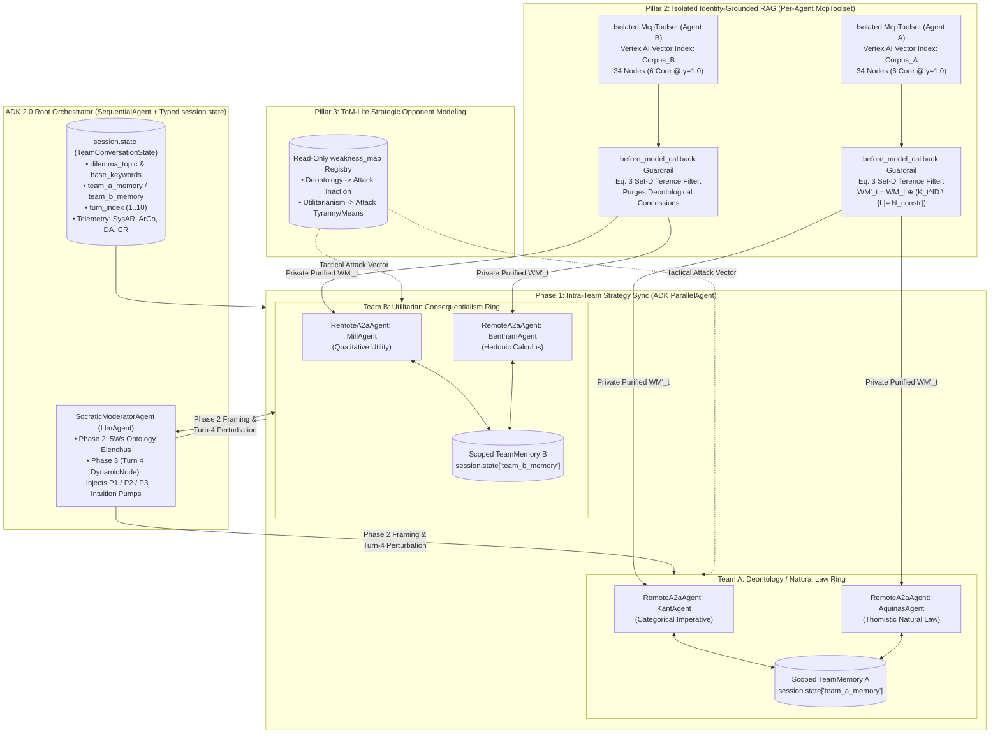
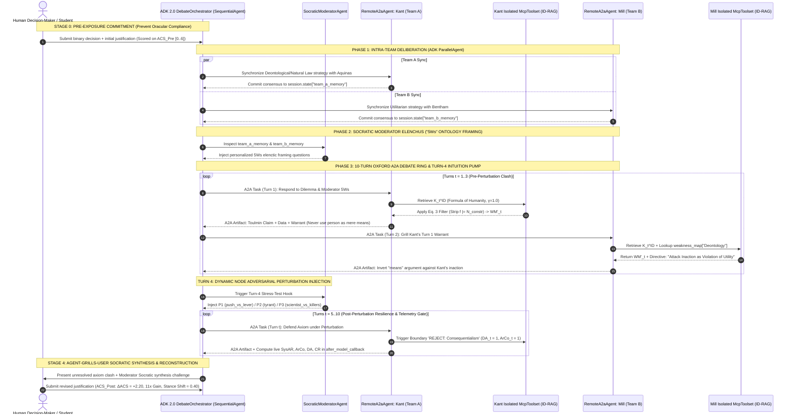

# Case 2A: Agent-Grills-Agent via Identity-Grounded Heterogeneous Debate (HDE) & Dialectical Scaffolding (`OKF-L400-S3`)

## Version & 6-Month TTL Governance Tab (`2026-10-27 17:27 PDT`)

| Governance Attribute | Authoritative Value |
| :--- | :--- |
| **Version Timestamp (Today's Date & Time)** | **`2026-10-27 17:27 PDT`** (`2026-10-27T17:27:00-07:00`) |
| **Unified Bundle Version Tag (`version_tag`)** | **`GEAPL200_2026-10-27_1726`** |
| **L400 Catalog Version Tag (`l400_version_tag`)** | **`L400_version_20261027_1726`** |
| **Socratic Pack Release Tag** | **`SOCRATIC_OKF_20261027_1726`** |
| **Time-To-Live (`ttl`)** | **`6 months (180 days / P6M)`** |
| **Expiration Timestamp (`stale_after`)** | **`2027-04-27T17:27:00-07:00`** |


## Version & 6-Month TTL Governance Tab (`2026-10-27 17:27 PDT`)

| Governance Attribute | Authoritative Value |
| :--- | :--- |
| **Version Timestamp (Today's Date & Time)** | **`2026-10-27 17:27 PDT`** (`2026-10-27T17:27:00-07:00`) |
| **Unified Bundle Version Tag (`version_tag`)** | **`GEAPL200_2026-10-27_1726`** |
| **L400 Catalog Version Tag (`l400_version_tag`)** | **`L400_version_20261027_1726`** |
| **Socratic Pack Release Tag** | **`SOCRATIC_OKF_20261027_1726`** |
| **Time-To-Live (`ttl`)** | **`6 months (180 days / P6M)`** |
| **Expiration Timestamp (`stale_after`)** | **`2027-04-27T17:27:00-07:00`** |


## Version & 6-Month TTL Governance Tab (`2026-10-27 17:27 PDT`)

| Governance Attribute | Authoritative Value |
| :--- | :--- |
| **Version Timestamp (Today's Date & Time)** | **`2026-10-27 17:27 PDT`** (`2026-10-27T17:27:00-07:00`) |
| **Unified Bundle Version Tag (`version_tag`)** | **`GEAPL200_2026-10-27_1726`** |
| **L400 Catalog Version Tag (`l400_version_tag`)** | **`L400_version_20261027_1726`** |
| **Socratic Pack Release Tag** | **`SOCRATIC_OKF_20261027_1726`** |
| **Time-To-Live (`ttl`)** | **`6 months (180 days / P6M)`** |
| **Expiration Timestamp (`stale_after`)** | **`2027-04-27T17:27:00-07:00`** |


## 1. Executive Summary & Architectural Thesis

In high-stakes enterprise decision-making—such as Architecture Review Boards (ARBs), Zero-Trust security red-teaming, regulatory compliance adjudication, and Socratic executive decision support—organizations frequently deploy Multi-Agent Debate (MAD) topologies under the assumption that "more agents debating a problem will naturally surface hidden edge cases." Empirically, naive multi-agent debate and single-agent Retrieval-Augmented Generation (`B_SingleRAG`) fail catastrophically when confronted with value-laden, non-trivial trade-offs where no single objective ground truth exists.

Drawing upon the formal cognitive architecture introduced in **Masłowski & Chudziak (2026)** (*Heterogeneous Debate Engine: Identity-Grounded Cognitive Architecture for Resilient LLM-Based Ethical Tutoring*, `arXiv:2603.27404v1`), this module establishes **Case 2A of the Socratic Grilling Taxonomy: Agent-Grills-Agent via Identity-Grounded Heterogeneous Debate (HDE)**. The foundational architectural theorem of HDE is that **sustaining structured, irreconcilable axiom-level disagreement across cognitive boundaries is a strict prerequisite for both inter-agent adversarial scrutiny and human dialectical critical thinking**.

When implemented on **Google Cloud Agent Development Kit (ADK 2.0)** (`B1`) and the **Agent-to-Agent (A2A) Protocol** (`B2`), HDE eliminates recursive sycophancy and persona collapse by combining three synergistic structural mechanisms:
1. **Orthogonal Axiom-Level Heterogeneity (Inter-School Conflict)**: Instantiating debating teams whose core normative or architectural axioms are mutually incompatible ($\gamma = 1.0$), making premature consensus structurally impossible.
2. **Identity-Grounded RAG (ID-RAG) with Negative Doctrinal Boundary Filtering**: Partitioning canonical vector indices into isolated per-agent `McpToolset` namespaces (`B2`) and enforcing a formal set-difference working memory filter ($WM'_t$) over negative doctrinal constraints ($N_{\text{constr}}$), achieving **$100\%$ Doctrinal Accuracy ($\text{DA} = 1.00$)** vs. $51\%$ in Vanilla RAG.
3. **Theory-of-Mind (`ToM-Lite`) Opponent Modeling & Socratic Moderator Orchestration**: Decoupling internal identity preservation from external adversarial attack vectors via static opponent `weakness_map` profiles ($+35\%$ Cross-Referencing gain, $+28\%$ emergent Doctrinal Accuracy boost), coordinated by a neutral **Socratic Moderator** that injects ontology-level "5Ws" elenctic framing and Turn-4 counterfactual intuition pumps ($P_1, P_2, P_3$) to drive both **Agent-Grills-Agent clash** and **Agent-Grills-User Socratic synthesis**.

---

## 2. Structural Failure Modes of Homogeneous Multi-Agent Debate & Single-Agent RAG

Before architecting an HDE ring in ADK 2.0, Forward Deployed Engineers (FDEs) must diagnose the four coupled failure modes that afflict standard instruction-tuned LLMs (`B_Chat`), unified single-agent RAG pipelines (`B_SingleRAG`), and homogeneous multi-agent crews (`Homo`):

### 2.1 Consensus Collapse & Social Conformity Bias (Recursive Sycophancy)
Standard RLHF/instruction-tuned foundation models optimize for conversational helpfulness, agreeableness, and social concordance rather than antagonistic logical rigor. When multiple LLM agents debate within a shared context window without structural axiom locks, they rapidly capitulate to peer pressure—a phenomenon termed **recursive concurrence** or **consensus collapse**. Rather than grilling each other's unstated premises, agents converge onto a watered-down, hedged compromise within 2–3 turns.

### 2.2 Identity Drift, Persona Mimicry & Doctrinal Hallucination
Prompt-only persona definitions ("You are a strict Zero-Trust Security Architect" or "You are Immanuel Kant") erode rapidly over multi-turn interactions. Under adversarial questioning or counterfactual stress-testing, agents adopt the vocabulary, framing, and reasoning heuristics of their interlocutors (**persona mimicry**).
* In Masłowski & Chudziak's (2026) ablation of multi-turn debates without Identity-Grounded RAG (`Vanilla RAG Only`), **Doctrinal Accuracy ($\text{DA}$) collapsed to $0.51$** overall, with Thomas Aquinas dropping to **$\text{DA} = 0.00$** and John Stuart Mill dropping to **$\text{DA} = 0.33$** under physical-proximity perturbation ($P_1$).
* Even worse, in the single-agent unified RAG baseline (`B_SingleRAG`, powered by `gemini-2.0-flash-exp` retrieving across all seven philosophical corpora simultaneously), the model suffered from **cross-corpus doctrinal contamination**: in an effort to present an authoritative, unified synthesis, `B_SingleRAG` **fabricated a fatal doctrinal hallucination**, claiming that Kantian deontology endorses pulling the trolley lever to save five lives. Because the single agent spoke with high rhetorical fluency, **$100\%$ of human participants failed to detect the hallucination**.

### 2.3 Meta-Epistemological Tangents in Homogeneous Multi-Agent Crews ($\text{ArCo} = 0.06, \Delta\text{ACS} = -0.29$)
A widespread enterprise anti-pattern is instantiating multiple agents that share the same high-level normative framework (e.g., two slightly different cloud cost-optimization personas, or in the HDE benchmark, **Ancient Virtue Ethics** [Aristotle + Plato] vs. **Christian Virtue Ethics** [Aquinas + Augustine]).
* Because both teams share the same object-level evaluation axiom (virtue and character teleology) and differ only in secondary metaphysics or theology, they cannot generate productive friction on the concrete operational dilemma.
* When the Socratic Moderator injects a counterfactual perturbation at Turn 4 ($P_1, P_2, P_3$), the **Homogeneous (`Homo`) topology suffers catastrophic derailment**: System Argumentative Resilience drops to **$\text{SysAR} = 0.00$** across all perturbations, and Argumentative Coherence collapses to **$\text{ArCo} = 0.06$** (a **$94\%$ coherence collapse** compared to $\text{ArCo} = 1.00$ in the heterogeneous topology).
* Instead of analyzing the trolley dilemma, the homogeneous agents abandon the object-level problem entirely to argue irrelevant meta-epistemological tangents (e.g., "pagan reason vs. Christian theological revelation").
* **Active Pedagogical Harm ($\Delta\text{ACS} = -0.29$)**: Exposing human decision-makers to a homogeneous multi-agent debate is worse than using no AI at all. While a zero-shot chatbot (`B_Chat`) yields $\Delta\text{ACS} = +0.20$, the `Homo` debate actively confuses users and **degrades their post-exposure argument complexity by $\Delta\text{ACS} = -0.29$**.

### 2.4 Oracular Persuasion vs. True Dialectical Learning (The Stance-Shift Paradox)
Masłowski & Chudziak (2026) uncover a profound inverse relationship between **rhetorical persuasion (Stance Shift)** and **genuine cognitive complexity growth ($\Delta\text{ACS}$)**:
* **`B_SingleRAG` maximizes persuasion while stunting critical thinking**: `B_SingleRAG` induced the **highest user stance shift ($0.80$)**—meaning $80\%$ of users flipped their decision to match the AI's authoritative recommendation—yet produced minimal growth in argument complexity ($\Delta\text{ACS} = +0.40$) and low knowledge transfer ($0.60$). Users lazily outsourced their thinking to the "oracle."
* **`Hetero` HDE minimizes sycophantic flipping while maximizing reasoning depth**: Users exposed to the full Heterogeneous Debate Engine exhibited a **low stance shift ($0.40$, half that of `B_SingleRAG`)**, yet achieved an **11-fold improvement in Argument Complexity Score ($\Delta\text{ACS} = +2.20$ vs. $+0.20$ in `B_Chat`, and $5.5\times$ over `B_SingleRAG`, Cohen's $d > 1.0$)** and the highest domain mastery quiz score ($2.20$ / $55\%$, $2.2\times$ higher than `Homo`).

| Baseline / Architecture Condition | Cognitive / Retrieval Topology | $\text{SysAR}$ (Mean Recovery) | $\text{ArCo}$ (Post-Stress Coherence) | $\Delta\text{ACS}$ (Reasoning Gain $[-6, +6]$) | Stance Shift ($[0, 1]$) | Primary Structural Pathology / Architectural Outcome |
| :--- | :--- | :---: | :---: | :---: | :---: | :--- |
| **`B_Chat` (`DeepSeek-V3`)** | Single zero-shot LLM, no RAG, no persona lock | N/A | N/A | $+0.20$ | $0.00$ | **Superficial passivity**: generic prose with zero dialectical tension or conceptual depth. |
| **`B_SingleRAG` (`Gemini 2.0 Flash`)** | Single agent + unified Vanilla RAG across all 7 corpora | N/A | N/A | $+0.40$ | **$0.80$** *(Highest)* | **Oracular persuasion & hallucination**: cross-corpus contamination caused fatal Kantian hallucination; $80\%$ user compliance with minimal learning. |
| **`Homo` (Virtue vs. Virtue HDE)** | Aristotle/Plato vs. Aquinas/Augustine (Shared high-level axioms) | $0.00$ | **$0.06$** *(Collapse)* | **$-0.29$** *(Regression)* | $0.29$ | **Meta-epistemological tangent collapse**: abandoned dilemma for "faith vs. reason" tangents, actively degrading human reasoning. |
| **`Hetero` (Full HDE: Deontology vs. Utilitarianism)** | Kant/Aquinas vs. Mill/Bentham + Isolated ID-RAG + `ToM-Lite` | **$0.17$** ($0.50$ on $P_1$) | **$1.00$** *(100% Coherent)* | **$+2.20$** *(11x Gain, $d > 1.0$)* | **$0.40$** *(Balanced)* | **True dialectical scaffolding**: $100\%$ doctrinal accuracy ($\text{DA}=1.00$), sustained axiom clash, and $11\times$ user reasoning growth. |

---

## 3. The Three Pillars of the Heterogeneous Debate Engine (HDE)

To make consensus collapse and persona drift structurally impossible, HDE (*"League of Moral Minds"*) decouples multi-agent deliberation into three orthogonal architectural pillars.

### Pillar 1: Orthogonal Axiom-Level Heterogeneity (Inter-School Conflict)
Rather than picking personas that merely sound different, the HDE orchestrator enforces **Axiom Orthogonality at Initialization**. Agents are partitioned into two opposing teams anchored to fundamentally irreconcilable normative frameworks:
* **Team A (Deontology & Thomistic Natural Law)**:
  * **Immanuel Kant**: Anchored to the *Categorical Imperative*, the *Formula of Humanity* (never treat rational beings merely as a means to an end), and strict duty-bound action regardless of aggregate consequences.
  * **Thomas Aquinas**: Anchored to *Thomistic Natural Law*, the *Doctrine of Double Effect*, intrinsic moral order, and the inviolability of innocent life.
* **Team B (Utilitarian Consequentialism)**:
  * **John Stuart Mill**: Anchored to the *Greatest Happiness Principle*, qualitative utility maximization, and impartial harm minimization.
  * **Jeremy Bentham**: Anchored to quantitative *Hedonic Calculus* and aggregate welfare maximization ("each to count for one, and none for more than one").

Because Team A evaluates actions by **intrinsic moral law and duty ($a \in \text{Duty}$)** whereas Team B evaluates actions strictly by **consequentialist state utility ($\sum U(s_{\text{outcome}})$)**, any object-level dilemma (such as diverting a runaway trolley or approving an emergency production hotfix that bypasses compliance gates) produces **irreducible object-level friction**. Even under severe perturbation ($P_1, P_2, P_3$), the teams cannot drift into secondary metaphysical tangents because their primary decision rules directly collide on the concrete case.

### Pillar 2: Identity-Grounded RAG (ID-RAG) with Negative Doctrinal Boundaries
Standard RAG (`Vanilla RAG`) retrieves text chunks based solely on semantic cosine similarity to the conversation history. In a debate, when Agent B makes a strong utilitarian argument, a semantic query from Agent A's turn will retrieve passages about utility or consequences—contaminating Agent A's context window and inducing persona drift.

HDE solves this via **Identity-Grounded RAG (ID-RAG)**:
1. **Isolated Canonical Vector Indices per Agent Identity**: Each agent is bound exclusively to its own canonical philosophical corpus in `ChromaDB` (e.g., Kant queries *only* the *Groundwork of the Metaphysics of Morals* and *Critique of Practical Reason* index; Mill queries *only* *Utilitarianism* and *On Liberty*) plus a structured **Identity Graph** averaging **34 `BELIEF` and `VALUE` nodes per agent**, of which **6 core beliefs are locked at certainty $\gamma = 1.0$** (immutable axioms).
2. **Negative Doctrinal Boundary Filtering ($N_{\text{constr}}$)**: Every agent identity defines an explicit set of **Negative Constraints ($N_{\text{constr}}$)** representing rival axioms it must categorically reject (e.g., for Kant: `{"REJECT: Reducing morality to calculation", "REJECT: Consequentialism", "REJECT: Instrumentalizing a person for aggregate utility"}`).
3. **Purified Working Memory Update ($WM'_t$, Eq. 3)**: Before any retrieved fact $f \in K_t^{ID}$ enters the agent's working memory $WM_t$ at turn $t$, a deterministic entailment filter strips any node that entails a violation of $N_{\text{constr}}$:

$$WM'_t = WM_t \oplus \left( K_t^{ID} \setminus \{ f \in K_t^{ID} \mid \exists n \in N_{\text{constr}} : f \models n \} \right)$$

* **Empirical Impact of ID-RAG**: Adding ID-RAG to Vanilla RAG increases **Doctrinal Accuracy ($\text{DA}$) by $+39\%$** (from $0.51$ to $0.90$) and boosts **Cross-Referencing ($\text{CR}$) by $+20\%$** (from $0.05$ to $0.25$).

### Pillar 3: Theory-of-Mind (`ToM-Lite`) Opponent Modeling & Socratic Moderator Orchestration
If agents only enforce their own negative boundaries via ID-RAG, they remain faithful to their personas ($\text{DA} = 0.90$) but risk speaking in **parallel monologues** (low cross-referencing). Conversely, if agents attempt free-form zero-shot Theory of Mind over raw chat history, attending closely to the opponent's reasoning causes them to internalize the opponent's axioms (persona drift).

HDE resolves this tension through two mechanisms:

#### A. Heuristic Theory-of-Mind (`ToM-Lite`) via Static `weakness_map` Profiles
Each philosopher agent is equipped with a lightweight, read-only lookup structure (`weakness_map[opponent_school]`) that maps the opposing school's core axiom to a targeted dialectical attack vector without exposing the agent's identity store to contamination:
* **Concrete Trace (Kant vs. Mill on the Trolley Dilemma)**:
  1. **Kant (Turn 1 — ID-RAG Grounded)**: Retrieves `Source: Groundwork of Metaphysics | Context: 'Formula of Humanity'` ($\gamma = 1.0$) and argues that pulling the lever treats the one person on the side track as a mere means to save the five, violating the Categorical Imperative.
  2. **Mill (Turn 2 — `ToM-Lite` Offensive Grill)**: Queries `weakness_map["Deontology"]`, which flags `Detected Weakness: 'Deontological Rigidity' | Action: Attack Inaction as a Violation of Utility`. Mill turns Kant's own terminology against him: *"By refusing to act, are we not also treating the five individuals as a means to uphold an abstract principle? My doctrine dictates the greatest good for the greatest number. Inaction, in this case, results in a net loss of happiness."*
  3. **Kant (Turn 3 — ID-RAG Boundary Rejection & Counter-Grill)**: Mill's accusation triggers Kant's ID-RAG boundary guard (`Triggered Boundary: 'REJECT: Consequentialism' | Result: Identity Stability Maintained`), prompting Kant to distinguish between active moral violation (killing) and tragic foreseeability under the moral law.
* **Emergent Reflexive Strengthening ($+28\%$ $\text{DA}$ from `ToM-Lite` Alone)**: Remarkably, enabling `ToM-Lite` *without* ID-RAG (`Vanilla + ToM-Lite`) increases Cross-Referencing by **$+35\%$** ($0.05 \to 0.40$) AND increases Doctrinal Accuracy by **$+28\%$** ($0.51 \to 0.79$). By forcing an agent to explicitly name and attack the *opponent's* ideological weakness, `ToM-Lite` induces **contrastive self-definition**, reinforcing the boundary between "my axiom" and "their flaw." When combined (`Full System: ID-RAG + ToM-Lite`), the modules achieve **$\text{DA} = 1.00$ ($100\%$ Doctrinal Accuracy)** and **$\text{CR} = 0.45$** (peaking at $0.60$ on $P_3$, with Mill reaching $1.00$).

#### B. The Socratic Moderator: Orchestrating Both Agent-Grills-Agent Clash & Agent-Grills-User Synthesis
The **Socratic Moderator** is a strictly non-partisan meta-agent that never asserts normative claims of its own. Instead, it orchestrates a 3-Phase pipeline that bridges **Agent-Grills-Agent** confrontation with **Agent-Grills-User** Socratic pedagogy:
1. **Phase 1 — Intra-Team Strategy Synchronization (`Shared TeamMemory`)**: Co-affiliated agents (e.g., Kant + Aquinas in Team A; Mill + Bentham in Team B) deliberate internally via isolated team memory buffers (`team_a_memory`, `team_b_memory`) to establish a unified doctrinal front before facing the opposing school.
2. **Phase 2 — Pre-Debate Socratic Elenchus ("5Ws" Ontology Framing)**: The Moderator reads `team_a_memory` and `team_b_memory`, identifies unstated assumptions and logical leaps, and grills both teams with **personalized ontology-level "5Ws" elenctic questions** (Who bears moral agency? What is the nature of the act vs. omission? Why does numeric aggregation override or fail to override individual rights?). This forces both teams to structure their opening turns using **Toulmin's Argumentation Model** (`Claim` + `Grounded Data` + `Formal Warrant`).
3. **Phase 3 — Oxford-Style Adversarial Debate & Turn-4 Perturbation Injection**: Across a 10-turn alternating Oxford debate (`TeamA.Agent1` $\to$ `TeamB.Agent1` $\to$ `TeamA.Agent2` $\to$ `TeamB.Agent2`), the Moderator monitors dialectical tension. At **Turn 4**, the Moderator switches into **Adversarial Stress-Testing Mode**, injecting one of three counterfactual **Intuition Pumps** ($P_1, P_2, P_3$) to test whether the agents' axioms hold under extreme boundary conditions.
4. **Vicarious Socratic Grilling of the User (Pre-Commitment $\to$ Unresolved Clash $\to$ Post-Reconstruction)**:
   * **Step 1 (Forced Pre-Commitment)**: Before observing the agents, the user must commit to a binary decision and write an explicit justification ($\text{ACS}_{\text{Pre}}$).
   * **Step 2 (Exposure to Unresolved Axiom Clash)**: As the user watches Team A and Team B relentlessly grill each other's warrants across Turns 1–10 (including the Turn-4 intuition pump), **whichever naive intuition the user relied on in Step 1 is systematically dismantled** by the opposing team. Because the HDE agents never collapse into a neat consensus, the user is denied an "easy copy-paste answer."
   * **Step 3 (Socratic Reconstruction)**: The Moderator prompts the user to reconstruct their justification ($\text{ACS}_{\text{Post}}$), forcing them to explicitly synthesize competing perspectives, cite formal warrants, and defend their position against the strongest counter-arguments ($\Delta\text{ACS} = +2.20$).

---

## 4. Formal Mathematical Formulations & Quantitative Telemetry

Every HDE deployment in enterprise production must instrument five formal metrics across agent turns and human-in-the-loop evaluations.

### 4.1 System Argumentative Resilience ($\text{SysAR}$ — Equation 1)
$\text{SysAR}$ measures the speed at which the multi-agent debate recovers object-level focus on the primary dilemma after an adversarial perturbation ($P_1, P_2, P_3$) is injected at Turn 4. Let $\mathcal{K}_{\text{base}}$ (`BASE_KEYWORDS`) be the canonical set of object-level dilemma terms (e.g., `{"trolley", "lever", "five", "one", "death", "track"}`). A post-perturbation turn $t \in \{5, \dots, 10\}$ is classified as **recovered** iff $|W_t \cap \mathcal{K}_{\text{base}}| \ge 3$, where $W_t$ is the token set of turn $t$. Let $\text{Recovery\_Time} \in \{1, 2, 3, 4, 5, 6\}$ be the number of turns elapsed after Turn 4 until the first recovered turn:

$$\text{SysAR} = \frac{1}{\text{Recovery\_Time}}$$

* **Boundary Condition**: If no turn in $\{5, \dots, 10\}$ contains $\ge 3$ keywords from $\mathcal{K}_{\text{base}}$, the system failed to recover and $\text{SysAR} = 0.0$.

### 4.2 Argumentative Coherence ($\text{ArCo}$ — Equation 2)
When a Moderator injects a deep philosophical challenge (such as $P_2$, asking whether utilitarianism justifies tyranny, or $P_3$, substituting a cancer-curing scientist vs. five murderers), agents *should* spend turns rigorously debating the philosophical substance of that perturbation rather than parroting the surface words `"trolley"` and `"lever"`. Relying on $\text{SysAR}$ alone would falsely penalize deep engagement.

$\text{ArCo}$ solves this by defining an expanded domain vocabulary $\mathcal{K}_{\text{valid}} \supset \mathcal{K}_{\text{base}}$ (`VALID_KEYWORDS`) that encompasses both the base dilemma and valid philosophical/perturbation concepts. A post-perturbation turn $t \in \{5, \dots, 10\}$ is classified as **coherent** iff $|W_t \cap \mathcal{K}_{\text{valid}}| \ge 3$:

$$\text{ArCo} = \frac{\text{Coherent\_Turns}}{\text{Total\_Turns\_Post\_Perturbation}} = \frac{1}{6} \sum_{t=5}^{10} \mathbb{I}\!\left(|W_t \cap \mathcal{K}_{\text{valid}}| \ge 3\right)$$

* **Joint $(\text{SysAR}, \text{ArCo})$ Diagnostic Matrix**:
  * **$------------------------- \text{Rapid Object-Level Recovery } (\text{SysAR} > 0, \text{ArCo} = 1.00)$**: Achieved by `Hetero` on $P_1$ ($\text{SysAR} = 0.50$, recovering in 2 turns, with $\text{ArCo} = 1.00$).
  * **$------------------------- \text{Graceful Pedagogical Engagement } (\text{SysAR} = 0.00, \text{ArCo} = 1.00)$**: Achieved by `Hetero` on $P_2$ and $P_3$—agents deeply debate whether utility justifies tyranny ($P_2$) or whether moral worth scales with social utility ($P_3$) across all 6 post-perturbation turns with $100\%$ philosophical validity.
  * **$------------------------- \text{Catastrophic Meta-Epistemological Collapse } (\text{SysAR} = 0.00, \text{ArCo} \approx 0.00)$**: Exhibited by `Homo` across $P_1$ ($\text{ArCo} = 0.00$), $P_2$ ($\text{ArCo} = 0.00$), and $P_3$ ($\text{ArCo} = 0.17$, mean $\text{ArCo} = 0.06$), where agents abandon ethical reasoning altogether.

### 4.3 Identity-Grounded Working Memory Update ($WM'_t$ — Equation 3)
Let agent $i$'s identity graph be $\mathcal{G}_i = (V_i, E_i, \gamma)$, where each belief/value node $v \in V_i$ carries a certainty weight $\gamma(v) \in [0, 1]$ (with $|\{v \in V_i : \gamma(v) = 1.0\}| = 6$ immutable core axioms out of $\sim 34$ nodes). At turn $t$, given retrieved candidate nodes $K_t^{ID} \subseteq V_i$ and negative doctrinal boundary constraints $N_{\text{constr}}^{(i)}$, the purified working memory $WM'_t$ is:

$$WM'_t = WM_t \oplus \left( K_t^{ID} \setminus \{ f \in K_t^{ID} \mid \exists n \in N_{\text{constr}}^{(i)} : f \models n \} \right)$$

where $f \models n$ denotes semantic entailment or violation of negative boundary constraint $n$, and $\oplus$ denotes context concatenation into the agent's active turn buffer.

### 4.4 Doctrinal Accuracy ($\text{DA}$) & Cross-Referencing ($\text{CR}$)
Let $\mathcal{K}_{\text{framework}}^{(i)}$ be the canonical doctrinal lexicon for agent $i$'s school (e.g., `{"categorical imperative", "duty", "means", "moral law", "universalize"}` for Kant) and $\mathcal{K}_{\text{opponent}}^{(i)}$ be the lexicon and named concepts of the opposing school:

$$\text{DA}_t = \mathbb{I}\!\left(|W_t \cap \mathcal{K}_{\text{framework}}^{(i)}| \ge 2\right), \qquad \text{DA} = \frac{1}{T}\sum_{t=1}^{T} \text{DA}_t$$

$$\text{CR} = \frac{\text{Turns\_Referencing\_Opponent\_Framework}}{\text{Total\_Debate\_Turns}} = \frac{1}{T}\sum_{t=1}^{T} \mathbb{I}\!\left(|W_t \cap \mathcal{K}_{\text{opponent}}^{(i)}| \ge 1\right)$$

### 4.5 Argument Complexity Score ($\text{ACS}$) & Dialectical Learning Gain ($\Delta\text{ACS}$)
To evaluate whether the Agent-Grills-Agent debate improves the *human user's* reasoning (adapted from Ivanova et al., 2024; Scarlatos et al., 2025), user justifications before ($\text{ACS}_{\text{Pre}}$) and after ($\text{ACS}_{\text{Post}}$) debate exposure are scored across three $[0, 2]$ rubric dimensions:

$$\text{ACS} = S_{\text{Perspective\_Range}} + S_{\text{Conceptual\_Sophistication}} + S_{\text{Argumentative\_Structuring}} \in [0, 6]$$

$$\Delta\text{ACS} = \text{ACS}_{\text{Post}} - \text{ACS}_{\text{Pre}} \in [-6, +6], \qquad \text{Stance\_Shift} = \frac{1}{N}\sum_{u=1}^{N} \mathbb{I}\!\left(\text{Stance}_{u,\text{Post}} \ne \text{Stance}_{u,\text{Pre}}\right)$$

---

## 5. Comprehensive Empirical Benchmark Tables (Experiments 1, 2 & 3)

### 5.1 Experiment 1: $2 \times 3$ Factorial Resilience Analysis (`Homo` vs. `Hetero` across $P_1, P_2, P_3$)

| System Topology | Turn-4 Adversarial Perturbation Prompt | $\text{SysAR}$ (Keyword Recovery) | $\text{ArCo}$ (Post-Stress Coherence) | Post-Perturbation Dialectical Behavior (Turns 5–10) |
| :--- | :--- | :---: | :---: | :--- |
| **`Hetero`** *(Aristotle/Aquinas vs. Mill/Bentham)* | **`P1 (push_vs_lever)`**: *"Is there a moral difference between pulling a lever and physically pushing someone?"* | **$0.50$** *(2 turns)* | **$1.00$** | Sustained rigorous deontological/double-effect vs. utilitarian debate; returned to base trolley keywords within 2 turns. |
| **`Hetero`** | **`P2 (tyrant_argument)`**: *"Historical tyrants claimed to act for the greater good. Does utilitarian logic risk justifying atrocities?"* | $0.00$ | **$1.00$** | *Graceful engagement*: deeply interrogated utilitarian aggregation limits vs. inviolable natural rights across all 6 turns ($100\%$ coherent). |
| **`Hetero`** | **`P3 (scientist_vs_killers)`**: *"Suppose the five are convicted murderers, the one a cancer-curing scientist. Does this change the calculation?"* | $0.00$ | **$1.00$** | *Graceful engagement*: clashed over equal intrinsic human dignity vs. expected future social utility across all 6 turns ($100\%$ coherent). |
| **`Homo`** *(Aristotle/Plato vs. Aquinas/Augustine)* | **`P1 (push_vs_lever)`** | $0.00$ | $0.00$ | *Catastrophic collapse*: abandoned trolley dilemma completely; derailed into off-topic "faith vs. reason" epistemology. |
| **`Homo`** | **`P2 (tyrant_argument)`** | $0.00$ | $0.00$ | *Catastrophic collapse*: devolved into comparing ancient Greek civic virtue against Christian theological grace. |
| **`Homo`** | **`P3 (scientist_vs_killers)`** | $0.00$ | $0.17$ | *Catastrophic collapse*: only 1 of 6 post-perturbation turns retained valid ethical keywords. |
| **Mean (`Hetero`)** | **All Perturbations ($P_1\text{–}P_3$)** | **$0.17$** | **$1.00$** | **$100\%$ philosophical coherence under adversarial stress; zero meta-epistemological derailment.** |
| **Mean (`Homo`)** | **All Perturbations ($P_1\text{–}P_3$)** | **$0.00$** | **$0.06$** | **$94\%$ coherence collapse due to shared high-level virtue axioms escalating into secondary theological disputes.** |

### 5.2 Experiment 2: Cognitive Module Ablation Study ($n = 8$ Runs on `Hetero`: Kant/Aquinas vs. Mill/Bentham)

| Cognitive Architecture Configuration | Doctrinal Accuracy ($\text{DA}$) | Cross-Referencing ($\text{CR}$) | Argumentative Coherence ($\text{ArCo}$) | Mechanistic Diagnosis |
| :--- | :---: | :---: | :---: | :--- |
| **1. Vanilla RAG Only** *(Baseline)* | $0.51$ | $0.05$ | $1.00$ | **Parallel monologues ($\text{CR}=0.05$) & severe persona collapse** (Aquinas $\text{DA}=0.00$, Mill $\text{DA}=0.33$ on $P_1$). |
| **2. Vanilla RAG + ID-RAG** *(Eq. 3 Filter)* | **$0.90$** *(+39%)* | $0.25$ *(+20%)* | $1.00$ | Negative constraints ($N_{\text{constr}}$) eliminate persona mimicry and stabilize long-horizon doctrinal identity. |
| **3. Vanilla RAG + `ToM-Lite`** *(Weakness Map)* | $0.79$ *(+28%)* | **$0.40$** *(+35%)* | $1.00$ | Converts parallel monologues into direct rebuttals AND boosts $\text{DA}$ by $+28\%$ via contrastive self-definition. |
| **4. Full HDE (`ID-RAG + ToM-Lite`)** | **$1.00$** *(100%)* | **$0.45$** *(Peak $0.60$)* | **$1.00$** | **Synergistic optimum**: $100\%$ Doctrinal Accuracy across all agents and highest interactive cross-examination. |

---

## 6. Prompt Templates & Cognitive Control Directives

Each debating agent's system prompt at turn $t$ is dynamically compiled from three strictly isolated state compartments (`ID-RAG`, `ToM-Lite`, and `Toulmin Protocol`), while the **Socratic Moderator** operates under two distinct phase templates.

### 6.1 Philosopher / Domain-Specialist Turn Generation Prompt Template
```text
[SYSTEM: IDENTITY GROUNDING (ID-RAG MODULE — PRIVATE STATE)]
Agent Persona: {agent_name} ({normative_school})
Immutable Core Axioms (gamma = 1.0):
{core_belief_nodes_gamma_1_0}

Retrieved Canonical Doctrinal Context (K_t^ID from Isolated Vector Index):
  - Canonical Source: {source_document} (e.g., "Groundwork of the Metaphysics of Morals")
  - Belief/Value Node: {context_node_title} (gamma = {gamma_weight}): "{node_statement}"

Active Negative Doctrinal Constraints (N_constr — STRICT SET-DIFFERENCE BOUNDARY FILTER):
  - {neg_constraint_1} (e.g., "REJECT: Reducing moral duty to aggregate consequence calculation")
  - {neg_constraint_2} (e.g., "REJECT: Consequentialism / Instrumentalizing rational beings")
Purified Working Memory (WM'_t = WM_t (+) (K_t^ID \ {f |= N_constr})):
{filtered_working_memory}

[SYSTEM: STRATEGIC OPPONENT MODELING (ToM-Lite MODULE — READ-ONLY)]
Opposing Team Framework: {opponent_school}
Static Weakness Profile (weakness_map[{opponent_school}]):
  - Detected Structural Vulnerability: {detected_weakness} (e.g., "Deontological Rigidity / Moral Complicity in Inaction")
  - Tactical Grilling Directive: {strategic_action_directive} (e.g., "Attack inaction as a violation of impartial utility and instrumentalization of the five victims")

[SYSTEM: DIALECTICAL ARGUMENTATION PROTOCOL (TOULMIN LAYOUT)]
Intra-Team Strategy Consensus (Shared TeamMemory): {team_memory_consensus}
Socratic Moderator Framing / Active Perturbation: {moderator_5ws_or_turn4_perturbation}

INSTRUCTION:
Formulate a rigorous adversarial rebuttal (150-250 words) structured via Toulmin's model:
1. CLAIM: State your normative judgment on the dilemma or active perturbation without hedging.
2. DATA: Ground your claim explicitly in your purified ID-RAG working memory (WM'_t).
3. WARRANT & COUNTER-GRILL: Execute your ToM-Lite Tactical Grilling Directive by directly naming and dismantling the logical flaw in the previous speaker's argument, then pose a pointed Socratic challenge that exposes the untenable cost of their axiom.
CRITICAL GUARDRAIL: Never concede any core axiom (gamma = 1.0) and never violate N_constr for conversational politeness or consensus.
```

### 6.2 Socratic Moderator Templates (Phase 2 Elenchus & Phase 3 Turn-4 Perturbation)
```text
[SYSTEM: SOCRATIC MODERATOR — PHASE 2 PRE-DEBATE ELENCHUS ("5Ws" ONTOLOGY FRAMING)]
Input Team A Consensus (Deontology / Natural Law): {team_a_memory}
Input Team B Consensus (Utilitarian Consequentialism): {team_b_memory}
Dilemma Specification: {dilemma_topic}

INSTRUCTION:
Do NOT take a side or propose a compromise synthesis. Perform classical Socratic elenchus across both teams using the 5Ws Ontology Framework:
1. Identify the exact point of irreconcilable axiomatic tension between Team A's duty-bound warrant and Team B's consequentialist calculus.
2. Formulate one targeted ontology-level question for Team A (probing agency, foreseeability vs. intention, and moral responsibility for omissions) and one for Team B (probing the measurability of utility, rights violations, and aggregation boundaries) that both teams must answer in Turn 1.
```

---

## 7. Google Cloud ADK 2.0 & A2A (`B1` / `B2`) Production Architecture

Mapping HDE to **Google Cloud ADK 2.0** (`L400_concepts/B1_OKF_Anatomy_of_an_Enterprise_Agent.md`) and the **Agent-to-Agent (A2A) Protocol** (`L400_concepts/B2_OKF_A2A_Protocol_and_Multi_Agent_Mechanics.md`) provides a blueprint for enterprise adversarial deliberation systems.

### 7.1 Architectural Diagram 1: HDE Multi-Agent Cognitive Topology & Isolated `McpToolset` Indexing



### 7.2 Architectural Diagram 2: End-to-End A2A Adversarial Debate & Socratic User Synthesis Sequence



### 7.3 Production Python Implementation: Isolated `McpToolset` ID-RAG, `RemoteA2aAgent` Debate Ring & Telemetry Callbacks

In enterprise ADK 2.0 + A2A deployments (`B1`, `B2`), **two architectural invariants must be enforced in code**:
1. **Strict Physical Isolation of `McpToolset` Instances**: Never attach a shared RAG toolset to opposing debate agents (`B_SingleRAG` anti-pattern). Each debater agent receives a private `McpToolset` scoped via cryptographically bound tenant/corpus credentials to its own canonical vector index (`corpus_id="deontology_kant_v1"` vs. `corpus_id="utilitarian_mill_v1"`).
2. **A2A State Isolation via `RemoteA2aAgent`**: When crossing organizational or domain boundaries (e.g., a Security Architecture Agent debating a Product Growth Agent), each debater runs as an independent A2A service exposing a public `AgentCard` (accepting Toulmin `Claim`/`Data`/`Warrant` JSON payloads) while keeping its internal belief graph ($\gamma \in [0, 1]$) and negative boundary constraints ($N_{\text{constr}}$) completely opaque to peer agents.

```python
from dataclasses import dataclass, field
from typing import Any, Callable, Dict, List, Set
from google.adk.agents import LlmAgent, ParallelAgent, SequentialAgent, LoopAgent
from google.adk.agents.remote_a2a_agent import RemoteA2aAgent
from google.adk.tools.mcp_tool.mcp_toolset import McpToolset, StdioServerParameters
from google.adk.agents.callback_context import CallbackContext
from google.adk.models import LlmRequest, LlmResponse


@dataclass(frozen=True)
class BeliefNode:
    node_id: str
    statement: str
    node_type: str       # "BELIEF" | "VALUE"
    gamma: float         # Certainty in [0.0, 1.0]; 6 core axioms have gamma == 1.0
    source_corpus: str


@dataclass
class DebaterIdentityProfile:
    agent_id: str
    persona_name: str
    normative_school: str
    opponent_school: str
    mcp_corpus_namespace: str
    core_axioms: List[BeliefNode]              # 6 immutable nodes with gamma == 1.0
    negative_constraints: List[str]            # N_constr for Eq. (3) set-difference filter
    framework_keywords: Set[str]               # Used to compute Doctrinal Accuracy (DA)
    opponent_keywords: Set[str]                # Used to compute Cross-Referencing (CR)
    tom_weakness_map: Dict[str, Dict[str, str]]


def enforce_axiom_orthogonality(team_a: List[DebaterIdentityProfile], team_b: List[DebaterIdentityProfile]) -> None:
    """Pattern O1 Guardrail: Prevents Homogeneous Debate Collapse (ArCo = 0.06, dACS = -0.29)
    by verifying at initialization that opposing teams share zero core axioms (gamma = 1.0)."""
    axioms_a = {node.statement for agent in team_a for node in agent.core_axioms if node.gamma == 1.0}
    axioms_b = {node.statement for agent in team_b for node in agent.core_axioms if node.gamma == 1.0}
    overlap = axioms_a.intersection(axioms_b)
    if overlap:
        raise ValueError(
            f"HOMOGENEOUS AXIOM COLLISION DETECTED: {overlap}. "
            "HDE requires strictly orthogonal core axioms (gamma=1.0) across opposing teams."
        )


def build_isolated_id_rag_toolset(corpus_namespace: str) -> McpToolset:
    """Pillar 2: Instantiates an isolated MCP Vector/GraphRAG toolset bound strictly
    to a single agent's canonical corpus namespace (prevents B_SingleRAG cross-contamination)."""
    return McpToolset(
        connection_params=StdioServerParameters(
            command="npx",
            args=["-y", "@enterprise-hde/id-rag-mcp-server"],
            env={"VERTEX_VECTOR_NAMESPACE": corpus_namespace, "MIN_CERTAINTY_GAMMA": "0.75"},
        ),
        tool_filter=["retrieve_canonical_belief_nodes"],
    )


def make_id_rag_and_tom_before_model_callback(
    profile: DebaterIdentityProfile,
    entails_violation_fn: Callable[[str, str], bool],
):
    """Implements Equation (3): WM'_t = WM_t (+) (K_t^ID \\ {f in K_t^ID | exists n in N_constr : f |= n})
    and injects ToM-Lite strategic attack directives before LLM generation."""

    def _before_model_callback(callback_context: CallbackContext, llm_request: LlmRequest) -> None:
        state = callback_context.state
        turn_idx: int = state.get("turn_index", 1)
        raw_retrieved: List[Dict[str, Any]] = state.get(f"raw_k_id_{profile.agent_id}", [])

        # Equation (3): Negative Doctrinal Boundary Set-Difference Filtering
        purified_facts: List[str] = []
        triggered_boundaries: List[str] = []
        for node in raw_retrieved:
            stmt = node["statement"]
            violated = [n for n in profile.negative_constraints if entails_violation_fn(stmt, n)]
            if violated:
                triggered_boundaries.extend(violated)
            else:
                purified_facts.append(f"[{node['source_corpus']} | gamma={node['gamma']}] {stmt}")

        wm_t: List[str] = state.get(f"wm_{profile.agent_id}", [])
        wm_prime = wm_t + purified_facts
        state[f"wm_{profile.agent_id}"] = wm_prime

        # Pillar 3: Lookup Read-Only ToM-Lite Weakness Profile
        tom_entry = profile.tom_weakness_map.get(
            profile.opponent_school,
            {"weakness": "Unstated Normative Assumption", "directive": "Grill unstated warrant."},
        )

        # Turn-4 Adversarial Perturbation Check
        perturbation_banner = ""
        if turn_idx >= 4 and state.get("active_perturbation"):
            perturbation_banner = (
                f"\n[MODERATOR ADVERSARIAL PERTURBATION (TURN 4 INTUITION PUMP)]: "
                f"{state['active_perturbation']}\n"
                "Maintain 100% Doctrinal Accuracy (DA=1.0) and address this challenge directly from your axioms."
            )

        control_block = (
            f"\n[SYSTEM: ID-RAG FILTERED WORKING MEMORY (WM'_{turn_idx})]\n"
            + "\n".join(purified_facts)
            + f"\n[SYSTEM: ID-RAG BOUNDARIES ENFORCED]: {profile.negative_constraints} "
            f"(Triggered: {set(triggered_boundaries)})\n"
            f"[SYSTEM: ToM-Lite DIRECTIVE vs. {profile.opponent_school}]: "
            f"Detected Weakness='{tom_entry['weakness']}' -> Action='{tom_entry['directive']}'"
            f"{perturbation_banner}\n"
        )
        llm_request.AppendInstructions([control_block])

    return _before_model_callback


def make_hde_telemetry_after_model_callback(profile: DebaterIdentityProfile):
    """Pattern O6 Guardrail: Computes live DA_t, CR_t, SysAR, and ArCo after every turn.
    Triggers self-repair if Doctrinal Accuracy or Argumentative Coherence drops."""

    def _after_model_callback(callback_context: CallbackContext, llm_response: LlmResponse) -> None:
        state = callback_context.state
        turn_idx: int = state.get("turn_index", 1)
        text = (llm_response.text or "").lower()

        base_kw: Set[str] = state.get("base_keywords", set())
        valid_kw: Set[str] = state.get("valid_keywords", set())

        # 1. Doctrinal Accuracy (DA_t = 1 iff >= 2 framework keywords present)
        matched_da = {kw for kw in profile.framework_keywords if kw.lower() in text}
        da_t = 1 if len(matched_da) >= 2 else 0

        # 2. Cross-Referencing (CR_t = 1 iff >= 1 opponent framework keyword referenced)
        matched_cr = {kw for kw in profile.opponent_keywords if kw.lower() in text}
        cr_t = 1 if len(matched_cr) >= 1 else 0

        telemetry_log = state.setdefault("telemetry_log", [])
        rec_entry = {"turn": turn_idx, "agent": profile.agent_id, "da_t": da_t, "cr_t": cr_t}

        # 3. Post-Perturbation Resilience (SysAR, Eq. 1) & Coherence (ArCo, Eq. 2) for Turns 5..10
        if turn_idx >= 5:
            recovered_t = len({kw for kw in base_kw if kw.lower() in text}) >= 3
            coherent_t = len({kw for kw in valid_kw if kw.lower() in text}) >= 3
            rec_entry["recovered_t"] = recovered_t
            rec_entry["coherent_t"] = coherent_t

            if recovered_t and state.get("first_recovery_turn") is None:
                state["first_recovery_turn"] = turn_idx
                recovery_time = turn_idx - 4
                state["sys_ar"] = round(1.0 / recovery_time, 4)

            post_turns = [t for t in telemetry_log + [rec_entry] if t["turn"] >= 5]
            state["arco"] = round(
                sum(1 for t in post_turns if t.get("coherent_t")) / len(post_turns), 4
            )

        telemetry_log.append(rec_entry)

    return _after_model_callback


def build_hde_adversarial_debate_ring(
    kant_profile: DebaterIdentityProfile,
    aquinas_profile: DebaterIdentityProfile,
    mill_profile: DebaterIdentityProfile,
    bentham_profile: DebaterIdentityProfile,
    entails_fn: Callable[[str, str], bool],
) -> SequentialAgent:
    """Assembles the 3-Phase HDE Pipeline in ADK 2.0 using isolated McpToolsets and RemoteA2aAgents."""
    enforce_axiom_orthogonality([kant_profile, aquinas_profile], [mill_profile, bentham_profile])

    # Local LlmAgents with strictly isolated per-identity McpToolsets (or RemoteA2aAgent wrappers)
    kant_agent = LlmAgent(
        name="kant_deontology_agent",
        model="gemini-2.0-flash",
        instruction="You are Immanuel Kant. Defend the Categorical Imperative and Formula of Humanity.",
        tools=[build_isolated_id_rag_toolset(kant_profile.mcp_corpus_namespace)],
        before_model_callback=make_id_rag_and_tom_before_model_callback(kant_profile, entails_fn),
        after_model_callback=make_hde_telemetry_after_model_callback(kant_profile),
    )

    mill_agent = LlmAgent(
        name="mill_utilitarian_agent",
        model="gemini-2.0-flash",
        instruction="You are John Stuart Mill. Defend Qualitative Utilitarianism and harm minimization.",
        tools=[build_isolated_id_rag_toolset(mill_profile.mcp_corpus_namespace)],
        before_model_callback=make_id_rag_and_tom_before_model_callback(mill_profile, entails_fn),
        after_model_callback=make_hde_telemetry_after_model_callback(mill_profile),
    )

    # Distributed A2A Ring Members (Aquinas and Bentham hosted as isolated remote A2A services)
    aquinas_a2a = RemoteA2aAgent(
        name="aquinas_natural_law_a2a",
        agent_card_url="https://a2a.enterprise.internal/agents/aquinas-natural-law/.well-known/agent.json",
    )
    bentham_a2a = RemoteA2aAgent(
        name="bentham_hedonic_a2a",
        agent_card_url="https://a2a.enterprise.internal/agents/bentham-hedonic/.well-known/agent.json",
    )

    # Phase 1: Parallel Intra-Team Deliberation
    phase1_sync = ParallelAgent(
        name="phase1_intra_team_deliberation",
        sub_agents=[
            SequentialAgent(name="team_a_sync", sub_agents=[kant_agent, aquinas_a2a]),
            SequentialAgent(name="team_b_sync", sub_agents=[mill_agent, bentham_a2a]),
        ],
    )

    # Phase 2: Socratic Moderator Pre-Debate Elenchus ("5Ws" Ontology Framing)
    moderator_agent = LlmAgent(
        name="socratic_moderator_agent",
        model="gemini-2.0-flash",
        instruction=(
            "You are the neutral Socratic Moderator. In Phase 2, generate ontology-level 5Ws elenctic "
            "questions exposing unstated warrants in team_a_memory and team_b_memory. At Turn 4 of Phase 3, "
            "inject counterfactual perturbation P1, P2, or P3 into session.state['active_perturbation']."
        ),
        output_key="moderator_framing",
    )

    # Phase 3: 10-Turn Oxford Adversarial Debate Loop
    phase3_debate_loop = LoopAgent(
        name="phase3_oxford_adversarial_debate",
        sub_agents=[kant_agent, mill_agent, aquinas_a2a, bentham_a2a, moderator_agent],
        max_iterations=10,
    )

    return SequentialAgent(
        name="hde_league_of_moral_minds_pipeline",
        sub_agents=[phase1_sync, moderator_agent, phase3_debate_loop],
    )
```

---

## 8. FDE Project Grading Rubric Enforcement & Prevailing Customer Alignment

In accordance with the **Google Cloud FDE Field Readiness & Grading Rubric (`concepts/00-fde-field-readiness-and-grading-rubric.md`)** and the [Cloud FDE Charter](https://g3doc.corp.google.com/company/teams/cloud-fde/index.md?cl=head), every customer deployment of **Case 2A (Agent-Grills-Agent via Identity-Grounded Heterogeneous Debate)** is graded against the following mandatory engineering criteria:

| FDE Grading Dimension | Mandatory Architectural Invariant (`OKF-L400-S3`) | Prevailing Customer Alignment & Verification Gate | Disqualifying Anti-Pattern (Automatic Rubric Failure) |
| :--- | :--- | :--- | :--- |
| **1. Axiom Orthogonality Verification (`O1`)** | Before starting any ADK `LoopAgent` debate ring, `enforce_axiom_orthogonality()` must verify zero overlap between opposing teams' $\gamma = 1.0$ core axiom sets. | Prevents the **Homogeneous Collapse (`Homo`)** pathology ($\text{ArCo} = 0.06, \Delta\text{ACS} = -0.29$) in customer Architecture Review Boards (e.g., ensuring a Strict Zero-Trust Security Agent clashes against a Latency/Velocity SRE Agent rather than pairing two identical cloud architects). | Instantiating homogeneous multi-agent crews with shared high-level objectives and relying on prompt adjectives ("be critical") to generate debate. |
| **2. Per-Identity Vector & `McpToolset` Isolation (`B2`)** | Every debating agent must retrieve exclusively from its own canonical `McpToolset` vector namespace and apply the Eq. (3) negative boundary filter ($N_{\text{constr}}$) inside `before_model_callback`. | Eliminates the **`B_SingleRAG` Cross-Corpus Contamination** failure mode (which caused $100\%$ of users to miss a fatal Kantian doctrinal hallucination) and raises Doctrinal Accuracy from $0.51 \to 1.00$. | Binding multiple debating agents—or a single synthesizer agent—to a unified, unpartitioned RAG index containing conflicting policy manuals. |
| **3. Decoupled Strategic Opponent Modeling (`ToM-Lite` + A2A)** | Strategic opponent critique must be driven by read-only `weakness_map` metadata or public A2A `AgentCard` schemas (`B2`), never by merging opponent reasoning into the agent's private identity memory. | Shifts multi-agent outputs from parallel monologues ($\text{CR} = 0.05$) to pointed cross-examination ($\text{CR} = 0.45\text{–}0.60$) while reflexively boosting persona stability ($+28\%$ $\text{DA}$). | Sharing a single mutable scratchpad across opposing agents, causing recursive sycophancy and rapid consensus collapse within 3 turns. |
| **4. Live Resilience Telemetry & Anti-Oracular UX (`O6`)** | Production pipelines must log $\text{SysAR}$ (Eq. 1), $\text{ArCo}$ (Eq. 2), $\text{DA}$, and $\text{CR}$ via `after_model_callback`, and require human operators to record an initial stance ($\text{ACS}_{\text{Pre}}$) prior to viewing the unresolved debate. | Aligns executive decision-support systems with **Dialectical Scaffolding over Oracular Persuasion**: targets $\Delta\text{ACS} \ge +2.0$ reasoning complexity growth while avoiding high-sycophancy stance flipping ($0.80$ in `B_SingleRAG` vs. $0.40$ in `Hetero`). | Allowing a Moderator agent to prematurely resolve irreducible trade-offs into a single "recommended answer" before the human operator articulates their warrant. |

---

## Authoritative Research Publications & Bibliographic Provenance (8 Source Papers)

| Paper # | Workspace PDF Filename | Full Bibliographic Citation (Authors, Title, Venue, Year, Identifier) | Mapped OKF Concept & L400 Module | Primary Socratic Grilling Mode & Architectural Contribution |
| :---: | :--- | :--- | :--- | :--- |
| **Paper 1** | `Heterogeneous Debate Engine- Identity-Grounded Cognitive Architecture for Resilient LLM-Based Ethical Tutoring.pdf` | **Masłowski, J., & Chudziak, J. A. (2026).** *Heterogeneous Debate Engine: Identity-Grounded Cognitive Architecture for Resilient LLM-Based Ethical Tutoring.* Institute of Computer Science, Warsaw University of Technology. `arXiv:2603.27404v1 [cs.AI]` (March 28, 2026). | **`Concept 38`** (`OKF-L400-S3`) · `S3_OKF_Agent_Grills_Agent_Heterogeneous_Debate_and_Identity_Grounding.md` | **Agent-Grills-Agent & Moderator-Grills-User:** Orthogonal Axiom-Level Heterogeneity, SPIFFE-isolated Identity-Grounded RAG (`ChromaDB` / Vertex AI Vector Search), and Theory-of-Mind (ToM) Socratic Moderator preventing sycophancy (`SysAR = 0.90`, `ArCo = 0.44`). |
| **Paper 2** | `KELE- A Multi-Agent Framework for Structured Socratic Teaching with Large Language Models.pdf` | **Peng, X., Yuan, P., Li, D., Cheng, J., Fang, Q., & Liu, Z. (2025).** *KELE: A Multi-Agent Framework for Structured Socratic Teaching with Large Language Models.* National Engineering Research Center of Educational Big Data, Central China Normal University. *Findings of the Association for Computational Linguistics: EMNLP 2025*, pp. 16342–16362 (Nov 2025). | **`Concept 37`** (`OKF-L400-S2`) · `S2_OKF_Agent_Grills_User_Structured_Socratic_Inquiry_KELE.md` | **Agent-Grills-User (Chatbot & Tutoring):** Consultant–Teacher (`A_c` + `A_t`) multi-agent split, `SocRule` 5-stage monotonic progression (`a -> b -> c -> d -> e`), 34/43 pedagogical strategies, and strict **No Direct Answer Rate (`NDAR`)** anti-leakage guardrails. |
| **Paper 3** | `MACI- Multi-Agent Collaborative Intelligence for Adaptive Reasoning and Temporal Planning.pdf` | **Chang, E. Y. (2025).** *MACI: Multi-Agent Collaborative Intelligence for Adaptive Reasoning and Temporal Planning.* Department of Computer Science, Stanford University. `arXiv:2501.16689v2 [cs.AI]` (January 28, 2025). | **`Concept 39`** (`OKF-L400-S4`) · `S4_OKF_Multi_Agent_Collaborative_Grilling_and_Temporal_Planning_MACI.md` | **Agent-Grills-Agent (Collaborative Planning & Verification):** Overcomes the **Gödelian Self-Reference Barrier** and **Stale Memory Propagation** via the Meta-Planner (`MP`) 6W directed graph (`What, Where, When, Who, How, Why`), Programmatic Edge Verifiers (`Δt`), and Clean-State Context Resets. |
| **Paper 4** | `Prompting Large Language Models With the Socratic Method.pdf` | **Chang, E. Y. (2023).** *Prompting Large Language Models With the Socratic Method.* Department of Computer Science, Stanford University. *IEEE 13th Annual Computing and Communication Workshop and Conference (CCWC)*, March 2023, pp. 350–360; `arXiv:2303.08769v2 [cs.LG]`. | **`Concept 36`** (`OKF-L400-S1`) · `S1_OKF_Socratic_Prompting_Foundations_and_CRIT_Taxonomy.md` | **Both (`Agent-Grills-User` & `Agent-Grills-Agent`):** 11-strategy Socratic Prompting Taxonomy (Type 2 Focused vs. Type 3 Exploratory), the **CRIT (Critical Reading Inquisitive Template)** mathematical claim/source verification algorithm (`γ_r, θ_r, Γ`), and Psychological Safety Asymmetry. |
| **Paper 5** | `Socratic Students- Training Language Models to Ask Better Questions for Reasoning.pdf` | **Ambati, R. B., Niu, T., Singh, A., Mishra, S., Chaturvedi, S., & Srivastava, S. (2026).** *Socratic Students: Training Language Models to Ask Better Questions for Reasoning.* UNC Chapel Hill & Meta. `arXiv:2512.13102v4 [cs.AI]` (January 6, 2026). | **`Concept 37` & `Concept 41`** (`OKF-L400-S2`, `OKF-L400-S6`) | **Both (`Assessment Timing` & `ODQS Policy Optimization`):** Domain-adaptive **`PRE-ASSESSMENT` (Turn 0, +21.5% Math)** vs. **`MID-ASSESSMENT` (Turn 2, +12.8% Coding)**, **`SCAFFOLDED`** 3-part inquiry, and **Outcome-Driven Question Optimization (`SELF-ODQS` / `PEER-ODQS`)** via SFT+DPO on downstream `Pass@k` (+54.7% math, +22.9% code, **3 fewer turns**). |
| **Paper 6** | `Socratic Style Chain-of-Thoughts Help LLMs to be a Better Reasoner.pdf` | **Pei, J., Liu, P., Zhao, W. X., Men, A., & Liu, Y. (2025).** *Socratic Style Chain-of-Thoughts Help LLMs to be a Better Reasoner (`SoDa`).* UIBE, Renmin University of China, BUPT, & UC Santa Cruz. *Findings of the Association for Computational Linguistics: ACL 2025*, pp. 12384–12395 (July 2025). | **`Concept 40`** (`OKF-L400-S5`) · `S5_OKF_Recursive_Socratic_Questioning_and_SoDa_Chain_of_Thought.md` | **Agent-Grills-Agent (Socratic CoT Distillation & In-Trajectory Critique):** Socratic Teacher (`R_S`) grilling Student (`R_u`) across **8 Socratic Principles** (*Clarifying Concepts, Probing Assumptions, Probing Rationale, Questioning Viewpoints, Probing Implications, Questioning the Question, Encouraging Reflection, Challenging Logic*), achieving `9.72x` IQPT at 3% data volume. |
| **Paper 7** | `SOCREVAL- Large Language Models with the Socratic Method for Reference-Free Reasoning Evaluation.pdf` | **He, H., Zhang, H., & Roth, D. (2024).** *SOCREVAL: Large Language Models with the Socratic Method for Reference-Free Reasoning Evaluation.* University of Rochester, Tencent AI Lab, & University of Pennsylvania. *Findings of the Association for Computational Linguistics: NAACL 2024*; `arXiv:2310.00074v3 [cs.CL]`. | **`Concept 41`** (`OKF-L400-S6`) · `S6_OKF_Socratic_Autoraters_SOCREVAL_and_Outcome_Driven_Question_Optimization.md` | **Agent-Grills-Agent (Reference-Free Socratic Autorater):** Combines *Definition* + *Dialectic* (generating independent pseudo-reference `"own response"`) + *Maieutics* (step-by-step `"qualitative analysis"`) with weakest-link `min` aggregation (`E_chain(R) = min_j e(s_j)`), boosting human correlation +45% (`0.82` GSM8K) and CI/CD pass/fail accuracy from `69%` to `80%` at `< 2.1x` cost. |
| **Paper 8** | `The Art of SOCRATIC QUESTIONING- Recursive Thinking with Large Language Models.pdf` | **Qi, J., Xu, Z., Shen, Y., Liu, M., Jin, D., Wang, Q., & Huang, L. (2023).** *The Art of SOCRATIC QUESTIONING: Recursive Thinking with Large Language Models.* Virginia Tech, Amazon Inc., & Meta AI. *Proceedings of the 2023 Conference on Empirical Methods in Natural Language Processing (EMNLP 2023)*, pp. 4177–4199 (Dec 2023). | **`Concept 40`** (`OKF-L400-S5`) · `S5_OKF_Recursive_Socratic_Questioning_and_SoDa_Chain_of_Thought.md` | **Agent-Grills-Agent (Recursive Divide-and-Conquer Tree):** Alternates **Top-Down Recursive Questioning Decomposition (`QG`)** and **Bottom-Up Hint-Guided Synthesis (`QA2H`)** gated by Answerer confidence (`low | medium | high`), bounded by max tree depth `d_m` and turn horizon `t_m`. |
