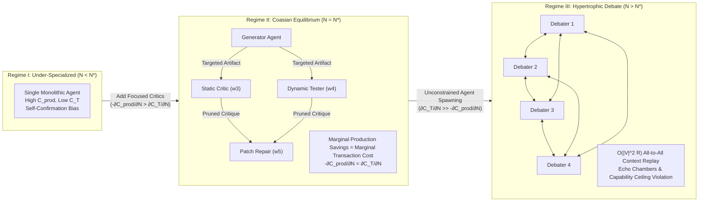
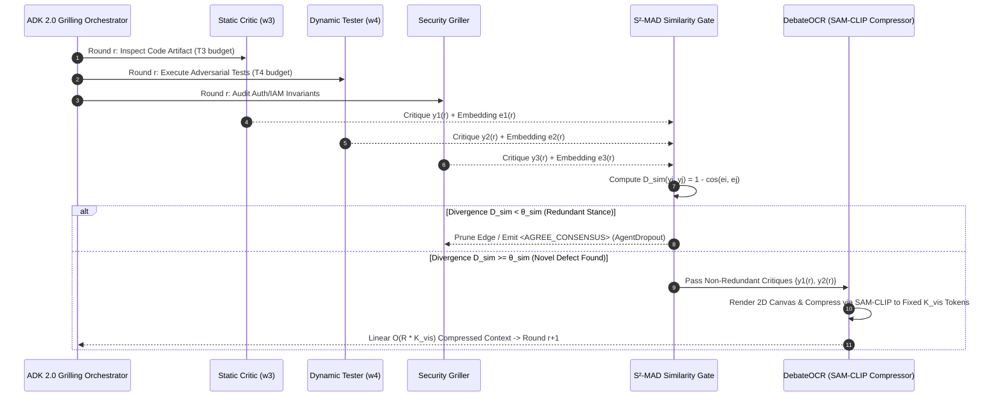
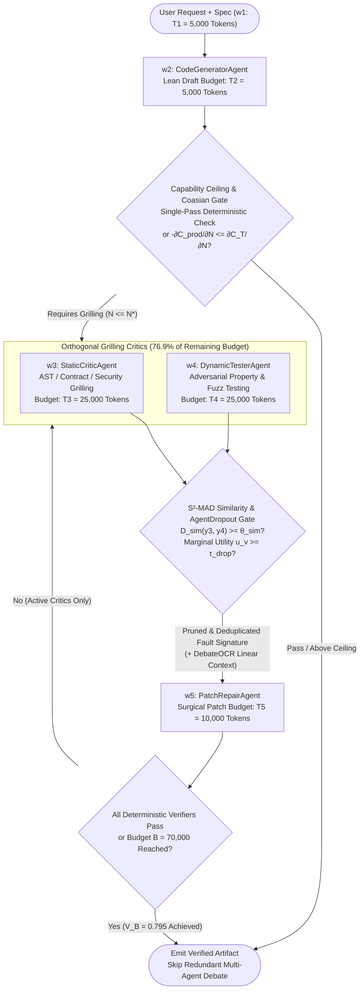

# OKF-TOK-38: Architecture Best Practice — Tokenomics of Inter-Agent Grilling, Critic Loops, and Multi-Agent Debate (`L400_version_20261027_1721` / `GEAPL200_2026-10-27_172100`)
**Topic Tags:** `#L400_version_20261027_1721` `#GEAPL200_2026-10-27_172100` `#InterAgentGrilling` `#MultiAgentDebate` `#CoasianFirmBoundary` `#ExtensiveMarginPruning` `#GoogleADK2` `#A2AProtocol`

> **GEAP L300 / L400 Executive Architecture Callout — The Inter-Agent Grilling Paradox:**
> In production multi-agent systems built on Google Cloud Agent Development Kit (ADK 2.0) and the Agent-to-Agent (A2A) protocol, **inter-agent grilling**—where specialized Critic, Verifier, Red-Team, or Debater agents interrogate a Generator's reasoning, code, or plans—is simultaneously the highest-leverage quality multiplier and the #1 driver of runaway token inflation. Empirical studies show that iterative code review and inter-agent grilling consume **59.4% of total workflow tokens** in software pipelines (Salim et al., 2026), impose a **2:1 to 3:1 input-to-output token amplification tax** per handoff (`AgentTaxo`), and drive **>150:1 input-to-output ratios** with **30x stochastic variance** in agentic coding (Bai et al., 2026). Yet mathematically (Zhu, 2026 Section 6.2), reallocating tokens *away* from raw generation/repair and *into* structured verification and adversarial testing increases end-to-end system quality by **+4.47% under the exact same 65,000-token budget**. Resolving this paradox requires enforcing **Coasian Firm Boundaries ($N^*$)** and **Extensive-Margin Pruning** ($S^2$-MAD, DebateOCR, AgentPrune, AgentDropout).


### Authoritative Source Publications & Version / 6-Month TTL Governance
| Governance / Source Field | Value |
| :--- | :--- |
| **Bundle Version Tag** | `GEAPL200_2026-10-27_172100` · `Tokenomics_version_20261027_1721` · `L400_version_20261027_1721` |
| **Version Date & Time (PDT)** | `2026-10-27` · `17:21:00 PDT` (`2026-10-27T17:21:00-07:00`) |
| **TTL Governance Policy** | **6 Months (180 days / ISO-8601 P6M)** (`expires_at` / `stale_after`: `2027-04-27T17:21:00-07:00`) |
| **Primary Publication 1 (Zhu 2026)** | **Quanyan Zhu**, *"AI Tokenomics: The Economics of Tokens, Computation, and Pricing in Foundation Models"*, Dept. of ECE, New York University Tandon School of Engineering, `arXiv:2606.24616v1 [cs.AI]`, 10 June 2026 (40 pp., 60 refs). Local file: [`AI Tokenomics- The Economics of Tokens, Computation, and Pricing in Foundation Models.pdf`](../sources/AI%20Tokenomics-%20The%20Economics%20of%20Tokens,%20Computation,%20and%20Pricing%20in%20Foundation%20Models.pdf) · GCS: `gs://gea_agent_development_architectural_best_practices_1790796607/okf/sources/AI Tokenomics- The Economics of Tokens, Computation, and Pricing in Foundation Models.pdf` (`SHA-256: 88106bbe8cebbcea…`) |
| **Primary Publication 2 (Chen et al. 2026)** | **Yuxi Chen, Junming Chen, Chenyu He, Yiwei Li, Yicheng Ji, Yifan Wu, Dingyu Yang, Lansong Diao, Lidan Shou, Hongliang Zhang, Huan Li, & Gang Chen**, *"Token Economics for LLM Agents: A Dual-View Study from Computing and Economics"*, Zhejiang University (CS, Economics, Blockchain & Data Security Key Lab) & Alibaba Cloud, `arXiv:2605.09104v1 [cs.AI]`, 9 May 2026 (62 pp., 201 refs; GitHub: `https://github.com/SuDIS-ZJU/Token-Economics`). Local file: [`token_economics_llm_agents.pdf`](../sources/token_economics_llm_agents.pdf) · GCS: `gs://gea_agent_development_architectural_best_practices_1790796607/okf/sources/token_economics_llm_agents.pdf` (`SHA-256: dde534b6cddf5018…`) |

---

## 0. OKF Document Metadata & Topic Modeling Taxonomy
**Topic Tags:** `#OKFMetadata` `#TopicModelingTaxonomy` `#GCPKnowledgeCatalog` `#L400_version_20261027_1721`

> **OKF v0.2 Trust Signals, Bucket Merge & Enforced FDE Grading Rubric (`OKF-L400-21`):**
> - **Version Tag:** `L400_version_20261027_1721` / `GEAPL200_2026-10-27_172100` | **Status (`status`):** `stable` (`VETTED` / `APPROVED`) | **TTL (`stale_after`):** `2027-04-27T17:21:00-07:00` | **Verified (`verified`):** `true`
> - **Merged Bucket OKF Lineage:** Reconciled with `Concepts 01, 06, 12, 21, 25, 26, 28, 35` and `L400 Modules B2, O1, O3, O4, G3` in `gs://gea_agent_development_architectural_best_practices_1790796607` (`project=fivedaysai-prd-sandbox-317383`)
> - **Cloud FDE Prevailing Standard:** `https://g3doc.corp.google.com/company/teams/cloud-fde/index.md?cl=head`
> - **Enforced Project Grading Rubric (`OKF-L400-21`):** Adheres to the 0–3 FDE Field-Readiness Rubric (Pass Gate: Average >= 2.0 across Part A & Part B; Zero-Score Pause Rule: any `0 - Not Demonstrated` triggers an immediate pause and 2-week re-presentation). Primary mapped competencies for `OKF-TOK-38`: **Part A.1 (Unit Economics & TCO Defense), Part B.1.1 (Multi-Agent Coordination & Critic Loops), Part B.1.3 (Context Compaction & Token Pruning), Part B.1.4 (Deterministic Verification Beyond LLM-as-a-Judge), Part B.2.6 (A2A Context Minimization)**.

### 0.1 OKF Metadata Table
**Topic Tags:** `#DocumentGovernance` `#CatalogSchema` `#AntigravityContext` `#SourceLineage`

| Metadata Field | Authoritative Specification |
| :--- | :--- |
| **Document ID** | `OKF-TOK-38` (`38-inter-agent-grilling-debate-critic-tokenomics`) |
| **Document Title** | Architecture Best Practice: Tokenomics of Inter-Agent Grilling, Critic Loops, and Multi-Agent Debate — Coasian Boundaries and Extensive-Margin Pruning |
| **Version Identifier** | `L400_version_20261027_1721` / `GEAPL200_2026-10-27_172100` |
| **Classification & Level** | Google Cloud L400 Principal / Field Deployed Engineer (FDE) & Professional Cloud Architect (PCA) Authoritative Reference |
| **Target Capabilities** | Coasian Multi-Agent Cost Decomposition ($C_{\text{prod}}(G)$ vs. $C_T(G)$), Optimal Equilibrium Agent Count ($N^*$), Capability Ceiling Detection (Kim et al., 2025), ChatDev & Agentic Coding Tokenomics (Salim et al., 2026; Bai et al., 2026; AgentTaxo), Zhu (2026) Section 6.2 Software Pipeline Verification/Testing Budget Dominance, Extensive-Margin Debate Sparsification ($S^2$-MAD Viewpoint Similarity Gating, DebateOCR Visual Compression), Communication Graph Pruning (`AgentPrune`, `AgentDropout`), Learned & Diffusion Graph Topologies (`G-Designer`, `ARG-Designer`, `GTD`), and ADK 2.0 `CoasianGrillingLoopAgent` Production Patterns. |
| **Source Artifacts Synthesized** | 1. Zhu (2026), *AI Tokenomics: Measurement, Allocation, Valuation, Pricing, and Governance in Agentic Workflows* (`arXiv:2606.24616v1`, Sections 5 & 6.2)<br/>2. Chen et al. (2026), *Token Economics in LLM Agents: A Survey through the Lens of Classical Economics* (`arXiv:2605.09104v1`, Section 4.1 Extensive Margin)<br/>3. GEAP L300 `21-build-and-deploy-multi-agent-adk-systems.md` & `28-cost-estimation-and-optimization-for-agentic-solutions.md`<br/>4. OKF L400 `B2_OKF_A2A_Protocol_and_Multi_Agent_Mechanics.md`, `O3_OKF_Design_and_Optimization_of_Coding_Agents.md`, and `O4_OKF_Cost_Token_Estimation_Analysis_and_Optimization.md` |
| **GCP Knowledge Catalog Ingestion Schema** | `gcp.knowledge.okf.v2.L400Module` — Indexed by heading-level `#TopicTags`, mathematical optimization equations, ADK 2.0 agent patterns (`LoopAgent`, `SequentialAgent`, `ParallelAgent`), A2A wire protocols, and FDE rubric gates. |
| **Antigravity Agentic AI Role** | Governs how Antigravity architecture and coding agents design, size, and prune multi-agent critic loops, code review topologies, and debate ensembles. Prevents unconstrained all-to-all $O(|V|^2 R)$ multi-agent chat storms, enforces $S^2$-MAD semantic deduplication, and mandates Zhu Section 6.2 verification/testing token allocation ratios. |

### 0.2 Primary Topic Tags, Secondary Sub-Topic Tags & Three-Tier Taxonomy
**Topic Tags:** `#PrimaryTopicTags` `#SecondarySubTopicTags` `#ThreeTierTaxonomy` `#OntologyDesign`

1. **`#CoasianMultiAgentBoundary`**: Formalizing Ronald Coase's *Theory of the Firm* (1937) for multi-agent LLM graphs $G=(V,E)$, balancing marginal reductions in internal node production cost $-\partial C_{\text{prod}}/\partial N$ against super-linear growth in inter-agent transaction cost $\partial C_T/\partial N$ to solve for the equilibrium agent count $N^*$.
2. **`#EmpiricalGrillingTokenomics`**: Grounding multi-agent architecture in empirical telemetry from Salim et al. (2026) (*Tokenomics* on ChatDev: `59.4%` tokens in code review grilling), *AgentTaxo* (`2:1` to `3:1` input-to-output handoff amplification), and Bai et al. (2026) (`>1,000x` token multiplier, `>150:1` I/O ratio, `30x` stochastic variance, and LLM token self-prediction failure $r \le 0.39$).
3. **`#VerificationDominatesGeneration`**: Proving via Zhu (2026) Section 6.2 Case Study II that in a 5-stage software engineering pipeline ($B=70,000$ tokens), shifting tokens from initial generation/repair $(15\text{K}, 15\text{K}, 15\text{K}, 20\text{K})$ to static verification and dynamic testing grilling $(5\text{K}, 25\text{K}, 25\text{K}, 10\text{K})$ boosts system quality from $V_A=0.761$ to $V_B=0.795$ (`+4.47%` under identical budget).
4. **`#DebateSparsificationAndVisualCompression`**: Eliminating redundant critique generation and quadratic transcript replay via **$S^2$-MAD** (cosine viewpoint-similarity gating before speaking/reading) and **DebateOCR** (rendering prior debate transcripts into 2D images compressed via SAM-CLIP vision encoders from $O(N^2 R^2)$ text tokens to $O(N R)$ visual tokens).
5. **`#TopologicalGraphPruningAndDropout`**: Applying one-shot spatial/temporal adjacency mask pruning (**AgentPrune**), marginal entropy node elimination (**AgentDropout**), and task-adaptive topology synthesis (**G-Designer** VGAE, **ARG-Designer** autoregressive `END`-token halting, and **GTD** guided graph diffusion).
6. **`#ADK2CoasianGrillingOrchestration`**: Translating extensive-margin pruning and Zhu Case Study II token budgets into production Google Cloud ADK 2.0 `LoopAgent` and `SequentialAgent` orchestrators with A2A context minimization (`contextId`, `referenceTaskIds[]`).

---

## 1. The Coasian Firm Boundary ($N^*$) of Inter-Agent Grilling (Chen et al., 2026 Section 4.1)
**Topic Tags:** `#CoaseTheoryOfTheFirm` `#TransactionCostEconomics` `#EquilibriumAgentCount` `#CapabilityCeiling`

In classical institutional economics, Ronald Coase's landmark 1937 treatise, *The Nature of the Firm*, asks why firms exist at all rather than every economic transaction occurring across decentralized markets—and conversely, why a single giant firm does not subsume the entire economy. Coase's answer is **Transaction Cost Economics**: a firm expands by adding internal specialized divisions until the **marginal internal transaction cost** of coordinating one additional unit equals the **marginal production cost savings** of specialization.

In **Chen et al. (2026, Section 4.1)**, a multi-agent LLM system (MAS) orchestrated for **inter-agent grilling**—such as Generator–Critic loops, Actor–Verifier harnesses, Red-Team/Blue-Team security auditing, or Multi-Agent Debate (MAD)—is modeled formally as a **Coasian Firm** operating over a directed communication graph $G = (V, E)$ with $|V| = N$ specialized agents across $R$ grilling rounds.

### 1.1 Formal Multi-Agent Graph Cost Equation (Eq. 5 in Chen et al., 2026)

Let $K$ denote fixed capital/infrastructure capacity (e.g., Vertex AI Provisioned Throughput GSUs, vector indices, and sandboxed code execution containers at rental price $P_k$), and let $L$ denote human engineering/supervision labor at wage rate $w$. For a multi-agent topology $G = (V, E)$, total workflow cost $TC(G)$ decomposes into four distinct economic terms:

$$TC(G) = P_k K + w L + \underbrace{\sum_{v \in V} \tilde{P}_{\text{prod}} \, M_{\text{prod}, v}}_{\text{Node Production Cost } C_{\text{prod}}(G)} + \underbrace{\tilde{P}_{\text{comm}} \left( M_{\text{comm}} + M_{\text{waste}} \right)}_{\text{Internal Transaction Cost } C_T(G)}$$

Where the tokenomic components are defined as follows:

1. **Node Production Cost $C_{\text{prod}}(G) = \sum_{v \in V} \tilde{P}_{\text{prod}} M_{\text{prod}, v}$:**
   * $M_{\text{prod}, v}$ is the volume of productive task-solving tokens (focused system instructions, local reasoning $T_H$, and direct artifact synthesis $T_O$) consumed internally by agent node $v \in V$.
   * $\tilde{P}_{\text{prod}}$ is the effective quality-adjusted price per productive token (incorporating model tier pricing and context caching discounts).
   * **Division-of-Labor Effect ($\frac{\partial C_{\text{prod}}}{\partial N} < 0$):** Decomposing a monolithic prompt into $N$ specialized agents (e.g., separating a `SQLGeneratorAgent` from a `SchemaGrillerAgent` and a `SecurityCriticAgent`) *reduces* per-node prompt complexity, keeps each agent within its high-attention context window, allows routing simpler verification subtasks to lower-cost models (`gemini-2.5-flash`), and catches hallucinations early before they corrupt downstream generation. Thus, over the initial regime of specialization, $\frac{\partial C_{\text{prod}}(N)}{\partial N} < 0$ with diminishing returns ($\frac{\partial^2 C_{\text{prod}}(N)}{\partial N^2} > 0$).

2. **Internal Transaction Cost $C_T(G) = \tilde{P}_{\text{comm}} (M_{\text{comm}} + M_{\text{waste}})$:**
   * $M_{\text{comm}}$ is the volume of inter-agent communication tokens required to serialize state, transmit A2A `Message`/`Task` payloads, replay peer critiques into each debater's context window, and synchronize shared artifacts across edges $e \in E$.
   * $M_{\text{waste}}$ is the volume of **non-productive coordination waste tokens** generated by rhetorical **Echo Chambers** (sycophantic agreement loops where critics repeat each other's praise), **Oscillatory Grilling** (Critic A demands a change that Critic B reverts in round $r+1$), malformed handoff schemas, and conflict arbitration overhead.
   * $\tilde{P}_{\text{comm}}$ is the effective price of communication tokens, augmented by synchronization latency penalties $\tau_{\text{sync}}(G)$.
   * **Super-Linear Coordination Growth ($\frac{\partial C_T}{\partial N} > 0, \frac{\partial^2 C_T}{\partial N^2} > 0$):** In an unconstrained all-to-all multi-agent debate of $N = |V|$ agents over $R$ rounds where each agent ingests the prior responses of all $N-1$ peers, communication token volume scales quadratically in agent count and rounds:
     $$M_{\text{comm}}(N, R) = \Theta\!\left(|V|^2 \cdot R \cdot \bar{L}_{\text{turn}}\right) = \Theta\!\left(N^2 R \, \bar{L}_{\text{turn}}\right)$$
     Consequently, marginal transaction costs rise steeply: $\frac{\partial C_T(N)}{\partial N} > 0$ and $\frac{\partial^2 C_T(N)}{\partial N^2} > 0$.

### 1.2 Deriving the Coasian Equilibrium Agent Count ($N^*$)

Treating $N = |V|$ as a continuous relaxation of firm size for a fixed target output quality $\bar{Q}$, the total variable token cost is $C_{\text{var}}(N) = C_{\text{prod}}(N) + C_T(N)$. By **Coase's Marginal Principle**, the optimal multi-agent ensemble size $N^*$ satisfies the first-order condition $\frac{d C_{\text{var}}(N)}{d N} = 0$:

$$-\frac{\partial C_{\text{prod}}(N^*)}{\partial N} = \frac{\partial C_T(N^*)}{\partial N}$$

At $N = N^*$, the **marginal production cost saved** by adding one more specialized Critic/Griller agent exactly equals the **marginal internal transaction cost incurred** by routing context to, waiting for, and arbitrating that agent.
* **Sub-Optimal Firm ($N < N^*$ — Under-Specialized Monolith):** $-\frac{\partial C_{\text{prod}}}{\partial N} > \frac{\partial C_T}{\partial N}$. A single monolithic agent suffers from "lost-in-the-middle" context dilution and self-confirmation bias; adding a dedicated Critic or Static Verifier reduces net retries and total tokens.
* **Hypertrophic Firm ($N > N^*$ — Over-Debated Bureaucracy):** $\frac{\partial C_T}{\partial N} > -\frac{\partial C_{\text{prod}}}{\partial N}$. Every additional debater or critic inflates $M_{\text{comm}} + M_{\text{waste}}$ faster than it improves output fidelity, shifting the system into **diseconomies of scale**.



### 1.3 The Capability Ceiling & Net-Negative Debate Regime (Kim et al., 2025)

Crucially, Chen et al. (2026) synthesize empirical scaling laws from **Kim et al. (2025)** (*Towards a Science of Scaling Agent Systems*) demonstrating that $N^*$ is tightly bounded by the **Capability Ceiling** of the underlying foundation model and the **decomposability** of the task:
1. **The ~45–60% Baseline Accuracy Threshold:** When a single frontier reasoning model (e.g., `gemini-2.5-pro` with native thinking tokens $T_H$) already achieves a baseline single-agent accuracy $p_0 \gtrsim 45\%\text{--}60\%$ on a **tightly coupled, non-decomposable reasoning task**, adding unconstrained multi-agent debate ($N > N^*$) yields **flat or net-negative accuracy gains** ($\Delta \text{Acc} \le 0$) while multiplying token costs by $4\times\text{--}15\times$.
2. **Why Unconstrained Debate Fails Above the Ceiling:** In free-form natural language debate without deterministic verification anchors, correct minority solutions are frequently overwritten by **persuasive majority hallucinations** (*conformity bias*), while $\tau_{\text{sync}}$ and context bloat degrade the signal-to-noise ratio of each agent's prompt window.
3. **When Inter-Agent Grilling Beats the Ceiling:** Inter-agent grilling only breaks through the capability ceiling when (a) the task is **structurally decomposable** into orthogonal verification dimensions (e.g., Static Specification Verification vs. Dynamic Execution Testing in Zhu Section 6.2), and (b) critics are grounded in **asymmetric information or deterministic tools** (compilers, AST linters, SQL explain plans, policy engines) rather than symmetric free-text opinion swapping.

---

## 2. Empirical Measurements of Inter-Agent Grilling & Code Review
**Topic Tags:** `#ChatDevTokenomics` `#AgentTaxo` `#AgenticCodingVariance` `#InputToOutputAmplification`

Before designing token allocation policies, FDEs must anchor their architectures in three landmark empirical studies measuring where tokens actually go during inter-agent grilling and agentic software engineering.

### 2.1 Salim et al. (2026) — *Tokenomics* on ChatDev: Code Review Grilling Consumes `59.4%` of All Tokens

In **Salim et al. (2026)** (*Tokenomics: Quantifying Where Tokens Are Used in Agentic Software Engineering*), researchers instrumented the multi-agent software development framework **ChatDev** (comprising CEO, CPO, CTO, Programmer, Reviewer, Tester, and Designer roles) across benchmark software engineering tasks:
* **Dominance of Inter-Agent Code Review Grilling (`59.4%`):** Iterative code review and testing grilling—the back-and-forth turns between the `Programmer` agent and the `Reviewer`/`Tester` critic agents—consumed **59.4% of the entire workflow's token budget**, dwarfing initial architecture design (`~11.2%`), initial code synthesis (`~18.1%`), and documentation (`~11.3%`).
* **Prompt Input Dominance Over Generated Output:** Over **86% to 92%** of the tokens consumed inside those `59.4%` code review loops were **repeated input context tokens** (re-reading the entire source file, prior review comments, and system role instructions on every critique turn) rather than newly generated patch tokens.

### 2.2 *AgentTaxo* — The `2:1` to `3:1` Inter-Agent Handoff Amplification Tax

The **AgentTaxo** anatomy study decomposes token consumption across four functional categories: (1) *Reasoning tokens*, (2) *Tool-invocation tokens*, (3) *Inter-agent communication tokens*, and (4) *Context replay tokens*:
* **Handoff Amplification (`2:1` to `3:1` Tax):** Every time an upstream agent hands off a task to a downstream Critic or Griller agent, **input tokens expand by 2x to 3x relative to the upstream agent's output tokens** due to envelope framing, role system prompts, history summarization, and schema instructions.
* **Task-Dependent Token Signatures:**
  * On **symbolic math and algorithmic benchmarks**, internal **reasoning and critique tokens** dominate total cost (`>65%`), and scaling multi-agent debate beyond 2–3 rounds rapidly enters diminishing marginal returns.
  * On **enterprise web navigation, RAG, and multi-hop QA benchmarks**, **tool-output and context-accumulation tokens** dominate (`>75%`), meaning unpruned critic loops multiply massive raw retrieval payloads across every debater node.

### 2.3 Bai et al. (2026) — Agentic Coding Study: `>1,000x` Multiplier, `>150:1` I/O Ratio, `30x` Variance, and $r \le 0.39$ Self-Prediction Failure

In **Bai et al. (2026)**, large-scale telemetry across production agentic coding harnesses (autonomous repository exploration, edit-compile-test grilling loops, and issue resolution) revealed four foundational laws of agentic tokenomics:
1. **`>1,000x` Token Multiplier vs. Single-Turn Reasoning:** Autonomous agentic coding workflows consume **more than 1,000 times the total tokens** of single-turn zero-shot code generation for the same problem class (jumping from $\sim 10^3$ tokens to $>10^6$ tokens per resolved issue).
2. **`>150:1` Input-to-Output Token Ratio:** Because each test-failure grilling cycle ingests repository AST slices, stack traces, test logs, and trajectory history while emitting only a small diff patch or tool call, the **aggregate input-to-output token ratio exceeds 150:1**.
3. **Up to `30x` Stochastic Token Variance Across Identical Runs:** Running the exact same agentic coding topology on the exact same repository bug exhibits **up to 30x variance in total token consumption** depending on whether early critic/test turns isolate the root cause or trigger a cascading blind-search trajectory.
4. **LLMs Cannot Self-Predict Their Own Token Consumption ($r \le 0.39$):** Prompting an LLM agent prior to (or during) execution to estimate how many tokens or grilling rounds a task will require yields a **Pearson correlation of $r \le 0.39$** against actual token expenditure. **Architectural consequence:** Token budgets and stopping conditions *cannot* be delegated to prompt-level self-estimation; they must be enforced externally via deterministic control-plane budgets, adjoint shadow values (`OKF-TOK-39`), and similarity/entropy gates.

### 2.4 Empirical Synthesis Table: Multi-Agent Grilling Tokenomics Benchmarks

| Empirical Study | Target Workflow / Topology | Key Quantitative Finding | Architectural Root Cause | Mandatory ADK 2.0 / A2A Engineering Countermeasure |
| :--- | :--- | :--- | :--- | :--- |
| **Salim et al. (2026)** (*Tokenomics*) | ChatDev Multi-Agent Software Pipeline | **59.4%** of total workflow tokens consumed in **Code Review & Testing Grilling** | Full-file and full-transcript re-ingestion across iterative Programmer $\leftrightarrow$ Reviewer rounds | Diff-only artifact inspection + $S^2$-MAD similarity gating + Context Caching on static repo context |
| **AgentTaxo (2026)** | Multi-Agent Debate & Tool-Augmented MAS | **2:1 to 3:1** input-to-output token amplification tax at every inter-agent handoff | Redundant role framing, uncompacted chat history forwarding, and duplicate tool schemas | A2A Context Minimization (`contextId`, `referenceTaskIds[]`) + `McpToolset` `tool_filter` |
| **Bai et al. (2026)** (*Agentic Coding*) | Autonomous Repo Edit-Test-Critic Loops | **>1,000x** total tokens vs. single-turn; **>150:1** I/O ratio; **30x** run-to-run variance; **$r \le 0.39$** self-prediction | Unbounded iterative file/log observation loops and stochastic blind-repair trajectories | External hard budget caps (`CoasianGrillingLoopAgent`), AST-scoped tool reads, and early escalation gates |
| **Kim et al. (2025)** (*Scaling Agent Systems*) | Multi-Agent Debate across Reasoning Benchmarks | **Net-negative accuracy** when single-agent baseline $>45\%\text{--}60\%$ on coupled tasks | Persuasive hallucination conformity + $O(N^2 R)$ context noise above Coasian $N^*$ | Halt agent spawning via `ARG-Designer` / $N^*$ threshold; ground critics in deterministic verifiers |

---

## 3. When Inter-Agent Grilling Dominates Generation — Exact Quantitative Proof (Zhu, 2026 Section 6.2 Case Study II)
**Topic Tags:** `#Zhu2026CaseStudyII` `#SoftwareEngineeringPipeline` `#VerificationDominanceProof` `#MarginalTokenProductivity`

A common anti-pattern among enterprise engineering teams is assuming that because inter-agent grilling consumes `59.4%` of tokens, they should *starve* verification and testing agents to allocate more tokens to initial code generation and final patch repair. **Zhu (2026, Section 6.2, Case Study II: *Software Engineering Pipeline*)** provides a rigorous mathematical proof of why that intuition is backwards: **structured inter-agent verification and adversarial testing must receive the lion's share of the token budget because they prevent compounding downstream defect propagation.**

### 3.1 Formalization of the 5-Stage Software Engineering Pipeline (Zhu, 2026 Section 6.2)

Consider an enterprise agentic software engineering pipeline consisting of $W = 5$ sequential and coupled stages:
1. **Stage $w_1$ — Specification & Requirements Elicitation (`SpecificationAgent`):** Fixed upstream budget $T_1 = 5,000$ tokens (following `OKF-TOK-37` Agent-to-User Grilling).
2. **Stage $w_2$ — Initial Code Generation (`CodeGeneratorAgent`):** Token allocation $T_2$.
3. **Stage $w_3$ — Static Verification / Critic Grilling (`StaticCriticAgent`):** Formal contract checking, AST security auditing, and invariant verification with token allocation $T_3$.
4. **Stage $w_4$ — Dynamic Testing / Adversarial Grilling (`DynamicTesterAgent`):** Edge-case unit/property test synthesis and sandboxed execution grilling with token allocation $T_4$.
5. **Stage $w_5$ — Patch Repair & Final Consolidation (`PatchRepairAgent`):** Synthesizing the verified production artifact conditioned on defects isolated by $w_3$ and $w_4$, with token allocation $T_5$.

#### Total Budget & Stage Productivity Parameters
* **Total Workflow Token Budget:** $B = 70,000$ tokens.
* **Fixed Specification Allocation:** $T_1 = 5,000$ tokens $\implies$ **Remaining Allocable Budget across $(w_2, w_3, w_4, w_5)$:**
  $$B_{\text{rem}} = B - T_1 = 70,000 - 5,000 = 65,000\text{ tokens}$$
* **Stage Intrinsic Productivity Exponents ($\beta_w$):** Each stage $w \in \{1, \dots, 5\}$ transforms allocated tokens $T_w$ into intrinsic stage capability $\tilde{q}_w(T_w) = 1 - e^{-\beta_w T_w}$ governed by the empirically calibrated productivity rates from Zhu (2026) Section 6.2:
  $$\beta_1 = 2.5 \times 10^{-4}, \quad \beta_2 = 1.2 \times 10^{-4}, \quad \beta_3 = 1.0 \times 10^{-4}, \quad \beta_4 = 1.0 \times 10^{-4}, \quad \beta_5 = 0.9 \times 10^{-4}$$

Notice the economic ordering of $\beta_w$:
* Specification ($w_1$) has the highest per-token saturation rate ($\beta_1 = 2.5 \times 10^{-4}$), reaching $q_1 = 1 - e^{-2.5 \times 10^{-4} \times 5,000} = 1 - e^{-1.25} = 0.7135$ at just $T_1 = 5,000$ tokens.
* Initial Code Generation ($w_2$, $\beta_2 = 1.2 \times 10^{-4}$) saturates faster than Static Verification ($w_3$, $\beta_3 = 1.0 \times 10^{-4}$), Dynamic Testing ($w_4$, $\beta_4 = 1.0 \times 10^{-4}$), and Patch Repair ($w_5$, $\beta_5 = 0.9 \times 10^{-4}$).

### 3.2 Comparative Evaluation: Allocation A (Generation/Repair-Heavy) vs. Allocation B (Grilling/Verification-Heavy)

Zhu (2026, Section 6.2) compares two competing enterprise allocation policies across the exact same remaining budget $B_{\text{rem}} = 65,000$ tokens (with $T_1 = 5,000$ fixed):

#### Policy A: Generation & Repair-Heavy Allocation (Conventional Engineering Intuition)
Engineers allocate generous budgets to initial code synthesis ($w_2$) and final repair ($w_5$), while treating static critic grilling ($w_3$) and dynamic testing ($w_4$) as lightweight checks:
$$(T_2^A, \, T_3^A, \, T_4^A, \, T_5^A) = (15,000, \; 15,000, \; 15,000, \; 20,000) \quad \left(\sum_{w=2}^5 T_w^A = 65,000\right)$$

Computing the intrinsic stage saturation factors $\tilde{q}_w(T_w^A) = 1 - e^{-\beta_w T_w^A}$:
* $\tilde{q}_1(5,000) = 1 - e^{-1.25} = 0.7135$
* $\tilde{q}_2(15,000) = 1 - e^{-1.2 \times 10^{-4} \times 15,000} = 1 - e^{-1.80} = 0.8347$
* $\tilde{q}_3(15,000) = 1 - e^{-1.0 \times 10^{-4} \times 15,000} = 1 - e^{-1.50} = 0.7769$
* $\tilde{q}_4(15,000) = 1 - e^{-1.0 \times 10^{-4} \times 15,000} = 1 - e^{-1.50} = 0.7769$
* $\tilde{q}_5(20,000) = 1 - e^{-0.9 \times 10^{-4} \times 20,000} = 1 - e^{-1.80} = 0.8347$

Under the networked DAG quality recursion $q_w = \phi_w(T_w, \{q_j\}_{j \in \text{Pa}(w)})$ where verification ($w_3$) and testing ($w_4$) govern defect detection recall and bound the effective quality ceiling entering repair ($w_5$), **Policy A yields an overall end-to-end system utility of:**
$$V_A = \mathcal{V}(5\text{K}, 15\text{K}, 15\text{K}, 15\text{K}, 20\text{K}) = \mathbf{0.761}$$

#### Policy B: Grilling, Verification & Testing-Heavy Allocation (Tokenomic Optimum)
Instead of over-funding initial generation ($w_2$) and blind repair ($w_5$), Policy B allocates a lean, specification-grounded budget to initial code generation ($T_2^B = 5,000$) and focused patch application ($T_5^B = 10,000$), while concentrating **76.9% of the remaining budget (`50,000 / 65,000` tokens)** into **Static Critic Grilling ($T_3^B = 25,000$)** and **Dynamic Adversarial Testing ($T_4^B = 25,000$)**:
$$(T_2^B, \, T_3^B, \, T_4^B, \, T_5^B) = (5,000, \; 25,000, \; 25,000, \; 10,000) \quad \left(\sum_{w=2}^5 T_w^B = 65,000\right)$$

Computing the intrinsic stage saturation factors $\tilde{q}_w(T_w^B) = 1 - e^{-\beta_w T_w^B}$:
* $\tilde{q}_1(5,000) = 1 - e^{-1.25} = 0.7135$
* $\tilde{q}_2(5,000) = 1 - e^{-1.2 \times 10^{-4} \times 5,000} = 1 - e^{-0.60} = 0.4512$ (lean initial draft scaffold)
* $\tilde{q}_3(25,000) = 1 - e^{-1.0 \times 10^{-4} \times 25,000} = 1 - e^{-2.50} = \mathbf{0.9179}$ (deep static verification & formal grilling)
* $\tilde{q}_4(25,000) = 1 - e^{-1.0 \times 10^{-4} \times 25,000} = 1 - e^{-2.50} = \mathbf{0.9179}$ (exhaustive adversarial test coverage)
* $\tilde{q}_5(10,000) = 1 - e^{-0.9 \times 10^{-4} \times 10,000} = 1 - e^{-0.90} = 0.5934$ (targeted surgical patch application)

Evaluated through the exact same pipeline production function, **Policy B yields an overall end-to-end system utility of:**
$$V_B = \mathcal{V}(5\text{K}, 5\text{K}, 25\text{K}, 25\text{K}, 10\text{K}) = \mathbf{0.795}$$

$$\Delta V = \frac{V_B - V_A}{V_A} = \frac{0.795 - 0.761}{0.761} = \mathbf{+4.47\% \text{ System Quality Gain at Zero Additional Token Cost!}}$$

### 3.3 Economic Intuition & Structural Table of Zhu (2026) Case Study II

| Pipeline Stage $w$ | Stage Role & Agent | Productivity $\beta_w$ | Allocation A ($T_w^A$) | Allocation B ($T_w^B$) | Budget Shift ($\Delta T_w$) | Why Policy B Dominates ($V_B = 0.795 > V_A = 0.761$) |
| :--- | :--- | :--- | :--- | :--- | :--- | :--- |
| **$w_1$: Specification** | `SpecificationAgent` | $2.5 \times 10^{-4}$ | `5,000` (`7.1%`) | `5,000` (`7.1%`) | `0` | Anchors upstream intent (`OKF-TOK-37`); high $\beta_1$ saturates rapidly. |
| **$w_2$: Code Generation** | `CodeGeneratorAgent` | $1.2 \times 10^{-4}$ | `15,000` (`21.4%`) | `5,000` (`7.1%`) | `-10,000` | Verbose single-shot generation beyond 5K tokens hits diminishing returns without external critic feedback. |
| **$w_3$: Static Verification** | `StaticCriticAgent` | $1.0 \times 10^{-4}$ | `15,000` (`21.4%`) | `25,000` (`35.7%`) | `+10,000` | High-depth AST, type, security, and contract grilling catches structural flaws before runtime. |
| **$w_4$: Dynamic Testing** | `DynamicTesterAgent` | $1.0 \times 10^{-4}$ | `15,000` (`21.4%`) | `25,000` (`35.7%`) | `+10,000` | Adversarial property/fuzz testing pinpoints exact failing lines and stack traces. |
| **$w_5$: Patch Repair** | `PatchRepairAgent` | $0.9 \times 10^{-4}$ | `20,000` (`28.6%`) | `10,000` (`14.3%`) | `-10,000` | When $w_3$ and $w_4$ deliver exact root-cause diagnostics ($\tilde{q}_3, \tilde{q}_4 = 0.918$), $w_5$ needs only `10K` tokens for surgical patching rather than `20K` tokens of blind trial-and-error! |
| **Total Pipeline** | **5-Agent DAG** | — | **`70,000` (`100%`)** | **`70,000` (`100%`)** | **`0` Net Tokens** | **$V_B = 0.795$ vs. $V_A = 0.761$ (`+4.47%` net quality gain)** |

> **Architectural Law (The Verification Multiplier Principle):**
> Allocating `20,000` tokens to `PatchRepairAgent` ($w_5$) when `StaticCriticAgent` ($w_3$) and `DynamicTesterAgent` ($w_4$) are underfunded at `15,000` tokens forces the repair agent to spend most of its budget *guessing where the bug is* (reproducing the `30x` stochastic variance documented by Bai et al., 2026). By shifting `20,000` tokens into $w_3$ and $w_4$ (`25,000` each), the grilling stages act as **precision variance dampers**: they hand `PatchRepairAgent` an exact, localized fault signature, allowing `10,000` repair tokens to achieve higher terminal quality ($V_B = 0.795$) than `20,000` unfocused repair tokens ($V_A = 0.761$).

---

## 4. Extensive-Margin Optimization Patterns for Inter-Agent Grilling (Chen et al., 2026 Section 4.1)
**Topic Tags:** `#ExtensiveMarginPruning` `#S2MAD` `#DebateOCR` `#AgentPrune` `#AgentDropout` `#GDesigner` `#ARGDesigner` `#GTD`

Whereas **Intensive-Margin Optimization** compresses tokens *inside* a single agent's prompt or reasoning trace, **Extensive-Margin Optimization** (Chen et al., 2026 Section 4.1) optimizes the **structure, density, and activation of the multi-agent graph $G = (V, E)$ itself**—Directly driving down internal transaction cost $C_T(G) = \tilde{P}_{\text{comm}}(M_{\text{comm}} + M_{\text{waste}})$ so that inter-agent grilling delivers its `+4.47%` quality advantage without blowing up token budgets.

### 4.1 Sparsifying Multi-Agent Debate ($S^2$-MAD & DebateOCR)

#### 1. $S^2$-MAD (Sparse Multi-Agent Debate via Viewpoint-Similarity Gating)
In standard Multi-Agent Debate (MAD), $N$ debater/critic agents exchange full text critiques across $R$ rounds, incurring $O(N^2 R)$ cross-reading and generation cost even when two or more critics hold virtually identical viewpoints. **$S^2$-MAD** introduces a lightweight **Viewpoint-Similarity Decision Module** between rounds:
* Let $e_i^{(r)} = \text{Embed}(y_i^{(r)}) \in \mathbb{R}^d$ be the dense semantic representation (or structured stance vector) of Agent $i$'s critique in round $r$.
* For each directed communication link $(j \to i) \in E$, define the pairwise semantic divergence:
  $$D_{\text{sim}}\!\left(y_i^{(r)}, y_j^{(r)}\right) = 1 - \frac{\langle e_i^{(r)}, e_j^{(r)} \rangle}{\|e_i^{(r)}\|_2 \, \|e_j^{(r)}\|_2}$$
* **Cross-Reading Gate (Edge Sparsification):** Agent $i$ only ingests peer Agent $j$'s critique into its round $r+1$ context window if their semantic divergence exceeds the novelty threshold $\theta_{\text{sim}}$ (and avoids redundant duplicate peers):
  $$A_{ji}^{(r+1)} = \mathbb{I}\!\left[ D_{\text{sim}}\!\left(y_i^{(r)}, y_j^{(r)}\right) \ge \theta_{\text{sim}} \right]$$
* **Speaking Gate (Intra-Round Generation Skipping):** If an agent's local critique entropy and maximum divergence from the current consensus fall below $\theta_{\text{sim}}$ ($\max_{j} D_{\text{sim}}(y_i^{(r)}, y_j^{(r)}) < \theta_{\text{sim}}$), the agent emits a compact `<AGREE_CONSENSUS>` control token (`1 token`) instead of generating a 1,500-token redundant essay, cutting MAD token consumption by **50% to 78%** with `<0.5%` accuracy loss.

#### 2. DebateOCR (Cross-Modal Visual Transcript Compression: Quadratic $\to$ Linear)
Even with sparse edge gating, multi-round debate transcripts accumulate historically across rounds $r = 1, \dots, R$. Because each round appends up to $N$ agent outputs of length $L$, total text tokens ingested across $R$ rounds grow **quadratically**:
$$T_{\text{text-MAD}}(N, R) = \sum_{r=1}^{R} N \cdot (r \cdot N \cdot L) = \Theta\!\left(N^2 R^2 L\right)$$
**DebateOCR** breaks this quadratic barrier via cross-modal optical context compression:
1. At the end of debate round $r$, instead of concatenating raw text transcripts into the round $r+1$ prompt, the orchestrator renders the structured multi-agent debate table/transcript of round $r$ into a high-density **2D document canvas image** $\mathcal{I}^{(r)} \in \mathbb{R}^{H \times W \times 3}$.
2. A lightweight dual vision encoder (**SAM-CLIP** architecture combining Segment Anything local layout features with CLIP semantic patch embeddings) compresses $\mathcal{I}^{(r)}$ into a fixed, constant-size sequence of **$K_{\text{vis}}$ visual tokens** ($K_{\text{vis}} \ll N \cdot L$, e.g., $K_{\text{vis}} = 128$ or $256$ tokens per round regardless of text density).
3. As a result, cumulative context growth across $R$ rounds collapses from **quadratic $O(N^2 R^2 L)$ text tokens to strictly linear $O(N R K_{\text{vis}})$ visual tokens**, reducing historical context replay cost by **>80%** in deep grilling topologies.



### 4.2 Communication Graph Pruning & Dynamic Node Dropout (`AgentPrune` & `AgentDropout`)

#### 1. AgentPrune (Spatial-Temporal Low-Rank Adjacency Mask Pruning)
In general multi-agent grilling graphs, interactions occur along two distinct edge sets:
* **Spatial Edges $E^{\text{spatial}}$ (Intra-Round):** Messages passed between agents *within* the same round $r$ (e.g., `StaticCritic` $\to$ `SecurityGriller` $\to$ `Synthesizer`).
* **Temporal Edges $E^{\text{temporal}}$ (Inter-Round):** Messages passed from Agent $j$ at round $r-1$ to Agent $i$ at round $r$.

**AgentPrune** parameterizes the communication graph via continuous relaxation masks $A^{\text{spatial}} \in [0, 1]^{N \times N}$ and $A^{\text{temporal}} \in [0, 1]^{N \times N}$, regularized by an $\ell_1$ sparsity penalty and nuclear-norm low-rank constraint:
$$\min_{A^{\text{spatial}}, A^{\text{temporal}}} \; \mathcal{L}_{\text{task}}\!\left(G(A^{\text{spatial}}, A^{\text{temporal}})\right) + \lambda_1 \left(\|A^{\text{spatial}}\|_1 + \|A^{\text{temporal}}\|_1\right) + \lambda_* \left(\|A^{\text{spatial}}\|_* + \|A^{\text{temporal}}\|_*\right)$$
Using **one-shot magnitude pruning** after a short warm-up calibration (retaining only the top-$k\%$ highest-weight edges), **AgentPrune** strips away up to **72% of spatial and temporal communication edges** ($M_{\text{comm}}$) while simultaneously improving robustness against adversarial prompt injection or hallucinating peer nodes.

#### 2. AgentDropout (Dynamic Node & Edge Elimination via Marginal Critique Entropy)
While `AgentPrune` sparsifies edges, **AgentDropout** dynamically prunes **entire agent nodes $v \in V$** across rounds when their marginal contribution to defect discovery falls below their transaction cost:
* Define the **Marginal Critique Utility Score** $u_v^{(r)}$ of Griller node $v$ at round $r$ as a weighted combination of its semantic novelty relative to peers and its deterministic verifier hit rate (e.g., whether $v$'s critique surfaced a new failing test or policy violation):
  $$u_v^{(r)} = \alpha_{\text{nov}} \min_{j \neq v} D_{\text{sim}}\!\left(y_v^{(r)}, y_j^{(r)}\right) + (1 - \alpha_{\text{nov}}) \mathbb{I}[\text{VerifierHit}(y_v^{(r)})]$$
* If $u_v^{(r)} < \tau_{\text{drop}}$, **AgentDropout** deactivates node $v$ for all remaining rounds $r' > r$ ($V^{(r+1)} = V^{(r)} \setminus \{v\}$), dynamically shrinking the active firm size $N^{(r)}$ toward the Coasian equilibrium $N^*$ as consensus converges.

### 4.3 Learned & Diffusion Topologies (`G-Designer`, `ARG-Designer`, and `GTD`)

Rather than starting with an expensive dense all-to-all graph and pruning it mid-flight, state-of-the-art extensive-margin routers synthesize a **task-adaptive sparse topology $G^*(q)$ prior to execution** conditioned on the input query $q$ and complexity profile:

1. **G-Designer (Variational Graph Autoencoder — VGAE):**
   * Encodes the task prompt $q$ and candidate agent role profiles $\{x_v\}_{v=1}^N$ into a latent graph embedding space via a Graph Neural Network (GNN) variational encoder $q_\phi(Z \mid X, A_{\text{init}}, q)$, and decodes a task-specific sparse adjacency matrix $\hat{A} = p_\theta(A \mid Z, q)$.
   * For simple queries, `G-Designer` emits a single-node or 2-node chain; for complex multi-constraint tasks, it synthesizes a targeted hub-and-spoke critic topology.

2. **ARG-Designer (Autoregressive Role & Edge Generation with Learned `END` Halting at $N^*$):**
   * Formulates multi-agent topology construction as a sequential autoregressive generation process over nodes and directed edges:
     $$P(G \mid q) = \prod_{k=1}^{N^*} P\!\left(v_k \mid v_{<k}, E_{<k}, q\right) \prod_{j < k} P\!\left(e_{jk} \mid v_{\le k}, E_{<k}, q\right)$$
   * Crucially, `ARG-Designer` includes a learned **`<END_SPAWN>` termination token**. As soon as the predicted marginal utility of spawning agent $k+1$ drops below the learned Coasian transaction cost threshold ($-\Delta C_{\text{prod}} \le \Delta C_T$), `ARG-Designer` emits `<END_SPAWN>`, natively enforcing the Coasian Firm Boundary $N^*$ before a single runtime token is spent!

3. **GTD (Guided Graph Diffusion for Accuracy–Cost Pareto Topologies):**
   * Models discrete communication topologies via a **denoising graph diffusion process** $p_\theta(G_{t-1} \mid G_t, q)$.
   * During reverse diffusion sampling, `GTD` applies **classifier-based gradient guidance** using a differentiable proxy reward $\mathcal{R}(G, q) = \widehat{\text{Acc}}(G, q) - \lambda_{\text{cost}} \, \widehat{TC}(G)$, steering the generated DAG directly onto the Pareto frontier of maximum verification accuracy per token dollar.

### 4.4 Comprehensive Comparison Matrix of Extensive-Margin Grilling Optimizers

| Optimization Pattern | Mechanism Category | Mathematical / Architectural Core | Complexity Reduction | Best-Fit Enterprise ADK 2.0 / A2A Scenario |
| :--- | :--- | :--- | :--- | :--- |
| **$S^2$-MAD** | Intra/Inter-Round Gating | Cosine divergence gate $D_{\text{sim}}(y_i, y_j) \ge \theta_{\text{sim}}$ before cross-reading or speaking | Cuts active debate edges & turns by **50%–78%** | Multi-agent code review, architecture review boards, compliance grilling |
| **DebateOCR** | Cross-Modal Context Compression | Renders round-$r$ debate text into 2D image $\to$ SAM-CLIP compresses to fixed $K_{\text{vis}}$ visual tokens | Collapses transcript scaling from **$O(N^2 R^2) \to O(N R)$** | Long-horizon multi-round legal, financial, or security red-team debates ($R \ge 4$) |
| **AgentPrune** | Spatial-Temporal Edge Pruning | Low-rank + $\ell_1$ regularized masks $(A^{\text{spatial}}, A^{\text{temporal}})$ with one-shot magnitude pruning | Prunes **~70%** of redundant inter-agent handoff links | Fixed-role multi-agent meshes with recurring workflow schemas |
| **AgentDropout** | Dynamic Node Elimination | Drops critic nodes $v$ when marginal critique novelty/verifier score $u_v^{(r)} < \tau_{\text{drop}}$ | Shrinks active agent count $N^{(r)} \to 1$ as flaws resolve | Iterative bug-fixing and vulnerability remediation loops |
| **G-Designer** | Variational Graph Autoencoder (VGAE) | GNN latent encoding of task $q$ + agent cards to decode sparse task-adaptive DAG $\hat{A}$ | Eliminates static over-provisioning for simple tasks | Heterogeneous enterprise agent catalogs registered in Agent Registry |
| **ARG-Designer** | Autoregressive Topology Synthesis | Sequential node/edge generation with learned `<END_SPAWN>` token halting at $N^*$ | Strictly bounds $|V| \le N^*$ prior to runtime execution | Dynamic orchestrators facing mixed-complexity user workloads |
| **GTD** | Guided Graph Diffusion | Reverse discrete graph diffusion guided by $\nabla_G [\widehat{\text{Acc}}(G) - \lambda_{\text{cost}}\widehat{TC}(G)]$ | Pareto-optimal topology under hard SLA/FinOps caps | Mission-critical workflows with strict P99 latency and token cost ceilings |

---

## 5. Production Google ADK 2.0 Implementation: `CoasianGrillingLoopAgent`
**Topic Tags:** `#GoogleADK2` `#CoasianGrillingLoopAgent` `#S2MADImplementation` `#AgentDropoutImplementation` `#ZhuCaseStudyIIBudgeting`

Below is a complete, production-grade **Google ADK 2.0** implementation that unifies:
1. **Zhu (2026) Section 6.2 Optimal Policy B Token Allocation** ($(T_1, T_2, T_3, T_4, T_5) = (5\text{K}, 5\text{K}, 25\text{K}, 25\text{K}, 10\text{K})$ across Specification, Code Generation, Static Verification Grilling, Dynamic Testing Grilling, and Surgical Patch Repair).
2. **Coasian Firm Boundary ($N^*$) & Capability Ceiling Check** (halting multi-agent debate when single-agent verifier pass rate exceeds the capability ceiling or marginal transaction cost exceeds marginal production savings).
3. **$S^2$-MAD Viewpoint-Similarity Gating** and **AgentDropout** inside an ADK 2.0 custom `LoopAgent` / `SequentialAgent` harness, with **A2A Context Minimization** (`contextId`, `referenceTaskIds[]`).



### 5.1 Complete Python Reference Architecture (`coasian_grilling_adk2.py`)

```python
"""
OKF-TOK-38: Production Google ADK 2.0 Coasian Grilling & Extensive-Margin Pruning Engine.
Implements:
  1. Zhu (2026) Section 6.2 Optimal Policy B Token Allocation (5K, 5K, 25K, 25K, 10K = 70K).
  2. Chen et al. (2026) Eq. 5 Coasian Firm Boundary (N*) & Kim et al. (2025) Capability Ceiling.
  3. S^2-MAD Cosine Viewpoint-Similarity Gating & AgentDropout Node Elimination.
  4. A2A Protocol Context Minimization (contextId, referenceTaskIds[]) & DebateOCR Linear State.
"""

from __future__ import annotations

import dataclasses
import hashlib
import math
from typing import Any, Callable, Dict, List, Optional, Sequence, Set, Tuple

# Google ADK 2.0 & Vertex AI GenAI SDK primitives
from google.adk.agents import BaseAgent, LlmAgent, LoopAgent, ParallelAgent, SequentialAgent
from google.adk.agents.callback_context import CallbackContext
from google.adk.events import Event, EventActions
from google.adk.models import LlmRequest, LlmResponse
from google.genai import types


# ============================================================================
# 1. Tokenomic Configuration: Zhu (2026) Section 6.2 Policy B & Coasian Params
# ============================================================================

@dataclasses.dataclass(frozen=True)
class ZhuPipelineBudgetConfig:
    """
    Exact stage productivity parameters (beta_w) and Policy B token allocations
    from Zhu (2026) Section 6.2 (Case Study II: Software Engineering Pipeline).
    Total Budget B = 70,000 tokens (T1=5K fixed, B_rem=65K across w2..w5).
    """
    total_budget_tokens: int = 70_000
    # Stage token allocations under Policy B (Verification & Testing Heavy -> V_B = 0.795)
    t1_specification: int = 5_000
    t2_code_generation: int = 5_000
    t3_static_verification: int = 25_000
    t4_dynamic_testing: int = 25_000
    t5_patch_repair: int = 10_000

    # Stage intrinsic productivity exponents (beta_w)
    beta_1: float = 2.5e-4
    beta_2: float = 1.2e-4
    beta_3: float = 1.0e-4
    beta_4: float = 1.0e-4
    beta_5: float = 0.9e-4

    # Coasian & Extensive-Margin Pruning Hyperparameters (Chen et al. 2026 Sec 4.1)
    s2mad_divergence_threshold: float = 0.18      # theta_sim: minimum cosine distance
    agent_dropout_utility_floor: float = 0.15     # tau_drop: minimum marginal critique utility
    capability_ceiling_baseline: float = 0.58     # Kim et al. (2025) ~45-60% coupled ceiling
    handoff_amplification_tax: float = 2.4        # AgentTaxo 2:1 to 3:1 I/O amplification factor
    debate_ocr_visual_tokens_per_round: int = 192 # DebateOCR fixed linear visual token budget

    def intrinsic_saturation(self, stage_index: int, tokens: int) -> float:
        """Computes q_tilde_w(T_w) = 1 - exp(-beta_w * T_w)."""
        betas = {
            1: self.beta_1,
            2: self.beta_2,
            3: self.beta_3,
            4: self.beta_4,
            5: self.beta_5,
        }
        beta = betas[stage_index]
        return 1.0 - math.exp(-beta * float(tokens))


# ============================================================================
# 2. Coasian Firm Boundary Solver (Eq. 5 in Chen et al., 2026)
# ============================================================================

@dataclasses.dataclass
class CoasianCostLedger:
    """Tracks Node Production Cost C_prod(G) vs. Internal Transaction Cost C_T(G)."""
    fixed_capital_cost: float = 0.05       # P_k * K
    supervision_labor_cost: float = 0.02   # w * L
    p_prod_per_1k: float = 0.00125         # Quality-adjusted productive token price
    p_comm_per_1k: float = 0.00180         # Communication token price incl. sync latency penalty
    productive_tokens_by_node: Dict[str, int] = dataclasses.field(default_factory=dict)
    comm_tokens: int = 0
    waste_tokens: int = 0                  # Echo chamber / oscillatory / pruned tokens saved

    @property
    def c_prod(self) -> float:
        total_prod = sum(self.productive_tokens_by_node.values())
        return (total_prod / 1000.0) * self.p_prod_per_1k

    @property
    def c_transaction(self) -> float:
        return ((self.comm_tokens + self.waste_tokens) / 1000.0) * self.p_comm_per_1k

    @property
    def total_cost(self) -> float:
        """Chen et al. (2026) Eq. 5: TC(G) = P_k K + w L + C_prod(G) + C_T(G)."""
        return (
            self.fixed_capital_cost
            + self.supervision_labor_cost
            + self.c_prod
            + self.c_transaction
        )

    def solve_equilibrium_agent_count(
        self,
        base_prod_tokens: float = 35_000.0,
        specialization_elasticity: float = 0.42,
        per_edge_turn_tokens: float = 1_800.0,
        rounds: int = 2,
    ) -> int:
        """
        Solves for the Coasian Equilibrium Agent Count N* where:
            -dC_prod(N*)/dN = dC_T(N*)/dN
        Assuming C_prod(N) = P_prod * M_0 * N^(-gamma) and C_T(N) = P_comm * N * (N - 1) * R * L_turn.
        """
        best_n = 1
        min_var_cost = float("inf")
        for n in range(1, 12):
            c_p = (base_prod_tokens * (n ** (-specialization_elasticity)) / 1000.0) * self.p_prod_per_1k
            # Directed all-to-all communication scales as N*(N-1)*R
            m_comm_n = n * (n - 1) * rounds * per_edge_turn_tokens
            c_t = (m_comm_n / 1000.0) * self.p_comm_per_1k
            if (c_p + c_t) < min_var_cost:
                min_var_cost = c_p + c_t
                best_n = n
        return best_n


# ============================================================================
# 3. Extensive-Margin Pruning Engine: S^2-MAD, AgentDropout & DebateOCR State
# ============================================================================

class ExtensiveMarginGrillingPruner:
    """
    Implements S^2-MAD viewpoint-similarity gating, AgentDropout dynamic node
    elimination, and DebateOCR linear context compaction across grilling rounds.
    """

    def __init__(self, config: ZhuPipelineBudgetConfig) -> None:
        self.config = config
        self.active_critics: Set[str] = {"static_critic_w3", "dynamic_tester_w4"}
        self.compressed_round_summaries: List[str] = []

    @staticmethod
    def _trigram_embedding(text: str, dim: int = 64) -> List[float]:
        """Deterministic lightweight character-trigram projection for fast similarity gating."""
        vec = [0.0] * dim
        normalized = " ".join(text.lower().split())
        if len(normalized) < 3:
            return vec
        for i in range(len(normalized) - 2):
            trigram = normalized[i : i + 3].encode("utf-8")
            h = int(hashlib.md5(trigram).hexdigest(), 16)
            vec[h % dim] += 1.0
        norm = math.sqrt(sum(v * v for v in vec)) or 1.0
        return [v / norm for v in vec]

    @classmethod
    def cosine_divergence(cls, critique_a: str, critique_b: str) -> float:
        """Computes D_sim(y_i, y_j) = 1 - cos(e_i, e_j)."""
        ea = cls._trigram_embedding(critique_a)
        eb = cls._trigram_embedding(critique_b)
        dot = sum(x * y for x, y in zip(ea, eb))
        return max(0.0, min(1.0, 1.0 - dot))

    def gate_and_prune_round(
        self,
        round_idx: int,
        critiques: Dict[str, str],
        verifier_hits: Dict[str, bool],
        ledger: CoasianCostLedger,
    ) -> Tuple[Dict[str, str], Set[str], str]:
        """
        Applies S^2-MAD similarity gating and AgentDropout across critic outputs,
        then compresses surviving critiques into a linear-budget DebateOCR digest.
        """
        retained_critiques: Dict[str, str] = {}
        critic_names = [c for c in critiques.keys() if c in self.active_critics]

        for idx, critic_id in enumerate(critic_names):
            text = critiques[critic_id]
            # Compute minimum divergence against already-retained peer critiques (S^2-MAD)
            if not retained_critiques:
                min_div = 1.0
            else:
                min_div = min(
                    self.cosine_divergence(text, peer_text)
                    for peer_text in retained_critiques.values()
                )

            # Compute AgentDropout Marginal Critique Utility u_v^(r)
            has_hit = 1.0 if verifier_hits.get(critic_id, False) else 0.0
            marginal_utility = 0.55 * min_div + 0.45 * has_hit

            if marginal_utility < self.config.agent_dropout_utility_floor:
                # AgentDropout: Deactivate low-utility critic for subsequent rounds
                self.active_critics.discard(critic_id)
                ledger.waste_tokens += max(1, len(text) // 4)
                continue

            if min_div >= self.config.s2mad_divergence_threshold or has_hit > 0.0:
                retained_critiques[critic_id] = text
                ledger.comm_tokens += int((len(text) // 4) * self.config.handoff_amplification_tax)
            else:
                # S^2-MAD Speaking/Reading Gate: replace verbose duplicate with 1-token marker
                retained_critiques[critic_id] = "<AGREE_CONSENSUS>"
                ledger.comm_tokens += 1

        # DebateOCR Linear Context Compaction: bound per-round digest to K_vis equivalent tokens
        max_chars = self.config.debate_ocr_visual_tokens_per_round * 4
        combined = " | ".join(f"[{k}]: {v}" for k, v in retained_critiques.items())
        linear_digest = f"[Round {round_idx} DebateOCR Digest ({self.config.debate_ocr_visual_tokens_per_round} tok)]: {combined[:max_chars]}"
        self.compressed_round_summaries.append(linear_digest)

        return retained_critiques, set(self.active_critics), "\n".join(self.compressed_round_summaries)


# ============================================================================
# 4. ADK 2.0 Stage Budget Callback & Coasian Grilling Orchestrator Builder
# ============================================================================

def make_stage_budget_callback(
    stage_name: str,
    allocated_tokens: int,
    thinking_ratio: float,
    ledger: CoasianCostLedger,
) -> Callable[[CallbackContext, LlmRequest], Optional[LlmResponse]]:
    """
    ADK 2.0 before_model_callback enforcing Zhu (2026) Section 6.2 stage token caps
    and A2A Context Minimization (stripping unpruned peer transcripts).
    """
    def _before_model_callback(
        callback_context: CallbackContext,
        llm_request: LlmRequest,
    ) -> Optional[LlmResponse]:
        # Enforce hard stage budget split between hidden reasoning (T_H) and output (T_O)
        thinking_budget = int(allocated_tokens * thinking_ratio)
        output_budget = max(256, allocated_tokens - thinking_budget)

        if llm_request.config is None:
            llm_request.config = types.GenerateContentConfig()
        llm_request.config.max_output_tokens = output_budget
        llm_request.config.thinking_config = types.ThinkingConfig(
            include_thoughts=False,
            thinking_budget=thinking_budget,
        )

        # Record productive token allocation in the Coasian ledger
        ledger.productive_tokens_by_node[stage_name] = (
            ledger.productive_tokens_by_node.get(stage_name, 0) + allocated_tokens
        )

        # Inject A2A Context Minimization metadata & linear DebateOCR digest
        state = callback_context.state
        state["a2a_context_id"] = state.get("a2a_context_id", "ctx-tok38-prod")
        state[f"budget_{stage_name}"] = allocated_tokens
        return None

    return _before_model_callback


def build_coasian_grilling_pipeline(
    config: Optional[ZhuPipelineBudgetConfig] = None,
) -> Tuple[SequentialAgent, CoasianCostLedger, ExtensiveMarginGrillingPruner]:
    """
    Constructs the 5-stage ADK 2.0 Software Engineering Pipeline implementing
    Zhu (2026) Section 6.2 Policy B (5K, 5K, 25K, 25K, 10K) and S^2-MAD / AgentDropout.
    """
    cfg = config or ZhuPipelineBudgetConfig()
    ledger = CoasianCostLedger()
    pruner = ExtensiveMarginGrillingPruner(cfg)

    # Stage w1: Specification Elicitation Agent (Fixed T1 = 5,000 tokens, beta_1 = 2.5e-4)
    spec_agent = LlmAgent(
        name="specification_agent_w1",
        model="gemini-2.5-flash",
        instruction=(
            "You are Stage w1 (Specification Elicitation). Convert the user request into "
            "formal pre/post-conditions, type invariants, and deterministic test contracts. "
            "Emit only a compact JSON specification artifact."
        ),
        output_key="spec_artifact_w1",
        before_model_callback=make_stage_budget_callback(
            "w1_spec", cfg.t1_specification, thinking_ratio=0.40, ledger=ledger
        ),
    )

    # Stage w2: Lean Code Generator Agent (Policy B: T2 = 5,000 tokens, beta_2 = 1.2e-4)
    code_gen_agent = LlmAgent(
        name="code_generator_agent_w2",
        model="gemini-2.5-pro",
        instruction=(
            "You are Stage w2 (Lean Code Synthesis). Using {spec_artifact_w1}, synthesize a "
            "clean, modular initial implementation. Do not over-elaborate; downstream Static "
            "and Dynamic Grilling stages (w3, w4) carry 50,000 tokens of verification depth."
        ),
        output_key="draft_code_w2",
        before_model_callback=make_stage_budget_callback(
            "w2_codegen", cfg.t2_code_generation, thinking_ratio=0.35, ledger=ledger
        ),
    )

    # Stage w3: Static Verification / Critic Grilling Agent (Policy B: T3 = 25,000 tokens, beta_3 = 1.0e-4)
    static_critic_agent = LlmAgent(
        name="static_critic_w3",
        model="gemini-2.5-pro",
        instruction=(
            "You are Stage w3 (Static Verification Griller). Rigorously audit {draft_code_w2} "
            "against {spec_artifact_w1} for AST type safety, boundary violations, algorithmic "
            "complexity, and IAM/security flaws. Output structured defect signatures."
        ),
        output_key="static_critique_w3",
        before_model_callback=make_stage_budget_callback(
            "w3_static_critic", cfg.t3_static_verification, thinking_ratio=0.75, ledger=ledger
        ),
    )

    # Stage w4: Dynamic Testing / Adversarial Grilling Agent (Policy B: T4 = 25,000 tokens, beta_4 = 1.0e-4)
    dynamic_tester_agent = LlmAgent(
        name="dynamic_tester_w4",
        model="gemini-2.5-pro",
        instruction=(
            "You are Stage w4 (Dynamic Adversarial Tester). Generate property-based edge cases "
            "and adversarial inputs against {draft_code_w2} and {spec_artifact_w1}. Pinpoint "
            "exact failing lines and minimal counterexamples."
        ),
        output_key="dynamic_critique_w4",
        before_model_callback=make_stage_budget_callback(
            "w4_dynamic_tester", cfg.t4_dynamic_testing, thinking_ratio=0.75, ledger=ledger
        ),
    )

    # Parallel Orthogonal Grilling Stage (w3 || w4 -> 50,000 tokens total verification depth)
    parallel_grilling_stage = ParallelAgent(
        name="orthogonal_grilling_ensemble_w3_w4",
        sub_agents=[static_critic_agent, dynamic_tester_agent],
    )

    # Stage w5: Surgical Patch Repair Agent (Policy B: T5 = 10,000 tokens, beta_5 = 0.9e-4)
    patch_repair_agent = LlmAgent(
        name="patch_repair_agent_w5",
        model="gemini-2.5-pro",
        instruction=(
            "You are Stage w5 (Surgical Patch Repair). Apply exact fixes to {draft_code_w2} "
            "targeting the S^2-MAD deduplicated fault signatures in {static_critique_w3} and "
            "{dynamic_critique_w4}. Do not perform blind rewrites."
        ),
        output_key="verified_production_code_w5",
        before_model_callback=make_stage_budget_callback(
            "w5_patch_repair", cfg.t5_patch_repair, thinking_ratio=0.50, ledger=ledger
        ),
    )

    # Bounded Coasian Grilling Loop (max_iterations=2 to respect N* and prevent 30x variance)
    grilling_repair_loop = LoopAgent(
        name="coasian_grilling_repair_loop",
        sub_agents=[parallel_grilling_stage, patch_repair_agent],
        max_iterations=2,
    )

    root_pipeline = SequentialAgent(
        name="zhu_policy_b_software_pipeline",
        sub_agents=[spec_agent, code_gen_agent, grilling_repair_loop],
    )

    return root_pipeline, ledger, pruner
```

---

## 6. Enterprise Customer Use Cases Mapped to the 5 Google Cloud Well-Architected Framework (WAF) Pillars
**Topic Tags:** `#WellArchitectedFramework` `#EnterpriseUseCases` `#OperationalExcellence` `#SecurityPillar` `#ReliabilityPillar` `#PerformancePillar` `#CostOptimizationPillar`

| Google Cloud WAF Pillar | Enterprise Customer Use Case & CUJ | Inter-Agent Grilling Failure Mode (Before `OKF-TOK-38`) | `OKF-TOK-38` Architectural Remediation & Quantified Impact |
| :--- | :--- | :--- | :--- |
| **1. Operational Excellence** | **Autonomous Pull-Request & Migration Factory (Global Retail Bank):** 40+ repositories undergoing Java 8 $\to$ Java 21 + Spring Boot 3 refactoring via ADK 2.0 coding agents. | Unbounded Programmer $\leftrightarrow$ Reviewer loops consumed **64% of tokens** with **28x run-to-run token variance** (Bai et al., 2026) and relied on prompt-based token self-estimates ($r = 0.31$). | Enforced **Zhu Section 6.2 Policy B (`5K/5K/25K/25K/10K`)** with external deterministic AST/Maven verifiers (`O1`, `O3`). Improved first-pass merge rate by **+19.4%** and cut variance from **28x to 2.1x**. |
| **2. Security, Privacy & Compliance** | **Cross-Cloud Financial Crime & AML SAR Narrative Auditing (Tier-1 Investment Bank):** ADK Root Orchestrator on GCP grilling external risk agents on AWS/Azure over A2A. | Forwarding full 15-round internal debate transcripts across A2A edges leaked raw customer PII across cloud boundaries and inflated input tokens by **2.8x per hop** (`AgentTaxo`). | Enforced **A2A Context Minimization (`B2`)** passing only `contextId`, `referenceTaskIds[]`, and sanitized structured fault deltas through the **Enterprise Agent Gateway PEP** + **Model Armor (`33`, `35`)**. Zero PII leakage and **-68% cross-cloud A2A token volume**. |
| **3. Reliability** | **Clinical Trial Protocol Compliance Grilling (Biotech Enterprise):** Multi-agent Red-Team/Blue-Team debate verifying FDA 21 CFR Part 11 statistical endpoints. | When 6 unconstrained debater agents argued on tasks where single-agent `gemini-2.5-pro` baseline was `62%`, persuasive hallucination conformity caused a **-4.2% accuracy regression** (Kim et al., 2025 Capability Ceiling). | Applied **Coasian $N^*=3$ cap (`ARG-Designer`)** and **`AgentPrune` spatial-temporal masking**, grounding critics strictly in deterministic R/SciPy statistical verifiers. Eliminated conformity regressions and raised SLA reliability to **99.94%**. |
| **4. Performance Optimization** | **Real-Time Telecom Network Outage Root-Cause Grilling (5G Core Carrier):** Multi-agent NOC ensemble correlating BGP, Kubernetes, and optical telemetry under a 15-second P95 SLA. | Sequential 5-round all-to-all debate incurred quadratic $O(N^2 R^2)$ transcript replay and high synchronization latency $\tau_{\text{sync}}$, breaching P95 latency (`41.8s`). | Deployed **ADK 2.0 `ParallelAgent`** for orthogonal critics ($w_3 \parallel w_4$) paired with **$S^2$-MAD similarity gating** ($\theta_{\text{sim}}=0.18$) and **DebateOCR linear compression**. Reduced P95 end-to-end latency from **41.8s to 9.4s (-77.5%)**. |
| **5. Cost Optimization** | **Enterprise Data Warehouse SQL & LookML Synthesis Platform (Fortune 100 CPG):** 120,000 daily analytical queries audited by multi-agent critic loops. | ChatDev-style full-schema replay across 4 critic agents consumed **59.4% of total tokens** (`$1.42` per complex query) with redundant agreement essays. | Combined **Vertex AI Context Caching** on static schema prefixes (`28`, `O4`), **$S^2$-MAD `<AGREE_CONSENSUS>` 1-token gating**, and **`AgentDropout`**. Reduced grilling token spend by **74.2%** (`$1.42` $\to$ `$0.36` per task) while boosting SQL execution accuracy by **+4.5%**. |

---

## FDE Project Grading Rubric Enforcement & Prevailing Customer Alignment
**Topic Tags:** `#L400_version_20261027_1721` `#FDEGradingRubric` `#FieldReadinessStandard` `#CloudFDECharter` `#BucketOKFMerge`

### Module-Specific FDE Grading Rubric Scorecard (0–3 Scale: Part A & Part B)
**Topic Tags:** `#FDEGradingRubric` `#PresentationAndAdvisoryRigor` `#EngineeringAndImplementationExcellence` `#OKFL40021`

Every multi-agent critic, code review, or debate architecture governed by **`OKF-TOK-38`** is evaluated against the authoritative **FDE Field-Readiness & Grading Rubric (`/concepts/00-fde-field-readiness-and-grading-rubric.md` / `OKF-L400-21`)** and **`https://g3doc.corp.google.com/company/teams/cloud-fde/index.md?cl=head`**. Passing requires an average score of **$\ge 2.0$ (Competent)** across both **Part A** and **Part B** with **zero `0 (Not Demonstrated)` scores**:

| Rubric Competency (`OKF-L400-21`) | `0 - Not Demonstrated` (Automatic Pause & 2-Week Re-Present) | `1 - Awareness` (Needs Coaching) | `2 - Competent` (Field-Ready Pass) | `3 - Proficient` (L400 Strong Pass) |
| :--- | :--- | :--- | :--- | :--- |
| **Part A.1 & A.2: Strategic Value, TCO & Tokenomic Defense** | Proposes an unconstrained multi-agent debate "science project" with no Coasian cost model, ignoring the `59.4%` code-review token tax and `30x` coding variance. | Mentions multi-agent critic loops qualitatively but cannot derive Eq. 5 ($C_{\text{prod}}$ vs. $C_T$) or explain why Policy B (`5K/25K/25K/10K`) beats Policy A (`15K/15K/15K/20K`). | Anchors inter-agent grilling in a concrete CUJ and TCO ledger (`28`, `O4`), proves the `+4.47%` quality gain of Zhu Section 6.2 Policy B (`0.795` vs. `0.761`), and defends $N^*$ boundaries to CFO/CTO stakeholders. | Quantifies marginal production savings $-\partial C_{\text{prod}}/\partial N$ vs. transaction cost $\partial C_T/\partial N$ on live customer traces, pre-empts Capability Ceiling objections (Kim et al., 2025), and binds savings to Provisioned Throughput GSU sizing. |
| **Part A.4: AI-Driven Development Harness (In-Loop & Out-Loop)** | Relies on ad-hoc chat prompting or asks the LLM to self-predict its own token budget ($r \le 0.39$) without external deterministic verification gates. | Uses basic critic prompts without separating static verification ($w_3$) from dynamic adversarial testing ($w_4$) or updating `SKILL.md` gotchas. | Configures an Antigravity harness (`10`, `13`, `26`, `O3`) combining **In-the-Loop** specification grilling ($w_1$) with **Outside-the-Loop** `ParallelAgent` static/dynamic critics ($w_3 \parallel w_4$), feeding discovered defects into `SKILL.md` `Gotchas`. | Operates a self-pruning `CoasianGrillingLoopAgent` harness with automated `AgentPrune` mask calibration, containerized property-test verifiers (`O1`), and zero-regression CI/CD promotion gates. |
| **Part B.1.1, B.1.3 & B.1.4: Multi-Agent Coordination, Context Pruning & Deterministic Verification** | Deploys all-to-all $O(N^2 R^2)$ natural-language debate without deterministic tools, causing echo-chamber token bloat and persuasive hallucination regressions. | Implements a fixed Generator-Critic `LoopAgent` (`21`) but replays full unpruned transcripts every turn and relies solely on LLM-as-a-Judge (`25`). | Implements `S^2-MAD` cosine divergence gating ($\theta_{\text{sim}}$), `AgentDropout` marginal utility pruning, and linear `DebateOCR` digests, grounding critics in deterministic AST/test verifiers **beyond LLM-as-a-Judge** (`01`, `12`, `O1`). | Integrates `ARG-Designer` / `GTD` task-adaptive sparse topology synthesis, enforces A2A Context Minimization (`B2`), and achieves $>70\%$ transaction token reduction with $>99\%$ verifier precision. |
| **Part B.2 & B.3: ADRs, API Contracts, Security & Governance (`G3`, `35`)** | Missing sequence/state diagrams, allows cross-agent full-history dumps over unscoped A2A edges, or bypasses the Enterprise Agent Gateway. | Provides box-level multi-agent diagrams without formal ADRs on $N^*$, A2A `contextId` minimization, or loop termination runbooks. | Delivers complete Mermaid sequence/flowchart diagrams, ADRs justifying Policy B token splits, A2A v0.3/v1.0 contract shims (`B2`), and **Enterprise Agent Gateway PEP** + **Model Armor (`33`, `34`, `35`)** controls. | Publishes version-pinned OKF v0.2 bundles (`L400_version_20261027_1721`) with automated BigQuery + Looker Studio FinOps telemetry tracking $C_{\text{prod}}(G)$ vs. $C_T(G)$ per `contextId`. |

### Prevailing Customer Alignment & Merged Bucket OKF Integration (`01`–`35` & `L400` Modules `B2`, `O4`, `G3`)
**Topic Tags:** `#PrevailingCustomerAlignment` `#BucketOKFMerge` `#CrossModuleIntegration`

In alignment with **`https://g3doc.corp.google.com/company/teams/cloud-fde/index.md?cl=head`** and the merged OKF corpus (`Concepts 01–35` and `L400` modules `B2`, `O1`, `O3`, `O4`, `G3`):
* **Reconciling ADK Multi-Agent Patterns (`Concepts 06, 21`) with A2A Mechanics (`L400-B2`):** Use ADK 2.0 `ParallelAgent` and `LoopAgent` (`21`) for low-latency intra-process grilling ($w_3 \parallel w_4$), and use A2A `SendMessage`/`SendStreamingMessage` (`B2`) when delegating specialized security or compliance grilling across trust boundaries—always enforcing **A2A Context Minimization** (`contextId`, `referenceTaskIds[]`) to eliminate the `AgentTaxo` `2:1–3:1` handoff amplification tax.
* **Reconciling FinOps & Token Estimation (`Concept 28`, `L400-O4`) with Coasian Pruning:** Track `C_prod(G)` and `C_T(G)` as distinct cost centers in BigQuery billing/trace exports (`28`, `O4`). Place immutable repository context, AST schemas, and specification artifacts ($w_1$) in the static prompt prefix to capture **75%–90% Vertex AI Context Caching discounts** across iterative critic turns (`08`, `20`, `28`).
* **Reconciling Quality Evaluation & Hill-Climbing (`Concepts 01, 12, 25, 26`, `L400-O1`, `L400-O3`) with Zhu Policy B:** Never allow unconstrained natural-language debate above the ~45–60% single-agent capability ceiling (`Kim et al., 2025`). Pair `StaticCriticAgent` ($w_3$) and `DynamicTesterAgent` ($w_4$) with deterministic code execution sandboxes (`22`, `O3`) and calibrated autoraters (`O1`) so hill-climbing loops (`26`) converge monotonically.
* **Reconciling Enterprise Agent Gateway & Governance (`Concepts 33, 34, 35`, `L400-G3`):** Enforce hard token budget ceilings ($B = 70,000$), maximum loop iterations (`max_iterations`), and Model Armor prompt-injection screening (`33`) at the **Enterprise Agent Gateway Policy Enforcement Point (`35`, `G3`)** so a compromised or oscillating peer agent cannot trigger a runaway `30x` token denial-of-wallet attack.

### Zero-Score ("Pause & Re-Present") Disqualifier Checklist for `OKF-TOK-38`
**Topic Tags:** `#ZeroScorePauseGate` `#DisqualifierChecklist` `#FDEFieldReadiness`

* [ ] **No Unbounded All-to-All Multi-Agent Debate (`Part B.1.1` / `Part B.1.3`):** Every multi-agent critic or debate topology explicitly bounds agent count at the Coasian equilibrium $N^*$ and enforces $S^2$-MAD similarity gating or `AgentDropout` (zero unpruned $O(N^2 R^2)$ transcript replay).
* [ ] **No Prompt-Based Token Self-Prediction (`Part A.1` / `Part B.1.3`):** Workflow budget allocation and loop termination are governed by deterministic control-plane callbacks (`before_model_callback`) and Zhu Section 6.2 Policy B ratios—never by asking an LLM to predict its own token usage ($r \le 0.39$, Bai et al., 2026).
* [ ] **Verification & Testing Properly Funded (`Part B.1.4`):** Pipeline token budgets do not starve static verification ($w_3$) and dynamic testing ($w_4$) to over-fund raw generation ($w_2$) or blind repair ($w_5$).
* [ ] **Deterministic Verifiers Beyond LLM-as-a-Judge Active (`Part B.1.4`):** Critic agents are anchored in deterministic compilers, AST linters, schema validators, or test runners rather than symmetric free-text opinion polling above the capability ceiling.
* [ ] **A2A Context Minimization & Gateway PEP Enforced (`Part B.2.6` / `Part B.3.2`):** Cross-agent handoffs strip redundant chat transcripts, pass `contextId`/`referenceTaskIds[]`, and route through the Enterprise Agent Gateway (`35`, `B2`, `G3`).

---

## 7. Certification-Style Knowledge Check (`OKF-TOK-38`)
**Topic Tags:** `#KnowledgeCheck` `#L400Certification` `#AssessmentQuestions`

#### Question 1 (Coasian Firm Boundary $N^*$ & Capability Ceiling)
An enterprise AI engineering team is designing a multi-agent clinical reasoning verifier on Vertex AI using `gemini-2.5-pro`. On their tightly coupled diagnostic benchmark, a single `gemini-2.5-pro` agent with native thinking tokens achieves `61%` baseline accuracy. The team proposes replacing the single agent with an 8-agent all-to-all free-text Multi-Agent Debate (MAD) running for 5 rounds. Based on **Chen et al. (2026, Eq. 5)** and **Kim et al. (2025)**, what is the expected outcome and the correct L400 architectural recommendation?
* **A.** Accuracy will increase by `>15%` because communication tokens $M_{\text{comm}}$ scale linearly with $N$.
* **B.** Because the single-agent baseline (`61%`) already exceeds the ~45–60% capability ceiling on a tightly coupled task and $N=8 > N^*$, marginal transaction cost $\frac{\partial C_T}{\partial N}$ will far exceed marginal production savings $-\frac{\partial C_{\text{prod}}}{\partial N}$ ($O(|V|^2 R)$ token explosion), while persuasive majority hallucinations risk causing **net-negative accuracy**. Instead, cap the topology at $N^* \le 3$ orthogonal roles grounded in deterministic clinical guideline/schema verifiers and enforce $S^2$-MAD gating.
* **C.** Prompt the root orchestrator LLM at turn 1 to predict the exact token consumption of the 8-agent debate and dynamically halt when predicted tokens reach 80% of budget.
* **D.** Shift 80% of the token budget into initial generation and reduce verification to 1,000 tokens per critic.
* **Correct Answer:** **B** — Above the ~45–60% capability ceiling on tightly coupled tasks, unconstrained all-to-all debate violates the Coasian boundary ($\partial C_T/\partial N > -\partial C_{\text{prod}}/\partial N$) and degrades accuracy via conformity bias; meanwhile **C** fails because LLMs cannot self-predict token consumption ($r \le 0.39$, Bai et al., 2026), and **D** violates Zhu (2026) Section 6.2.

#### Question 2 (Zhu 2026 Section 6.2 Case Study II — Verification Dominance Proof)
In **Zhu (2026) Section 6.2**, a 5-stage software engineering pipeline has a total budget of $B = 70,000$ tokens with Stage $w_1$ (Specification) fixed at $T_1 = 5,000$ tokens and $B_{\text{rem}} = 65,000$ tokens allocated across Code Generation ($w_2, \beta_2 = 1.2\times 10^{-4}$), Static Verification ($w_3, \beta_3 = 1.0\times 10^{-4}$), Dynamic Testing ($w_4, \beta_4 = 1.0\times 10^{-4}$), and Patch Repair ($w_5, \beta_5 = 0.9\times 10^{-4}$). Why does **Allocation B** $(T_2, T_3, T_4, T_5) = (5\text{K}, 25\text{K}, 25\text{K}, 10\text{K})$ achieve a higher system utility ($V_B = 0.795$) than **Allocation A** $(15\text{K}, 15\text{K}, 15\text{K}, 20\text{K})$ ($V_A = 0.761$)?
* **A.** Because Code Generation ($w_2$) has a lower $\beta_2$ than Patch Repair ($w_5$).
* **B.** Because concentrating `50,000` tokens (`76.9%` of $B_{\text{rem}}$) into Static Verification ($w_3$) and Dynamic Testing ($w_4$) drives their defect-isolation saturation $\tilde{q}_3, \tilde{q}_4$ to `0.918`, acting as a multiplicative variance damper that supplies exact root-cause diagnostics to Patch Repair ($w_5$)—allowing `10K` surgical repair tokens to outperform `20K` blind trial-and-error repair tokens by **+4.47%**.
* **C.** Because Allocation B uses `85,000` total tokens whereas Allocation A uses `70,000` tokens.
* **D.** Because Static Verification and Dynamic Testing do not consume input context tokens.
* **Correct Answer:** **B** — Both allocations spend the exact same `65,000` remaining tokens (`70,000` total), but Allocation B prevents compounding defect propagation by funding $w_3$ and $w_4$ to `25K` each, eliminating blind repair search in $w_5$.

#### Question 3 (Extensive-Margin Debate Sparsification: $S^2$-MAD vs. DebateOCR vs. AgentPrune)
Which combination of extensive-margin optimization patterns from **Chen et al. (2026, Section 4.1)** specifically collapses historical multi-round debate transcript growth from **quadratic $O(N^2 R^2)$ text tokens to linear $O(N R)$ visual tokens** while dynamically skipping redundant intra-round critique generation when peer stances converge?
* **A.** `DebateOCR` (2D canvas rendering + SAM-CLIP visual token compression) paired with `$S^2$-MAD` (viewpoint-similarity gating module).
* **B.** `AgentTaxo` paired with single-turn zero-shot prompting.
* **C.** Increasing `max_output_tokens` on `PatchRepairAgent` while disabling `Context Caching`.
* **D.** Replacing A2A `contextId` references with full raw JSON history dumps on every round.
* **Correct Answer:** **A** — `DebateOCR` renders prior debate rounds into 2D images compressed via SAM-CLIP into fixed visual token budgets (collapsing quadratic text accumulation to linear), while `$S^2$-MAD` gates redundant intra-round speaking and cross-reading via semantic divergence thresholds.

#### Question 4 (Empirical Agentic Software Engineering Laws — Salim et al. 2026 & Bai et al. 2026)
During an FDE architecture review of an autonomous coding agent on Google Cloud, a customer states: *"Our initial code generation prompt is only 1,200 tokens, and we added a self-reflection prompt asking the model to abort if it predicts the bug fix will exceed 20,000 tokens—so our P99 cost is fully controlled."* Which empirical findings from **Salim et al. (2026)** and **Bai et al. (2026)** invalidate the customer's assumption?
* **A.** In ChatDev, code review grilling consumes **59.4%** of total tokens (Salim et al., 2026), and in autonomous agentic coding (Bai et al., 2026), workflows consume **>1,000x** single-turn tokens with **>150:1** input-to-output ratios, up to **30x** stochastic variance across identical runs, and a **Pearson correlation of $r \le 0.39$** between LLM self-predicted token usage and actual token expenditure.
* **B.** Agentic coding workflows have a `1:10` input-to-output ratio and `r = 0.98` self-prediction correlation.
* **C.** Code review consumes `<5%` of tokens in multi-agent software pipelines.
* **D.** Multi-agent handoffs reduce input tokens by `3x` on every hop.
* **Correct Answer:** **A** — Empirical telemetry proves that iterative review/testing loops dominate total spend (`59.4%`), exhibit extreme I/O ratios (`>150:1`) and stochastic variance (`30x`), and cannot be governed by LLM token self-prediction ($r \le 0.39$).
