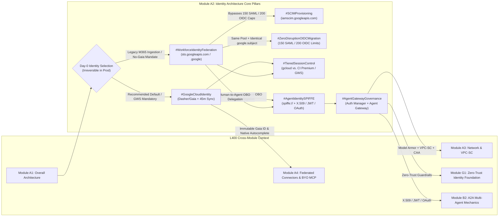
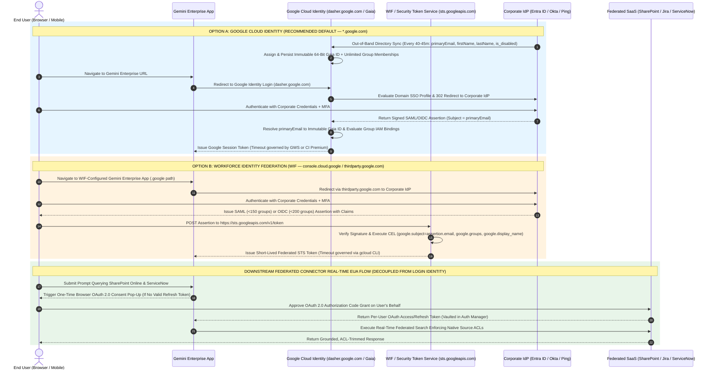
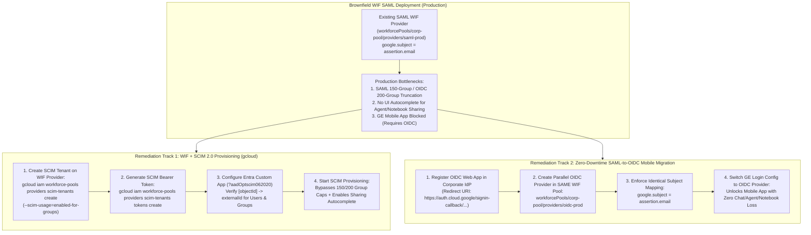
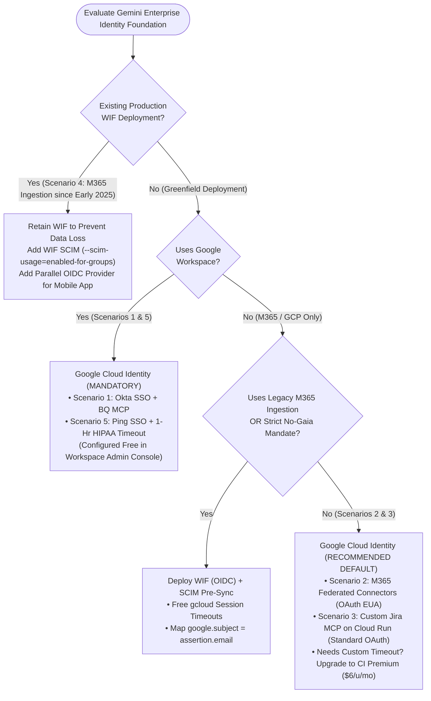
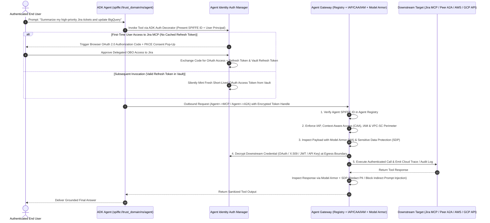
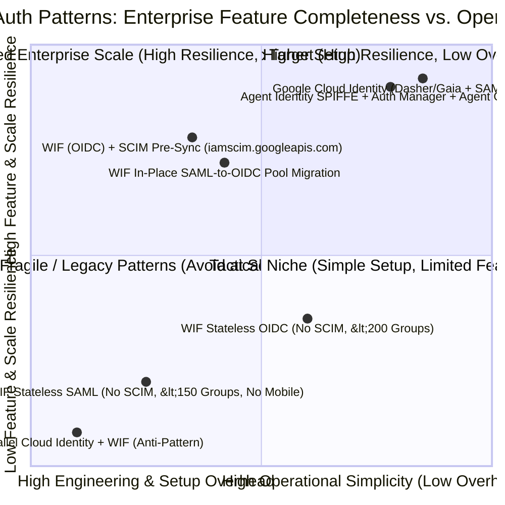

# Google Cloud Gemini Enterprise L400 OKF — Module A2: Identity Architecture (`L400_version_20261026_0350`)
**Topic Tags:** `#L400_version_20261026_0350` `#IdentityArchitecture` `#GoogleCloudIdentity` `#WorkforceIdentityFederation` `#SCIMProvisioning` `#AgentIdentitySPIFFE` `#GeminiEnterprise`

---

## 0. OKF Document Metadata & Topic Modeling Taxonomy
**Topic Tags:** `#OKFMetadata` `#TopicModeling` `#CapabilityBrief` `#KnowledgeCatalog` `#L400_version_20261026_0350`

> **OKF v0.2 Trust Signals, Bucket Merge & Enforced FDE Grading Rubric (`OKF-L400-21`):**
> - **Version Tag:** `L400_version_20261026_0350` | **Status (`status`):** `stable` (`VETTED` / `APPROVED`) | **TTL (`stale_after`):** `2027-04-26T00:00:00Z` *(Maintains existing TTL & version)* | **Verified (`verified`):** `true`
> - **Merged Bucket OKF Lineage:** Reconciled with `Concepts 09, 13` in `gs://gea_agent_development_architectural_best_practices_1790796607` (`project=fivedaysai-prd-sandbox-317383`)
> - **Cloud FDE Prevailing Standard:** `https://g3doc.corp.google.com/company/teams/cloud-fde/index.md?cl=head`
> - **Enforced Project Grading Rubric (`OKF-L400-21`):** Adheres to the 0–3 FDE Field-Readiness Rubric (Pass Gate: Average >= 2.0 across Part A & Part B; Zero-Score Pause Rule: any `0 - Not Demonstrated` triggers an immediate pause and 2-week re-presentation). Primary mapped competencies for `OKF-L400-A2`: **Part A.2 (Technical Defense), Part B.1.5 (Domain Compliance), Part B.2.2 (Technical Scope & Constraints), Part B.3.1 (Authentication & Authorization), Part B.3.5 (Compliance & Governance)**.

### 0.1 OKF Document Metadata Table (`capability-brief-generator`)
**Topic Tags:** `#OKFMetadata` `#CapabilityBrief` `#GCPKnowledgeCatalog` `#AntigravityAgenticAI`

| Metadata Attribute | Authoritative Value / Specification |
| :--- | :--- |
| **Document ID** | `OKF-L400-A2` |
| **Document Title** | Google Cloud Gemini Enterprise L400 OKF — Module A2: Identity Architecture |
| **Version Tag** | `L400_version_20261026_0350` (`#L400_version_20261026_0350`) |
| **Module Code & Track** | `A2` — Architecture & Platform Foundations Track (L400 Principal / Fellow Level) |
| **Target Capabilities** | End-User Identity Foundation Selection (`Google Cloud Identity` / `Dasher` / `Gaia` vs. `Workforce Identity Federation` / `WIF`), Security Token Service (`sts.googleapis.com`) RFC 8693 Token Exchange, Inbound Directory Sync (GCDS / Entra ID 40–45 min Admin SDK sync) vs. WIF + SCIM Pre-Synchronization (`iamscim.googleapis.com` & `?aadOptscim062020`), Group Assertion Truncation Bypass (**150 SAML** / **200 OIDC** ceilings), Zero-Downtime SAML-to-OIDC Mobile Migration, Session Timeout Governance (`gcloud` CLI vs. Workspace / Cloud Identity Premium), and Cryptographic Autonomous Agent Identity (`SPIFFE`, `X.509`, `JWT`, `OAuth 2.0`, `Agent Identity Auth Manager`, and `Agent Gateway`). |
| **Source Artifacts Synthesized** | 1. `A2_Identity_architecture.md` (SME Video Learning Points & 25-Question Evaluation Suite)<br/>2. `sme-recording-a2-identity-architecture.md` (L400 SME Recording Transcript Synthesis & 6 PCA Scenarios)<br/>3. `slides-a2-identity-architecture.md` (A2 Identity Architecture v1.1.0 Delivery Deck — 50+ Slides, Runbooks, Decision Trees & Agent Identity Specifications) |
| **GCP Knowledge Catalog Ingestion Schema** | `OKF-Schema-v4.2` — Hierarchical Markdown with Universal Heading Topic Tags, Multi-Dimensional Comparison Matrices, Mermaid.js State/Sequence/Quadrant Graphs, ASCII Architecture Blueprints, WAF 5-Pillar Alignment, Production Landing Metrics, and Grounded Evaluation Banks. |
| **Antigravity Agentic AI Role** | **Primary Grounding & Architecture Verification Corpus** for Antigravity-driven coding, architecture synthesis, and automated governance agents. Enables Antigravity agents to validate identity immutability rules, generate compliant Terraform/`gcloud` SCIM and WIF configurations, enforce SPIFFE/Auth Manager decorators in ADK code, and prevent catastrophic production identity mutations. |

---

### 0.2 Primary & Secondary Topic Tags (`topic-modeler`)
**Topic Tags:** `#TopicTaxonomy` `#PrimaryTopics` `#SecondarySubTopics` `#CapabilityTaxonomy`

#### 0.2.1 Primary Topic Tags (6 Core Pillars)
**Topic Tags:** `#IdentityArchitecture` `#GoogleCloudIdentity` `#WorkforceIdentityFederation` `#SCIMProvisioning` `#FederatedConnectors` `#AgentIdentitySPIFFE`

1. **`#IdentityArchitecture`**: Governs the foundational Day-0 architectural selection, control-plane vs. data-plane persona separation, and irreversible production state bindings between human users, autonomous agents, and Google Cloud Gemini Enterprise resources.
2. **`#GoogleCloudIdentity`**: Covers Google's first-party stateful corporate directory foundation (`Dasher` tenant directory backed by immutable `Gaia` identifiers, surfaced as `Google Identity` in the Gemini Enterprise UI and authenticated via `dasher.google.com` / `*.google.com`), including SAML 2.0 SSO delegation and 40–45 minute periodic read-only directory synchronization.
3. **`#WorkforceIdentityFederation`**: Encompasses Google Cloud's Bring-Your-Own-Identity (`BYOID` / `WIF`) keyless, Gaia-less federation pattern via `.google` endpoints (`console.cloud.google` / `thirdparty.google.com`) and the Security Token Service (`sts.googleapis.com`), requiring continuous attribute injection and strict preservation of email-formatted `google.subject` claims.
4. **`#SCIMProvisioning`**: Details out-of-band System for Cross-domain Identity Management (RFC 7644 SCIM 2.0) pre-synchronization into WIF backend identity stores (`iamscim.googleapis.com`), overcoming hard protocol group assertion limits (**150 groups for SAML**, **200 groups for OIDC**) and enabling UI type-ahead autocomplete.
5. **`#FederatedConnectors`**: Traces the architectural shift from late-2024/early-2025 ingestion connectors (which required WIF + Entra ID Group GUIDs for SharePoint/OneDrive ACL reconciliation) to mid/late-2025 real-time Federated Connectors powered by per-user OAuth 2.0 Authorization Code Grant flows (End-User Authorization / EUA).
6. **`#AgentIdentitySPIFFE`**: Defines Google Cloud's cryptographic workload identity framework for autonomous agents (`spiffe://<trust_domain>/<namespace>/<agent_name>`), multi-system credentials (`X.509`, `JWT`, `OAuth`, `API Keys`), the **Agent Identity Auth Manager**, and the **Agent Gateway** policy enforcement proxy.

#### 0.2.2 Secondary Sub-Topic Tags (6 Capability / Outcome / Impact Tags)
**Topic Tags:** `#ImmutableGaiaPersistence` `#SCIMGroupLimitBypass` `#ZeroDisruptionOIDCMigration` `#TieredSessionControl` `#MCPClientInteroperability` `#AgentGatewayGovernance`

1. **`#ImmutableGaiaPersistence`** *(Type: Outcome)*: Insulates end-user chat histories, custom low-code agents, and Gemini Notebooks from corporate email rebrands, M&A domain migrations, or marital name changes by binding resource ownership to an immutable internal 64-bit `Gaia ID` rather than a mutable email string.
2. **`#SCIMGroupLimitBypass`** *(Type: Capability)*: Pre-synchronizes external IdP user and group graphs into a Google-managed WIF SCIM tenant (`gcloud iam workforce-pools providers scim-tenants`), bypassing the 150-group SAML and 200-group OIDC token payload ceilings while populating the sharing autocomplete cache.
3. **`#ZeroDisruptionOIDCMigration`** *(Type: Outcome)*: Unlocks Gemini Enterprise Mobile App access (which strictly mandates OIDC under WIF) for existing SAML WIF customers by adding a parallel OIDC provider inside the same Workforce Identity Pool with an identical `google.subject=assertion.email` mapping, avoiding user state resets or license duplication.
4. **`#TieredSessionControl`** *(Type: Impact)*: Balances regulatory re-authentication compliance (e.g., 1-hour HIPAA or 2-hour SOC timeouts) against FinOps licensing by contrasting free `gcloud`-managed session timeouts in WIF against Google Workspace built-in Admin Console controls and Cloud Identity Premium ($6/user/month) entitlements.
5. **`#MCPClientInteroperability`** *(Type: Capability)*: Differentiates developer velocity when building custom Model Context Protocol (MCP) servers and SDK tools—contrasting out-of-the-box OAuth 2.0 authorization code support in Google Cloud Identity against custom RFC 8693 OAuth Token Exchange implementations required for WIF against `sts.googleapis.com`.
6. **`#AgentGatewayGovernance`** *(Type: Impact)*: Enforces Zero-Trust runtime security across `Agent <-> Agent (A2A)`, `Agent <-> MCP Tool`, and `Agent <-> Model` calls by combining Agent Registry verification, IAP/CAA/IAM authorization, inline Model Armor (MA) + Sensitive Data Protection (SDP) inspection, and boundary-level token decryption.

---

### 0.3 Three-Tier Topic Modeling Taxonomy & Matrix Table
**Topic Tags:** `#ThreeTierTaxonomy` `#TaxonomyMatrix` `#KnowledgeGraph` `#CatalogSchema`

#### 0.3.1 Three-Tier Hierarchical Taxonomy Tree
**Topic Tags:** `#TaxonomyTree` `#DomainHierarchy` `#IdentityOntology`

* **Tier 1: Enterprise Identity & Access Foundations (`OKF-L400-A2`)**
  * **Tier 2: Human End-User & Admin Identity Architecture**
    * *Tier 3: Stateful First-Party Identity (`Google Cloud Identity` / `Dasher` / `Gaia` / `dasher.google.com`)*
    * *Tier 3: Stateless & Hybrid Third-Party Federation (`Workforce Identity Federation` / `sts.googleapis.com` / `console.cloud.google` / `thirdparty.google.com`)*
    * *Tier 3: Out-of-Band Directory Synchronization (`GCDS`, `Entra ID Admin SDK 45-min Sync`, `WIF SCIM 2.0 via iamscim.googleapis.com`)*
    * *Tier 3: Protocol & Session Governance (`SAML 150-Group Limit`, `OIDC 200-Group Limit`, `In-Place SAML-to-OIDC Migration`, `Session Timeouts`)*
  * **Tier 2: Data Connector & Tool Authorization Mechanics**
    * *Tier 3: Legacy Ingestion ACL Matching (`Entra ID Object IDs & Group GUIDs`)*
    * *Tier 3: Real-Time Federated Connectors (`OAuth 2.0 Authorization Code Grant` / `Browser Consent Pop-up` / `EUA`)*
    * *Tier 3: Custom MCP Server Authentication (`Standard OAuth Client Libraries` vs. `RFC 8693 STS Token Exchange`)*
  * **Tier 2: Autonomous Agent Identity, Credentials & Gateway Plane**
    * *Tier 3: Cryptographic Workload Identity (`SPIFFE ID`, `Dual Access: Act-as-Self vs. OBO Act-as-User`)*
    * *Tier 3: Multi-System Credential Hierarchy (`X.509 + GCP Access Token`, `Signed JWT`, `OAuth 2.0 + PKCE`, `Managed API Keys`)*
    * *Tier 3: Managed Runtime Enforcement (`Agent Identity Auth Manager`, `ADK Decorators`, `Agent Gateway + Model Armor`)*

#### 0.3.2 Topic Taxonomy Matrix Table
**Topic Tags:** `#TaxonomyMatrix` `#TopicMapping` `#ArchitecturalTraceability`

| Tier 1 Domain | Tier 2 Architectural Pillar | Tier 3 Technical Concept / Mechanism | Associated Primary & Secondary Tags | Target Section(s) |
| :--- | :--- | :--- | :--- | :--- |
| **1. Human Identity Foundations** | **Stateful 1P Directory (`Cloud Identity`)** | `Dasher`/`Gaia` store, immutable `Gaia ID`, 4 synced attributes (`primary email`, `first name`, `last name`, `is_disabled`), 40–45m Entra sync, `dasher.google.com` login flow, custom group email expressions. | `#GoogleCloudIdentity`, `#ImmutableGaiaPersistence` | `2.1`, `2.3`, `3.2`, `4.1` |
| **1. Human Identity Foundations** | **Stateless/Hybrid 3P Federation (`WIF`)** | `console.cloud.google` (`thirdparty.google.com`) routing, `sts.googleapis.com` token exchange, mandatory email-formatted `google.subject`, CEL claim mapping, production immutability rules. | `#WorkforceIdentityFederation`, `#IdentityArchitecture` | `2.1`, `2.2`, `3.2`, `4.2` |
| **2. Directory Scale & Protocol Governance** | **Group Truncation & SCIM Sync** | Hard assertion caps (**150 groups SAML** / **200 groups OIDC**), WIF SCIM tenant (`iamscim.googleapis.com`), `?aadOptscim062020` Entra flag, `--scim-usage=enabled-for-groups`, sharing autocomplete. | `#SCIMProvisioning`, `#SCIMGroupLimitBypass` | `2.2`, `2.3`, `4.3` |
| **2. Directory Scale & Protocol Governance** | **Mobile OIDC & Session Timeouts** | Mobile app OIDC mandate for WIF, in-place SAML-to-OIDC WIF Pool migration, free `gcloud` WIF session timeout vs. Workspace Admin Console vs. Cloud Identity Premium ($6/u/mo). | `#ZeroDisruptionOIDCMigration`, `#TieredSessionControl` | `2.2`, `2.3`, `4.4` |
| **3. Connector & MCP AuthZ** | **Ingestion vs. Federated & MCP** | Late-2024 M365 ingestion (Entra Object IDs/GUIDs) vs. Mid-2025 Federated Connectors (OAuth 2.0 Auth Code Grant pop-up), standard OAuth MCP libraries vs. RFC 8693 STS token exchange. | `#FederatedConnectors`, `#MCPClientInteroperability` | `1.2`, `2.1`, `2.3` |
| **4. Autonomous Agent Identity** | **SPIFFE, Auth Manager & Gateway** | Ephemeral `spiffe://` IDs, Dual Access (Self vs. OBO), Credential Matrix (`X.509`, `JWT`, `OAuth`, `API Key`), Auth Manager ADK decorators, Agent Gateway (Registry, IAP/CAA/IAM, Model Armor, Traces). | `#AgentIdentitySPIFFE`, `#AgentGatewayGovernance` | `2.4`, `3.1`, `4.5` |

---

### 0.4 Module Topic Connection & Flow Graph
**Topic Tags:** `#TopicGraph` `#MermaidGraph` `#ASCIIBlueprint` `#L400KnowledgeGraph`

#### 0.4.1 Mermaid.js Module Topic Connection Graph (`graph LR`)
**Topic Tags:** `#MermaidGraph` `#TopicConnections` `#ArchitectureFlow`



#### 0.4.2 ASCII Cross-Module Identity Knowledge Connection Diagram
**Topic Tags:** `#ASCIIDiagram` `#CrossModuleArchitecture` `#KnowledgeCatalogMap`

```text
+======================================================================================================+
|                    GCP L400 KNOWLEDGE CATALOG: MODULE A2 IDENTITY CONNECTION MAP                     |
+======================================================================================================+
|                                                                                                      |
|  [Module A1: Overall Architecture]                                                                   |
|                 |                                                                                    |
|                 v                                                                                    |
|  +------------------------------------------------------------------------------------------------+  |
|  | MODULE A2: HUMAN & ADMIN IDENTITY PLANE (Irreversible Day-0 Production Binding)                |  |
|  |                                                                                                |  |
|  |   +-----------------------------------------+    +-----------------------------------------+   |  |
|  |   | PATH 1: GOOGLE CLOUD IDENTITY (DEFAULT) |    | PATH 2: WORKFORCE IDENTITY FED. (WIF)   |   |  |
|  |   | - Dasher / Gaia First-Party Directory   |    | - Keyless BYOID via sts.googleapis.com  |   |  |
|  |   | - Login: dasher.google.com (*.google.com|    | - Login: console.cloud.google (.google) |   |  |
|  |   |   & standard OAuth endpoints)           |    |   & thirdparty.google.com               |   |  |
|  |   | - 4 Synced Attrs (40-45m Entra SDK):    |    | - Mandatory: google.subject = email     |   |  |
|  |   |   primaryEmail, firstName, lastName,    |    | - Token Caps: 150 (SAML) / 200 (OIDC)   |   |  |
|  |   |   is_disabled                           |    | - WIF+SCIM (iamscim.googleapis.com)     |   |  |
|  |   | - Immutable 64-bit Gaia ID              |    |   bypasses caps & enables autocomplete  |   |  |
|  |   | - Timeout: GWS Admin or CI Premium ($6) |    | - Timeout: Free via gcloud CLI          |   |  |
|  |   +--------------------+--------------------+    +--------------------+--------------------+   |  |
|  +------------------------|----------------------------------------------|------------------------+  |
|                           |                                              |                           |
|                           +----------------------+-----------------------+                           |
|                                                  |                                                   |
|                                                  v                                                   |
|  +------------------------------------------------------------------------------------------------+  |
|  | MODULE A2 -> A4 / B1 / B2 / G1: AUTONOMOUS AGENT IDENTITY & CONNECTOR AUTHORIZATION PLANE      |  |
|  |                                                                                                |  |
|  |   * Federated Connectors (Module A4): Per-user OAuth 2.0 Auth Code Grant (Browser Pop-up EUA)  |  |
|  |   * Custom MCP Servers (Module A4): Standard OAuth (Cloud Identity) vs. RFC 8693 STS (WIF)     |  |
|  |   * Cryptographic Agent Identity (Modules B1/G1): spiffe://<trust_domain>/<ns>/<agent_name>    |  |
|  |   * Agent Identity Auth Manager: Vaults Client Secrets/Refresh Tokens + ADK OBO Decorators     |  |
|  |   * Agent Gateway (Modules A3/B2/G3): Registry + IAP/CAA/IAM + Model Armor + X.509/JWT A2A     |  |
|  +------------------------------------------------------------------------------------------------+  |
+======================================================================================================+
```

---

## 1. Executive Overview, Problem Statement & Antigravity Agentic AI Development Context
**Topic Tags:** `#ExecutiveOverview` `#ProblemStatement` `#AntigravityAI` `#IdentityEvolution` `#L400_version_20261026_0350`

> **Enforced FDE Project Grading Rubric Reference (`OKF-L400-21` & `g3doc/company/teams/cloud-fde`):** Every project applying Section 1 of `OKF-L400-A2` is graded against **Part A.2 (Technical Defense), Part B.1.5 (Domain Compliance), Part B.2.2 (Technical Scope & Constraints), Part B.3.1 (Authentication & Authorization), Part B.3.5 (Compliance & Governance)** and merged bucket **Concepts 09, 13** (`stale_after: 2027-04-26T00:00:00Z`, version `L400_version_20261026_0350`). Builders must achieve >= 2 (**Competent**) across Part A & Part B and avoid any 0 (**Not Demonstrated**) pause triggers.

### 1.1 Executive Summary & The Day-0 Identity Imperative
**Topic Tags:** `#Day0Architecture` `#IdentityImmutability` `#StatePreservation` `#ExecutiveSummary`

Identity architecture is the single most consequential **Day-0 architectural decision** in any Google Cloud Gemini Enterprise deployment. Unlike stateless compute tiers or interchangeable model endpoints, the end-user identity foundation establishes the permanent cryptographic principal key to which all user-authored artifacts—including **conversation history, custom low-code and ADK agents, Gemini Notebooks (NotebookLM Enterprise), saved prompts, and per-user seat licenses**—are irrevocably bound.

**The Catastrophic Mutation Hazard:** Altering the identity foundation of an active production Gemini Enterprise environment (switching between **Google Cloud Identity** and **Workforce Identity Federation**, or modifying the primary `google.subject` claim mapping within WIF) forces a **complete reset of all end-user accounts**. The platform evaluates returning users as brand-new principals, permanently orphaning all historical chats, custom agents, and notebooks, and effectively requiring a brand-new deployment. Furthermore, running both Google Cloud Identity and Workforce Identity Federation simultaneously in parallel for the same deployment is a strict **architectural anti-pattern** that creates dual login pathways, split user profiles, license duplication, and unmanageable governance complexity.

---

### 1.2 Architectural Evolution: Why Best Practices Shifted from WIF (Late 2024) to Google Cloud Identity (Late 2025–Present)
**Topic Tags:** `#ConnectorEvolution` `#IngestionConnectors` `#FederatedConnectors` `#CloudIdentityDefault`

A critical responsibility of Principal Architects and Forward Deployed Engineers (FDEs) is guiding enterprise customers through the historical evolution of Gemini Enterprise identity patterns so they do not design greenfield 2026 architectures around obsolete 2024 constraints:

1. **Era 1 — The Ingestion Connectors Era (December 2024 – Spring 2025):**
   * Early Gemini Enterprise deployments relied exclusively on **data ingestion connectors** that copied documents and their Access Control Lists (ACLs) into Google Cloud Discovery Engine data stores.
   * For Microsoft 365 ingestion sources (**SharePoint Online, OneDrive, Outlook**), Microsoft enforces document ACLs using internal **Microsoft Entra ID Object IDs and Group GUIDs** rather than email addresses.
   * Because Google Cloud Identity's standard directory sync did not expose raw Entra Group GUIDs inside login assertions for ingested ACL matching, customers ingesting M365 data were required to deploy **Workforce Identity Federation (WIF)** with Microsoft Entra ID so that Entra Object IDs and Group GUIDs could be passed directly inside SAML/OIDC login assertions to `sts.googleapis.com`.
2. **Era 2 — The Federated Connectors Era (Fall 2025 – December 2025):**
   * Google Cloud launched **10+ real-time Federated Connectors** (covering Microsoft 365 SharePoint, OneDrive, Outlook, ServiceNow, Jira, Confluence, Salesforce, and more) built on the **OAuth 2.0 Authorization Code Grant** flow with **Real-Time End-User Authorization (EUA)**.
   * When an end user queries a federated data source for the first time, Gemini Enterprise presents a one-time browser **OAuth consent pop-up** prompting the user to authorize access on their behalf. Queries execute in real time against the source API using the user's delegated OAuth token, completely **eliminating the need to extract or match Microsoft Entra Object IDs or Group GUIDs** via the Gemini Enterprise sign-in identity.
3. **Era 3 — Current Strategic Recommendation (Late 2025 – Present / 2026):**
   * **Google Cloud Identity (`Dasher` / `Gaia`, surfaced as `Google Identity`)** is the **primary recommended default** for all new Gemini Enterprise deployments, and is **strictly mandatory** for any organization using **Google Workspace**.
   * It delivers **"Identity Made Easy"**: an **immutable Gaia ID** that survives corporate email rebrands and name changes, native **type-ahead autocomplete** for sharing custom agents and Gemini Notebooks, universal **Gemini Enterprise Mobile App** compatibility across SAML and OIDC, seamless alignment with existing **GCP Landing Zones**, and out-of-the-box compatibility with standard **OAuth 2.0 client libraries** for custom **Model Context Protocol (MCP)** servers.
   * **Workforce Identity Federation (WIF)** remains fully supported as a specialized exception pattern for: (a) **established brownfield WIF production deployments** operating smoothly since early 2025 (which must remain on WIF to avoid user data loss), (b) environments still dependent on **legacy M365 ingestion connectors**, or (c) organizations with strict sovereign/regulatory bans against syncing directory records to Google Cloud or requiring **free `gcloud`-configured session timeouts** without purchasing Cloud Identity Premium ($6/user/month).

---

### 1.3 Antigravity Agentic AI Development Context
**Topic Tags:** `#AntigravityDevelopment` `#AgenticAIContext` `#ADKIntegration` `#ZeroTrustAgents`

When this OKF document (`OKF-L400-A2`) is ingested into a **GCP Knowledge Catalog** powering **Antigravity-driven Agentic AI development**, autonomous coding and architecture agents consume its rules to enforce four deterministic engineering behaviors:

1. **Automated Identity Pre-Flight Verification:** Before generating Terraform or `gcloud` provisioning scripts for a Gemini Enterprise app, Antigravity agents inspect whether the target GCP Organization has an active Google Workspace footprint or existing Cloud Identity Landing Zone, defaulting to `Google Identity` (`dasher.google.com`) and blocking any PR that attempts to mutate an existing production WIF `google.subject` mapping or run dual Cloud Identity + WIF login paths.
2. **Protocol & Directory Scale Synthesis:** When an Antigravity agent detects a brownfield WIF deployment where users belong to **>150 groups (SAML)** or **>200 groups (OIDC)**—or where mobile app rollout is requested—it automatically synthesizes the 7-step `gcloud iam workforce-pools providers scim-tenants` runbook (`iamscim.googleapis.com` with `?aadOptscim062020`) and generates an in-place OIDC provider migration inside the existing WIF Pool preserving `google.subject=assertion.email`.
3. **MCP Server & ADK Authentication Scaffolding:** When scaffolding custom **Model Context Protocol (MCP)** servers or **Agent Development Kit (ADK)** tools:
   * For **Google Cloud Identity** environments, the coding agent uses standard Google OAuth 2.0 Authorization Code client libraries and **Agent Identity Auth Manager** decorators.
   * For **WIF** environments, the coding agent automatically injects **RFC 8693 OAuth 2.0 Token Exchange** middleware targeting `https://sts.googleapis.com/v1/token` so custom MCP tools do not fail with `invalid_grant` or `401 Unauthorized` errors.
4. **Zero-Trust SPIFFE & Agent Gateway Enforcement:** For every autonomous agent deployed to Vertex AI Agent Engine, Gemini Enterprise, GKE, or Cloud Run, Antigravity agents bind permissions to the agent's ephemeral **SPIFFE ID** (`spiffe://<trust_domain>/<namespace>/<agent_name>`), store third-party secrets and OAuth refresh tokens exclusively inside **Agent Identity Auth Manager** (never hardcoded in prompts or environment variables), and route all `Agent <-> Agent (A2A)` and `Agent <-> MCP` traffic through the **Agent Gateway** with **Model Armor** enabled.

---

## 2. Deep Technical Architecture, Matrices, Visual Pictures & Flow Diagrams
**Topic Tags:** `#TechnicalArchitecture` `#IdentityMechanics` `#FlowDiagrams` `#ComparisonMatrices` `#L400_version_20261026_0350`

> **Enforced FDE Project Grading Rubric Reference (`OKF-L400-21` & `g3doc/company/teams/cloud-fde`):** Every project applying Section 2 of `OKF-L400-A2` is graded against **Part A.2 (Technical Defense), Part B.1.5 (Domain Compliance), Part B.2.2 (Technical Scope & Constraints), Part B.3.1 (Authentication & Authorization), Part B.3.5 (Compliance & Governance)** and merged bucket **Concepts 09, 13** (`stale_after: 2027-04-26T00:00:00Z`, version `L400_version_20261026_0350`). Builders must achieve >= 2 (**Competent**) across Part A & Part B and avoid any 0 (**Not Demonstrated**) pause triggers.

### 2.1 End-User & Admin Identity Foundations: Google Cloud Identity (`Dasher`/`Gaia`) vs. Workforce Identity Federation (`WIF`)
**Topic Tags:** `#GoogleCloudIdentity` `#WorkforceIdentityFederation` `#DasherGaia` `#ControlPlaneVsDataPlane`

#### 2.1.1 Dual-Persona Access Model: Admin Control Plane vs. End-User Data Plane
**Topic Tags:** `#DualPersonaModel` `#ControlPlane` `#DataPlane` `#IAMGovernance`

Gemini Enterprise enforces a strict architectural separation between administrative infrastructure governance and end-user runtime interaction:

1. **Administrator Persona (GCP Control Plane):**
   * **Interfaces & Tooling:** Cloud Administrators manage Gemini Enterprise exclusively through the **Google Cloud Console** (`console.cloud.google.com` or `console.cloud.google`), **`gcloud` CLI**, **Terraform**, or direct REST/gRPC calls to the **Discovery Engine API** (`discoveryengine.googleapis.com`).
   * **Governance Scope:** Administrators provision the regional/multi-regional Gemini Enterprise application (`Project + Location`), configure **VPC Service Controls (VPC-SC)** perimeters, define **Model Armor** prompt/response inspection templates, configure custom corporate branding, establish data connectors, and assign **Gemini Enterprise User** or **Gemini Enterprise Restricted User** IAM roles plus billing seat licenses to user/group principals.
   * **Strict Isolation:** End-user interfaces (such as the Gemini Enterprise Web App, Mobile App, or NotebookLM UI) **never** expose infrastructure controls like Model Armor or VPC Service Controls.
2. **End-User Persona (Gemini Enterprise Data Plane):**
   * **Interfaces & Tooling:** Business users, analysts, and developers access Gemini Enterprise via the **Gemini Enterprise Web App** (`vertexaisearch.cloud.google.com` / custom branded URL) or the **Gemini Enterprise Mobile App** (iOS/Android).
   * **Identity Gateways & Domain Routing Indicators:**
     * **Google Cloud Identity (`Google Identity` UI Toggle):** Routes browser authentication through Google's first-party corporate login infrastructure (`accounts.google.com` / `dasher.google.com` and standard `*.google.com` endpoints such as `console.cloud.google.com`).
     * **Workforce Identity Federation (`Third-Party Identity` / `WIF` UI Toggle):** Routes browser authentication through Google Cloud's third-party federation gateway (`auth.cloud.google` / `thirdparty.google.com`) and surfaces in the browser address bar by **omitting the `.com` TLD suffix**—specifically using the `.google` top-level domain (e.g., `console.cloud.google`).

#### 2.1.2 Deep Dive: Google Cloud Identity (`Dasher` / `Gaia`) Mechanics
**Topic Tags:** `#DasherDirectory` `#GaiaID` `#DirectorySync` `#EntraIDSync`

**Google Cloud Identity** (available in **Cloud Identity Free** and **Cloud Identity Premium** tiers, and natively included with all **Google Workspace** editions) is powered by Google's first-party corporate tenant directory (**`Dasher`**) and internal identity store (**`Gaia`**):

* **Inbound Directory Synchronization (Read-Only Periodic Sync):**
  * Enterprise Identity Providers—such as **Microsoft Entra ID**, **Okta Universal Directory**, **PingFederate / PingOne**, or on-premises **Active Directory** (via **Google Cloud Directory Sync / GCDS**)—act as the authoritative source of truth.
  * Using the **Google Cloud / G Suite Connector by Microsoft** (or Okta/Ping inbound provisioning), the external IdP pushes user and group updates to Google Cloud Identity's **Admin SDK Directory APIs**.
  * **Default Synchronization Cadence:** Microsoft Entra ID runs an automatic incremental provisioning cycle **every 40 to 45 minutes** (45 minutes nominal exam benchmark).
  * **Four Core User Attributes Synchronized by Default:**
    1. `primaryEmail` (Primary corporate email address / username)
    2. `name.givenName` (First name)
    3. `name.familyName` (Last name)
    4. `suspended` / `is_disabled` (Boolean active/disabled lifecycle flag)
  * **Offboarding & Suspension Semantics (`is_disabled: true`):** When a user is disabled in Entra ID or Okta, the next directory sync marks the Cloud Identity account as `is_disabled: true` (suspended). This **immediately freezes sign-in capabilities** and revokes active access while **retaining all underlying user data** (chats, custom agents, notebooks) for compliance holds or administrative transfer.
* **Immutable 64-Bit `Gaia ID` State Protection:**
  * Every user and group provisioned into `Dasher`/`Gaia` receives a permanent, **immutable internal `Gaia ID`**.
  * Gemini Enterprise binds all user state (chat logs, custom agents, Gemini Notebooks, and seat licenses) to this internal `Gaia ID` rather than the mutable `primaryEmail` string.
  * Consequently, if an employee changes their last name, or if the company undergoes an M&A domain rebrand (e.g., `@legacycorp.com` -> `@newcorp.com`), the updated `primaryEmail` syncs into Cloud Identity onto the **same `Gaia ID`**, resulting in **zero data loss and zero license churn**.
* **Federated SAML 2.0 / OIDC Single Sign-On Flow:**
  * Google Cloud Identity stores **no corporate passwords**. When a user enters their email at the Gemini Enterprise login screen, Cloud Identity evaluates the domain's **3P SAML SSO Profile** (`admin.google.com > Security > Authentication > SSO with third-party IdP`), redirects the browser (`HTTP 302`) to the external IdP (`Entra ID`, `Okta`, `Ping`), validates the returned signed SAML assertion (`Subject = primaryEmail`) against the uploaded X.509 certificate, and issues a standard Google session token (`dasher.google.com`).

#### 2.1.3 Deep Dive: Workforce Identity Federation (`WIF` / `BYOID`) Mechanics
**Topic Tags:** `#WorkforceIdentityFederation` `#STSTokenExchange` `#GoogleSubject` `#StatelessFederation`

**Workforce Identity Federation (WIF)** allows external IdP users to access Google Cloud and Gemini Enterprise **without creating `Gaia` user objects**:

* **Zero Native Directory Persistence (Stateless by Default):**
  * By default, WIF maintains **no internal user or group database** inside Google Cloud.
  * Every single login assertion (SAML 2.0 XML assertion or OIDC JWT ID Token) must continuously carry and inject all required identity claims: **username (`google.subject`), display name (`google.display_name`), and group memberships (`google.groups`)**, plus any third-party connector identifiers (`attribute.as_user_identifier_1`).
* **Security Token Service (`sts.googleapis.com`) Exchange:**
  * When a user authenticates via a WIF-enabled Gemini Enterprise app (`thirdparty.google.com` / `.google` login path), the external IdP posts the signed SAML/OIDC assertion to Google's **Security Token Service API (`https://sts.googleapis.com/v1/token`)**.
  * STS cryptographically verifies the assertion against the WIF Provider's configured X.509 certificate or OIDC JWKS URI, executes **Common Expression Language (CEL)** attribute mappings, and issues a short-lived **Google Cloud Federated STS Token** representing the principal:
    `principal://iam.googleapis.com/locations/global/workforcePools/<POOL_ID>/subject/<GOOGLE_SUBJECT>`
* **Mandatory Email Format & Mutability Hazard of `google.subject`:**
  * While GCP IAM generally allows `google.subject` to be any string, **Gemini Enterprise strictly requires `google.subject` to be formatted as an email address** (`google.subject=assertion.email` or `assertion.upn`).
  * Because stateless WIF has no underlying immutable `Gaia ID`, the literal `google.subject` string **is** the primary key for all user data in Gemini Enterprise. If an administrator changes the `google.subject` attribute mapping post-deployment—or if a user's email address changes in the corporate IdP—Gemini Enterprise treats the user as a **brand-new identity**, permanently orphaning all prior chat history, custom agents, and Gemini Notebooks.

#### 2.1.4 ASCII Architectural Blueprint: Google Cloud Identity (`dasher.google.com`) vs. WIF (`thirdparty.google.com` / `sts.googleapis.com`)
**Topic Tags:** `#ASCIIBlueprint` `#CloudIdentityVsWIF` `#EndpointArchitecture` `#LoginFlows`

```text
+========================================================================================================+
|         ARCHITECTURAL COMPARISON: GOOGLE CLOUD IDENTITY (1P GAIA) VS. WORKFORCE IDENTITY (WIF)         |
+========================================================================================================+
|                                                                                                        |
|  [CORPORATE IDENTITY PROVIDER: Microsoft Entra ID / Okta / PingFederate / Active Directory]            |
|          |                                                                   |                         |
|          | (A) Out-of-Band Sync (Every 40-45m)                               | (B) Just-in-Time Token  |
|          |     4 Core Attrs: primaryEmail,                                   |     Assertion Only      |
|          |     firstName, lastName, is_disabled                              |     (Stateless Default) |
|          v                                                                   v                         |
|  +-----------------------------------------------+   +----------------------------------------------+  |
|  | PATH 1: GOOGLE CLOUD IDENTITY (RECOMMENDED)   |   | PATH 2: WORKFORCE IDENTITY FEDERATION (WIF)  |  |
|  | UI Choice: "Google Identity"                  |   | UI Choice: "Third-Party Identity (WIF)"      |  |
|  | Login Domain: dasher.google.com / *.google.com|   | Login Domain: console.cloud.google (.google) |  |
|  |               (console.cloud.google.com)      |   |               & thirdparty.google.com        |  |
|  +-----------------------------------------------+   +----------------------------------------------+  |
|  | 1. Directory Store: Dasher / Gaia DB          |   | 1. Directory Store: NONE by default          |  |
|  |    - Assigns IMMUTABLE 64-bit Gaia ID         |   |    (Optional WIF+SCIM via iamscim.googleapis)|  |
|  |    - Caches users & unlimited groups          |   | 2. Token Exchange: sts.googleapis.com        |  |
|  | 2. AuthN Flow: SAML 2.0 / OIDC SSO Redirect   |   |    - CEL Mapping:                            |  |
|  |    - Validates Subject = primaryEmail         |   |      google.subject = assertion.email (REQ!) |  |
|  | 3. Resource Binding Key:                      |   |      google.display_name = assertion.name    |  |
|  |    [Immutable Gaia ID] -> Survives email/name |   |      google.groups = assertion.groups        |  |
|  |    changes & M&A domain rebranding!           |   | 3. Resource Binding Key:                     |  |
|  | 4. Session Timeout Control:                   |   |    [Literal google.subject String] -> Email  |  |
|  |    - GWS Admin Console (Included) OR          |   |    change or mapping edit WIPES USER DATA!   |  |
|  |    - Cloud Identity Premium ($6/user/mo)      |   | 4. Session Timeout Control:                  |  |
|  | 5. Custom MCP Client Libraries:               |   |    - Free via gcloud CLI (--session-duration)|  |
|  |    - Standard OAuth 2.0 Auth Code Libraries   |   | 5. Custom MCP Client Libraries:              |  |
|  +-----------------------+-----------------------+   |    - Requires Custom RFC 8693 STS Exchange   |  |
|                          |                           +-----------------------+----------------------+  |
|                          +-------------------------+-------------------------+                         |
|                                                    |                                                   |
|                                                    v                                                   |
|  +--------------------------------------------------------------------------------------------------+  |
|  |                         GEMINI ENTERPRISE RUNTIME & DATA PLANE                                   |  |
|  |  * Web App & Mobile App (Mobile supports SAML+OIDC on Cloud Identity; STRICTLY OIDC on WIF)      |  |
|  |  * Sharing Autocomplete (Native on Cloud Identity; Requires SCIM on WIF)                         |  |
|  |  * Federated Connectors (OAuth 2.0 Auth Code Grant Pop-up -> Real-time EUA to M365/Jira/etc.)    |  |
|  +--------------------------------------------------------------------------------------------------+  |
+========================================================================================================+
```

#### 2.1.5 Mermaid.js Sequence Diagram: End-to-End Authentication & Connector Authorization Flows
**Topic Tags:** `#MermaidSequence` `#AuthNSequence` `#CloudIdentityFlow` `#WIFSTSFlow`



#### 2.1.6 Multi-Dimensional Comparison Matrix: Google Cloud Identity vs. WIF (Stateless) vs. WIF + SCIM
**Topic Tags:** `#ComparisonMatrix` `#CloudIdentity` `#WorkforceIdentityFederation` `#SCIMComparison`

| Architectural Dimension | Option 1: Google Cloud Identity (`Dasher` / `Gaia`) — **Recommended Default** | Option 2: Workforce Identity Federation (`WIF`) — **Stateless Token Assertion** | Option 3: Workforce Identity Federation (`WIF`) + **SCIM Pre-Synchronization** |
| :--- | :--- | :--- | :--- |
| **Gemini Enterprise UI Selection & Login Endpoint** | `"Google Identity"` (`dasher.google.com` / standard `*.google.com` endpoints like `console.cloud.google.com`) | `"Third-Party Identity"` (`thirdparty.google.com` / `.google` TLD omitting `.com`, e.g., `console.cloud.google` + `sts.googleapis.com`) | `"Third-Party Identity"` (`thirdparty.google.com` / `.google` TLD + `sts.googleapis.com` + `iamscim.googleapis.com`) |
| **Underlying Principal Key & Immutability** | **Immutable 64-bit `Gaia ID`**. Survives email address changes, name changes, and M&A domain rebrands without data loss. | **Mutable `google.subject` string** (must be email format: `assertion.email`). Any email change or mapping edit **destroys all user state**. | **Mutable `google.subject` string** (`assertion.email`). Even with SCIM `externalId`, changing `google.subject` email **destroys user state**. |
| **Directory Sync & Synced User Attributes** | Read-only periodic sync (**every 40–45 min** on Entra ID) of 4 core attributes: `primary email`, `first name`, `last name`, `is_disabled`. | **Zero directory sync.** Every login assertion must continuously pass email, display name, and group claims inside the token. | Out-of-band SCIM 2.0 push sync from IdP into WIF SCIM tenant (`gcloud iam workforce-pools providers scim-tenants`). |
| **Group Assertion Ceilings & Scaling** | **Unlimited (Directory-Backed):** Groups sync out-of-band via Admin SDK / GCDS; zero login token bloat. | **Hard Token Caps:** Truncates or omits groups above **150 groups (SAML)** or **200 groups (OIDC)**, causing silent ACL failures. | **Bypasses Token Caps:** Pre-synced SCIM database resolves groups out-of-band (`--scim-usage=enabled-for-groups`). |
| **Agent & Notebook Sharing Autocomplete** | **Natively Supported:** Pre-populated directory enables instant type-ahead autocomplete and email validation. | **Not Supported:** No backing directory exists; users must manually type exact email addresses blindly. | **Supported via SCIM:** Pre-synced SCIM database populates the UI autocomplete cache for users and groups. |
| **Gemini Enterprise Mobile App Support** | **Supports both SAML 2.0 & OIDC** seamlessly via Google's native mobile identity broker. | **Strictly Requires OIDC.** SAML WIF deployments cannot use the mobile app until migrated to OIDC. | **Strictly Requires OIDC.** Requires adding an OIDC provider to the WIF pool with identical `google.subject`. |
| **Custom Web Session Timeout Governance** | Included in **Google Workspace** Admin Console; for GCP-only tenants, requires **Cloud Identity Premium ($6/user/month)** (Free tier locked at 4h). | **Free via `gcloud` CLI** (`--session-duration`) at zero additional licensing cost. | **Free via `gcloud` CLI** (`--session-duration`) at zero additional licensing cost. |
| **Custom MCP Server & SDK Client Compatibility** | **Native Compatibility:** Works out-of-the-box with standard Google OAuth 2.0 Authorization Code client libraries. | **High Engineering Overhead:** Requires implementing custom **RFC 8693 OAuth 2.0 Token Exchange** against `sts.googleapis.com`. | **High Engineering Overhead:** Requires implementing custom **RFC 8693 OAuth 2.0 Token Exchange** against `sts.googleapis.com`. |
| **Google Workspace Coexistence** | **Strictly Mandatory:** Workspace SaaS services depend directly on `Gaia` and `Dasher`. | **Prohibited / Incompatible** for Google Workspace customers. | **Prohibited / Incompatible** for Google Workspace customers. |

#### 2.1.7 Inline Section Best Practices (Section 2.1)
**Topic Tags:** `#BestPractices` `#CloudIdentityFirst` `#SingleIdentityPath` `#GaiaImmutability`

* **Mandate Google Cloud Identity for All Greenfield & Workspace Deployments:** Always select **Google Cloud Identity (`Dasher`/`Gaia`)** for new Gemini Enterprise deployments unless blocked by a legacy M365 ingestion connector or an absolute regulatory prohibition on Gaia directory sync. If the customer uses Google Workspace, Google Cloud Identity is mandatory.
* **Enforce Single-Path Identity Governance:** Never configure Google Cloud Identity and Workforce Identity Federation simultaneously in parallel for the same Gemini Enterprise application. Standardize on a single authentication path to prevent dual login widgets, split user identities, and double licensing.
* **Lock Production Identity Configurations Behind Change Control:** Treat the Gemini Enterprise identity foundation and WIF `google.subject` mapping as immutable Day-0 constants. Protect WIF pool/provider resources in Terraform with `lifecycle { prevent_destroy = true }` and `ignore_changes = [attribute_mapping["google.subject"]]`.

#### 2.1.8 Inline Section FAQs (Section 2.1)
**Topic Tags:** `#SectionFAQ` `#CloudIdentityFAQ` `#WIFFAQ` `#BrowserIndicators`

* **Q1: How can a troubleshooting engineer immediately tell from a user's browser session whether they are authenticating via Google Cloud Identity or Workforce Identity Federation?**
  * **A:** In **Workforce Identity Federation (WIF)**, the browser address bar uses the `.google` top-level domain **without the `.com` suffix** (for example, `console.cloud.google` and `auth.cloud.google` / `thirdparty.google.com`). In contrast, **Google Cloud Identity** routes through standard `.google.com` domains (`console.cloud.google.com` and `dasher.google.com`).
* **Q2: What happens when an employee is offboarded in Microsoft Entra ID and their `is_disabled` flag syncs to Google Cloud Identity?**
  * **A:** Within the standard **40–45 minute** Entra ID provisioning cycle, Google Cloud Identity updates the user's status to **suspended** (`is_disabled: true`). This immediately blocks the user from signing in or refreshing tokens while preserving all of their Gemini Enterprise chat history, custom agents, and notebooks intact.
* **Q3: Why does an employee email change (e.g., after a corporate merger) cause total data loss in WIF, whereas it causes zero disruption in Google Cloud Identity?**
  * **A:** Google Cloud Identity assigns each user a permanent internal **64-bit `Gaia ID`**, so changing `primaryEmail` merely updates a mutable attribute on the same `Gaia ID`. WIF has no `Gaia ID` and keys all Gemini Enterprise resources directly to the literal `google.subject` string (which must be an email address). Changing the user's email alters `google.subject`, causing Gemini Enterprise to treat them as a brand-new user.
* **Q4: If an organization already uses Microsoft Entra ID or Okta as its corporate IdP, does choosing Google Cloud Identity mean managing a second set of passwords?**
  * **A:** No. Google Cloud Identity federates with Entra ID, Okta, or PingFederate via SAML 2.0 / OIDC SSO. Users still log in with their corporate Entra/Okta credentials and MFA; Cloud Identity simply acts as a read-only synchronized directory (`Dasher`/`Gaia`) and relying party.

---

### 2.2 WIF Deep Dive: STS Token Exchange, Protocol Group Assertion Limits (150 SAML / 200 OIDC), SCIM Pre-Synchronization & SAML-to-OIDC Migration
**Topic Tags:** `#STSTokenExchange` `#GroupAssertionLimits` `#SCIMPreSync` `#SAMLToOIDCMigration`

#### 2.2.1 Stateless WIF Token Mechanics & The 150 (SAML) / 200 (OIDC) Group Truncation Hazard
**Topic Tags:** `#SAML150Limit` `#OIDC200Limit` `#TokenTruncation` `#ACL Evaluation`

In a stateless Workforce Identity Federation deployment, Google Cloud has no local directory of users or groups. Consequently, during every sign-in handshake, the corporate IdP must embed all user metadata and security group memberships directly inside the cryptographic assertion sent to `sts.googleapis.com`. This creates two severe production failure modes at enterprise scale:

1. **Hard Protocol Group Assertion Ceilings (150 SAML vs. 200 OIDC):**
   * **SAML 2.0 Assertion Ceiling:** Supports a default maximum of **150 groups**. When an enterprise user belongs to more than 150 groups in Active Directory / Entra ID / Okta, group claims beyond 150 are **omitted, truncated, or completely redacted** from the SAML assertion (or Entra ID substitutes an overage claim that stateless WIF cannot resolve).
   * **OIDC JWT Assertion Ceiling:** Supports a default maximum of **200 groups**. When a user belongs to more than 200 groups, group data in the OIDC token is omitted or truncated.
   * **Production Impact of Group Truncation:** When group claims are truncated, downstream IAM bindings and legacy ingestion connector ACL checks silently fail (`403 Forbidden` or missing search results from restricted SharePoint/OneDrive sites), disproportionately impacting senior executives, directors, and veteran engineers who accumulate 160–500+ group memberships over their tenure.
2. **Absence of UI Type-Ahead Autocomplete:**
   * Because stateless WIF only learns about a user at the moment their token hits `sts.googleapis.com`, Gemini Enterprise has no directory table to query when a user opens the **Share Agent** or **Share Notebook** dialog. Users get zero type-ahead autocomplete suggestions and cannot validate colleague or group email addresses before sharing.

#### 2.2.2 WIF + SCIM 2.0 Pre-Synchronization Architecture (`iamscim.googleapis.com`)
**Topic Tags:** `#SCIM20` `#iamscim` `#EntraSCIMFlag` `#GroupLimitBypass`

To eliminate both the 150 (SAML) / 200 (OIDC) group assertion limits and the missing sharing autocomplete in WIF deployments without migrating off WIF, Google Cloud supports **SCIM 2.0 (System for Cross-domain Identity Management)** inbound provisioning for Workforce Identity Pools:

* **Architectural Mechanism:**
  * Administrators provision a **SCIM Tenant** attached to their WIF Pool Provider via `gcloud iam workforce-pools providers scim-tenants create` with the flag `--scim-usage=enabled-for-groups` (or via the Cloud Console WIF SCIM configuration).
  * Google Cloud exposes a dedicated SCIM 2.0 REST endpoint:
    `https://iamscim.googleapis.com/v1/locations/global/workforcePools/<POOL_ID>/providers/<PROVIDER_ID>/tenants/<TENANT_ID>/v2/`
  * The corporate IdP (Entra ID, Okta, Ping) authenticates to this endpoint using a **long-lived Bearer Token** generated via `gcloud iam workforce-pools providers scim-tenants tokens create` and continuously pushes User and Group objects into a Google-managed WIF backend database.
* **Critical Microsoft Entra ID SCIM Compliance Flag (`?aadOptscim062020`):**
  * When configuring a custom SCIM Enterprise Application in Microsoft Entra ID for WIF, administrators **must append `?aadOptscim062020`** to the SCIM Tenant URL so Entra ID emits RFC 7644-compliant SCIM `PATCH` operations:
    `https://iamscim.googleapis.com/v1/locations/global/workforcePools/<POOL>/providers/<PROVIDER>/tenants/<TENANT>/v2/?aadOptscim062020`
* **Critical `objectId` -> `externalId` Attribute Mapping Rule:**
  * Prior to starting the initial Entra ID provisioning cycle, administrators must verify in Entra ID Attribute Mappings (for both **User** and **Group** objects) that the target `customappsso` attribute `externalId` is mapped from Microsoft Entra `objectId` (`[objectId]`). If the first sync runs with an incorrect `externalId` mapping, the WIF SCIM tenant must be deleted and recreated.

#### 2.2.3 Zero-Downtime WIF SAML-to-OIDC In-Place Migration for Mobile App Enablement
**Topic Tags:** `#ZeroDowntimeMigration` `#MobileOIDCMandate` `#InPlacePoolUpgrade` `#SubjectParity`

The **Gemini Enterprise Mobile App** (iOS and Android) **strictly requires the OIDC protocol** when authenticating against Workforce Identity Federation (whereas Google Cloud Identity supports both SAML and OIDC on mobile). Many brownfield WIF customers initially deployed using SAML 2.0 in late 2024 or early 2025.

* **How to Migrate from SAML to OIDC in WIF Without Data Loss:**
  1. **Retain the Existing Workforce Identity Pool:** Do **not** create a new Workforce Identity Pool, as the Pool ID (`workforcePools/<POOL_ID>`) is part of the user's IAM principal URI.
  2. **Create a Parallel OIDC Provider Inside the Same Pool:** Register a new OIDC App in the corporate IdP (e.g., Entra ID / Okta) and create a new **OIDC Provider** (`workforcePools/<POOL_ID>/providers/<NEW_OIDC_PROVIDER>`) alongside the existing SAML provider.
  3. **Preserve Exact `google.subject` Parity:** Configure the CEL attribute mapping on the new OIDC provider so that `google.subject` maps to the **exact same email attribute** used by the SAML provider (`google.subject=assertion.email`).
  4. **Seamless Cutover:** Because Gemini Enterprise keys user ownership to `locations/global/workforcePools/<POOL_ID>/subject/<EMAIL>` (independent of the specific provider ID inside the pool), switching the Gemini Enterprise login configuration to the new OIDC provider preserves **100% of chat history, custom agents, Gemini Notebooks, IAM bindings, and seat licenses**.

#### 2.2.4 ASCII Architectural Picture: WIF Stateless Assertion Truncation vs. WIF + SCIM Pre-Sync & OIDC Migration
**Topic Tags:** `#ASCIIArchitecture` `#SCIMFlow` `#GroupTruncationDiagram` `#OIDCMigration`

```text
+========================================================================================================+
|        WIF STATELESS ASSERTION TRUNCATION VS. WIF + SCIM PRE-SYNC & IN-PLACE OIDC MIGRATION            |
+========================================================================================================+
|                                                                                                        |
|  [SCENARIO A: STATELESS WIF (NO SCIM) -> SILENT ACL FAILURE & NO AUTOCOMPLETE]                         |
|                                                                                                        |
|   Senior Director (Member of 240 AD/Entra Security Groups)                                             |
|        |                                                                                               |
|        v                                                                                               |
|   +-------------------------------------------------------+                                            |
|   | Corporate IdP Issues Login Assertion:                 |                                            |
|   | - SAML 2.0 Hard Ceiling: 150 Groups (Groups 151-240   | ---> [sts.googleapis.com]                  |
|   |   TRUNCATED / REDACTED!)                              |            |                               |
|   | - OIDC JWT Hard Ceiling: 200 Groups (Groups 201-240   |            v                               |
|   |   TRUNCATED / OMITTED!)                               |      * Missing SharePoint Search Results   |
|   +-------------------------------------------------------+      * No Sharing Autocomplete in UI       |
|                                                                                                        |
|  ----------------------------------------------------------------------------------------------------  |
|                                                                                                        |
|  [SCENARIO B: WIF + SCIM PRE-SYNCHRONIZATION + IN-PLACE OIDC PROVIDER MIGRATION]                       |
|                                                                                                        |
|   [Corporate IdP: Entra ID / Okta]                                                                     |
|        |                                                                                               |
|        +---> (1) Out-of-Band SCIM 2.0 Push Sync (Bearer Token via gcloud)                              |
|        |         Endpoint: https://iamscim.googleapis.com/v1/.../v2/?aadOptscim062020                  |
|        |         Mapping:  Entra [objectId] ===> SCIM externalId (Users & Groups)                      |
|        |         Flag:     --scim-usage=enabled-for-groups                                             |
|        |         Result:   Pre-syncs ALL 240+ groups into Google WIF SCIM Database!                    |
|        |                   -> Bypasses 150 SAML / 200 OIDC limits & enables UI Autocomplete!           |
|        |                                                                                               |
|        +---> (2) In-Place SAML-to-OIDC Provider Migration (Inside SAME Workforce Pool)                 |
|                  +------------------------------------------------------------------+                  |
|                  | Workforce Pool: locations/global/workforcePools/corp-wif-pool    |                  |
|                  |   |-- Legacy Provider: providers/saml-idp  (google.subject=email)|                  |
|                  |   +-- New Provider:    providers/oidc-idp  (google.subject=email)|                  |
|                  +------------------------------------------------------------------+                  |
|                  Result: Identical principal://.../workforcePools/corp-wif-pool/subject/user@corp.com  |
|                          -> Unlocks GE Mobile App (OIDC) with ZERO data loss or license churn!         |
+========================================================================================================+
```

#### 2.2.5 Mermaid.js Flow Diagram: WIF + SCIM Provisioning & SAML-to-OIDC Migration Pipeline
**Topic Tags:** `#MermaidFlowchart` `#SCIMRunbook` `#OIDCMigrationFlow` `#WIFModernization`



#### 2.2.6 Multi-Dimensional Protocol & Limit Matrix: SAML 2.0 vs. OIDC vs. SCIM 2.0 in WIF
**Topic Tags:** `#ProtocolMatrix` `#SAMLLimits` `#OIDCLimits` `#SCIMSpecs`

| Technical Parameter | WIF with SAML 2.0 (Stateless) | WIF with OIDC 1.0 (Stateless) | WIF with SCIM 2.0 Pre-Synchronization |
| :--- | :--- | :--- | :--- |
| **Hard Group Assertion Ceiling** | **150 groups maximum** per SAML response before truncation/omission. | **200 groups maximum** per OIDC JWT before truncation/omission. | **Unlimited / Directory-Backed** (resolved via `iamscim.googleapis.com` database). |
| **Gemini Enterprise Mobile App** | **Unsupported** (Mobile app rejects WIF SAML login flows). | **Fully Supported** (Mandatory protocol for WIF mobile access). | **Fully Supported when paired with OIDC** WIF provider. |
| **UI Sharing Autocomplete** | **Disabled** (No directory cache for type-ahead lookup). | **Disabled** (No directory cache for type-ahead lookup). | **Enabled** (Populates users, display names, and groups in UI). |
| **Required CEL Subject Mapping** | `google.subject = assertion.email` (or email-formatted NameID). | `google.subject = assertion.email` (must match SAML during migration). | Matches WIF provider (`google.subject = assertion.email`) + SCIM `externalId = [objectId]`. |
| **Session Duration Configuration** | Configured via `gcloud` (`--session-duration`), free of charge. | Configured via `gcloud` (`--session-duration`), free of charge. | Inherited from the underlying WIF Pool/Provider `--session-duration`. |

#### 2.2.7 Inline Section Best Practices (Section 2.2)
**Topic Tags:** `#BestPractices` `#SCIMDeployment` `#OIDCMigration` `#EntraSCIM`

* **Always Enable SCIM on Production WIF Pools:** Never leave an enterprise WIF deployment in pure stateless mode if users belong to more than 100 security groups or collaborate on custom agents and notebooks. Configure WIF SCIM (`--scim-usage=enabled-for-groups`) on Day 0 to prevent silent 150-group (SAML) and 200-group (OIDC) truncation.
* **Append `?aadOptscim062020` and Verify `externalId` Before Starting Entra SCIM Sync:** When integrating Microsoft Entra ID with `iamscim.googleapis.com`, always append `?aadOptscim062020` to the SCIM tenant URL and verify `[objectId] -> externalId` for both Users and Groups before clicking "Start provisioning."
* **Use In-Place OIDC Provider Addition for Mobile Enablement:** When migrating a brownfield SAML WIF environment to OIDC for the Gemini Enterprise Mobile App, always create the OIDC provider inside the **existing Workforce Identity Pool** with an identical `google.subject=assertion.email` mapping.

#### 2.2.8 Inline Section FAQs (Section 2.2)
**Topic Tags:** `#SectionFAQ` `#GroupLimitFAQ` `#SCIMFAQ` `#MobileOIDCFAQ`

* **Q1: What are the exact default group assertion limits in Workforce Identity Federation before group claims are truncated or omitted?**
  * **A:** **150 groups for SAML 2.0 tokens** and **200 groups for OIDC tokens**. Exceeding these limits causes group claims to be omitted or truncated unless **SCIM pre-synchronization** is configured.
* **Q2: Does enabling SCIM on a Workforce Identity Federation pool convert WIF users into Google Cloud Identity (`Gaia`) accounts?**
  * **A:** No. WIF + SCIM stores pre-synced users and groups inside a dedicated WIF SCIM tenant database (`iamscim.googleapis.com`) scoped to the Workforce Identity Pool. It does not create `Gaia` accounts and does not assign immutable `Gaia IDs`, meaning `google.subject` email immutability rules still apply.
* **Q3: Can a customer running WIF with SAML 2.0 use the Gemini Enterprise Mobile App?**
  * **A:** No. When using WIF, the Gemini Enterprise Mobile App strictly requires **OIDC**. However, the customer can migrate from SAML to OIDC with **zero user data loss** by adding an OIDC provider to the same Workforce Identity Pool and keeping the `google.subject` mapping identical (`assertion.email`).
* **Q4: What happens if an administrator starts Microsoft Entra ID SCIM provisioning to WIF before mapping `[objectId]` to `externalId`?**
  * **A:** Sync errors occur and corrupt the SCIM tenant mapping state; fixing it requires **deleting and recreating the WIF SCIM tenant** via `gcloud` before re-running the initial provisioning cycle.

---

### 2.3 Architectural Decision Framework, Session Timeout Licensing, Custom MCP RFC 8693 Token Exchange & 7-Step Setup Runbooks
**Topic Tags:** `#DecisionFramework` `#SessionTimeouts` `#RFC8693MCP` `#ImplementationRunbooks`

#### 2.3.1 Session Timeout Governance & Licensing Mechanics (`gcloud` vs. Google Workspace vs. Cloud Identity Premium)
**Topic Tags:** `#SessionTimeouts` `#CloudIdentityPremium` `#GoogleWorkspaceTimeout` `#FinOpsLicensing`

Enterprise security teams (e.g., HIPAA healthcare, PCI-DSS financial services, FedRAMP/defense) frequently mandate strict re-authentication session durations (such as a **1-hour** or **2-hour** web session timeout). How Gemini Enterprise enforces custom session timeouts depends directly on the chosen identity architecture and licensing tier:

1. **Google Cloud Identity Free Tier:**
   * Enforces a **fixed default 4-hour web session timeout** for Gemini Enterprise; administrators **cannot** customize session timeout durations in `admin.google.com` on Cloud Identity Free.
2. **Google Cloud Identity Premium Tier ($6/user/month list price):**
   * Unlocks customizable **Google Session Control** policies inside `admin.google.com`, allowing administrators to enforce custom session durations (e.g., 1 hour, 2 hours, 4 hours) alongside **Context-Aware Access (CAA)** device/IP posture checks.
3. **Google Workspace Editions (Enterprise / Business):**
   * Because Google Workspace inherently includes Google Cloud Identity **plus built-in Admin Console web session duration controls**, existing Google Workspace customers can enforce custom session timeouts (such as a **1-hour HIPAA session timeout** for Gemini Notebook) natively inside `admin.google.com` **without purchasing separate Cloud Identity Premium licenses and without switching to WIF**.
4. **Workforce Identity Federation (`WIF`):**
   * Supports configuring custom session timeout durations **for free via `gcloud` CLI** (`gcloud iam workforce-pools create/update --session-duration=...`) without requiring Cloud Identity Premium licenses.

#### 2.3.2 Custom Model Context Protocol (MCP) Servers & SDK Client Compatibility (Standard OAuth vs. RFC 8693 STS Exchange)
**Topic Tags:** `#MCPServers` `#RFC8693` `#OAuthClientLibraries` `#DeveloperVelocity`

When enterprise AI engineering teams build custom **Model Context Protocol (MCP)** servers (e.g., a custom Jira MCP server on Cloud Run) or custom ADK agents that authenticate users and call Google Cloud / third-party APIs:

* **With Google Cloud Identity (`Dasher`/`Gaia`):**
  * Google Cloud reference templates, sample MCP server repositories, and standard **OAuth 2.0 Authorization Code Grant** client libraries work **out-of-the-box**. The MCP client obtains standard Google OAuth 2.0 tokens directly without custom token-brokering logic.
* **With Workforce Identity Federation (`WIF`):**
  * Standard first-party Google OAuth client libraries fail out-of-the-box because WIF users do not possess `Gaia` accounts.
  * Developers must write and maintain custom **RFC 8693 OAuth 2.0 Token Exchange** code against the Google Security Token Service (`https://sts.googleapis.com/v1/token`), manually exchanging the external IdP token (`subject_token_type=urn:ietf:params:oauth:token-type:jwt` or `:saml2`) for a federated STS access token (`grant_type=urn:ietf:params:oauth:grant-type:token-exchange`).

#### 2.3.3 Seven-Step Implementation Runbooks: Google Cloud Identity vs. WIF + SCIM
**Topic Tags:** `#SevenStepRunbook` `#CloudIdentitySetup` `#WIFSCIMSetup` `#GroupEmailExpression`

1. **Seven-Step Google Cloud Identity Setup Runbook (e.g., with Microsoft Entra ID):**
   * **Step 1 — Verify Domain in `admin.google.com`:** Log into `admin.google.com` as a Super Administrator and verify ownership of the corporate DNS domain via TXT/CNAME records.
   * **Step 2 — Create 3P SAML SSO Profile:** Navigate to `Security > Authentication > SSO with third-party IdP`, create a SAML SSO profile, and copy the Google Service Provider (SP) **Entity ID** and **ACS URL** (`dasher.google.com`) into the Entra ID Enterprise Application (`Google Cloud / G Suite Connector by Microsoft`).
   * **Step 3 — Configure SAML Subject & X.509 Certificate:** Verify the SAML NameID (`Unique User Identifier`) maps to `user.userprincipalname` / `primaryEmail`, upload the Entra ID X.509 signing certificate into `admin.google.com`, and assign the SSO profile to organizational units/groups.
   * **Step 4 — Authorize Inbound Provisioning Robot Account:** Create a dedicated administrative service/robot account in `admin.google.com` with CRUD privileges over **Users** and **Groups**, and authorize the Entra ID Provisioning connector via OAuth.
   * **Step 5 — Configure Custom Group Email Expression (Critical for Entra Security Groups):** Because Microsoft Entra Security Groups often lack an email address (`mail` attribute is null) whereas Google Cloud Identity requires every group to have an email-formatted identifier, configure a **Custom Expression** in Entra ID Group Attribute Mapping to synthesize a valid group email (e.g., concatenating `displayName` + `@domain.com` and stripping spaces).
   * **Step 6 — Start 40–45 Minute Provisioning Cycle:** Enable provisioning in Entra ID to sync the 4 core user attributes (`primaryEmail`, `givenName`, `familyName`, `is_disabled`) and security groups every 40–45 minutes.
   * **Step 7 — Bind IAM & Assign Gemini Enterprise Licenses:** In the GCP Console, select `"Google Identity"` for the regional Gemini Enterprise location and assign `Gemini Enterprise User` roles and seat licenses to the synced Cloud Identity groups.

2. **Eight-Step Workforce Identity Federation + SCIM 2.0 Setup Runbook:**
   * **Step 1 — Create WIF Pool & OIDC/SAML Provider:** Create the Workforce Identity Pool in `global` location (`gcloud iam workforce-pools create`).
   * **Step 2 — Register Corporate IdP App with WIF Callback URL:** Configure the Redirect URI / ACS URL (`https://auth.cloud.google/signin-callback/locations/global/workforcePools/<POOL>/providers/<PROVIDER>`).
   * **Step 3 — Configure Mandatory CEL Attribute Mappings:** Map `google.subject=assertion.email` (strictly email format), `google.groups=assertion.groups`, and `google.display_name=assertion.name` (plus `attribute.as_user_identifier_1=assertion.upn` if using legacy ingestion connectors).
   * **Step 4 — Create WIF SCIM Tenant via `gcloud`:** Run `gcloud iam workforce-pools providers scim-tenants create <TENANT_ID> --location=global --workforce-pool=<POOL> --provider=<PROVIDER> --scim-usage=enabled-for-groups`.
   * **Step 5 — Generate SCIM Bearer Token via `gcloud`:** Run `gcloud iam workforce-pools providers scim-tenants tokens create` and securely copy the secret token.
   * **Step 6 — Configure Custom Entra Enterprise App with `?aadOptscim062020`:** Set the Tenant URL to `https://iamscim.googleapis.com/v1/locations/global/workforcePools/<POOL>/providers/<PROVIDER>/tenants/<TENANT>/v2/?aadOptscim062020` and paste the Secret Token.
   * **Step 7 — Verify `[objectId] -> externalId` Mapping Before Initial Sync:** Confirm in Entra ID Attribute Mappings that both User and Group objects map `[objectId]` to `customappsso` `externalId`.
   * **Step 8 — Start SCIM Sync & Bind PrincipalSet IAM:** Start Entra SCIM provisioning and grant Gemini Enterprise access to `principalSet://iam.googleapis.com/locations/global/workforcePools/<POOL>/group/<GROUP_ID>`.

#### 2.3.4 ASCII Architectural Decision Tree & 5 Canonical Slide Deck Reference Scenarios
**Topic Tags:** `#ASCIIDecisionTree` `#ReferenceScenarios` `#IdentitySelection` `#ScenarioMapping`

```text
+========================================================================================================+
|             GEMINI ENTERPRISE IDENTITY ARCHITECTURE DECISION TREE & 5 REFERENCE SCENARIOS              |
+========================================================================================================+
|                                                                                                        |
|  [START: Evaluating Identity Architecture for Gemini Enterprise Deployment]                            |
|     |                                                                                                  |
|     v                                                                                                  |
|  [Q1: Is this an existing BROWNFIELD production deployment on WIF (e.g., since early 2025)?]           |
|     |-- YES --> [RETAIN WIF + ADD SCIM & OIDC] (Scenario 4: Prevents catastrophic user data reset!)    |
|     |                                                                                                  |
|     |-- NO (Greenfield Deployment)                                                                     |
|          |                                                                                             |
|          v                                                                                             |
|  [Q2: Does the enterprise use GOOGLE WORKSPACE (Gmail, Docs, Drive, Meet)?]                            |
|     |-- YES --> [GOOGLE CLOUD IDENTITY IS MANDATORY]                                                   |
|     |             * Scenario 1: Workspace + Okta + Low-Code Agents + BigQuery MCP -> Cloud Identity    |
|     |             * Scenario 5: Workspace + PingFederate + Gemini Notebook + 1-Hr HIPAA Session        |
|     |               Timeout -> Cloud Identity (Configure 1-hr timeout natively in GWS Admin Console!)  |
|     |                                                                                                  |
|     |-- NO (Microsoft 365 / Non-Workspace Customer)                                                    |
|          |                                                                                             |
|          v                                                                                             |
|  [Q3: Does the deployment require LEGACY M365 INGESTION CONNECTORS or strict NO-GAIA sovereignty?]     |
|     |-- YES --> [USE WORKFORCE IDENTITY FEDERATION (WIF) + SCIM + OIDC]                                |
|     |                                                                                                  |
|     |-- NO (Uses Modern Federated Connectors / OAuth 2.0 Auth Code Grant / Custom MCP Servers)         |
|          |                                                                                             |
|          v                                                                                             |
|  [RECOMMENDED DEFAULT: GOOGLE CLOUD IDENTITY (Dasher / Gaia)]                                          |
|     * Scenario 2: Greenfield M365 (SharePoint/OneDrive/Outlook) + Entra ID + Federated Connectors      |
|       -> Google Cloud Identity (No Entra Object ID matching needed with Federated Connectors!)         |
|     * Scenario 3: Greenfield Jira/Confluence + Entra ID + Custom Jira MCP Server on Cloud Run          |
|       -> Google Cloud Identity (Standard OAuth MCP client libraries work out-of-the-box; avoids        |
|          writing custom RFC 8693 STS token exchange code!)                                             |
+========================================================================================================+
```

#### 2.3.5 Mermaid.js Decision & Runbook Flow Diagram
**Topic Tags:** `#MermaidDecisionTree` `#ScenarioFlow` `#CloudIdentityRunbook` `#WIFRunbook`



#### 2.3.6 Multi-Dimensional Matrix of the 5 Canonical Slide Deck Reference Scenarios
**Topic Tags:** `#ScenarioMatrix` `#CanonicalScenarios` `#ArchitectureValidation` `#ExamScenarios`

| Scenario ID & Customer Profile | Corporate IdP & Productivity Suite | Data Sources & Agent Workload | Authoritative Identity Decision | Architectural & FinOps Rationale |
| :--- | :--- | :--- | :--- | :--- |
| **Scenario 1: Workspace + Okta + BQ MCP** | **Okta** + **Google Workspace** | Low-code agents, Agent Engine, BigQuery MCP Server | **Google Cloud Identity (Mandatory)** | Any Google Workspace footprint strictly requires Google Cloud Identity (`Dasher`/`Gaia`). Okta federates via SAML SSO and syncs users/groups into Cloud Identity. |
| **Scenario 2: Greenfield M365 + Entra ID** | **Microsoft Entra ID** + **Microsoft 365** | SharePoint, OneDrive, Outlook via **Federated Connectors** + Search & Low-Code Agents | **Google Cloud Identity (Recommended)** | Modern Federated Connectors use OAuth 2.0 Authorization Code Grant (real-time EUA), eliminating the legacy 2024 requirement to pass Entra Object IDs via WIF. |
| **Scenario 3: Custom Jira MCP on Cloud Run** | **Microsoft Entra ID** (No Workspace) | Jira & Confluence Federated Connectors + **Custom Jira MCP Server on Cloud Run** | **Google Cloud Identity (Recommended)** | Google Cloud MCP reference templates and OAuth client libraries work out-of-the-box with Cloud Identity, whereas WIF requires complex custom **RFC 8693 STS token exchange** code. |
| **Scenario 4: Brownfield M365 Ingestion on WIF** | **Microsoft Entra ID** + **Microsoft 365** | Existing WIF production deployment (since early 2025) using **M365 Ingestion Connectors** + adding Mobile App & Sharing | **Retain WIF + Add SCIM & OIDC Provider** | Switching from WIF to Cloud Identity in production wipes all user chats, agents, and notebooks. Instead, add **WIF SCIM** (for >150/200 groups & autocomplete) and an **in-place OIDC provider** (for Mobile App). |
| **Scenario 5: Healthcare HIPAA 1-Hr Timeout** | **PingFederate** + **Google Workspace** | **Gemini Notebook** requiring strict **1-hour HIPAA web session timeout** | **Google Cloud Identity (Mandatory & Cost-Optimal)** | Google Workspace mandates Cloud Identity and includes native Admin Console web session timeout controls, satisfying the 1-hour HIPAA timeout without buying Cloud Identity Premium or using WIF. |

#### 2.3.7 Inline Section Best Practices (Section 2.3)
**Topic Tags:** `#BestPractices` `#SessionGovernance` `#GroupEmailExpression` `#MCPStandards`

* **Synthesize Group Emails in Entra ID for Cloud Identity Sync:** Because Microsoft Entra ID Security Groups lack an email attribute by default, always configure a custom expression in the Entra ID `Google Cloud / G Suite Connector` group mappings to generate an email-formatted address (`<groupName>@<domain.com>`) so security groups sync cleanly into Cloud Identity.
* **Leverage Existing Google Workspace Session Controls Before Buying Cloud Identity Premium:** When a customer with Google Workspace requests a custom compliance session timeout (e.g., 1-hour HIPAA), configure it directly in `admin.google.com > Security > Google session control` at zero extra licensing cost.
* **Choose Google Cloud Identity When Building Custom MCP Servers:** To maximize developer velocity and avoid maintaining custom RFC 8693 STS token exchange plumbing, standardize on Google Cloud Identity whenever engineering teams build custom MCP servers on Cloud Run or Vertex AI Agent Engine.

#### 2.3.8 Inline Section FAQs (Section 2.3)
**Topic Tags:** `#SectionFAQ` `#SessionTimeoutFAQ` `#RFC8693FAQ` `#EntraGroupsFAQ`

* **Q1: Why do standard Google Cloud MCP server code samples fail when deployed in a Workforce Identity Federation environment?**
  * **A:** Standard MCP server samples rely on first-party Google OAuth 2.0 Authorization Code client libraries. Because WIF identities do not have `Gaia` accounts, developers must explicitly implement **RFC 8693 OAuth 2.0 Token Exchange** against `sts.googleapis.com` to exchange the external IdP assertion for a federated Google Cloud STS token.
* **Q2: Under what conditions can a customer enforce a custom 1-hour or 2-hour web session timeout in Google Cloud Identity?**
  * **A:** Either the customer already holds **Google Workspace** licenses (which include customizable Admin Console session duration controls), or—if they are a GCP-only customer on Cloud Identity Free (which is locked at 4 hours)—they must upgrade the targeted users to **Cloud Identity Premium ($6/user/month)**.
* **Q3: Why do Microsoft Entra ID Security Groups fail to provision into Google Cloud Identity out-of-the-box if default mappings are left untouched?**
  * **A:** Google Cloud Identity requires every group object to possess a unique email address, whereas Microsoft Entra ID Security Groups (unlike M365 Unified Groups) do not populate a `mail` attribute by default. Administrators must define a custom expression in Entra ID attribute mappings to construct an email address for each synced Security Group.
* **Q4: Did "Off-Property Calling Sites" (custom web portals invoking Discovery Engine APIs) permanently require WIF?**
  * **A:** Historically in early 2025, off-property calling sites required WIF to exchange external IdP tokens at `sts.googleapis.com`. However, Google Cloud Identity now fully supports off-property caller configurations, removing that historical exception.

---

### 2.4 Autonomous Agent Identity (`SPIFFE` / `X.509`), Multi-System Credentials, Agent Identity Auth Manager & Agent Gateway
**Topic Tags:** `#AgentIdentitySPIFFE` `#X509Credentials` `#AgentIdentityAuthManager` `#AgentGateway`

#### 2.4.1 Cryptographic Workload Identity for Agents (`SPIFFE`) & The Dual Access Model
**Topic Tags:** `#SPIFFE` `#WorkloadIdentity` `#DualAccessModel` `#OBODelegation`

As enterprise AI evolves from simple Q&A chatbots into autonomous multi-agent systems running across **Vertex AI Agent Engine**, **Gemini Enterprise**, **Google Kubernetes Engine (GKE)**, and **Cloud Run**, agents require their own verifiable, least-privilege cryptographic identity distinct from shared service account keys:

* **Auto-Provisioned Ephemeral `SPIFFE` Identity:**
  * Google Cloud automatically provisions a cryptographic **SPIFFE ID (Secure Production Identity Framework for Everyone)** for each registered autonomous agent:
    `spiffe://<trust_domain>/<namespace>/<agent_name>`
  * Unlike static JSON service account keys (which can be leaked or exfiltrated), the agent's SPIFFE identity is cryptographically attested by the underlying Google Cloud runtime control plane and backed by short-lived, auto-rotated **X.509 SVIDs (SPIFFE Verifiable Identity Documents)** and **JWT-SVIDs**.
* **The Dual Access Model (Act-as-Self vs. Act-on-Behalf-of-User / OBO):**
  1. **Autonomous Principal Mode (`Act-as-Self`):** For background jobs, scheduled cron automations, or system-level telemetry where no human user is in the loop, the agent authenticates directly using its own `SPIFFE ID` and receives only the IAM permissions explicitly granted to that specific agent principal (`least privilege per agent`).
  2. **Delegated End-User Mode (`Act-on-Behalf-of-User` / `OBO`):** When invoked by a human user in Gemini Enterprise, the agent operates under **End-User Authorization (EUA)**. Using the **Agent Identity Auth Manager**, the agent presents both its own cryptographic SPIFFE attestation and the invoking user's delegated **OAuth 2.0 Authorization Code Grant** token (with **PKCE**), ensuring the agent can never access SharePoint, Jira, BigQuery, or ServiceNow records that the human user is forbidden from viewing.

#### 2.4.2 Multi-System Agent Credential Matrix (`X.509`, `Signed JWT`, `OAuth 2.0`, `Managed API Keys`)
**Topic Tags:** `#AgentCredentials` `#X509SVID` `#SignedJWT` `#OAuthPKCE`

Autonomous agents interact with heterogeneous downstream targets across Google Cloud, peer agents, multi-cloud environments, MCP tools, and legacy REST APIs. Google Cloud's Agent Identity architecture maps four distinct credential classes to five target interaction topologies:

1. **X.509 Certificate (`mTLS` / `X.509 SVID`):** Cryptographically binds the agent's `SPIFFE ID` for mutual TLS authentication to Google Cloud APIs (paired with a GCP Access Token), peer agents over **Agent-to-Agent (A2A)** protocol, and high-security MCP servers.
2. **Signed Federated JWT (`JWT-SVID` / OIDC ID Token):** Short-lived, cryptographically signed JSON Web Token used for cross-cloud workload identity federation into **AWS IAM Roles**, **Microsoft Azure Workload Identity**, on-premises gateways, A2A peers, and MCP servers.
3. **OAuth 2.0 Access Token (Auth Code Grant + PKCE / Client Credentials):** Used for user-delegated **On-Behalf-Of (OBO)** calls or machine-to-machine calls against **MCP Tools** (e.g., Jira MCP, ServiceNow MCP, BigQuery MCP) and SaaS APIs.
4. **Managed API Key:** Vaulted, rotation-managed static bearer token injected at the boundary solely when calling legacy **Third-Party HTTP APIs** that do not support OAuth 2.0, JWT, or mTLS.

#### 2.4.3 Agent Identity Auth Manager & Agent Gateway Runtime Enforcement
**Topic Tags:** `#AuthManager` `#ADKDecorators` `#AgentGateway` `#ModelArmor`

To prevent developers from hardcoding credentials in agent code or exposing OAuth refresh tokens to LLM prompt context (where prompt injection could exfiltrate them), Google Cloud provides two managed control/data plane components:

1. **Agent Identity Auth Manager:**
   * **Centralized Secret & Token Lifecycle Vault:** Securely stores OAuth 2.0 Client IDs, Client Secrets, per-user OAuth Refresh Tokens, and third-party API Keys inside a hardware-encrypted Google Cloud vault.
   * **ADK Decorator Integration:** Developers building agents with the **Agent Development Kit (ADK)** annotate tool functions with declarative **Auth Manager decorators**. At runtime, if a tool requires user consent, Auth Manager automatically pauses execution, surfaces the browser OAuth 2.0 consent pop-up to the user, captures the authorization code with **PKCE**, exchanges it for access/refresh tokens, and caches the refresh token per user—completely decoupling token management from agent business logic.
2. **Agent Gateway (Unified Zero-Trust Runtime Proxy):**
   * Sits inline across all three agent communication planes: **`Agent <-> Agent (A2A)`**, **`Agent <-> MCP Tool`**, and **`Agent <-> Foundation Model`**.
   * Enforces five sequential security stages on every outbound/inbound call:
     1. **Agent Registry Verification:** Confirms the calling and target agents are registered, attested workloads with valid `SPIFFE IDs`.
     2. **Access Control Enforcement (`IAP` + `CAA` + `IAM`):** Evaluates Identity-Aware Proxy (IAP), Context-Aware Access (CAA) device/network posture, VPC Service Controls (VPC-SC), and fine-grained IAM policies.
     3. **Inline Threat & Privacy Inspection (`Model Armor` + `SDP`):** Runs real-time **Model Armor** checks (blocking prompt injection, jailbreaks, and malicious URLs) and **Cloud Sensitive Data Protection (SDP)** de-identification/redaction on tool inputs and outputs.
     4. **Boundary Token Decryption & Injection:** Retrieves and decrypts the required downstream credential (`OAuth Token`, `X.509`, `JWT`, or `API Key`) from Auth Manager **at the network egress boundary** so raw tokens never enter the LLM context window.
     5. **Centralized Observability (`Cloud Logging`, `Cloud Monitoring`, `Cloud Trace`):** Emits immutable audit logs recording *which human user* (`Gaia ID` / `google.subject`) invoked *which autonomous agent* (`SPIFFE ID`) to call *which downstream MCP tool*.

#### 2.4.4 ASCII Architectural Blueprint: SPIFFE Agent Identity, Auth Manager & Agent Gateway
**Topic Tags:** `#ASCIIBlueprint` `#SPIFFEArchitecture` `#AgentGatewayDiagram` `#AuthManagerFlow`

```text
+========================================================================================================+
|        AUTONOMOUS AGENT IDENTITY (SPIFFE), AUTH MANAGER & AGENT GATEWAY ZERO-TRUST ARCHITECTURE        |
+========================================================================================================+
|                                                                                                        |
|  [HUMAN USER: Authenticated via Google Cloud Identity (Gaia ID) or WIF (google.subject)]               |
|         |                                                                                              |
|         | Invokes Agent / Approves One-Time OAuth 2.0 + PKCE Consent Pop-Up                            |
|         v                                                                                              |
|  +--------------------------------------------------------------------------------------------------+  |
|  | LAYER 1: AGENT RUNTIME & CRYPTOGRAPHIC SPIFFE IDENTITY PLANE                                     |  |
|  | Runtimes: Vertex AI Agent Engine | Gemini Enterprise | GKE | Cloud Run                           |  |
|  |                                                                                                  |  |
|  |   +------------------------------------------------------------------------------------------+   |  |
|  |   | Auto-Provisioned Ephemeral SPIFFE ID: spiffe://<trust_domain>/<namespace>/<agent_name>   |   |  |
|  |   | Dual Access Mode: [Mode A: Act-as-Self (Autonomous)] OR [Mode B: Act-as-User (OBO/EUA)]  |   |  |
|  |   | ADK Agent Code: Uses declarative @auth_manager decorators (ZERO hardcoded keys/tokens!)  |   |  |
|  |   +--------------------------------------------+---------------------------------------------+   |  |
|  +------------------------------------------------|-------------------------------------------------+  |
|                                                   |                                                    |
|                                                   v                                                    |
|  +--------------------------------------------------------------------------------------------------+  |
|  | LAYER 2: AGENT IDENTITY AUTH MANAGER & AGENT GATEWAY (INLINE ZERO-TRUST ENFORCEMENT PROXY)       |  |
|  |                                                                                                  |  |
|  |   [1. Agent Registry] ---> [2. IAP + CAA + IAM + VPC-SC] ---> [3. Model Armor (MA) + SDP]        |  |
|  |                                                                      |                           |  |
|  |   [5. Cloud Trace / Audit Logs] <--- [4. Auth Manager Boundary Token Decryption & Injection]     |  |
|  +------------------------------------------------|-------------------------------------------------+  |
|                                                   |                                                    |
|         +--------------------+--------------------+--------------------+--------------------+          |
|         |                    |                    |                    |                    |          |
|         v                    v                    v                    v                    v          |
|  +-------------+      +--------------+     +--------------+     +--------------+     +--------------+  |
|  | GCP APIs    |      | Peer Agents  |     | Multi-Cloud  |     | MCP Tools    |     | 3P HTTP APIs |  |
|  | (BigQuery,  |      | over A2A     |     | (AWS, Azure, |     | (Jira MCP,   |     | (Legacy REST |  |
|  |  Vertex AI) |      | Protocol     |     |  On-Prem)    |     |  ServiceNow) |     |  Endpoints)  |  |
|  +-------------+      +--------------+     +--------------+     +--------------+     +--------------+  |
|  | Credential: |      | Credential:  |     | Credential:  |     | Credential:  |     | Credential:  |  |
|  | X.509 SVID +|      | X.509 / JWT /|     | Signed       |     | OAuth Token /|     | Managed      |  |
|  | GCP Token   |      | OAuth Token  |     | Federated JWT|     | X.509 / JWT  |     | API Key      |  |
|  +-------------+      +--------------+     +--------------+     +--------------+     +--------------+  |
+========================================================================================================+
```

#### 2.4.5 Mermaid.js Sequence Diagram: Autonomous Agent SPIFFE Attestation, Auth Manager OBO & Agent Gateway Flow
**Topic Tags:** `#MermaidSequence` `#SPIFFESequence` `#AuthManagerOBO` `#AgentGatewaySequence`



#### 2.4.6 Multi-Dimensional Matrix: Autonomous Agent Target Topologies & Credential Mapping
**Topic Tags:** `#CredentialMatrix` `#TargetTopologies` `#SPIFFECredentials` `#AgentSecurity`

| Downstream Target System | Primary Interaction Protocol | Supported Agent Credential Types | Identity & Authorization Mode | Agent Gateway & Auth Manager Controls |
| :--- | :--- | :--- | :--- | :--- |
| **1. Google Cloud APIs** (BigQuery, Vertex AI, Cloud Storage) | gRPC / REST over mTLS (`*.googleapis.com`) | **X.509 SVID + GCP Access Token** | `Act-as-Self` (SPIFFE IAM binding) or `Act-as-User` (End-User Credential / IAM conditions) | VPC Service Controls (VPC-SC), Context-Aware Access, Cloud Audit Logs. |
| **2. Peer Agents (Multi-Agent Systems)** | **Agent-to-Agent (A2A)** Protocol | **X.509 Certificate**, **Signed JWT**, or **OAuth 2.0 Token** | Mutual agent verification (`SPIFFE <-> SPIFFE`) + propagated human OBO context | Agent Registry lookup, A2A IAM policy check, inline Model Armor inspection between agents. |
| **3. Multi-Cloud & Hybrid Workloads** (AWS, Azure, On-Premises) | AWS STS (`AssumeRoleWithWebIdentity`) / Azure AD Federation | **Signed Federated JWT (`JWT-SVID`)** | Keyless Workload Identity Federation using Google-signed OIDC/JWT assertions | Eliminates cross-cloud static IAM keys; short-lived JWT minted per outbound request. |
| **4. Model Context Protocol (MCP) Servers** (e.g., Jira MCP, ServiceNow MCP) | MCP over HTTP/SSE or gRPC | **OAuth 2.0 Token (Auth Code + PKCE / Client Credentials)**, **X.509**, or **JWT** | `Act-as-User (OBO)` via interactive consent pop-up or `Act-as-Self` service flow | Auth Manager vaults OAuth Client Secrets & Refresh Tokens; Gateway decrypts token at boundary. |
| **5. Third-Party Legacy HTTP APIs** | HTTPS REST | **Managed API Key** (or OAuth Bearer Token) | Workload-scoped egress authentication | API Key stored in Auth Manager / Secret Manager and injected at Gateway boundary (never in prompt/code). |

#### 2.4.7 Inline Section Best Practices (Section 2.4)
**Topic Tags:** `#BestPractices` `#ZeroTrustAgents` `#SPIFFEBestPractices` `#NoHardcodedSecrets`

* **Eliminate Shared Service Account Keys in Favor of Per-Agent `SPIFFE` Identities:** Never share a single static GCP service account JSON key across multiple agents. Provision each agent with its own cryptographic `SPIFFE ID` (`spiffe://<trust_domain>/<namespace>/<agent_name>`) to enforce least-privilege access and granular blast-radius containment.
* **Vault All OAuth Refresh Tokens and Secrets in Agent Identity Auth Manager:** Never pass raw OAuth access/refresh tokens or API keys inside LLM system instructions, agent memory state, or container environment variables. Use ADK Auth Manager decorators so tokens are decrypted strictly at the **Agent Gateway** boundary.
* **Enforce Inline Model Armor + SDP on All Agent Gateway Egress/Ingress Paths:** Always enable **Model Armor** and **Sensitive Data Protection (SDP)** on the Agent Gateway to block indirect prompt injection originating from external MCP tool payloads or peer A2A responses before they reach the foundation model.

#### 2.4.8 Inline Section FAQs (Section 2.4)
**Topic Tags:** `#SectionFAQ` `#SPIFFEFAQ` `#AuthManagerFAQ` `#AgentGatewayFAQ`

* **Q1: How does an autonomous agent authenticate to AWS or Azure resources without storing static AWS IAM access keys or Azure client secrets?**
  * **A:** The agent uses its cryptographic **SPIFFE identity** to obtain a **Signed Federated JWT (`JWT-SVID`)** from Google Cloud, which is presented to AWS STS (`AssumeRoleWithWebIdentity`) or Azure Workload Identity Federation to obtain temporary cross-cloud credentials cleanly and keylessly.
* **Q2: Why is decrypting OAuth tokens and API keys at the Agent Gateway boundary superior to passing tokens directly into the ADK agent runtime memory?**
  * **A:** If an autonomous agent holds raw OAuth tokens or API keys inside its execution context, an adversarial prompt injection attack could trick the agent into echoing or exfiltrating the token to an external endpoint. Decrypting and injecting credentials at the **Agent Gateway** boundary guarantees the LLM never sees the raw credential.
* **Q3: What happens when an ADK agent needs to query a 3P MCP server on behalf of a human user (`OBO`), but the user's OAuth access token has expired?**
  * **A:** The **Agent Identity Auth Manager** automatically uses the vaulted per-user **OAuth Refresh Token** to silently mint a fresh short-lived OAuth access token in the background without re-prompting the user for browser consent.
* **Q4: Which agent runtimes natively support Google Cloud's cryptographic SPIFFE Agent Identity and Agent Gateway architecture?**
  * **A:** **Vertex AI Agent Engine**, **Gemini Enterprise**, **Google Kubernetes Engine (GKE)**, and **Cloud Run**.

---

## 3. Architectural Best Practices, Guardrails, Trade-Offs & Anti-Patterns
**Topic Tags:** `#BestPractices` `#ArchitecturalGuardrails` `#TradeOffMatrix` `#AntiPatterns` `#L400_version_20261026_0350`

> **Enforced FDE Project Grading Rubric Reference (`OKF-L400-21` & `g3doc/company/teams/cloud-fde`):** Every project applying Section 3 of `OKF-L400-A2` is graded against **Part A.2 (Technical Defense), Part B.1.5 (Domain Compliance), Part B.2.2 (Technical Scope & Constraints), Part B.3.1 (Authentication & Authorization), Part B.3.5 (Compliance & Governance)** and merged bucket **Concepts 09, 13** (`stale_after: 2027-04-26T00:00:00Z`, version `L400_version_20261026_0350`). Builders must achieve >= 2 (**Competent**) across Part A & Part B and avoid any 0 (**Not Demonstrated**) pause triggers.

### 3.1 Core Architectural Principles
**Topic Tags:** `#ArchitecturalPrinciples` `#IdentityMadeEasy` `#ZeroTrustIdentity` `#ImmutabilityPrinciple`

1. **Principle 1 — "Identity Made Easy" Default to Google Cloud Identity (`Dasher` / `Gaia`):**
   * Treat **Google Cloud Identity** as the standard reference architecture for all greenfield Gemini Enterprise deployments (and as an absolute technical requirement for Google Workspace customers). It provides immutable 64-bit `Gaia IDs`, native sharing autocomplete, universal mobile app SSO (SAML and OIDC), and zero-friction OAuth 2.0 MCP client compatibility.
2. **Principle 2 — Absolute Production Identity Immutability:**
   * Once a Gemini Enterprise environment enters production, the identity foundation (`Google Cloud Identity` vs. `Workforce Identity Federation`) and the primary principal mapping (`google.subject=assertion.email`) must be treated as **immutable**. Never migrate a functioning brownfield WIF deployment to Cloud Identity unless leadership explicitly signs off on a complete wipe and rebuild of all user chats, custom agents, and Gemini Notebooks.
3. **Principle 3 — Single-Path Identity Governance:**
   * Maintain a **single, deterministic authentication pathway** per Gemini Enterprise environment. Never run Google Cloud Identity and Workforce Identity Federation simultaneously in parallel.
4. **Principle 4 — Out-of-Band Directory Pre-Synchronization at Scale:**
   * Decouple group membership evaluation from login assertion payload limits by synchronizing user and group hierarchies out-of-band—via **Google Cloud Directory Sync / Entra ID Admin SDK Sync** (for Cloud Identity) or **WIF + SCIM 2.0 (`iamscim.googleapis.com`)** (for WIF)—thereby eliminating **150-group SAML** and **200-group OIDC** truncation failures.
5. **Principle 5 — Cryptographic Agent Identity & Boundary Credential Injection:**
   * Assign every autonomous agent a verifiable **`SPIFFE ID`**, enforce **End-User Authorization (EUA / OBO)** via **Agent Identity Auth Manager**, and decrypt downstream credentials strictly at the **Agent Gateway** egress boundary paired with **Model Armor** inspection.

---

### 3.2 Prescriptive Operational Guardrails
**Topic Tags:** `#PrescriptiveGuardrails` `#SecurityGuardrails` `#SCIMGuardrails` `#TerraformGuardrails`

* **Guardrail G-A2-01 (`google.subject` Email Format & Immutability Lock):** In all WIF deployments, `google.subject` **must** be mapped to an email-formatted claim (`google.subject=assertion.email`). Enforce OPA/Sentinel policy checks in CI/CD pipelines to block any Terraform commit that alters `google.subject` post-deployment.
* **Guardrail G-A2-02 (Entra Security Group Email Synthesis for Cloud Identity):** When provisioning Microsoft Entra ID Security Groups into Google Cloud Identity, mandate a custom expression in Entra ID attribute mappings to synthesize a valid group email address (`<sanitizedDisplayName>@<domain.com>`), preventing group sync failures caused by null `mail` attributes.
* **Guardrail G-A2-03 (Mandatory WIF SCIM Parameters for Entra ID):** When configuring WIF + SCIM with Microsoft Entra ID, enforce three non-negotiable pre-sync checks: (1) create the SCIM tenant with `--scim-usage=enabled-for-groups`, (2) append `?aadOptscim062020` to the `iamscim.googleapis.com` Tenant URL, and (3) verify `[objectId] -> externalId` for both Users and Groups **before** initiating the first provisioning cycle.
* **Guardrail G-A2-04 (In-Place WIF Pool OIDC Addition for Mobile Rollout):** When enabling the Gemini Enterprise Mobile App for an existing SAML WIF customer, provision the new OIDC provider **inside the existing Workforce Identity Pool** with an identical `google.subject=assertion.email` mapping rather than creating a new WIF Pool.
* **Guardrail G-A2-05 (FinOps Session Timeout Right-Sizing):** Before purchasing **$6/user/month Cloud Identity Premium** licenses solely for custom web session timeouts (e.g., 1-hour HIPAA timeouts), verify whether the customer already has **Google Workspace** (which includes native Admin Console session timeout controls at no additional cost) or whether `gcloud`-configured WIF session timeouts apply to non-Workspace contractor cohorts.

---

### 3.3 Mermaid.js Architectural Trade-Off Quadrant Chart (`quadrantChart`)
**Topic Tags:** `#QuadrantChart` `#MermaidQuadrant` `#ArchitectureTradeOffs` `#ComplexityVsResilience`



---

### 3.4 Multi-Dimensional Architectural Trade-Off Matrix
**Topic Tags:** `#TradeOffMatrix` `#ArchitecturalDecisions` `#ProsAndCons` `#SelectionCriteria`

| Identity Architecture Pattern | Key Technical Specifications | Primary Architectural Advantages | Operational Trade-Offs & Limitations | Prescriptive Target Fit |
| :--- | :--- | :--- | :--- | :--- |
| **1. Google Cloud Identity (`Dasher`/`Gaia`) + 3P SAML/OIDC SSO** | • **Login:** `dasher.google.com` (`*.google.com`)<br/>• **Sync:** 40–45m read-only sync of 4 core attributes (`primaryEmail`, `givenName`, `familyName`, `is_disabled`)<br/>• **Key:** Immutable 64-bit `Gaia ID` | • Survives email/domain changes with zero data loss<br/>• Unlimited synced group memberships<br/>• Native sharing autocomplete<br/>• Supports SAML & OIDC on GE Mobile App<br/>• Out-of-the-box OAuth 2.0 MCP library support | • Custom web session timeouts require **Google Workspace** or **Cloud Identity Premium ($6/user/month)** (Free tier locked at 4 hrs)<br/>• Requires Entra custom group email expression if security groups lack `mail` | **Primary Recommended Default** for all greenfield deployments; **Strictly Mandatory** for all Google Workspace customers. |
| **2. Workforce Identity Federation (`WIF`) — Stateless (No SCIM)** | • **Login:** `console.cloud.google` (`thirdparty.google.com`)<br/>• **Token Exchange:** `sts.googleapis.com`<br/>• **Key:** `google.subject=assertion.email` | • Zero user/group records persisted in Google Cloud<br/>• Free custom session timeouts via `gcloud` CLI<br/>• Preserves raw IdP claims in STS token | • Truncates groups above **150 (SAML)** or **200 (OIDC)**<br/>• Zero UI sharing autocomplete<br/>• Email or `google.subject` change wipes all user data<br/>• Requires custom RFC 8693 STS code for MCP servers | Niche sovereign/defense environments with strict bans on cloud directory sync and `<150` groups per user. |
| **3. Workforce Identity Federation (`WIF`) + SCIM 2.0 Pre-Sync** | • **Endpoint:** `iamscim.googleapis.com` (`?aadOptscim062020`)<br/>• **Flag:** `--scim-usage=enabled-for-groups`<br/>• **Mapping:** `[objectId] -> externalId` | • Bypasses **150 (SAML)** and **200 (OIDC)** group assertion limits<br/>• Enables UI type-ahead autocomplete for sharing agents & notebooks<br/>• Preserves existing brownfield WIF user state | • Higher CLI setup complexity (`gcloud` SCIM tenant + bearer token + separate Entra app)<br/>• Still lacks immutable `Gaia ID` (`google.subject` email changes remain destructive)<br/>• Still requires RFC 8693 for custom MCP | **Mandatory Modernization Pattern** for brownfield WIF production deployments and legacy M365 ingestion customers. |
| **4. WIF In-Place SAML-to-OIDC Pool Migration** | • **Scope:** Existing WIF Pool, new OIDC Provider<br/>• **Constraint:** Identical `google.subject=assertion.email` | • Unlocks **Gemini Enterprise Mobile App** for brownfield SAML WIF customers<br/>• Zero data loss, zero license churn, zero IAM rework | • Requires strict pre-cutover validation that OIDC `assertion.email` matches SAML `assertion.email` case-for-case | Existing SAML WIF customers rolling out the Gemini Enterprise Mobile App. |
| **5. SPIFFE Agent Identity + Auth Manager + Agent Gateway** | • **ID:** `spiffe://<trust_domain>/<ns>/<agent>`<br/>• **Creds:** `X.509`, `JWT`, `OAuth 2.0`, `API Key`<br/>• **Proxy:** Agent Gateway + Model Armor | • Eliminates static service account JSON keys<br/>• Enforces per-user OBO authorization (`EUA`)<br/>• Decrypts tokens at egress boundary; blocks prompt injection via Model Armor | • Requires instrumenting custom agents with ADK Auth Manager decorators and registering agents in the Agent Registry | **Mandatory Standard** for all production autonomous agents across Agent Engine, Gemini Enterprise, GKE, and Cloud Run. |

---

### 3.5 Critical Anti-Patterns to Avoid
**Topic Tags:** `#AntiPatterns` `#ArchitecturePitfalls` `#FailureModes` `#RemediationPatterns`

| Anti-Pattern Name | Observed Engineering Mistake | Catastrophic Production Impact | Prescriptive Remediation |
| :--- | :--- | :--- | :--- |
| **1. Parallel Dual-Identity Deployment (`Cloud Identity + WIF`)** | Configuring both Google Cloud Identity and Workforce Identity Federation simultaneously for the same Gemini Enterprise deployment. | Creates dual login URLs (`*.google.com` vs. `*.google`), split user profiles, duplicate seat license consumption, and inconsistent ACL evaluation. | Enforce a **Single Identity Access Architecture** per environment (Google Cloud Identity for greenfield/Workspace; WIF + SCIM for brownfield WIF). |
| **2. Mid-Production Identity Foundation Switching** | Migrating an active production WIF environment to Google Cloud Identity (or vice versa) without planning for a full state wipe. | **100% destruction of end-user state:** orphans all historical chats, custom agents, and Gemini Notebooks across all users. | Retain WIF for healthy brownfield deployments (since early 2025) and modernize in place using **WIF + SCIM** and **in-place OIDC providers**. |
| **3. Post-Deployment Mutation of `google.subject` in WIF** | Changing the WIF provider CEL mapping (e.g., from `assertion.email` to `assertion.objectId` or `assertion.upn` with a different domain). | Gemini Enterprise evaluates every returning user as a brand-new identity, wiping access to all prior chats, agents, and notebooks. | Map `google.subject=assertion.email` on Day 0 and lock the attribute mapping against post-deployment edits. |
| **4. Choosing WIF for Greenfield M365 Federated Connectors** | Selecting WIF for a new M365 SharePoint/OneDrive deployment based on outdated late-2024 ingestion connector guidance. | Introduces unnecessary STS/SCIM/RFC 8693 complexity and forfeits immutable `Gaia IDs`. | Use **Google Cloud Identity** paired with modern **Federated Connectors** (which use OAuth 2.0 Authorization Code Grant real-time EUA). |
| **5. Relying on Raw Stateless Assertions for >150 (SAML) / >200 (OIDC) Groups** | Running stateless WIF without SCIM in an enterprise where employees belong to hundreds of AD/Entra security groups. | Group claims beyond **150 (SAML)** or **200 (OIDC)** are silently omitted or truncated, causing `403` denials and missing search results. | Enable **WIF SCIM provisioning (`iamscim.googleapis.com`)** via `gcloud` with `--scim-usage=enabled-for-groups`. |
| **6. Embedding OAuth Tokens or Static Keys Inside Agent Code / Prompts** | Passing raw OAuth access tokens, refresh tokens, or GCP service account JSON keys inside agent environment variables or LLM prompts. | Exposes credentials to prompt injection exfiltration and violates Zero-Trust workload isolation. | Use **SPIFFE Agent Identity**, vault secrets in **Agent Identity Auth Manager**, and inject tokens at the **Agent Gateway** boundary. |

---

## 4. Enterprise Customer Use Cases & Google Cloud Well-Architected Framework (WAF) Alignment
**Topic Tags:** `#EnterpriseUseCases` `#WellArchitectedFramework` `#WAFPillars` `#LookerStudioFinOps` `#L400_version_20261026_0350`

> **Enforced FDE Project Grading Rubric Reference (`OKF-L400-21` & `g3doc/company/teams/cloud-fde`):** Every project applying Section 4 of `OKF-L400-A2` is graded against **Part A.2 (Technical Defense), Part B.1.5 (Domain Compliance), Part B.2.2 (Technical Scope & Constraints), Part B.3.1 (Authentication & Authorization), Part B.3.5 (Compliance & Governance)** and merged bucket **Concepts 09, 13** (`stale_after: 2027-04-26T00:00:00Z`, version `L400_version_20261026_0350`). Builders must achieve >= 2 (**Competent**) across Part A & Part B and avoid any 0 (**Not Demonstrated**) pause triggers.

### 4.1 Five Detailed Enterprise Customer Use Cases
**Topic Tags:** `#CustomerUseCases` `#ProductionArchitectures` `#RealWorldScenarios` `#WAFMapping`

#### 4.1.1 Use Case 1: Global Financial Services M&A Rebrand & Federated M365/ServiceNow Integration (`Apex Global Bank`)
**Topic Tags:** `#UseCase1` `#FinancialServices` `#ImmutableGaiaID` `#FederatedConnectors`

* **Customer Profile & Challenge:** Apex Global Bank (85,000 employees) uses Microsoft Entra ID and Microsoft 365 (SharePoint Online, OneDrive) alongside ServiceNow and Jira. Following a major merger, the bank will rebrand all employee email addresses from `@apexbank.com` to `@apexglobal.com` in Q3. Additionally, their AI engineering team is building a custom Jira & Risk MCP server on Cloud Run. An external consultant initially proposed Workforce Identity Federation (WIF) because of the SharePoint footprint.
* **Target Architecture & Resolution:**
  * The Principal Architect vetoes WIF and deploys **Google Cloud Identity (`Dasher`/`Gaia`)** federated with Microsoft Entra ID via SAML 2.0 SSO and 45-minute inbound directory provisioning (`primaryEmail`, `givenName`, `familyName`, `is_disabled`, plus a custom expression generating email addresses for Entra Security Groups).
  * SharePoint Online, OneDrive, ServiceNow, and Jira are integrated using modern **Federated Connectors** (OAuth 2.0 Authorization Code Grant with one-time browser consent pop-ups), eliminating any need for Entra Object ID assertion matching.
  * When the `@apexbank.com` -> `@apexglobal.com` email migration occurs, the updated `primaryEmail` syncs into Cloud Identity within 45 minutes onto each employee's **immutable 64-bit `Gaia ID`**, preserving 100% of analysts' Gemini Notebooks, custom agents, and chat histories. Furthermore, the Cloud Run Jira MCP server uses standard Google OAuth 2.0 client libraries without writing custom RFC 8693 STS exchange code.

#### 4.1.2 Use Case 2: Brownfield WIF Manufacturing Deployment Hitting 150-Group SAML Truncation & Mobile Rollout (`Titan Heavy Industries`)
**Topic Tags:** `#UseCase2` `#ManufacturingWIF` `#SCIMRemediation` `#ZeroDowntimeOIDC`

* **Customer Profile & Challenge:** Titan Heavy Industries (45,000 employees) has operated Gemini Enterprise in production since January 2025 using **Workforce Identity Federation (WIF)** with SAML 2.0 and legacy M365 ingestion connectors. Three urgent requirements emerge: (1) Senior directors belonging to **160–280 Entra ID security groups** report missing SharePoint search results; (2) engineers cannot use type-ahead autocomplete when sharing custom diagnostic agents; and (3) the COO wants to roll out the **Gemini Enterprise Mobile App** to 10,000 field technicians without losing existing chat histories or custom agents.
* **Target Architecture & Resolution:**
  * To prevent wiping 15+ months of production chats, agents, and notebooks, the architect **retains Workforce Identity Federation**.
  * First, the architect provisions a **WIF SCIM 2.0 Tenant** (`gcloud iam workforce-pools providers scim-tenants create --scim-usage=enabled-for-groups`), configures a custom Entra Enterprise App pointing to `https://iamscim.googleapis.com/.../v2/?aadOptscim062020`, verifies `[objectId] -> externalId` for Users and Groups, and starts SCIM sync. This immediately bypasses the **150-group SAML / 200-group OIDC** assertion limits and populates the UI sharing autocomplete directory.
  * Second, to enable the Gemini Enterprise Mobile App (which strictly requires OIDC on WIF), the architect creates a **parallel OIDC provider inside the existing Workforce Identity Pool** with an identical `google.subject=assertion.email` mapping, cutting over cleanly with zero user data loss and zero license duplication.

#### 4.1.3 Use Case 3: Healthcare Provider Enforcing 1-Hour HIPAA Session Timeouts on Gemini Notebook (`Mercy Health Network`)
**Topic Tags:** `#UseCase3` `#HealthcareHIPAA` `#SessionTimeoutFinOps` `#GoogleWorkspace`

* **Customer Profile & Challenge:** Mercy Health Network (60,000 clinicians) runs **Google Workspace Enterprise** federated with **PingFederate** as its corporate IdP. They are deploying **Gemini Enterprise and Gemini Notebook** for clinical research synthesis. Their HIPAA Security Officer mandates a strict **1-hour web session timeout** requiring re-authentication at PingFederate, and their procurement team wants to avoid paying $6/user/month ($360,000/month) for Cloud Identity Premium licenses or switching to WIF.
* **Target Architecture & Resolution:**
  * Because Mercy Health Network is a **Google Workspace** customer, **Google Cloud Identity (`Dasher`/`Gaia`) is mandatory** (WIF is incompatible with Workspace).
  * Furthermore, because Google Workspace editions natively include customizable **Google Session Control** policies inside `admin.google.com`, the administrator configures the **1-hour web session timeout** directly in the Google Admin Console using their existing Workspace entitlement—achieving full HIPAA compliance at **$0 incremental licensing cost**.

#### 4.1.4 Use Case 4: Sovereign Defense Contractor Requiring Zero-Gaia Federation & Custom CLI Session Timeouts (`Aegis Defense Systems`)
**Topic Tags:** `#UseCase4` `#DefenseSovereignty` `#KeylessWIF` `#GcloudSessionTimeout`

* **Customer Profile & Challenge:** Aegis Defense Systems (12,000 cleared engineers, non-Workspace) has a strict regulatory mandate prohibiting the synchronization or persistence of employee user records into multi-tenant first-party cloud identity directories (`Gaia`), and requires a strict **45-minute web session timeout** without purchasing Cloud Identity Premium licenses.
* **Target Architecture & Resolution:**
  * The architect deploys **Workforce Identity Federation (WIF)** using **OIDC** with Okta, routing logins via `console.cloud.google` (`thirdparty.google.com`) and exchanging assertions at `sts.googleapis.com`.
  * The WIF pool is configured via `gcloud` with `--session-duration=2700s` (45 minutes) at zero additional license cost, mapping `google.subject=assertion.email`, `google.display_name=assertion.name`, and `google.groups=assertion.groups` (keeping all engineers under 120 groups, well below the 200-group OIDC cap).

#### 4.1.5 Use Case 5: Multi-Agent Supply Chain Orchestration Across GCP, AWS & MCP Tools (`OmniLogistics Global`)
**Topic Tags:** `#UseCase5` `#MultiAgentSPIFFE` `#AuthManagerOBO` `#AgentGateway`

* **Customer Profile & Challenge:** OmniLogistics Global deploys an autonomous multi-agent system on **Vertex AI Agent Engine** and **Cloud Run** where a coordinator agent delegates tasks over the **A2A protocol** to a BigQuery forecasting agent, an AWS S3 inventory agent, and a custom ServiceNow MCP server. The CISO mandates zero static service account keys, strict End-User Authorization (OBO) so agents only query ServiceNow tickets the human dispatcher is authorized to see, and inline protection against indirect prompt injection.
* **Target Architecture & Resolution:**
  * Every agent is provisioned with an ephemeral cryptographic **`SPIFFE ID`** (`spiffe://<trust_domain>/<namespace>/<agent_name>`).
  * The coordinator agent authenticates to peer A2A agents using **X.509 SVIDs / Signed JWTs**, federates into AWS IAM Roles using a **Signed Federated JWT (`JWT-SVID`)**, and invokes the ServiceNow MCP server using **ADK Auth Manager decorators** that trigger a one-time OAuth 2.0 + PKCE consent pop-up and vault the per-user refresh token in **Agent Identity Auth Manager**.
  * All `Agent <-> Agent`, `Agent <-> MCP`, and `Agent <-> Model` calls pass through the **Agent Gateway**, which validates the Agent Registry, enforces IAP/CAA/IAM, runs inline **Model Armor** + **Sensitive Data Protection (SDP)** scans, and decrypts downstream tokens strictly at the egress boundary.

---

### 4.2 Google Cloud Well-Architected Framework (WAF) 5-Pillar Alignment Matrix
**Topic Tags:** `#WAFAlignment` `#SecurityPillar` `#OperationalExcellence` `#ReliabilityPillar` `#CostOptimizationLooker`

| WAF Pillar | Module A2 Identity Architecture Prescriptions | Concrete Implementation & Governance Controls |
| :--- | :--- | :--- |
| **1. Security, Privacy & Compliance** | • Enforce Zero-Trust human & agent authentication<br/>• Prevent privilege escalation & credential leakage<br/>• Enforce regulatory session lifetimes (HIPAA/SOC) | • Delegate authentication to corporate IdPs via SAML 2.0 / OIDC SSO (`dasher.google.com` or `sts.googleapis.com`)<br/>• Enforce **Real-Time End-User Authorization (EUA / OBO)** via Federated Connectors and **Agent Identity Auth Manager** (OAuth 2.0 Auth Code + PKCE)<br/>• Assign ephemeral **`SPIFFE IDs`** (`X.509` / `JWT`) to every agent; never use static JSON keys<br/>• Inspect all agent/MCP payloads inline via **Agent Gateway + Model Armor + SDP**<br/>• Enforce 1-hr/2-hr session timeouts via Workspace Admin Console, Cloud Identity Premium + CAA, or `gcloud` WIF `--session-duration`. |
| **2. Operational Excellence** | • Standardize repeatable Day-0 identity provisioning<br/>• Prevent destructive configuration drift in CI/CD<br/>• Centralize multi-agent auditability | • Execute the standardized **7-Step Google Cloud Identity Runbook** (including custom Entra group email expressions) or **8-Step WIF + SCIM Runbook** (`?aadOptscim062020` & `[objectId] -> externalId`)<br/>• Separate Admin Control Plane (`Terraform`, `gcloud`, `discoveryengine.googleapis.com`) from End-User Data Plane<br/>• Stream `sts.googleapis.com`, `iamscim.googleapis.com`, and **Agent Gateway** traces into **Cloud Logging**, **Cloud Monitoring**, and **Cloud Trace**. |
| **3. Reliability & Resilience** | • Protect user state against email/domain mutations<br/>• Eliminate silent ACL failures from token truncation<br/>• Enable zero-downtime protocol upgrades | • Default to **Google Cloud Identity** so **immutable 64-bit `Gaia IDs`** insulate chats, custom agents, and notebooks from M&A rebrands or name changes<br/>• Deploy **WIF + SCIM (`--scim-usage=enabled-for-groups`)** to eliminate **150-group (SAML)** and **200-group (OIDC)** truncation failures<br/>• Execute **in-place SAML-to-OIDC WIF Pool migrations** (`google.subject=assertion.email`) for zero-downtime mobile rollout. |
| **4. Performance Efficiency** | • Minimize login handshake latency & HTTP header bloat<br/>• Accelerate developer velocity for custom MCP tools | • Offload hundreds of group memberships to out-of-band **Cloud Identity Directory Sync** (40–45m) or **WIF SCIM Pre-Sync** so SAML/OIDC login assertions remain compact and `sts.googleapis.com` token exchange p99 latency stays `<150 ms`<br/>• Use Google Cloud Identity with standard OAuth 2.0 client libraries and ADK **Auth Manager decorators** to eliminate custom RFC 8693 token exchange overhead. |
| **5. Cost Optimization (FinOps with Cloud Billing Reports & Looker Studio)** | • Right-size identity & session timeout licensing<br/>• Prevent duplicate seat licenses from split identities<br/>• Track identity/seat FinOps via **Cloud Billing reports** and **Looker Studio** | • **Avoid Unnecessary $6/User/Month Cloud Identity Premium Upgrades:** Leverage built-in **Google Workspace** Admin Console session timeout controls (Scenario 5) or `gcloud` WIF session timeouts where appropriate<br/>• **Eliminate Duplicate Seat Licensing:** Enforce single-path identity governance and preserve `google.subject` parity during SAML-to-OIDC migrations so users are never double-licensed<br/>• **Automated License Reclamation (`is_disabled`):** Use the 40–45m Entra ID sync (`is_disabled: true`) and SCIM deprovisioning to automatically reclaim Gemini Enterprise seats from offboarded staff<br/>• **FinOps Telemetry with Cloud Billing Reports & Looker Studio:** Export Gemini Enterprise seat assignments, Cloud Identity Premium SKU usage, and Discovery Engine API costs to BigQuery, monitor spend trends via native **Cloud Billing reports**, and build executive **Looker Studio** FinOps dashboards correlating active user logins (`Gaia ID` / `google.subject` audit logs) against provisioned seat licenses to identify and reclaim inactive seats. |

---

## 5. Google Production Landing Metrics Evaluation Matrix
**Topic Tags:** `#ProductionLandingMetrics` `#SLIsAndSLOs` `#IdentityTelemetry` `#GoLiveReadiness` `#L400_version_20261026_0350`

> **Enforced FDE Project Grading Rubric Reference (`OKF-L400-21` & `g3doc/company/teams/cloud-fde`):** Every project applying Section 5 of `OKF-L400-A2` is graded against **Part A.2 (Technical Defense), Part B.1.5 (Domain Compliance), Part B.2.2 (Technical Scope & Constraints), Part B.3.1 (Authentication & Authorization), Part B.3.5 (Compliance & Governance)** and merged bucket **Concepts 09, 13** (`stale_after: 2027-04-26T00:00:00Z`, version `L400_version_20261026_0350`). Builders must achieve >= 2 (**Competent**) across Part A & Part B and avoid any 0 (**Not Demonstrated**) pause triggers.

### 5.1 Production Go-Live Readiness & SLI/SLO Evaluation Matrix
**Topic Tags:** `#SLIMatrix` `#SLOBenchmarks` `#ProductionVerification` `#ObservabilityMetrics`

| Metric ID & Category | Service Level Indicator (SLI) / Telemetry Signal | Target Production SLO / Threshold | Verification Method & Telemetry Source | Remediation Action if Threshold Breached |
| :--- | :--- | :--- | :--- | :--- |
| **PLM-A2-01: Identity Path Uniqueness** | Count of active end-user authentication pathways per Gemini Enterprise regional deployment | **Exactly `1`** (`Google Cloud Identity` **OR** `WIF`, never both in parallel) | GCP Console -> Gemini Enterprise -> Settings -> Authentication & Terraform state inspection | Immediately disable dual-path configuration; standardize on single identity path before onboarding users. |
| **PLM-A2-02: Cloud Identity Inbound Sync Cadence** | Time elapsed between Entra ID / Okta user attribute/status change (`is_disabled`) and `Dasher`/`Gaia` update | **`<= 45 minutes`** (40–45 min default Entra ID sync interval; `>= 99.9%` sync success rate) | `admin.google.com` Directory Sync Audit Logs & Entra ID Enterprise App Provisioning Logs | Inspect OAuth robot account CRUD permissions and verify custom Entra group email expressions. |
| **PLM-A2-03: WIF Group Truncation Rate** | Percentage of WIF login assertions exceeding **150 groups (SAML)** or **200 groups (OIDC)** without SCIM | **`0.0%` unmitigated group truncation** (`100%` of pools with `>150/200` groups backed by WIF SCIM) | Cloud Audit Logs (`sts.googleapis.com`) & `gcloud iam workforce-pools providers scim-tenants list` | Enable WIF SCIM 2.0 (`--scim-usage=enabled-for-groups`) and sync groups via `iamscim.googleapis.com`. |
| **PLM-A2-04: WIF `google.subject` Format & Drift** | Percentage of WIF principals where `google.subject` is a valid email string & drift count of CEL mapping | **`100%` email-formatted** (`google.subject=assertion.email`); **`0` post-go-live CEL mutations** | WIF Provider CEL specification audit (`gcloud iam workforce-pools providers describe`) | Enforce Terraform `prevent_destroy` / `ignore_changes` on `google.subject` mapping. |
| **PLM-A2-05: STS & SSO Exchange Latency** | p95 / p99 authentication token exchange latency at `dasher.google.com` or `sts.googleapis.com` | **p95 `< 80 ms`**, **p99 `< 150 ms`**; token exchange error rate **`< 0.05%`** | Cloud Monitoring (`sts.googleapis.com/token_count` & latency distributions) | Offload large group claims to SCIM/Directory Sync to shrink assertion payload size. |
| **PLM-A2-06: Mobile App Protocol Readiness** | Protocol compatibility for WIF mobile users | **`100%` OIDC** for WIF mobile cohorts (SAML WIF mobile attempts = `0`) | Workforce Identity Pool Provider protocol audit (`oidc` vs. `saml`) | Add parallel OIDC provider in same WIF Pool with identical `google.subject=assertion.email`. |
| **PLM-A2-07: Agent SPIFFE & Gateway Coverage** | Percentage of production autonomous agents using cryptographic `SPIFFE IDs` and routing through Agent Gateway | **`100%` SPIFFE coverage** (`0` static SA JSON keys); **`100%` Gateway + Model Armor inspection** | Agent Registry inventory, Secret Manager/Auth Manager audit, & Agent Gateway Cloud Trace logs | Revoke static JSON keys; bind IAM to `spiffe://...` and enforce ADK `@auth_manager` decorators. |
| **PLM-A2-08: License Utilization & FinOps Efficiency** | Orphaned/duplicate seat license ratio & inactive suspended (`is_disabled: true`) seat retention | **`0%` duplicate seats** from split identities; **`< 48 hours`** to reclaim offboarded seats | **Cloud Billing reports** + **Looker Studio** FinOps dashboard joined with Cloud Audit Logs | Automate seat unassignment when `is_disabled: true` or SCIM `active: false` syncs. |

---

## 6. Complete Bank of Scenario & PCA Certification Questions
**Topic Tags:** `#PCACertification` `#ScenarioQuestions` `#QuizBank` `#ExamPreparation` `#L400_version_20261026_0350`

> **Enforced FDE Project Grading Rubric Reference (`OKF-L400-21` & `g3doc/company/teams/cloud-fde`):** Every project applying Section 6 of `OKF-L400-A2` is graded against **Part A.2 (Technical Defense), Part B.1.5 (Domain Compliance), Part B.2.2 (Technical Scope & Constraints), Part B.3.1 (Authentication & Authorization), Part B.3.5 (Compliance & Governance)** and merged bucket **Concepts 09, 13** (`stale_after: 2027-04-26T00:00:00Z`, version `L400_version_20261026_0350`). Builders must achieve >= 2 (**Competent**) across Part A & Part B and avoid any 0 (**Not Demonstrated**) pause triggers.

### 6.1 Part A: Deep Enterprise Scenario Questions (From SME Recording & Delivery Deck — Questions 1 to 6)
**Topic Tags:** `#PCAScenarios` `#EnterpriseScenarios` `#ArchitectureQuestions` `#DistractorAnalysis`

#### 6.1.1 Question 1: M&A Domain Rebranding & Immutable Gaia IDs vs. WIF Subject Mutability
**Topic Tags:** `#Question1` `#ImmutableGaiaID` `#DomainRebrand` `#CloudIdentity`

**Scenario Question:**  
A Fortune 500 healthcare enterprise is deploying Google Cloud Gemini Enterprise for 30,000 employees who authenticate via Microsoft Entra ID. The enterprise is scheduled to undergo a corporate restructuring in six months that will change all employee primary email addresses and domain names. Furthermore, clinical researchers heavily rely on sharing custom agents and NotebookLM notebooks using UI type-ahead auto-complete. Which identity architecture should the Principal Cloud Architect recommend to ensure zero loss of chat history, custom agents, and notebooks during the upcoming email domain migration?

* **A.** Configure Workforce Identity Federation (WIF) with Microsoft Entra ID using OIDC, map `google.subject` to the user's `mail` attribute, and configure a `gcloud` session timeout of 45 minutes.
* **B.** Deploy Google Cloud Identity federated with Microsoft Entra ID, leveraging periodic 45-minute directory synchronization of the four core attributes (`primary email`, `first name`, `last name`, `is_disabled`) and immutable internal `Gaia IDs`.
* **C.** Deploy both Google Cloud Identity and Workforce Identity Federation in parallel so users can log in via `.google` endpoints before the merger and `.google.com` endpoints after the merger.
* **D.** Configure stateless Workforce Identity Federation with SAML 2.0 and update the `google.subject` mapping from the legacy email attribute to the new email attribute on the day of the domain cutover.

* **Correct Answer:** **B**
* **Deep Architectural Rationale & Distractor Analysis:**
  * **Why B is Correct:** **Google Cloud Identity (`Dasher`/`Gaia`)** is the primary recommended identity foundation for Gemini Enterprise. It syncs four core attributes (`primary email`, `first name`, `last name`, `is_disabled`) every 40–45 minutes from Entra ID and assigns each user an **immutable internal 64-bit `Gaia ID`**. Because all Gemini Enterprise artifacts (chats, custom agents, notebooks) are bound to the immutable `Gaia ID` rather than the email string, updating `primary email` during a domain rebrand causes zero data loss and natively supports UI sharing auto-complete.
  * **Why A is Incorrect:** In WIF, `google.subject` must be formatted as an email address (`mail`), and there is no underlying `Gaia ID`. When the employees' email addresses change in six months, `google.subject` will change, causing Gemini Enterprise to treat every employee as a brand-new user and wiping all prior chats, agents, and notebooks.
  * **Why C is Incorrect:** Running Google Cloud Identity and WIF in parallel is an explicit architectural anti-pattern, and switching users from WIF to Cloud Identity mid-production destroys all user state.
  * **Why D is Incorrect:** Modifying `google.subject` values or mappings in WIF post-deployment orphans all historical user data, and stateless SAML WIF neither supports UI sharing auto-complete nor the Gemini Enterprise mobile app.

---

#### 6.1.2 Question 2: Sovereign Defense No-Gaia Mandate & WIF STS Token Exchange Mechanics
**Topic Tags:** `#Question2` `#WorkforceIdentityFederation` `#STSTokenExchange` `#GoogleSubject`

**Scenario Question:**  
A defense intelligence agency is implementing Gemini Enterprise. Due to strict federal security mandates, the agency prohibits provisioning or synchronizing user accounts into first-party Google `Gaia` directories, and requires all users to authenticate exclusively via their existing Okta OIDC Identity Provider. During initial testing, users authenticate via `console.cloud.google` (`thirdparty.google.com`), and assertions are exchanged at `sts.googleapis.com`. Six months into production, an IAM administrator proposes changing the WIF `google.subject` attribute mapping from the user's email address (`user.email`) to an internal numeric badge ID (`user.badgeNumber`). How should the Cloud Architect respond to this proposal?

* **A.** Approve the change, because `sts.googleapis.com` automatically links the new `google.subject` badge number to the user's existing immutable Gaia ID.
* **B.** Approve the change, provided the administrator runs a `gcloud` command to clear the WIF session timeout cache prior to updating the attribute mapping.
* **C.** Reject the change, because Gemini Enterprise strictly requires `google.subject` to be formatted as an email address, and altering `google.subject` post-deployment causes Gemini Enterprise to treat existing users as brand-new identities, wiping out all chat history, custom agents, and notebooks.
* **D.** Reject the change, and instead migrate the production environment from Workforce Identity Federation to Google Cloud Identity over the weekend so that numeric badge IDs can be used without data loss.

* **Correct Answer:** **C**
* **Deep Architectural Rationale & Distractor Analysis:**
  * **Why C is Correct:** Two foundational WIF rules apply: (1) Gemini Enterprise strictly expects `google.subject` to be **formatted as an email address** (`assertion.email`), and (2) WIF has no immutable `Gaia ID`, so mutating the `google.subject` mapping in production causes Gemini Enterprise to treat returning users as brand-new accounts, resulting in complete loss of chat history, custom agents, and notebooks.
  * **Why A is Incorrect:** WIF intentionally does **not** create `Gaia` accounts or `Gaia IDs`.
  * **Why B is Incorrect:** Session timeout settings have no mechanism to reconcile mutated `google.subject` identifiers.
  * **Why D is Incorrect:** Switching an active production environment from WIF to Google Cloud Identity is equally destructive (wiping all user state) and violates the agency's no-Gaia regulatory mandate.

---

#### 6.1.3 Question 3: Google Workspace Coexistence & Modern Federated Connectors vs. Legacy Ingestion
**Topic Tags:** `#Question3` `#GoogleWorkspace` `#FederatedConnectors` `#OAuthCodeGrant`

**Scenario Question:**  
An enterprise retail organization is an active Google Workspace customer and uses Microsoft Entra ID as its central Identity Provider. They are deploying Gemini Enterprise in late 2025 and plan to integrate Microsoft SharePoint Online and ServiceNow using the latest Federated Connectors. A systems integrator recommends configuring Workforce Identity Federation (WIF) so that Gemini Enterprise can extract Microsoft Entra ID object IDs to match SharePoint Access Control Lists (ACLs). Which architectural correction should the Google Cloud Architect provide?

* **A.** The integrator is correct; any integration with Microsoft SharePoint Online requires Workforce Identity Federation to extract Entra ID object IDs for ACL evaluation.
* **B.** Because the organization is a Google Workspace customer, they are technically required to use Google Cloud Identity; furthermore, modern Federated Connectors use the OAuth 2.0 Authorization Code Grant flow (via a browser consent pop-up), which eliminates the legacy ingestion requirement to match on Entra ID object IDs.
* **C.** The organization should configure Workforce Identity Federation for SharePoint search queries while using Google Cloud Identity for NotebookLM and agent creation in the same environment.
* **D.** The organization should use Workforce Identity Federation with SCIM so that Entra ID object IDs are automatically converted into Google Workspace Gaia IDs during ingestion.

* **Correct Answer:** **B**
* **Deep Architectural Rationale & Distractor Analysis:**
  * **Why B is Correct:** First, any **Google Workspace** customer is **technically required to use Google Cloud Identity** (`Dasher`/`Gaia`) because Workspace services depend directly on those directories. Second, while late-2024/early-2025 *ingestion* connectors required WIF to match Entra ID object IDs against ingested SharePoint ACLs, mid/late-2025 **Federated Connectors** use per-user **OAuth 2.0 Authorization Code Grant** flows (prompting the user via a one-time browser consent pop-up), completely eliminating the need to match on Entra object IDs via WIF.
  * **Why A is Incorrect:** This describes the obsolete late-2024 ingestion connector requirement and violates the mandatory Cloud Identity rule for Workspace customers.
  * **Why C is Incorrect:** Running WIF and Cloud Identity in parallel is an anti-pattern, and Workspace customers cannot use WIF for Gemini Enterprise.
  * **Why D is Incorrect:** SCIM on WIF does not convert Entra object IDs into Workspace Gaia IDs.

---

#### 6.1.4 Question 4: WIF Group Assertion Ceilings (150 SAML / 200 OIDC) & SCIM Pre-Synchronization
**Topic Tags:** `#Question4` `#SCIMProvisioning` `#SAML150Limit` `#OIDC200Limit`

**Scenario Question:**  
A global engineering firm has been running Gemini Enterprise in production on Workforce Identity Federation (WIF) with OIDC since early 2025. Recently, principal engineers who belong to more than 220 corporate security groups reported that they can no longer retrieve sensitive documents from ingested data repositories, even though their group permissions in the corporate IdP are valid. Additionally, users complain that when sharing custom agents and notebooks, the Gemini Enterprise UI does not auto-complete colleague email addresses. What is the root cause of these issues, and how should the architect resolve them without disrupting existing user data?

* **A.** OIDC tokens in WIF have a default limit of 150 groups; the architect should switch the WIF pool from OIDC to SAML 2.0, which supports up to 200 groups and enables auto-complete.
* **B.** Stateless WIF assertions truncate or omit group claims beyond 200 groups for OIDC (and 150 groups for SAML) and lack a local directory; the architect should migrate the production environment from WIF to Google Cloud Identity immediately.
* **C.** Configure the SCIM (System for Cross-domain Identity Management) protocol for the WIF pool via `gcloud` to pre-sync users and groups into a database, bypassing the 200-group OIDC assertion limit and enabling UI auto-complete.
* **D.** Increase the OIDC token session timeout via `gcloud` so that `sts.googleapis.com` caches group claims across multiple login requests.

* **Correct Answer:** **C**
* **Deep Architectural Rationale & Distractor Analysis:**
  * **Why C is Correct:** In stateless WIF, **OIDC tokens enforce a default limit of 200 groups** (and **SAML tokens enforce a default limit of 150 groups**) before group data is truncated or omitted. Configuring **SCIM** (`gcloud iam workforce-pools providers scim-tenants create --scim-usage=enabled-for-groups`) pre-synchronizes users and groups into a Google-managed database (`iamscim.googleapis.com`), bypassing both the 200-group OIDC and 150-group SAML token limits while simultaneously enabling UI type-ahead auto-complete—all without migrating off WIF or losing production user state.
  * **Why A is Incorrect:** It reverses the limits: SAML has the lower **150-group** limit and OIDC has the **200-group** limit; switching to SAML would worsen truncation and break mobile app access.
  * **Why B is Incorrect:** Migrating a production WIF deployment to Cloud Identity wipes out all existing user chats, custom agents, and notebooks.
  * **Why D is Incorrect:** Session timeout duration has no effect on per-token group claim limits or directory auto-complete.

---

#### 6.1.5 Question 5: Mobile OIDC Mandate on WIF & RFC 8693 Token Exchange for Custom MCP Servers
**Topic Tags:** `#Question5` `#MobileOIDC` `#RFC8693` `#CustomMCP`

**Scenario Question:**  
An enterprise running Gemini Enterprise on Workforce Identity Federation (WIF) with SAML 2.0 wants to enable the Gemini Enterprise mobile application for its field sales workforce and build custom Model Context Protocol (MCP) servers using Google Cloud SDKs. What protocol and development adjustments must the engineering team account for under their existing WIF architecture?

* **A.** The Gemini Enterprise mobile app supports SAML 2.0 natively on WIF, and standard OAuth client code works without modification for custom MCP servers.
* **B.** To enable the mobile app under WIF, the team must migrate the WIF configuration from SAML 2.0 to OIDC while keeping the `google.subject` mapping identical (`assertion.email`) to prevent data loss; additionally, custom MCP servers must implement RFC 8693 OAuth Token Exchange against `sts.googleapis.com`.
* **C.** The team must create a second Workforce Identity Pool using OIDC with a new `google.subject` format specifically for mobile users, and use static GCP Service Account keys for custom MCP servers.
* **D.** The Gemini Enterprise mobile app requires migrating from WIF to Google Cloud Identity, which automatically converts all existing WIF user chat histories and notebooks via RFC 8693.

* **Correct Answer:** **B**
* **Deep Architectural Rationale & Distractor Analysis:**
  * **Why B is Correct:** Under WIF, the **Gemini Enterprise Mobile App strictly requires OIDC** (unlike Cloud Identity, which supports both SAML and OIDC on mobile). To avoid wiping user state during a SAML-to-OIDC transition, administrators add an OIDC provider inside the **same Workforce Identity Pool** and keep `google.subject` mapped to the **exact same email attribute** (`assertion.email`). Furthermore, when developing custom MCP servers under WIF, standard first-party OAuth client samples fail out-of-the-box and require implementing **RFC 8693 OAuth Token Exchange** against `sts.googleapis.com`.
  * **Why A is Incorrect:** SAML 2.0 is not supported on the mobile app under WIF, and standard OAuth client code does not handle WIF STS token exchange out-of-the-box.
  * **Why C is Incorrect:** Creating a new pool or altering `google.subject` isolates users into separate identities, losing their web chat history and consuming duplicate seat licenses.
  * **Why D is Incorrect:** Switching from WIF to Cloud Identity in production destroys all existing user state; RFC 8693 is an OAuth token exchange standard, not a data migration tool.

---

#### 6.1.6 Question 6: Control Plane vs. Data Plane Governance & Session Timeout Licensing Tiers
**Topic Tags:** `#Question6` `#SessionTimeouts` `#CloudIdentityPremium` `#ControlPlane`

**Scenario Question:**  
A financial services company (non-Workspace) has deployed Gemini Enterprise using the Google Cloud Identity Free tier federated with Okta. Their CISO mandates that administrators must configure Model Armor and VPC Service Controls via Infrastructure-as-Code, and that end-user web sessions in Gemini Enterprise must expire and require re-authentication every 2 hours. When the IAM administrator attempts to configure the 2-hour session timeout in Google Cloud Identity Free tier, the option is unavailable. Why is this happening, and how are administrative and session controls governed?

* **A.** Session timeouts in Google Cloud Identity can only be configured through the NotebookLM end-user UI, where Model Armor and VPC Service Controls are also managed.
* **B.** Custom session timeouts in Google Cloud Identity (for non-Workspace customers) are gated behind the Cloud Identity Premium licensing tier (unlike Workforce Identity Federation, where session timeouts can be set for free via `gcloud` commands), while Model Armor and VPC Service Controls are managed via the GCP Console, `gcloud` CLI, Terraform, or Discovery Engine APIs.
* **C.** Google Cloud Identity does not support session timeouts under any licensing tier; the company must deploy Workforce Identity Federation in parallel with Cloud Identity to enforce the 2-hour timeout.
* **D.** The administrator is logging into `console.cloud.google` (without `.com`), which disables both Cloud Identity session timeout settings and Terraform access to `discoveryengine.googleapis.com`.

* **Correct Answer:** **B**
* **Deep Architectural Rationale & Distractor Analysis:**
  * **Why B is Correct:** While WIF allows setting custom session timeouts via `gcloud` commands at no extra cost, **Google Cloud Identity Free tier is fixed at 4 hours and gates custom session timeout controls behind the Cloud Identity Premium tier ($6/user/month)** (unless the customer already owns Google Workspace, which includes Admin Console session controls). Additionally, administrative platform settings (Model Armor, VPC-SC, custom branding) are governed exclusively through the **GCP Control Plane** (`console.cloud.google.com`, `gcloud`, Terraform, or `discoveryengine.googleapis.com` APIs).
  * **Why A is Incorrect:** End-user UIs never expose infrastructure security controls or tenant session policies.
  * **Why C is Incorrect:** Cloud Identity supports custom session timeouts via Cloud Identity Premium (or Google Workspace), and running WIF + Cloud Identity in parallel is an anti-pattern.
  * **Why D is Incorrect:** `console.cloud.google` is the WIF login URL; the company deployed Google Cloud Identity (`console.cloud.google.com`).

---

### 6.2 Part B: Comprehensive 25-Question Knowledge & Certification Verification Bank (From `A2_Identity_architecture.md` — Questions 7 to 31)
**Topic Tags:** `#QuizVerificationBank` `#25Questions` `#A2SourceQuestions` `#ExhaustiveCoverage`

#### 6.2.1 Question 7 (Source Quiz Q1): Late 2024 – Early 2025 Ingestion Connector Era Best Practice
**Topic Tags:** `#QuizQ1` `#IngestionEra` `#EntraObjectIDs` `#WIFHistory`

**Question:**  
Why was Workforce Identity Federation (WIF) considered the best practice for Microsoft 365 data sources during the late 2024 to early 2025 timeframe?

* **A.** Google Cloud Identity did not support SAML or OIDC authentication protocols at the time.
* **B.** Ingestion connectors required extracting Microsoft Entra object IDs to match access control lists (ACLs).
* **C.** Microsoft 365 required all end users to authenticate using raw STS API calls.
* **D.** Workforce Identity Federation was the only way to enable Model Armor and VPC Service Controls.

* **Correct Answer:** **B**
* **Rationale:** During the late 2024 – early 2025 Ingestion Connectors Era, M365 ingestion connectors copied SharePoint/OneDrive documents into Discovery Engine and required extracting Microsoft Entra ID Object IDs and Group GUIDs via WIF assertions to evaluate document ACLs.

---

#### 6.2.2 Question 8 (Source Quiz Q2): Mid-to-Late 2025 Federated Connector Architectural Shift
**Topic Tags:** `#QuizQ2` `#FederatedConnectors` `#OAuthCodeGrant` `#EntraIDDecoupling`

**Question:**  
What architectural change in mid-to-late 2025 eliminated the requirement to match on Microsoft Entra object IDs?

* **A.** Microsoft Entra ID deprecated object IDs in favor of Google Gaia IDs.
* **B.** The introduction of federated connectors utilizing the OAuth auth code grant flow.
* **C.** The mandatory enforcement of the SCIM protocol across all Google Workspace tenants.
* **D.** The removal of access control lists (ACLs) from SharePoint and OneDrive connectors.

* **Correct Answer:** **B**
* **Rationale:** Launching 10+ Federated Connectors in mid-to-late 2025 using the **OAuth 2.0 Authorization Code Grant** flow enabled real-time per-user authorization (EUA) at query time, eliminating the need to match Entra Object IDs via the Gemini Enterprise login assertion.

---

#### 6.2.3 Question 9 (Source Quiz Q3): Disruptive Impact of Switching Production Identity Configurations
**Topic Tags:** `#QuizQ3` `#ProductionImmutability` `#DataLossHazard` `#StateReset`

**Question:**  
What is the direct consequence of switching a production Gemini Enterprise environment from Workforce Identity Federation to Google Cloud Identity?

* **A.** Existing chat histories and custom agents are automatically migrated within 45 minutes.
* **B.** Only administrative settings like VPC Service Controls are reset, while user data remains intact.
* **C.** End users lose their chat history, custom agents, and notebooks, effectively resetting the deployment.
* **D.** Google Cloud automatically creates a parallel access path so users can access old data via a `.google` domain.

* **Correct Answer:** **C**
* **Rationale:** Switching the identity foundation in an active production deployment changes the underlying principal keys, permanently orphaning all existing user chat history, custom agents, and Gemini Notebooks.

---

#### 6.2.4 Question 10 (Source Quiz Q4): First-Party Directory System Powering Google Cloud Identity
**Topic Tags:** `#QuizQ4` `#DasherGaia` `#FirstPartyDirectory` `#CloudIdentity`

**Question:**  
Which underlying first-party Google directory system powers Google Cloud Identity?

* **A.** STS / IAM Pool
* **B.** Dasher / Gaia
* **C.** SKIM / SCIM
* **D.** Entra / Active Directory

* **Correct Answer:** **B**
* **Rationale:** Google Cloud Identity is backed by Google's first-party corporate directory (**`Dasher`**) and user/group identity store (**`Gaia`**), authenticating via `dasher.google.com`.

---

#### 6.2.5 Question 11 (Source Quiz Q5): Four Core User Attributes Synced into Google Cloud Identity
**Topic Tags:** `#QuizQ5` `#FourSyncedAttributes` `#DirectorySync` `#IsDisabled`

**Question:**  
When syncing an external Identity Provider to Google Cloud Identity, which four core attributes are synchronized by default?

* **A.** Username, Password hash, Group Object ID, and Department
* **B.** Primary email, First name, Last name, and `is_disabled`
* **C.** UPN, Immutable ID, Security Token, and Role
* **D.** SamAccountName, Display name, Gaia ID, and Session timeout

* **Correct Answer:** **B**
* **Rationale:** Inbound directory provisioning to Google Cloud Identity synchronizes four minimal user attributes by default: **`primary email` (`primaryEmail`), `first name` (`givenName`), `last name` (`familyName`), and `is_disabled` (`suspended`)**.

---

#### 6.2.6 Question 12 (Source Quiz Q6): Resilience of Google Cloud Identity to Corporate Email Changes
**Topic Tags:** `#QuizQ6` `#ImmutableGaiaID` `#EmailChangeResilience` `#UserContinuity`

**Question:**  
Why does changing a user's primary email address in Google Cloud Identity NOT result in the loss of their Gemini Enterprise data?

* **A.** Because Google Cloud Identity caches the old email address indefinitely in the browser cookie.
* **B.** Because user data is tied to an immutable internal Gaia ID rather than the mutable email address.
* **C.** Because the STS endpoint automatically rewrites historical ACLs whenever an email changes.
* **D.** Because Gemini Enterprise does not use email addresses when configured with Google Cloud Identity.

* **Correct Answer:** **B**
* **Rationale:** Google Cloud Identity assigns an **immutable internal `Gaia ID`** to each user; updating `primaryEmail` modifies an attribute on the existing `Gaia ID` without breaking resource ownership.

---

#### 6.2.7 Question 13 (Source Quiz Q7): Google Workspace Mandatory Identity Requirement
**Topic Tags:** `#QuizQ7` `#GoogleWorkspaceMandate` `#CloudIdentityRequirement` `#GaiaDependency`

**Question:**  
If an organization is an existing Google Workspace customer, which identity configuration MUST they use for Gemini Enterprise?

* **A.** Workforce Identity Federation with SAML
* **B.** Workforce Identity Federation with OIDC
* **C.** Google Cloud Identity
* **D.** Either Workforce Identity Federation or Google Cloud Identity run in parallel

* **Correct Answer:** **C**
* **Rationale:** Google Workspace SaaS applications depend directly on `Gaia` and `Dasher`, making **Google Cloud Identity strictly mandatory** for all Workspace customers.

---

#### 6.2.8 Question 14 (Source Quiz Q8): Google Cloud Endpoint Handling WIF Token Exchange
**Topic Tags:** `#QuizQ8` `#STSEndpoint` `#TokenExchange` `#WorkforceIdentityFederation`

**Question:**  
In a Workforce Identity Federation (WIF) architecture, which Google Cloud endpoint is responsible for exchanging an external IDP assertion for a Google Cloud token?

* **A.** `dasher.googleapis.com`
* **B.** `sts.googleapis.com`
* **C.** `gaia.googleapis.com`
* **D.** `discoveryengine.googleapis.com`

* **Correct Answer:** **B**
* **Rationale:** Workforce Identity Federation relies on the **Google Security Token Service (`sts.googleapis.com`)** to validate external IdP assertions and issue short-lived federated Google Cloud access tokens.

---

#### 6.2.9 Question 15 (Source Quiz Q9): Impact of Altering WIF `google.subject` Post-Deployment
**Topic Tags:** `#QuizQ9` `#GoogleSubjectMutation` `#WIFDataLoss` `#IdentityImmutability`

**Question:**  
What happens in Workforce Identity Federation if an administrator alters the `google.subject` attribute mapping post-deployment?

* **A.** The identity provider automatically updates all historical chat logs.
* **B.** It triggers an automatic sync via SCIM to update user attributes.
* **C.** The system treats existing users as new users, leading to data loss for all affected users.
* **D.** The Google Cloud Console rejects the change unless Premium licensing is active.

* **Correct Answer:** **C**
* **Rationale:** Because WIF has no immutable `Gaia ID`, the mapped `google.subject` string is the user's primary key. Altering `google.subject` post-deployment causes Gemini Enterprise to treat existing users as brand-new identities, orphaning all prior data.

---

#### 6.2.10 Question 16 (Source Quiz Q10): How User Consent Works in Modern Federated Connectors
**Topic Tags:** `#QuizQ10` `#FederatedConnectorAuth` `#OAuthConsentPopup` `#EUA`

**Question:**  
How do modern federated connectors handle user authentication and authorization when querying third-party data sources?

* **A.** They extract the user's password from the SAML assertion and replay it against the data source.
* **B.** They prompt the user via a browser pop-up to approve an OAuth authorization code grant on their behalf.
* **C.** They require an administrator to manually map every user's Entra object ID in Terraform.
* **D.** They bypass source ACLs entirely and rely solely on VPC Service Controls.

* **Correct Answer:** **B**
* **Rationale:** Modern Federated Connectors use the **OAuth 2.0 Authorization Code Grant** flow, presenting a one-time browser consent pop-up for the user to authorize real-time queries on their behalf.

---

#### 6.2.11 Question 17 (Source Quiz Q11): Session Timeout Configuration Comparison (WIF vs. Cloud Identity)
**Topic Tags:** `#QuizQ11` `#SessionTimeouts` `#CloudIdentityPremium` `#GcloudCLI`

**Question:**  
How does configuring session timeouts differ between Workforce Identity Federation (WIF) and Google Cloud Identity (for non-Workspace customers)?

* **A.** Both allow free configuration via `gcloud`, but WIF requires a browser restart.
* **B.** WIF supports configuring session timeouts via `gcloud` commands, whereas Google Cloud Identity gates session timeout controls behind the Premium licensing tier.
* **C.** Google Cloud Identity includes free session timeout controls, whereas WIF requires an enterprise add-on license.
* **D.** Neither supports session timeouts; timeouts can only be enforced by the external IDP.

* **Correct Answer:** **B**
* **Rationale:** WIF supports configuring session timeouts via `gcloud` CLI at no extra license cost, while Google Cloud Identity Free tier is locked at 4 hours and requires **Cloud Identity Premium** (or an existing Google Workspace edition) to customize session timeouts.

---

#### 6.2.12 Question 18 (Source Quiz Q12): Mandatory Protocol for Gemini Enterprise Mobile App on WIF
**Topic Tags:** `#QuizQ12` `#MobileAppOIDC` `#WIFMobile` `#ProtocolRequirement`

**Question:**  
Which authentication protocol is strictly required if a customer using Workforce Identity Federation wants to use the Gemini Enterprise mobile application?

* **A.** SAML 2.0
* **B.** OIDC (OpenID Connect)
* **C.** Kerberos
* **D.** LDAP

* **Correct Answer:** **B**
* **Rationale:** While Google Cloud Identity supports both SAML and OIDC for the mobile app, **Workforce Identity Federation strictly requires OIDC** to authenticate the Gemini Enterprise mobile app.

---

#### 6.2.13 Question 19 (Source Quiz Q13): Migrating WIF from SAML to OIDC Without Data Loss
**Topic Tags:** `#QuizQ13` `#SAMLToOIDC` `#SubjectPreservation` `#ZeroDataLoss`

**Question:**  
If a customer using WIF needs to migrate from SAML to OIDC to support the Gemini Enterprise mobile app, what must they do to prevent end-user data loss?

* **A.** Keep the `google.subject` mapping identical (e.g., mapped to the exact same email address) inside the same Workforce Identity Pool.
* **B.** Export all NotebookLM data to Cloud Storage before deleting the SAML provider.
* **C.** Upgrade to Google Cloud Identity Premium prior to enabling OIDC.
* **D.** Assign new email addresses to all mobile app users.

* **Correct Answer:** **A**
* **Rationale:** Creating a parallel OIDC provider inside the **same Workforce Identity Pool** and keeping `google.subject` mapped to the **exact same email attribute** (`assertion.email`) ensures the user's WIF principal URI remains unchanged, preventing any data loss.

---

#### 6.2.14 Question 20 (Source Quiz Q14): Default OIDC Group Assertion Limit in WIF
**Topic Tags:** `#QuizQ14` `#OIDC200Groups` `#TokenLimits` `#WIFLimits`

**Question:**  
What is the default group assertion limit for OIDC tokens before group data can become omitted or truncated in WIF?

* **A.** 50 groups
* **B.** 150 groups
* **C.** 200 groups
* **D.** 500 groups

* **Correct Answer:** **C**
* **Rationale:** OIDC tokens in Workforce Identity Federation enforce a default ceiling of **200 groups** before group claims are truncated or omitted.

---

#### 6.2.15 Question 21 (Source Quiz Q15): Default SAML Group Assertion Limit in WIF
**Topic Tags:** `#QuizQ15` `#SAML150Groups` `#TokenLimits` `#WIFLimits`

**Question:**  
What is the default group assertion limit for SAML tokens before group data becomes omitted or truncated in WIF?

* **A.** 100 groups
* **B.** 150 groups
* **C.** 200 groups
* **D.** 300 groups

* **Correct Answer:** **B**
* **Rationale:** SAML 2.0 assertions in Workforce Identity Federation enforce a default ceiling of **150 groups** before group claims are truncated or redacted.

---

#### 6.2.16 Question 22 (Source Quiz Q16): Role of SCIM in Workforce Identity Federation
**Topic Tags:** `#QuizQ16` `#SCIMBenefits` `#Autocomplete` `#GroupTruncationBypass`

**Question:**  
How does implementing SCIM (System for Cross-domain Identity Management) assist Workforce Identity Federation deployments?

* **A.** It automatically upgrades WIF users to Gaia accounts.
* **B.** It pre-syncs users and groups into a database, bypassing token assertion limits and enabling autocomplete.
* **C.** It replaces the need for an external Identity Provider.
* **D.** It converts legacy ingestion connectors into federated connectors automatically.

* **Correct Answer:** **B**
* **Rationale:** WIF SCIM pre-synchronizes users and groups into a backing database (`iamscim.googleapis.com`), simultaneously bypassing the **150 (SAML) / 200 (OIDC)** group assertion limits and enabling UI type-ahead autocomplete for sharing agents and notebooks.

---

#### 6.2.17 Question 23 (Source Quiz Q17): Visual Browser Address Bar Indicator for WIF Login Path
**Topic Tags:** `#QuizQ17` `#BrowserURLIndicator` `#DotGoogleTLD` `#WIFDiagnostics`

**Question:**  
What visual indicator in a web browser's address bar signifies that a user is accessing resources via a Workforce Identity Federation login path?

* **A.** The URL contains `admin.google.com/wif`.
* **B.** The domain omits the `.com` suffix (e.g., `console.cloud.google`).
* **C.** The page displays a warning icon next to `dasher.google.com`.
* **D.** The address bar automatically appends `#gaia_disabled`.

* **Correct Answer:** **B**
* **Rationale:** WIF browser login paths use the `.google` top-level domain **omitting `.com`** (e.g., `console.cloud.google` / `auth.cloud.google`), whereas Google Cloud Identity uses standard `.google.com` domains (`console.cloud.google.com` / `dasher.google.com`).

---

#### 6.2.18 Question 24 (Source Quiz Q18): Default Microsoft Entra ID to Cloud Identity Sync Interval
**Topic Tags:** `#QuizQ18` `#EntraSyncInterval` `#45Minutes` `#DirectorySync`

**Question:**  
What default synchronization interval does Microsoft Entra ID use when provisioning users to Google Cloud Identity?

* **A.** Every 15 minutes
* **B.** Every 45 minutes
* **C.** Every 2 hours
* **D.** Every 24 hours

* **Correct Answer:** **B**
* **Rationale:** Microsoft Entra ID runs its automatic incremental provisioning cycle to Google Cloud Identity **every 40–45 minutes** (45 minutes standard benchmark).

---

#### 6.2.19 Question 25 (Source Quiz Q19): Mandatory Format for `google.subject` in Gemini Enterprise WIF
**Topic Tags:** `#QuizQ19` `#GoogleSubjectEmail` `#WIFMapping` `#PrincipalFormat`

**Question:**  
What format does Gemini Enterprise strictly expect for the `google.subject` mapping when configured with Workforce Identity Federation?

* **A.** An immutable GUID / UUID
* **B.** A Unix UID
* **C.** An email address (or formatted as an email address)
* **D.** A Base64-encoded SAML assertion ID

* **Correct Answer:** **C**
* **Rationale:** Gemini Enterprise strictly requires `google.subject` in WIF to be mapped to an **email-formatted string** (`google.subject=assertion.email`) for seat licensing, chat history, Gemini Notebooks, and sharing.

---

#### 6.2.20 Question 26 (Source Quiz Q20): RFC Standard Required for Custom MCP Servers under WIF
**Topic Tags:** `#QuizQ20` `#RFC8693` `#OAuthTokenExchange` `#CustomMCP`

**Question:**  
When developing custom MCP servers or SDK integrations with Workforce Identity Federation, which specification must developers account for to handle token exchange?

* **A.** RFC 8693 (OAuth 2.0 Token Exchange)
* **B.** RFC 1918 (Private IP Addressing)
* **C.** RFC 2616 (HTTP/1.1 Caching)
* **D.** RFC 5322 (Internet Message Format)

* **Correct Answer:** **A**
* **Rationale:** Under WIF, custom MCP servers and SDK tools cannot use standard first-party Google OAuth client libraries out-of-the-box and must implement **RFC 8693 (OAuth 2.0 Token Exchange)** against `sts.googleapis.com`.

---

#### 6.2.21 Question 27 (Source Quiz Q21): How Administrators Manage Gemini Enterprise Infrastructure
**Topic Tags:** `#QuizQ21` `#AdminControlPlane` `#InfrastructureGovernance` `#DiscoveryEngineAPI`

**Question:**  
How do Cloud Administrators typically access and manage Gemini Enterprise infrastructure settings such as Model Armor, VPC Service Controls, and branding?

* **A.** Exclusively through the Gemini Enterprise mobile app settings menu.
* **B.** Through the GCP Console, `gcloud` CLI, Terraform, or Discovery Engine APIs.
* **C.** By logging into the end-user NotebookLM interface with a special prompt command.
* **D.** Through the Microsoft SharePoint Admin Center.

* **Correct Answer:** **B**
* **Rationale:** Platform administration is strictly separated into the **GCP Control Plane** via the Google Cloud Console, `gcloud` CLI, Terraform, or `discoveryengine.googleapis.com` APIs.

---

#### 6.2.22 Question 28 (Source Quiz Q22): Behavior of `is_disabled` Attribute Sync in Google Cloud Identity
**Topic Tags:** `#QuizQ22` `#IsDisabledSync` `#UserOffboarding` `#DataRetention`

**Question:**  
What happens when a user's `is_disabled` attribute is synced as `true` to Google Cloud Identity during employee offboarding?

* **A.** The user's account and all associated Gemini notebooks are permanently deleted immediately.
* **B.** The user's sign-in capabilities are frozen/suspended while their underlying account data is retained.
* **C.** The user is automatically converted to a Workforce Identity Federation principal.
* **D.** The attribute is ignored unless Google Cloud Identity Premium is enabled.

* **Correct Answer:** **B**
* **Rationale:** Syncing `is_disabled: true` suspends the Cloud Identity user account, immediately blocking sign-in and active sessions while preserving underlying chat history, agents, and notebooks.

---

#### 6.2.23 Question 29 (Source Quiz Q23): Why Stateless WIF Requires Attributes in Every Login Token
**Topic Tags:** `#QuizQ23` `#StatelessWIF` `#AssertionAttributes` `#TokenClaims`

**Question:**  
Why must display names and group information be sent in every login token assertion when using standard Workforce Identity Federation without SCIM?

* **A.** Because WIF does not create persistent Gaia accounts or store a local user directory by default.
* **B.** Because Google Cloud Identity deletes all user attributes every 15 minutes.
* **C.** Because OIDC tokens cannot be encrypted unless display names are included.
* **D.** Because the Discovery Engine API requires a new Gaia ID on every query.

* **Correct Answer:** **A**
* **Rationale:** Stateless WIF stores zero persistent user or group records in Google Cloud by default, requiring every login assertion to carry the user's email (`google.subject`), display name, and group claims dynamically.

---

#### 6.2.24 Question 30 (Source Quiz Q24): Why Parallel Cloud Identity + WIF is an Anti-Pattern
**Topic Tags:** `#QuizQ24` `#DualIdentityAntiPattern` `#SingleAccessDesign` `#GovernanceRisk`

**Question:**  
Why is running both Google Cloud Identity and Workforce Identity Federation in parallel considered an architectural anti-pattern?

* **A.** It violates GCP's terms of service and triggers automatic organization suspension.
* **B.** It creates dual access pathways and unnecessary identity complexity rather than adhering to a single access design.
* **C.** Google Cloud Identity disables the STS API endpoint whenever WIF is detected.
* **D.** SAML assertions cannot be processed if Gaia accounts are active in the same browser.

* **Correct Answer:** **B**
* **Rationale:** Running both identity foundations simultaneously creates dual login pathways (`*.google.com` vs. `*.google`), split user identities, duplicate seat licensing, and operational confusion.

---

#### 6.2.25 Question 31 (Source Quiz Q25): Recommended Path for Healthy Brownfield WIF Production Customers
**Topic Tags:** `#QuizQ25` `#BrownfieldWIF` `#ProductionContinuity` `#AvoidMigrationDisruption`

**Question:**  
If an existing customer has been operating on Workforce Identity Federation with Microsoft Entra ID in production since early 2025 without issues, what is the best recommended path forward?

* **A.** Force an immediate migration to Google Cloud Identity to get the latest features.
* **B.** Remain on Workforce Identity Federation (and enhance with SCIM / OIDC as needed) to prevent massive end-user disruption and data loss.
* **C.** Delete the WIF pool and re-ingest all Microsoft 365 ACL data manually.
* **D.** Convert all user accounts to standard `@gmail.com` accounts.

* **Correct Answer:** **B**
* **Rationale:** Because migrating from WIF to Google Cloud Identity in production wipes all user chats, custom agents, and notebooks, existing WIF customers operating smoothly since early 2025 should **remain on WIF** and modernize in place using **WIF + SCIM** and **OIDC**.

---

## 7. Comprehensive Module FAQ Compendium
**Topic Tags:** `#FAQCompendium` `#IdentityArchitectureFAQs` `#TechnicalReference` `#TroubleshootingGuide` `#L400_version_20261026_0350`

> **Enforced FDE Project Grading Rubric Reference (`OKF-L400-21` & `g3doc/company/teams/cloud-fde`):** Every project applying Section 7 of `OKF-L400-A2` is graded against **Part A.2 (Technical Defense), Part B.1.5 (Domain Compliance), Part B.2.2 (Technical Scope & Constraints), Part B.3.1 (Authentication & Authorization), Part B.3.5 (Compliance & Governance)** and merged bucket **Concepts 09, 13** (`stale_after: 2027-04-26T00:00:00Z`, version `L400_version_20261026_0350`). Builders must achieve >= 2 (**Competent**) across Part A & Part B and avoid any 0 (**Not Demonstrated**) pause triggers.

### 7.1 Identity Foundations, Evolution & Production Immutability FAQs (FAQs 1–7)
**Topic Tags:** `#FoundationFAQs` `#CloudIdentityVsWIF` `#ImmutabilityFAQs` `#ConnectorEvolution`

* **FAQ 1: What are the two primary human end-user identity foundation models supported by Google Cloud Gemini Enterprise?**
  * **Answer:** The two supported models are: (1) **Google Cloud Identity** (powered by Google's first-party `Dasher` corporate tenant directory and `Gaia` identity store, surfaced as `"Google Identity"` in the Gemini Enterprise UI and authenticating via `dasher.google.com` / `*.google.com`), and (2) **Workforce Identity Federation (`WIF` / Bring-Your-Own IdP)** (a keyless third-party federation pattern surfaced as `"Third-Party Identity"` in the UI, authenticating via `.google` endpoints like `console.cloud.google` / `thirdparty.google.com` and exchanging tokens at `sts.googleapis.com`).
* **FAQ 2: Why did Google Cloud's best-practice recommendation shift from Workforce Identity Federation (in late 2024 – early 2025) to Google Cloud Identity (from late 2025 to the present)?**
  * **Answer:** During the **Ingestion Connectors Era (Late 2024 – Early 2025)**, Microsoft 365 ingestion connectors (SharePoint, OneDrive) copied documents into Discovery Engine and required extracting Microsoft Entra ID Object IDs and Group GUIDs via WIF login assertions to evaluate document ACLs. In **Mid-to-Late 2025**, Google launched **10+ Federated Connectors** powered by per-user **OAuth 2.0 Authorization Code Grant** flows (Real-Time End-User Authorization via a browser consent pop-up), completely eliminating the need to match on Entra Object IDs via the sign-in identity. Consequently, **Google Cloud Identity** is now the primary recommended default because it provides immutable `Gaia IDs`, native sharing autocomplete, universal mobile SSO, and standard OAuth 2.0 MCP compatibility.
* **FAQ 3: Why is changing the identity configuration of an active production Gemini Enterprise environment (or mutating `google.subject` in WIF) strictly discouraged?**
  * **Answer:** All user-owned artifacts in Gemini Enterprise—including **chat history, custom low-code/ADK agents, Gemini Notebooks (NotebookLM Enterprise), and per-user seat licenses**—are cryptographically bound to the underlying principal identifier (`Gaia ID` in Cloud Identity or `workforcePools/<POOL>/subject/<GOOGLE_SUBJECT>` in WIF). Switching between Cloud Identity and WIF, or altering `google.subject` post-deployment, causes Gemini Enterprise to treat existing users as brand-new identities, resulting in **irreversible data loss** across all users.
* **FAQ 4: Why are Google Workspace customers strictly required to use Google Cloud Identity rather than Workforce Identity Federation?**
  * **Answer:** Google Workspace SaaS applications (Gmail, Drive, Docs, Meet, Gemini for Workspace) depend natively on Google's first-party `Dasher` and `Gaia` directory infrastructure. Therefore, any organization with an active Google Workspace footprint must use **Google Cloud Identity** for Gemini Enterprise.
* **FAQ 5: What are the exact four core user attributes synchronized by default during inbound directory provisioning into Google Cloud Identity, and what is the default sync cadence for Microsoft Entra ID?**
  * **Answer:** The four core user attributes synchronized by default are: (1) **`primary email` (`primaryEmail`)**, (2) **`first name` (`givenName`)**, (3) **`last name` (`familyName`)**, and (4) **`is_disabled` (`suspended`)**. When using the Microsoft Entra ID provisioning connector, incremental sync runs automatically **every 40 to 45 minutes** (45 minutes nominal benchmark).
* **FAQ 6: How does `dasher.google.com` differ from `thirdparty.google.com` and `console.cloud.google` during login troubleshooting?**
  * **Answer:** `dasher.google.com` (alongside standard `.google.com` URLs like `console.cloud.google.com`) is the first-party authentication endpoint used by **Google Cloud Identity (`Dasher`/`Gaia`)** SSO flows. Conversely, `thirdparty.google.com` and browser URLs ending in `.google` **without the `.com` suffix** (such as `console.cloud.google` and `auth.cloud.google`) indicate that the user is traversing a **Workforce Identity Federation (WIF)** login path routed to `sts.googleapis.com`.
* **FAQ 7: Why is running Google Cloud Identity and Workforce Identity Federation simultaneously in parallel considered a critical anti-pattern?**
  * **Answer:** Configuring both identity paths in parallel creates dual login endpoints (`*.google.com` and `*.google`), split user identities (where the same human has both a `Gaia ID` and a WIF `google.subject`), duplicate seat license consumption, fragmented chat/notebook histories, and inconsistent IAM/ACL enforcement.

---

### 7.2 WIF Token Limits, SCIM Pre-Synchronization & Protocol Migration FAQs (FAQs 8–14)
**Topic Tags:** `#WIFLimitsFAQs` `#SCIMFAQs` `#OIDCMigrationFAQs` `#SessionTimeoutFAQs`

* **FAQ 8: What are the exact group assertion limits for SAML 2.0 and OIDC tokens in Workforce Identity Federation, and what happens when a user exceeds them?**
  * **Answer:** Stateless WIF enforces a default limit of **150 groups for SAML 2.0 assertions** and **200 groups for OIDC JWT assertions**. When a user belongs to more than 150 groups (SAML) or 200 groups (OIDC), group data is **truncated, omitted, or redacted** from the assertion token, causing silent `403 Forbidden` authorization failures and missing search results from restricted data stores.
* **FAQ 9: How does enabling SCIM 2.0 (`iamscim.googleapis.com`) on a Workforce Identity Federation pool resolve both group truncation and missing UI autocomplete?**
  * **Answer:** Configuring a WIF SCIM tenant via `gcloud iam workforce-pools providers scim-tenants create --scim-usage=enabled-for-groups` pre-synchronizes users and group memberships out-of-band from the corporate IdP into a Google-managed WIF database (`iamscim.googleapis.com`). At runtime, Gemini Enterprise resolves group memberships and user display names/emails directly from this pre-synced database, completely **bypassing the 150 (SAML) and 200 (OIDC) token assertion limits** while populating the directory cache required for **UI type-ahead autocomplete** when sharing agents and notebooks.
* **FAQ 10: What special URL query parameter and attribute mapping must be verified when configuring Microsoft Entra ID SCIM provisioning for WIF?**
  * **Answer:** Administrators must: (1) append the flag **`?aadOptscim062020`** to the WIF SCIM Tenant URL (`https://iamscim.googleapis.com/v1/locations/global/workforcePools/<POOL>/providers/<PROVIDER>/tenants/<TENANT>/v2/?aadOptscim062020`) to ensure RFC 7644-compliant SCIM `PATCH` behavior, and (2) verify in Entra ID Attribute Mappings for both **Users** and **Groups** that `customappsso` `externalId` is mapped from Microsoft Entra **`[objectId]`** *before* running the first sync (otherwise the SCIM tenant must be deleted and recreated).
* **FAQ 11: Why must administrators configure a custom group expression when syncing Microsoft Entra ID Security Groups into Google Cloud Identity?**
  * **Answer:** Google Cloud Identity requires every group object to have a valid email address, whereas Microsoft Entra ID Security Groups do not populate a `mail` attribute by default. Administrators must configure a custom expression in Entra ID group attribute mappings to synthesize a unique email address (e.g., `<sanitizedDisplayName>@<domain.com>`) for each synced security group.
* **FAQ 12: How can a brownfield customer running WIF with SAML 2.0 enable the Gemini Enterprise Mobile App without losing user chat histories, custom agents, or notebooks?**
  * **Answer:** Because the Gemini Enterprise Mobile App **strictly requires OIDC** when using WIF, the administrator must create a **parallel OIDC provider inside the existing Workforce Identity Pool** (`workforcePools/<EXISTING_POOL>/providers/<NEW_OIDC_PROVIDER>`) and configure its CEL mapping so that **`google.subject` maps to the exact same email address (`assertion.email`)** used by the SAML provider. Because the pool ID and `google.subject` remain identical, zero user data is lost and no duplicate seat licenses are consumed.
* **FAQ 13: How are custom web session timeouts governed across WIF, Google Cloud Identity Free, Google Cloud Identity Premium, and Google Workspace?**
  * **Answer:**
    * **Workforce Identity Federation (`WIF`):** Custom session timeouts are configured **for free via `gcloud` CLI** (`--session-duration`).
    * **Google Cloud Identity Free Tier:** Locked at a fixed **4-hour session timeout**; cannot be customized in the Admin Console.
    * **Google Cloud Identity Premium Tier ($6/user/month):** Unlocks custom session duration controls (e.g., 1-hr, 2-hr) and Context-Aware Access in `admin.google.com`.
    * **Google Workspace Editions:** Include built-in Admin Console web session duration controls at **no extra cost**, allowing Workspace customers to enforce 1-hour HIPAA or SOC timeouts without buying Cloud Identity Premium or switching to WIF.
* **FAQ 14: Why do custom Model Context Protocol (MCP) servers require RFC 8693 under WIF, whereas standard OAuth client libraries work natively under Google Cloud Identity?**
  * **Answer:** Standard Google OAuth 2.0 client libraries and MCP reference templates assume first-party `Gaia` user accounts. Under WIF, users do not have `Gaia` accounts, so custom MCP servers and SDK integrations must implement **RFC 8693 (OAuth 2.0 Token Exchange)** against `https://sts.googleapis.com/v1/token` to exchange the external IdP token for a federated STS access token.

---

### 7.3 Autonomous Agent Identity (`SPIFFE`), Credentials, Auth Manager & Agent Gateway FAQs (FAQs 15–20)
**Topic Tags:** `#SPIFFEFAQs` `#AuthManagerFAQs` `#AgentGatewayFAQs` `#ZeroTrustAgents`

* **FAQ 15: What is the structure of an autonomous agent's cryptographic identity in Google Cloud, and why does it replace static service account JSON keys?**
  * **Answer:** Every registered agent is auto-provisioned with an ephemeral cryptographic **SPIFFE ID** formatted as `spiffe://<trust_domain>/<namespace>/<agent_name>`, backed by short-lived, platform-attested **X.509 SVIDs** and **JWT-SVIDs**. Unlike static service account JSON keys—which are long-lived, frequently shared across workloads, and vulnerable to exfiltration—SPIFFE identities are non-exportable, automatically rotated, and scoped to a single agent workload.
* **FAQ 16: How does the Agent Identity "Dual Access Model" (`Act-as-Self` vs. `Act-on-Behalf-of-User / OBO`) prevent confused-deputy privilege escalation?**
  * **Answer:** When an agent runs background tasks without a human user, it authenticates in **`Act-as-Self`** mode with least-privilege IAM bound strictly to its `SPIFFE ID`. When invoked by a human user, the agent operates in **`Act-on-Behalf-of-User (OBO / EUA)`** mode via **Agent Identity Auth Manager**, presenting the human user's delegated OAuth 2.0 token so the downstream system (SharePoint, Jira, BigQuery) enforces the human user's exact row/document-level ACLs.
* **FAQ 17: Which four credential types are supported for autonomous agents across Google Cloud's five target interaction topologies?**
  * **Answer:**
    1. **Google Cloud APIs:** `X.509 SVID + GCP Access Token`
    2. **Peer Agents over A2A Protocol:** `X.509 Certificate`, `Signed JWT`, or `OAuth 2.0 Token`
    3. **Multi-Cloud / Hybrid (`AWS`, `Azure`, `On-Prem`):** `Signed Federated JWT (JWT-SVID)`
    4. **MCP Tools (`Jira MCP`, `ServiceNow MCP`):** `OAuth 2.0 Token (Auth Code + PKCE / Client Credentials)`, `X.509`, or `JWT`
    5. **Legacy Third-Party HTTP APIs:** `Managed API Key`
* **FAQ 18: How does the Agent Identity Auth Manager simplify OAuth 2.0 token lifecycle management for ADK developers?**
  * **Answer:** Developers annotate tool functions with declarative **ADK Auth Manager decorators**. Auth Manager vaults OAuth Client IDs, Client Secrets, per-user Refresh Tokens, and API Keys; orchestrates the interactive browser OAuth 2.0 Authorization Code + PKCE consent pop-up on first use; and silently exchanges vaulted refresh tokens for fresh access tokens on subsequent calls—without exposing raw secrets to agent code.
* **FAQ 19: What five security and observability functions are executed inline by the Agent Gateway?**
  * **Answer:** On every `Agent <-> Agent (A2A)`, `Agent <-> MCP`, and `Agent <-> Model` call, the **Agent Gateway**: (1) verifies workload attestation in the **Agent Registry**, (2) enforces **IAP, Context-Aware Access (CAA), IAM, and VPC-SC** policies, (3) scans inputs and outputs inline with **Model Armor (MA)** and **Sensitive Data Protection (SDP)**, (4) decrypts and injects downstream credentials from **Auth Manager** strictly at the egress boundary, and (5) emits end-to-end audit logs and traces to **Cloud Logging, Cloud Monitoring, and Cloud Trace**.
* **FAQ 20: How should FinOps and Security teams use Cloud Billing reports and Looker Studio to govern Gemini Enterprise identity and licensing costs?**
  * **Answer:** Teams should export Cloud Billing data and Discovery Engine / Cloud Identity audit logs to BigQuery, monitor SKU spend via **Cloud Billing reports** (tracking Gemini Enterprise seats and $6/user/month Cloud Identity Premium licenses), and build **Looker Studio** dashboards that correlate active `Gaia ID` / `google.subject` authentication events against provisioned seat licenses—identifying inactive or suspended (`is_disabled: true`) users for automated seat reclamation and verifying zero duplicate seats from split identities.


---

## FDE Project Grading Rubric Enforcement & Prevailing Customer Alignment

> **Mandatory Governance Standard:** Every project, prototype, or production agent built using the patterns in this concept **must pass the [Google Cloud FDE Field-Readiness & Project Grading Rubric](/concepts/00-fde-field-readiness-and-grading-rubric.md)** (aligned with the [Cloud FDE Team Charter](https://g3doc.corp.google.com/company/teams/cloud-fde/index.md?cl=head)). Scoring Requirement: **Average >= `2.0 (Competent)`** across both **Part A (Presentation & Advisory Rigor)** and **Part B (Engineering & Implementation Excellence)**, with **zero `0 (Not Demonstrated)` scores** on any single metric.

## 8. Enforceable FDE Field-Readiness & Project Grading Rubric Alignment (`OKF-L400-21` & `g3doc/company/teams/cloud-fde`)
**Topic Tags:** `#L400_version_20261026_0350` `#FDEGradingRubric` `#FieldReadinessStandard` `#CloudFDECharter` `#BucketOKFMerge`

### 8.1 Module-Specific FDE Grading Rubric Scorecard (0–3 Scale: Part A & Part B)
**Topic Tags:** `#L400_version_20261026_0350` `#FDEGradingRubric` `#PresentationAndAdvisoryRigor` `#EngineeringAndImplementationExcellence`

Every application or architecture built using **`OKF-L400-A2` (Identity Architecture (Cloud Identity, WIF, STS & SCIM))** is evaluated against the standalone **FDE Grading Rubric (`OKF-L400-21`)**. To pass field readiness, the solution must achieve an average score of **>= 2.0 (Competent)** in both **Part A (Presentation & Advisory Rigor)** and **Part B (Engineering & Implementation Excellence)** with **zero `0 (Not Demonstrated)` scores**:

| Rubric Competency (`OKF-L400-21`) | `0 - Not Demonstrated` (Automatic Pause & 2-Week Re-Present) | `1 - Awareness` (Needs Coaching) | `2 - Competent` (Field-Ready Pass) | `3 - Proficient` (L400 Strong Pass) |
| :--- | :--- | :--- | :--- | :--- |
| **Part A.1 & A.2: Strategic Value, TCO & Technical Defense** | Presents `OKF-L400-A2` as an ungrounded "science project" with no CUJ, no TCO estimate, and inability to defend trade-offs under pushback. | Names high-level benefits of `Identity Architecture (Cloud Identity, WIF, STS & SCIM)` but lacks quantitative TCO math or data-backed trade-off defense. | Frames `Identity Architecture (Cloud Identity, WIF, STS & SCIM)` around customer personas & Critical User Journeys (CUJs), presents a viable TCO model (`O4`), and calmly defends design choices using data-backed matrices. | Quantifies unit economics across the 16-line TCO ledger, pre-empts CISO/CFO objections with empirical ablation stats, and links ADRs directly to commercial KPIs. |
| **Part A.4: AI-Driven Development Harness (In-Loop & Out-Loop)** | Built without a pre-configured AI harness, `SKILL.md`, or automated verification loop; agent mistakes are repeated manually. | Used basic IDE autocomplete without distinguishing In-the-Loop vs. Outside-the-Loop workflows or updating instructions. | Demonstrates pre-coding harness setup (`SKILL.md` + OKF MCP `tool_filter`), executes both **In-the-Loop** (spec fixes) and **Outside-the-Loop** (goal-driven lint/test loops), and feeds agent mistakes back into instructions. | Operates a self-improving Antigravity + `GCPSkillRegistry` (`B3`, `O3`) harness with containerized TDD verifiers (`O1`) and a versioned mistake-to-`Gotchas` ledger. |
| **Part B: Core Engineering Competencies (`Part A.2 (Technical Defense), Part B.1.5 (Domain Compliance), Part B.2.2 (Technical Scope & Constraints), Part B.3.1 (Authentication & Authorization), Part B.3.5 (Compliance & Governance)`)** | Ignores the production guardrails of `OKF-L400-A2`, leaving single points of failure, unscoped credentials, or unverified LLM outputs. | Understands `Identity Architecture (Cloud Identity, WIF, STS & SCIM)` conceptually but misses critical production edge cases (e.g., group truncation, Confused Deputy, or context bloat). | Implements the production patterns of `OKF-L400-A2` and merged bucket `Concepts 09, 13` meeting latency SLAs, least-privilege security, deterministic + autorater evaluation, and graceful degradation. | Masters all L400 edge cases in `OKF-L400-A2`, automates shift-left policy/security gates in CI/CD across Progressive Deployment Rings, and teaches the panel novel optimization insights. |
| **Part B.2: Scoping, ADRs, API Specs & Operational Runbooks** | Missing architecture/sequence diagrams, ADRs, OpenAPI/MCP/A2A contracts, or troubleshooting runbooks. | Provides high-level box diagrams without sequence flows, formal ADRs, or actionable operational runbooks. | Delivers complete Mermaid/ASCII architecture & sequence diagrams, ADRs with trade-off rationale, contract-first API/MCP schemas, and day-2 troubleshooting runbooks. | Publishes version-pinned OKF v0.2 documentation bundles (`L400_version_20261026_0350`, `stale_after: 2027-04-26T00:00:00Z`) verified by automated `skills-ref` and schema linters. |

### 8.2 Cloud-FDE Prevailing Customer Best Practices & Bucket OKF Integration (`g3doc/company/teams/cloud-fde` & `Concepts 09, 13`)
**Topic Tags:** `#L400_version_20261026_0350` `#CloudFDECharter` `#BucketOKFMerge` `#PrevailingCustomerBestPractices`

In accordance with **`https://g3doc.corp.google.com/company/teams/cloud-fde/index.md?cl=head`** and the merged Cloud Storage bucket **`gs://gea_agent_development_architectural_best_practices_1790796607`** (`Concepts 09, 13`), engineers implementing `OKF-L400-A2` must follow these prevailing customer best practices while maintaining the existing TTL (`stale_after: 2027-04-26T00:00:00Z`) and version (`L400_version_20261026_0350`):
* **Enforce Architectural Separation & Progressive Disclosure (`Concepts 01, 03, 04, 05`)**: Keep MCP tools atomic and stateless (scoped via `McpToolset` `tool_filter`), package procedural reasoning in `GCPSkillRegistry` `SKILL.md` bundles (`< 5,000 tokens` Tier 2), validate OKF v0.2 frontmatter trust signals (`status`, `stale_after`, `verified`, `content_sha256`) before execution, and place static prefixes first for 75–90% Context Caching discounts.
* **Enforce Zero-Trust Gateway, PAB & Model Armor (`Concepts 13, 14, 15`)**: Register all agents, skills, and MCP servers in **Agent Registry** (`VETTED`/`PRODUCTION`), route all data-plane calls through **Enterprise Agent Gateway** over **Private Service Connect (PSC)**, bind least-privilege IAM with **Principal Access Boundaries (PAB)** and out-of-band `GcpAuthProviderScheme` token injection, and screen all inputs/outputs through **Model Armor** + **Cloud DLP**.
* **Enforce Component-Level Trajectory Eval & Progressive Rings (`Concepts 06, 07, 12`)**: Validate every skill and agent trajectory in Vertex AI Evaluation Service (`IN_ORDER` / `ANY_ORDER`, Goal Completion >92%, Tool Precision >98%, Step Token Bloat <15%, P95 Step Latency <500ms) using deterministic verifiers **beyond LLM-as-a-Judge** before promoting across `Sandbox -> SME Alpha -> Champion Beta -> Production GA` rings.

### 8.3 Zero-Score ("Pause & Re-Present") Disqualifier Checklist for `OKF-L400-A2`
**Topic Tags:** `#L400_version_20261026_0350` `#ZeroScorePauseGate` `#FDEGradingRubric`

* [ ] **Commercial & CUJ Anchoring Verified (`Part A.1` / `Part B.2.1`)**: No ungrounded "science project" elements; `OKF-L400-A2` is tied to a specific customer persona, CUJ, Definition of Done, and TCO model.
* [ ] **Pre-Coding Harness & Mistake Feedback Verified (`Part A.4`)**: Both In-the-Loop and Outside-the-Loop Antigravity harness workflows are documented, and mistakes discovered during `OKF-L400-A2` implementation were fed back into `SKILL.md` `Gotchas`.
* [ ] **Evaluation Beyond LLM-as-a-Judge Verified (`Part B.1.4`)**: Deterministic schema/code/citation verifiers and retrieval/trajectory metrics are active alongside calibrated autoraters.
* [ ] **Zero-Trust & Least Privilege Verified (`Part B.3.1`–`B.3.5`)**: No static keys/PATs; PAB, OAuth/WIF, CMEK, VPC-SC, and Model Armor guardrails are enforced.
* [ ] **ADRs, Diagrams, API Contracts & Runbooks Complete (`Part B.2.4`–`B.2.7`)**: All required design and operational artifacts for `OKF-L400-A2` are complete and pinned to `L400_version_20261026_0350`.

