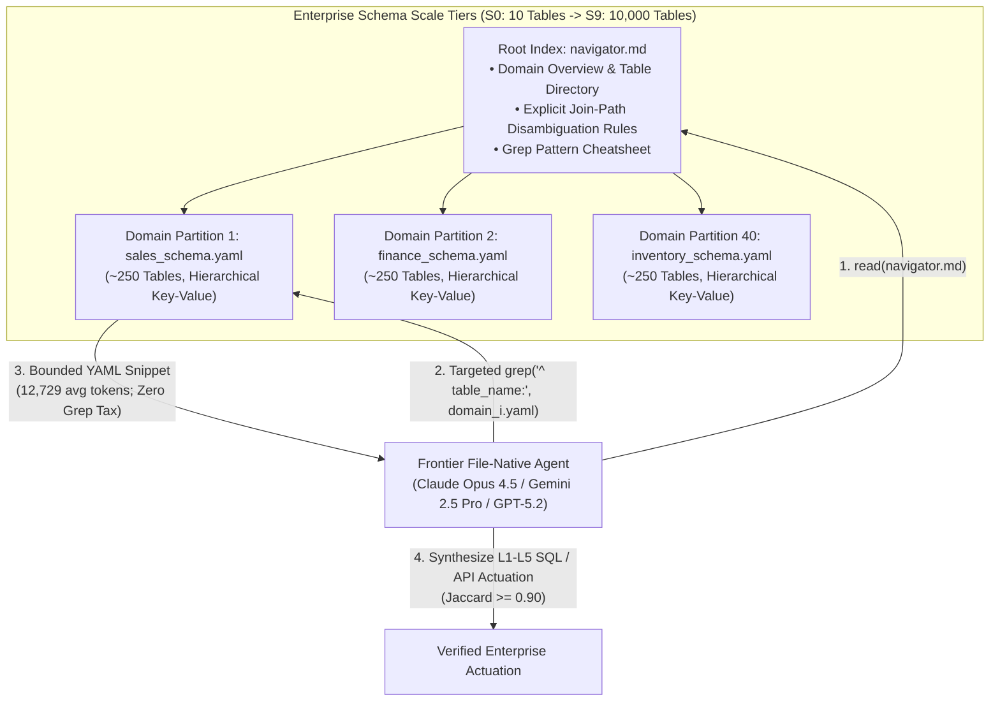

# Architecture Best Practice: Structured File-Native & Open-Source Software (OSS) Context Engineering — `AGENTS.md` / `GEMINI.md` Taxonomy, 10,000-Table Domain Partitioning, and Grep-Tax Mitigation

**Topics:** #file-native-agents #structured-context-engineering #agents-md #gemini-md #claude-md #grep-tax #domain-partitioning #schema-navigation #progressive-disclosure #fde-grading-rubric

> **Sources:** `Structured Context Engineering for File-Native Agentic Systems.pdf` (Damon McMillan, HxAI Australia, 2026) & `Context Engineering for AI Agents in Open-Source Software.pdf` (Mohsenimofidi, Galster, Treude, Baltes, Heidelberg / Bamberg / SMU, MSR 2026, `arXiv:2510.21413v4`) · **Corpus:** `GEAPL200` (Unified L200 + L300 + L400 Open Knowledge Format v0.2 · Version `GEAPL200_2026-10-27_183500`) · **Standalone Catalog ID:** `03-structured-file-native-and-oss-context-engineering` · **Target:** GCP Knowledge Catalog (Dataplex) & Antigravity Agentic AI Development

---

## Version & 6-Month TTL Governance Tab

| Document ID | Version Tag (Today's Date & Time) | Version Timestamp (PDT) | Time-To-Live (TTL) | Expiration (`stale_after`) | Status |
| :--- | :--- | :--- | :--- | :--- | :--- |
| `38-structured-file-native-and-oss-context-engineering` | **`GEAPL200_2026-10-27_183500`** (`L400_version_20261027_1835`) | `2026-10-27 18:35:00 PDT` (`2026-10-27T18:35:00-07:00`) | **6 Months** (`180 days` / `P6M`) | `2027-04-27T18:35:00-07:00` | Published / Verified |

### Grounding Research Publications (Local PDF Sources)
- **`PAPER-06-FILE-NATIVE` — [`Structured Context Engineering for File-Native Agentic Systems.pdf`](../Structured%20Context%20Engineering%20for%20File-Native%20Agentic%20Systems.pdf):** *Structured Context Engineering for File-Native Agentic Systems: Evaluating Schema Accuracy, Format Effectiveness, and Multi-File Navigation at Scale* — Damon McMillan (HxAI Australia; Technical Research Report (2026, 9,649 Experiments across 11 Models, 4 Formats, and 10 to 10,000 Tables)). URL: `file://./Structured%20Context%20Engineering%20for%20File-Native%20Agentic%20Systems.pdf` · Code/Data: `https://toonformat.dev/`
- **`PAPER-03-OSS-CE` — [`Context Engineering for AI Agents in Open-Source Software.pdf`](../Context%20Engineering%20for%20AI%20Agents%20in%20Open-Source%20Software.pdf):** *Context Engineering for AI Agents in Open-Source Software* — Seyedmoein Mohsenimofidi, Matthias Galster, Christoph Treude, Sebastian Baltes (Heidelberg University, University of Bamberg, Singapore Management University; 23rd International Conference on Mining Software Repositories (MSR '26), April 13–14, 2026, Rio de Janeiro, Brazil (arXiv:2510.21413v4, DOI: 10.1145/3793302.3793350)). URL: `https://doi.org/10.1145/3793302.3793350` · Code/Data: `https://doi.org/10.5281/zenodo.17428770`
- **`PAPER-05-MCE` — [`Meta Context Engineering via Agentic Skill Evolution.pdf`](../Meta%20Context%20Engineering%20via%20Agentic%20Skill%20Evolution.pdf):** *Meta Context Engineering via Agentic Skill Evolution* — Haoran Ye, Xuning He, Vincent Arak, Haonan Dong, Guojie Song (State Key Laboratory of General Artificial Intelligence, School of Intelligence Science and Technology & School of EECS, Peking University; arXiv Preprint (arXiv:2601.21557v2, 11 Feb 2026)). URL: `https://arxiv.org/abs/2601.21557` · Code/Data: `https://github.com/metaevo-ai/meta-context-engineering`

---


## 0. OKF Document Metadata & Topic Modeling Taxonomy
**Topic Tags:** `#L400_version_20261027_1835` `#OKFMetadata` `#FileNativeContextEngineering` `#OSSContextFiles` `#GrepTaxMitigation` `#DomainPartitionedSchemas`

| Metadata Field | Value |
| :--- | :--- |
| **OKF Document ID** | `38-structured-file-native-and-oss-context-engineering` (Standalone Index: `03`) |
| **Primary Literature** | 1. Damon McMillan (*Structured Context Engineering for File-Native Agentic Systems*, HxAI Australia, 2026 — 9,649 experiments across 11 models, 4 formats, 10–10,000 tables)<br/>2. Seyedmoein Mohsenimofidi, Matthias Galster, Christoph Treude, Sebastian Baltes (*Context Engineering for AI Agents in Open-Source Software*, MSR '26, `arXiv:2510.21413v4` — 10,000 GitHub repos, 466 context-file adopters) |
| **Architectural Domain** | File-Native Semantic Layers (`grep`/`read`), Hierarchical `navigator.md` Partitioning, & Machine-Readable Repo Manifests (`AGENTS.md`, `GEMINI.md`, `CLAUDE.md`) |
| **Target GCP Runtimes** | Gemini Enterprise Coding & Data Agents, BigQuery / AlloyDB Text-to-SQL Agents, Antigravity IDE / Cloud Workstations |
| **Enforced FDE Standard** | `concepts/00-fde-field-readiness-and-grading-rubric.md` & `OKF-L400-21` (`https://g3doc.corp.google.com/company/teams/cloud-fde/index.md?cl=head`) |

---

## FDE Project Grading Rubric Enforcement & Prevailing Customer Alignment

> **Mandatory Governance Standard:** Every project, prototype, or production agent built using the patterns in this concept **must pass the [Google Cloud FDE Field-Readiness & Project Grading Rubric](/concepts/00-fde-field-readiness-and-grading-rubric.md)** (aligned with the [Cloud FDE Team Charter](https://g3doc.corp.google.com/company/teams/cloud-fde/index.md?cl=head) and `OKF-L400-21`). Scoring Requirement: **Average >= `2.0 (Competent)`** across both **Part A (Presentation & Advisory Rigor)** and **Part B (Engineering & Implementation Excellence)**, with **zero `0 (Not Demonstrated)` scores** on any single metric.

### 1. Part A — Presentation & Advisory Rigor Enforcement for This Concept

- **A.1 Strategic Delivery & Value Articulation:** Advise enterprise data and software engineering leaders using empirical findings from **9,649 controlled experiments**:
  1. **Model-Tier Architecture Matching (`R1` & `R3`):** File-native retrieval (`grep` + `read`) significantly improves accuracy for Frontier + Frontier Lab models (**`79.8%` vs `77.1%`, `+2.7%`, $p=0.029$**; `Gemini 2.5 Pro` hits **`85.1%` overall** and **`74.0%` on L5 complex multi-step SQL**, highest of all 11 models!), whereas Open Source models suffer a **`-7.7%` accuracy drop** (`64.6%` vs `72.3%`, $p<0.001$) when forced into file-native tool loops without prompt-embedded schemas.
  2. **The "Grep Tax" FinOps Discovery (`R5`):** Disk file compression does *not* equal runtime token efficiency. **YAML (`12,729` avg tokens)** is the most token-efficient format for file-native agents, beating JSON (`16,320`, `+28%`), custom compact TOON (`17,625`, `+38%` despite 25% smaller disk footprint!), and Markdown (`20,382`, `+60%` due to pipe-table delimiter bloat).
- **A.2 Objection Handling & Technical Defense:** Defend why enterprise data warehouses with **10,000+ BigQuery/Snowflake tables (`S9` scale)** cannot use flat RAG vector search or monolithic prompt injection, and demonstrate how **2-tier Domain-Partitioned File Navigation (`navigator.md` + `~250` tables/domain in YAML)** sustains **`~99–100%` schema navigation accuracy at 10,000 tables** with bounded per-query token cost.

### 2. Part B — Engineering & Implementation Excellence Cutlines for This Concept

- **B.1.1 & B.2.1 Agentic Context & Repository Hygiene:** Standardize every enterprise repository on a version-controlled, machine-readable **`AGENTS.md` / `GEMINI.md`** manifest structured across the 14 empirical MSR '26 categories and written using **Explanatory + Prescriptive + Prohibitive + Conditional** rules (avoiding vague Descriptive prose).
- **B.2.5 Decision Records (ADRs):** Document explicit **Disambiguation Rules in `navigator.md`** so ambiguous business joins (e.g., *customer state* via `CUSTOMER` home address vs. `SS_ADDR_SK` transaction address, where Markdown biased 72% of models to one path vs. 33% in YAML) are resolved deterministically rather than left to serialization format quirks.
- **B.6.1 CI/CD Co-Evolution Gate:** Enforce CI checks that detect **Context Drift** (50% of OSS `AGENTS.md` files are never updated after initial commit!) by requiring co-evolution of `AGENTS.md` / `GEMINI.md` whenever build scripts, test runners, or database schemas change.

### 3. Prevailing Customer Exemplars & Cross-KB Links

| Customer / Benchmark Exemplar | Architectural Challenge | File-Native / OSS Pattern Applied | Quantified Production Outcome |
| :--- | :--- | :--- | :--- |
| **Enterprise Data Warehouse Agent (`TPC-DS` `S0–S9`: 10 to 10,000 Tables)** | Scaling text-to-SQL and data actuation from 24 tables (`6,000` tokens) to 10,000 enterprise tables where single-file schemas exceed 2.5M tokens. | **Two-Level Domain Partitioning (`S6–S9`)**: Root `navigator.md` routing to domain-partitioned YAML files (`~250` tables/domain) via `grep`/`read`. | **99–100% schema navigation accuracy up to 10,000 tables**; `Claude Opus 4.5` (`89.0%`) and `Gemini 2.5 Pro` (`85.1%` overall, **`74.0%` at L5**) lead all models. |
| **Multi-Model Enterprise FinOps (`11-Model Format & Grep-Tax Study`)** | Custom compact serialization (`TOON`, -25% file size) unexpectedly inflated runtime token usage by `+38%` and caused 16x grep retries in `Haiku 4.5`. | Standardize programmatic schema files on **grep-friendly YAML** (`12,729` avg tokens) with explicit navigator join-path disambiguation. | **`28%–60%` lower runtime token consumption** than JSON, TOON, and Markdown pipe-tables across 11 models; eliminates pattern-unfamiliarity tool cycling. |
| **Enterprise SDLC Coding Agents (`MSR '26` 10,000-Repo Empirical Study)** | Unstructured or stale `AGENTS.md` / `CLAUDE.md` / `GEMINI.md` files (50% never updated; only 6/155 include security rules) cause flaky CI and unsafe commits. | **14-Category Schema + 5-Style Hybrid Specification** with CI co-evolution hooks. | Eliminates deprecated command calls (e.g. `rsyslog` `stylecheck.sh`) and codifies flaky-test & security boundaries across multi-agent coding teams. |

**Related OKF Concepts:**
- [Google Cloud FDE Field-Readiness & Project Grading Rubric](/concepts/00-fde-field-readiness-and-grading-rubric.md)
- [Enterprise Agent Skills — Progressive Disclosure & Lifecycle](/concepts/07-enterprise-agent-skills.md)
- [The New SDLC with Vibe Coding](/concepts/16-the-new-sdlc-with-vibe-coding.md)
- [Agentic Context Engineering (ACE) — Evolving Playbooks](/concepts/36-agentic-context-engineering-evolving-playbooks.md)
- [Meta Context Engineering via Agentic Skill Evolution](/concepts/40-meta-context-engineering-and-agentic-skill-evolution.md)

---

## 1. Part I: Empirical Context Engineering in Open-Source Software (`MSR '26` Study)

To understand how engineering teams structure persistent context for autonomous coding agents (`Gemini CLI`, `Claude Code`, `OpenAI Codex`, `GitHub Copilot`), Mohsenimofidi et al. (MSR 2026) mined **228,890 non-fork GitHub repositories**, filtered to **48,795 mature, actively maintained software projects** across the top 10 programming languages ($\ge 271$ commits, $\ge 7$ watchers, OSI-approved license), and deeply analyzed the **top 10,000 repositories** balanced by popularity and maturity.

### 1.1 Adoption & File-Length Distribution Across Agentic Manifest Formats (`RQ1`)

Across the 10,000 mature OSS repositories, **466 repositories (~4.7%)** had adopted at least one machine-readable AI context file format (with TypeScript [135], Go [58], Python [58], C# [56], Java [36], JavaScript [34], C++ [32], Rust [29], PHP [19], and C [9] leading adoption):

| Context File Format | Primary Agent / Ecosystem | Repo Count (out of 453 valid) | Mean Length ($M$ lines) | Std. Dev. ($SD$ lines) | Empirical Characteristics |
| :--- | :--- | :---: | :---: | :---: | :--- |
| **`.github/copilot-instructions.md`** | GitHub Copilot Coding Agent & Code Review | `218` (229 raw) | **`310 lines`** | `127 lines` | Longest average length; heavily adopted in C# and enterprise .NET repositories. |
| **`CLAUDE.md`** | Anthropic Claude Code | `181` (183 raw) | **`287 lines`** | `112 lines` | Strong adoption in TypeScript/Python; most frequently co-occurs with `AGENTS.md` (25 repos). |
| **`AGENTS.md`** | Open Tool-Agnostic Standard (Agentic AI Foundation / Codex / Copilot) | `118` (155 total files across 116 repos) | **`142 lines`** | **`231 lines`** | Highest structural variance (supports nested directory-scoped `AGENTS.md` files). |
| **`GEMINI.md`** | Google Gemini Code Assist / Gemini CLI / Antigravity | `29` | **`106 lines`** | `65 lines` | Most concise and modular; favors pointer references and progressive disclosure. |

### 1.2 The 14 Canonical Content Categories in `AGENTS.md` (`RQ2`)

Analysis of 1,318 unique headings across 155 `AGENTS.md` files reveals **14 recurring categories**—and exposes a critical **Enterprise Governance Blind Spot**: while *Conventions* (`50`), *Contribution Guidelines* (`48`), and *Architecture* (`47`) are heavily documented, **Troubleshooting (`8`) and Security (`6`) are neglected in over 94% of repositories!**

| Rank | Category | Heading Frequency (L1/L2) | Operational Scope & What Enterprise FDEs Must Include |
| :---: | :--- | :---: | :--- |
| **1** | **Conventions** | `50` | Coding standards, naming/formatting rules, idioms, and linting expectations. |
| **2** | **Contribution Guidelines** | `48` | Branching strategy, PR templates, code review gates, and CI/CD merge requirements. |
| **3** | **Architecture / Structure** | `47` | Key directories, module boundaries, component dependencies, and data flow. |
| **4** | **Build Commands** | `40` | Exact CLI commands and flags for compiling, bundling, and local deployment. |
| **5** | **Goals / Purposes** | `32` | High-level system mission, domain boundaries, and non-goals (**Intent Engineering**). |
| **6** | **Test Execution** | `32` | Exact commands to run unit, integration, or single-file tests (`pytest -k`, `go test`). |
| **7** | **Metadata** | `29` | Version tags, file ownership, scope globs, and agent routing hints. |
| **8** | **Test Strategy** | `24` | Mocking policy, coverage cutlines, flaky-test handling, and E2E verification rules. |
| **9** | **Tech Stack** | `15` | Language versions, core frameworks, ORM/database drivers, and pinned toolchains. |
| **10** | **Setup** | `11` | Environment variables, local container/sandbox bootstrap, and prerequisite services. |
| **11** | **References** | `9` | Pointers to internal ADRs, OpenAPI/Protobuf schemas, and design docs. |
| **12** | **Troubleshooting** | `8` *(Under-Served!)* | Known build failure signatures, environment gotchas, and recovery playbooks. |
| **13** | **Patterns / Examples** | `8` *(Under-Served!)* | Canonical code exemplars, anti-patterns (`WRONG -> RIGHT`), and golden templates. |
| **14** | **Security** | `6` *(Critical Gap!)* | Secret handling, IAM/privilege boundaries, prohibited directories, and PII redaction rules. |

### 1.3 The 5 Stylistic Dimensions of Agent Instructions & Evolution Taxonomy (`RQ2` & `RQ3`)

Mohsenimofidi et al. identify **five distinct linguistic styles** used to encode rules for agents, plus **9 commit-evolution categories** across 453 historical commits (169 deeply annotated across repos with $\ge 10$ commits, such as `neomjs/neo` with 49 changes in 19 days and `gofiber/fiber` with 11 changes over 148 days):

| Stylistic Dimension | Definition | Concrete Example from OSS Corpus | Behavioral Impact on LLM Agents |
| :--- | :--- | :--- | :--- |
| **1. Descriptive** | States existing project facts without explicit behavioral imperatives. | *"This project uses the Linux Kernel Style Guideline."* | **Weakest alone:** Weaker models treat descriptive prose as background trivia rather than a hard constraint. |
| **2. Prescriptive** | Direct imperative verbs instructing the agent how to act. | *"Follow the existing code style and conventions."* | Clear positive action guidance; forms the backbone of workflow execution steps. |
| **3. Prohibitive** | Explicit negative constraints defining hard boundaries. | *"Never commit directly to the main branch."* / *"Agent shall no longer call `stylecheck.sh`."* | Essential for safety and blast-radius prevention, but must be paired with what *to* do instead. |
| **4. Explanatory** | Pairs a prescriptive/prohibitive rule with its causal rationale (*why*). | *"Avoid hard-coded waits **to prevent timing issues in CI environments**."* | **Highest Generalization (`MCE` & `ACE` validated):** Enables the LLM to apply the principle to novel edge cases! |
| **5. Conditional** | Encodes situational `IF -> THEN` decision logic. | *"If you need to use reflection, use `ReflectionUtils` APIs."* | Prevents context confusion by scoping rules to specific task triggers. |

- **Commit Evolution Reality (`RQ3`):** **50% (77/155) of `AGENTS.md` files were never modified after creation**, 23% (36) were modified only once, 21% (32) 2–7 times, and only 6% (10) $\ge 10$ times. When developers do update context files, **81% of modifications fine-tune instructions** (`Add instruction(s)` [78], `Modify instruction(s)` [59], `Add section(s)` [26], `Remove instruction(s)` [23], `Modify heading(s)` [23]) in response to observed agent failures (e.g., `eclipse-rdf4j/rdf4j` updating `AGENTS.md` to handle flaky tests, or `rsyslog` removing calls to deprecated `stylecheck.sh`).

---

## 2. Part II: Structured Context Engineering for File-Native Systems (9,649 Experiments)

Rather than stuffing entire database schemas or API catalogs into the system prompt (**Prompt Engineering Baseline**) or relying on lossy vector chunking, **File-Native Agentic Systems** organize persistent system knowledge into structured files (`YAML`, `Markdown`, `JSON`, `TOON`) plus a routing index (`navigator.md`) that agents query on demand using native `grep` and `read` tools. McMillan (2026) evaluated this paradigm across **9,649 experiments** spanning **11 models**, **4 formats**, **5 query complexity tiers (`L1–L5`)**, and **10 schema scale tiers (`S0–S9`: 10 to 10,000 tables)**.



### 2.1 Finding `R1` & `R3`: Architecture Effectiveness Depends on Model Tier (21.4pp Capability Gap)

One-way ANOVA across 8,401 core evaluations confirms that **model capability is the dominant factor** ($F(10, 8390) = 30.55, p < 0.001$), with a **21.4 percentage point gap** between Frontier (`86.0%`) and Open Source (`64.6%`) tiers. Crucially, **file-native retrieval helps Frontier models (`+2.7%`, $p=0.029$) but hurts Open Source models (`-7.7%`, $p<0.001$)** whose weaker tool-use training causes premature search termination or malformed grep loops:

| Model | Capability Tier | File-Native Agent Accuracy (%) | Prompt Baseline Accuracy (%) | Architecture Diff (`File - Prompt`) | L1 (Direct) | L2 (1-Join) | L3 (Multi-Hop) | L4 (CTE/Win) | **L5 (Multi-Step)** | Best Format & Spread |
| :--- | :--- | :---: | :---: | :---: | :---: | :---: | :---: | :---: | :---: | :--- |
| **`claude-opus-4.5`** | Frontier | **`89.0%`** | N/A | File Only | **100%** | 93% | 94% | **94%** | 64% | `YAML` (92%, spread 5.4%) |
| **`gemini-2.5-pro`** | Frontier | **`85.1%`** | 81.4% | **`+3.7%` (File)** | 94% | **97%** | 81% | 81% | **`74%` (#1!)** | `JSON` (88%, spread 5.1%) |
| **`gpt-5.2`** | Frontier | **`83.8%`** | 82.0% | **`+1.8%` (File)** | 95% | 89% | **96%** | 85% | 54% | `JSON` (85%, spread 1.8%) |
| **`gpt-5-mini`** | Frontier Lab | **`77.1%`** | 69.4% | **`+7.7%` (File)** | 95% | 88% | 82% | 71% | 49% | `YAML`/`MD` (78%, spread 1.6%) |
| **`gemini-2.5-flash`** | Frontier Lab | `77.0%` | **78.0%** | `-1.1%` (Prompt) | 94% | 92% | 83% | 75% | 40% | `YAML`/`MD` (79%, spread 5.1%) |
| **`claude-haiku-4.5`** | Frontier Lab | **`76.1%`** | 74.5% | **`+1.6%` (File)** | **100%** | 93% | 87% | 71% | 29% | `YAML` (84%, spread 12.2%) |
| **`DeepSeek-V3.2`** | Open Source | `75.3%` | **78.6%** | `-3.3%` (Prompt) | 96% | 92% | 82% | 67% | 40% | `MD` (80%, spread 10.2%) |
| **`kimi-k2`** | Open Source | **`75.0%`** | 74.7% | `+0.3%` (File) | 99% | 89% | 86% | 64% | 37% | `YAML` (82%, spread 11.1%) |
| **`llama-4-scout`** | Open Source | **`63.1%`** | 62.6% | `+0.5%` (File) | 94% | 75% | 79% | 50% | 18% | `MD` (72%, spread 13.2%) |
| **`llama-4-maverick`** | Open Source | `60.9%` | **74.8%** | `-13.9%` (Prompt) | 90% | 82% | 73% | 37% | 23% | `MD` (71%, spread 20.1%) |
| **`qwen3-32b`** | Open Source | `48.9%` | **70.9%** | `-21.9%` (Prompt) | 92% | 53% | 44% | 37% | 18% | `YAML` (54%, spread 9.8%) |

### 2.2 Finding `R2`, `R4`, & `R5`: Format Equivalence, Semantic Join Bias, 10k-Table Partitioning, and the "Grep Tax"

1. **Aggregate Format Equivalence vs. Open-Source Sensitivity (`R2`):** Across all models, aggregate accuracy does not significantly differ by format ($\chi^2 = 2.45, p = 0.484$: **YAML `75.4%`**, **Markdown `74.9%`**, **JSON `72.3%`**, **TOON `72.3%`**). However, Open Source models exhibit massive format sensitivity (`9.8%–20.1%` spread) compared to Frontier models (`1.6%–5.4%` spread).
2. **Subtle Structural Bias on Ambiguous Joins (`Section 5.4`):** When a query contains semantic ambiguity (e.g., *"customer state"*, which could join via `CUSTOMER` home address or `SS_ADDR_SK` store-sales transaction address), **Markdown's flat heading structure guided `72%` of models to one join path, whereas YAML's hierarchical structure guided only `33%` to that path** (`Opus 4.5` resolved the ambiguity regardless of format, while weaker models followed surface format cues). **Lesson:** Invest engineering effort in explicit **Navigator Disambiguation Rules** inside `navigator.md`, not exotic file formats.
3. **Scaling to 10,000 Tables via Domain Partitioning (`R4`):** Single-file schemas maintain near-100% navigation accuracy from `S0` (10 tables) to `S5` (1,000 tables). From `S6` (2,000 tables) to **`S9` (10,000 tables)**, partitioning the schema into domain files of **`~250 tables per domain`** indexed by a root `navigator.md` achieves **99–100% navigation accuracy** while keeping per-query token consumption flat!
4. **The "Grep Tax" (`R5` — Why Compact TOON & Markdown Cost `38%–60%` More Runtime Tokens than YAML):**

| Serialization Format | Relative Disk File Size | **Avg Runtime Tokens (`TPC-DS` 11-Model Avg)** | Overhead vs. YAML | Root Cause of Runtime Token Behavior |
| :--- | :---: | :---: | :---: | :--- |
| **`YAML` (Recommended)** | `1.00x` (Baseline) | **`12,729 tokens`** | **Baseline (`0%`)** | Spaced hierarchical key-value lines return clean, bounded context windows on `grep` hits; universally familiar syntax in LLM pretraining. |
| **`JSON`** | `~1.25x` | `16,320 tokens` | `+28%` | Repeated braces, quotes, and verbose structural delimiters inflate `read` payloads. |
| **`TOON` (Token-Oriented Object Notation)** | **`0.75x` (`-25%` smaller on disk!)** | `17,625 tokens` | **`+38%` ("Grep Tax")** | **1. Line Density (`1.18x–1.37x`):** Packing more schema tokens per line causes `grep -C` context windows to return denser text.<br/>**2. Pattern Unfamiliarity Cycling (`up to 2.12x` in Haiku at `S5`):** Models unfamiliar with `TABLE`/`COL`/`FK` keywords cycle through DDL (`CREATE TABLE`), JSON (`"TABLE_NAME":`), and YAML (`^  TABLE_NAME:`)—taking **up to 16 `grep` calls vs. 3 in YAML**! |
| **`Markdown`** | `~1.15x` | `20,382 tokens` | **`+60%` (Table Bloat)** | Models match Markdown headings on the first try, but GFM pipe tables (`\| col \| --- \|`) pack massive delimiter overhead into every retrieved line (`+7%` on Gemini Flash to `+105%` on Claude Opus). |

---

## 3. Production Implementation Blueprint: Enterprise `GEMINI.md` / `AGENTS.md` + 10K-Table Domain Navigator

```yaml
# File: context/schemas/navigator.md (YAML Frontmatter + Disambiguation Index)
---
schema_scale_tier: "S9_10000_TABLES"
partition_strategy: "domain_partitioned_yaml_250_tables_per_file"
default_format: "yaml"
grep_guidance:
  table_lookup: "^  [a-z0-9_]+:$"
  column_lookup: "^      [a-z0-9_]+:"
---
# Enterprise Data Warehouse Schema Navigator (10,000 Tables across 40 Domains)

## 1. Domain Partition Directory
- `domains/01_customer_core.yaml` (Tables: `customer`, `customer_address`, `customer_demographics`, ... [248 tables])
- `domains/02_store_sales.yaml` (Tables: `store_sales`, `store_returns`, `store`, ... [252 tables])
- `domains/03_finance_gl.yaml` (Tables: `gl_journal`, `debt_instruments`, `xbrl_taxonomy`, ... [240 tables])

## 2. Mandatory Semantic Disambiguation Rules (Prevents Format-Induced Join Drift)
- **RULE-JOIN-001 (`Customer State / Location`):**
  - **IF** the user query asks for *"customer residence state"* or *"where the customer lives"*, **ALWAYS** join `store_sales.ss_customer_sk -> customer.c_customer_sk -> customer_address.ca_address_sk` (`ca_state`).
  - **IF** the user query asks for *"transaction / purchase state"*, **ALWAYS** join `store_sales.ss_addr_sk -> customer_address.ca_address_sk`.
  - **PROHIBITED:** Never infer address join paths from table proximity; verify against this rule first.
```

---

## 4. Anti-Patterns & Remediation Matrix

| Anti-Pattern | Observable Symptom | Root Cause | Architectural Remediation |
| :--- | :--- | :--- | :--- |
| **Deploying File-Native Retrieval on Unvalidated Open-Source Models** | SQL generation accuracy drops by `-13.9%` (`Llama-4-Maverick`) to `-21.9%` (`Qwen3-32B`) compared to direct prompt injection. | Smaller/open-source models lack robust multi-step `grep`/`read` tool-use calibration and fail on L2–L5 multi-hop joins. | Follow the **Model-Tier Architecture Selection Guide**: use **File-Native Retrieval** for Frontier (`Gemini 2.5 Pro`, `Claude Opus 4.5`, `GPT-5.2`) and validated Frontier Lab models; use **Pre-Retrieved Prompt Injection** for smaller open-source models. |
| **Adopting Novel Compact Formats (`TOON`) Without Grep Prompt Guidance** | Runtime token usage increases by `+38%` (`2.12x` on Haiku at 1,000 tables) and tool calls jump from `1.6` to `5.0+` (up to 16 retries). | Pretrained LLMs do not recognize custom syntax (`TABLE`, `COL`, `FK`) and burn turns guessing regex patterns (**The Grep Tax**). | Use **YAML** for machine-read schema partitions (`28–60%` fewer runtime tokens); if custom compact formats are required, inject explicit regex examples in `navigator.md`. |
| **Write-Once "Zombie" `AGENTS.md` / `GEMINI.md` Files** | Coding agents invoke deleted scripts (e.g., `stylecheck.sh`) or violate updated module boundaries. | Empirical MSR '26 finding: **50% of OSS `AGENTS.md` files are never updated after their initial commit**. | Add a CI/CD co-evolution check and wire the **ACE Curator (`Concept 36`)** or **MCE Base-Agent (`Concept 40`)** to propose PR deltas to `GEMINI.md` whenever build/test pipelines change. |

---

## 5. Socratic FDE Field-Readiness & Customer Grilling Questions (L100–L400)

### Q1 (L200 — Format & FinOps Defense): *"Our engineering team wants to invent a custom minified DSL to shrink our 1,000-table schema file by 25% on disk so our file-native SQL agent uses fewer tokens. Should we approve this?"*
- **Model Answer (Score 3 — Proficient):** **No.** McMillan's (2026) 9,649-experiment study proved that **disk file size does not predict runtime token efficiency** in file-native agents due to the **Grep Tax**. A custom compact format (`TOON`, which is 25% smaller on disk than YAML) actually **increased runtime token consumption by `+38%` on average** (`17,625` vs `12,729` tokens) and by **`2.12x` on smaller frontier-lab models at 1,000 tables**. This happens for two reasons: (1) *Token Density*—compact lines pack more unrelated schema tokens into every `grep` line match (`1.18x–1.37x` baseline overhead); and (2) *Pattern Unfamiliarity*—models cycle through familiar SQL DDL, JSON, and YAML regexes (up to 16 failed `grep` calls vs 3 in YAML) before matching the custom syntax. Instead, keep schemas in **YAML** (the most token-efficient format at `12,729` avg tokens) and partition schemas exceeding 1,000 tables into **~250-table domain YAML files** indexed by `navigator.md`.
- **Red-Flag Answer (Score 0/1):** Endorsing custom minified text formats under the assumption that smaller disk byte size equals fewer runtime prompt tokens.

### Q2 (L300 — Enterprise Repository Governance): *"We audited our 200 microservices and found that teams wrote `AGENTS.md` and `GEMINI.md` files as high-level descriptive summaries, and haven't touched them in 6 months. What is wrong with this, and how do we fix it?"*
- **Model Answer (Score 3 — Proficient):** Based on the MSR '26 empirical study of 10,000 repositories:
  1. **Descriptive vs. Explanatory/Conditional Style:** Purely *descriptive* statements (*"We use FastAPI and pytest"*) fail to constrain autonomous agents. High-performing context manifests combine **Prescriptive** imperatives, **Prohibitive** boundaries (*"Never run migrations against prod DB"*), **Explanatory** rationales (*"Avoid hard-coded sleeps to prevent CI flakiness"*), and **Conditional** routing (*"If modifying auth, run `pytest tests/security/`"*).
  2. **Closing the Security & Troubleshooting Gap:** Over 94% of OSS `AGENTS.md` files omit **Security** (only 6/155) and **Troubleshooting** (8/155). Every enterprise `GEMINI.md` must include all 14 categories, with mandatory Security and Troubleshooting sections.
  3. **Preventing the 50% Stale-File Trap:** Treat `GEMINI.md` / `AGENTS.md` as living, versioned code artifacts verified in CI alongside source code and test suites.