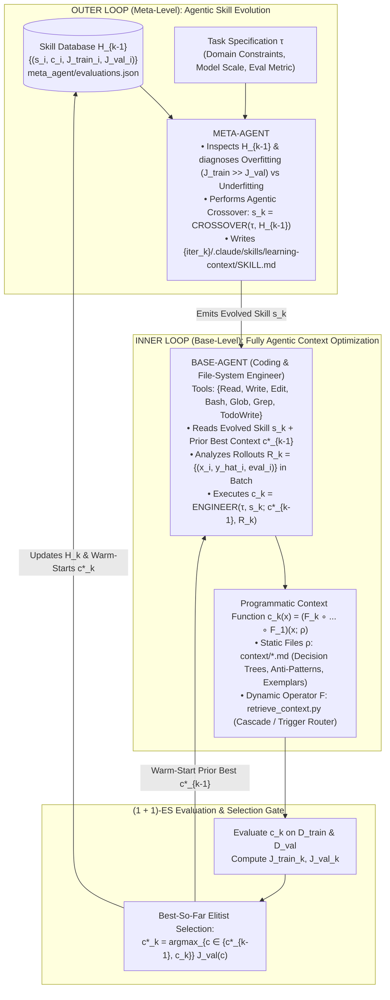

# Architecture Best Practice: Meta Context Engineering (MCE) via Agentic Skill Evolution — Bi-Level Optimization, Agentic Crossover, and Programmatic Context Artifacts

**Topics:** #meta-context-engineering #agentic-skill-evolution #bi-level-optimization #agentic-crossover #skill-md #programmatic-context #strong-to-weak-transfer #alpha-evolve #google-adk #fde-grading-rubric

> **Source:** `Meta Context Engineering via Agentic Skill Evolution.pdf` (Haoran Ye, Xuning He, Vincent Arak, Haonan Dong, Guojie Song, Peking University, `arXiv:2601.21557v2`, `https://github.com/metaevo-ai/meta-context-engineering`) · **Corpus:** `GEAPL200` (Unified L200 + L300 + L400 Open Knowledge Format v0.2 · Version `GEAPL200_2026-10-27_183500`) · **Standalone Catalog ID:** `05-meta-context-engineering-and-agentic-skill-evolution` · **Target:** GCP Knowledge Catalog (Dataplex) & Antigravity Agentic AI Development

---

## Version & 6-Month TTL Governance Tab

| Document ID | Version Tag (Today's Date & Time) | Version Timestamp (PDT) | Time-To-Live (TTL) | Expiration (`stale_after`) | Status |
| :--- | :--- | :--- | :--- | :--- | :--- |
| `40-meta-context-engineering-and-agentic-skill-evolution` | **`GEAPL200_2026-10-27_183500`** (`L400_version_20261027_1835`) | `2026-10-27 18:35:00 PDT` (`2026-10-27T18:35:00-07:00`) | **6 Months** (`180 days` / `P6M`) | `2027-04-27T18:35:00-07:00` | Published / Verified |

### Grounding Research Publications (Local PDF Sources)
- **`PAPER-05-MCE` — [`Meta Context Engineering via Agentic Skill Evolution.pdf`](../Meta%20Context%20Engineering%20via%20Agentic%20Skill%20Evolution.pdf):** *Meta Context Engineering via Agentic Skill Evolution* — Haoran Ye, Xuning He, Vincent Arak, Haonan Dong, Guojie Song (State Key Laboratory of General Artificial Intelligence, School of Intelligence Science and Technology & School of EECS, Peking University; arXiv Preprint (arXiv:2601.21557v2, 11 Feb 2026)). URL: `https://arxiv.org/abs/2601.21557` · Code/Data: `https://github.com/metaevo-ai/meta-context-engineering`
- **`PAPER-01-ACE` — [`AGENTIC CONTEXT ENGINEERING- EVOLVING CONTEXTS FOR SELF-IMPROVING LANGUAGE MODELS.pdf`](../AGENTIC%20CONTEXT%20ENGINEERING-%20EVOLVING%20CONTEXTS%20FOR%20SELF-IMPROVING%20LANGUAGE%20MODELS.pdf):** *Agentic Context Engineering: Evolving Contexts for Self-Improving Language Models* — Qizheng Zhang, Changran Hu, Shubhangi Upasani, Boyuan Ma, Fenglu Hong, Vamsidhar Kamanuru, Jay Rainton, Chen Wu, Mengmeng Ji, Hanchen Li, Urmish Thakker, James Zou, Kunle Olukotun (Stanford University, SambaNova Systems, Inc., UC Berkeley; Published as a conference paper at ICLR 2026 (arXiv:2510.04618v3, 29 Mar 2026)). URL: `https://arxiv.org/abs/2510.04618` · Code/Data: `https://github.com/ace-agent/ace`
- **`PAPER-06-FILE-NATIVE` — [`Structured Context Engineering for File-Native Agentic Systems.pdf`](../Structured%20Context%20Engineering%20for%20File-Native%20Agentic%20Systems.pdf):** *Structured Context Engineering for File-Native Agentic Systems: Evaluating Schema Accuracy, Format Effectiveness, and Multi-File Navigation at Scale* — Damon McMillan (HxAI Australia; Technical Research Report (2026, 9,649 Experiments across 11 Models, 4 Formats, and 10 to 10,000 Tables)). URL: `file://./Structured%20Context%20Engineering%20for%20File-Native%20Agentic%20Systems.pdf` · Code/Data: `https://toonformat.dev/`

---


## 0. OKF Document Metadata & Topic Modeling Taxonomy
**Topic Tags:** `#L400_version_20261027_1835` `#OKFMetadata` `#MetaContextEngineering` `#AgenticSkillEvolution` `#BiLevelOptimization` `#AgenticCrossover`

| Metadata Field | Value |
| :--- | :--- |
| **OKF Document ID** | `40-meta-context-engineering-and-agentic-skill-evolution` (Standalone Index: `05`) |
| **Primary Literature** | Haoran Ye, Xuning He, Vincent Arak, Haonan Dong, Guojie Song (*Meta Context Engineering via Agentic Skill Evolution*, State Key Laboratory of General AI, Peking University, `arXiv:2601.21557v2`, Feb 2026) |
| **Architectural Domain** | Bi-Level Evolution of Context Engineering Skills (`SKILL.md` + Scripts) & Programmatic Context Artifacts (`context/*.md` + `retrieve_context.py`) |
| **Target GCP Runtimes** | Google ADK 2.0 Skill Registry (`B3`), AlphaEvolve / Vertex AI Evaluation Harnesses (`O6`), Gemini Enterprise Coding Agents |
| **Enforced FDE Standard** | `concepts/00-fde-field-readiness-and-grading-rubric.md` & `OKF-L400-21` (`https://g3doc.corp.google.com/company/teams/cloud-fde/index.md?cl=head`) |

---

## FDE Project Grading Rubric Enforcement & Prevailing Customer Alignment

> **Mandatory Governance Standard:** Every project, prototype, or production agent built using the patterns in this concept **must pass the [Google Cloud FDE Field-Readiness & Project Grading Rubric](/concepts/00-fde-field-readiness-and-grading-rubric.md)** (aligned with the [Cloud FDE Team Charter](https://g3doc.corp.google.com/company/teams/cloud-fde/index.md?cl=head) and `OKF-L400-21`). Scoring Requirement: **Average >= `2.0 (Competent)`** across both **Part A (Presentation & Advisory Rigor)** and **Part B (Engineering & Implementation Excellence)**, with **zero `0 (Not Demonstrated)` scores** on any single metric.

### 1. Part A — Presentation & Advisory Rigor Enforcement for This Concept

- **A.1 Strategic Delivery & Value Articulation:** Frame **Meta Context Engineering (MCE)** as the evolutionary layer above static context harnesses (`GEPA` and `ACE`):
  1. **Superior Domain Accuracy (`+89.1%` Offline / `+74.1%` Online Relative Gain):** Across 5 disparate domains (`FiNER` Finance, `USPTO-50k` Chemistry, `Symptom2Disease` Medicine, `LawBench` Legal, `AEGIS2` AI Safety), MCE achieves **5.6%–53.8% relative improvement over SOTA CE methods (mean `+16.9%`)**, beating ACE's `70.7%` offline and `41.1%` online relative gains by **`+18.4%` and `+33.0%`**.
  2. **Surpassing Vertical Fine-Tuned Models Without Weight Updates:** General LLMs equipped with MCE-evolved context surpass specialized vertical models—e.g., on `LawBench` (`0.70` Micro-F1 vs `0.56` best legal-specific model) and `AEGIS2` (`Qwen3-8B + MCE` achieves **`0.80` F1**, beating dedicated `Llama Guard 3 8B` at `0.72` F1).
  3. **Strong-to-Weak Model Distillation (`172.6%` Relative Gain on `Gemma3-4B`):** Contexts learned by a frontier model (`DeepSeek-V3.1`) transfer to compact edge/guardrail models (`Gemma3-4B`, `Qwen3-8B`, `Llama3.3-70B`) with **4–7% lower degradation than ACE**, while accelerating offline training by **`13.6x` (`1.9h` vs `25.8h`)** and requiring **`4.8x` fewer rollouts (`450` vs `2,169`)**.
- **A.2 Objection Handling & Technical Defense:** Explain why **no single fixed CE harness is universally optimal**: additive playbooks (`ACE`) excel on `FiNER` (`71.0%`) but lose to raw `ICL` (`84.4%` vs `79.2%`) on `Symptom2Disease` and lose to concise `GEPA` (`0.69` vs `0.65` on `LawBench`; `0.76` vs `0.68` on `AEGIS2`) due to context interference and bloat (`79K–114K` tokens). MCE ranks **#1 across all five domains** because its Meta-Agent dynamically evolves the CE skill itself!

### 2. Part B — Engineering & Implementation Excellence Cutlines for This Concept

- **B.1.1 & B.2.1 Bi-Level Agentic Architecture:** Decouple **how to engineer context (`Skill s_k` in `.claude/skills/learning-context/SKILL.md`)** from **what context is learned (`Context Function c_k = (ρ_k, F_k)` in `context/*.md` + `retrieve_context.py`)** using a history-informed `(1 + 1)-Evolution Strategy (ES)`.
- **B.2.5 Decision Records (ADRs) & Overfitting Gates:** Require the Meta-Agent to inspect `evaluations.json` (`J_train` vs `J_val` gap) during **Agentic Crossover** and inject explicit **Multi-Gate Stop Criteria** when validation accuracy plateaus or the train-val gap widens (`>1.5%`).

### 3. Prevailing Customer Exemplars & Cross-KB Links

| Domain & Benchmark | Why Fixed CE Harnesses (`GEPA` / `ACE`) Struggle | MCE Evolved Skill & Context Architecture | Quantified Production Outcome |
| :--- | :--- | :--- | :--- |
| **Financial XBRL Tagging (`FiNER` — 139 US GAAP Tags)** | `GEPA` (`66.0%`) suffers brevity bias; `ACE` (`71.0%`) balloons to `79K` tokens (`114K` with MiniMax) over 25.8 hours. | **8-Phase Error-Driven Generalization Skill:** Organizes context into `reasoning-chains.md`, `semantic-principles.md`, and `tag-reference.md` (`1.5K` `MCE-S` / `20K` `MCE-L`). | **`75.0%` offline accuracy** (`73%` at just `1.5K` tokens vs `ACE` `70%` at `79K` tokens); **`13.6x` faster training (`1.9h` vs `25.8h`)** and **`4.8x` fewer rollouts (`450` vs `2,169`)**. |
| **Clinical Triage (`Symptom2Disease` — 22 Diagnoses)** | Minimal train-test shift means `ACE`'s abstract reflections (`79.2%` offline, `62.3%` online) add noise and underperform raw `ICL` (`84.4%`). | **Conservative Multi-Gate Skill + `1,440-Line` Python Cascade Router (`retrieve_context.py`):** 9 Critical Rules, 4 Surgical Discriminators (`Impetigo` painful vs `Chicken Pox` itchy), and explicit 5-rule Stop Criteria. | **`89.2%` offline (`+25.5%`)** and **`76.9%` online** (vs `ACE` `62.3%`), eliminating context interference via query-specific Python routing. |
| **Legal Charge Prediction (`LawBench` Criminal Law)** | `ACE`'s `88KB` historical error bullets cause severe *context interference* (`0.65` F1), losing to `GEPA`'s concise global workflow (`0.69` F1). | **Structural Case Decomposition Skill (`READ -> DECOMPOSE -> MATCH -> VALIDATE`):** Shrinks context from `88KB` to `<30KB` across 11 files + `177-line` trigger-based Python router (`(一)`, `另案处理`). | **`0.70` Micro-F1** (beats both `GEPA` `0.69` and specialized legal LLMs `0.56`). |
| **Lightweight Safety Guardrails (`AEGIS2` on `Qwen3-8B`)** | Small 8B models have limited context capacity and over-classify benign creative/SEO prompts as unsafe (`ACE` `0.68` F1). | **Precision-First Cascade Skill + `995-Line` Early-Safe-Return Gate:** Immediately returns `safe_content_context` for benign SEO/short queries; separates `CREATE` (safe) vs `EXTRACT` (plagiarism). | **`0.80` F1 on `Qwen3-8B`** (`+0.26` over base `0.54`), outperforming dedicated **`Llama Guard 3 8B` (`0.72` F1)**. |

**Related OKF Concepts:**
- [Google Cloud FDE Field-Readiness & Project Grading Rubric](/concepts/00-fde-field-readiness-and-grading-rubric.md)
- [Enterprise Agent Skills — Progressive Disclosure & Skill Lifecycle](/concepts/07-enterprise-agent-skills.md)
- [Agent Skills](/concepts/14-agent-skills.md)
- [Hill-Climbing Agentic Systems](/concepts/26-hill-climbing-agentic-systems.md)
- [Agentic Context Engineering (ACE) — Evolving Playbooks](/concepts/36-agentic-context-engineering-evolving-playbooks.md)
- [Socratic Grilling: User-to-Agent and Agent-to-Agent Protocols](/concepts/41-socratic-grilling-user-to-agent-and-agent-to-agent-protocols.md)

---

## 1. Why Static Context Engineering Harnesses Hit an Inductive Bias Ceiling

First-generation Context Engineering (CE) systems hard-code both **how context is represented** and **how context is updated**, trapping enterprise teams between two opposing inductive biases:
1. **Representation-Level Trade-Offs:**
   - *Case-based trajectory stores* retain rich episodic detail but fail to abstract generalizable domain rules.
   - *Flat itemized bullet lists (`ACE`, `Dynamic Cheatsheet`)* accumulate isolated heuristics but lack hierarchical decision logic and conditional routing.
   - *Graph-based memories (`A-MEM`, `Mem0`)* incur high graph-traversal latency without consistently outperforming targeted file retrieval.
2. **Optimization-Level Biases (Brevity vs. Verbosity Bloat):**
   - **Brevity-Biased Rewriters (`GEPA`, `MIPROv2`):** Compress all guidance into `1K–2K` tokens—excelling on small-model guardrails (`AEGIS2`) and procedural legal workflows (`LawBench`), but failing on knowledge-dense tasks (`FiNER`, `USPTO-50k`).
   - **Verbosity-Biased Additive Curators (`ACE`, `DC-CU`):** Append instance-level reflections after every rollout without a global view of the corpus—causing **Context Bloat** (`79K–114K` tokens on `FiNER` and `88KB` on `LawBench`), high training latency (`25.8 hours` on 200 `FiNER` examples), and **Context Interference** when tangentially related bullets dilute attention.

**The Meta Context Engineering (MCE) Breakthrough:** MCE recognizes that `GEPA`, `ACE`, and `DC` are merely *single points* in the vast space of possible context engineering algorithms. By encapsulating the CE methodology itself inside an **evolvable Agent Skill (`SKILL.md` + Python scripts)** and granting the base agent full coding/filesystem agency (`Read, Write, Edit, Bash, Glob, Grep, TodoWrite`), MCE co-evolves **how to learn context** alongside **the learned context artifacts**.

---

## 2. Mathematical Formulation of Bi-Level Meta Context Engineering



### 2.1 Context Function & Bi-Level Objective
Define a **Programmatic Context Function** $c \in \mathcal{C}$ that maps any runtime query $x \in \mathcal{X}$ to its compiled context payload $c(x)$, parameterized by a tuple $(\rho, F)$:

$$c(x) = \left(F_k \circ \dots \circ F_1\right)(x; \rho)$$

where:
- $\rho = \{\rho_1, \dots, \rho_m\}$ denotes **static file artifacts** stored in `context/` (e.g., `reasoning-chains.md`, `semantic-principles.md`, `tag-reference.md`, `workflow.md`),
- $F = \{F_1, \dots, F_k\}$ denotes **dynamic programmatic operators** implemented in `retrieve_context.py` (e.g., keyword/regex trigger gates, prioritized symptom cascades, embedding similarity filters, or early safe-return gates) that selectively filter and compose $\rho$ conditioned on $x$.

Given a frozen base generator LLM $f_\theta$ producing $\hat{y} = f_\theta(x, c(x))$ and a skill $s \in \mathcal{S}$ that specifies the executable context-learning procedure, MCE solves the **Bi-Level Optimization Problem**:

$$s^* = \arg\max_{s \in \mathcal{S}} J_{\text{val}}\left(c_s^*\right) \qquad \text{s.t.} \qquad c_s^* = \arg\max_{c_s \in \mathcal{C}} J_{\text{train}}\left(c_s; s\right)$$

1. **Meta-Level Agentic Crossover (`Outer Loop`):** At iteration $k \in \{1, \dots, K\}$, the Meta-Agent inspects the full skill history $\mathcal{H}_{k-1} = \{(s_i, c_i, J_i^{\text{train}}, J_i^{\text{val}})\}_{i=1}^{k-1}$, checks for **Overfitting** ($J_i^{\text{train}} \gg J_i^{\text{val}}$) or **Underfitting** (both low), and synthesizes a new skill folder:
   $$s_k = \text{CROSSOVER}\left(\tau, \mathcal{H}_{k-1}\right)$$
2. **Base-Level Agentic Engineering (`Inner Loop`):** Warm-started from the prior best context function $c_{k-1}^*$ and its training rollout traces $\mathcal{R}_k = \{(x_i, \hat{y}_i, \text{eval}_i)\}$, the Base-Agent executes $s_k$ using Python scripts (`utils/llm.py`, `utils/embedding.py`) and filesystem tools:
   $$c_k = \text{ENGINEER}\left(\tau, s_k; c_{k-1}^*, \mathcal{R}_k\right)$$
3. **Elitist `(1+1)-ES` Selection:** $c_k$ is evaluated on $\mathcal{D}_{\text{val}}$, appended to $\mathcal{H}_k$, and retained as $c_k^*$ if and only if $J_{\text{val}}(c_k) \ge J_{\text{val}}(c_{k-1}^*)$.

---

## 3. Master Quantitative Benchmarks Across 5 Domains & 4 Model Families

### 3.1 Offline & Online Context Performance (`DeepSeek-V3.1` Generator, `Qwen3-8B` on `AEGIS2`)

| Setting & Method | `FiNER` (Finance Acc % $\uparrow$) | `USPTO-50k` (Chemistry Acc % $\uparrow$) | `Symptom2Disease` (Medicine Acc % $\uparrow$) | `LawBench` (Legal Micro-F1 $\uparrow$) | `AEGIS2.0` (AI Safety F1 $\uparrow$) | **Mean Relative Gain vs. Base ($\uparrow$)** |
| :--- | :---: | :---: | :---: | :---: | :---: | :---: |
| **Base Model (Zero-Shot)** | 58.0 | 6.0 | 63.7 | 0.36 | 0.54 | — |
| **Offline: `ICL` (Many-Shot)** | 64.0 (`+6.0`) | 9.0 (`+3.0`) | 84.4 (`+20.7`) | 0.57 (`+.21`) | 0.59 (`+.05`) | `+32.1%` |
| **Offline: `MIPROv2` (DSPy Heavy)** | 69.0 (`+11.0`) | 14.0 (`+8.0`) | 73.1 (`+9.4`) | 0.60 (`+.24`) | 0.59 (`+.05`) | `+48.6%` |
| **Offline: `GEPA` (DSPy Heavy)** | 66.0 (`+8.0`) | 15.0 (`+9.0`) | 70.8 (`+7.1`) | 0.69 (`+.33`) | 0.76 (`+.22`) | `+61.5%` |
| **Offline: `ACE` (5 Epochs)** | 71.0 (`+13.0`) | 18.0 (`+12.0`) | 79.2 (`+15.5`) | 0.65 (`+.29`) | 0.68 (`+.14`) | `+70.7%` |
| **Offline: `MCE` (Full Bi-Level)** | **`75.0` (`+17.0`)** | **`20.0` (`+14.0`)** | **`89.2` (`+25.5`)** | **`0.70` (`+.34`)** | **`0.80` (`+.26`)** | **`+89.1%` (#1 All 5!)** |
| **Online: `Dynamic Cheatsheet (DC-CU)`** | 61.0 (`+3.0`) | 14.0 (`+8.0`) | 73.1 (`+9.4`) | 0.46 (`+.10`) | 0.53 (`-.01`) | `+35.8%` |
| **Online: `ACE`** | 64.0 (`+6.0`) | 13.0 (`+7.0`) | 62.3 (`-1.4`) | 0.63 (`+.27`) | 0.57 (`+.03`) | `+41.1%` |
| **Online: `MCE (w/o skills)`** | 67.0 (`+9.0`) | 18.0 (`+12.0`) | **76.9 (`+13.2`)** | **0.70 (`+.34`)** | **0.68 (`+.14`)** | `+71.3%` |
| **Online: `MCE (w/ Fixed Task Skill)`** | **`68.0` (`+10.0`)** | **`20.0` (`+14.0`)** | 76.4 (`+12.7`) | 0.66 (`+.30`) | 0.63 (`+.09`) | **`+74.1%`** |

### 3.2 Strong-to-Weak Context Transferability (Context as Non-Parametric Knowledge Distillation)

Contexts trained once using `DeepSeek-V3.1` as the generator and transferred zero-shot to smaller open-weights models (`Llama3.3-70B`, `Qwen3-8B`, `Gemma3-4B`) prove that MCE's compact, well-structured files avoid the model-specific overfitting and long-context degradation of ACE:

| Target Model | Method | `FiNER` Acc (%) | `Symptom2Disease` Acc (%) | `LawBench` Micro-F1 | **Avg. Relative Gain (%) $\uparrow$** | **Avg. Relative Drop from Source (%) $\downarrow$** |
| :--- | :--- | :---: | :---: | :---: | :---: | :---: |
| **`DeepSeek-V3.1` (Source)** | Base / `ACE` / **`MCE`** | 58.0 / 71.0 / **75.0** | 63.7 / 79.2 / **89.2** | 0.36 / 0.65 / **0.70** | — / `+42.4%` / **`+54.6%`** | — |
| **`Llama3.3-70B`** | Base / `ACE` / **`MCE`** | 56.0 / 71.0 / **74.0** | 65.1 / 68.4 / **82.1** | 0.24 / 0.19 (`-0.05`!) / **0.27** | — / `+3.7%` / **`+23.6%`** | `28.1%` (ACE) vs **`23.6%` (MCE)** |
| **`Qwen3-8B`** | Base / `ACE` / **`MCE`** | 59.0 / 63.0 / **71.0** | 65.6 / 72.2 / **80.2** | 0.27 / 0.32 / **0.45** | — / `+11.8%` / **`+36.4%`** | `23.6%` (ACE) vs **`17.1%` (MCE)** |
| **`Gemma3-4B`** | Base / `ACE` / **`MCE`** | 17.0 / 64.0 / **65.0** | 51.9 / 51.4 (`-0.5`!) / **70.3** | 0.01 / 0.00 / **0.03** | — / `+58.5%` / **`+172.6%`** | `48.3%` (ACE) vs **`43.4%` (MCE)** |

### 3.3 Ablation & Confound Analysis (`FiNER` — Ruling Out Agentic Model Transfer)

To verify that MCE's gains come from its **bi-level methodology** rather than knowledge transfer from its coding harness model (`MiniMax-M2.1`), Ye et al. replaced the Reflector and Curator in `ACE` with `MiniMax-M2.1`:
- **`ACE` with `DeepSeek-V3.1`:** Reaches `71%` at Epoch 1 (`12K` tokens) and finishes Epoch 5 at **`70%` (`79K` tokens)**.
- **`ACE` with `MiniMax-M2.1`:** Generates a bloated **`114K`-token playbook** that overflows the context window at Epoch 3 (Step 73) and degrades final accuracy to **`67%`**!
- **Bi-Level Ablation (`Table 3`):** Zero-shot Base (`58.0%`) < `ACE` (`71.0%`) = `MCE w/ fixed skill` (`71.0%`) < `MCE w/o skills` (`73.0%`) < **`Full MCE w/ evolving skills` (`75.0%`)**.

---

## 4. Production Implementation Blueprint: MCE Bi-Level Skill Crossover & Programmatic Context Router

```python
from __future__ import annotations
import dataclasses
from pathlib import Path
from typing import Callable, Dict, List, Optional

@dataclasses.dataclass
class SkillIterationRecord:
    iteration: int
    skill_path: Path
    context_dir: Path
    retrieve_script: Path
    train_score: float
    val_score: float
    context_tokens: int

    @property
    def train_val_gap(self) -> float:
        return self.train_score - self.val_score

class MCEBiLevelOrchestrator:
    """
    Implements Algorithm 1 (Meta Context Engineering) with (1+1)-ES Selection
    and explicit Overfitting / Stop-Criteria Governance.
    """

    def __init__(self, workspace_dir: Path, max_train_val_gap: float = 0.015) -> None:
        self.workspace_dir = workspace_dir
        self.history: List[SkillIterationRecord] = []
        self.best_record: Optional[SkillIterationRecord] = None
        self.max_train_val_gap = max_train_val_gap

    def diagnose_skill_history(self) -> str:
        if not self.history:
            return "Initial iteration: synthesize foundational error-driven skill from task spec."
        latest = self.history[-1]
        diagnostics = [
            f"Best Val Score So Far: {self.best_record.val_score:.4f} (iter {self.best_record.iteration})",
            f"Latest Iter {latest.iteration}: train={latest.train_score:.4f}, val={latest.val_score:.4f}, "
            f"gap={latest.train_val_gap:+.4f}, tokens={latest.context_tokens}",
        ]
        if latest.train_val_gap > self.max_train_val_gap:
            diagnostics.append(
                "OVERFITTING DETECTED (train_val_gap > 1.5%): Shift skill philosophy from pattern memorization "
                "to structural decomposition, abstract principles, and stricter multi-gate addition criteria."
            )
        elif latest.train_score < 0.70 and latest.val_score < 0.70:
            diagnostics.append(
                "UNDERFITTING DETECTED: Increase pattern extraction depth, add surgical discriminators "
                "for recurring confusion pairs, and refine retrieve_context.py routing."
            )
        return "\n".join(diagnostics)

    def register_and_select(self, candidate: SkillIterationRecord) -> SkillIterationRecord:
        """(1 + 1)-ES elitist selection on validation score with tie-breaking on token economy."""
        self.history.append(candidate)
        if self.best_record is None:
            self.best_record = candidate
        elif candidate.val_score > self.best_record.val_score:
            self.best_record = candidate
        elif (
             abs(candidate.val_score - self.best_record.val_score) <= 1e-6
            and candidate.context_tokens < self.best_record.context_tokens
        ):
            self.best_record = candidate
        return self.best_record
```

---

## 5. Socratic FDE Field-Readiness & Customer Grilling Questions (L100–L400)

### Q1 (L200 — Architectural Selection): *"When should an enterprise team use Agentic Context Engineering (`ACE`, Concept 36) versus Meta Context Engineering (`MCE`, Concept 40)?"*
- **Model Answer (Score 3 — Proficient):**
  - Use **ACE (`Concept 36`)** when you need low-overhead, incremental bullet accumulation over long multi-step interaction trajectories (`AppWorld` tool-use agents) where the representation format (an itemized playbook of API rules and code snippets) is already well-matched to the domain.
  - Use **MCE (`Concept 40`)** when: (1) you are tackling diverse or unfamiliar vertical domains (`LawBench`, `Symptom2Disease`, `AEGIS2` guardrails, `USPTO-50k`) where a flat playbook causes **context interference or bloat**; (2) you need **query-conditional programmatic retrieval (`retrieve_context.py`)** such as a 1,440-line clinical cascade or a 995-line early-safe-return safety gate; (3) you want to **distill knowledge from a frontier model (`DeepSeek-V3.1` / `Gemini 2.5 Pro`) into a compact 4B–8B edge/guardrail model (`Gemma3-4B` / `Qwen3-8B`)**; or (4) you need **`13.6x` faster batch-level offline context compilation**.
- **Red-Flag Answer (Score 0/1):** Claiming ACE and MCE are identical or that MCE only tunes text prompts without generating executable retrieval code (`retrieve_context.py`).

### Q2 (L400 — Meta-Learning & Overfitting Defense): *"In Iteration 2 of MCE on our legal classification benchmark, training accuracy hit 92% and context size grew to 88KB, but validation F1 dropped by 4 points. How does MCE detect and recover from this?"*
- **Model Answer (Score 3 — Proficient):** This is **Context Overfitting via Surface Pattern Memorization**, exactly as observed on `LawBench` and `Symptom2Disease` in Ye et al. (2026). During the Meta-Level step (`sk = CROSSOVER(τ, H_{k-1})`), the Meta-Agent inspects `meta_agent/evaluations.json`, detects the `14%` train-val gap and `88KB` context bloat, and evolves the skill's core philosophy in `SKILL.md` from *instance-level pattern accumulation* to **Structural Case Decomposition** (`READ -> DECOMPOSE -> MATCH -> VALIDATE`, categorizing errors by *processing stage* rather than label) and **Multi-Gate Stop Criteria** (requiring $\ge 3$ occurrences, $\ge 0.9$ confidence, and `<1.5%` train-val gap), shrinking the context from `88KB` to `<30KB` and lifting `LawBench` validation Micro-F1 to `0.70`.