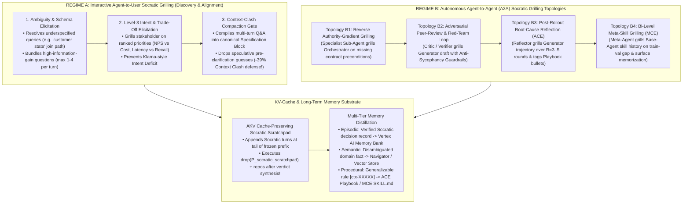
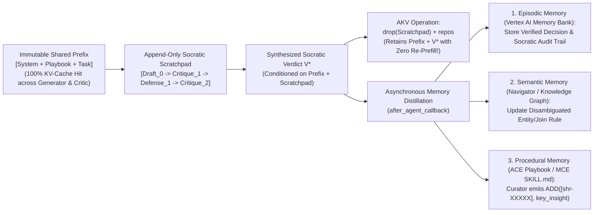

# Architecture Best Practice: Socratic Grilling & Prompting in Multi-Agent Systems — User-Facing Discovery, Agent-to-Agent Adversarial Verification, Cache-Preserving Scratchpads, and Memory Distillation

**Topics:** #socratic-grilling #socratic-prompting #multi-agent-debate #anti-sycophancy #authority-gradient #context-clash-prevention #cache-preserving-scratchpad #generator-reflector-curator #intent-elicitation #fde-grading-rubric

> **Sources:** Synthesized across `AGENTIC CONTEXT ENGINEERING (ICLR 2026)`, `CACHE ENGINEERING FOR AGENTS (AKV, 2026)`, `Context Engineering: From Prompts to Corporate Multi-Agent Architecture (Vishnyakova, 2026; Tomasev et al., 2026; Breunig, 2025)`, `Meta Context Engineering via Agentic Skill Evolution (Ye et al., 2026)`, `Structured Context Engineering for File-Native Agentic Systems (McMillan, 2026)`, and `GEAP L300/L400 Architecture Corpus` · **Corpus:** `GEAPL200` (Unified L200 + L300 + L400 Open Knowledge Format v0.2 · Version `GEAPL200_2026-10-27_183500`) · **Standalone Catalog ID:** `06-socratic-grilling-user-to-agent-and-agent-to-agent-protocols` · **Target:** GCP Knowledge Catalog (Dataplex) & Antigravity Agentic AI Development

---

## Version & 6-Month TTL Governance Tab

| Document ID | Version Tag (Today's Date & Time) | Version Timestamp (PDT) | Time-To-Live (TTL) | Expiration (`stale_after`) | Status |
| :--- | :--- | :--- | :--- | :--- | :--- |
| `41-socratic-grilling-user-to-agent-and-agent-to-agent-protocols` | **`GEAPL200_2026-10-27_183500`** (`L400_version_20261027_1835`) | `2026-10-27 18:35:00 PDT` (`2026-10-27T18:35:00-07:00`) | **6 Months** (`180 days` / `P6M`) | `2027-04-27T18:35:00-07:00` | Published / Verified |

### Grounding Research Publications (Local PDF Sources)
- **`PAPER-01-ACE` — [`AGENTIC CONTEXT ENGINEERING- EVOLVING CONTEXTS FOR SELF-IMPROVING LANGUAGE MODELS.pdf`](../AGENTIC%20CONTEXT%20ENGINEERING-%20EVOLVING%20CONTEXTS%20FOR%20SELF-IMPROVING%20LANGUAGE%20MODELS.pdf):** *Agentic Context Engineering: Evolving Contexts for Self-Improving Language Models* — Qizheng Zhang, Changran Hu, Shubhangi Upasani, Boyuan Ma, Fenglu Hong, Vamsidhar Kamanuru, Jay Rainton, Chen Wu, Mengmeng Ji, Hanchen Li, Urmish Thakker, James Zou, Kunle Olukotun (Stanford University, SambaNova Systems, Inc., UC Berkeley; Published as a conference paper at ICLR 2026 (arXiv:2510.04618v3, 29 Mar 2026)). URL: `https://arxiv.org/abs/2510.04618` · Code/Data: `https://github.com/ace-agent/ace`
- **`PAPER-02-AKV` — [`CACHE ENGINEERING FOR AGENTS.pdf`](../CACHE%20ENGINEERING%20FOR%20AGENTS.pdf):** *Cache Engineering for Agents* — Tianyu Fu, Ruoxi Wang, Zihan Min, Zhongqi Ren, Zhihao Li, Tengxuan Liu, Shengxu Mu, Hanling Zhang, Yu Wang (Tsinghua University, The Chinese University of Hong Kong; arXiv Preprint (arXiv:2610.28577v1, 20 Oct 2026)). URL: `https://arxiv.org/abs/2610.28577` · Code/Data: `https://github.com/thu-nics/AKV`
- **`PAPER-03-OSS-CE` — [`Context Engineering for AI Agents in Open-Source Software.pdf`](../Context%20Engineering%20for%20AI%20Agents%20in%20Open-Source%20Software.pdf):** *Context Engineering for AI Agents in Open-Source Software* — Seyedmoein Mohsenimofidi, Matthias Galster, Christoph Treude, Sebastian Baltes (Heidelberg University, University of Bamberg, Singapore Management University; 23rd International Conference on Mining Software Repositories (MSR '26), April 13–14, 2026, Rio de Janeiro, Brazil (arXiv:2510.21413v4, DOI: 10.1145/3793302.3793350)). URL: `https://doi.org/10.1145/3793302.3793350` · Code/Data: `https://doi.org/10.5281/zenodo.17428770`
- **`PAPER-04-CORP-MAS` — [`Context Engineering- From Prompts to Corporate Multi-Agent Architecture.pdf`](../Context%20Engineering-%20From%20Prompts%20to%20Corporate%20Multi-Agent%20Architecture.pdf):** *Context Engineering: From Prompts to Corporate Multi-Agent Architecture* — Vera V. Vishnyakova (Director, Center for Transfer and Management of Socio-Economic Information, HSE University, Moscow; Working Paper / Monograph (March 2026); synthesizing Tomasev et al. (2026, arXiv:2602.11865), Breunig (2025), Deloitte (2026), and KPMG (2026)). URL: `file://./Context%20Engineering-%20From%20Prompts%20to%20Corporate%20Multi-Agent%20Architecture.pdf` · Code/Data: `https://arxiv.org/abs/2602.11865`
- **`PAPER-05-MCE` — [`Meta Context Engineering via Agentic Skill Evolution.pdf`](../Meta%20Context%20Engineering%20via%20Agentic%20Skill%20Evolution.pdf):** *Meta Context Engineering via Agentic Skill Evolution* — Haoran Ye, Xuning He, Vincent Arak, Haonan Dong, Guojie Song (State Key Laboratory of General Artificial Intelligence, School of Intelligence Science and Technology & School of EECS, Peking University; arXiv Preprint (arXiv:2601.21557v2, 11 Feb 2026)). URL: `https://arxiv.org/abs/2601.21557` · Code/Data: `https://github.com/metaevo-ai/meta-context-engineering`
- **`PAPER-06-FILE-NATIVE` — [`Structured Context Engineering for File-Native Agentic Systems.pdf`](../Structured%20Context%20Engineering%20for%20File-Native%20Agentic%20Systems.pdf):** *Structured Context Engineering for File-Native Agentic Systems: Evaluating Schema Accuracy, Format Effectiveness, and Multi-File Navigation at Scale* — Damon McMillan (HxAI Australia; Technical Research Report (2026, 9,649 Experiments across 11 Models, 4 Formats, and 10 to 10,000 Tables)). URL: `file://./Structured%20Context%20Engineering%20for%20File-Native%20Agentic%20Systems.pdf` · Code/Data: `https://toonformat.dev/`

---


## 0. OKF Document Metadata & Topic Modeling Taxonomy
**Topic Tags:** `#L400_version_20261027_1835` `#OKFMetadata` `#SocraticGrilling` `#UserToAgentSocraticDiscovery` `#AgentToAgentAdversarialReview` `#AntiSycophancy` `#CachePreservingScratchpad`

| Metadata Field | Value |
| :--- | :--- |
| **OKF Document ID** | `41-socratic-grilling-user-to-agent-and-agent-to-agent-protocols` (Standalone Index: `06`) |
| **Primary Literature** | Cross-Paper Synthesis: Zhang et al. (`ACE`, ICLR 2026), Fu et al. (`AKV Cache Engineering`, 2026), Vishnyakova (`Corporate MAS`, 2026), Tomasev et al. (`Intelligent Delegation`, 2026), Breunig (`Context Rot`, 2025), Ye et al. (`MCE`, 2026), McMillan (`File-Native Systems`, 2026) |
| **Architectural Domain** | Dual-Regime Socratic Grilling: (1) Interactive Agent-to-User Ambiguity & Intent Elicitation; (2) Autonomous Agent-to-Agent (`A2A`) Adversarial Critique, Reflection & Memory Distillation |
| **Target GCP Runtimes** | Gemini Enterprise Agent Platform, Google ADK 2.0 (`LoopAgent`, `SequentialAgent`, `ask_user`), Vertex AI Memory Bank, AKV / SGLang Serving |
| **Enforced FDE Standard** | `concepts/00-fde-field-readiness-and-grading-rubric.md` & `OKF-L400-21` (`https://g3doc.corp.google.com/company/teams/cloud-fde/index.md?cl=head`) |

---

## FDE Project Grading Rubric Enforcement & Prevailing Customer Alignment

> **Mandatory Governance Standard:** Every project, prototype, or production agent built using the patterns in this concept **must pass the [Google Cloud FDE Field-Readiness & Project Grading Rubric](/concepts/00-fde-field-readiness-and-grading-rubric.md)** (aligned with the [Cloud FDE Team Charter](https://g3doc.corp.google.com/company/teams/cloud-fde/index.md?cl=head) and `OKF-L400-21`). Scoring Requirement: **Average >= `2.0 (Competent)`** across both **Part A (Presentation & Advisory Rigor)** and **Part B (Engineering & Implementation Excellence)**, with **zero `0 (Not Demonstrated)` scores** on any single metric.

### 1. Part A — Presentation & Advisory Rigor Enforcement for This Concept

- **A.1 Strategic Delivery & Value Articulation:** Articulate why **Socratic Grilling** is the active control mechanism that operationalizes **Level 2 Context Sufficiency**, **Level 3 Intent Engineering**, and **Level 4 Specification Engineering**:
  1. **In User-to-Agent Discovery (Regime A):** Eliminates the **Intent Deficit** (`Klarna` cautionary case) and **Context Clash** (`-39%` accuracy drop when multi-turn clarifications leave early speculative guesses in the prompt, `Microsoft/Salesforce` study cited in `Vishnyakova 2026`) by proactively grilling the human operator on missing constraints, trade-off priorities, and verification criteria *before* executing costly multi-step trajectories, then compiling the answers into a clean specification state.
  2. **In Agent-to-Agent Topologies (Regime B):** Eliminates the **Authority Gradient & Sycophancy Defect** (`Tomasev et al., 2026`), drives **`+17.0%` accuracy gains via `ACE` Reflector Socratic root-cause diagnosis (`R=3..5` rounds)**, and enforces **`MCE` 5-Gate Socratic Overfitting Checks** (`+89.1%` relative domain gain).
- **A.2 Objection Handling & Technical Defense:** Defend how to run multi-round Socratic grilling without blowing up token cost or latency by pairing Socratic scratchpads with **AKV Cache Engineering (`drop(P_socratic_scratchpad)` + `repos`, `Concept 37`)** so intermediate debate turns are dropped from future attention after their conclusions are absorbed via **Nested Conditioning**.

### 2. Part B — Engineering & Implementation Excellence Cutlines for This Concept

- **B.1.1 & B.3.1 Multi-Agent Socratic Topologies:** Implement both **Forward Socratic Critique (`Critic/Reflector -> Generator`)** and **Reverse Socratic Readiness Grilling (`Sub-Agent -> Orchestrator`)** with explicit **Convergence / Termination Gates** ($R \le 5$ rounds, zero unresolved critical blockers, train-val gap $\le 1.5\%$).
- **B.2.5 Decision Records (ADRs) & Anti-Sycophancy Guardrails:** Enforce **Blinded Premise Evaluation**, **Mandatory Counter-Hypothesis Generation**, and **Evidence-Backed Claim Attestation** so Critic/Reflector agents never rubber-stamp flawed Generator outputs.

### 3. Prevailing Customer Exemplars & Cross-KB Links

| Socratic Grilling Regime & Topology | Enterprise Scenario & Failure Prevented | Socratic Protocol & Cache/Memory Mechanism | Quantified Production Impact |
| :--- | :--- | :--- | :--- |
| **Regime A.1: User-Facing Socratic Discovery & Intent Elicitation (`Agent grills User`)** | Enterprise architect or business user submits an ambiguous request (*"Build a customer retention agent"* or *"Query customer sales by state"*). | **Information-Gain Socratic Elicitation (`1–3` bundled questions)** + **Context-Clash Compaction** (replaces multi-turn speculative dialogue with a compiled Spec & Intent Contract). | Prevents the **`-39%` multi-turn Context Clash quality drop** (`Breunig 2025`) and resolves join-path ambiguity (`72%` MD vs `33%` YAML drift, `McMillan 2026`) prior to execution. |
| **Regime B.1: Reverse Authority-Gradient Grilling (`Sub-Agent grills Orchestrator`)** | Frontier orchestrator (`Gemini 2.5 Pro`) issues an under-specified task to a specialist sub-agent; sycophancy causes the sub-agent to guess and hallucinate. | **Contract-First Pre-Flight Socratic Handshake (`Tomasev et al., 2026`):** Sub-agent rejects execution and returns a structured Socratic clarification request if verification contract or required schema keys are missing. | Eliminates silent **Hallucination-in-the-Chain ($A \rightarrow B \rightarrow C$)** and enforces verifiable delegation contracts. |
| **Regime B.2: Trajectory Root-Cause Socratic Grilling (`ACE Reflector grills Generator`)** | Coding/financial agent (`AppWorld` / `FiNER`) fails unit tests or misclassifies XBRL debt tags (`Tranche A loan` vs `Revolving facility`). | **`R=3..5` Round Socratic Reflection (`error_id -> root_cause -> correct_approach -> key_insight -> bullet_tags`)** + **Curator JSON `ADD` Delta**. | **`+17.0%` offline / `+17.1%` online accuracy gain** on `AppWorld` and **`+12.8%` on Finance** (`Zhang et al., ICLR 2026`), with `91.8%` KV-cache reuse. |
| **Regime B.3: Meta-Level Overfitting Socratic Grilling (`MCE Meta-Agent grills Base-Agent`)** | Base-agent memorizes 29 surface patterns on `FiNER` / `LawBench` (`88KB` bloat, `14%` train-val gap). | **Socratic Skill Crossover (`Why did this error occur at a semantic level?` + `5-Gate Stop Criteria`)** + **AKV `drop(P_scratchpad)`**. | Shrinks `LawBench` context from `88KB -> <30KB`, achieves **`+89.1%` mean relative gain**, and cuts training time by **`13.6x`** (`Ye et al., 2026`). |

**Related OKF Concepts:**
- [Google Cloud FDE Field-Readiness & Project Grading Rubric](/concepts/00-fde-field-readiness-and-grading-rubric.md)
- [Agentic Context Engineering (ACE) — Evolving Playbooks](/concepts/36-agentic-context-engineering-evolving-playbooks.md)
- [Cache Engineering for Agents — Direct KV-Cache Control & AKV](/concepts/37-cache-engineering-kv-prefix-optimization-for-agents.md)
- [Corporate Multi-Agent Context Architecture & 4-Level Maturity Pyramid](/concepts/39-corporate-multi-agent-context-architecture-and-memory-tiers.md)
- [Meta Context Engineering via Agentic Skill Evolution](/concepts/40-meta-context-engineering-and-agentic-skill-evolution.md)
- [Multi-Agent Memory Lifecycle and Context-Rot Prevention](/concepts/42-multi-agent-memory-lifecycle-and-context-rot-prevention.md)

---

## 1. Taxonomy of Socratic Grilling in Enterprise Multi-Agent Systems

**Socratic Grilling** (systematic, disciplined questioning that exposes hidden assumptions, resolves ambiguity, tests logical consistency, and isolates root causes of error) is the primary cognitive mechanism that bridges raw data (**Context**) with purposeful action (**Intent**) and verifiable governance (**Specification**). In enterprise agentic systems, Socratic Grilling operates across **two distinct regimes** and **five architectural topologies**:



---

## 2. Regime A: Agent-to-User Socratic Grilling (Ambiguity Resolution Without Context Pollution)

### 2.1 Why Naive Chatbots Fail at Socratic Discovery: Sycophantic Guessing vs. Context Clash
When a user submits an under-specified or internally contradictory request, standard LLM assistants fail in one of two ways:
1. **Sycophantic Premature Execution (Sufficiency Violation):** The agent silently guesses missing parameters (e.g., choosing `CUSTOMER` home address 72% of the time in Markdown vs. 33% in YAML on `TPC-DS` queries, `McMillan 2026`, or optimizing token cost over customer loyalty in `Klarna`, `Vishnyakova 2026`) and executes an expensive, wrong trajectory.
2. **Multi-Turn Context Clash (`-39%` Quality Drop):** If the user and chatbot engage in a meandering 6-turn clarification dialogue where the assistant makes early, incomplete attempts in turns 1–3 and the user corrects them in turns 4–6, **retaining those early speculative assistant turns in the active context window causes a `39%` drop in final reasoning accuracy** (`Microsoft & Salesforce` study cited in `Breunig 2025` / `Vishnyakova 2026`). The model's attention becomes split between its early wrong assumptions and the later clarified constraints (**Context Clash**).

### 2.2 Mathematical Protocol for Information-Gain Socratic Elicitation
Let $\Theta = (\theta_{\text{task}}, \theta_{\text{intent}}, \theta_{\text{verify}})$ represent the latent specification variables across **Task Scope**, **Intent Trade-Off Hierarchy**, and **Verification Contract**, with prior epistemic uncertainty $H(\Theta \mid x_0)$ given initial user prompt $x_0$.
1. **Trigger Gate (When to Grill vs. When to Act):**
   - If $H(\Theta \mid x_0) \le \epsilon_{\text{act}}$ (all required schema keys, privilege scopes, and intent priorities are unambiguous), **execute immediately** without pestering the user.
   - If $H(\Theta \mid x_0) > \epsilon_{\text{act}}$ or the action is irreversible/high-blast-radius, enter **Socratic Elicitation Mode**.
2. **Optimal Question Selection with Bounded Cognitive Load:**
   Select a minimal bundle of $K \in \{1, \dots, 4\}$ orthogonal Socratic questions $Q^* = \{q_1, \dots, q_K\}$ that maximize expected information gain penalized by user cognitive load $\lambda K$:
   $$Q^* = \arg\max_{|Q| \le 4} \left[ H(\Theta \mid x_0) - \mathbb{E}_{A \sim p(A \mid Q, x_0)} \left[ H(\Theta \mid x_0, Q, A) \right] - \lambda |Q| \right]$$
   Each question $q_k$ is presented with **structured options ordered by recommended default first**, explicitly surfacing the architectural trade-off (e.g., *"Option 1 (Recommended): Customer Residence State (`customer_address.ca_state`) — tracks long-term demographic residency; Option 2: Store Transaction Location (`store_sales.ss_addr_sk`) — tracks point-of-sale geography"*).
3. **Post-Clarification State Compilation (Eliminating Context Clash):**
   Once the user responds with answers $A^*$, the orchestrator **compiles $(x_0, Q^*, A^*)$ into a single canonical Specification & Intent Block $S_{\text{compiled}}$** and **drops or masks the intermediate clarification turns $(Q^*, A^*)$ and any pre-clarification speculative thoughts** from active attention via `drop(P_clarification)`!

```mermaid
sequenceDiagram
    autonumber
    participant User as Enterprise User / Architect
    participant Gate as Socratic Sufficiency & Intent Gate
    participant AKV as AKV Cache / Context Compiler
    participant Exec as Downstream Specialist Agents

    User->>Gate: Submit Initial Request x_0 ("Build automated refund & retention workflow")
    Note over Gate: Compute Epistemic Uncertainty H(Θ | x_0) > ε_act<br/>Missing: (1) Max auto-refund threshold, (2) VIP NPS vs Cost Intent priority, (3) Approval SLA
    Gate->>User: Emit Structured Socratic Bundle Q* (3 High-IG Questions, Recommended Options First)
    User-->>Gate: Return Answers A* (Auto-refund <= $250; VIP Retention > Call Cost; PagerDuty > $250)
    Gate->>AKV: Compile Canonical Spec S_compiled(x_0, Q*, A*)<br/>+ Issue AKV drop(P_raw_QA_turns) & repos
    Note over AKV: ✅ Zero Context Clash (-39% drop prevented!)<br/>✅ Static Prefix Preserved in KV Cache
    AKV->>Exec: Dispatch Contract-Bound Task + S_compiled + Delegation Capability Token
```

---

## 3. Regime B: Agent-to-Agent (A2A) Socratic Grilling Topologies

### 3.1 Topology B1: Reverse Socratic Grilling Across the Authority Gradient (`Sub-Agent -> Orchestrator`)
In hierarchical multi-agent systems (`Vishnyakova 2026`; `Tomasev et al., 2026`), a steep **Authority Gradient** exists when a frontier orchestrator delegates subtasks to narrower specialist agents. Due to instruction-tuning sycophancy, sub-agents accept flawed, ambiguous, or unverifiable instructions silently, producing **Hallucination-in-the-Chain ($A \rightarrow B \rightarrow C$)**.
- **The Reverse Socratic Handshake Invariant:** Every specialist sub-agent executes a deterministic/lightweight **Pre-Flight Contract Check** before invoking external tools. If any of the following three conditions fail, the sub-agent returns a `SOCRATIC_CHALLENGE_REQUIRED` envelope to the orchestrator instead of executing:
  1. **Missing Verification Criterion (`Contract-First Decomposition`):** The orchestrator did not specify how the sub-agent's output will be verified.
  2. **Referential / Schema Ambiguity:** Multiple database tables, API endpoints, or entity IDs match the request without a disambiguation rule.
  3. **Policy / Intent Conflict:** Fulfilling the literal task instruction violates an encoded Level 3 Intent rule or Level 4 Constitutional Policy.

### 3.2 Topology B2: Adversarial Critic / Red-Team Socratic Grilling (`Critic -> Generator`)
When a Generator agent proposes an architectural design, SQL query, code patch, or compliance decision, a peer **Socratic Critic / Verifier Agent** grills the proposal across **four mandatory Socratic axes**:
1. **Clarification & Operationalization:** *"Which exact API schema field or database table backs assumption $X$?"*
2. **Assumption & Premise Stress-Testing:** *"What happens to this logic if the API returns paginated results (`page_index > 10`) or null foreign keys?"*
3. **Counter-Example & Red-Team Falsification:** *"Construct a concrete input where this code/rule produces a false positive (e.g. matching `$16M Tranche A loan facility` as `MaximumBorrowingCapacity` instead of `DebtInstrumentFaceAmount`)."*
4. **Intent & Consequence Alignment:** *"Does optimizing this metric cause specification gaming or violate the corporate trade-off hierarchy?"*

#### Anti-Sycophancy Guardrails for Multi-Agent Debate
A well-known failure mode of multi-agent LLM debate is **Mutual Sycophancy / Premature Consensus** (where the Critic praises a flawed Generator output, or the Generator caves to a hallucinating Critic on turn 1). Production ADK Socratic loops enforce **four Anti-Sycophancy Guardrails**:

| Anti-Sycophancy Guardrail | Architectural Mechanism | Failure Mode Prevented |
| :--- | :--- | :--- |
| **1. Blinded / Role-Inverted Premise Framing** | Present the Generator's draft to the Critic framed as *"a candidate submission known to contain subtle edge-case defects; your score depends on finding falsifiable flaws backed by execution/schema evidence."* | Eliminates polite RLHF agreement bias ("This looks great overall!"). |
| **2. Mandatory Evidence-Citation Invariant** | Neither the Critic nor the Generator may assert a critique or defense without citing a concrete **Execution Trace (`E_t`)**, **Schema Line (`domain.yaml:L42`)**, or **Playbook Bullet (`[shr-00009]`)**. | Prevents the Generator from capitulating to an ungrounded Critic hallucination (**Flip-Flop Regression**). |
| **3. Asymmetric Verification Rule (`Verifier's Law`)** | Whenever a dispute can be settled by a deterministic tool (running a Python snippet, SQL `EXPLAIN`, or regex check), the Socratic Critic must execute the verification tool rather than argue in prose. | Grounds Socratic grilling in objective environment truth (`ACE` & `MCE` core principle). |
| **4. Bounded Iteration & Convergence Gate ($R=3\text{–}5$)** | Cap Socratic refinement at **$R = 3\text{–}5$ rounds** (`ACE Table 19`: $R=5$ achieves `67.6%` peak accuracy on `AppWorld`, whereas $R=10$ degrades to `65.2%` due to overthinking). | Prevents infinite debate loops, token runaway, and **Reflector Overthinking**. |

### 3.3 Topology B3 & B4: Socratic Reflection (`ACE`) & Bi-Level Skill Grilling (`MCE`)
- **In `ACE` (`Concept 36`):** The Reflector conducts a structured Socratic interrogation of the Generator's rollout trajectory (`reasoning -> error_identification -> root_cause_analysis -> correct_approach -> key_insight`) and assigns granular credit tags (`helpful`, `harmful`, `neutral`) to every playbook bullet used (`bullet_tags`).
- **In `MCE` (`Concept 40`):** The Meta-Agent conducts a **5-Question Socratic Quality Audit** (`MCE Appendix C, Page 30`) before accepting any updated context section:
  1. `[ ]` *Does this rule explain **why**, not just **what**?*
  2. `[ ]` *Would this work for a similar but different example not in training?*
  3. `[ ]` *Is this more about semantic category than surface pattern?*
  4. `[ ]` *Does this build on existing context rather than duplicating it?*
  5. `[ ]` *Have I removed overly specific examples that don't generalize?*

---

## 4. Cache-Preserving Socratic Scratchpads & Multi-Tier Memory Distillation

### 4.1 Solving the Socratic KV-Cache Problem (`AKV` Co-Design)
A 4-round Agent-to-Agent Socratic grilling loop generates `2,000–6,000` tokens of intermediate questions, counter-examples, and rebuttals. If every Socratic debate rewrites the prompt prefix, KV caching breaks completely; conversely, if all raw debate turns are kept forever in active context across a 50-step task, they cause **Context Distraction** and inflate KV-read costs (`82.4%` of API cost).

**The Cache-Preserving Socratic Scratchpad Pattern (`AKV` + `ADK 2.0`):**
1. **Immutable Shared Prefix:** Both the Generator and the Socratic Critic share the exact same prefix: `[System Instructions + ACE/MCE Playbook + Task Contract + Retained Reasoning History]`. Because this prefix is byte-identical, the Socratic Critic reuses **100% of the Generator's prefilled KV cache** in the serving engine's Extended Radix Tree!
2. **Append-Only Ephemeral Scratchpad Tail:** The Socratic grilling turns (`[Draft_0, Critique_1, Defense_1, Critique_2, Verdict_Final]`) are appended strictly at the tail of the message list.
3. **Nested-Conditioning Verdict + `drop(P_scratchpad)`:** The final message `Verdict_Final` synthesizes the verified output and key lessons while attending causally to the entire Socratic debate. Immediately after `Verdict_Final` is appended, the harness issues an AKV operation:
   $$\text{drop}\left(\{ \text{Draft}_0, \text{Critique}_1, \text{Defense}_1, \text{Critique}_2 \}\right) \circ \text{repos}$$
   This excludes the verbose intermediate debate from all future turns' attention while **retaining `Verdict_Final`'s KV state (which already carries the Socratic conditioning via Nested Conditioning) without re-prefilling a single token!**



---

## 5. Production Implementation Blueprint: ADK 2.0 Socratic Grilling Engine with AKV Scratchpad Drop

```python
from __future__ import annotations
from dataclasses import dataclass, field
from typing import Dict, List, Literal, Optional
from pydantic import BaseModel, Field

class SocraticChallengeItem(BaseModel):
    axis: Literal[
        "CLARIFICATION_SCHEMA",
        "ASSUMPTION_STRESS_TEST",
        "COUNTER_EXAMPLE_FALSIFICATION",
        "INTENT_POLICY_ALIGNMENT",
    ]
    severity: Literal["BLOCKING", "MAJOR", "MINOR"]
    question: str = Field(description="Precise Socratic question exposing the flaw or ambiguity")
    evidence_citation: str = Field(description="Mandatory citation to schema line, REPL trace, or Playbook ID")
    proposed_remediation: str = Field(description="Concrete testable fix or verification check")

class SocraticCritiqueEnvelope(BaseModel):
    converged: bool = Field(description="True ONLY if zero BLOCKING or MAJOR issues remain")
    five_gate_audit_passed: bool = Field(description="True if rule explains WHY, generalizes, and avoids surface overfitting")
    challenges: List[SocraticChallengeItem] = Field(default_factory=list)
    bullet_credit_tags: Dict[str, Literal["helpful", "harmful", "neutral"]] = Field(default_factory=dict)
    distilled_procedural_insight: Optional[str] = None

@dataclass
class SocraticLoopResult:
    final_verified_output: str
    rounds_executed: int
    converged: bool
    akv_dropped_message_indices: List[int] = field(default_factory=list)
    distilled_insights: List[str] = field(default_factory=list)

class CachePreservingSocraticCoordinator:
    """
    Executes an Anti-Sycophancy Generator-Critic Socratic Grilling Loop (max R=5 rounds),
    emits AKV drop/repos operations for intermediate debate turns, and extracts procedural deltas.
    """

    def __init__(self, max_rounds: int = 5) -> None:
        self.max_rounds = max_rounds

    def run_socratic_loop(
        self,
        messages: List[Dict[str, str]],
        generator_fn,
        critic_fn,
    ) -> SocraticLoopResult:
        scratchpad_indices: List[int] = []
        insights: List[str] = []

        # Initial Generator draft appended to shared prefix
        draft = generator_fn(messages)
        draft_idx = len(messages)
        messages.append({"role": "assistant", "content": draft})
        scratchpad_indices.append(draft_idx)

        converged = False
        rounds = 0
        for r in range(1, self.max_rounds + 1):
            rounds = r
            critique: SocraticCritiqueEnvelope = critic_fn(messages)
            if critique.distilled_procedural_insight:
                insights.append(critique.distilled_procedural_insight)

            blocking_or_major = [
                c for c in critique.challenges if c.severity in ("BLOCKING", "MAJOR")
            ]
            if critique.converged and critique.five_gate_audit_passed and not blocking_or_major:
                converged = True
                break

            # Append Socratic critique to tail (shares 100% of prefix KV cache)
            crit_idx = len(messages)
            messages.append({"role": "user", "content": critique.model_dump_json()})
            scratchpad_indices.append(crit_idx)

            # Generator defends or revises draft grounded in cited evidence
            draft = generator_fn(messages)
            new_draft_idx = len(messages)
            messages.append({"role": "assistant", "content": draft})
            scratchpad_indices.append(new_draft_idx)

        # Keep ONLY the final verified assistant message in active attention;
        # mark all intermediate draft/critique messages for AKV drop!
        final_idx = scratchpad_indices.pop()  # surviving verdict index
        assert final_idx == len(messages) - 1
        return SocraticLoopResult(
            final_verified_output=messages[final_idx]["content"],
            rounds_executed=rounds,
            converged=converged,
            akv_dropped_message_indices=scratchpad_indices,
            distilled_insights=insights,
        )
```

---

## 6. Socratic FDE Field-Readiness & Customer Grilling Questions (L100–L400)

### Q1 (L200 — User-Facing Socratic Chatbots): *"We instructed our enterprise chatbot to ask clarifying questions across 4–5 turns before generating complex SQL or financial reports, but our final answer accuracy actually dropped by 35% compared to single-turn prompts! Why did asking clarifying questions hurt accuracy, and how do you fix it?"*
- **Model Answer (Score 3 — Proficient):** You hit **Context Clash** (`Breunig 2025` / `Microsoft & Salesforce` study cited in `Vishnyakova 2026`), which empirically causes a **`39%` quality drop** when a task is split across sequential clarification turns. During early turns, the assistant emits partial hypotheses, tentative SQL fragments, or assumptions that turn out to be wrong once the user clarifies their intent in later turns. When all those turns remain in the context window, the LLM's attention is polluted by its own earlier invalidated guesses. **The Architectural Fix:**
  1. **Bundle High-Information-Gain Questions Up Front:** Use a structured Socratic question card (1–4 questions in a single turn with recommended defaults first) rather than dragging clarification across 5 unstructured turns.
  2. **Post-Clarification State Compilation + AKV Drop:** Once the user answers, compile the original request + user answers into a single clean **Canonical Specification Block**, and apply **AKV `drop(P_clarification_turns)`** (or prune the intermediate speculative turns before dispatching to the SQL/report generator) so the execution model sees *only* the verified specification.

### Q2 (L300 — Multi-Agent Debate & Anti-Sycophancy): *"When we put a Generator agent and a Critic agent in a loop, either the Critic rubber-stamps the Generator on turn 1, or the Generator flips a correct answer to an incorrect one because the Critic sounded confident. How do you engineer a Socratic loop that strictly improves accuracy?"*
- **Model Answer (Score 3 — Proficient):** Unconstrained multi-agent debate fails due to **RLHF Mutual Sycophancy** and **Ungrounded Flip-Flopping**. To guarantee monotonic quality improvement, enforce four architectural invariants:
  1. **Adversarial Premise Framing:** Prompt the Critic as a fault-finding auditor where passing a defective artifact is a critical failure.
  2. **Mandatory Evidence Citation & Verifier's Law:** Require every Critic challenge to cite a concrete execution traceback, unit-test failure, schema line (`domain.yaml`), or playbook rule (`[shr-00009]`). The Generator is explicitly instructed **never to abandon a verified answer unless the Critic provides an objective falsifying trace or schema citation**.
  3. **Calibrated Iteration Cap ($R=3\text{–}5$):** Per `ACE` (`Table 19`), cap Socratic reflection at $R=3\text{–}5$ rounds (where `AppWorld` accuracy peaks at `67.6%`), preventing the $R=10$ overthinking degradation (`65.2%`).
  4. **MCE 5-Gate Socratic Stop Criteria:** Halt refinement immediately once validation gates pass or remaining errors are irreducible ambiguities.

### Q3 (L400 — End-to-End Cache & Memory Integration): *"Walk through what happens to the KV cache and the 4 memory tiers the moment an A2A Socratic Grilling loop converges on a root-cause fix."*
- **Model Answer (Score 3 — Proficient):**
  1. **Working Memory & KV Cache (`AKV`):** During the Socratic loop, the Generator and Critic share the frozen prefix `[System + Playbook + Task]` (`100%` prefix cache reuse). When the loop converges at round $r \le 5$ on `Verdict_Final`, the harness emits `drop(P_intermediate_socratic_turns)` + `repos`. Because `Verdict_Final` was computed with causal attention over the Socratic debate (**Nested Conditioning**), its KV state retains the distilled reasoning while freeing GPU memory and excluding the verbose debate turns from future decode attention (`-59.8%` full-attention decode time).
  2. **Episodic Memory (`Vertex AI Memory Bank`):** An asynchronous `after_agent_callback` persists the verified decision and its cryptographic attestation chain ($\text{Sig}_B(\text{Verdict}, \text{Sig}_C)$) linked to the episode `trace_id`.
  3. **Semantic Memory (`Navigator / Vector Store`):** Any newly disambiguated domain fact or join path discovered during Socratic grilling is written to `navigator.md` or the semantic index with `TrustTier` provenance.
  4. **Procedural Memory (`ACE Playbook` / `MCE SKILL.md`):** The Curator extracts the generalizable `key_insight` (verified against the 5-Gate Socratic quality checklist) and appends it as a compact delta bullet `[ctx-XXXXX] helpful=1 harmful=0` via non-LLM deterministic merging.