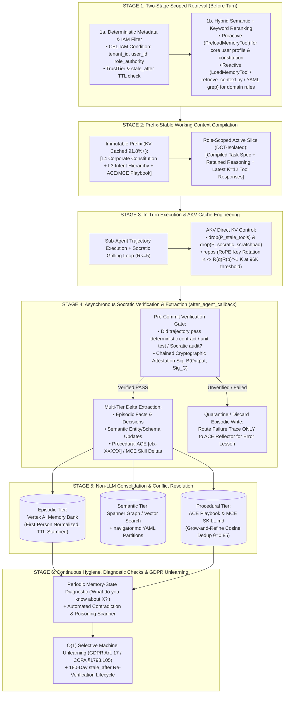

# Architecture Best Practice: Multi-Agent Memory Lifecycle & Context-Rot Prevention — End-to-End ADK & Vertex AI Memory Bank Pipeline, Prefix-Preserving Compaction, and Poisoning Defenses

**Topics:** #memory-lifecycle #context-rot-prevention #context-poisoning #context-distraction #context-confusion #context-clash #vertex-ai-memory-bank #google-adk #selective-unlearning #fde-grading-rubric

> **Sources:** Synthesized across `Context Engineering: From Prompts to Corporate Multi-Agent Architecture (Vishnyakova, 2026; Breunig, 2025; Tomasev et al., 2026)`, `AGENTIC CONTEXT ENGINEERING (Zhang et al., ICLR 2026)`, `CACHE ENGINEERING FOR AGENTS (Fu et al., 2026)`, `Meta Context Engineering (Ye et al., 2026)`, `Structured Context Engineering for File-Native Agentic Systems (McMillan, 2026)`, and `GEAP L300 Concepts 08, 20, 23, 24` · **Corpus:** `GEAPL200` (Unified L200 + L300 + L400 Open Knowledge Format v0.2 · Version `GEAPL200_2026-10-27_183500`) · **Standalone Catalog ID:** `07-multi-agent-memory-lifecycle-and-context-rot-prevention` · **Target:** GCP Knowledge Catalog (Dataplex) & Antigravity Agentic AI Development

---

## Version & 6-Month TTL Governance Tab

| Document ID | Version Tag (Today's Date & Time) | Version Timestamp (PDT) | Time-To-Live (TTL) | Expiration (`stale_after`) | Status |
| :--- | :--- | :--- | :--- | :--- | :--- |
| `42-multi-agent-memory-lifecycle-and-context-rot-prevention` | **`GEAPL200_2026-10-27_183500`** (`L400_version_20261027_1835`) | `2026-10-27 18:35:00 PDT` (`2026-10-27T18:35:00-07:00`) | **6 Months** (`180 days` / `P6M`) | `2027-04-27T18:35:00-07:00` | Published / Verified |

### Grounding Research Publications (Local PDF Sources)
- **`PAPER-04-CORP-MAS` — [`Context Engineering- From Prompts to Corporate Multi-Agent Architecture.pdf`](../Context%20Engineering-%20From%20Prompts%20to%20Corporate%20Multi-Agent%20Architecture.pdf):** *Context Engineering: From Prompts to Corporate Multi-Agent Architecture* — Vera V. Vishnyakova (Director, Center for Transfer and Management of Socio-Economic Information, HSE University, Moscow; Working Paper / Monograph (March 2026); synthesizing Tomasev et al. (2026, arXiv:2602.11865), Breunig (2025), Deloitte (2026), and KPMG (2026)). URL: `file://./Context%20Engineering-%20From%20Prompts%20to%20Corporate%20Multi-Agent%20Architecture.pdf` · Code/Data: `https://arxiv.org/abs/2602.11865`
- **`PAPER-01-ACE` — [`AGENTIC CONTEXT ENGINEERING- EVOLVING CONTEXTS FOR SELF-IMPROVING LANGUAGE MODELS.pdf`](../AGENTIC%20CONTEXT%20ENGINEERING-%20EVOLVING%20CONTEXTS%20FOR%20SELF-IMPROVING%20LANGUAGE%20MODELS.pdf):** *Agentic Context Engineering: Evolving Contexts for Self-Improving Language Models* — Qizheng Zhang, Changran Hu, Shubhangi Upasani, Boyuan Ma, Fenglu Hong, Vamsidhar Kamanuru, Jay Rainton, Chen Wu, Mengmeng Ji, Hanchen Li, Urmish Thakker, James Zou, Kunle Olukotun (Stanford University, SambaNova Systems, Inc., UC Berkeley; Published as a conference paper at ICLR 2026 (arXiv:2510.04618v3, 29 Mar 2026)). URL: `https://arxiv.org/abs/2510.04618` · Code/Data: `https://github.com/ace-agent/ace`
- **`PAPER-02-AKV` — [`CACHE ENGINEERING FOR AGENTS.pdf`](../CACHE%20ENGINEERING%20FOR%20AGENTS.pdf):** *Cache Engineering for Agents* — Tianyu Fu, Ruoxi Wang, Zihan Min, Zhongqi Ren, Zhihao Li, Tengxuan Liu, Shengxu Mu, Hanling Zhang, Yu Wang (Tsinghua University, The Chinese University of Hong Kong; arXiv Preprint (arXiv:2610.28577v1, 20 Oct 2026)). URL: `https://arxiv.org/abs/2610.28577` · Code/Data: `https://github.com/thu-nics/AKV`
- **`PAPER-05-MCE` — [`Meta Context Engineering via Agentic Skill Evolution.pdf`](../Meta%20Context%20Engineering%20via%20Agentic%20Skill%20Evolution.pdf):** *Meta Context Engineering via Agentic Skill Evolution* — Haoran Ye, Xuning He, Vincent Arak, Haonan Dong, Guojie Song (State Key Laboratory of General Artificial Intelligence, School of Intelligence Science and Technology & School of EECS, Peking University; arXiv Preprint (arXiv:2601.21557v2, 11 Feb 2026)). URL: `https://arxiv.org/abs/2601.21557` · Code/Data: `https://github.com/metaevo-ai/meta-context-engineering`

---


## 0. OKF Document Metadata & Topic Modeling Taxonomy
**Topic Tags:** `#L400_version_20261027_1835` `#OKFMetadata` `#MultiAgentMemoryLifecycle` `#ContextRotPrevention` `#VertexAIMemoryBank` `#ContextPoisoningDefense` `#SelectiveUnlearning`

| Metadata Field | Value |
| :--- | :--- |
| **OKF Document ID** | `42-multi-agent-memory-lifecycle-and-context-rot-prevention` (Standalone Index: `07`) |
| **Primary Literature** | Cross-Paper & GEAP L300/L400 Synthesis: Breunig (`Context Rot`, 2025), Vishnyakova (`Corporate MAS & 4 Memory Tiers`, 2026), Zhang et al. (`ACE Grow-and-Refine & GDPR Unlearning`, ICLR 2026), Fu et al. (`AKV Rolling Drop & Repos`, 2026), Ye et al. (`MCE Programmatic Context`, 2026), and GEAP L300 (`Concepts 08, 20, 23, 24`) |
| **Architectural Domain** | End-to-End 6-Stage Memory Lifecycle, 4-Tier Memory Governance, Context-Rot Quarantine, & Prefix-Preserving Compaction |
| **Target GCP Runtimes** | Vertex AI Memory Bank, Google ADK 2.0 (`PreloadMemoryTool`, `LoadMemoryTool`, `after_agent_callback`), Cloud Spanner Graph, AlloyDB |
| **Enforced FDE Standard** | `concepts/00-fde-field-readiness-and-grading-rubric.md` & `OKF-L400-21` (`https://g3doc.corp.google.com/company/teams/cloud-fde/index.md?cl=head`) |

---

## FDE Project Grading Rubric Enforcement & Prevailing Customer Alignment

> **Mandatory Governance Standard:** Every project, prototype, or production agent built using the patterns in this concept **must pass the [Google Cloud FDE Field-Readiness & Project Grading Rubric](/concepts/00-fde-field-readiness-and-grading-rubric.md)** (aligned with the [Cloud FDE Team Charter](https://g3doc.corp.google.com/company/teams/cloud-fde/index.md?cl=head) and `OKF-L400-21`). Scoring Requirement: **Average >= `2.0 (Competent)`** across both **Part A (Presentation & Advisory Rigor)** and **Part B (Engineering & Implementation Excellence)**, with **zero `0 (Not Demonstrated)` scores** on any single metric.

### 1. Part A — Presentation & Advisory Rigor Enforcement for This Concept

- **A.1 Strategic Delivery & Value Articulation:** Frame enterprise memory not as "a bigger context window," but as a **governed, 6-stage infrastructure lifecycle** across **Working, Episodic, Semantic, and Procedural Memory** that prevents all **7 Empirical Context Degradation Modes** (`Context Poisoning`, `Context Distraction [>100K tokens]`, `Context Confusion`, `Context Clash [-39%]`, `Context Collapse [18,282 -> 122 tokens]`, `Brevity Bias`, and `Grep Tax [+38% to +60%]`).
- **A.2 Objection Handling & Technical Defense:** Defend the exact architectural trade-offs between:
  1. **Proactive (`PreloadMemoryTool`) vs. Reactive (`LoadMemoryTool` / File-Native `grep`) Memory Retrieval** (`Concept 24` + `Concept 38`).
  2. **Threshold-Triggered Text Summarization (`48K / 96K`) vs. AKV Tool-Response Rolling Drop ($K=12$) + `repos`** (`Concept 37`).
  3. **Asynchronous `after_agent_callback` Memory Consolidation vs. Synchronous In-Turn Memory Writes.**

### 2. Part B — Engineering & Implementation Excellence Cutlines for This Concept

- **B.1.1 & B.4.2 6-Stage Memory Lifecycle Implementation:** Implement **(1) Provenance-Attested Ingestion**, **(2) Two-Stage Filter-Then-Rank Retrieval (Scope/Authority/Intent filter before semantic similarity)**, **(3) Prefix-Preserving Working Context Compilation**, **(4) AKV Rolling Drop & Batch Compaction**, **(5) Socratic Verification Gate Before Long-Term Memory Commit**, and **(6) TTL Expiration, Conflict Resolution, & GDPR Art. 17 Selective Unlearning**.
- **B.3.1 Security & Tenant Isolation:** Enforce CEL IAM Conditions and cryptographic `memoryScope` boundaries (`user_id`, `tenant_id`, `role_authority`) so episodic and procedural memories never leak across tenants or sub-agent trust zones.

### 3. Prevailing Customer Exemplars & Cross-KB Links

| Customer / Benchmark Scenario | Degradation Mode Encountered | Lifecycle Remediation Applied | Quantified Production Outcome |
| :--- | :--- | :--- | :--- |
| **Long-Horizon Reasoning Agent (`Gemini 2.5` 100K+ Token Study & `BCP` 96K+)** | **Context Distraction:** Above `100,000 tokens`, the model fixates on historical action loops instead of synthesizing new plans (`BCP` accuracy drops from `88%` to `24%` at `96K+`). | **AKV Tool-Response Rolling Drop ($K=12$) + `repos`** (`Concept 37`) paired with **Asynchronous Episodic Distillation** (`Vertex AI Memory Bank`). | Lifts `96K+` token `BCP` accuracy from `24%` to **`37%` (`+13.0%`)** while cutting API cost by **`27.7%`**. |
| **Multi-Session Enterprise Copilot (`Vishnyakova 2026` Compliance & `FiNER` Online)** | **Context Poisoning:** A hallucinated entity or unverified inference in Session 1 is consolidated into episodic/procedural memory and reproduces in Sessions 2..N (`FiNER` label-free online drops `-3.4%`). | **Socratic Verification Gate (`Concept 41`) + Provenance-Tagged Memory Entries + Grow-and-Refine Harmful Counter Pruning (`Concept 36`)**. | Blocks unverified inferences from entering persistent memory; sustains **`76.1%–78.2%` accuracy** even under `20%` adversarial reflection noise. |
| **Multi-Turn Enterprise Advisory Chatbot (`Microsoft/Salesforce` Split-Prompt Study)** | **Context Clash (`-39%` Quality Drop):** Contradictory intermediate hypotheses across sequential turns poison final synthesis. | **State Compilation + Turn-Prefix Compaction (`reserveTokens=16384`, `keepRecentTokens=20000`) / AKV Scratchpad Drop**. | Eliminates the `39%` multi-turn split-prompt degradation while preserving prefix KV-cache stability. |

**Related OKF Concepts:**
- [Google Cloud FDE Field-Readiness & Project Grading Rubric](/concepts/00-fde-field-readiness-and-grading-rubric.md)
- [Context Engineering for Stateful AI Agents on Google Cloud](/concepts/08-context-engineering-stateful-agents.md)
- [Context Engineering — Sessions & Memory](/concepts/20-context-engineering-sessions-memory.md)
- [Agent Context Persistence and Memories](/concepts/23-agent-context-persistence-and-memories.md)
- [Stateful Agents with Persistent Memories and Vertex AI Memory Bank](/concepts/24-agent-with-persistent-memories-deep-dive.md)
- [Agentic Context Engineering (ACE) — Evolving Playbooks](/concepts/36-agentic-context-engineering-evolving-playbooks.md)
- [Cache Engineering for Agents — Direct KV-Cache Control & AKV](/concepts/37-cache-engineering-kv-prefix-optimization-for-agents.md)
- [Socratic Grilling: User-to-Agent and Agent-to-Agent Protocols](/concepts/41-socratic-grilling-user-to-agent-and-agent-to-agent-protocols.md)

---

## 1. Unified Diagnostic Taxonomy: The 7 Context & Memory Degradation Modes

Across the 6 foundational research publications and the GEAP L300/L400 production corpus, every context or memory failure in an enterprise multi-agent system maps to one of **seven formal degradation modes**:

| # | Degradation Mode | Primary Source | Trigger Threshold / Root Cause | Empirical Failure Signature | Deterministic Engineering Cure |
| :---: | :--- | :--- | :--- | :--- | :--- |
| **1** | **Context Poisoning** | Breunig (2025) / Vishnyakova (2026) / Zhang et al. (2026) | A hallucination, false tool output, or unverified inference is written to Episodic Memory or the ACE Playbook and treated as established fact in all future turns. | Error compounds exponentially across steps; user can correct the current turn in chat but cannot surgically purge the poisoned episode from cloud memory. | **1. Pre-Commit Socratic Verification Gate (`Concept 41`)**<br/>**2. Provenance IDs + `helpful`/`harmful` counters (`ACE` Grow-and-Refine)**<br/>**3. User-visible Memory Audit & Surgical Quarantine API**. |
| **2** | **Context Distraction** | Breunig (2025) / `Gemini 2.5` Study / Fu et al. (2026) | Active context exceeds **`~100,000 tokens`** (or `48K–96K` in `BCP`), causing attention to shift from pretrained reasoning weights to repeating past trajectory patterns. | Agent gets "lost in the middle" (`step 47`), loops on stale actions, or ignores newly attached files (`BCP` accuracy falls `88% -> 65% -> 24%`). | **AKV Tool-Response Rolling Drop ($K=12$) + RoPE `repos`** (`Concept 37`) to bound active attention while retaining reasoning KV states. |
| **3** | **Context Confusion** | Breunig (2025) / Ye et al. (`MCE LawBench`, 2026) | Irrelevant tool outputs, verbose NER false positives, or tangentially related playbook bullets (`smuggling weapons` vs `smuggling goods`) crowd the window. | Model tries to attend to every provided rule/log simultaneously, diluting attention on legally or clinically decisive facts (`ACE` `0.65` vs `MCE` `0.70` on `LawBench`). | **ADK `AgentTool` Sub-Agent Isolation** + **MCE Programmatic Cascade Routing (`retrieve_context.py`)** + **Two-Stage Filter-Then-Rank Retrieval**. |
| **4** | **Context Clash** | Breunig (2025) / `Microsoft & Salesforce` Study | Incremental dialogue across turns accumulates conflicting assumptions, early incomplete guesses, or contradictory data sources (Policy vs CRM vs Memory). | **`39%` quality drop** on multi-turn split prompts compared to single-shot canonical specifications. | **Post-Clarification State Compilation (`Concept 41`)** + **Deterministic Trust-Tier Source Conflict Resolution (`L1 Constitution > L2 CRM > L4 Episodic`)**. |
| **5** | **Context Collapse** | Zhang et al. (`ACE`, ICLR 2026) | Tasking an LLM with monolithically rewriting an accumulated memory cheatsheet (`DC-CU`) at each adaptation step. | At `AppWorld` Step 60 $\rightarrow$ 61, context collapses from **`18,282 tokens` (`66.7%` acc) to `122 tokens` (`57.1%` acc)**—worse than zero-shot `63.7%`! | **Itemized Playbook Bullets (`[ctx-XXXXX]`) + Curator JSON `ADD` Deltas + Non-LLM Deterministic Merging (`Concept 36`)**. |
| **6** | **Brevity Bias** | Zhang et al. (`ACE`, 2026) / Gao et al. (2025) | Prompt optimizers (`GEPA`, `MIPROv2`) compress domain rules into short `1K–2K` token generic instructions. | Strips edge-case XBRL tags, chemical reaction rules, and API pagination loops (`GEPA` `46.4%` vs `ACE` `59.4%` on `AppWorld`). | **Rich Structured Playbooks (`ACE`)** or **Task-Adaptive Bi-Level Context (`MCE`, scaling `1.5K` to `86K` tokens)**. |
| **7** | **The Grep Tax** | McMillan (`File-Native Systems`, 2026) | Using verbose Markdown pipe tables (`+60%` tokens) or unfamiliar compact formats (`TOON`, `+38%` tokens) in file-native `grep`/`read` systems. | Compact `TOON` triggers up to **16 failed `grep` retries** (vs 3 in YAML) and `2.12x` token overhead on `Haiku` at 1,000 tables. | **Domain-Partitioned YAML (`~250` tables/file) + Root `navigator.md` with Regex Cheatsheet (`Concept 38`)**. |

---

## 2. End-to-End 6-Stage Multi-Agent Memory Lifecycle (`ADK 2.0` + `Vertex AI Memory Bank` + `AKV`)



### 2.1 Stage-by-Stage Engineering Contract

1. **Stage 1 — Two-Stage Scoped Retrieval (`Intent & Authority Before Similarity`):**
   As established in `Concept 08` and `Concept 24`, pure cosine similarity retrieval over shared multi-agent memory is a critical security and reliability vulnerability. Every retrieval call must execute a **Two-Stage Filter-Then-Rank Pipeline**:
   - **Stage 1a (Hard Deterministic Pre-Filter):** Enforce Google Cloud IAM / CEL conditions (`tenant_id == ctx.tenant_id && role in memory.allowed_roles && now() < memory.stale_after`) plus `DelegationCapabilityToken` scope filtering.
   - **Stage 1b (Hybrid Retrieval Mode):** Use **Proactive `PreloadMemoryTool`** only for bounded, universal session invariants (Corporate Intent Hierarchy, core user profile), and **Reactive `LoadMemoryTool` / MCE `retrieve_context.py` / File-Native YAML `grep`** for task-specific domain schemas and procedural rules.
2. **Stage 2 — Prefix-Stable Working Context Compilation:**
   Order the compiled working context strictly by **mutation frequency (slowest-changing at the top, fastest-changing at the bottom)**:
   $$\text{Context}_{\text{compiled}} = \underbrace{\left[ \text{System Prompt} \;\|\; \text{L4 Spec & L3 Intent} \;\|\; \text{ACE/MCE Playbook} \right]}_{\text{100\% Immutable Intra-Session Prefix (KV-Cached)}} \;\|\; \underbrace{\left[ \text{Retained Reasoning} \;\|\; \text{Latest } K=12 \text{ Tool Outputs} \;\|\; \text{Current Query} \right]}_{\text{Dynamic Suffix Managed by AKV drop + repos}}$$
3. **Stage 3 — Active Trajectory Compaction (`AKV` vs. `Turn-Prefix Summarization`):**
   - When running on an **AKV-enabled SGLang / vLLM cluster**, apply `Tool-Response Rolling Drop ($K=12$)` + `drop(P_socratic_scratchpad)` + threshold `repos` (`96K` tokens) to keep active KV size bounded with zero re-prefill.
   - When running on a **managed API without direct KV drop**, defer text compaction until the exact token threshold (`96K` tokens with `reserveTokens=16384` and `keepRecentTokens=20000`, per `Pi` harness protocol in `PDF 2 Appendix A.2.2`), summarizing the older prefix into a structured `[Original Request / Early Progress / Context for Suffix]` block so prefix invalidation occurs at most once every ~50 turns rather than every turn.
4. **Stage 4 — Pre-Commit Socratic Verification Gate (Anti-Poisoning Firewall):**
   Never allow an agent to write unverified speculations into **Vertex AI Memory Bank** or the **ACE Playbook**. In `after_agent_callback`:
   - **Episodic/Semantic Commits** require a positive verification signal (`contract_verified == True` and valid cryptographic attestation chain).
   - **Failed Trajectories** are never stored as factual episodic truths; instead, they are routed to the **ACE Reflector (`Concept 36`)** to extract a *corrective anti-pattern bullet* (`[ts-XXXXX]`) so the agent learns from the failure without poisoning factual memory!
5. **Stage 5 — Deterministic Consolidation & Source-Conflict Precedence:**
   - **Vertex AI Memory Bank** consolidates episodic facts asynchronously using custom memory topics (filtering out conversational filler).
   - **ACE Grow-and-Refine** updates `helpful`/`harmful` counters in place, appends new `[ctx-XXXXX]` bullets, deduplicates at cosine similarity $\theta_{\text{dedup}} = 0.85$, and prunes bullets where $c_i^- - c_i^+ \ge \tau_{\text{harm}}$.
6. **Stage 6 — Operator Steward Controls, Diagnostic Audits & GDPR Unlearning:**
   To close the **Interface Paradox** (`Vishnyakova 2026`, Section 16), expose an explicit **Memory Ledger & Quarantine API** allowing operators (and automated Socratic auditors) to inspect *"What does the agent currently remember about project $X$?"*, trace every memory item back to its `source_episode_id` and `attestation_sig`, and execute **$O(1)$ Selective Unlearning** by revoking `source_episode_id` across Episodic, Semantic, and Procedural stores simultaneously.

---

## 3. Production Implementation Blueprint: Unified ADK Memory Lifecycle & Anti-Poisoning Firewall

```python
from __future__ import annotations
import dataclasses
import time
from typing import Dict, List, Literal, Optional, Set

@dataclasses.dataclass
class GovernedMemoryRecord:
    record_id: str
    memory_tier: Literal["EPISODIC", "SEMANTIC", "PROCEDURAL_PLAYBOOK"]
    tenant_id: str
    user_id: str
    topic_key: str
    content: str
    source_episode_id: str
    attestation_sig: str
    created_at: float
    stale_after: float
    helpful_count: int = 1
    harmful_count: int = 0
    quarantined: bool = False

class MultiAgentMemoryLifecycleManager:
    """
    Enforces the 6-Stage Memory Lifecycle across ADK 2.0 & Vertex AI Memory Bank:
    Two-Stage Scoped Retrieval, Pre-Commit Anti-Poisoning Firewall, TTL Enforcement,
    and O(1) GDPR Article 17 Selective Machine Unlearning.
    """

    def __init__(self, ttl_days: int = 180, max_harm_delta: int = 3) -> None:
        self.records: Dict[str, GovernedMemoryRecord] = {}
        self.ttl_seconds = ttl_days * 86400
        self.max_harm_delta = max_harm_delta

    def stage1_scoped_retrieve(
        self,
        tenant_id: str,
        user_id: str,
        allowed_tiers: Set[str],
        query_keywords: Set[str],
        now_ts: Optional[float] = None,
    ) -> List[GovernedMemoryRecord]:
        now = now_ts or time.time()
        # Stage 1a: Hard deterministic security, TTL, quarantine, and harm-counter filter
        surviving = [
            r for r in self.records.values()
            if r.tenant_id == tenant_id
            and (r.user_id in {user_id, "*"})
            and r.memory_tier in allowed_tiers
            and not r.quarantined
            and r.stale_after > now
            and (r.harmful_count - r.helpful_count) < self.max_harm_delta
        ]
        # Stage 1b: Rank within surviving authorized subset by keyword overlap + net helpfulness
        def score(rec: GovernedMemoryRecord) -> tuple:
            words = set(rec.content.lower().split())
            overlap = len(words & query_keywords)
            net_utility = rec.helpful_count - rec.harmful_count
            return (overlap, net_utility, rec.created_at)

        return sorted(surviving, key=score, reverse=True)

    def stage4_verified_commit(
        self,
        candidate: GovernedMemoryRecord,
        execution_verified: bool,
        socratic_audit_passed: bool,
    ) -> str:
        """Anti-Poisoning Firewall: Blocks unverified episodic/semantic writes."""
        if not candidate.attestation_sig:
            raise ValueError("Rejected memory commit: Missing cryptographic provenance attestation.")

        if candidate.memory_tier in ("EPISODIC", "SEMANTIC"):
            if not (execution_verified and socratic_audit_passed):
                candidate.quarantined = True
                self.records[candidate.record_id] = candidate
                return f"QUARANTINED:{candidate.record_id} (Unverified trajectory blocked from active memory)"

        self.records[candidate.record_id] = candidate
        return f"COMMITTED:{candidate.record_id}"

    def stage6_selective_unlearn_by_episode(self, source_episode_id: str) -> List[str]:
        """GDPR Art. 17 / CCPA §1798.105 O(1) Selective Unlearning & Poisoned Episode Purge."""
        purged_ids = [
            rid for rid, rec in self.records.items()
            if rec.source_episode_id == source_episode_id
        ]
        for rid in purged_ids:
            del self.records[rid]
        return purged_ids
```

---

## 4. Socratic FDE Field-Readiness & Customer Grilling Questions (L100–L400)

### Q1 (L200 — Memory Architecture & FinOps): *"Why shouldn't we configure `PreloadMemoryTool` to automatically inject the user's entire episodic history and all 500 domain rules into the system prompt at the start of every session?"*
- **Model Answer (Score 3 — Proficient):** Indiscriminately preloading all episodic and semantic memories violates **Relevance** and **Economy**, triggering **Context Distraction** (`>100K` token degradation), **Context Confusion** (`LawBench` / `Symptom2Disease` interference where irrelevant rules degrade classification accuracy), and unnecessary KV-cache read overhead (`82.4%` of API cost). Instead, combine **Proactive `PreloadMemoryTool`** strictly for compact, universal invariants (User Profile + Level 3 Intent Hierarchy) with **Reactive Two-Stage Retrieval** (`LoadMemoryTool`, MCE `retrieve_context.py`, or File-Native YAML `grep`) that filters by `tenant_id`, `role_authority`, and `stale_after` TTL *before* ranking by relevance.

### Q2 (L300 — Context Poisoning Recovery): *"A customer reports that 3 weeks ago their financial analyst agent misread a draft term sheet, stored a wrong interest rate covenant in long-term memory, and has been repeating that error in every report since—even when users correct it in chat. Why didn't chat corrections fix it, and how do we prevent and remediate this?"*
- **Model Answer (Score 3 — Proficient):** This is classic **Context Poisoning across the Interface Paradox** (`Vishnyakova 2026`, Section 16; `Breunig 2025`). Correcting an agent inside a transient working-memory chat session does *not* automatically purge or overwrite the poisoned record in **Episodic Memory (`Vertex AI Memory Bank`)** or **Procedural Memory (`ACE Playbook`)**, so the next session reloads the poisoned fact. Our 3-part remediation:
  1. **Prevention (Stage 4 Anti-Poisoning Firewall):** Never commit episodic facts to Memory Bank unless the trajectory passes a **Pre-Commit Socratic Verification Gate** and carries source provenance (`TrustTier`).
  2. **Automated Detection (Stage 5 Credit Tracking):** Track `helpful`/`harmful` counters on every retrieved memory/bullet (`ACE` protocol); when a user corrects an output, the Reflector tags the cited memory ID as `harmful`, automatically quarantining it once $c^- - c^+ \ge \tau_{\text{harm}}$.
  3. **Surgical Remediation (Stage 6 Episode Unlearning):** Use `stage6_selective_unlearn_by_episode(source_episode_id)` to purge all episodic, semantic, and procedural artifacts derived from the corrupted session in $O(1)$ time.