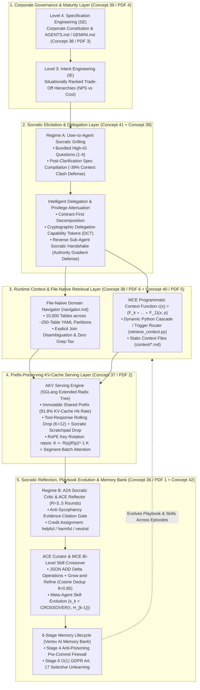
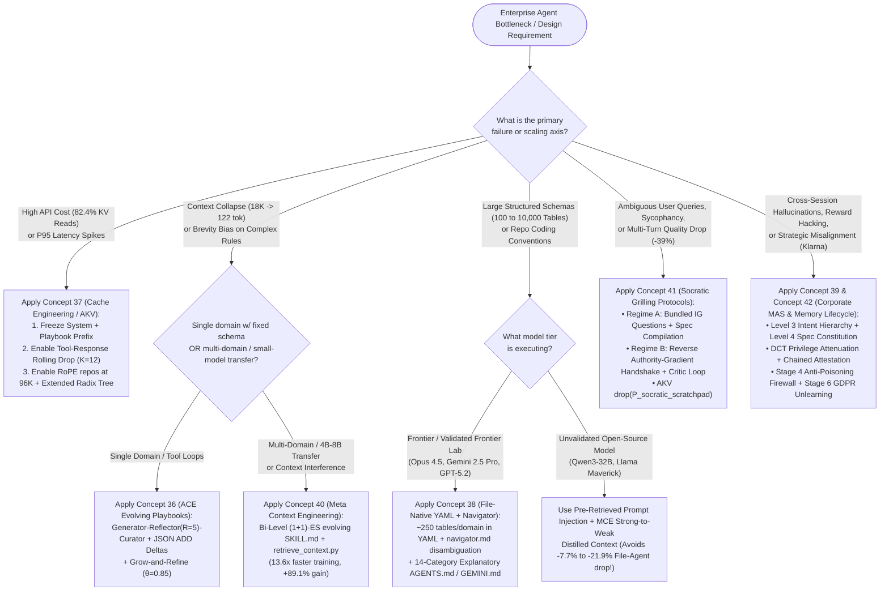

# Architecture Best Practice: Cross-KB Topic Connection & Mermaid Flow Graph — Integrating the 6 Context/Cache/Memory Publications with GEAP L200, L300, and L400 OKF

**Topics:** #topic-connection-graph #knowledge-graph #spanner-graph #cross-kb-ontology #context-engineering #cache-engineering #memory-bank #socratic-grilling #l400-integration #fde-grading-rubric

> **Sources:** Synthesized across `18_OKF_TOPIC_CONNECTION_AND_FLOW_GRAPH.md (L400)`, `GEAP L200/L300 Concepts 00–35`, and the `6 Context, Cache & Memory Research Publications (Concepts 36–44)` · **Corpus:** `GEAPL200` (Unified L200 + L300 + L400 Open Knowledge Format v0.2 · Version `GEAPL200_2026-10-27_183500`) · **Standalone Catalog ID:** `08-context-cache-memory-topic-connection-and-flow-graph` · **Target:** GCP Knowledge Catalog (Dataplex), Cloud Spanner Graph (`arch_guidelines_graph`), & Antigravity Agentic AI Development

---

## Version & 6-Month TTL Governance Tab

| Document ID | Version Tag (Today's Date & Time) | Version Timestamp (PDT) | Time-To-Live (TTL) | Expiration (`stale_after`) | Status |
| :--- | :--- | :--- | :--- | :--- | :--- |
| `43-context-cache-memory-topic-connection-and-flow-graph` | **`GEAPL200_2026-10-27_183500`** (`L400_version_20261027_1835`) | `2026-10-27 18:35:00 PDT` (`2026-10-27T18:35:00-07:00`) | **6 Months** (`180 days` / `P6M`) | `2027-04-27T18:35:00-07:00` | Published / Verified |

### Grounding Research Publications (Local PDF Sources)
- **`PAPER-01-ACE` — [`AGENTIC CONTEXT ENGINEERING- EVOLVING CONTEXTS FOR SELF-IMPROVING LANGUAGE MODELS.pdf`](../AGENTIC%20CONTEXT%20ENGINEERING-%20EVOLVING%20CONTEXTS%20FOR%20SELF-IMPROVING%20LANGUAGE%20MODELS.pdf):** *Agentic Context Engineering: Evolving Contexts for Self-Improving Language Models* — Qizheng Zhang, Changran Hu, Shubhangi Upasani, Boyuan Ma, Fenglu Hong, Vamsidhar Kamanuru, Jay Rainton, Chen Wu, Mengmeng Ji, Hanchen Li, Urmish Thakker, James Zou, Kunle Olukotun (Stanford University, SambaNova Systems, Inc., UC Berkeley; Published as a conference paper at ICLR 2026 (arXiv:2510.04618v3, 29 Mar 2026)). URL: `https://arxiv.org/abs/2510.04618` · Code/Data: `https://github.com/ace-agent/ace`
- **`PAPER-02-AKV` — [`CACHE ENGINEERING FOR AGENTS.pdf`](../CACHE%20ENGINEERING%20FOR%20AGENTS.pdf):** *Cache Engineering for Agents* — Tianyu Fu, Ruoxi Wang, Zihan Min, Zhongqi Ren, Zhihao Li, Tengxuan Liu, Shengxu Mu, Hanling Zhang, Yu Wang (Tsinghua University, The Chinese University of Hong Kong; arXiv Preprint (arXiv:2610.28577v1, 20 Oct 2026)). URL: `https://arxiv.org/abs/2610.28577` · Code/Data: `https://github.com/thu-nics/AKV`
- **`PAPER-03-OSS-CE` — [`Context Engineering for AI Agents in Open-Source Software.pdf`](../Context%20Engineering%20for%20AI%20Agents%20in%20Open-Source%20Software.pdf):** *Context Engineering for AI Agents in Open-Source Software* — Seyedmoein Mohsenimofidi, Matthias Galster, Christoph Treude, Sebastian Baltes (Heidelberg University, University of Bamberg, Singapore Management University; 23rd International Conference on Mining Software Repositories (MSR '26), April 13–14, 2026, Rio de Janeiro, Brazil (arXiv:2510.21413v4, DOI: 10.1145/3793302.3793350)). URL: `https://doi.org/10.1145/3793302.3793350` · Code/Data: `https://doi.org/10.5281/zenodo.17428770`
- **`PAPER-04-CORP-MAS` — [`Context Engineering- From Prompts to Corporate Multi-Agent Architecture.pdf`](../Context%20Engineering-%20From%20Prompts%20to%20Corporate%20Multi-Agent%20Architecture.pdf):** *Context Engineering: From Prompts to Corporate Multi-Agent Architecture* — Vera V. Vishnyakova (Director, Center for Transfer and Management of Socio-Economic Information, HSE University, Moscow; Working Paper / Monograph (March 2026); synthesizing Tomasev et al. (2026, arXiv:2602.11865), Breunig (2025), Deloitte (2026), and KPMG (2026)). URL: `file://./Context%20Engineering-%20From%20Prompts%20to%20Corporate%20Multi-Agent%20Architecture.pdf` · Code/Data: `https://arxiv.org/abs/2602.11865`
- **`PAPER-05-MCE` — [`Meta Context Engineering via Agentic Skill Evolution.pdf`](../Meta%20Context%20Engineering%20via%20Agentic%20Skill%20Evolution.pdf):** *Meta Context Engineering via Agentic Skill Evolution* — Haoran Ye, Xuning He, Vincent Arak, Haonan Dong, Guojie Song (State Key Laboratory of General Artificial Intelligence, School of Intelligence Science and Technology & School of EECS, Peking University; arXiv Preprint (arXiv:2601.21557v2, 11 Feb 2026)). URL: `https://arxiv.org/abs/2601.21557` · Code/Data: `https://github.com/metaevo-ai/meta-context-engineering`
- **`PAPER-06-FILE-NATIVE` — [`Structured Context Engineering for File-Native Agentic Systems.pdf`](../Structured%20Context%20Engineering%20for%20File-Native%20Agentic%20Systems.pdf):** *Structured Context Engineering for File-Native Agentic Systems: Evaluating Schema Accuracy, Format Effectiveness, and Multi-File Navigation at Scale* — Damon McMillan (HxAI Australia; Technical Research Report (2026, 9,649 Experiments across 11 Models, 4 Formats, and 10 to 10,000 Tables)). URL: `file://./Structured%20Context%20Engineering%20for%20File-Native%20Agentic%20Systems.pdf` · Code/Data: `https://toonformat.dev/`

---


## 0. OKF Document Metadata & Topic Modeling Taxonomy
**Topic Tags:** `#L400_version_20261027_1835` `#OKFMetadata` `#CrossKBTopicFlowGraph` `#SpannerPropertyGraph` `#UnifiedOntology` `#ContextCacheMemoryGraph`

| Metadata Field | Value |
| :--- | :--- |
| **OKF Document ID** | `43-context-cache-memory-topic-connection-and-flow-graph` (Standalone Index: `08`) |
| **Primary Literature** | Cross-Corpus Graph Synthesis of `PDF 1 (ACE)`, `PDF 2 (AKV Cache Eng)`, `PDF 3 (OSS AGENTS.md)`, `PDF 4 (Corporate MAS Pyramid)`, `PDF 5 (MCE Skill Evolution)`, `PDF 6 (File-Native 10K Tables)`, `GEAP L200/L300 (00–35)`, and `L400 (A1–O6, 18–21)` |
| **Architectural Domain** | Knowledge Graph Ontology, Spanner Graph GQL Schema, Decision Routing Trees, & Cross-KB Dependency Mapping |
| **Target GCP Runtimes** | Cloud Spanner Graph (`arch_guidelines_graph`), BigQuery (`gea_arch_guidelines_analytics`), Dataplex Universal Catalog (`geapl200-architecture-kb`) |
| **Enforced FDE Standard** | `concepts/00-fde-field-readiness-and-grading-rubric.md` & `OKF-L400-21` (`https://g3doc.corp.google.com/company/teams/cloud-fde/index.md?cl=head`) |

---

## FDE Project Grading Rubric Enforcement & Prevailing Customer Alignment

> **Mandatory Governance Standard:** Every project, prototype, or production agent built using the patterns in this concept **must pass the [Google Cloud FDE Field-Readiness & Project Grading Rubric](/concepts/00-fde-field-readiness-and-grading-rubric.md)** (aligned with the [Cloud FDE Team Charter](https://g3doc.corp.google.com/company/teams/cloud-fde/index.md?cl=head) and `OKF-L400-21`). Scoring Requirement: **Average >= `2.0 (Competent)`** across both **Part A (Presentation & Advisory Rigor)** and **Part B (Engineering & Implementation Excellence)**, with **zero `0 (Not Demonstrated)` scores** on any single metric.

### 1. Part A — Presentation & Advisory Rigor Enforcement for This Concept

- **A.1 Strategic Delivery & Value Articulation:** Enable FDEs and MCP-connected coding agents (`gea-agents-arch-guidelines-mcp-server`) to traverse the entire **45-Concept (`00`..`44`) + 22-Module (`L400`) Knowledge Graph** deterministically—mapping any customer symptom (e.g., *high KV-read API cost*, *multi-turn accuracy drop*, *10,000-table schema navigation*, *Klarna-style NPS erosion*, or *reward hacking*) to its exact mathematical root cause and Google Cloud architectural remediation.
- **A.2 Objection Handling & Technical Defense:** Demonstrate how the **6 Research Papers** are not isolated academic studies, but form a **closed-loop, multi-layer systems architecture** when unified with Google ADK 2.0, Vertex AI Memory Bank, and SGLang/AKV serving.

### 2. Part B — Engineering & Implementation Excellence Cutlines for This Concept

- **B.1.2 & B.4.1 Knowledge Graph & Spanner Graph Integration:** Provide executable **Cloud Spanner Graph DDL (`CREATE PROPERTY GRAPH`)** and **ISO GQL Queries** so the NL2KG pipeline (`okf-gcs-update-spec.md`) can ingest Concepts `36`–`44` into `arch_guidelines_graph` with zero schema friction.

### 3. Prevailing Customer Exemplars & Cross-KB Links

- [Google Cloud FDE Field-Readiness & Project Grading Rubric](/concepts/00-fde-field-readiness-and-grading-rubric.md)
- [Agentic Context Engineering (ACE) — Evolving Playbooks](/concepts/36-agentic-context-engineering-evolving-playbooks.md)
- [Cache Engineering for Agents — Direct KV-Cache Control & AKV](/concepts/37-cache-engineering-kv-prefix-optimization-for-agents.md)
- [Structured File-Native & OSS Context Engineering](/concepts/38-structured-file-native-and-oss-context-engineering.md)
- [Corporate Multi-Agent Context Architecture & 4-Level Maturity Pyramid](/concepts/39-corporate-multi-agent-context-architecture-and-memory-tiers.md)
- [Meta Context Engineering via Agentic Skill Evolution](/concepts/40-meta-context-engineering-and-agentic-skill-evolution.md)
- [Socratic Grilling: User-to-Agent and Agent-to-Agent Protocols](/concepts/41-socratic-grilling-user-to-agent-and-agent-to-agent-protocols.md)
- [Multi-Agent Memory Lifecycle and Context-Rot Prevention](/concepts/42-multi-agent-memory-lifecycle-and-context-rot-prevention.md)
- [FDE Socratic Grilling Rubric & Master Enterprise FAQ Compendium](/concepts/44-fde-socratic-grilling-rubric-and-faq-compendium.md)

---

## 1. Master Cross-KB Synthesis Matrix: 6 Papers $\times$ L200/L300 (`00–35`) $\times$ L400 (`A1–O6`)

| New OKF Concept ID (`36–44`) | Standalone ID (`01–09`) | Primary Research Paper(s) Synthesized | Connected GEAP L200/L300 Concepts (`00–35`) | Connected L400 OKF Modules (`A1–O6`, `18–21`) | Core Architectural Role in Unified Stack |
| :--- | :---: | :--- | :--- | :--- | :--- |
| **`36-agentic-context-engineering-evolving-playbooks`** | `01` | **PDF 1:** *Agentic Context Engineering (ACE)* (Zhang et al., ICLR 2026) | `08` (Stateful CE), `20` (Sessions/Memory), `24` (Memory Bank Deep Dive), `26` (Hill-Climbing) | `B1` (Agent Anatomy), `O3` (Coding Agents), `O6` (AlphaEvolve) | Replaces monolithic prompt rewrites (`Context Collapse`) and terse prompts (`Brevity Bias`) with **Generator-Reflector-Curator** incremental `[ctx-XXXXX]` playbook deltas. |
| **`37-cache-engineering-kv-prefix-optimization-for-agents`** | `02` | **PDF 2:** *Cache Engineering for Agents (`AKV`)* (Fu et al., Tsinghua/CUHK 2026) | `08` (Stateful CE), `24` (Context Compaction), `28` (Cost Estimation & FinOps) | `O3` (Coding Agents), `O4` (Cost/Token Optimization), `A1` (Overall Arch) | Decouples active KV cache $\mathcal{C}$ from logical trajectory $x_{1:t}$ via `append`, `drop`, and RoPE `repos` on an **Extended Radix Tree** (`-27.7%` cost, `1.51x` P95 speedup). |
| **`38-structured-file-native-and-oss-context-engineering`** | `03` | **PDF 6:** *File-Native Agentic Systems* (McMillan, 2026) & **PDF 3:** *OSS Context Engineering* (Mohsenimofidi et al., MSR '26) | `07` & `14` (Agent Skills), `13` (Spec-Driven Dev), `16` (New SDLC w/ Vibe Coding) | `B3` (Skills Registry), `O3` (Coding Agents), `20` (Cross-KB Best Practices) | Scales file-native retrieval to **10,000 tables** via `~250`-table YAML domain partitions + `navigator.md`, eliminates the **Grep Tax**, and standardizes 14-category `AGENTS.md`/`GEMINI.md` files. |
| **`39-corporate-multi-agent-context-architecture-and-memory-tiers`** | `04` | **PDF 4:** *From Prompts to Corporate Multi-Agent Architecture* (Vishnyakova, 2026; Tomasev et al., 2026; Breunig, 2025) | `03` (Protocol Stack), `06` (Multi-Agent MCP), `09` (State Mgmt), `21` (Multi-Agent ADK), `35` (Agent Gateway/Registry) | `B1` (Agent Anatomy), `B2` (A2A Mechanics), `G1` (Zero Trust), `G2` (Prod Scale), `G3` (Governance) | Establishes the **4-Level Maturity Pyramid (`PE -> CE -> IE -> SE`)**, **5 Context Quality Criteria**, **Intelligent Delegation (`DCT` + Attestation)**, and **4 Federated Memory Tiers**. |
| **`40-meta-context-engineering-and-agentic-skill-evolution`** | `05` | **PDF 5:** *Meta Context Engineering (`MCE`)* (Ye et al., Peking Univ 2026) | `07` & `14` (Agent Skills), `25` (Evaluate Agents), `26` (Hill-Climbing), `27` (Model Upgrades) | `B3` (Agent Skills & Registry), `O1` (Autoraters), `O6` (AlphaEvolve) | Bi-level `(1+1)-ES` optimization where a Meta-Agent evolves `SKILL.md` via **Agentic Crossover** and a Base-Agent writes `context/*.md` + `retrieve_context.py` (`+89.1%` gain, `13.6x` speedup). |
| **`41-socratic-grilling-user-to-agent-and-agent-to-agent-protocols`** | `06` | **Cross-Paper Synthesis:** `PDF 1` (Reflector), `PDF 2` (AKV Scratchpad), `PDF 4` (Authority Gradient & Clash), `PDF 5` (5-Gate Audit), `PDF 6` (Disambiguation) | `01` & `12` (Agent Quality), `13` (Spec-Driven Dev), `21` (Multi-Agent ADK), `25` (Evaluation) | `B2` (A2A Protocol), `O1` (Autoraters), `O2` (Troubleshooting), `21` (FDE Rubric) | Formalizes **User-to-Agent Socratic Discovery** (`-39%` Context Clash defense) and **Agent-to-Agent (`A2A`) Socratic Grilling** with Anti-Sycophancy Guardrails and **AKV Scratchpad Drop**. |
| **`42-multi-agent-memory-lifecycle-and-context-rot-prevention`** | `07` | **Cross-Paper Synthesis:** `Breunig (2025)`, `PDF 1–6`, and `GEAP L300 (08, 20, 23, 24)` | `08` (Stateful CE), `20` (Sessions/Memory), `23` (Context Persistence), `24` (Memory Bank Deep Dive), `33` (Model Armor) | `B1` (Context Perimeter), `G1` (Identity/IAM), `G3` (Governance), `O4` (Cost) | Unifies the **6-Stage Memory Lifecycle**, **7 Degradation Defenses**, **Pre-Commit Anti-Poisoning Firewall**, and **GDPR Art. 17 $O(1)$ Selective Unlearning**. |
| **`43-context-cache-memory-topic-connection-and-flow-graph`** | `08` | **Cross-KB Graph Architecture:** All 6 Papers + `GEAP L200/L300` + `L400` | `00`–`35` (Full GEAP Catalog) | `00`, `18` (Topic Flow Graph), `20` (Cross-KB Use Cases) | Provides the **Master Mermaid Architecture Graphs**, **Diagnostic Routing Tree**, and **Cloud Spanner Property Graph Schema**. |
| **`44-fde-socratic-grilling-rubric-and-faq-compendium`** | `09` | **Cross-KB Assessment & FAQ Synthesis:** All 6 Papers + `00` + `19` + `21` | `00` (FDE Field-Readiness Rubric), `25` (Evaluation), `28` (Cost/FinOps) | `19` (Master Enterprise FAQ), `21` (Enforceable FDE Rubric Standard) | Codifies the **0–3 FDE Socratic Grilling Rubric**, **Master Quantitative Equation Reference**, and **20 L100–L400 Socratic Grilling Q&As**. |

---

## 2. Master Architectural Flow Graph: How the 6 Papers & Socratic Protocols Interlock



---

## 3. FDE Diagnostic Decision Tree: Selecting the Right Context, Cache & Memory Pattern



---

## 4. Cloud Spanner Property Graph Schema (`arch_guidelines_graph`) for Concepts `36–44`

To support automated NL2KG ingestion into **Cloud Spanner Graph** (`fivedaysai-prd-sandbox-317383`, instance `gea-arch-graph`, database `arch_guidelines_graph`) per `okf-gcs-update-spec.md`, the following DDL and GQL query patterns bind Concepts `36`–`44` into the existing L200/L300/L400 graph:

```sql
-- Cloud Spanner Graph DDL Extension for Context, Cache, Memory & Socratic Grilling Nodes
CREATE TABLE IF NOT EXISTS OkfDegradationMode (
  degradation_id STRING(64) NOT NULL,
  name STRING(128) NOT NULL,
  empirical_impact STRING(512),
  source_paper STRING(256),
  PRIMARY KEY (degradation_id)
);

CREATE TABLE IF NOT EXISTS OkfMitigationEdge (
  concept_id STRING(128) NOT NULL,
  degradation_id STRING(64) NOT NULL,
  mechanism STRING(512) NOT NULL,
  quantified_gain STRING(256),
  PRIMARY KEY (concept_id, degradation_id),
  CONSTRAINT FK_Concept FOREIGN KEY (concept_id) REFERENCES OkfConcept (document_id),
  CONSTRAINT FK_Degradation FOREIGN KEY (degradation_id) REFERENCES OkfDegradationMode (degradation_id)
);

CREATE OR REPLACE PROPERTY GRAPH arch_guidelines_graph
  NODE TABLES (
    OkfConcept KEY (document_id) LABEL Concept,
    OkfDegradationMode KEY (degradation_id) LABEL DegradationMode
  )
  EDGE TABLES (
    OkfMitigationEdge
      KEY (concept_id, degradation_id)
      SOURCE KEY (concept_id) REFERENCES OkfConcept (document_id)
      DESTINATION KEY (degradation_id) REFERENCES OkfDegradationMode (degradation_id)
      LABEL MITIGATES
  );
```

---

## 5. Socratic FDE Field-Readiness & Customer Grilling Questions (L100–L400)

### Q1 (L300 — Cross-KB Architectural Synthesis): *"An enterprise customer is building a 10,000-table BigQuery financial analyst agent on Gemini Enterprise. They need it to clarify ambiguous accounting questions with the user, verify its SQL and XBRL tags before answering, learn from mistakes over time without context collapse, and keep P95 latency and API token costs low. How do Concepts 36 through 42 fit together in a single request lifecycle?"*
- **Model Answer (Score 3 — Proficient):**
  1. **Governance & Intent (`Concept 39`):** The orchestrator loads the immutable prefix containing the **Level 4 Corporate Specification** (`GEMINI.md`) and **Level 3 Intent Hierarchy** (accuracy & auditability > speed).
  2. **User-Facing Socratic Discovery (`Concept 41`, Regime A):** If the user's accounting query has referential or join-path ambiguity, the agent emits a single structured Socratic question card (`1–3` high-IG options), compiles the user's answer into a **Canonical Specification Block**, and drops the raw clarification turns to prevent the **`-39%` Context Clash drop**.
  3. **File-Native Schema & Skill Routing (`Concept 38` & `Concept 40`):** Using `Gemini 2.5 Pro` (`85.1%` overall, `74.0%` L5 SQL accuracy), the agent reads `navigator.md`, routes to the relevant `~250`-table YAML domain partition (`12,729` avg tokens, avoiding the `+38%` TOON / `+60%` Markdown Grep Tax), and executes MCE's `retrieve_context.py` to pull disambiguation rules for the relevant US GAAP XBRL tags (`FiNER` / `Formula`).
  4. **A2A Socratic Verification & AKV Cache Control (`Concept 41` Regime B + `Concept 37`):** The Generator drafts the SQL/XBRL analysis; a Socratic Critic verifies the query against execution feedback (`R <= 5` rounds). Once verified, **AKV** executes `drop(P_socratic_scratchpad)` and `Tool-Response Rolling Drop ($K=12$)` + `repos`, preserving **91.8% prefix KV-cache reuse** (`-82.6%` billed input cost) and **`1.51x` faster P95 latency**.
  5. **Playbook & Memory Lifecycle (`Concept 36` & `Concept 42`):** In `after_agent_callback`, the **Stage 4 Anti-Poisoning Firewall** verifies the cryptographic attestation signature before committing episodic facts to **Vertex AI Memory Bank**, while the **ACE Curator** emits a compact JSON `ADD` delta (`[ctx-XXXXX]`) merged deterministically via **Grow-and-Refine** (`cosine_similarity >= 0.85`), preventing **Context Collapse** (`18,282 -> 122` tokens).